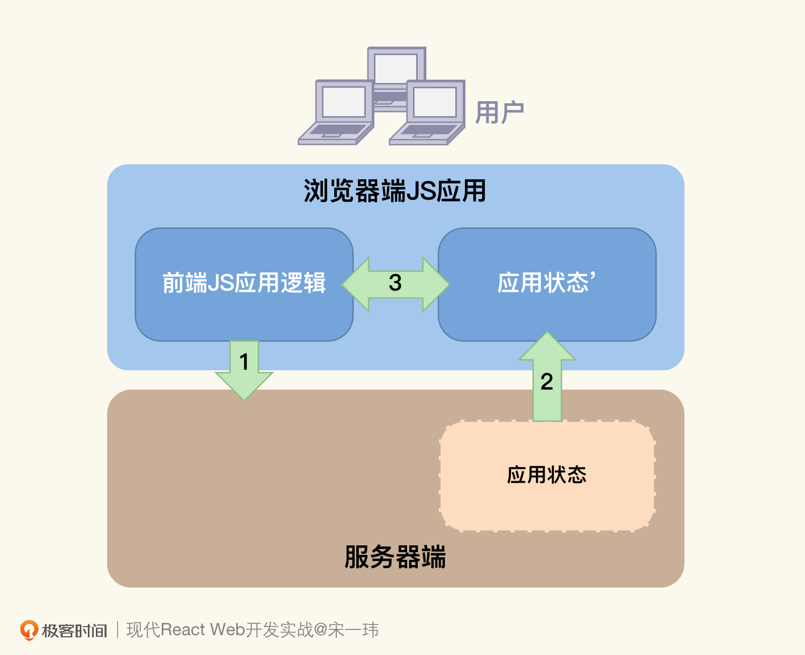
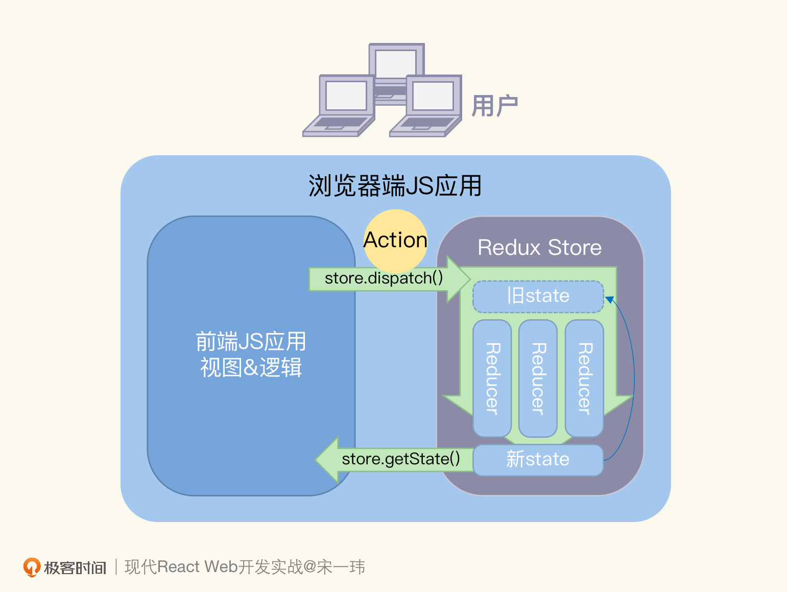
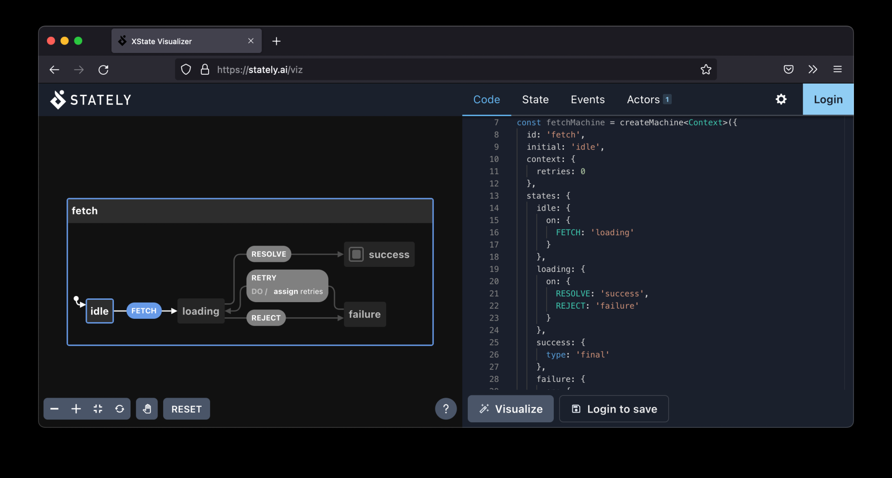

# 16 | 应用状态管理（上）：应用状态管理框架Redux

你好，我是宋一玮，欢迎回到 React 应用开发的学习。

上节课我们学习了不可变数据，了解了不可变数据对 React 的重要意义，然后学习了用

```
React.memo 创建具有更佳性能的纯组件。最后介绍了在 JS 中实现不可变数据的几种方式，
除了我们在oh-my-kanban 中的手工实现，还有 Immutable.js 和 Immer 这些开源框架。
```

接下来我们会用两节课的时间，学习 React 的应用状态管理。你也许已经胸有成竹了：“应用

```
状态，不就是 useState 吗？已经很熟悉啦。”
```

很高兴你有这份自信，不过我们上面提到的应用状态管理的学习，是一个概念到框架再到具体案例的过程。首先应用状态管理是一个前端领域的概念，这节课我们会先来看看它是解决什么问题的，然后来学习目前仍然最流行的应用状态管理框架 Redux，了解它的用法和设计思想。

这里也提前做个小预告，在下节课我们会进一步讨论什么情况下使用 React 的 state，什么情况下使用 Redux，并举一些实际的例子。

下面开始这节课的内容。

## 什么是应用状态管理？

我们先看应用状态（Application State）。理论上，一个应用在运行的时候内存里所有跟它有关的数据都可以称作是应用状态，但实际上，这远远超出了应用开发者需要关注的范围。

我们姑且可以类比一下后端服务：有状态服务（Stateful Service）和无状态服务（StatelessService）常被一起提及。

比如一个购物车 HTTP 服务，在服务器端临时保存了当前登录用户的 session 信息，用户先后两次请求都会读写这个 session，那这个 HTTP 服务就是有状态服务；另一个商品列表 HTTP服务，并不关心用户是否登录，仅凭用户发过来的 HTTP 请求里包含的参数就可以完成工作，把结果作为 HTTP 响应返回给用户，那么它就是无状态服务。

这两个服务相减，得出“服务器端临时保存的登录用户的 session 信息”就是我们需要关注的应用状态（至于 session 保存在内存里还是数据库里，我们这里暂时不讨论）。

越是“富 JS”的浏览器端应用，越是倾向于把服务器端的应用状态转移到浏览器端。于是就有了“浏览器端临时保存的登录用户的 session 信息”，这样提供给前端 JS 使用的应用状态。



如果不这样做呢？这里我们再举个反例。

比如对一个简单的对话框来说，决定它是否显示的是一个布尔值状态。如果把这个状态保存在服务器端，意味着每次弹出和关闭对话框都要去调用后端服务，这比在浏览器端保存状态要重得多。

从用户体验看，用户开关对话框都要等服务器响应，体验是比较差的。从前端开发角度看，开关对话框本来可以是一个同步的本地逻辑，却非要实现成异步的服务器请求，增加了复杂性。你可能会有疑惑：“真有框架会这样做吗？”有啊，当年的 JSF 就是。

React 这样由数据驱动的前端框架，更是依赖浏览器本地的应用状态。

当开发本地状态越来越复杂，复杂到需要一层专门的抽象时，就出现了应用状态管理框架，来管理这些应用状态。

## 应用状态管理框架 Redux

在 React 技术社区中，提到应用状态管理框架，一定会先提到 Redux。Redux 是一个用于 JS应用的、可预测的状态容器。它并不是 React 专用，你也可以在 Vue 或 Svelte 应用中使用Redux。

你可以在任何一个 JS 项目中安装 Redux：

```
npm install redux
我们先看一段为 cardList 写的样例代码：
```

```python
import { createStore } from 'redux';
function cardListReducer(state = [], action) {
 switch (action.type) {
   case 'card/add':
     return [action.newCard, ...state];
   case 'card/remove':
     return state.filter(card => card.title !== action.title);
   default:
     return state;
 }
}
const store = createStore(cardListReducer);
store.subscribe(() => console.log(store.getState()));
store.dispatch({ type: 'card/add', newCard: { title: '开发任务-1' } });
// [{ title: '开发任务-1' }]
store.dispatch({ type: 'card/add', newCard: { title: '测试任务-2' } });
// [{ title: '测试任务-2' }, { title: '开发任务-1' }]
store.dispatch({ type: 'card/remove', title: '开发任务-1' });
// [{ title: '测试任务-2' }]
你一下子看到了有点熟悉的名称： reducer 、 action 、 dispatch ，好嘛，这不就是
第 9 节课讲到的，状态 Hooks 之一的 useReducer 吗？是的，你没看错，之所以这么像，原
```

因之一是 Redux 的两位原作者，都加入了 React 核心团队。

```
上面这段代码的核心概念是 store 即存储。在用 Redux 的 createStore API 创建 store
时指定 reducer 归约器函数，然后调用 store.subscribe() 方法订阅  store 的变化，
store.getState() 可以取得最新的状态数据。然后调用  store.dispatch()  方法派发
action 动作， reducer 会根据 action 中的 type 字段决定动作的类型，然后返回新的
状态用于更新store 。
```

### Redux 的核心概念和设计思想

刚才已经提到了 Redux 几个重要概念，这里再稍作介绍：

```
动作 action ：一个具有 type 属性的简单 JS 对象，用于表达一种意图或是事件；
归约器 reducer ：一个纯函数，接收当前状态和 action 作为参数，根据 action 不
```

- 同，返回与不同变更过程相当的新状态；

```
存储 store ：应用状态的容器，通过 reducer 返回的初始值创建，可以通过
store.getState() 返回最新的状态，也可以通过store.dispatch() 方法派发
action ，接受外部使用者订阅状态的变化。
```

Redux 用上面这些概念，实现了一套单向数据流（Unidirectional Data Flow）。



这里也有必要强调 Redux 的三个基本原则：

- 单一事实来源（Single Source Of Truth）。Redux 全局只有一个 store，里面包含了唯一的状态对象树；

- 状态只读。这就是在强调状态的不可变性，只有通过派发 action 的方式才能触发 reducer，返回一个包含变更的新状态；

- 状态变更不应有副作用。在 store 中使用的 reducer，都必须是不会产生副作用的纯函数（Pure Function）。

这三个基本原则保证了 Redux 管理的应用状态是可预测的。

### Redux Toolkit

也许你听到过这样的评价：“使用 Redux 框架会导致代码冗长、啰嗦（verbose）。”我的建议是，不用纠结，只要想清楚你想从 Redux 中得到什么收益，也许这个收益足以抵消掉啰嗦带来的痛点。

一个好消息是，Redux 官方已经推出了一套更易于使用的封装库 Redux Toolkit，来简化Redux 开发：

- 降低了配置 Redux store 的复杂度；

- 减少了 Redux 所需的样板代码；

- 内置了 Redux 必备的扩展库。

依旧在任何 JS 项目中都可以安装 Redux Toolkit，Redux Toolkit 里已经内置了 Redux，不用重复安装：

```
npm uninstall redux
npm install @reduxjs/toolkit
```

以下是用 Redux Toolkit 改写的前面 Redux 的代码：

```bash
import { createSlice, configureStore } from '@reduxjs/toolkit';
const cardListSlice = createSlice({
 name: 'cardList',
 initialState: [],
 reducers: {
   addCard(state, action) {
     state.unshift(action.payload.newCard);
   },
   removeCard(state, action) {
     const index = state.findIndex(card => card.title === action.payload.title);
     if (index !== -1) {
       state.splice(index, 1);
     }
   },
 },
});
export const { addCard, removeCard } = cardListSlice.actions;
const store = configureStore({
 reducer: cardListSlice.reducer
});
store.subscribe(() => console.log(store.getState()));
store.dispatch(addCard({ newCard: { title: '开发任务-1' } }));
// [{ title: '开发任务-1' }]
store.dispatch(addCard({ newCard: { title: '测试任务-2' } }));
// [{ title: '测试任务-2' }, { title: '开发任务-1' }]
store.dispatch(removeCard({ title: '开发任务-1' }));
// [{ title: '测试任务-2' }]
```

我猜你会过来吐槽：“前面 Redux 的样例代码是 745B，这个 Redux Toolkit 的样例代码是953B，代码怎么反而变多了？”

虽然场面有点尴尬，但请放心，从我实际开发经验来看，在项目规模增大时，后者比前者减少的代码量非常可观。顺便提一下，在写 Redux 代码时，为成堆的 action.type 起名字很容易导致决策疲劳，而用 Redux Toolkit 来写会好很多。

```
Redux Toolkit 新引入了一个概念 slice ，即切片。切片是一组相关的 state 默认值、
action 、 reducer 的集合。
```

```
首先用 Redux Toolkit 的 createSlice API 创建 slice ，然后从这个 slice 中拿到生成的
actionCreator 和 reducer ，用 configureStore  API 消费这个 reducer 创建
store 。接下来的步骤就与前面 Redux 的例子类似了，有一点区别是这边用于派发的
action 都是调用 actionCreator 创建的。
如果你的眼睛够尖，也许你已经发现了：“ reducer 函数的写法怎么不一样了？之前是返回
新 state，现在又退回了最早的 Array.unshift() ？”
这只是表象，其实 Redux Toolkit 的 reducer 中默认启用了 Immer，也就是上节课刚学习使
```

用的不可变数据框架。

- 它可以让 JS 开发者使用原生的 JS 数据结构，和本来不具有不可变性的 JS API，创建和操作不可变数据。

```
这就是说，我们在 Redux Toolkit 中创建的 reducer ，可以直接用熟悉的 JS API 来修改状
```

态，框架会帮我们加入 state 的不可变性。

除此之外，Redux Toolkit 还有不少重要的功能，尤其是包括获取远程数据相关的状态管理，我们会在下节课和后面的课程中陆续涉及。

## 其他应用状态管理框架

当然，Redux 也不是应用状态管理领域的唯一玩家，同样被广泛使用的还有 MobX、XState等框架，下面我们来简要介绍一下。

### MobX

MobX 是以透明的函数式响应编程（Transparent Functional Reactive Programming，TFRP）的方式，实现状态管理。以下是来自 MobX 官方文档的样例代码：

```xml
import React from "react"
import ReactDOM from "react-dom"
import { makeAutoObservable } from "mobx"
import { observer } from "mobx-react"
// 对应用状态进行建模。
class Timer {
   secondsPassed = 0
   constructor() {
       makeAutoObservable(this)
   }
   increase() {
       this.secondsPassed += 1
   }
   reset() {
       this.secondsPassed = 0
   }
}
const myTimer = new Timer()
// 构建一个使用 observable 状态的“用户界面”。
const TimerView = observer(({ timer }) => (
   <button onClick={() => timer.reset()}>已过秒数：{timer.secondsPassed}</button>
))
ReactDOM.render(<TimerView timer={myTimer} />, document.body)
// 每秒更新一次‘已过秒数：X’中的文本。
setInterval(() => {
   myTimer.increase()
}, 1000)
```

如果你是先上手 Immer，之后才接触 MobX 的话，会发现它们的思路很像，都鼓励你用熟悉的 JS 类型和方法修改数据，由框架来界定前后的变更。这并不意外，因为 MobX（官网）跟前面用到的 Immer 框架是同一个作者，MobX 比 Immer 还早面世 3 年。

### XState

这个 XState 框架比起 Redux 和 MobX 来说更加硬核一些。它本身就是一个有限状态机（维基百科）的 JS/TS 实现，且遵守了W3C 的 XCXML 规范。以下是来自 XState 官方Github，在 React 中使用 XState 的样例代码：

```bash
import { useMachine } from '@xstate/react';
import { createMachine } from 'xstate';
const toggleMachine = createMachine({
 id: 'toggle',
 initial: 'inactive',
 states: {
   inactive: {
     on: { TOGGLE: 'active' }
   },
   active: {
     on: { TOGGLE: 'inactive' }
   }
 }
});
export const Toggler = () => {
 const [state, send] = useMachine(toggleMachine);
 return (
   <button onClick={() => send('TOGGLE')}>
     {state.value === 'inactive'
       ? 'Click to activate'
       : 'Active! Click to deactivate'}
   </button>
 );
};
```

XState 还有一个强项，就是它可视化的状态图：



可惜我自己还没有机会在生产项目中使用 XState，如果你曾经用过，欢迎你在留言区分享你的经验。

## 小结

这节课我们学习了应用状态对于 JS 前端应用的重要意义，也学习了以 Redux 为代表的应用状

```
态管理框架，介绍了 Redux 的核心概念 action 、 reducer 、 store ，以及它单向数据
```

流的本质。

从使用角度，我们介绍了 Redux 封装库 Redux Toolkit 的用法，强调了它对 Redux 开发中

```
action 、 reducer 和不可变数据的简化。最后我们也简要介绍了另外两个应用状态管理框
```

架 MobX 和 XState，希望能帮到你拓宽思路。

下节课，我们会把 Redux 与 React 结合起来使用，看看它能为 React 的状态管理带来什么好处，同时会要探讨什么时候该用 Redux，什么时候用 React 内建的 state 就好。

## 思考题

```
这节课我们提到过 Redux 的 action 、 reducer 、 dispatch 概念，与前面第 9 节课
学过的 useReducer 很类似。那么单就这节课学到的内容，可以请你把 Redux 和
useReducer 做个对比吗？
```

2. Redux 一直在强调自己管理的状态是可预测的，那么可预测这件事本身，对我们的应用开发有什么好处吗？

好的，这节课就到这里，我们下节课再见。
