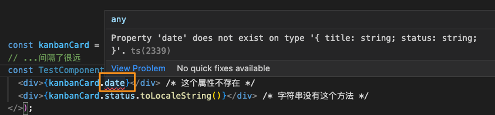
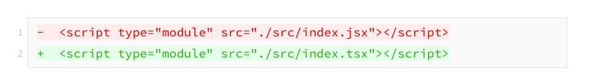

# 18 | 数据类型：活用TypeScript做类型检查

你好，我是宋一玮，欢迎回到 React 应用开发的学习。

在前面两节课里，我们学习了应用状态管理的概念和代表性框架 Redux，以及 Redux 的封装库 Redux Toolkit + React Redux 的用法。

同时，我们也分析了 React 应用中的三种状态：业务状态、交互状态和外部状态，以及从数据流层面区分的全局状态和局部状态。最后根据这些分类，我们对 React 项目什么时候使用Redux，什么时候混用 React 内建 state 和 Redux 提出了一些建议。

当 React 应用中的状态越来越多，越来越复杂时，你有可能遇到这样的痛点：

- 通过 props、context 传递状态数据时，时不时会用错数据的类型导致 Bug；

- 把自己开发的组件给别人用，别人不知道你的组件 props 的数据类型；

- 当你用别人开发的组件时，虽然有文档，但你发现已经跟现在的版本对不上了；

- 当你去自己一个月前写的组件里修 Bug 时，实在记不清了，要读上下游的代码或者在浏览器中设断点调试，才能判断出某个 props 的数据类型。

这些痛点归根结底都是因为 JavaScript 是弱类型的语言，变量类型在运行时才能确定，在开发阶段无法指定变量类型。在大中型 React 项目中，引入类型系统是十分必要的。

这节课我们会学习如何活用 TypeScript，在 React 应用中加入数据类型检查。

## 为什么要用 TypeScript？

如果缺少类型定义，会导致什么问题？我们看一个例子：

```xml
const kanbanCard = { title: '开发任务-1', status: new Date().toString() };
// ...间隔了很远
const TestComponent = (<>
 <div>{kanbanCard.date}</div> /* 这个属性不存在 */
 <div>{kanbanCard.status.toLocaleString()}</div> /* 字符串没有这个方法 */
</>);
// ...
kanbanCard.step = 'ongoing'; /* 也许是临时起意加入这个属性 */
// ...又隔了很远
kanbanCard.stop = 'done'; /* 不小心拼错了属性名 */
// ...又隔了很远
if (kanbanCard.step === 'done') {} /* 因为前面拼错了，这里会一直为false */
// ...
const ongoingList = [kanbanCard];
// ...又隔了很远
ongoingList.push({
 cardTitle: '测试任务-2', /* 这个属性名与数组中其他成员不一致 */
 status: new Date().toString()
});
// ...又隔了很远
const TestComponent2 = ongoingList.map(({ title, status }) => (
 <div key={title}>{title} {status}</div> /* 会有一张卡片的标题没有显示 */
));
```

在这段例子代码中，我们列举了几种常见的与类型有关的编程错误，包括：

- 尝试读取变量中并不存在的属性；

- 用错了变量的类型；

- 随意为对象添加属性；

- 在数组中添加形状不一致的对象。

为源码引入类型系统就可以避免大部分这样的错误。目前 JS 技术社区中最流行也最强大的类型系统是由 TypeScript 提供的。

TypeScript（以下简称 TS）是微软推出一款基于 JavaScript 的强类型编程语言（官网）。TS 语法是 JS 的超集，可以编译成 JS 在浏览器等环境中执行。

使用 TS 进行开发，开发者可以为变量加入类型定义，TS 也会为没有类型的代码做类型推断。IDE 会根据类型作出代码检查和代码提示，在编译成 JS 的过程中，TSC 编译器会再次检查代码中的类型，当检查到不合格的代码 TSC 会抛错。如果检查都通过了，在成功生成的 JS中，类型信息会被剔除掉。

还是上面那段代码，当有了 TS 的加持后，VSCode 的内建 TS Language Server 会为我们实时检查 TS 代码，指出其中的错误，如下图：



其实这时我们还没有显式地为代码加入类型定义，TS 强大的类型推断起了作用。如果这样修改一下上面的代码，它会更加健壮，相关的代码自动补全也会更好用：

```javascript
type CardType = {
 title: string,
 status: string,
 step?: string
};
const kanbanCard: CardType = {/* ... */};
// ...
const ongoingList: Array<CardType> = [];
// ...
```

除了在 IDE 中，前面提示的编程错误在 TS 编译阶段也会再报出来。

## 为 React 项目加入 TypeScript 支持

### Create-React-App 项目

如果是全新的 React 项目，可以利用 Create React App 内置的 TypeScript 项目模版，创建支持 TypeScript 的 React 项目：

```
npx create-react-app my-ts-app --template typescript
如果是现有的 CRA 项目，比如 oh-my-kanban ，你可以直接安装 TS 依赖，CRA 会自适
```

应：

```
npm install -D typescript @types/node @types/react @types/react-dom @types/jest
但还有一个非常 tricky 的步骤，项目根目录必须要有 TS 的配置文件 tsconfig.json ，
```

CRA 在启动时才会认为这是一个 TS 项目，否则会出现一些导入导出模块的问题。

```
tsconfig.json  用最少内容即可：
{
 "compilerOptions": {
   "esModuleInterop": true,
   "jsx": "react-jsx"
 }
}
这时只要把 src/index.js 改成 src/index.tsx 就可以开始 TS 编程了。
```

### Vite React 项目

```
当然，我没忘了你在第 14 节课的作品， yeah-my-kanban 项目，它在 Vite 项目中加入
```

TS 支持也很方便：

```
npm install -D typescript @types/node @types/react @types/react-dom @types/jest
然后把src/index.jsx 改成 src/index.tsx ，再把入口 HTML 的 <script> 指向的文
```

件改一下就可以开始 TS 编程了：



其实也能看出来，TS 是允许与 JS 混用的，所以你可以采取“渐进式增强”的方式，将项目中的JS 代码改写为 TS 代码，某些 JS 代码就算一直保留着也没关系。

## React 项目中的 TypeScript 用法

需要先声明一下，这个专栏的主题是 React 应用开发，所以在这里，我们并不会系统介绍TypeScript 语言，TS 的特性、语法、内建类型等，如果你有需要，可以参考 TypeScript官网上的手册，或者是其他书籍、课程。

我们这节课会聚焦在 React 项目中典型的 TS 语句，包括函数组件签名、Hooks 等。

### 函数组件与 props 类型

```bash
这里姑且以 oh-my-kanban 为例。由于看板卡片的数据在多处被反复使用，所以先放一个公
共的类型 TS 文件 src/types/KanbanCard.types.ts ：
export type KanbanCardType = {
 title: string;
 status: string;
};
然后在 src/KanbanColumn.tsx 中导入它，我们为 KanbanColumn 组件的属性集类型取了一
个简单粗暴的名字 KanbanColumnProps ，把目前每个 prop 的数据类型都定义好；函数
```

KanbanColumn 又得折腾回一个独立的变量，给这个变量加上 React 包内置的函数组件类型

```
React.FC ， FC 后面的 <KanbanColumnProps> 是代表 props 类型的范型，这就表示这
个变量是一个输入为 KanbanColumnProps 类型、输出为 React 元素的函数组件。
```

最后我们再默认导出这个变量：

```bash
import { KanbanCardType } from './types/KanbanCard.types';
// ...
type KanbanColumnProps = {
 bgColor: string;
 canAddNew?: boolean;
 cardList?: Array<KanbanCardType>;
 onAdd?: (newCard: KanbanCardType) => void;
 onDrop?: React.DragEventHandler<HTMLElement>;
 onRemove?: (cardToDel: KanbanCardType) => void;
 setDraggedItem?: (card: KanbanCardType) => void;
 setIsDragSource?: (isDragSource: boolean) => void;
 setIsDragTarget?: (isDragTarget: boolean) => void;
 title: string;
};
const KanbanColumn: React.FC<KanbanColumnProps> = ({
 bgColor,
 canAddNew = false,
 cardList = [],
 onAdd,
 onDrop,
 onRemove,
 setDraggedItem,
 setIsDragSource = () => {},
 setIsDragTarget = () => {},
 title
}) => {
 // ...
};
export default KanbanColumn;
这里这节课的第一个“决策疲劳”点出现了。上面代码中把 KanbanColumnProps 声明为 TS
中的 type 类型，但其实完全也可以声明为 TS 中的 interface 接口，从功能上基本没有区
```

别，只有两个功能例外：

```javascript
type 可以作为联合 Union 类型的别名，但 interface 不可以；
type Pet = Cat | Dog; // 可以
interface IPet extends Cat | Dog {} // 不可以，会抛错
interface 可以重复声明（Redeclaration），但 type 不可以：
interface ICat {
 age: number
}
interface ICat {
 color: string
} // 可以，会合并
const cat: ICat = { age: 4, color: 'silver shaded' };
type Cat = { age: number };
type Cat = { color: string }; // 不可以，会抛错
```

这两种没有对错之分。由于上面两个区别，越是希望组件的设计开发更封闭一些，越倾向于用

```
type ，越是认为组件需要更开放更灵活，越倾向于 interface 。
在 React 技术社区里， type 和 interface 两个流派都有大量忠实的追随者，开源组件库
中用 interface 声明组件 props 的情况更多些。就我自己而言，没什么特别想法时会首选
type 。
```

### Hooks 类型

```javascript
其中 useState 比较简单， useState 函数在 TS 中会接受一个范型参数 <S> ，这样返回
的 state 类型就是 S ，对应的 state 更新函数能接受的参数类型也是 S （或者回调方式中的输
入输出都是 S 类型）：
const [showAdd, setShowAdd] = useState<boolean>(false);
const [todoList, setTodoList] = useState<Array<KanbanCardType>>([]);
对于useEffect 来说，没有需要标记的类型。
useContext 需要在创建 context 时指定类型。用 oh-my-kanban 唯一的 context 举例，先
将 src/context/AdminContext.js 更名为 src/context/AdminContext.ts ，然后
在 React.createContext 方法上传入范型参数 <T> ，这样 AdminContext.Provider
中的 value  prop 类型就是 T ，在 useContext(AdminContext) 返回的值也是 T ：
const AdminContext = React.createContext<boolean>(false);
```

其他 Hooks 请参考官方文档，这里不再赘述。

### 在 React 项目中使用 TS 的一些建议

有一种说法是，用 TS 开发项目需要学做“类型体操”，在我听来这种说法多少有些泛娱乐化了。

确实，TS 在提供 JS 编程能力的基础上，还提供了一套强大的类型编程能力（甚至有人在尝试证明 TS 的类型编程能力是图灵完备的）。开发者用 TS 编程时，既可以为业务而编程，也可以为类型而编程。为业务编程自然是为了实现业务目标，那为类型编程是为了什么呢？是为了业务代码的类型更健壮。所以两者的终极目标其实是一致的，都是开发出质量更高、可维护性更强的 JS 应用。

但从上面的学习中我们也知道了，TS 是在应用的开发期和编译期产生效果的，能帮开发者减少编程错误，但对运行时没有直接帮助。我们从实际出发，随着为源码加入的类型越来越多，越来越完整，“加类型”这件事本身的边际效应是递减的。

- 边际效用递减原理（Principle of Diminishing Marginal Utility）是个经济学概念，通俗的说法是：开始的时候，收益值很高，越到后来，收益值就越少。

所以我们有必要时不时地，在当前 React 项目对强类型的需求程度，还有我们投入开发的时间精力之间取个平衡。此外，我也认为越是公共的、被重用的组件或模块，越值得多在类型开发上投入资源。

从学习来看，虽然跟 JS 同根同源，TS 毕竟还是门编程语言，学习曲线还是存在的。从这个专栏的立场来说，我比较希望你根据目前 React 应用开发的学习进度，先学习 TS 中对 React开发有直接帮助的部分，等具有一定基础了，再以渐进的方式来学习 TS。

## React 数据类型检查的其他可选方案

其实在 TypeScript 成为主流之前，React 项目的数据类型检查还有一些其他可选方案，包括：

1. PropTypes

它曾内置于 React 框架中，为开发者提供一套 DSL 来定义 props 数据结构，在开发模式下运行 React 应用，React 会检查 props 数据，如果不符合定义就在控制台抛 warning；而在生产模式下，props 检查功能会自动关闭，以提升应用执行效率。

后来从 React v15.5 版本开始，PropTypes 被移到了一个独立的NPM 包，以下是来自React 官网的样例代码：

```bash
import PropTypes from 'prop-types'
function HelloWorldComponent({ name }) {
 return (
   <div>Hello, {name}</div>
 )
}
HelloWorldComponent.propTypes = {
 name: PropTypes.string
}
export default HelloWorldComponent
```

2. Flow（官网）

- Flow 是一个针对 JavaScript 代码的静态类型检测器。…经常与 React 一起使用。Flow 通过特殊的类型语法为变量，函数，以及 React 组件提供注解。

以下是来自官网的样例代码，跟 TS 很像有没有？

```javascript
// @flow
function square(n: number): number {
 return n * n;
}
square("2"); // Error!
```

3. JSDoc（官网）

其实这个规范和技术已经推出很久了，也并不是专门为 React 设计的，但它是这些方案里最轻量的，还是有不少忠实用户。以下样例代码来自其官网：

```bash
/** @module color/mixer */
/** The name of the module. */
export const name = 'mixer';
/**
* Blend two colors together.
* @param {string} color1 - The first color, in hexadecimal format.
* @param {string} color2 - The second color, in hexadecimal format.
* @return {string} The blended color.
*/
export function blend(color1, color2) {}
```

## 小结

这节课我们了解了强数据类型可以帮助开发者在开发 React 应用时，减少编程错误，提高开发效率。然后学习了 TypeScript 的概念，以及如何在 React 项目中引入 TypeScript。

接着我们用之前课程的代码作为例子，尝试了用 TypeScript 改写部分代码，为组件加入类型定义，也针对在 React 项目中该写多少类型代码提出了一些建议。最后我们一块了解了一下除了 TypeScript，其他的类型检查方案。

不论是第 15 节课的不可变数据、第 16～17 节的应用状态管理，还是这节课的 TypeScript，都为我们应对大中型 React 项目中的复杂数据流打下了基础。

接下来我们会把重点放到组件逻辑上。组件逻辑越来越复杂怎么办？我好像听到你回答“抽象”。是的，这是很好的方法。下节课，我们就来学习如何设计开发自定义 Hooks 和高阶组件，以达到抽象和代码复用。

## 思考题

1. 既然已经用 TypeScript 为 state、props 声明了数据类型，那么可以根据这些类型做线上表单的数据验证吗？

2. 你有静态类型编程语言的学习和开发经验吗？如果有的话，请与 JS 的动态类型（弱类型）做个对比，分析一下各自的优势劣势是什么。

好了，这节课的内容就到这里。我们下节课再见！
