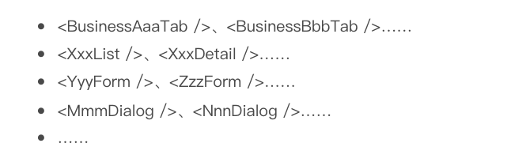

# 19 | 代码复用：如何设计开发自定义Hooks和高阶组件？

你好，我是宋一玮，欢迎回到 React 应用开发的学习。

可能你已经发现了，前面第 15 节课的不可变数据、第 16～17 节的应用状态管理，还有上节课用 TypeScript 为 React 项目引入类型系统，其实都在为我们应对大中型 React 项目中的复杂数据流打基础。

大中型 React 项目复杂的不只是数据流，还有应用逻辑，所以接下来我们就把重点放到应用逻辑上。应用逻辑我们会分为局部和整体两个部分来学习，这节课我们先来看局部，即组件逻辑。

组件逻辑越来越复杂怎么办？我曾观察过不少单组件包含数百行、甚至上千行代码的情况。其中有结构清晰、易于维护的模范代码，但更多的还是可以当作负面典型的后进代码，这些组件代码往往存在以下问题：

- 承担了过多的职责；

- 业务逻辑和交互逻辑杂糅在一起；

- 从其他组件中复制粘贴代码。

具体表现为：

- 传递的 props 个数过多；

```
使用 useState 的个数过多；
单个 useEffect 的副作用回调函数行数过多；
```

- ……

这些问题大都可以通过抽象的方式改进。那么接下来，我们就来学习如何设计开发自定义Hooks 和高阶组件，以达到抽象和代码复用。

## 抽象的目的

我们对抽象（Abstraction）并不陌生，前面第 13 节课提到的面向接口编程，就是抽象的一种。MVC 架构里 M、V、C 分别也都是抽象，后端开发中的分层架构，每一层也是抽象。在软件开发中，抽象可以用来降低程序的复杂度，使得开发者可以专注处理少数重要的部分。

我曾观察到一种误区，就是认为“抽象只是为代码复用而做的，不需要复用的话就没必要抽象”，其实不是这样的。为了代码复用确实需要先做抽象，但我们日常开发工作中大部分的抽象其实都不是为了代码复用，而是为了开发出更有效、更易读、更好维护的代码。

```
我们稍微回顾一下上一个模块中的 oh-my-kanban 项目，在第 3 节课的源码中，
src/App.js 文件中只包含了 App 、 KanbanCard 、 KanbanNewCard 三个组件。请你设
```

想一下，假如当时不继续拆分组件，而直接把第二模块中所有的新功能都加到这三个组件里，这三个组件的代码会有多么臃肿？

所以就有了从第 5 节课开始的组件拆分，一直到第 12～13 的大重构，这些过程其实都是在做抽象。

```
组件拆分时抽象出了两个新组件 KanbanBoard 和 KanbanColumn ，但当时这两个新组件只
封装了 DOM 结构和样式。后来的大重构对 App 里的数据和逻辑重新做了抽象，让 App 之外
的组件分别封装自己的视图、数据和逻辑，有效降低了开发维护 App 组件时的负担。
```

接下来我们来看 React 应用中两种主要的抽象方式：自定义 Hooks 和组件组合。

## 自定义 Hooks

```
在开发 React 函数组件时，我们会大量使用 Hooks，包括useState、useEffect等。当这
```

些 Hooks 的组合满足一定业务逻辑或者是交互逻辑时，可以根据需要将它们提取成自定义Hooks。

```
自定义 Hook 首先是一个函数，它的函数名应以use*开头，它内部调用的其他 Hooks 仍旧需
```

要遵守第 10 节课中讲到的，Hooks 的使用规则：

- 第一，只能在 React 的函数组件中调用 Hooks。第二，只能在组件函数的最顶层调用 Hooks。

也许你会问：“等下，说是要遵守，这不一下子把两条规则都打破了吗？”其实不冲突，主要是以下两个原因：

- 自定义 Hooks 只会在 React 函数组件中执行才有效；

- 自定义 Hooks 只是很薄的封装，虽然在运行时的调用栈上会增加一层，但这层并不会在组件与被封装的 Hooks 之间增加额外的循环、条件分支。

来看一个典型的业务型自定义 Hook。

以下代码是一个书籍列表组件，会从服务器端读取特定类别下的书籍列表数据（注意

```
React.StrictMode 会重复触发副作用回调函数，为了简化例子这里没有做处理）。数据是
```

分页返回的，当还有下一页时，用户可以点击“读取更多”按钮，加载下一页数据拼到当前列表尾部：

```bash
import React, { useEffect, useState } from 'react';
const BookList = ({ categoryId }) => {
 const [books, setBooks] = useState([]);
 const [totalPages, setTotalPages] = useState(1);
 const [currentPage, setCurrentPage] = useState(1);
 const [isLoading, setIsLoading] = useState(true);
 useEffect(() => {
   const fetchBooks = async () => {
     const url = `/api/books?category=${categoryId}&page=${currentPage}`;
     const res = await fetch(url);
     const { items, totalPages } = await res.json();
     setBooks(books => books.concat(items));
     setTotalPages(totalPages);
     setIsLoading(false);
   };
   setIsLoading(true);
   fetchBooks();
 }, [categoryId, currentPage]);
 return (
   <div>
     <ul>
       {books.map((book) => (
         <li key={book.id}>{book.title}</li>
       ))}
       {isLoading && (<li>Loading...</li>)}
     </ul>
     <button
       onClick={() => setCurrentPage(currentPage + 1)}
       disabled={currentPage === totalPages}
     >
       读取更多
     </button>
   </div>
 );
};
export default BookList;
```

上面的代码中，分页读取书籍列表这部分逻辑，我们可以选择抽取成自定义 Hook：

```bash
useFetchBooks，它的参数只有categoryId，函数体调用了多个基础 Hooks，返回值包括
books列表、是否读取中isLoading。当前页和总页数做了额外处理，返回计算值
hasNextPage和一个回调函数onNextPage。代码如下：
import React, { useEffect, useState } from 'react';
function useFetchBooks(categoryId) {
 const [books, setBooks] = useState([]);
 const [totalPages, setTotalPages] = useState(1);
 const [currentPage, setCurrentPage] = useState(1);
 const [isLoading, setIsLoading] = useState(true);
 useEffect(() => {
   const fetchBooks = async () => {
     const url = `/api/books?category=${categoryId}&page=${currentPage}`;
     const res = await fetch(url);
     const { items, totalPages } = await res.json();
     setBooks(books => books.concat(items));
     setTotalPages(totalPages);
     setIsLoading(false);
   };
   setIsLoading(true);
   fetchBooks();
 }, [categoryId, currentPage]);
 const hasNextPage = currentPage < totalPages;
 const onNextPage = () => {
   setCurrentPage(current => current + 1);
 }
 return {books, isLoading, hasNextPage, onNextPage};
}
const BookList = ({ categoryId }) => {
 const {
   books,
   isLoading,
   hasNextPage,
   onNextPage
 } = useFetchBooks(categoryId);
 return (
   <div>
     <ul>
       {books.map((book) => (
         <li key={book.id}>{book.title}</li>
       ))}
       {isLoading && (<li>Loading...</li>)}
     </ul>
     <button onClick={onNextPage} disabled={!hasNextPage}>
       读取更多
     </button>
   </div>
 );
};
export default BookList;
这个自定义 Hook 对 BookList 隐藏了与获取书籍列表相关的业务实现。但请注意一点，抽
```

取自定义 Hook 之前的代码并没有明显的痛点，所以这个抽象并不是必需的，更多还是出于学习目的。

自定义 Hooks 也被用于代码复用。

```javascript
依然是上面这个例子，假设我们还要开发一个杂志列表组件 MagazineList ，读取远程数据
逻辑与书籍列表十分相似，只有 REST API 的 URL 不同，那么我们可以对 useFetchBooks
进行一个小改造，把 API URL 作为可选参数传入 useFetchBooks ：
function useFetchBooks(categoryId, apiUrl = '/api/books') {
 const [books, setBooks] = useState([]);
 const [totalPages, setTotalPages] = useState(1);
 const [currentPage, setCurrentPage] = useState(1);
 const [isLoading, setIsLoading] = useState(true);
 useEffect(() => {
   const fetchBooks = async () => {
     const url = `${apiUrl}?category=${categoryId}&page=${currentPage}`;
     const res = await fetch(url);
     // ...
```

在组件中就可以复用这个 Hook 了：

```javascript
const MagazineList = ({ categoryId }) => {
 const {
   books,
   isLoading,
   hasNextPage,
   onNextPage
 } = useFetchBooks(categoryId, '/api/magazines');
 // ...
```

只要遵循 Hooks 的使用规则，一个组件中可以使用多个自定义 Hooks，自定义 Hooks 里面也可以调用其他自定义 Hooks。

## 组件组合

与组件抽象对应的概念是组件扩展（Extension），我们先来归纳一下组件扩展，以帮助理解如何在 React 组件层面做抽象。

组件扩展需要一定的模式，否则就成了代码堆砌。React 组件一般以组合（Composition）方

```
式应对大部分扩展需求。请你回忆一下 oh-my-kanban 中 KanbanColumn 组件在“大重构”
```

前后的两个版本：

```
重构前 KanbanColumn 只包含 DOM 结构和样式的抽象，为具体子组件留下了一个槽位
（Slot），是由 App 负责将多个 KanbanColumn 和 KanbanCard 等组件组合在一起；
重构后改为由 KanbanBoard 负责将多个 KanbanColumn 组合在一起， KanbanCard 的
组合逻辑被转移到 KanbanColumn 的抽象中，由 KanbanColumn 负责把 KanbanCard
```

- 组合在一起。

那么就可以得出一个方法论，即我们对组件进行抽象的着陆点就是组件的组合，换句话说，对组件抽象的产物是可以被用于组合的新组件。

这里列举一些在大中型 React 应用中常见的组件抽象的产物：



由此可见，不论是否强调代码复用，我们已经在使用组合方式开发 React 应用了。

## 高阶组件

组件组合有一种重要的设计模式：高阶组件（HOC，Higher-Order Component）。高阶组件可以将一个组件转换成为另一个组件，一般用于代码复用。具有以下特征的函数就是高阶组件：

```javascript
const EnhancedComponent = withSomeFeature(WrappedComponent);
//    -----------------   --------------- ----------------
//          |             ----    |               |
//          |              |      |               |
//          V              V      V               V
//       增强组件       (约定前缀) 高阶组件         原组件
```

或者这样：

```javascript
const EnhancedComponent = withSomeFeature(args)(WrappedComponent);
//    -----------------   --------------- ----  ----------------
//          |                    |         |            |
//          |                    V         V            |
//          |                 高阶函数     参数           |
//          |             ---------------------         |
//          |                       |                   |
//          V                       V                   V
//       增强组件                 高阶组件               原组件
```

为了开发高阶组件，一般可以先把多个组件公共的逻辑或者交互，抽取成为一个父组件，再封装成高阶组件。

比如下面这个显示“读取中”状态的高阶组件，它要做的事情就是从传入的 props 中拿到

```
isLoading 属性，如果为 true 则显示一个炫酷的读取中 CSS 动画，否则直接展示原组
```

件：

```xml
function withLoading(WrappedComponent) {
 const ComponentWithLoading = ({ isLoading, ...restProps }) {
   // 炫酷的读取中CSS动画
   return isLoading ? (
     <div className="loading">读取中</div>
   ) : (
     <WrappedComponent {...restProps} />
   );
 };
 return ComponentWithLoading;
}
// ...
const EnhancedMovieList = withLoading(MovieList);
// ...
<MovieList movies={movies} />
<EnhancedMovieList isLoading={isLoading} movies={movies} />
```

```
这个高阶组件不仅可以用于 MovieList ，还可以用于 TvShowList 、 MtvList ，是一个
```

可复用的抽象。

```
此外还可以从高阶组件中创建新的 props 传递给原组件，以下是高阶组件 withRouter 的示
```

意代码，来自 React 路由框架 react-router v6 的官方文档：

```xml
function withRouter(WrappedComponent) {
 function ComponentWithRouterProp(props) {
   const location = useLocation();
   const navigate = useNavigate();
   const params = useParams();
   return (
     <WrappedComponent
       {...props}
       router={{ location, navigate, params }}
     />
   );
 }
 return ComponentWithRouterProp;
}
可以看出，这个 withRouter 就是三个自定义 Hooks 的组合，创建了一个新的 router 属
```

性传给了原组件，这跟在原组件中直接使用三个 Hooks 区别不大。其实这个高阶组件主要还是给类组件用的，毕竟类组件无法直接使用 Hooks。

高阶组件也可以组合使用，比如：

```javascript
const EnhancedMovieList = withRouter(withLoading(MovieList));
这时推荐使用 Redux 的 compose 函数来改善代码的可读性：
const enhance = compose(
 withRouter,
 withLoading
);
const EnhancedMovieList = enhance(MovieList);
```

以上的例子都相对简单，当必要时，可以在高阶组件内部加入相关的 state、Hooks，以封装

```
一段完整的业务或交互逻辑。比如下面这个高阶组件 withLoggedInUserContext ，在用
```

户尚未登录时显示登录对话框，登录成功后从服务器端读取当前用户数据，并把用户数据放到

```
LoggedInUserContext 中，供后代组件使用：
```

```bash
export const LoggedInUserContext = React.createContext();
function withLoggedInUserContext(WrappedComponent) {
 const LoggedInUserContainer = (props) => {
   const [isLoggedIn, setIsLoggedIn] = useState(false);
   const [isLoading, setIsLoading] = useState(true);
   const [currentUserData, setCurrentUserData] = useState(null);
   useEffect(() => {
     async function fetchCurrentUserData() {
       const res = await fetch('/api/user');
       const data = await res.json();
       setCurrentUserData(data);
       setIsLoading(false);
     }
     if (isLoggedIn) {
       setIsLoading(true);
       fetchCurrentUserData();
     }
   }, [isLoggedIn]);
   return !isLoggedIn ? (
     <LoginDialog onLogin={setIsLoggedIn} />
   ) : isLoading ? (
     <div>读取中</div>
   ) : (
     <LoggedInUserContext.Provider value={currentUserData}>
       <WrappedComponent {...props} />
     </LoggedInUserContext.Provider>
   )
 }
}
这个 withLoggedInUserContext 看似很完整，但也有一些值得推敲的地方，比如：
```

- 如果在整个应用中只使用一次这个高阶组件，那么是不是没必要封装成高阶组件？

- 如果在应用组件树的不同分支中，多次使用这个高阶组件，会不会导致出现多个登录对话框？

- 考虑单一职责原则（Single Responsibility Principle），这个高阶组件是不是承担了太多职责？

老实说，尤其在 React Hooks 成为主流以后，我所开发过或者见到过的高阶组件，还是在React 组件库或 React 相关框架里的居多，而在 React 应用项目中比较少见。对抽象高阶组件，我建议至少满足以下前提之一：

- 你在开发 React 组件库或 React 相关框架；

- 你需要在类组件中复用 Hooks 逻辑；

- 你需要复用包含视图的逻辑。

## 小结

在这节课，我们了解了在组件逻辑越来越复杂时，即便不考虑代码复用，也可以通过抽象来简化组件的设计和开发，学习了 React 中的自定义 Hooks 和组件组合这两种抽象方式。进一步地，也学习了在自定义 Hooks 和组件组合基础上的代码复用，尤其是组件组合的重要设计模式之一：高阶组件的写法。

这节课一开始也提到过，组件逻辑属于是 React 应用的局部逻辑。下节课，我们会继续讨论React 应用的整体逻辑，看看大中型 React 项目在代码增多后，整体扩展上会遇到哪些挑战，以及如何应对这些挑战。

## 思考题

```
这节课自定义 Hooks 的样例代码useFetchBooks 中，返回值是一个对象，使用这个自定
```

- 义 Hook 时，可以用属性解构的方式直接获得其中的属性，然而基础 Hooks 之一的

```
useState ，它的返回值却是一个具有两个成员的数组，请你思考一下这两种返回值类
```

- 型，各有什么好处？

2. 第 15 节课我们讲到了 React 内建的纯组件 API React.memo，可以请你根据它的功能描述，在不参考 React 源码的前提下，自己实现一个用于纯组件的高阶组件吗？

好了，这节课的内容就是这些。我们下节课再见。
