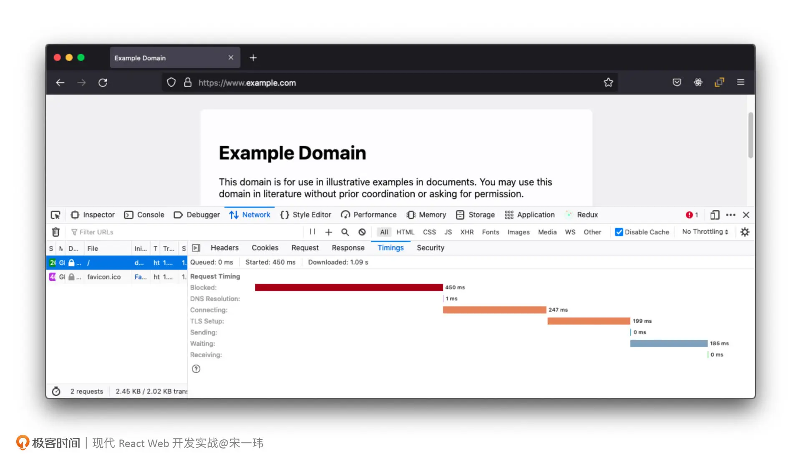
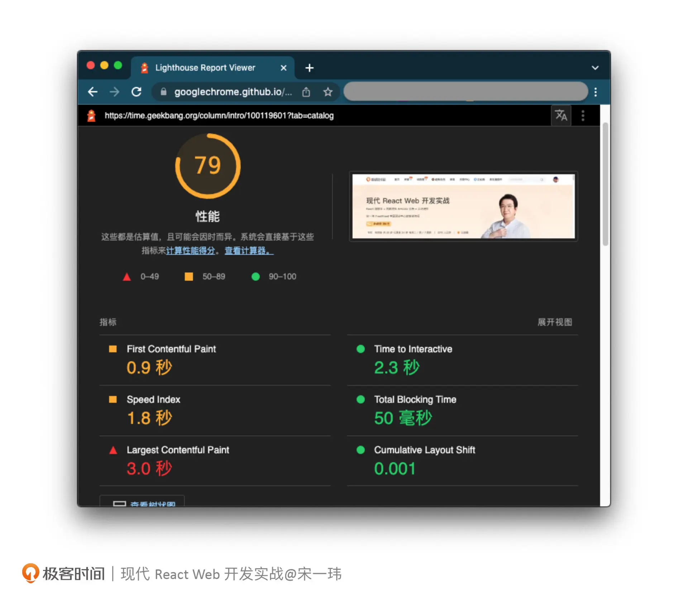
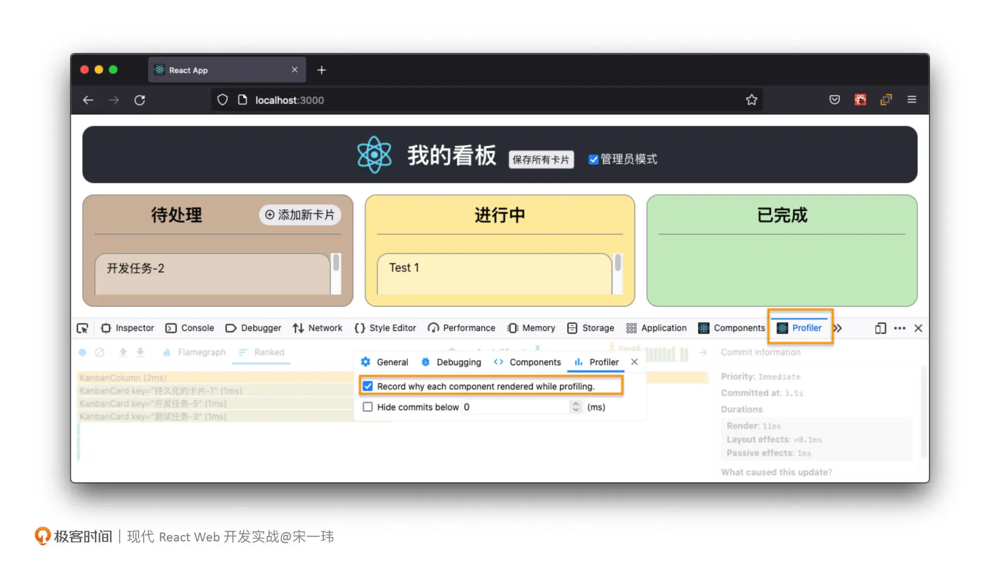
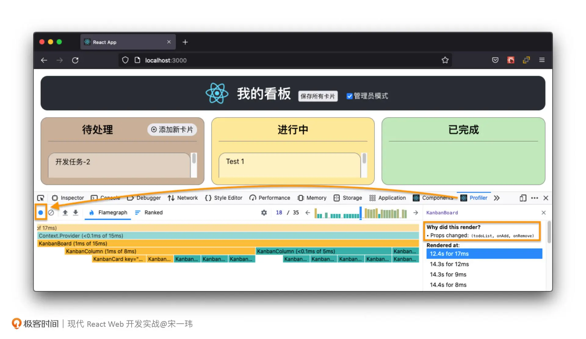
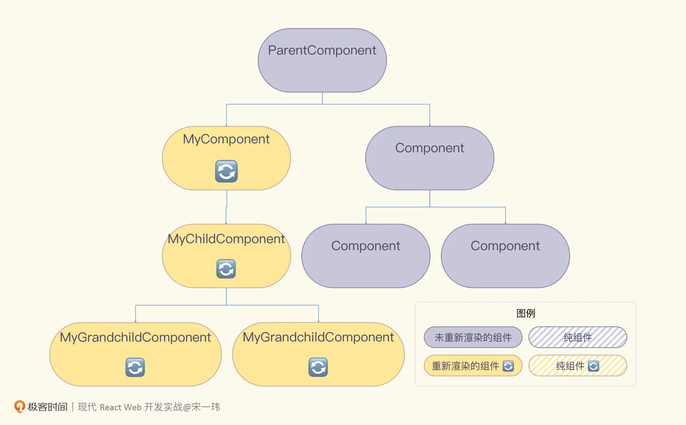
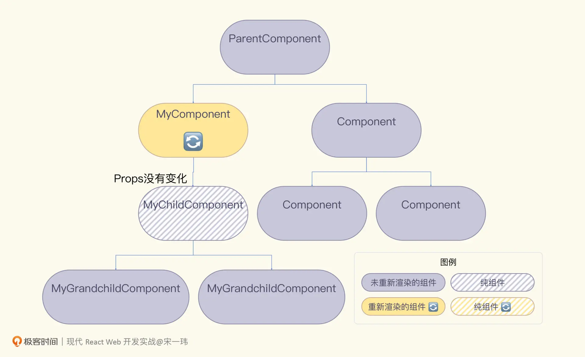
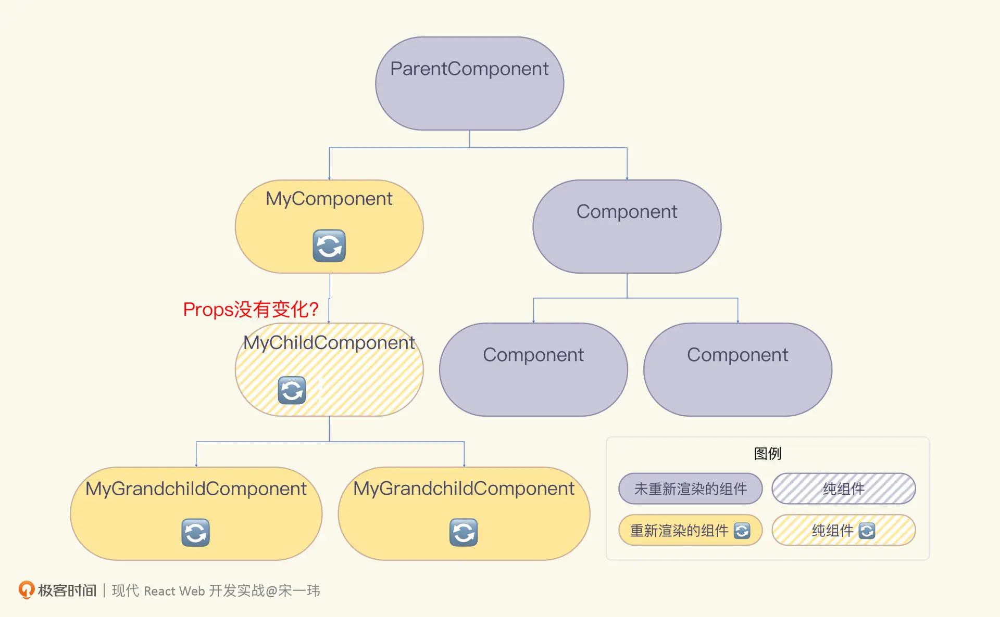

# 21 | 性能优化：保证优秀的用户体验

你好，我是宋一玮，欢迎回到 React 应用开发的学习。

上节课，我们学习了按业务功能划分为主，结合按组件、按文件职能划分目录结构的方式，从整体层面把握大中型 React 应用逻辑的扩展。同时，也强调了前端应用逻辑架构对应用逻辑扩展的指导作用。

至此，我们已经学习了大中型 React 项目的数据流、局部和整体逻辑的相关实践。

无论项目规模大小，我们作为优秀前端开发者，追求优秀的用户体验的脚步是不会停下来的。

如果想让我们的前端应用具有优秀的用户体验，一个必要条件是具备良好的性能。所以这节课，我们会暂时从应用业务开发中跳脱出来，将关注点放在应用性能上，了解一下常见的React 性能问题和优化方案。

## 不要过早做性能优化

著名计算机科学家高德纳（Donald E. Knuth）在他的著作《计算机程序设计艺术》（TAOCP）中提出过：“过早优化是万恶之源（Premature Optimization is the Root of All Evil）。”强调了开发者在程序开发的早期阶段，有许多重要的工作要做，而优化程序这件事往往会占用了开发者过多的精力，却没能带来对等的收益。

当你在开发前端应用时，也可以参考这一原则。

在第 6 节课讲虚拟 DOM 时，我曾提到 Svelte 作者对虚拟 DOM 技术的评价：

- 虚拟 DOM 的价值在于，当你构建应用时，无需考虑状态的变化如何体现在 UI 上，且一般情况下不用担心性能问题。这减少了代码 Bug，比起乏味的编码，你可以把更多时间投入到创造性的工作上。

这段评价同样可以用在虚拟 DOM 技术的代表性框架——React 上。只要你依照 React 的常规用法来开发应用，规模、复杂度不大的 React 应用在未做任何优化之前，是能达到主流前端应用的性能表现的。

当然，滥用这一原则的另一个极端，即完全拒绝程序优化工作，也是不可取的。所以取个中间值，遇到性能问题时再优化是个很好的选择。

## 应用性能问题的表现

那么如何才能判断是遇到性能问题了呢？以时间维度来看，与后端服务不同，GUI 是给人类用户使用的，它的性能问题的阈值要高得多。对前端应用性能问题的判断，可以首先从最终用户的视角出发，我们根据问题的具体表现分类成“慢”和“卡”。

### “慢”

对 Web 前端应用，长久以来用户已经被教育出一套心智模型，也就是在浏览器显示网页读取进度时，以及网页应用弹出“读取中”提示时，一段时间的等待是必然的。

有研究表明这类等待时间保持在 1～2 秒以内时，用户满意度比较高。当然，将这些时间尽量缩短，有助于进一步提升用户体验，如各大互联网搜索引擎的首页，首次加载时间普遍都优化到了短短的几百毫秒。

反过来说，如果用户在使用 Web 应用的过程中，明确抱怨了“慢”，说明这个“慢”已经超过了 2秒这一阈值了，我给你列举了下面五种关于“慢”的主要情况：

1. 首次页面加载慢。这个其实在 Web 前端领域是个比较大的话题，浏览器中有一系列指标可以量化页面加载快慢的情况，包括首字节时间（TTFB）、首次内容绘制时间（FCP）、可交互时间（TTI）等，具体可以参考这个链接。

2. 页面局部读取数据慢。这是单页应用的常见设计，比如在页面加载完成后，再延迟加载一个列表数据，这时一般会为列表显示一个临时的“读取中”标识，等到数据到位时再替换成真正的列表内容。有研究表明，加了“读取中”标识的应用比起不加的应用，用户会愿意等待更长的时间。但如果等了 3 秒、5 秒、10 秒列表还没回来，用户会认为这个功能很慢，甚至怀疑哪里出错了。

3. 提交表单处理慢。数据下载的反方向是上传，Web 应用一般都是分布式应用，需要提交数据到服务器端进行处理和保存。用户录入表单内容是花费了精力的，提交表单过程慢，更容易导致用户的不安全感。

4. 页面跳转慢。这个跟首次页面加载慢类似，电商网站页面跳转慢很容易导致转化率的下降。

5. 短时间内多次页面刷新。这是个很微妙但也很普遍的问题，如果用户在应用中完成一系列连贯性的操作，但过程中页面存在多次刷新会打断用户的连续操作时，“慢”的感觉会被放大。具体的例子比如从网站上购买火车票，这个体验近些年已经优化得很好了，但你可以设想一下，每点击下一步都得刷新页面的话，那体验会是多么糟糕。

### “卡”

前面提到用户的心智模型中，网页与服务器端发生交互时，秒数量级的等待是可以接受的。但比如在文本框中输入文字、点击下拉框之类，就不适用这个规律了。这些操作如果出现性能问题，比起“慢”，更多用户会称之为“卡”（卡顿、延迟）。

“卡”有标准吗？有个说法是人类注意不到 100ms 以内的延迟，这也就意味着包括视频游戏在内的 GUI 如果达到了 60FPS，即每帧画面 16ms，那就已经是非常流畅了。所以可以说判断前端应用是否“卡”的衡量基准，是建立在 10～100ms 这个数量级上的。

同样的，关于“卡”也是主要包括了下面五种情况。

1. 表单控件交互卡顿。你可能在某些网页遇到过这样的体验：在文本框连续输入好几个字母，如“abcdef”，但只有“ab”出来了，等了半秒钟“cdef”才突然跳出来，这样的卡顿很影响交互效率。

2. 鼠标、键盘交互的视觉反馈不及时。这个现象与上面的有一些差别，比如一个扁平式按钮，它的鼠标悬停效果可以帮助用户理解它是个按钮而不是单纯一个图标，但如果鼠标悬停上去，等了一秒钟后才出变化，就有可能误导用户。

3. 页面纵向滚动不连贯。网页的基本布局是纵向的流式文档布局，纵向滚动翻页就是网页最基本的操作之一。当用户用鼠标滚轮翻一页卡半页时，他将很难精准地定位到他想看的内容。

4. 页面动画掉帧。这个情况跟游戏或电影掉帧类似。

5. 页面短时间不响应。如果还能自动恢复正常，那还能称之为卡了；如果长时间不响应，用户会说页面挂了。

### “电脑风扇起飞了”

如果光看时间维度，“慢”和“卡”基本可以涵盖大部分前端性能问题了。但其实除了时间之外，还有资源这个维度。计算资源、网络带宽资源、存储资源都与用户，尤其是浏览器用户直接相关。

计算资源特指 CPU，如果用到了 WebGL 图形加速，那就再加上 GPU。不知你有没有遇到过一些 Web 应用，当使用特定功能时，电脑风扇转速提升、开始嗡嗡作响，就像要“起飞了”似的。这时 Web 应用也许运行地不慢也不卡，但就是打满了 CPU。这种现象不符合用户对浏览器网页的一般印象，也被部分用户视为一种性能问题。

在不慢不卡的前提下，也许开发者并不会特别关注网络带宽资源和存储资源。但对于移动设备而言，这两种资源还是相对比较昂贵的。有个段子是“用了一晚上 5G 网络，房子归运营商了”，这意味着太耗流量也会成为问题。

## 定位性能问题的根源

讲到这里，你也许有点按耐不住了：“难道不讲些 React 性能优化技巧吗？”当然会的，别急。直接把一个 React 性能问题的案例贴在这里，然后再贴几行代码解决它是很容易的，但我更想强调的是应用性能优化的一个闭环逻辑：开发应用 > 出现性能问题 > 定位性能问题的根源 >解决性能问题 > 继续开发应用，如下图：

```
   ┌──────────────────────────────────────────────────────────┐
   │                                                          │
   │      先开发应用   ──────────────────────►   继续开发        │
   │                                                          │
   └─────────────┬─────────────────────────────▲──────────────┘
                 │                             │
          ┌──────▼─────┐  ┌────────────┐ ┌─────┴──────┐
          │ 出现性能问题 ├──► 定位性能问题 ├─► 解决性能问题 │
          │            │  │   的根源    │ │            │
          └────────────┘  └────────────┘ └────────────┘
```

当遇到性能问题时，可以先判断它符合前面哪一种表现，然后去定位这一性能问题的根源（Root Cause）。

先看“慢”的问题。

首次页面加载慢和页面跳转慢的问题，可以通过浏览器的开发者工具来定位问题根源，是建立连接慢、等待服务器响应慢、下载慢，还是下载队列被阻塞了。



这里尤其推荐 Chrome 浏览器开发者工具中的 Lighthouse 工具。



页面局部读取数据慢和提交表单处理慢，这两种问题的根源更有可能是服务器处理慢。而短时间内多次页面刷新，则更多是用户体验设计的问题。

再看“卡”的问题。

表单控件交互卡顿，和鼠标、键盘交互的视觉反馈不及时这两种表现，常见的根源是网页 JS进行了比较耗时的同步操作，阻塞了网页的渲染。页面纵向滚动不连贯常见于 DOM 内容过多的情况。页面长时间不响应，则有可能是因为进入了 JS 死循环。

React 浏览器扩展 React Developer Tools 里，包含一个 Profiler 性能分析功能，也可以用来定位性能问题。建议在设置中勾选“记录每个组件渲染的原因”，可以帮助你巩固对组件渲染过程的理解。



点击开始分析，在应用中进行一系列操作，然后点击停止，扩展就会生成火焰图和排位图，从中就可以找出与 React 相关的性能问题的根源。



当同时遇到多个性能问题时，可以先确定性能瓶颈在哪里，优先解决它。

## 解决性能问题

从上面定位性能问题根源的过程就可以看出，当一个 React 应用出现性能问题时，并不一定是在 React 领域内的问题，也并不一定要通过 React 来解决。

而与 React 紧密相关的性能问题，通常通过以下方式解决。

### 为生产环境构建

在 React 源码中，有大量只在开发模式运行的代码分支，用于运行时检查，向开发者警示错误的 API 用法，或建议更好的写法。前面 React 浏览器扩展的性能分析工具，也在 React 源码的开发模式下做了大量埋点。

而这些有利于开发调试的代码，对生产环境基本毫无帮助，反而会拖累框架的执行效率。比如

```
我们熟悉的调试利器 console.log ，它在部分环境中是同步执行的，如果大量使用会阻塞
```

正常的业务代码。而且 React 框架本身的代码量越大，意味着浏览器下载的 JS 文件越大，加载 JS 模块所耗费的资源也会更多。

所以在为生产环境构建 React 应用项目时，需要指定生产模式，这样编译构建工具会在生成的产物中清理掉开发模式的代码，一举减轻浏览器运行时的负担。如果你用的是 CRA 创建的

```
React 项目，那么 npm run build 出来的产物就是面向生产环境的。如果你使用了 Vite，
则执行 vite build ；如果直接使用了 Webpack，则使用 Webpack 的 mode:
'production' 。
```

这个优化方式是 React 各种优化里最经济实惠的一款，可以成为你的首选。

### 避免不必要的渲染 / 重新渲染

当 React 应用面临“卡”的性能问题时，如果通过上面提到的 Profiler 工具能定位到是 React 领域的问题，那么大概率会是因为某些 React 应用代码，导致了过多不必要的渲染 / 重新渲染。

我们在前面第 6 节、第 8 节课，还有加餐 2，一直在鼓吹 React 的底层实现 Fiber 协调引擎多么好多么快，虚拟 DOM 对提高渲染效率有多大作用，你可能会说：“这么快就掉链子了？”

掉链子倒也不至于。我们先看看什么是不必要的渲染 / 重新渲染。

首先当一个组件由于 state 变更而重新渲染，它的子组件和后代组件都会被重新渲染（哪怕props 没变化）。但它的父组件和祖先组件不会重新渲染，它的平级组件以及平级组件的子组件树也不会重新渲染，这是从设计上保证的。如果这个规律被打破了，则需要检查代码是否不小心修改了其他组件的 state 或 context。如下图所示：



当然我们可以对上面的重新渲染逻辑进一步优化。优化方案之前我们已经学习过，你能记起来

```
吗？是的，就是纯组件， React.memo 或 React.PureComponent  API。我们只要把
MyChildComponent 调整为纯组件：
```

```javascript
const EnhancedMyChildComponent = React.memo(MyChildComponent);
如果传入纯组件的 props 值没有变化，那从 MyChildComponent 开始的子组件树的重新渲
```

染就被打断了，这就是典型的基于纯组件的性能优化。如图：



但需要注意一点，就是不要滥用纯组件。你当然可以选择把项目中所有组件都封装成纯组件，但这属于明显的过度优化，代价是更深的元素树，也可能会遇到组件不按预期重新渲染的Bug。我的建议是，只对比较“重”的组件下手。

```
然而，如果你对着 oh-my-kanban 的代码使用纯组件，你会惊奇地发现，纯组件没有拦住任
何重新渲染，跟没优化一样（尽管 oh-my-kanban 还没有明显的性能问题，不需要优化）。
```

如图，这是为什么呢？



根源还是第 15 节课讲到的不可变数据。很大一部分纯组件失效的情况，都是因为父组件给作为子组件的纯组件传递了函数类型的 props，而这个函数在父组件的每次重新渲染中都会被重新创建，破坏了不可变性。解决方案是利用第 10 节课学习的性能优化 Hooks 之一的

```javascript
useCallback ，如：
const handleToggleAdmin = useCallback((evt) => {
 setIsAdmin(currentState => !currentState);
}, []);
```

除了纯组件，还有更高级的优化方案，比如针对长列表的部分渲染框架 react-window 或者react-virtualized。

### 代码分割

如果你构建出来的生产环境产物中，单个 JS 文件有好几个 MB 大小，那可以考虑利用构建工具的代码分割功能，将产物分成多个 chunk，每个 chunk JS 文件几百 KB，可以分摊整体 JS体积，充分利用浏览器并行下载和缓存的特性优化应用加载速度。

除了这种业务无关的代码分割方式，在 React 中开发者也可以按功能模块或路由显式地分割应用，然后用懒加载的方式在浏览器中按需加载应用的一部分。这部分相关的 API 和实践我们会留到后面第 24 节课学习。

## 小结

这节课我们学习了前端应用的性能优化，强调了不要过早做性能优化，应用开发的主线工作还是应用开发，当“慢”或者“卡”的性能问题真实发生时，再去用一些工具定位性能问题的根源，进而确定是否是 React 领域内的性能问题。

确认后，可以通过为生产环境构建、避免不必要的渲染 / 重新渲染或代码分割等方案解决React 应用的性能问题。

接下来两节课，我们将进入大中型 React 项目最重要的实践之一：自动化测试的学习。利用端到端（E2E）测试和单元测试，保证 React 项目的质量。同时也了解一下测试金字塔的理论，有助于你更深入理解端到端和单元测试的关系。

## 思考题

```
尽管 oh-my-kanban 还没有明显的性能问题，目前不需要优化，但还是可以作为一个很好
```

- 的例子，来试验哪些是不必要的渲染 / 重新渲染。请你利用 React Developer Tools 里的工

```
具分析oh-my-kanban ，找到里面最“卡”的操作，并利用纯组件优化它；
```

2. 这节课前面 2/3 的内容其实并不限定于 React 应用。你在之前的工作学习中有遇到过前端性能问题吗？如果有过，请你回顾一下那个问题属于“慢”、“卡”还是其他情况？也欢迎你分享你定位根源和解决问题的经过。

好了，这节课就是这些内容。我们下节课再见。
