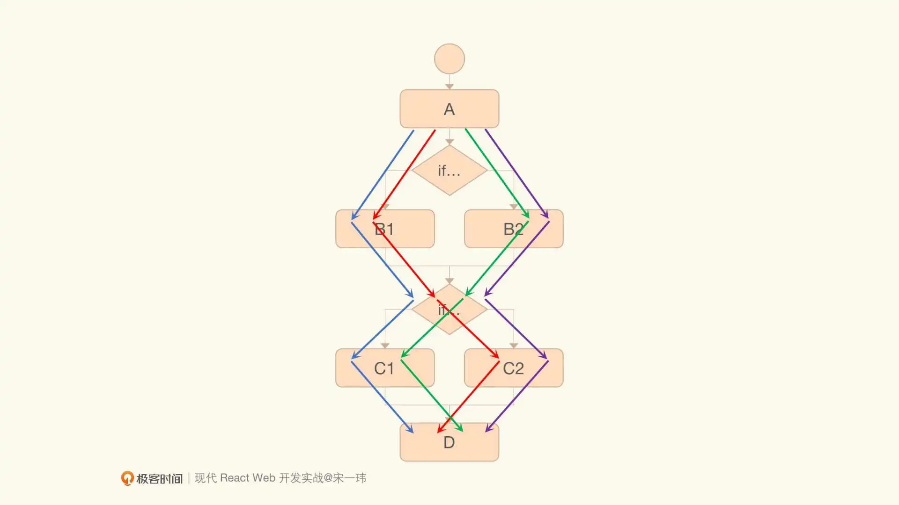
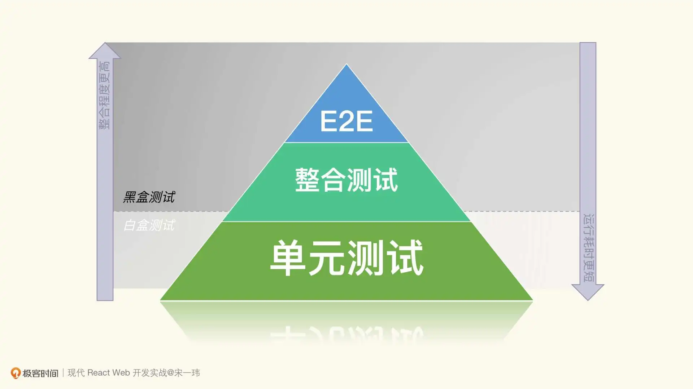

# 23 | 质量保证（下）：测试金字塔与React单元测试

你好，我是宋一玮，欢迎回到 React 应用开发的学习。

从上节课开始，我们进入了大中型 React 项目最重要的实践之一：自动化测试的学习。

我们首先了解了人工测试与自动化测试的区别，以及自动化测试对大型前端项目的重要意义，也建议由业务功能的开发者亲自来编写自动化测试脚本。然后我们学习了如何利用现代自动化测试框架 Playwright，开发自动化 E2E 测试用例。

这节课，我们会继续学习大中型 React 项目的质量保证，利用单元测试进一步提升项目质量。同时也了解一下测试金字塔的理论，有助于你更深入理解端到端和单元测试的关系。

下面开始这节课的内容。

## 前端开发者应该了解的测试金字塔

首先回顾一下上节课提到的关于测试范围的观点：

- ……不会去尝试穷举所有可能性，否则开发出来的测试用例就算比源码都大好多好多倍，也都不一定能达到 100% 覆盖。

假设一段程序先后有 2 个条件分支，那么如果希望全覆盖到，则需要设计 4 个测试用例。如下图所示：



图中的 4 条颜色的连线对应了 4 个测试用例，分别是：

- A → B1 → C1 → D；

- A → B1 → C2 → D；

- A → B2 → C1 → D；

- A → B2 → C2 → D。

而在一个完整的前端应用中，这样的分支绝不在少数。可想而知，无论从编写效率还是执行效率来看，E2E 测试都无法覆盖所有逻辑和交互分支。

那换个思路，如果把 E2E 无法覆盖的部分测试点打散，改用其他更加高效的方式测试它们，不就能提高覆盖率了吗？

这就引出了一个软件测试领域的重要概念：测试金字塔。

测试金字塔（Test Pyramid）最初由敏捷开发鼻祖 Mike Cohn 在其著作《Scrum 敏捷软件开发》中提出，主张分层次开展自动化测试以提高测试效率。

金字塔从上到下三层分别是 E2E 测试、整合测试和单元测试。其中 E2E 和整合测试属于黑盒测试，整合程度更高，单元测试属于白盒测试，运行耗时更短。之所以呈金字塔形状，是因为从测试用例的比重看，E2E 的最少（占 10% 左右），单元测试最多（占 70% 左右），如下图所示。



我们上节课学习了 E2E 测试，知道 E2E 包含了前端和后端，整合测试会将软件模块和它的真实依赖一起测试，如后端的 HTTP 接口测试。而单元测试则会设定特定的输入和输出，对软件中尽量小的构成单元进行测试，前端、后端都可以做单元测试。

接下来，我们就来学习 React 应用的单元测试。

## React 单元测试的范围和目标

理想情况自然是为 React 项目中的所有源码都加上单元测试，这个范围在小型 React 项目还能做得到，但大中型项目往往就比较难了。从测试优先级来排序，需要测试的代码类型包括：

- React 组件；

- 自定义 Hooks；

- Redux 的 Action、Reducer、Selector 等；

- 其他。

需要说明的是，近年来 React 组件测试实践越来越丰富，根据实际需要，可以将父子组件写在同一个测试用例里，也可以组件带着自定义 Hooks 一起测。可以说，这已经逐渐模糊了组件单元测试和整合测试的界限。

但类比连着真实数据库一起测的后端整合测试，前端 React 组件测试使用模拟（Mock）的比重还是很大的，所以这里依旧把组件测试归类到单元测试的范畴。

单元测试的目标是比较容易量化的，大部分单元测试框架都支持统计代码覆盖率（CodeCoverage），即运行测试用例时所执行的源码占源码总量的比重。若想提高测试的覆盖率，需要测试用例尽可能进入源码中更多的分支。

当企业要求产品源码的测试覆盖率，无论前端还是后端都要达到 90% 以上时，多少是可以体现出企业对软件质量的重视程度的。

## 用 Jest + RTL 编写单元测试

目前 React 技术社区最为流行的单元测试框架是 Jest + RTL（React Testing Library）。Jest是 FB 推出的一款开源 JavaScript 测试框架（官网），RTL（React Testing Library）是一款开源的轻量级 React 组件测试库（官网）。

其实你早在第三节课用 CRA 创建 React 项目时就已经接触过 Jest + RTL 了，还记得那个

```xml
src/App.test.js 文件吗？那个就是 Jest 的单元测试文件：
import { render, screen } from '@testing-library/react';
import App from './App';
test('renders learn react link', () => {
 render(<App />);
 const linkElement = screen.getByText(/learn react/i);
 expect(linkElement).toBeInTheDocument();
});
如果现在在 oh-my-kanban 下跑一下 npm test ，它应该会失败，并显示如下提示：
FAIL  src/App.test.js
 ✕ renders learn react link (29 ms)
 ● renders learn react link
   TestingLibraryElementError: Unable to find an element with the text: /learn r
   Ignored nodes: comments, <script />, <style />
   <body>
     <div>
       <div
         class="App"
       >
         <header
           class="App-header"
         >
           <h1>
             我的看板
             <button>
               保存所有卡片
             </button>
   # ...
       </div>
     </div>
   </body>
     4 | test('renders learn react link', () => {
     5 |   render(<App />);
   > 6 |   const linkElement = screen.getByText(/learn react/i);
       |                              ^
     7 |   expect(linkElement).toBeInTheDocument();
     8 | });
     9 |
     at Object.getElementError (node_modules/@testing-library/dom/dist/config.js
     at node_modules/@testing-library/dom/dist/query-helpers.js:90:38
     at node_modules/@testing-library/dom/dist/query-helpers.js:62:17
     at getByText (node_modules/@testing-library/dom/dist/query-helpers.js:111:1
     at Object.<anonymous> (src/App.test.js:6:30)
     at TestScheduler.scheduleTests (node_modules/@jest/core/build/TestScheduler
     at runJest (node_modules/@jest/core/build/runJest.js:404:19)
Test Suites: 1 failed, 1 total
Tests:       1 failed, 1 total
Snapshots:   0 total
Time:        0.665 s, estimated 1 s
Ran all test suites related to changed files.
Watch Usage
› Press a to run all tests.
› Press f to run only failed tests.
› Press q to quit watch mode.
› Press i to run failing tests interactively.
› Press p to filter by a filename regex pattern.
› Press t to filter by a test name regex pattern.
› Press Enter to trigger a test run.
```

很快修复一下？有错的不是源码，而是测试用例：

```javascript
test('渲染保存所有卡片按钮', () => {
 render(<App />);
 const btnElem = screen.getByText(/保存所有卡片/i);
 expect(btnElem).toBeInTheDocument();
});
```

Jest 会自动重新运行失败的测试用例，这次通过了：

```
PASS  src/App.test.js
 ✓ 渲染保存所有卡片按钮 (27 ms)
Test Suites: 1 passed, 1 total
Tests:       1 passed, 1 total
Snapshots:   0 total
Time:        0.709 s, estimated 1 s
Ran all test suites related to changed files.
Watch Usage: Press w to show more.
```

如果 React 项目不是用 CRA 搭建的，则需要安装 Jest + RTL。Jest 的安装可以参考官网的快速开始文档，RTL 则使用以下命令：

```
npm install -D @testing-library/react
在 package.json 中加入一个 test 脚本：
 "scripts": {
   "test": "jest"
 },
```

不论是否是 CRA 创建的 React 项目，只要装好了 Jest，在单元测试的同时可以很方便的统计

```
代码覆盖率。在 package.json 中加入一个 cov 脚本：
```

```
 "scripts": {
   "cov": "jest --coverage"
 },
运行 npm run cov 就可以看到覆盖率报告（好低）：
PASS  src/App.test.js
 ✓ 渲染保存所有卡片按钮 (27 ms)
-----------------|---------|----------|---------|---------|----------------------
File             | % Stmts | % Branch | % Funcs | % Lines | Uncovered Line #s
-----------------|---------|----------|---------|---------|----------------------
All files        |   39.21 |    35.29 |   13.63 |   40.81 |
App.js          |   51.72 |        0 |      20 |   55.55 | 34-40,44-49,57,60-61,
KanbanColumn.js |   22.72 |       40 |    8.33 |   22.72 | 54,57-58,64-102
-----------------|---------|----------|---------|---------|----------------------
Test Suites: 1 passed, 1 total
Tests:       1 passed, 1 total
Snapshots:   0 total
Time:        0.439 s, estimated 1 s
Ran all test suites.
```

开发测试用例时，你可以参照单元测试的3A 模式：Arrange（准备）→ Act（动作）→Assert（断言）。

### 为 React 组件编写单元测试

```
我们依旧以 oh-my-kanban 项目为例，学习一下如何为 React 组件编写单元测试。
```

虽然上节课添加 E2E 测试时创建了一个 test 目录，但建议把单元测试文件放在与被测试的源

```xml
码文件尽量近的位置（但也不用像 CRA 默认的 src/App.test.js 那么近）。Jest 鼓励把测
试文件放在源码文件同级的 __tests__ 目录下，后缀插入 .test ，那我们创建一个
src/__tests__/KanbanNewCard.test.js 文件，内容如下：
import { act, fireEvent, render } from '@testing-library/react';
import KanbanNewCard from '../KanbanNewCard';
describe('KanbanNewCard', () => {
 it('添加新卡片', async () => {
   // Arrange 准备
   const onSubmit = jest.fn();
   // Act 动作
   const { findByText, findByRole } = render(
     <KanbanNewCard onSubmit={onSubmit} />
   );
   // Assert 断言
   const titleElem = await findByText('添加新卡片');
   expect(titleElem).toBeInTheDocument();
   const inputElem = await findByRole('textbox');
   expect(inputElem).toHaveFocus();
   // Act 动作
   act(() => {
     fireEvent.change(inputElem, { target: { value: '单元测试新卡片-1' } });
     fireEvent.keyDown(inputElem, { key: 'Enter' });
   });
   // Assert 断言
   expect(onSubmit).toHaveBeenCalledTimes(1);
   expect(onSubmit.mock.lastCall[0]).toHaveProperty('title', '单元测试新卡片-1');
 });
});
```

保存文件，Jest 会自动执行：

```
PASS  src/App.test.js
PASS  src/__tests__/KanbanNewCard.test.js
Test Suites: 2 passed, 2 total
Tests:       2 passed, 2 total
Snapshots:   0 total
Time:        0.788 s, estimated 1 s
Ran all test suites.
Watch Usage: Press w to show more.
从代码可以看出，这个测试用例是典型的 3A 模式。测试用例 it 的回调函数是一个 async 异
步函数，先用 jest.fn() 方法准备模拟函数 onSubmit ，然后用 RTL 提供的 render  API 渲染
KanbanNewCard 组件，接着用 render 返回结果中的查询器，异步查找标题文字并断言标
```

题被渲染出来了。

```
接下来的 findByRole 是 RTL 里比较有特色的一个方法。
```

RTL 库的设计原则是：“你的测试代码越是贴近软件的真实用法，你从测试中得到的信心就越足。”

```
所以 RTL 里的 API 设计，基本都不鼓励去深挖 DOM 结构这种实现细节。 findByRole 里的
```

Role 特指WAI-ARIA，即 W3C 推出的富互联网应用可访问性标准中的 Roles。HTML 里包

```
括 <input type="text"> 在内的大部分标签都有默认的 Role，比标签名本身更具业务意
义，具体可以参考这个标准表格。因为文本框默认 role="textbox" ，而
KanbanNewCard 组件中只存在一个文本框，所以可以很容易定位到。
```

如果你实在手痒想用 CSS 选择器或者 XPath 来查找 DOM 节点，可以折中一下，为 HTML 标

```
签加入 data-testid 。对，就是上节课 E2E 里用到的那个同款属性，然后调用 RTL 的
findByTestId 来查找。
定位到文本框，断言它已经获得了焦点，然后开始调用 RTL 的 act  API 开展动作。先利用
fireEvent 输入一个卡片标题，然后回车。最后来断言一开始准备的模拟函数 onSubmit
```

被调用过一次，且参数包含刚输入的卡片标题。

到这里，你就完成了一个基础的 React 组件单元测试用例。除了这种预期路径（HappyPath），你还需要编写一些负向的用例（Negative Cases），用来测试出错的情况以及一些边界情况。

正如这节课一开始的前后两个分支的例子，如果用单元测试来覆盖，那我们需要分别编写 A、B1、B2、C1、C2、D 的单元测试，看似数量上比 4 条路径多，但开发和运行成本要低得多。

```
如果为 src/App.js 编写一个真正的单元测试，很难避免测试用例中会同时渲染子组件
KanbanBoard 和后代组件 KanbanColumn ，这是不是类似上节课提到的“ App 组件的可测
```

试性有问题？”其实还好。

早期在 React 技术社区，开发者会利用一款测试框架 Enzyme 对组件做“浅渲染”，可以将渲染

```
和测试的范围限制在 App 本身；而 React 进入新版后，开发者经常会遇到需要渲染稍微“深”
```

一点的情况，原来的“浅渲染”不够灵活了。

现在更常见的方法，是利用 Jest 强大的模拟功能，将被测组件所导入的其他组件替换成简化的模拟版本，具体可以参考 React 官方文档的Mock 模块章节。

### 为 Hooks 编写单元测试

这里简单提一下，如何为自定义 Hooks 编写单元测试。

因为自定义 Hooks 不能在 React 函数组件以外的环境中执行，所以首先需要创建一个封装器组件来调用自定义 Hooks，在测试用例里渲染该组件后再做断言。RTL 库团队曾推出一款开源库 react-hooks-testing-library ，封装了上面提到的逻辑，后来已经合并到 RTL 13.1 以上

```
的版本中，成为了其中的 renderHook  API。
目前 oh-my-kanban 中没有自定义 Hooks 的例子，我们姑且看一下第 19 节课的
useFetchBooks ：
```

```javascript
const MagazineList = ({ categoryId }) => {
 const {
   books,
   isLoading,
   hasNextPage,
   onNextPage
 } = useFetchBooks(categoryId, '/api/magazines');
 // ...
```

为它开发一个单元测试，下面是部分代码：

```javascript
describe('useFetchBooks', () => {
 it('获取书籍列表', async () => {
   jest.spyOn(global, 'fetch').mockImplementation(() =>
     Promise.resolve({
       json: () => Promise.resolve({
         items: [
           { id: 1, title: '百年孤独' },
           { id: 2, title: '嫌疑人X的献身' },
         ], totalPages: 5
       })
     })
   );
   const { result, rerender } = renderHook(() => useFetchBooks(categoryId));
   const {
     books,
     isLoading,
     hasNextPage,
     onNextPage
   } = result.current;
   expect(/*...*/);
   global.fetch.mockRestore();
 });
});
```

单元测试是不应该有副作用的。从这段代码中，你可以看到在测试用例开头，先用

```
jest.spyOn 方法将全局的 fetch 方法替换成了模拟函数，经过动作、断言，最后要记得把
被替换的全局 fetch 方法还原。否则，有可能影响到其他测试用例。
```

## 小结

这节课我们学习了测试金字塔的概念，认识到可以用更多的、成本更低的单元测试来弥补 E2E覆盖不到的地方。然后我们学习了如何用 Jest + RTL 为 React 组件和 Hooks 编写单元测试。经过上节课和这节课的学习，我相信你对大中型 React 项目的质量保证有了一定的掌握。

比起“独狼”开发，在团队协作过程中，人与人交流频率会更高，信息失真也会成为问题，最终影响到开发效率和效果。包括自动化测试在内的现代前端工程化实践，就成为团队开发大中型React 应用的必经之路。

下节课是这个专栏的最后一节正课内容，我会带着你总结一下前面的内容，然后为你介绍大型React 应用项目中的团队协作和工程化。最后还会带来一个特别企划，请你跟我一起，以开源软件的方式合作开发一个大型 React 项目。

## 思考题

1. 请你用学到的知识配合 Jest 和 RTL 的文档，为 KanbanColumn 写单元测试。

2. 请你复习一遍模块三的内容，想想每节课的知识点都在大中型 React 项目和团队协作中能发挥什么作用？

这节课内容就到这里，我们下节课不见不散！
