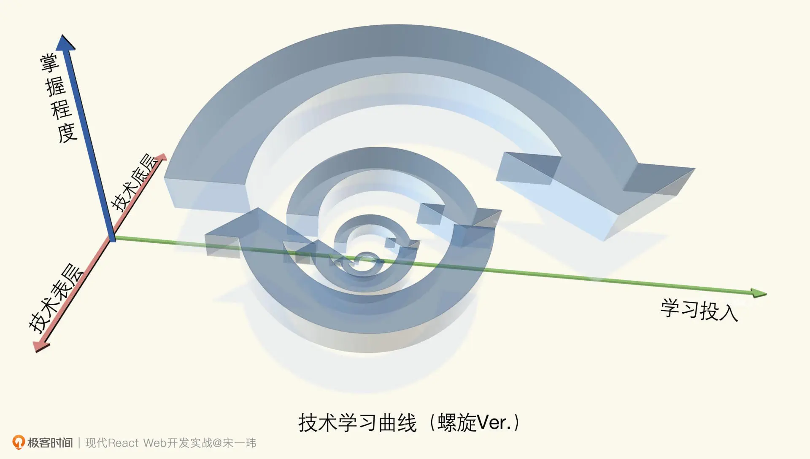
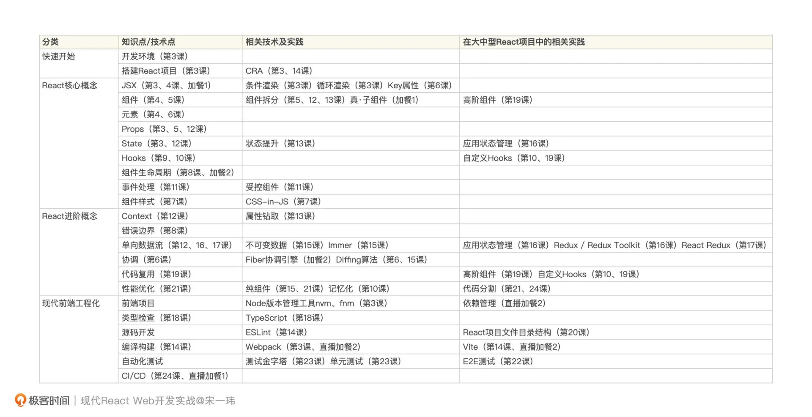
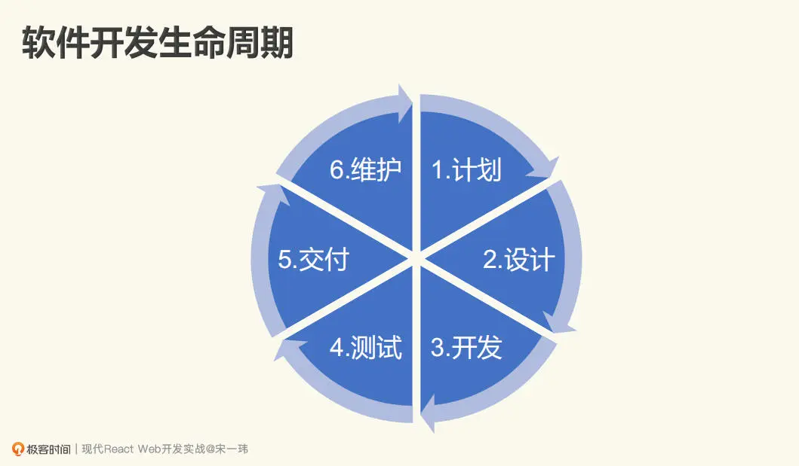
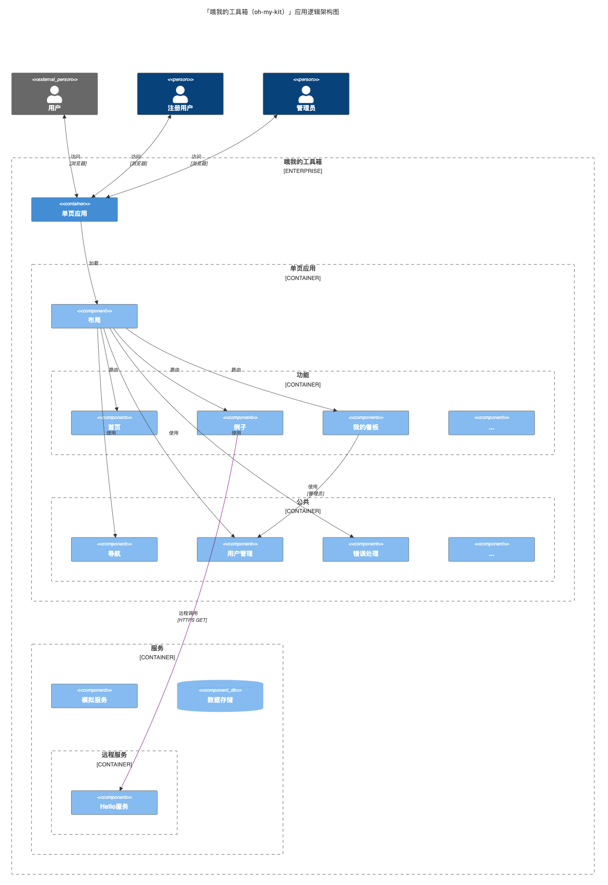
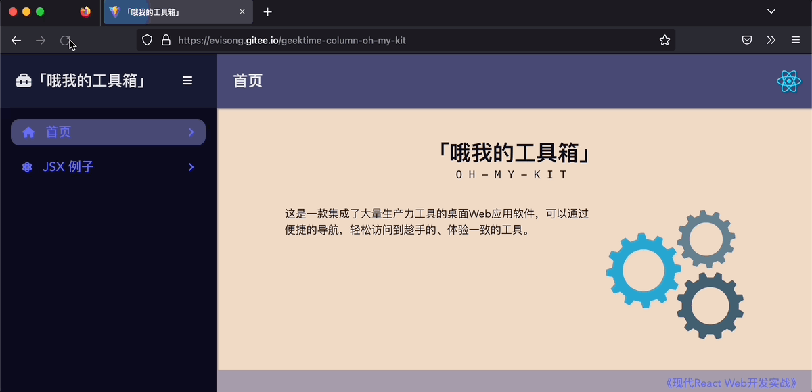
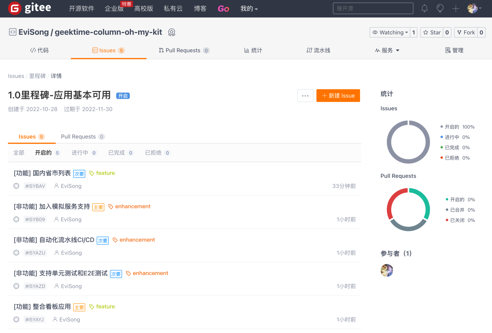

# 24 | 工程化与团队协作：让我们合作开发一个大型React项目

你好，我是宋一玮，欢迎回到 React 应用开发的学习。

前面我们用两节课的时间，学习了大中型 React 项目最重要的实践之一：自动化测试。我们先后学习了如何利用 Playwright 框架开发自动化 E2E 测试用例，以及如何用 Jest + RTL 为React 组件和 Hooks 编写单元测试。

我们也通过对测试金字塔概念的学习，理解了 E2E 和单元测试互为补充的关系，认识到可以在项目中同时加入这两种自动化测试用例，来提高整体覆盖率、提升项目质量。

这节课是模块三，也是这个专栏的最后一节正课内容。我会带着你总结一下前面学习过的知识点，然后把它们串联起来，介绍大型 React 应用项目中的团队协作和工程化。

最后还有一个特别企划。这个专栏其实在立项之初，就设计了一小一大两个 React 项目，其中

```
的小项目就是模块二的 oh-my-kanban 。相信你对它印象深刻，毕竟我基本每节课都会像写
```

字楼电梯间的洗脑广告一样，反复提到它。

那么大项目呢？这不，马上就来了：我会新搭建一个开源 React 项目，在其中设计一系列扩展点，然后请你跟我一起，合作开发这个大型 React 项目。

下面开始这节课的内容。

## 本专栏的知识地图

如果你是从第一节课开始，按课程连载顺序一节一节学到这里，那么你应该会发现，这个专栏跟市面上其他教程有些许不同：

首先，本专栏从课程设计上，采用了学习曲线的变体——螺旋学习曲线（第 6 节课），即：学习技术表层 → 学习技术底层 → 回过头来理解表层 → 继续学习更多表层 → 底层 → …如此往复… → 掌握技术。



其次，在内容上，本专栏极力避免单纯的技术点罗列，而是强调与技术点相关的逻辑，包括React 从旧版到新版发生变化的逻辑、React 技术点与背后的前端领域知识间的逻辑，还有为React 项目引入各种现代工程化技术和实践的逻辑。这样设计的好处，可以帮你加深理解，让学习到的知识真正转化成自己的能力。

但如果万一，比如你的朋友是从课程中间开始学起的，他 / 她有可能需要花些功夫来适应这个专栏的节奏。

一是为了带着你复习，二是为了帮助你的朋友尽快融入这个专栏，我总结了一份本专栏专用的知识地图，放在这里供你们参考。



## 前端团队的分工协作

前面一直提到“团队协作开发大中型 React 应用项目”，并不是说一个人就没办法独立开发大中型 React 应用项目，而更多是从软件工程角度探讨开发效率和效果。

现代软件开发的任务拆解（WBS）和迭代计划（Iteration Plan），都无法脱离具体技术存在。

比如，正因为 React 技术支持组件拆分，按组件分配工作任务才是可行的。先有若干工作任务，再分派给开发团队成员，这样大家就可以齐头并进、并行不悖了。

在团队人力不足的情况下，每位团队成员往往会被分派到多个工作任务；极端情况下，团队如果只有一人，那这一个人就会接手所有工作任务，但这并不会否定工作任务拆分的价值，它依旧是制定开发计划的基础。

在上面的知识地图中，有一列是“在大中型 React 项目中的相关实践”，里面很多内容都与团队协作相关。

当团队规模大于等于 2 人时，分工可以考虑横向和纵向分工。横向分工是按业务功能分派工作任务，纵向则是按应用架构层次分派工作任务。在真实项目中，往往是结合这两种方式来分工的。

这里用第 20 节课中的“按业务功能划分为主，结合按组件、按文件职能的方式，划分”的文

```
件目录结构作为线索，举一个横向加纵向分工的例子。团队一共 6 人， # 号后面是团队成员
```

的名字：

```
src
├── components
│   ├── Button           # 小花
│   ├── Dialog           # 大壮
│   ├── ErrorBoundary    # 大壮
│   ├── Form             # 小花
│   ├── ...
│   └── Tooltip          # 小花
├── context
│   ├── ...
│   └── UserContext.js   # 阿强
├── features
│   ├── admin            # 小黑
│   ├── dashboard        # 小黑
│   │   ├── activies     # 小白
│   │   ├── charts       # 大壮
│   │   ├── news         # 小黑
│   │   ├── ...
│   │   └── index.js     # 小黑
│   ├── kanban           # 小白
│   ├── home             # 阿珍
│   ├── login            # 阿强
│   ├── ...
│   └── user             # 阿强
├── hooks
│   ├── ...
│   └── useLocation.js   # 阿珍
└── servies
   ├── kanbanService.js # 小白
   ├── ...
   └── userService.js   # 阿强
我们大都希望团队协作的开发效率是 1 + 1 > 2 ，只要产品需求、工作分配、团队人员别掉
```

链子，这相对还是容易达到的。

```
但要注意，随着团队规模的扩大， 1 + 1 + 1 > 3 、 1 + 1 + 1 + 1 > 4 这样线性的
```

效率提升会越来越难做到。究其原因，还是人。人是团队最大的财富，也是最大的变量。团队成员间沟通顺畅、配合默契，每位成员也具备相当的开发能力、发挥稳定，团队协作才能更有效，反之，项目开发就会出问题。

现代软件项目的工程化实践，可以为团队提供助力，减小包括人在内的不稳定因素的影响，最大化地保证团队整体稳定输出。

## 现代大型 React 项目的工程化

我们在前面第 14 节课里，已经介绍过一部分适用于 React 项目的现代工程化技术。这里我们会从更宏观一些的层面，介绍现代大型 React 项目的工程化。

首先，我们来一块看一下大型 React 项目工程化的目标和要点。

1. 项目、团队可扩展。

在项目开发过程中，可以根据需要，相对灵活地在项目代码中加入新功能，也可以无缝地在团队中加入新的成员，这样的项目，才有可能成为健康的项目。

2. 简化开发流程，缩短迭代周期。

比起早期的瀑布式开发，敏捷开发是更加轻流程的。无论是流程推动人，还是人推动流程，都需要让流程更加优化，减少资源的浪费。

3. 减少重复性工作，降低人为出错可能性。

还是我一贯的观点，人会出错，不用避讳。比起每次出错时把精力放在甩锅上，倒不如在容易出错的地方引入自动化，减少人的参与。节省出来的精力，可以投入到更具有创造性的工作上。

4. 贯彻团队约定，统一标准。

根据 2020 年中国青年报发起的调研，我国年轻人有 40% 以上自称“社恐”。这与我观察到的现象类似：软件工程师里年轻人居多，确实不少年轻工程师不愿意在例会上主动发言。

但项目开发需要整个团队的工作符合一定标准，对项目建立一定共识。比如代码缩进是 Tab 还是空格，是 2 个空格还是 4 个空格；再比如新提交的代码测试覆盖率必须达到 80% 以上还是90% 以上，等等。不愿交流怎么建立共识呢？鼓励大家改善社恐的同时，工程化实践也可以替“沉默的大多数”发声。

5. 权责清晰，变更可追溯。

你可能会说：“刚说完不鼓励甩锅，这马上就强调工程化可以作为甩锅利器。”其实不是这样，可追溯首先还是帮助降低项目长期的成本和风险。

比如产品上线发现 Bug，需要回退，要确定回退的目标版本吧？这样做可以使权责清晰，也确保了没有“三不管”的代码，整个项目的代码就都是可控的。消极来说，当所有人甩锅都变得如此简单，那甩锅也就不是什么需要花心思培养的特技了。

大型 React 项目的工程化贯穿了整个软件生命周期，下图来自于直播加餐 01：



从上图的第 3 阶段开发阶段开始，工程化会覆盖多个环境：

- 本地开发环境。第 14 节课介绍的工程化实践基本都体现在这个环境中，与开发者密切相关；

- 持续集成环境。一般而言企业里会为 CI/CD 搭建专门的服务器，常见的软件比如 Jenkins。CI Pipeline 常会运行在虚拟机或者 Docker 里。团队多位开发者的工作成果将汇聚到这里；

- 测试环境。这里部署的产品服务会被用来跑 E2E 测试或其他人工测试；

- 生产环境或准生产环境。在部分企业，线上监控、报警也被视为工程化的一部分；

- 用户浏览器环境。生产环境的特殊组成部分。

## 开源 React 项目 oh-my-kit

```
我们课程的收官大项目名字就叫 oh-my-kit（哦我的工具箱），嗯，我给项目起名字的水平
```

也就这样了（摊手）。

在紧张的工作学习过程中，你经常需要用到一些提升自己效率的工具，而这些工具经常分散在各个地方，比如手机 App、小程序、PC 软件、某个网页，而且它们的体验也参差不齐，相互间也缺乏连通性。《哦我的工具箱》是一款集（duī）成（qì）了大量生产力工具的桌面 Web应用软件，可以通过便捷的导航，轻松访问到趁手的、体验一致的工具。

JS 开源社区是非常活跃的，我相信你之前即使没有参与过开源项目的开发，也应该看过不少开源框架或开源库的网站和代码仓库了。开源软件是软件开发领域最伟大的创举之一，这里我们不去揣测开源项目后面经济利益之类的动机，单从结果来看，开源推动了软件行业的共同进步，也成就了许多团体和个人。

```
我们的 oh-my-kit 项目会作为开源项目托管在 Gitee 上。一开始会由我来搭建项目的脚手
```

架，加入并维护通用模块：



```
├── dist                  # 发布目录
├── docs                  # 文档目录
│   ├── diagrams          # 文档中的图表目录
│   └── architecture.md   # 此文档
├── public                # 静态资源目录
│   ├── mock              # 模拟远程数据目录
│   └── vite.svg
├── src                   # 源代码目录
│   ├── components        # 公共组件目录，通过 #components/* 导入
│   ├── context           # 公共React context目录
│   ├── features          # 功能模块目录
│   │   ├── App           # 主体布局模块
│   │   ├── Example       # 例子模块
│   │   ├── Home          # 首页模块
│   │   └── Routes.tsx    # 模块路由集中配置文件
│   ├── hooks             # 公共React Hooks目录，通过 #hooks/* 导入
│   │   └── useService.ts # 远程服务Hook
│   ├── services          # 远程服务目录
│   └── types             # 公共Types定义目录，通过 #types/* 导入
├── index.html
├── package.json
├── tsconfig.json         # TypeScript配置
├── tsconfig.node.json
└── vite.config.ts        # Vite配置
```

也会配置对应的 CI/CD，将发行版部署在 Gitee Pages 上：



```
同时我会为 oh-my-kit 项目加入产品路线图（Roadmap）和轻量级的产品需求文档
```

（PRD），也会在代码中设置一系列扩展点，为这些需求留出位置：



接下来我会请你认领其中的产品需求。你将 Fork 代码仓库，拉出你自己的功能分支，编写代码实现需求，然后提交拉取请求（Pull Request）。

我会定期对拉取请求做代码评审，通过评审和测试的代码，会被合并到主代码仓库中，并最终在 Gitee Pages 部署新版。希望通过这样的方式，在你练手的同时，也能保证项目具备一定的

```
质量，让 oh-my-kit 成为一款基本可用的开源 Web 应用。
```

该项目也会参考一些成功开源项目的维护方式，欢迎你和你的朋友们提出 Issue，我们会根据优先级做迭代计划。

目前的服务器端我会采用模拟（Mock）方式，但也会尽量利用浏览器存储来满足一部分持久化的需求。当项目具有一定规模时，会根据大家的反馈，决定是否加入真实的服务器端。

开源项目的 URL 是：

https://gitee.com/evisong/geektime-column-oh-my-kit

## 小结

好的，到这里本专栏的正课内容就告一段落了。

这节课我们用知识地图的方式，复习了前面课程的大部分知识点，介绍了前端团队在大型React 项目中横向和纵向的分工方法。也从宏观层面介绍了现代大型 React 项目工程化的目

```
标，以及工程化过程中包含的几个环境。最后，我们约好，在新建的开源 React 项目 oh-my-
kit 中协作开发，实践整个专栏所学。
```

这节课没有思考题，非常欢迎你提交代码。

我们下节课结束语再见。
