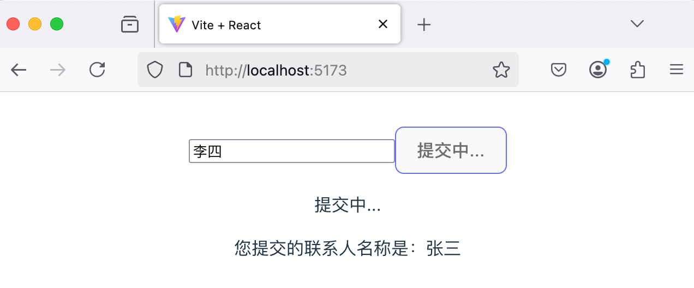

# React19新增的Action和表单相关API

你好，我是宋一玮，好久不见，欢迎回到 React 应用开发的学习。

专栏完结到现在，已经过去了两年时间。这两年里，前端开发技术仍然在不断发展、推陈出新，技术社区也非常活跃。尽管市面上涌现出了不少新的前端框架、前端库，React 仍然是众多前端技术中的佼佼者，在市场上占据着主要地位。在这两年间，React 有没有什么变化呢？

2024 年 12 月 5 日，React 正式发布了新版本 React 19，这是距离上一个大版本（React 18）发布两年半以来最大的一次更新。React 19 加入了新的 API 和 Hooks，改进了不少已有的API，也进一步增强了服务器端渲染的能力。我将用 3 节加餐来介绍 React 19 的主要新内容：

- React 19 的新概念 action，以及与表单处理相关的新 API。

```
React 19 的新use API、ref 的改进，以及 JSX 新支持的 HTML 标签。
```

- React 19 在服务器端渲染领域的新功能：服务器组件和服务器 action。

在介绍这些新内容的同时，我也会补充相关的背景知识，确保新内容能平滑地融入整个专栏的知识体系中。除了上面这些，React 19 还包含一些额外的新 API 和部分既有 API 在参数细节上的改进，以及整体可调试性的增强，这些知识较为零散，你可以参考官方文档，随用随查即可，这次加餐中不再赘述。

这一节我们先介绍新概念 action，以及与表单处理相关的新 API：useActionState 、useFormStatus和useOptimistic。

## 创建 React 19 项目

首先，我们来看看 React 19 项目在创建过程中有什么不同。

本专栏曾推荐使用 CRA，即 Create-React-App 创建 React 项目，而 2025 年 1 月，Meta 官方宣布 CRA 已经结束其历史使命，并正式将其标记为“弃用”。你依旧可以在前面课程的学习中使用 CRA，但对新项目，目前 Vite 项目脚手架是我创建 React 项目的首选方式。从

```sql
create-vite@6.2.0 版本开始，Vite 的 React 项目模版默认采用 React 19。
在命令行中执行 create-vite ，并根据提示输入项目名 oh-my-react-19 ，选择 React
+  JavaScript ：
npm create vite@latest
✔ Project name: … oh-my-react-19
✔ Select a framework: › React
✔ Select a variant: › JavaScript
```

进入项目目录，执行：

```bash
cd oh-my-react-19
npm install
npm run dev
```

然后即可在浏览器中访问脚手架的默认页面：http://localhost:5173/。

## 将现有 React 项目升级至 React 19

还有一种情况，对于已有的 React 项目，如何升级到 React 19。

React 19 总体而言是向前兼容的，但因为它删除了一些前面版本中标记为弃用的 API，对于仍在使用这些被弃用 API 的 React 项目，升级将带来破坏性更新。官方的建议是先升级到React 18.3，这个版本完善了弃用 API 的警告信息，在 React 项目运行这个版本，有助于提前发现升级 React 19 将导致的问题。

在项目中运行如下命令即可安装 React 18.3：

```
npm install react@18.3.1 react-dom@18.3.1
假设你的组件代码里用 MyComponent.defaultProps = { prop1: 'value' } 指定
```

prop 默认值，浏览器控制台里会警告：

- Warning: App: Support for defaultProps will be removed from function components in afuture major release. Use JavaScript default parameters instead.

为了顺利升级到 React 19，你需要按照提示修正浏览器控制台中的所有警告。当控制台中不再有警告时，你就可以放心升级 React 19 了：

```
npm install react@19 react-dom@19
```

## React 18 的 Transition

```
在介绍 React 19 新 APIuseActionState、 useFormStatus 和 useOptimistic 之前，
```

我们首先要介绍 React 19 中的一个新概念：action（动作），而要介绍 action，就得先聊聊transition（过渡）。

这里我们先提出一个问题，在前端 UI 中，所有交互都同等重要吗？之所以问出这个问题，是因为我们前端开发者面临着重要现实：浏览器资源是有限的。浏览器中 JavaScript 是单线程的，同一时间能做的事情是有限的。如果能人为定义这些 UI 交互的轻重缓急，就有机会为更优先的交互保留资源，比如录入文字、滚动列表等。

前面加餐 02介绍的 Fiber 协调引擎，把 React 的渲染过程切分成了大量细小的、可中断和恢复的工作单元，这为 React 的性能优化提供了更多可能性。React 18 加入的 transition（过渡）概念，可以用来定义非关键的 state 更新。

非关键的 state 更新是区别于关键 state 更新而言的。在不作区别时，所有的 state 更新都是同样重要的。在第 9 节我们曾提到过，React 18 在各种事件处理函数或回调函数中，如果存在多个 state 更新操作，则会自动批处理，即在一次渲染中使用多个 state 的新值。这总体上提高了渲染效率，但也带来一个问题，如果其中某个 state 更新导致的渲染代价较大，则会拖累其他的 state 更新，具体来说，可能会导致录入文字变“卡”。

这种情况下，我们可以把代价大的 state 更新标记为非关键的 transition，把它在调度器里的优先级排到关键更新之后。在 transition 执行过程中，调度器每 5 毫秒都会把控制权交还给主进程，检查是否有其他更重要的工作单元，如果有就暂停 transition，这样就可以进一步避免阻塞 UI。

```javascript
与 transition 相关的有两个 API，一个函数 startTransition 和一个 Hook
useTransition 。它们的用法如下：
startTransition(() => {/* 省略 */});
//              -----------------
//                      ^
//                      |
//                 scope回调函数
const [isPending, startTransition] = useTransition();
//     ---------  ---------------
//         ^                  ^
//         |                  |
// 是否存在待执行的transition  与startTransition API相同的函数
```

其中“scope 回调函数”中包含的 state 更新会被标记为 transition。我们可以在回调函数内实现一些耗时的逻辑，比如更新一个长列表。如果在 transition 之外有 state 更新，它们会优先被处理，调度器有空闲时才会处理 transition 包含的更新。这样就不会影响用户输入文字时的流

```
畅度。Hook 版本返回的isPending标志可以用来判断是否存在待执行的 transition，常被用
```

于显示类似“读取中”的提示。

```
React 18 要求上面的回调函数整体是同步的，如果其中包含了异步（如 async 、
setTimeout ）的代码，这部分代码中的 state 更新不会被标记为 transition。而从新版的
```

React 19 开始，transition 的回调函数可以是异步函数了。

## React 19 的 Action

我们刚讲到，在 React 18 中 transition 只能是同步函数，而来到 React 19 新版本，transition可以是异步函数了，这将 transition 的使用场景从性能优化扩展到了业务功能的实现。之所以

```
这么说，是因为在开发 React 应用时，我们会遇到很多使用异步函数或 Promise 的场景，典
```

型的场景就比如请求服务器端数据、提交表单到服务器端。对这类异步函数使用 transition，我们可以获得以下收益：

- 提升组件性能，不会阻塞关键交互，为用户带来更平滑的体验。

- 短时间内多次请求服务器端有可能会产生竞争条件（Race Condition）问题，导致组件多次渲染，用户会看到中间的一些更新一闪而过；而使用 transition 包裹异步请求逻辑，同时存

- 在的 transitions 会被合并，只有最后一次 state 更新会被真正渲染出来，用户只会看到最终结果。

```
一个 transition 会自动维护其待定（pending）状态，transition 开始时为true ，结束时改
为false ，可以代替开发者手工维护的“读取中（loading）” state。
```

伴随着 transition 的进化，React 19 将用于触发 transition 的函数，无论是异步还是同步，统称为 action（动作）。从概念上讲，这个 action 与 Redux 中的 action 是类似的，都代表了一定的意图并最终更新 state。在 React 19 中，一个 action 可以有多种调用方法，一种是作为

```
参数传给startTransition ，另一种是传给 <form> 标签的 action 属性。后者就是我们
```

接下来会介绍的表单 action。

```
我们来看一个表单 action 的例子。在前面创建的 React 19 项目中，找到 App.jsx ，在其中
```

加入表单组件：

```xml
function App() {
 const [name, setName] = useState();
 const formAction = async (formData) => {
   const contactName = formData.get('name');
   // 模拟异步请求
   await new Promise((resolve) => setTimeout(resolve, 1000));
   setName(contactName);
 };
 return (
   <form action={formAction}>
     <input type="text" name="name" placeholder="联系人名称" />
     <button type="submit">提交</button>
     {name && <p>您提交的联系人名称是：{name}</p>}
   </form>
 );
}
```

可以看到组件代码中包含一个非受控组件组成的表单，并声明了一个异步函数

```
formAction ，将它作为 action 赋值给 <form> 的 action  prop。这样表单在提交时，
React 会调用这个函数，函数参数是 Web 标准的 FormData 接口的 formData 对象。表单完
```

整提交后，表单控件的值会被自动重置。

## 新 Hook：useFormStatus

```xml
我们已知上面的表单 action 会作为 transition 执行，那么能不能像useTransition 那样获取
transition 的待定状态呢？答案是肯定的，React 19 中的新 Hook  useFormStatus 可以返回
最近的表单提交的状态信息。不过需要在 <form> 所在组件的子组件或后代组件中才能使用
它，可以理解成 <form> 所在组件会形成一个特别的表单 context，后代组件可以通过
useFormStatus 访问这个 context。我们可以将表单按钮抽取成 FormButtons 组件，并在
App 组件中使用它，代码如下：
import { useFormStatus } from 'react-dom';
function FormButtons() {
 const { pending } = useFormStatus();
 return (
   <button type="submit" disabled={pending}>
     {pending ? '提交中...' : '提交'}
   </button>
 );
}
function App() {
 // 省略
 return (
   <form action={formAction}>
     <input type="text" name="name" placeholder="联系人名称" />
     <FormButtons />
     {name && <p>您提交的联系人名称是：{name}</p>}
   </form>
 );
}
这样表单提交发送请求过程中，按钮会被禁用，并显示“提交中…”。除了pending ，这个
Hook 还返回了包含表单数据的 data 等字段。
```

## 新 Hook：useActionState

使用表单 action 时，该如何处理表单提交后的服务器返回值呢？我们可以利用 React 19 的新

```javascript
Hook useActionState 来创建一个增强版的 action。这个 Hook 的签名如下：
const [state, formAction, pending] = useActionState(action, initState);
//     -----  ----------  -------                   ------  ---------
//       ^        ^            ^                      ^         ^
//       |        |            |                      |         |
// state变量  用于form的action  待定状态            action函数  state初始值
Hook 参数中的action 函数，其参数变成了两个，第一个是当前 state，第二个才是
formData 。作为参数的 action 不应直接指定给 <form> ，取而代之的是 Hook 返回数组
中的第二个变量 formAction 。Hook 返回的第一个变量是个 state，组件挂载时，其初始值
来自 initState ，而后续执行 action 时，action 函数的返回值会被 React 用来更新
state。Hook 返回的第三个变量pending 与 useFormStatus 返回的 pending 是等效的，
可以直接在 <form> 所在组件中使用。
用useActionState 来改写前面的表单组件，可以把原来联系人名称的 state 合并到表单
```

action 返回的 state 里，代码如下：

```xml
import { useActionState } from 'react';
// 省略 function FormButtons
function App() {
 const [state, formAction, pending] = useActionState(
   async (currentState, formData) => {
     // 省略模拟异步请求逻辑
     return { ...currentState, success: true, name: contactName };
   }, {});
 return (
   <form action={formAction}>
     <input type="text" name="name" placeholder="联系人名称" />
     <FormButtons />
     {pending && <p>提交中...</p>}
     {state.success && <p>您提交的联系人名称是：{state.name}</p>}
   </form>
 );
}
```

对应的页面截图如下：



在 action 函数中，开发者也可以处理可能发生的服务器错误，将错误消息作为 state 返回。这部分逻辑你可以自行尝试一下。

## 新 Hook：useOptimistic

```
与表单 action 配套，在 React 19 中还有另一个新 Hook useOptimistic ，在 action 执行期
```

间，它能乐观更新组件的 state，从而实现更友好的用户体验。

所谓乐观更新，就是在用户操作表单后的第一时间更新 UI，在 transition 结束后再将最终的state 同步到 UI。举个很具体的例子，社交软件上常见的“点赞”按钮，当用户点击这个按钮时，按钮瞬间就变成“已点赞”的状态，提供给用户一个实时的正面反馈；而实际上，这时浏览器端向服务器端点赞 API 的请求还在发送和处理中，假设这个 API 经过 1 秒钟才返回请求结果，如果请求成功了，则页面保留“已点赞”的状态，否则页面将提示用户点赞失败，按钮退回尚未点赞的状态。

这个 Hook 的签名如下：

```javascript
const [optimisticState, addOptimistic] = useOptimistic(state, updater);
//     ---------------  -------------                  -----  -------
//           ^                ^                          ^       ^
//           |                |                          |       |
//      乐观state       触发乐观更新的函数              原始state    ｜
//                                                    乐观state更新函数
其中作为参数的 state 是指原始的 state，返回数组的第一个变量optimisticState 是派
生出来的乐观 state。作为另一个参数的乐观 state 更新函数 updater ，接受原始 state 和
optimisticValue两个参数；Hook 返回的触发乐观更新的函数 addOptimistic 接受一
个optimisticValue 参数，开发者应在 action 函数中尽早调用addOptimistic，它内部
会调用updater函数更新乐观 state。在 transition 执行期间，optimisticState 变量的值
为 updater 返回的结果，而在没有 transition 执行的时候，optimisticState 变量的值等
```

于原始 state 的值。

```
这个签名跟第 9 节讲到的 useReducer 有一定的相似性，为了方便理解，你不妨把
addOptimistic 看作是useReducer里的dispatch ，把updater 看作useReducer里
的reducer 。
让我们继续修改前面useActionState的例子，用useOptimistic来创建乐观 state，替代
```

原有的 state，代码如下：

```xml
import { useActionState, useOptimistic } from 'react'
// 省略 function FormButtons
function App() {
 const [state, formAction, pending] = useActionState(
   async (currentState, formData) => {
     const contactName = formData.get('name');
     addOptimistic(contactName);
     // 省略模拟异步请求逻辑
     return { ...currentState, success: true, name: contactName };
   }, {});
 const [optimisticState, addOptimistic] = useOptimistic(
   state,
   (currentState, optimisticValue) => ({
     ...currentState, name: optimisticValue
   })
 );
 return (
   <form action={formAction}>
     <input type="text" name="name" placeholder="联系人名称" />
     <FormButtons />
     <p>您提交的联系人名称是：{optimisticState.name}
       {pending ? (<span>(提交中...)</span>) : (
         state.success && <span>(提交成功!)</span>
       )}
     </p>
   </form>
 );
}
```

经过以上修改，用户在提交表单的第一时间就能看到新的联系人名称。1 秒钟后，transition 结束，联系人名称被替换成经过服务器端处理的、真实的 state 值。

```
需要声明的是，虽然我们的例子把useActionState 、useFormStatus 和
useOptimistic这三个新 Hook 都串了起来，但它们并不是必须同时使用的。它们的必要条
```

件只有表单 action，你可以自由组合使用这些 Hook。

另外，表单 action 和上述三个 Hook 还比较新，截止到 2025 年 2 月，社区中的一部分知名开源库（如 React Hook Form 等）还没有做好相关的支持或适配工作，你在实际使用中需要酌情做出一定取舍。

## 小结

在这节加餐中，我们介绍了 React 19 版本新加入的 action 概念，及其背后的 transition，讲解

```xml
了与 action 相关的三个新 Hook：useActionState 、useFormStatus 和
useOptimistic，并分别提供了样例代码。
下一节加餐，我们将继续介绍 React 19 的新 API use 的两种用法、ref 和forwardRef 的
变化，以及一些新支持的 HTML 标签<title>、<link>、<meta>、 <style> 、
<script>。
```

## 思考题

1. 我们在前面讲 transition 时，曾提到它可以“提升组件性能，不会阻塞关键交互，为用户带来更平滑的体验”。你能举一些例子，说明哪些交互是区别于 transition 的关键交互吗？可否写一段代码来演示 transition 是如何保障关键交互的性能的？

2. 在 React 19.0.0 版本中，表单 action 有一个特性，当用户提交表单执行 action 后，所有表单字段都会被重置，以方便下一次交互。但在有些场景中，我们希望提交表单后，表单内容能被保留，自动重置的特性反而变成了限制。你能想到什么办法绕开这个限制吗？

好了，这节课的内容就到这里。我们下节课再见。
