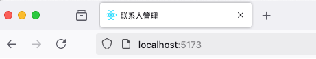

# React19新增的use以及其他API

你好，我是宋一玮，欢迎回到 React 应用开发的学习。

上节课我们学习了如何创建 React 19 项目，了解了 React 19 的 action，及其背后的

```xml
transition 概念，还学习了与表单 action 相关的三个新 Hooks：useActionState 、
useFormStatus和useOptimistic。
这节课，我们会继续介绍 React 19 的新功能，包括新 API use 的两种用法、ref 与
forwardRef 的变化，以及一些新支持的 HTML 标签<title>、<link>、<meta>、
<style> 、<script>。
```

## Suspense 与组件的懒加载

```
在介绍 React 19 新 API use 之前，我们先聊一下 React 中 Suspense（中文可以翻译为“等
```

待”，为避免歧义下文将沿用英文单词）的概念以及它的使用场景。React 早在 16.6 版本就加

```
入了 <Suspense> 组件，当时它的主要用途是配合React.lazy() API 实现自定义组件的懒
```

加载。随着 React 18 引入 Fiber 协调引擎，Suspense 的功能进一步增强，适用的场景也扩展到获取异步数据。

为了方便理解 Suspense，我们先来看一下组件懒加载。随着 React 项目规模的不断提升，为了减少用户首次加载的等待时间，优化用户体验，开发者可能会需要进行代码分割。组件懒加载是代码分割的重要方式之一。

```bash
我们用上一节课的 React 19 表单代码作为例子，将 FormButtons 组件改为懒加载。首先把
组件抽取到一个独立文件 FormButtons.jsx 中：
export default function FormButtons() {
 // 省略
}
然后修改App.jsx ，在App 组件前插入一行 React.lazy() 语句：
const FormButtons = React.lazy(() => import('./FormButtons.jsx'));
React.lazy() 的参数是一个回调函数，回调函数内调用了 import() 语句并返回了它的
```

Promise。这个 API 被调用后会返回一个新组件，React 在它首次渲染时会调用回调函数，并

```
等待返回的 Promise 被解决，随后 Promise 解决值的 .default 会作为 React 组件被渲染出
```

来。

```
但光有上面的代码还不够。在 React.lazy() 回调函数被触发后，Promise 被解决之前，
FormButtons 组件会进入挂起（Suspend）状态。对进入挂起状态的组件，React 在它的祖
```

先组件中寻找最近的 Suspense 边界，用这个 Suspense 指定的后备视图来替代 Suspense

```
的子组件树。React 中用于定义 Suspense 边界的组件是 <Suspense> 。配合使用这两个
```

API 的 App 组件代码如下：

```xml
import React, { Suspense } from 'react';
const FormButtons = React.lazy(() => import('./FormButtons.jsx'));
function App() {
 // 省略
 return (
   <form action={formAction}>
     <input type="text" name="name" placeholder="联系人名称" />
     <Suspense fallback={<span>加载中...</span>}>
       <FormButtons />
     </Suspense>
     {/* 省略 */}
   </form>
 );
}
```

这样实现的效果是在首次展示页面时，文本框会先显示出来，而按钮位置会显示“加载中”字样，直到分割的 JS 文件读取完成，才会渲染为按钮组件。你可以在浏览器开发者工具的网络页签中设置网络限速来验证这一效果。

Suspense 边界和组件挂起这一对功能不只可以用于自定义组件文件的懒加载，还可以用于远程数据的加载。

## React 19：新 use API

```javascript
接下来，我们介绍 React 19 中另一个与异步处理相关的新 API：use 。它的签名是：
const value = use(resource);
```

这个新 API 看起来像是 Hook，但它并不是 Hook。与 Hook 相同的是，它必须被用在 React组件函数或者自定义 Hook 中；与 Hook 不同的是，它可以用在条件分支或循环中。它的参数

```
resource 即资源，目前 React 支持两种资源：Promise 和 context，代表着这个 API 的两种
```

不同用例。

### 新 API：use(Promise)

在开发 React 应用时，我们经常要写很多与服务器端通信的代码，这些代码大部分都是异步

```
的。在 React 中编写异步代码还是有一些限制的，比如在 useEffect 中使用
async/await 需要写成 Async IIFE（异步立即调用函数表达式）， useState 的初始值也不
```

能是一个异步函数等。来到了 React 19，框架对异步函数的支持有了一定的提升，如上节课

```
提到的 startTransition 新支持了异步函数，再如我们马上要讲的use(Promise) ，可
```

以很容易地把异步函数与 Suspense 集成起来。

```
use 只接收一个参数，当这个参数的类型是一个 Promise 时，它将在 Promise 被解决
（resolve）时把 Promise 的返回值返回给调用者。使用 use(Promise) 的组件需要被包在
```

一个 Suspense 边界内，Promise 尚未解决时，该组件会被挂起，直至 Promise 被兑现（fulfill）或拒绝（reject）。针对 Promise 被拒绝的情况，组件需要被包在一个错误边界（Error Boundary）内。

我们继续使用上面的 React 19 样例代码，在表单前面追加一个联系人列表。首先在项目中安

```xml
装 react-error-boundary 库：
npm install react-error-boundary
然后在 App.jsx 中插入新组件 Contacts ：
import { use } from 'react';
const contactsPromise = new Promise((resolve) => {
 setTimeout(() => {
   resolve([
     { id: 1, name: '张三' },
     { id: 2, name: '李四' },
     { id: 3, name: '王五' }
   ]);
 }, 1000);
});
function Contacts() {
 const contacts = use(contactsPromise);
 return (
   <ul>
     {contacts.map(contact => (
       <li key={contact.id}>{contact.name}</li>
     ))}
   </ul>
 );
}
```

可以看到，我们在组件外面创建了一个 Promise 以模拟获取远程数据的过程，并把这个

```
Promise 作为参数传递给组件内的 use 。当然，在真实项目中，我们可以通过调用 fetch API
```

来创建这个 Promise。

```xml
接下来在 App 中使用 Contacts 组件，并在其外侧加上错误边界和 Suspense 边界：
import { Suspense } from 'react';
import { ErrorBoundary } from 'react-error-boundary';
// 省略
function App() {
 // 省略
 return (
   <>
     <ErrorBoundary fallback={<div>加载失败</div>}>
       <Suspense fallback={<div>读取中...</div>}>
         <Contacts />
       </Suspense>
     </ErrorBoundary>
     <form action={formAction}>
       {/* 省略 */}
     </form>
   </>
 );
}
```

在浏览器里刷新整个页面，会看到表单上方先显示“读取中”，一秒后再显示联系人列表。你可

```
以尝试把contactsPromise的 resolve 改成 reject ，看看是否能正确触发错误边界的
```

错误提示。

上述代码中，创建 Promise 的语句被写在了组件之外，所以当组件所在的 JS 被加载后就会执

```
行。如果 Promise 被解决的时间晚于 Contacts 组件被渲染，则 Contacts 组件会被挂起，
```

直到 Promise 被解决。这种写法作为例子勉强可以，但 Promise 执行的时机并不受 React 控制，灵活性不够。

```javascript
那能不能把 Promise 写在组件内部呢？答案是肯定的，但直接在组件函数里用 const 来声
```

明，会导致组件每次重新渲染都要创建新的 Promise，组件会被多次挂起，不具有实际意义。

```
另一种做法是在父组件 App 中创建一个用来保存 Promise 的 state，以 state 的初始值、额外
```

的副作用或者事件处理函数来控制执行 Promise 的时机，然后将这个 state 随着 props 传递给

```xml
子组件 Contacts ，供其内部 use 使用。示例代码如下：
function Contacts({ contactsPromise }) {
 const contacts = use(contactsPromise);
 // 省略
}
function App() {
 const [contactsPromise, setContactsPromise] = useState(() => {
   return new Promise((resolve) => {
     setTimeout(() => {
       resolve([
         { id: 1, name: '张三' },
         { id: 2, name: '李四' },
         { id: 3, name: '王五' }
       ]);
     }, 1000);
   });
 });
 // 省略
 return (
   <>
     <ErrorBoundary fallback={<div>加载失败</div>}>
       <Suspense fallback={<div>读取中...</div>}>
         <Contacts contactsPromise={contactsPromise} />
       </Suspense>
     </ErrorBoundary>
```

这个新 API 的引入将进一步增加开发者对 React Suspense 机制的使用。

### 新 API：use(Context)

```bash
当 use 的参数是由 createContext 方法创建的 context 时，它的作用与 useContext
Hook 是基本相同的，即在组件中读取和订阅 context，不同点是 use(Context) 比
useContext 更灵活，可以用在组件函数的条件分支或循环里。比如：
import { use } from 'react';
export default function KanbanCard() {
 const isAdmin = (username === 'BOSS') ? true : use(AdminContext);
另外，从 React 19 开始，在组件中提供 context 不再需要 .Provider 后缀：
```

```xml
{/* React 19之前 */}
<AdminContext.Provider value={isAdmin}>
 {/* 省略 */}
</AdminContext.Provider>
{/* React 19开始 */}
<AdminContext value={isAdmin}>
 {/* 省略 */}
</AdminContext>
```

## React 19 的ref

```xml
我们在第 9 节讲过useRef  Hook 的用法，当时样例代码中把文本框的真实 DOM 元素引用
保存到了ref 中：
<input type="text" value={title} ref={ref} />
然后以ref.current.focus()语句调用原生 DOM API， 将该文本框设置为页面焦点。
有时为了实现更复杂的交互，或是为了抽取可重用组件，我们需要在父组件中调用 useRef
，并把创建的 ref 传递给子组件，这样就可以在父组件中操作子组件内部的真实 DOM 元
素。然而在 React 19 以前，ref 并不能直接声明为一个组件的 prop，而是需要借助
forwardRef  API。比如我们把样例中的文本框抽取成一个自定义组件：
import { forwardRef } from 'react';
const NewCardInput = forwardRef(function NewCardInput(props, ref) {
 const { title, onChange, onKeyDown } = props;
 return (
   <input type="text" value={title} ref={ref}
     onChange={onChange} onKeyDown={onKeyDown} />
 );
}
```

然后父组件就可以操纵子组件的文本框 DOM：

```bash
export default function KanbanNewCard({ onSubmit }) {
 // 省略
 const inputElem = useRef(null);
 useEffect(() => {
   setTimeout(() => inputElem.current.focus(), 100);
 }, []);
 return (
   <li css={kanbanCardStyles}>
     <h3>添加新卡片</h3>
     <NewCardInput title={title} ref={inputElem}
       onChange={handleChange} onKeyDown={handleKeyDown} />
   </li>
 );
}
利用 useRef 和 forwardRef ，我们可以用更灵活的结构实现更复杂的交互。然而
forwardRef 这个 API 本身是比较反直觉的，跟 React 其他 API 相比起来多少有些格格不
```

入，会降低代码的可读性。

```xml
好消息是从 React 19 开始，ref可以像其他 props 一样，直接在函数组件参数里定义，无需
再调用forwardRef。在 React 19 中，上面的代码可以改写为：
function NewCardInput({ title, onChange, onKeyDown, ref }) {
 return (
   <input type="text" value={title} ref={ref}
     onChange={onChange} onKeyDown={onKeyDown} />
 );
}
```

这样就更加符合 React 整体写法，减少了开发者的负担。

## React 19 新支持的 HTML 标签

React 19 中新支持了一些开发者耳熟能详的 HTML 标签，可以写在 JSX 中。包括用于管理文

```
档元数据的<title>、<link>、<meta>，以及编写内联样式表的 <style> 、加载额外 JS
脚本的<script>。
```

### 用<title>、<link>、<meta>定义文档元数据

```
在编写传统的 HTML 页面时，我们会在 HTML 文档的 <head> 区域内定义一些元数据，如文
```

档标题、页面图标、用于 SEO 的页面关键字、页面描述等。在 React 19 以前，若想设置这

```
些元数据，需要使用在副作用中编写 JS 代码或借助 react-helmet 这样的第三方库。而
React 19 新支持了对应的 HTML 标签<title>、<link>、<meta>，开发者可以直接在
```

JSX 中设置文档元数据。

我们直接看例子：

```xml
function App() {
 // 省略
 return (
   <>
     <title>联系人管理</title>
     <link rel="icon" href="/src/assets/react.svg" />
     <meta name="description" content="这个页面提供了联系人管理的功能" />
     {/* 省略其他JSX */}
当 React 渲染这部分 JSX 时，会自动把对应的标签提升到文档的<head> 区域中。如果打开
```

浏览器的开发者工具，你会看到下面的 HTML 源码：

```xml
<html lang="en">
 <head>
   <meta charset="UTF-8"><!--Vite模版-->
   <link rel="icon" type="image/svg+xml" href="/vite.svg"><!--Vite模版-->
   <meta name="viewport"
     content="width=device-width, initial-scale=1.0"><!--Vite模版-->
   <title>联系人管理</title>
   <title>Vite + React</title><!--Vite模版-->
   <link rel="icon" href="/src/assets/react.svg">
   <meta name="description" content="这个页面提供了联系人管理的功能">
 </head>
可以看到除了 Vite 模版自带的元数据标签，我们在 JSX 中编写的<title>、<link>、
<meta>也被合并了进来。带来的效果如下图：
```



上图浏览器页签中标题和页面图标都发生了变化。

```
你可以尝试在子组件里多写一个<title>，如在 Contacts 组件的 JSX 中加一行 <title>
联系人列表</title> ，看看是什么效果。
当然，以上三个标签中的<link>，其最常见的用法还是加载样式文件。我们下面就会介绍。
```

### 用 <style> 和 <link> 编写和加载样式表

我们曾在第 7 节介绍过 React 组件样式，当时提到可以用 CSS-in-JS 库动态生成 HTML 的

```xml
<style> 片段，或构建出独立的 CSS 文件供 HTML 加载使用。React 19 加入了对<style>
和<link>标签的支持，开发者可以用更贴近原生 HTML 的方式在 JSX 中编写样式。
直接看例子，在 App 组件的 JSX 中加入：
<title>联系人管理</title>
<link rel="stylesheet" href="/src/index.css" precedence="global" />
<style href="blue-text" precedence="colors">
 {` body { color: blue; } `}
</style>
这样修改后，main.jsx 中的import './index.css'语句就可以注释掉了。这样写 JSX
的效果是，当组件被渲染时，<style>和<link>会被转换为对应的 HTML 元素并提升到文
档的<head> 区域中。其中<style>的href prop 是能代表 CSS 内容的任意字符串，当组件
树中有多个<style>时，React 会比对href字符串来排除掉重复的 CSS 样式。类似的，当
多个<link>的href prop 相同时，React 也会去重。
可以看到这两个标签有一个共同的 prop 叫precedence，它并不是原生 HTML 标签的属性。
```

我们知道，当 CSS 中有两条规则使用了同样的选择器时，它们的优先级就与出现的顺序有

```
关。这个precedence就是用来设置 CSS 样式优先级的。
开发者对它的第一直觉，可能是要指定类似low/mid/high这样的枚举值，但可惜不是的。
precedence的值可以是任意字符串，在渲染时这个字符串会用来给样式表分组，同组的样式
在提升到<head> 区域后会保证放在一起，组内各个样式的顺序与渲染顺序一致。
```

至于组与组之间的顺序，也与渲染顺序一致，与组名具体是什么字符串无关。如果希望深层后代组件中定义的样式可以保证一定的优先级，那么可以采用一个小技巧：在根组件预定义几个

```xml
<style>，将它们的precedence分别设置成low/mid/high。这样它们的渲染顺序就决定
好了，深层后代组件的<style>和<link>再设置优先级 prop，渲染时就会提升到对应的分
```

组里去，可以在一定程度上保证顺序。

```
但需要注意的是，React 19 内建的<style>和<link>标签并没有对 CSS 代码做任何额外处
```

理，这就意味着它们并不能控制 CSS 的作用域，也没有尝试去解决 CSS 的浏览器兼容性问题。这些是 CSS-in-JS 方案所擅长的，所以如果这些功能对于你的 React 项目是必要的，那还是要考虑使用 CSS-in-JS 方案。

### 用 <script> 加载和执行 JS 脚本

```
除了样式表，React 19 还支持了用<script>标签加载和执行 JS 脚本，例如：
```

```xml
<script> alert("hi!") </script>
<script src="map.js" />
当 React 项目需要整合一些非 React 生态的第三方脚本时，传统的方案是利用useEffect在
组件挂载时动态向 DOM 树中加入一个<script>元素，由它来加载外部 JS 资源。React 19
内建支持了<script>标签，这类用例的实现被简化了。
```

## 小结

这一节我们回顾了 React 的 Suspense 与组件的懒加载，也讲解了如何使用 React 19 的新

```
use(Promise)  API，把 Suspense 的使用场景扩展到异步读取远程数据。同时我们也介绍
了这个 API 的另一种用例 use(Context) ，将它与 useContext 作了对比。然后我们讲到
需要传递 ref 的情况，在 React 19 以前需要使用 forwardRef 这个 API，而从 React 19 开
始，可以直接把 ref 当作 prop 来传。最后讲了 React 19 新支持的 HTML 标签，包括用于定
义 HTML 文档元数据的<title>、<link>、<meta>，用于样式表的 <style> 和用于加载
执行 JS 脚本的 <script> 。
```

下一节，我们会聊一聊在 React 技术社区越来越重要的一个趋势：服务器端渲染 SSR，探讨它的必要性、基本原理，以及 React SSR 领域的首选全栈框架 Next.js。同时也会提到 React19 中针对 SSR 的新功能。

## 思考题

```xml
这节课我们讲到了 Suspense，如果通过 <Suspense> 加载的组件里又包含了其他
<Suspense>，那么它们的fallback 会如何显示？
在 React 19 中，父组件以useRef 创建的 ref 可以通过 props 很容易地传递给子组件，
```

- 这种方式可以让父组件引用子组件中的 DOM 元素，这样固然提高了组件开发的灵活性和可扩展性，但你能想到这种实现会带来什么新的问题吗？该如何解决这些问题？

好了，这节课内容就到这里。我们下节课再见。
