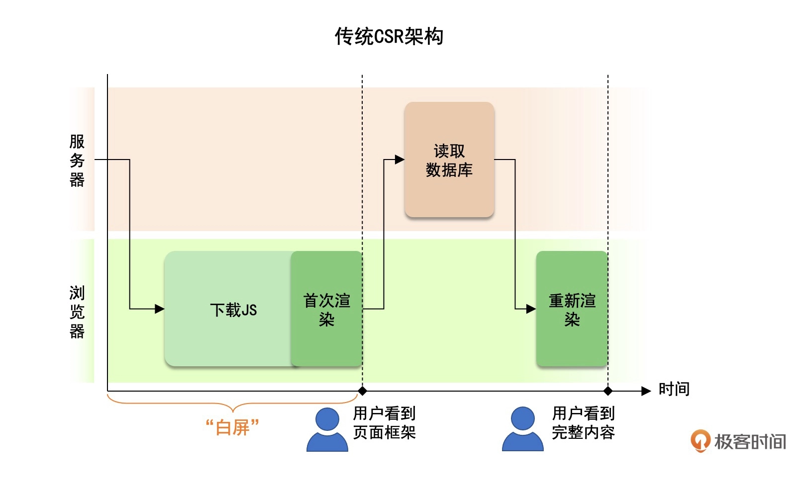
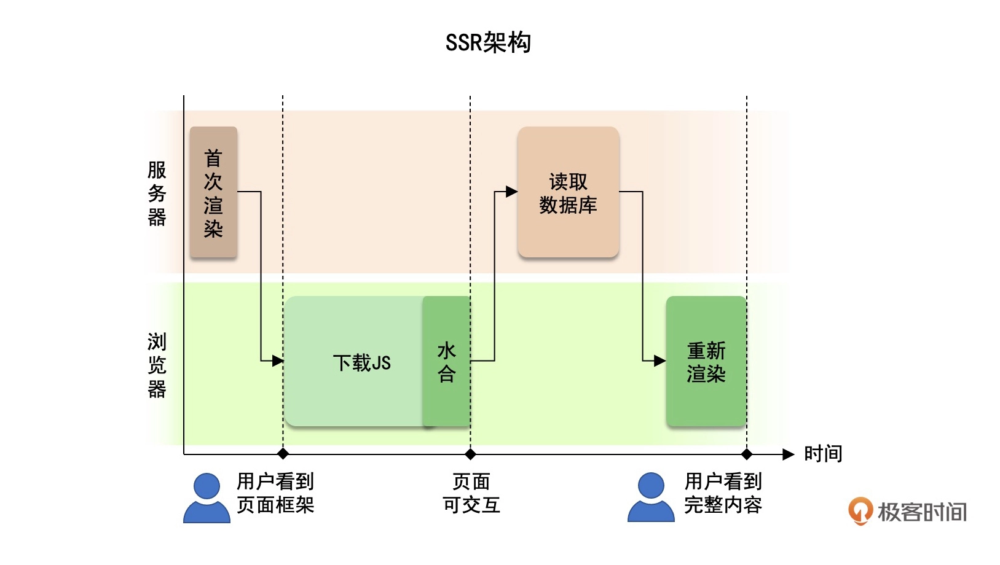
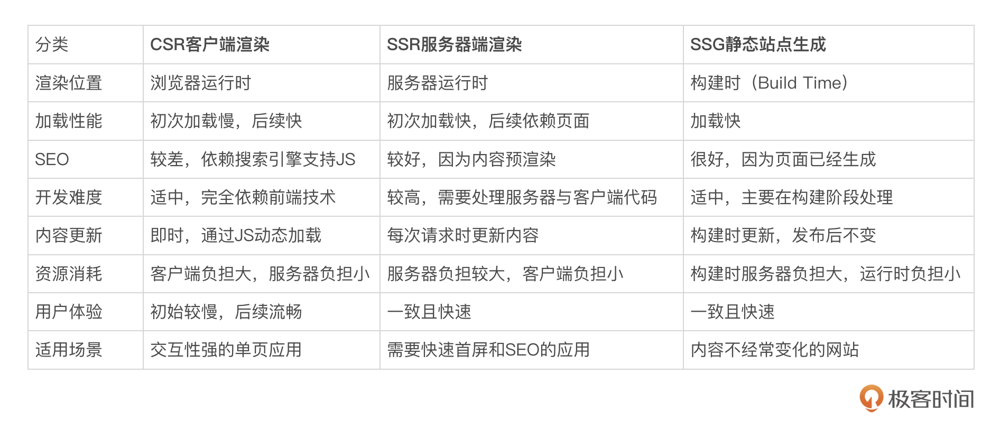
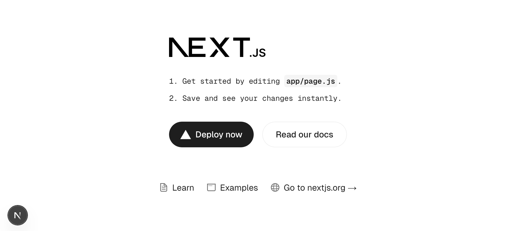
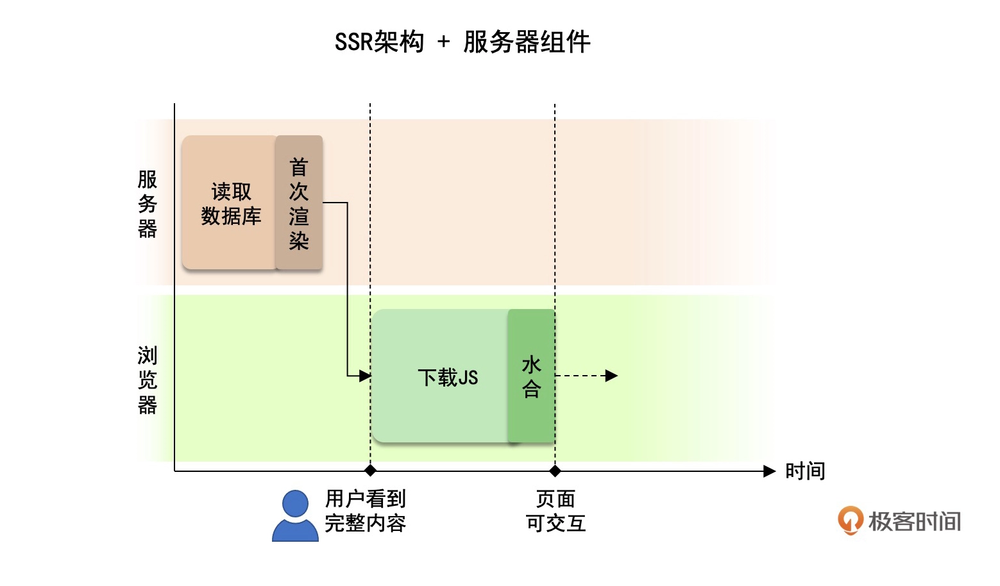

# SSR、Next.js与服务器组件

你好，我是宋一玮，欢迎回到 React 应用开发的学习。

```
上节课我们回顾了 React 的 Suspense 与组件的懒加载，介绍了 React 19 新 API use 的两种
用法 use(Promise) 和 use(Context) ，还有ref 和 forwardRef 的变化，以及 JSX 中
新支持的 HTML 标签<title>、<link>、<meta>、<style> 、<script>。
```

可能你已经注意到了，前两节课在介绍 React 19 新功能之前，我都会介绍必要的背景知识，

```
比如介绍 action 之前先补充 transition 的知识，介绍 use(Promise) 之前先回顾了
```

Suspense 的知识。这符合本专栏一贯的讲解思路，即帮助你在学习新功能、新 API 的同时，了解它们能解决什么样的问题，并强调知识点之间的相关性。

这节课作为 React 19 新功能系列加餐中的最后一节，将聚焦 React 19 在服务器端的两大重量级新功能：服务器组件和服务器 action。延续之前的讲解思路，我们接下来会先讲解服务器端渲染 SSR 是什么，为什么要在服务器端跑 React，并简要介绍 React SSR 首选的全栈开发框架 Next.js。

## 服务器端渲染 SSR

```
随着 React 项目规模的扩大和依赖项的增加，生产环境构建的产物，尤其是*.js 文件体积会
```

逐渐增大。我就经手过单个 JS 文件达到 10MB 以上的项目，这文件还是经过代码压缩的。这样的大文件会导致用户浏览器加载应用时，需要长时间面对白屏，不利于用户体验（如下图所示）。

这种情况下，我们可以利用代码分割技术减小单个文件的体积，不过同时我们也可以思考一下，有没有其他方式可以减少用户的白屏时间？



服务器端渲染（Server-Side Rendering，后文简称 SSR）可以有效缓解这个问题。顾名思义，服务器端渲染可以理解成：把全部或部分渲染工作转移到服务器端。React 有 SSR，Vue、Angular 也有 SSR。不同框架实现 SSR 的方式不尽相同，但都能有效减少用户浏览器首次加载的白屏时间。

### React 的 SSR

用户访问整个 React 应用时，首次请求的 HTML 文档只用于加载 JS、CSS 文件，并不包含任何实际内容，因此出现了白屏。如果 HTML 直接包含了首屏的有效内容，用户就可以更早地开始使用应用。在架构层面，除了前面一直采用的浏览器端运行应用之外，React 还支持在服务器端渲染组件。

```
我们来回顾一下本专栏的样例应用 oh-my-kanban，它的入口代码是这样导入 ReactDOM 对象
```

的：

```python
import ReactDOM from 'react-dom/client';
这是 ReactDOM 的客户端或者说浏览器端 API。在同一个react-dom 包里，React 还提供了
```

另一套服务器端 API，例如：

```python
import { renderToString } from 'react-dom/server';
const html = renderToString(<App />);
```

这段代码可以在服务器端的 Node.js 环境中执行，配合 Node.js 下的 Web 服务器，如Express.js、Koa 等，就可以直接将组件渲染出来的完整 HTML 直接返回给用户浏览器。这就是 React 的 SSR。

```
但这样的 HTML 页面暂时不具有动态交互性，诸如 onClick 等逻辑在服务器端渲染时会被忽
略。等到 HTML 在浏览器端加载后，浏览器会继续加载 React 项目构建产物中的 *.js 等文
件，待加载完成会调用 ReactDOM 客户端 API 的 hydrateRoot 方法，在浏览器端重建虚拟
DOM 树，并把 onClick 等逻辑关联到对应的 DOM 元素上去，这样一来 React 应用就被还
```

原成了“完全体”，而这个还原过程被称为“水合”（hydrate）。水合的关键代码如下：

```python
import { hydrateRoot } from 'react-dom/client';
hydrateRoot(document.getElementById('root'), <App />);
```

浏览器加载服务器端渲染的 HTML 后到水合完成之前的这段时间，我们的 React 应用虽然并不能响应按钮点击等操作，但已经可以向用户展示关键内容了。SSR 为 React 应用带来了更短的首屏加载时间，如下图所示，你可以与前面 CSR 的图对比一下。



此外 SSR 对搜索引擎也更加友好，有利于搜索引擎优化（SEO）。早期的搜索引擎爬虫技术对页面 JS 的支持有限，爬取网页时，只读取到了 HTML 的内容，而错过了 JS 动态生成的内容，导致搜索引擎认为该网页质量不高，网页在搜索结果中的排名就相应降低。

SSR 产生的页面 HTML 会包含更多有效内容，有利于提高在搜索结果中的排名。但随着搜索引擎技术的进步，现代的爬虫已经可以正常处理 JS 和 JS 动态生成的内容，HTML 静态内容的比例已经不再是搜索排名的关键因素，不过在这一背景下，SSR 带来的页面加载速度的提升，仍对 SEO 有很大帮助。

你可能会好奇，SSR 与 PHP、ASP.NET 这样的传统服务器端页面技术有什么区别？传统服务器端页面技术确实也在服务器端生成 HTML，但通常不涉及现代 JavaScript 框架。按用途来区分，SSR 用于 SPA（Single Page Application）单页应用，而传统服务器端页面技术一般用于 MPA（Multi-Page Application）多页应用。

### CSR、SSR 与 SSG

与 SSR 类似的架构概念还有：CSR（Client-Side Rendering）客户端渲染，就是本专栏一直在使用的架构，oh-my-kanban 也是采用了这个架构；SSG（Static Site Generation）静态站点生成，利用 React 技术生成静态网页。

我对 CSR、SSR 和 SSG 做了简单对比：



## React 全栈开发框架 Next.js

虽然 React 提供了与 SSR 相关的 API，但要想实现一套完整的 SSR 方案，开发者额外需要做的事情还不少，如读取服务器端数据、服务器端路由等。React 的生态是非常丰富的，但这也反过来增加了开发者做技术选型和整合多种库的成本。开发者们期待着“一站式”的解决方案。以此为契机，React 社区中兴起了一批基于 React 的全栈 Web 开发框架，其中 Next.js框架尤其受到广大开发者的欢迎。

### Next.js 框架简介

Next.js 刚推出时是为了解决 React SSR 开发的一些痛点，在后续不断演进的过程中，它吸纳了业界的最佳实践，加入了对全栈 Web 开发的支持。截至 15 版本，Next.js 主要支持了以下功能：

- 内建的代码构建功能。

- 在浏览器端或服务器端渲染 React 组件，在页面级别支持 CSR、SSR、SSG。

- 支持各种主流 CSS 方案。

- 获取服务器端数据，内建缓存。

- 服务器端与浏览器端路由。

- 内建性能优化，以及对图片等资源文件的优化。

- React 19 的服务器组件和服务器 action。

开发者使用 Next.js 开发 React 应用时，如果没有特别的需要，无须再引入 React Router 或React Query 等库，从而省去了一些技术选型的工作。Next.js 这种整合了多种框架和库的框架，也被称为元框架（meta-framework）。

但同时也需要注意的是，以上很多功能的前提是需要 Next.js 本身作为服务器运行时，部署上线时要把整个 Next.js 应用部署为 Web 服务器，传统 CSR 采用的静态 Web 服务器（如Nginx） + CDN 是不够的。Next.js 应用开发的范式与传统 React 应用开发也不太一样，很多时候要考虑服务器端的行为，当然，这也扩展了 React 应用的能力边界。

在 SSR 领域同样具有影响力的还有 Remix 框架（已经合并入 React Router v7），在 SSG 领域则有 Gatsby 框架。目前 React 官方也开始鼓励开发者使用基于 React 的全栈框架，如Next.js、Remix 或 Gatsby 来开始一个 React 项目。

### 创建 Next.js 项目

我们下面来创建一个 Next.js 项目，你可以顺便对比一下这与创建传统 React 项目有什么不同。首先在命令行运行：

```
npx create-next-app@latest
这里我用的 Next.js 版本是15.2.3。当命令提示What is your project named?时，输
入oh-my-next-app；为了方便本节课程的实践，命令提示的其他问题中，除了Would you
like to use App Router? 选择Yes，其他都选No。等命令创建完项目，用 IDE 查看生
成的package.json文件，可以看到react和react-dom的版本都是19.0.0。
```

然后启动项目：

```bash
cd oh-my-next-app
npm run dev
```

在浏览器访问：http://localhost:3000/，可以看到如下页面：



你可以使用浏览器的查看页面源代码功能，查看当前页面的 HTML 代码，类似下面这样：

```xml
<body class="__variable_4d318d __variable_ea5f4b">
 <div class="page_page__556_G">
   <main class="page_main__nw1Wk">
     
     <ol>
       <li>Get started by editing <code>app/page.js</code>.</li>
       <li>Save and see your changes instantly.</li>
     </ol>
     <!-- 省略其余HTML -->
你会发现与 Vite 或 CRA 创建的传统 React 项目不同，比起简单的一行<div id="root">
</div>，Next.js 渲染的首页 HTML 代码中包含了对应实际内容的静态 HTML 标签。虽然后
```

面还有不少 JS 代码，但这部分 HTML 保证了页面在下载到浏览器的第一时间就能为用户展示出有效内容。这就是 Next.js 基于 React 提供的服务器端渲染能力。

### 在 App Router 中添加表单页面

```bash
这个项目使用了 Next.js 15 版本推荐的 App Router 功能，在项目 app 目录下，Next.js 会根
据目录结构和文件名自动配置页面路由。以上的首页对应的是app/page.js文件，我们马上
来试试新加一个页面。在 app 目录新建一个名叫 contact 的子目录，在这个子目录里新建
一个 page.js 文件，在文件中加入第一节加餐中用于演示表单 action 的代码：
import { useState } from 'react';
function ContactForm() {
 const [name, setName] = useState();
 const formAction = async (formData) => {/* 省略action代码 */};
 return (
   <form action={formAction}>
     {/* 省略JSX */}
   </form>
 );
}
export default ContactForm;
```

```
Next.js 基于上述目录结构，自动创建了 /contact 路由。尝试访问
```

http://localhost:3000/contact，你会看到页面报错：

```
Error:   × You’re importing a component that needs useState. This React hook only
works in a client component. To fix, mark the file (or its parent) with the "use client"
```

- directive.

```bash
这时我们需要在刚才的 app/contact/page.js 文件的开头插入一行语句：
'use client';
这样一来，页面就可以正常渲染了。在 React 19 中，'use client' 和下面要讲到的 'use
server' 是两个特殊的指示符（directive），用于向构建工具提供指令。这里的 'use
client' 就是告诉构建工具，这个文件的代码都是运行在客户端（即浏览器端）的。
接下来我们在首页添加一个指向/contact的导航链接。
import Link from 'next/link';
export default function Home() {
 return (
   <Link href="/contact">联系人管理</Link>
   {/* 省略其他JSX */}
 );
}
```

浏览器中查看 http://localhost:3000/ 首页，点击刚添加的“联系人管理”链接，页面会跳转到

```
刚刚创建的 /contact 页面。注意这个跳转实际上是一个基于前端路由的视图切换，并不会
```

刷新整个浏览器，至于地址栏中 URL 的变化，则是 Next.js 调用浏览器 History API 实现的。

目前地址栏的 URL 为 http://localhost:3000/contact，如果你强行刷新浏览器，浏览器会重新加载联系人页面，这意味着后端路由也是等效的。

Next.js 框架的功能比起原生 React 丰富了很多，基于 Next.js 进行应用开发也会涉及很多全栈框架所特有的最佳实践。这些内容多到足够开一个新专栏了，这里我们点到为止。

## React 19 的服务器组件

React 19 新加入了服务器组件（React Server Components，缩写为 RSC）。服务器组件就是只在服务器端运行的 React 组件，它完全在服务器端渲染，渲染结果会随着 SSR 渲染的HTML 传递给客户端（即浏览器端）。

开发者可以在服务器组件中运行服务器端代码，比如读取数据库或远程 API，将返回的数据直接用 JSX 渲染出来。为了演示服务器端代码与浏览器端代码的差别，我们不妨来试试在服务器组件里用 Node.js API 读取本地文件。首先，我们在刚才的 Next.js 项目根目录建一个文本

```bash
文件 data.json ：
{
   "contacts": [
       { "id": 1, "name": "张三" },
       { "id": 2, "name": "李四" },
       { "id": 3, "name": "王五" }
   ]
}
然后来到app/page.js文件，将 Home 组件的函数改为异步函数，并加入读取文件的代码：
import Link from 'next/link';
import fs from 'node:fs/promises';
export default async function Home() {
 const content = await fs.readFile('./data.json', 'utf-8');
 const { contacts } = JSON.parse(content);
 return (
   <div>
     <ul>
       {contacts.map(contact => (
         <li key={contact.id}>{contact.name}</li>
       ))}
     </ul>
     <Link href="/contact">联系人管理</Link>
   </div>
 );
}
```

刷新页面，可以看到浏览器页面中展示了来自本地文件的联系人列表。这样做的好处如下图所示，用户访问这个页面的首次请求就可以得到包含了实际数据的 HTML，而不需要等浏览器端JS 加载、React 完成水合后再发起对数据的请求。



```
这里要纠正一个可能的误会，并不是只有async 异步函数才能定义服务器组件。异步函数并
```

不是服务器组件的特征，而是一个特性。前面我们之所以把组件函数改为异步函数，是因为在JS 中读取文件或数据库的代码大都是异步的，服务器组件对异步函数的支持为我们提供了便

```
利。其实在改为异步函数之前，这个 Home 组件就已经是服务器组件了，Next.js 的 App
```

Router 默认将包含页面组件在内的所有组件，无论同步函数还是异步函数声明的，都当作服务器组件。

需要注意的是，与传统 React 组件不同，服务器组件本身不会在浏览器端渲染（或重新渲染），也不会在浏览器端进行水合，甚至服务器组件的源代码都不会被打包进浏览器加载的 JS中。没有水合意味着，开发者不能在服务器组件中使用任何交互性的 Hooks 或 JS 代码，比如

```
useState 、useEffect 、事件处理等等。
```

这时你可能会困惑，React 没有了交互性，这难道不是一种倒退吗？你大可放心，服务器组件可以跟客户端组件，也就是传统 React 组件配合使用。你可以把服务器组件的子组件抽取到独

```
立的文件中，在文件顶部加入'use client'指示符，这个文件所包含的组件就会被视为客
```

户端组件，在这里你可以放心地使用各种 Hooks、事件处理函数，以及其他浏览器端的 JS 交互代码。

在 Next.js 中，客户端组件默认也会被 SSR（“客户端组件”这个名字会有点误导，你可以理解成传统 React 组件）。当浏览器中的 React 完成初始化，服务器组件虽然不会参与渲染，但会把专用的序列化数据同步到浏览器端，跟随其他客户端组件形成一个完整的组件树，水合过程还是会照常进行，水合完成后客户端组件的交互代码就会生效。上一小节加入的

```
ContactForm 组件就是一个客户端组件，你可以在里面使用 useState 等 Hooks。
```

服务器组件与客户端组件之间可以通过 props 通信。服务器组件传递给客户端组件的 props 必须是可序列化（serializable）的数据类型，或者是 Promise（请回忆一下上节课的

```
use(Promise) ），甚至可以传递服务器 action 的函数引用。但因为服务器组件并不包含状
```

态，使得它与客户端组件之间的通信基本是单向的。如果你希望通过客户端组件的交互影响服务器组件，通常需要借助路由。

服务器组件的子组件可以是服务器组件也可以是客户端组件。那么客户端组件的子组件会是什么呢？

```
在客户端组件所在文件中，用 import 语句导入的子组件、后代组件也都会自动被视为客户
端组件。你如果像第一节加餐那样，把表单按钮抽取成 FormButtons 组件并放在同目录的
FormButtons.jsx文件中，那么即使你不在文件开头加入'use client'，FormButtons
也仍旧会是客户端组件。这样的规则使得你无法通过 import 的方式把服务器组件用作客户
端组件的子组件。也许你会意外，'use server'并不是用来声明服务器组件的，而是有其
```

他用途，我们待会儿会讲。

但这并不意味着客户端组件的子组件只能是客户端组件。服务器组件传递给客户端组件的props 除了前面列举的类型，还可以传递 React 元素（即 JSX），这里的元素并不限定是客户

```
端组件还是服务器组件的元素。这就带来了一种灵活的组件混合模式：通过 children
```

prop，将服务器组件传递给客户端组件。如以下代码所示：

```bash
import ClientComponent from './ClientComponent.jsx';
import ServerComponent from './ServerComponent.jsx';
// Page默认为服务器组件
export default function Page() {
 return (
   <ClientComponent>
     <ServerComponent />
   </ClientComponent>
 );
}
```

## React 19 的服务器 Action

第一节加餐曾介绍过 React 19 的 action，是指用于触发 transition 的函数。在服务器组件环境下，React 19 更是支持了服务器 action（Server Actions），即能被客户端组件调用的、在服务器端执行的 action。

让我们回忆一下第一节加餐中的表单 action，我们一般会在表单 action 里将表单数据提交到服务器端 API，进而保存到数据库里，开发者需要额外实现一套服务器端 API，也需要编写调用

```
fetch API 的逻辑。如果表单 action 能直接在服务器端执行，那就可以省略服务器端 API，
```

直接将表单数据保存到数据库里！

```bash
我们马上试试把前面表单页面的 formAction 改成服务器 action。在 app/contact 目录下
新建一个 actions.js 文件，代码如下：
'use server';
import { redirect } from 'next/navigation';
import fs from 'node:fs/promises';
export async function saveContactAction(formData) {
 const content = await fs.readFile('./data.json', 'utf-8');
 const { contacts } = JSON.parse(content);
 contacts.push({
   id: contacts.length + 1,
   name: formData.get('name'),
 });
 const newContent = JSON.stringify({ contacts }, null, 4);
 await fs.writeFile('./data.json', newContent, 'utf-8');
 redirect('/');
}
文件的第一行是'use server'指示符，这代表该文件中所有函数都是服务器函数。我们创
建了一个名叫saveContactAction的服务器 action，利用 Node.js API 将新联系人写入到
data.json 文件中。注意这单纯是为了演示 action 执行服务器端代码的能力，在实际项目中
```

比起读写文件，还是操作数据库更常见一些。在 action 的末尾，我们调用 Next.js 的导航 API

```xml
redirect跳转回首页。
要调用这个服务器 action，只需修改联系人表单ContactForm组件：
import { saveContactAction } from './actions.js';
function ContactForm() {
 // 删除原来的formAction
 return (
   <form action={saveContactAction}>
```

```
这样在浏览器端提交表单后，saveContactAction会在服务器端被执行，然后浏览器跳转
```

回首页，首页上会显示新提交的联系人。其实这个过程还是存在浏览器端对服务器端 API 的调用的，只不过 Next.js 框架为你代劳了。

```javascript
除了文件第一行，'use server'也可以写在单个函数的顶部，如：
async function saveContactAction(formData) {
 'use server';
 // 其他代码
}
要使用服务器 action，除了像前面这样、在客户端组件 import 导入服务器 action，也可以由
```

服务器组件通过 props 将服务器 action 的引用传递给客户端组件。

React 官方文档最近把服务器 action 改名成了服务器函数（Server Functions），表示并不是所有的服务器函数都是服务器 action。不过我们在遇到具体的、action 之外的用例之前，不妨先暂时沿用服务器 action 这个名称。

React 19 的服务器组件和服务器 action 带来了前端开发范式的变化，让 SSR 的功用更上一层楼。不过截止到 2025 年 3 月，Next.js 是事实上唯一完整支持这两个新特性的全栈框架，所以我们这节加餐一大半都在介绍 Next.js。我很期待其他 React 元框架也陆续加入相应的支持。

## 小结

这节课我们首先介绍了什么是服务器端渲染 SSR，为什么需要 SSR，以及 SSR 与传统 CSR的区别。接着，我们简要介绍了 React 在全栈 Web 应用开发领域首选的元框架 Next.js，演练了如何创建 Next.js 项目，并在 App Router 中加入新的页面。最后，我们重点介绍了 React19 的新功能：服务器组件和服务器 action，也通过实例演示了如何在 Next.js 中使用这两个功能。

至此，我们完成了关于 React 19 新功能的全部三节加餐，希望这三节加餐能帮助你掌握React 19 的最新变化。

## 思考题

1. 在 React 19 引入服务器组件功能后，我们与服务器通信的能力得到了增强。能不能请你说一说，在 React 19 中分页显示数据库中的列表数据，都有哪些方法？

```
你能用第一节加餐讲过的 useActionState 结合服务器 action 实现一版联系人表单吗？
```

回顾本专栏之初定下的期望：“学习一门技术，务必要有大于一门技术的收获”，希望这次加餐也助你达成了这个目标。重聚虽然短暂，但我相信，只要你一如既往，对前端技术充满着好奇和热情，那我们一定会在不远的将来再见。
