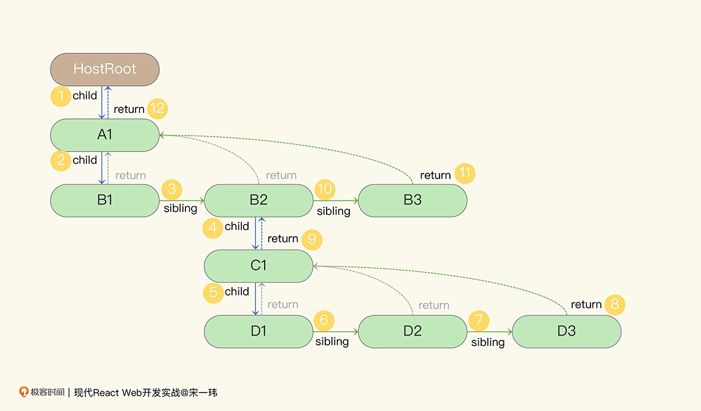
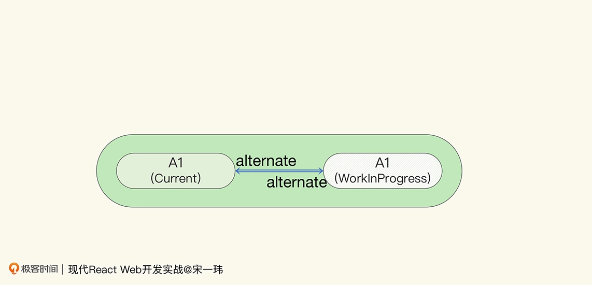
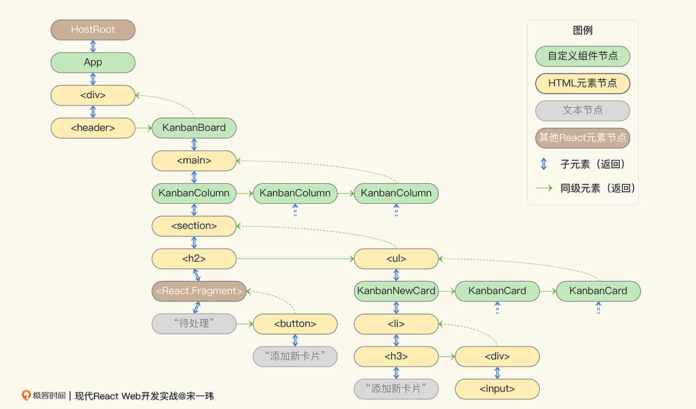

# 加餐02 | 留言区心愿单：Fiber协调引擎

你好，我是宋一玮，欢迎回到 React 应用开发的学习。

之前提到过，我们会在专栏的留言区选取一些具有代表性的问题，放到加餐里统一讲解。

上次的加餐 01 我们介绍了“真·子组件”，以及 JSX 语法糖在 React 17 版本以后发生的变化。这节加餐我们有且只有一个主题，就是目前留言区呼声最高的，Fiber 协调引擎。

```
首先还是要说明一下，在 React 18.2.0 中，Fiber 的源代码有 3 万多行（以 wc -l
packages/react-reconciler/src/*[^new].js 命令统计），要想搞清它的每一行代码
```

都是干什么的，一节加餐是远远不够的。

这节加餐会从原理入手，介绍 Fiber 内的部分重要模型和一些关键流程，并尽量跟前面课程中学到的 React 各种概念串联起来，这包括 React 元素、渲染过程、虚拟 DOM、生命周期、Hooks。不求面面俱到，为的是帮助你加深对 React 框架的理解。

另外请注意，Fiber 协调引擎是 React 的内部实现，无论是否学习它，都不会影响你对 React框架的使用。

## 什么是 Fiber 协调引擎？

正如第 6 节课讲到的：

- React 组件会渲染出一棵元素树……每次有 props、state 等数据变动时，组件会渲染出新的元素树，React 框架会与之前的树做 Diffing 对比，将元素的变动最终体现在浏览器页面的 DOM 中。这一过程就称为协调（Reconciliation）。在 React 的早期版本，协调是一个同步过程，这意味着当虚拟 DOM 足够复杂，或者元素渲染时产生的各种计算足够重，协调过程本身就可能超过 16ms，严重的会导致页面卡顿。而从 React v16 开始，协调从之前的同步改成了异步过程，这主要得益于新的 Fiber协调引擎。

Fiber 协调引擎做的事情基本上贯穿了 React 应用的整个生命周期，包括并不限于：

- 创建各类 FiberNode 并组建 Fiber 树；

- 调度并执行各类工作（Work），如渲染函数组件、挂载或是更新 Hooks、实例化或更新类组件等；

- 比对新旧 Fiber，触发 DOM 变更；

- 获取 context 数据；

- 错误处理；

- 性能监控。

```
Fiber 协调引擎的源代码集中在 react-reconciler 这个包里，在 Github 上的地址是：
```

https://github.com/facebook/react/tree/v18.2.0/packages/react-reconciler

## Fiber 中的重要概念和模型

在协调过程中存在着各种动作，如调用生命周期方法或 Hooks，这在 Fiber 协调引擎中被称作是工作（Work）。Fiber 中最基本的模型是 FiberNode，用于描述一个组件需要做的或者已完成的工作，每个组件可能对应一个或多个 FiberNode。这与一个组件渲染可能会产生一个或多个 React 元素是一致的。

```
实际上，每个 FiberNode 的数据都来自于元素树中的一个元素，元素与 FiberNode 是一一
对应的。与元素树不同的是，元素树每次渲染都会被重建，而 FiberNode 会被复用，
FiberNode 的属性会被更新。
下面是 FiberNode 的数据结构，为了方便理解，我把关键的属性进行了分组，并省略了一些
```

我认为不太关键的属性：

```sql
type Fiber = {
 // ---- Fiber类型 ----
 /** 工作类型，枚举值包括：函数组件、类组件、HTML元素、Fragment等 */
 tag: WorkTag,
 /** 就是那个子元素列表用的key属性 */
 key: null | string,
 /** 对应React元素ReactElmement.type属性 */
 elementType: any,
 /** 函数组件对应的函数或类组件对应的类 */
 type: any,
 // ---- Fiber Tree树形结构 ----
 /** 指向父FiberNode的指针 */
 return: Fiber | null,
 /** 指向子FiberNode的指针 */
 child: Fiber | null,
 /** 指向平级FiberNode的指针 */
 sibling: Fiber | null,
 // ---- Fiber数据 ----
 /** 经本次渲染更新的props值 */
 pendingProps: any,
 /** 上一次渲染的props值 */
 memoizedProps: any,
 /** 上一次渲染的state值，或是本次更新中的state值 */
 memoizedState: any,
 /** 各种state更新、回调、副作用回调和DOM更新的队列 */
 updateQueue: mixed,
 /** 为类组件保存对实例对象的引用，或为HTML元素保存对真实DOM的引用 */
 stateNode: any,
 // ---- Effect副作用 ----
 /** 副作用种类的位域，可同时标记多种副作用，如Placement、Update、Callback等 */
 flags: Flags,
 /** 指向下一个具有副作用的Fiber的引用，在React 18中貌似已被弃用 */
 nextEffect: Fiber | null,
 // ---- 异步性/并发性 ----
 /** 当前Fiber与成对的进行中Fiber的双向引用 */
 alternate: Fiber | null,
 /** 标记Lane车道模型中车道的位域，表示调度的优先级 */
 lanes: Lanes
};
其他需要关注的，还有与 Hooks 相关的模型，这包括了 Hook 和 Effect ：
type Hook = {
 memoizedState: any,
 baseState: any,
 baseQueue: Update<any, any> | null,
 queue: any,
 next: Hook | null,
};
type Effect = {
 tag: HookFlags,
 create: () => (() => void) | void,
 destroy: (() => void) | void,
 deps: Array | null,
 next: Effect,
};
此外，还有 Dispatcher。基本每个 Hook 都有 mount 和 update 两个 dispatcher，如
useEffect 有 mountEffect 和 updateEffect ；少数 Hooks 还有额外的rerender 的
dispatcher，如 useState有rerenderState 。
```

## 协调过程是怎样的？

```
当第一次渲染，React 元素树被创建出来后，Fiber 协调引擎会从 HostRoot 这个特殊的元素
开始，遍历元素树，创建对应的 FiberNode 。
FiberNode 与 FiberNode 之间，并没有按照传统的 parent-children 方式建立树形结构。而
是在父节点和它的第一个子节点间，利用child 和 return 属性建立了双向链表。节点与它
的平级节点间，利用 sibling 属性建立了单向链表，同时平级节点的 return 属性，也都被
设置成和单向链表起点的节点 return 一样的值引用。
```

如图所示：



这样做的好处是，可以在协调引擎进行工作的过程中，避免递归遍历 Fiber 树，而仅仅用两层循环来完成深度优先遍历，这个用于遍历 Fiber 树的循环被称作 workLoop。

```javascript
以下是 workLoop 的示意代码，为了便于理解，我对源码中的 performUnitOfWork 、
beginWork、completeUnitOfWork、completeWork 做了合并和简化，就是里面的
workWork （WARCRAFT 梗）：
let workInProgress;
function workLoop() {
 while (workInProgress && !shouldYield()) {
   const child = workWork(workInProgress);
   if (child) {
     workInProgress = child;
     continue;
   }
   let completedWork = workInProgress;
   do {
     if (completedWork.sibling) {
       workInProgress = completedWork.sibling;
       break;
     }
     completedWork = completedWork.return;
   } while (completedWork);
 }
}
更狠的一点是，这个循环随时可以跑，随时可以停。这意味着 workLoop 既可以同步跑，也
可以异步跑，当 workLoop 发现进行中的 Fiber 工作耗时过长时，可以根据一个
shouldYield() 标记决定是否暂停工作，释放计算资源给更紧急的任务，等完成后再恢复
```

工作。

当组件内更新 state 或有 context 更新时，React 会进入渲染阶段（Render Phase）。这一阶

```
段是异步的，Fiber 协调引擎会启动workLoop ，从 Fiber 树的根部开始遍历，快速跳过已处
理的节点；对有变化的节点，引擎会为 Current（当前）节点克隆一个 WorkInProgress
（进行中）节点，将这两个 FiberNode 的 alternate 属性分别指向对方，并把更新都记录
在WorkInProgress 节点上。如下图所示：
```



你可以理解成同时存在两棵 Fiber 树，一棵 Current 树，对应着目前已经渲染到页面上的内容；另一棵是 WorkInProgress 树，记录着即将发生的修改。

```
函数组件的 Hooks 也是在渲染阶段执行的。除了useContext ，Hooks 在挂载后，都会形成
一个由 Hook.next 属性连接的单向链表，而这个链表会挂在
FiberNode.memoizedState 属性上。
在此基础上，useEffect 这样会产生副作用的 Hooks，会额外创建与 Hook 对象一一对应的
Effect 对象，赋值给 Hook.memoizedState 属性。此外，也会在
FiberNode.updateQueue 属性上，维护一个由 Effect.next 属性连接的单向链表，并
把这个 Effect 对象加入到链表末尾。
当 Fiber 树所有节点都完成工作后，WorkInProgress 节点会被改称为 FinishedWork
（已完成）节点，WorkInProgress 树也会被改称为 FinishedWork树。这时 React 会进
```

入提交阶段（Commit Phase），这一阶段主要是同步执行的。Fiber 协调引擎会把

```
FinishedWork 节点上记录的所有修改，按一定顺序提交并体现在页面上。
```

提交阶段又分成如下 3 个先后同步执行的子阶段：

- 变更前（Before Mutation）子阶段。这个子阶段会调用类组件的getSnapshotBeforeUpdate 方法。

- 变更（Mutation）子阶段。这个子阶段会更新真实 DOM 树。

- 递归提交与删除相关的副作用，包括移除 ref、移除真实 DOM、执行类组件的

```
componentWillUnmount  。
```

- 递归提交添加、重新排序真实 DOM 等副作用。

```
依次执行 FiberNode 上 useLayoutEffect 的清除函数。
引擎用 FinishedWork 树替换 Current 树，供下次渲染阶段使用。
```

- 布局（Layout）子阶段。这个子阶段真实 DOM 树已经完成了变更，会调用

```
useLayoutEffect 的副作用回调函数，和类组件的 componentDidMount 方法。
在提交阶段中，引擎还会多次异步或同步调用 flushPassiveEffects() 。这个函数会先
```

后两轮按深度优先遍历 Fiber 树上每个节点：

```
第一轮：如果节点的 updateQueue 链表中有待执行的、由 useEffect 定义的副作用，
```

- 则顺序执行它们的清除函数；

```
第二轮：如果节点的 updateQueue 链表中有待执行的、由 useEffect 定义的副作用，
```

- 则顺序执行它们的副作用回调函数，并保存清除函数，供下一轮提交阶段执行。

```
这个flushPassiveEffects() 函数真正的执行时机，是在上述提交阶段的三个同步子阶段
```

之后，下一次渲染阶段之前。引擎会保证在下一次渲染之前，执行完所有待执行的副作用。

你也许会好奇，协调引擎的 Diffing 算法在哪里？其实从渲染到提交阶段，到处都在利用memoizedProps 和 memoizedState 与新的 props、state 做比较，以减少不必要的工作，进而提高性能。

```
以上学习了 Fiber 协调引擎的工作流程，再回来看看 oh-my-kanban 的 Fiber 树，是不是能
更进一步理解 oh-my-kanban 的生命周期了？
```



好了，Fiber 协调引擎我们暂时就讲到这里。

如果你还有其他想听的话题，或者在课程学习中有什么疑问，欢迎在留言区告诉我。下节课再见！
