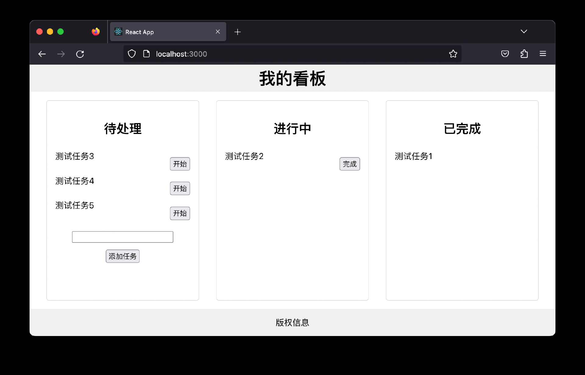
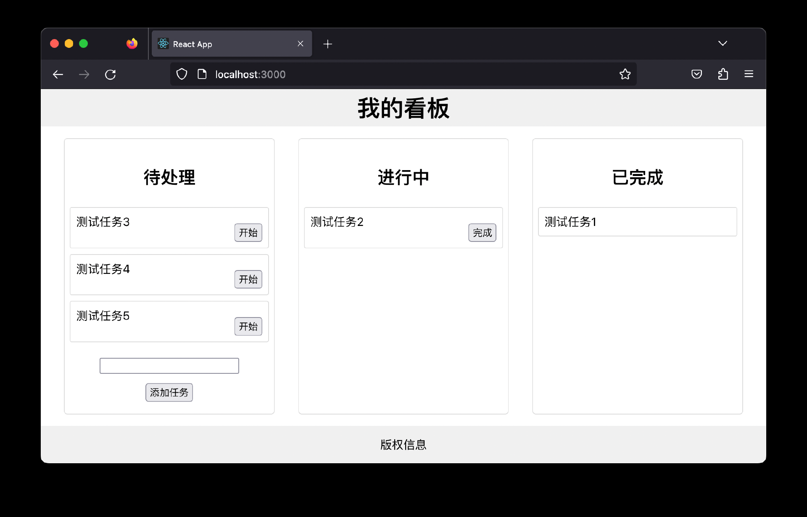
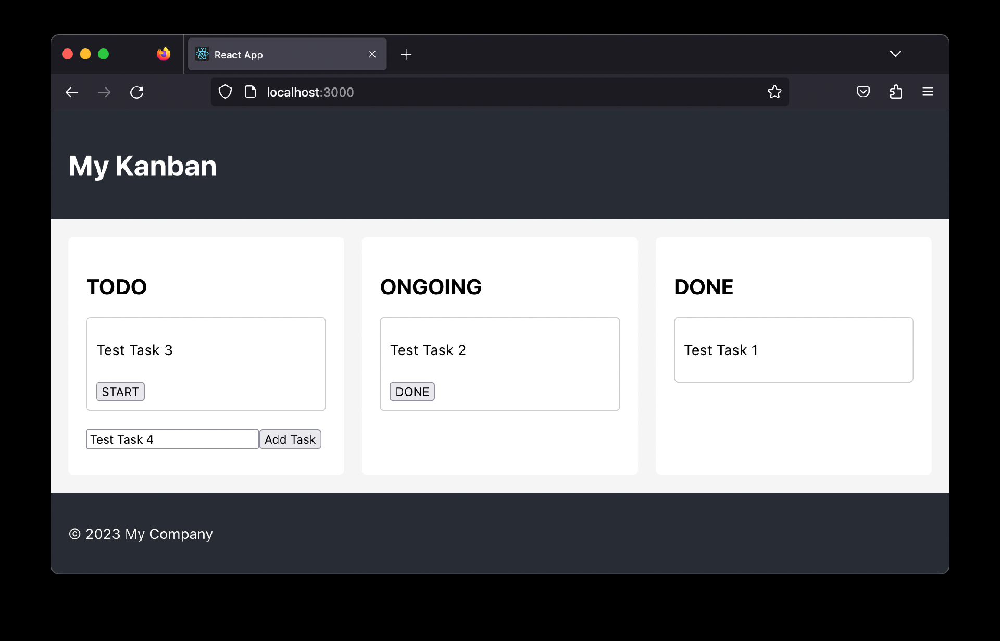
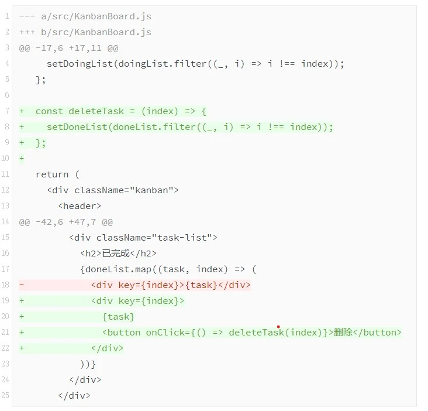
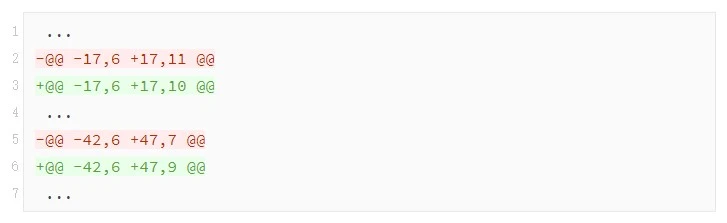
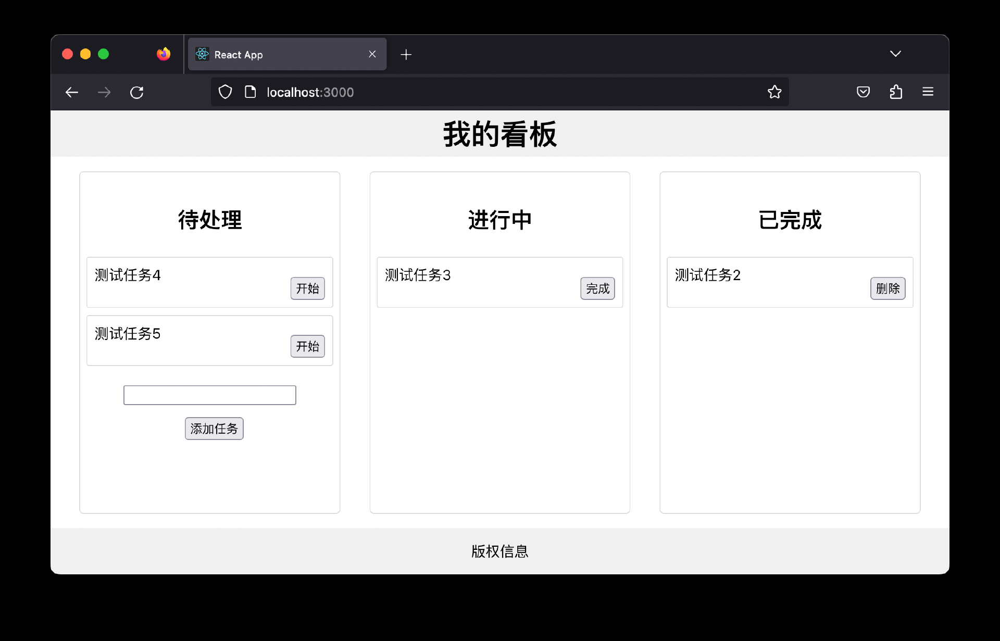
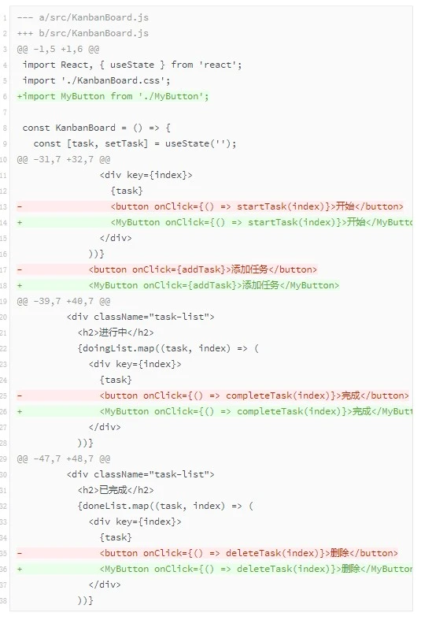
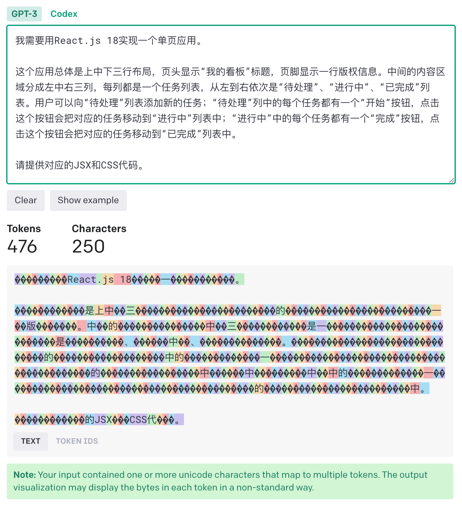
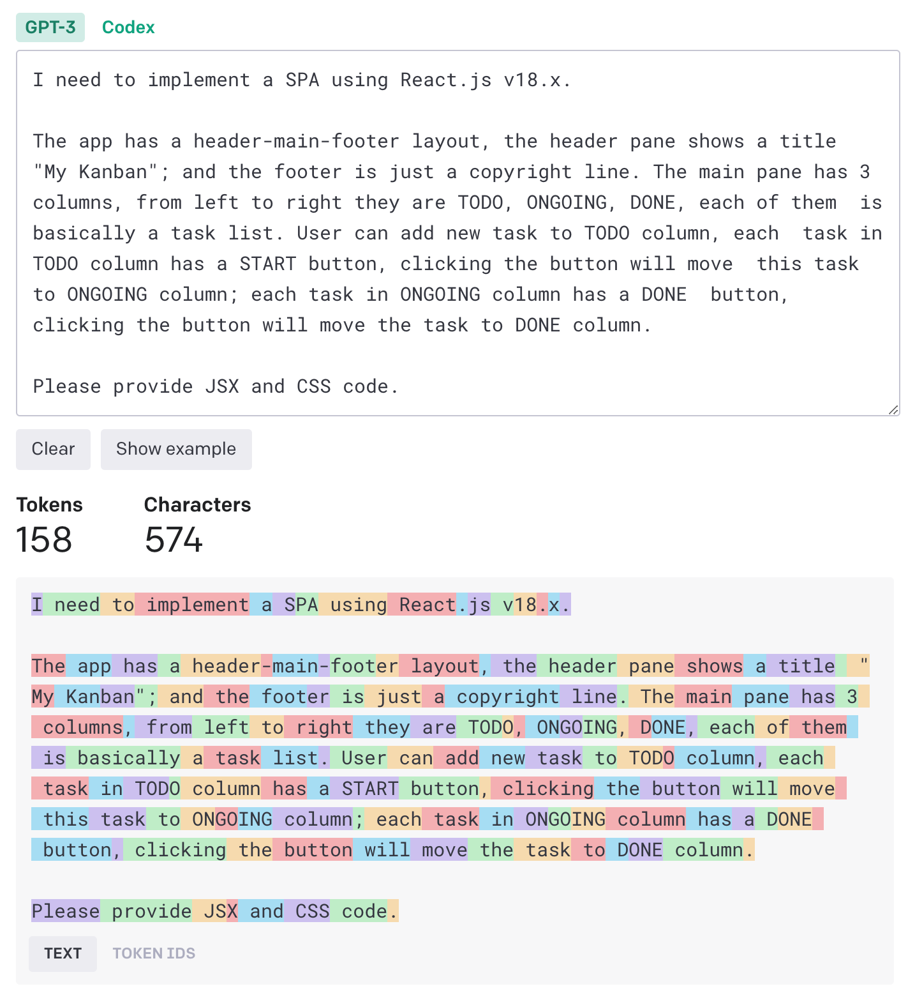

# 特别加餐 | 用ChatGPT开发一个看板项目

你好，我是宋一玮，欢迎来到 React 应用开发专栏。

最近两三个月，以 ChatGPT 为代表的生成式 AI 技术突飞猛进，终于真正威胁到了前端工程师的地位（笑）。有不少同学希望了解 AI，尤其是生成式 AI 对前端开发工作和前端工程师意味着什么，我个人也在关注相关领域的进展，正好趁着这次加餐的机会，跟你交流一下我的想法。

通过这次加餐，我们将主要交流以下三点。

- 了解如何利用 ChatGPT 生成一个基本可用的 React 看板项目。

- 了解如何利用 ChatGPT 修改现有代码和编写单元测试。

- 探讨 ChatGPT 对前端开发意味着什么。

- 在开始正式内容前，我假设你已经学习了本专栏的大部分或全部内容，或是对 React 应用开发有一定了解。当然，如果你已经有 ChatGPT 的使用经验就更好了。

## 用 ChatGPT 从零开始生成一个 React 看板项目

说是从零开始，其实我们还是会借助 Create React App（CRA）这款脚手架工具来搭建项目。考虑到脚手架工具足够成熟足够自动化，用 AI 来代替它意义不大。

我选择的模型是 GPT-4，首次使用的提示语（Prompt）如下。

- 我需要用 React.js 18 实现一个单页应用。这个应用总体是上中下三行布局，页头显示“我的看板”标题，页脚显示一行版权信息。中间的内容区域分成左中右三列，每列都是一个任务列表，从左到右依次是“待处理”、“进行中”、“已完成”列表。用户可以向“待处理”列表添加新的任务；“待处理”列中的每个任务都有一个“开始”按钮，点击这个按钮会把对应的任务移动到“进行中”列表中；“进行中”中的每个任务都有一个“完成”按钮，点击这个按钮会把对应的任务移动到“已完成”列表中。请提供对应的 JSX 和 CSS 代码。

以下是 ChatGPT 返回的结果：

- 创建这个 React 应用涉及到一些细节，包括如何处理状态和事件。下面是一个简单的示例，用 React.js 实现这个应用。首先，我们需要安装 react.js，如果还没有安装，可以在命令行中运行以下代码：

```
npx create-react-app kanban-board
```

- 然后进入创建的项目文件夹：

```bash
cd kanban-board
然后在 src 文件夹中创建一个新的文件KanbanBoard.js，并且在这个文件中写下以下代
```

- 码：

```bash
import React, { useState } from 'react';
import './KanbanBoard.css';
const KanbanBoard = () => {
 const [task, setTask] = useState('');
 const [toDoList, setToDoList] = useState([]);
 const [doingList, setDoingList] = useState([]);
 const [doneList, setDoneList] = useState([]);
 const addTask = () => {
   setToDoList([...toDoList, task]);
   setTask('');
 };
 const startTask = (index) => {
   setDoingList([...doingList, toDoList[index]]);
   setToDoList(toDoList.filter((_, i) => i !== index));
 };
 const completeTask = (index) => {
   setDoneList([...doneList, doingList[index]]);
   setDoingList(doingList.filter((_, i) => i !== index));
 };
 return (
   <div className="kanban">
     <header>
       <h1>我的看板</h1>
     </header>
     <div className="task-lists">
       <div className="task-list">
         <h2>待处理</h2>
         {toDoList.map((task, index) => (
           <div key={index}>
             {task}
             <button onClick={() => startTask(index)}>开始</button>
           </div>
         ))}
         <input
           type="text"
           value={task}
           onChange={(e) => setTask(e.target.value)}
         />
         <button onClick={addTask}>添加任务</button>
       </div>
       <div className="task-list">
         <h2>进行中</h2>
         {doingList.map((task, index) => (
           <div key={index}>
             {task}
             <button onClick={() => completeTask(index)}>完成</button>
           </div>
         ))}
       </div>
       <div className="task-list">
         <h2>已完成</h2>
         {doneList.map((task, index) => (
           <div key={index}>{task}</div>
         ))}
       </div>
     </div>
     <footer>
       <p>版权信息</p>
     </footer>
   </div>
 );
};
export default KanbanBoard;
然后在 src 文件夹中创建一个新的 CSS 文件KanbanBoard.css，并且在这个文件中写下
```

- 以下代码：

在生成 CSS 代码时，内容超长被截断了。于是我在对话中输入了：

- 请继续。

ChatGPT 继续输出：

- 对不起，CSS 样式可能被意外地剪切。以下是完整的 CSS 样式。

```
在KanbanBoard.css文件中：
```

```bash
.kanban {
 display: flex;
 flex-direction: column;
 align-items: center;
 justify-content: space-between;
 height: 100vh;
}
header, footer {
 height: 10vh;
 width: 100%;
 background-color: #f0f0f0;
 display: flex;
 align-items: center;
 justify-content: center;
}
.task-lists {
 display: flex;
 justify-content: space-around;
 flex-grow: 1;
 width: 100%;
 padding: 1em;
 box-sizing: border-box;
}
.task-list {
 display: flex;
 flex-direction: column;
 align-items: center;
 border: 1px solid #ddd;
 border-radius: 5px;
 width: 30%;
 padding: 1em;
 box-sizing: border-box;
}
.task-list h2 {
 margin-bottom: 1em;
}
.task-list div {
 display: flex;
 justify-content: space-between;
 width: 100%;
 margin-bottom: 0.5em;
}
input, button {
 margin-top: 1em;
}
然后在src文件夹的App.js文件中引入KanbanBoard.js：
import React from 'react';
import KanbanBoard from './KanbanBoard';
import './App.css';
function App() {
 return (
   <div className="App">
     <KanbanBoard />
   </div>
 );
}
export default App;
```

- 这就是一个基础的看板应用。你可以在此基础上继续进行优化，例如添加拖拽任务的功能，或者使用后端 API 来存储和获取任务等。

这时我就可以在我的本地开发环境中，尝试 ChatGPT 生成的代码了。按照前面提示的，用

```
CRA 创建 React 项目，用 VSCode 打开项目，在 src 目录添加前面的 KanbanBoard.js
和 KanbanBoard.css ，并修改 src/App.js ，然后在命令行中进入项目目录，运行  npm
start ，浏览器会弹出如下页面。具体步骤你也可以参考专栏第 3 节课《看板应用：从零
```

开始快速搭建一个 React 项目》。



经过简单试用，用户可以正常添加任务，也可以让任务在“待处理”“进行中”和“已完成”三列中流转。

单个任务的样式上还可以再做些美化。这时我在 ChatGPT 中继续对话。

- 请修改 CSS，为任务列表中的每个任务都加上自己的边框。

ChatGPT 回复：

- 当然，我们可以在 CSS 中添加一些样式来给任务列表中的每个任务加上边框。在

```
KanbanBoard.css文件中，我们可以添加以下代码：
.task-list div {
 display: flex;
 justify-content: space-between;
 width: 100%;
 margin-bottom: 0.5em;
 border: 1px solid #ddd; /* 添加边框 */
 padding: 0.5em; /* 添加内边距 */
 border-radius: 3px; /* 添加圆角 */
}
```

- 这个样式将给每个任务都添加一个边框，同时还有一些内边距和轻微的圆角。这样应该可以提供更好的视觉效果。

用这段代码替换 CSS 中对应的样式片段，保存文件并在浏览器里观察页面变化。



好的，到目前为止，ChatGPT 已经基于仅仅描述了需求和交互的提示语，为我们生成了令人印象深刻的代码。这些代码虽然不多，但已经涵盖了专栏里一些重要的知识点，比如下面这些。

- 箭头函数组件和 JSX 语法，参考专栏第 4 节《JSX：该怎样理解这种声明式语法糖》。

```
组件使用了 Hooks  useState ，参考专栏第 9 节《React Hooks（上）：为什么说在
```

- React 中函数组件和 Hooks 是绝配？》。

- 添加任务的文本框被实现为受控组件，参考专栏第 11 节《事件处理：React 合成事件是什么？为什么不用原生 DOM 事件？》。

- 在更新 state 时，并没有去修改原始数组而是新建数组，参考专栏第 15 节《不可变数据：为什么对 React 这么重要？》。有官方资料表明，ChatGPT 训练数据里还是英文内容占了绝大多数，那么如果把提示语换成英文会有什么不一样呢？

- I need to implement a SPA using React.js v18.x.The app has a header-main-footer layout, the header pane shows a title “My Kanban”;and the footer is just a copyright line. The main pane has 3 columns, from left to right theyare TODO, ONGOING, DONE, each of them is basically a task list. User can add newtask to TODO column, each task in TODO column has a START button, clicking thebutton will move this task to ONGOING column; each task in ONGOING column has aDONE button, clicking the button will move the task to DONE column.Please provide JSX and CSS code.

ChatGPT 生成的代码结构和质量与前面中文的版本基本相当，在本地跑起来效果如下图。



可以看到用英文写提示语时，默认生成的样式与中文生成的版本有一定区别，我推测这与训练模型时使用的中英文数据有关。

经过进一步测试，开发大中型 React Web 应用时会用到的一些技术如 Redux、Immer、TypeScript 等，ChatGPT 都能应对。可以认为 ChatGPT 在训练模型时，这些技术栈都被加进了训练数据集。其实不止 ChatGPT，ChatGPT 的竞品大模型也会支持这些主流技术栈。

## 用 ChatGPT 修改现有代码

我们知道写代码可不是“一杆子买卖”，为了实现需求，我们经常需要反复修改代码。ChatGPT对话维持上下文的能力为修改已有代码提供了便利。

还是前面看板项目的例子，在同一 ChatGPT 对话中继续输入：

- 请为“已完成”列表中的每个任务都加上一个“删除”按钮，点击即可从列表中删除该任务。请以 GNU patch 命令可以识别的补丁格式提供所需的代码片段。

ChatGPT 会基于前面生成的代码，返回一个补丁：

- 下面是一个 GNU 补丁格式的代码片段，用于向“已完成”列表中的每个任务添加一个“删除”按钮，并实现点击该按钮即可从列表中删除任务的功能。



- 这个补丁会在“已完成”列表中的每个任务后面添加一个“删除”按钮，并为其添加一个

```sql
deleteTask事件处理函数。当点击“删除”按钮时，任务将从已完成列表中删除。要应用这
个补丁，请将上述代码保存到一个名为kanban-delete-button.patch的文件中，并在
```

- 命令行中执行以下命令：

```sql
patch -p1 < kanban-delete-button.patch
这将更新KanbanBoard.js文件并添加删除功能。
需要多试几次，有时候 ChatGPT 会“记错”前面的代码，比如把 <div key={index}>
{task}</div> 记成了 {task} 。
```

看似这个 patch 已经很完整了，但它有 bug（然而 ChatGPT 坚持认为没错）：

```sql
$ patch KanbanBoard.js kanban-delete-button.patch
patching file KanbanBoard.js
patch: **** malformed patch at line 14: @@ -42,6 +47,7 @@
如果想让 patch 命令执行成功，就必须手工调整行数：
```



这次勉强成功了：

```sql
$ patch KanbanBoard.js kanban-delete-button.patch
patching file KanbanBoard.js
Hunk #1 succeeded at 22 (offset 5 lines).
Hunk #2 succeeded at 60 with fuzz 1 (offset 13 lines).
```



如果希望修改的代码并没有在 ChatGPT 对话中出现过，那就需要通过提示语让这部分代码成为上下文的一部分。最直接的方式是把这部分代码直接贴给 ChatGPT：

```
我在项目中加入了一个 React 组件MyButton，代码如下：
```

```bash
import React from 'react';
const MyButton = (props) => {
 return <button {...props}>{props.children}</button>;
};
export default MyButton;
请用这个组件替换所有KanbanBoard .js中的所有<button>。
```

ChatGPT 返回：

```xml
好的，你可以通过导入MyButton组件并使用它替换KanbanBoard.js中的所有
<button>标签来实现这个需求。以下是 GNU 补丁格式的代码片段：
```



```
这个补丁将KanbanBoard.js中的所有<button>标签替换为<MyButton>组件。要应用
这个补丁，请将上述代码保存到一个名为kanban-use-mybutton.patch的文件中，并
```

- 在命令行中执行以下命令：

```
patch -p1 < kanban-use-mybutton.patch
这将更新KanbanBoard.js文件并使用你的MyButton组件。
```

但要注意 ChatGPT 的 token 数限制。比如 GPT-3.5 模型的 token 上限是 4K，GPT-4 则是8K。在 https://platform.openai.com/tokenizer 工具中可以很方便地确定提示语的 token数，以前面从零开始生成的提示语为例：



如果是英文版本的提示语，占的 token 数会少些：



目前业界已经有了多种方案来绕开 token 限制，而 ChatGPT 竞争对手之一的 Claude 更是直接推出了 100K token 的版本（参考https://www.anthropic.com/index/100k-context-windows）。

在了解 ChatGPT 的能力和限制后，你可能会经常需要作出下面的决策。

- 用 ChatGPT 生成代码的范围。

- 什么时候依赖 ChatGPT 修改代码，什么时候接手代码自己来改。

## 用 ChatGPT 生成单元测试代码

在同一个 ChatGPT 对话中继续输入提示语：

```
请仅用jest + @testing-library/react为KanbanBoard.js生成单元测试代码。
```

这个“仅”字作为提示词还是很有用的，如果不做这个限制，ChatGPT 会放飞自我，引入诸如

```
@testing-library/user-event 、 @testing-library/jest-dom 这样的库，倒没
```

有做错，只是对我们的项目而言没必要。

```
首先，我们需要确保已经安装了 jest 和 @testing-library/react。如果没有的话，
```

- 可以通过以下命令进行安装：

```python
npm install --save-dev jest @testing-library/react
然后我们在src目录下创建KanbanBoard.test.js文件，用于写我们的单元测试。
import React from 'react';
import { render, fireEvent } from '@testing-library/react';
import KanbanBoard from './KanbanBoard';
test('should allow tasks to be added, started, completed, and deleted', () => {
 const { getByText, getByRole } = render(<KanbanBoard />);
 const addTaskInput = getByRole('textbox');
 const addTaskButton = getByText('添加任务');
 fireEvent.change(addTaskInput, { target: { value: 'New Task' } });
 fireEvent.click(addTaskButton);
 expect(getByText('New Task')).toBeInTheDocument();
 expect(addTaskInput.value).toBe('');
 const startButton = getByText('开始');
 fireEvent.click(startButton);
 expect(getByText('New Task')).toBeInTheDocument();
 expect(() => getByText('开始')).toThrow();
 const completeButton = getByText('完成');
 fireEvent.click(completeButton);
 expect(getByText('New Task')).toBeInTheDocument();
 expect(() => getByText('完成')).toThrow();
 const deleteButton = getByText('删除');
 fireEvent.click(deleteButton);
 expect(() => getByText('New Task')).toThrow();
});
```

- 这个单元测试会测试一个任务是否可以被添加到待处理列表、开始、完成，以及被删除。它

```
首先通过fireEvent.change和fireEvent.click模拟用户输入和点击事件来添加一个
```

- 新任务，然后检查这个任务是否显示在待处理列表中，且输入框已被清空。接着它会点击开始按钮，检查任务是否显示在进行中列表中，且开始按钮不再存在。然后它会点击完成按钮，检查任务是否显示在已完成列表中，且完成按钮不再存在。最后，它会点击删除按钮，检查任务是否已从已完成列表中被删除。

```
现在，你可以通过运行npm test命令来运行这个单元测试。
```

可以看到这个单元测试的代码里也涵盖了新加入的“删除”按钮。按提示把代码保存到本地，命令行运行成功。

```
$ npm test
PASS  src/KanbanBoard.test.js
 ✓ should allow tasks to be added, started, completed, and deleted (52 ms)
Test Suites: 1 passed, 1 total
Tests:       1 passed, 1 total
Snapshots:   0 total
Time:        0.552 s, estimated 1 s
Ran all test suites related to changed files.
```

## ChatGPT 对前端开发意味着什么？

从上面生成代码的过程来看，ChatGPT 是一次激动人心的技术突破，不过这也会引起部分前端工程师的焦虑：“我要学完 30 节课才能写出来的 React 应用代码，AI 只需要 3 秒，那我还有必要继续学前端技术吗？”

其实这样的焦虑为时过早，目前 AI 仍然是为人所用的工具。我们需要先思考一点：谁来使用AI？

- 如果是由产品经理、咨询顾问、销售这样的非技术人员来使用，那么 AI 生成的应用程序就是一个黑盒，它的功能将受限于 AI 模型的能力，以及提示语是否有效。

- 如果是由软件工程师尤其是前端工程师来使用，那么 AI 生成的代码就是一个白盒，工程师除了可以调整优化提示语，更可以在任意时刻接手代码，根据需要直接修改代码实现。同样是工具，AI 在软件工程师手上更灵活、更具扩展性、可维护性。

在现阶段主要的软件开发工作流中，无论是手写的代码，还是工具生成的代码，都要有具体的owner（负责人）。owner 需要理解代码的设计和实现，以应对后续的修 bug、加功能和必要的重构。这就要求我们前端工程师仍然要学好前端技术知识，这样面对 AI 工具生成的前端代码，才能知其然知其所以然。

跟所有新技术和新工具一样，ChatGPT 的问世也会造成短期的信息差。同样是前端工程师、非前端工程师以及技术管理者们，会对 ChatGPT 有不同的认识。假设你作为先行者，利用ChatGPT 或其他 AI 工具提高了 n% 的开发效率，这一提升也许会成为你的优势。但当 AI 工具作为基础设施逐渐普及，成为主流前端开发流程的一部分时，总开发效率提升，而个人的这一优势将被抹平。所以我会建议你不要“all-in”。

## 小结

在这一次加餐中，我们以看板应用的产品需求作为提示语，用 ChatGPT 从零开始生成了一个React 项目。紧接着我们展示了如何利用 ChatGPT 对话上下文修改生成的代码，为 React 组件生成了单元测试。

对前端工程师来说，ChatGPT 这样的 AI 将作为工具，大幅提升我们的开发效率。我们在学习如何使用 AI 工具的同时，更需要学好前端技术知识，才能当好前端软件产品的 owner。

## 思考题

你心目中的下一代前端开发流程是怎样的？

欢迎你在留言区与我交流讨论，我们留言区见！
