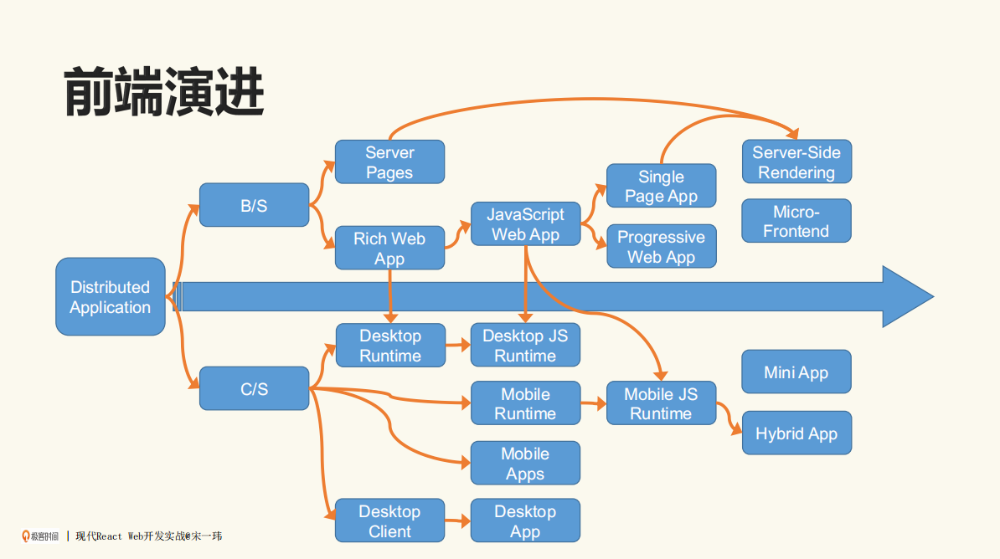
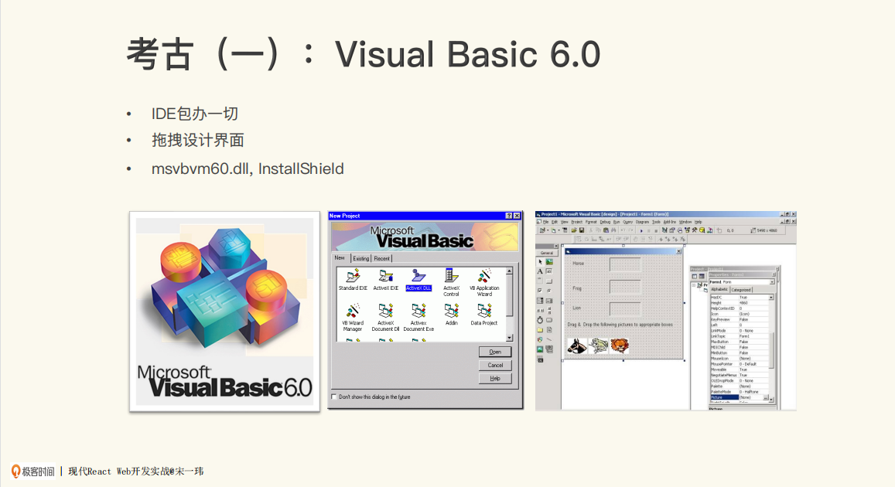
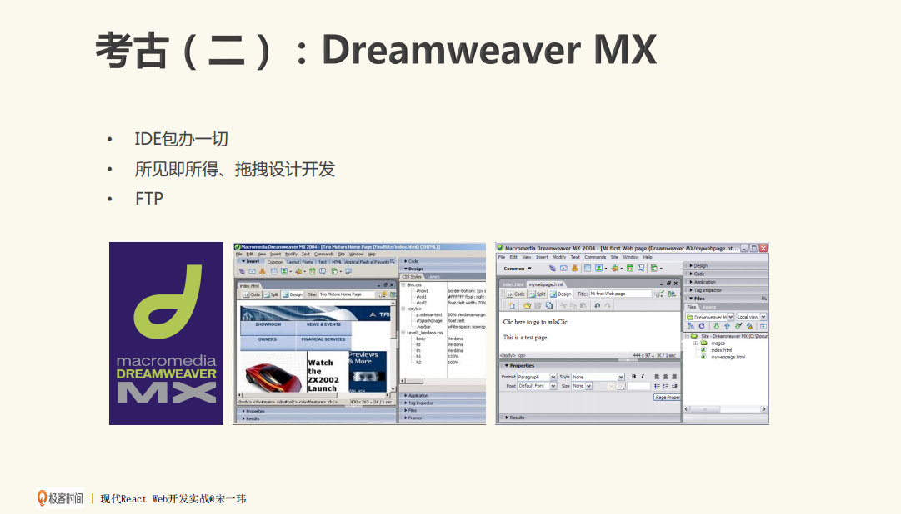
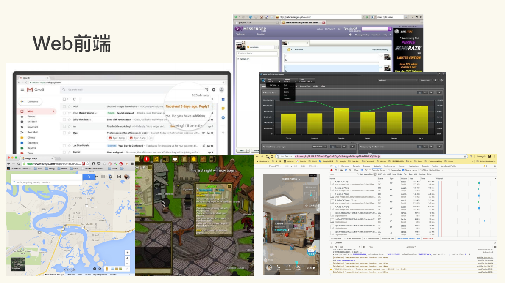
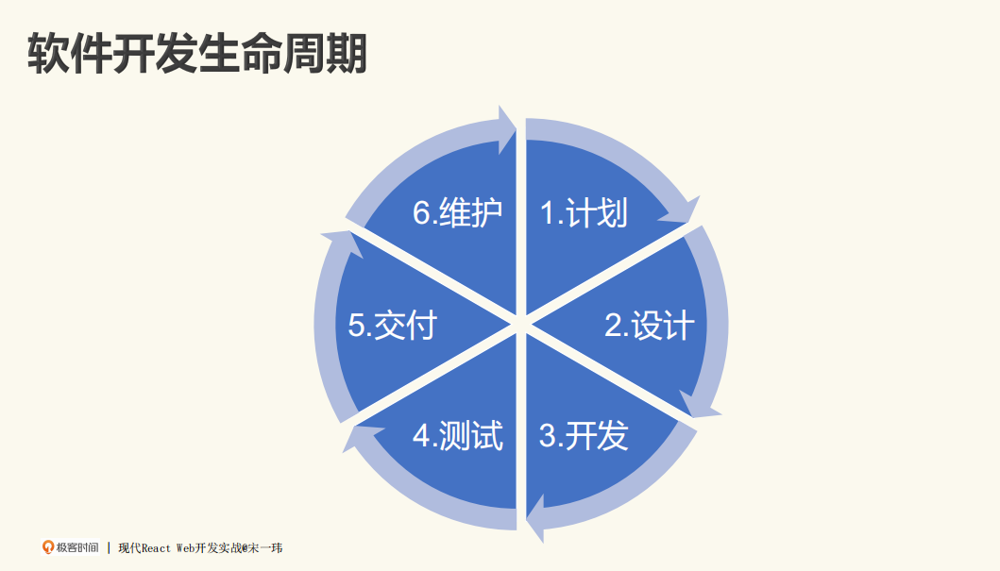

# 直播加餐01 | 前端开发为什么要工程化？

- 本文由编辑整理自宋一玮老师在极客时间直播中的演讲《前端工程化的最佳实践与演进》，详细视频请在 b 站搜索观看，或直接点击链接观看。以及，PPT 获取地址在这里，提取码为：63U8。

为什么要用工程化的方式去做前端开发呢？这是最近一段时间大家经常聊起的话题。这其中一定是有深层次的原因，而我们也应该避免拿着某个概念来直接套问题。比如说构建是工程化，所以我们要用它，或者说 CI/CD 是工程化，所以我们要用它。

这节课我们会从上世纪末的前端开发讲起，同时也将进行技术方面的一些考古，看看能否从历史中有所借鉴，寻找前端开发要参与工程化的初衷。下节课，我们将结合案例，介绍一些我所亲身经历的前端工程化的最佳实践。

好的，让我们开始今天的内容。

## 前端演进

如下图所示，为前端的发展演进历程：

从横轴看，最早是 Server Pages（服务器端页面），后来也有叫 Rich Web App，不过 RichWeb App 逐渐细化，或者说被 JS 所统治，之后就有了 JS Web App。再往后是 Single PageApp，也就是现在常见的单页应用。

这里有一个很有意思的事情，当时最出名的应该是谷歌推出的 Gmail，这是很震撼的一个产品，大家从来没有想到网页端这样一个应用，可以跟桌面端应用不分伯仲了。

在图中我把 Server-Side Rendering（SSR）也列了出来，这也很有意思。我们看时间跨度，Server Pages 是上世纪末的事情，Server-Side Rendering 是这几年的事情。可以发现，技术的车轮之所以会时不时倒过个车，原因很大可能就是我们需要用老的方式去解决一些比较新的问题。

再看桌面端的 Runtime 和 Client，为什么我非要把这两者分开呢？也很好理解，如果我们单纯发布一个 Client，有可能这个包会比较大。

假设你用 Go 语言去写这种应用，打了一个 exe，可能一下子就有 20～30MB。在前几年存储比较贵、网络比较慢的情况下，这是比较要命的。所以当时出现了一种趋势，就是将 Runtime共通的一些东西剥离出来，先预装在桌面的 PC 里。比较出名的有 Java 的 GRE、Flash 等。

有了 Runtime 以后，真正要发布应用就比较小。但实际上在近两年，无论存储还是网络的成本都越来越低了，一个大文件倒也不是太大的问题了，不过在当时算是一个很具体的开发痛点和挑战。

## 考古

了解了前端演进的大概历程，接下来让我们来做两个技术上的考古，首先考古的是 VisualBasic 6.0。

### 第一个考古：Visual Basic 6.0

这是上世纪末微软推出的一套技术，其中有很多亮点，最让开发者直接受益的就是 IDE 了，它能帮我们包办很多事情。

比如我们可以在里面通过所见即所得的拖拽方式设计一个界面，通过事件绑定的方式去写所谓Code Behind 这样的代码。还有一些属性，也都可以在里面列出来，而我们可以通过这种可视的方式去修改。这对当时的前端开发者有着非常强的吸引力。

当我们真正完成了开发，就会把它交付成一个 exe 或者 msvbvm60.dll，也就是我刚才说的桌面端的这样一个 Runtime。

此外，如果说不在进行时或运行时，可能会导致的一个结果是我的 VB 程序在系统里（这里特指 Windows）就跑不起来，以至于后来推出了一个专门的工具叫 InstallShield。

如果你用过 Windows 以前的安装包，就知道真正执行这个文件时，InstallShield 看起来好像只是一个向导界面，但实际上它干了很多事情，包括检查环境里有没有相应的 Runtime。如果没有，它会帮你装一份，甚至从网上下载一份。

从结果上来看，可以保证我们只要跑完 InstallShield 以后，在本地就可以真正应用。

### 第二个考古：Dreamweaver MX

Dreamweaver MX 其实是网页设计的鼻祖，它经历过很多老东家，但是这个版本非常地出名，它的风格与 Visual Basic 6.0 一样，IDE 包办一切，既可以去所见即所得地拖拽设计，又可以把开发出来的东西切换到代码视图。

不过这里有一个问题，最终我们是要把页面发布到线上的，比如类似于 www.baidu.com 这样的网站，该怎么做呢？

FTP 这种方式可以解决这个问题。我们可以在工具内部，直接把正在编辑开发的页面上传到远端，远端再提供 HTTP 服务，就相当于这个网站了。

之所以要做这两个考古，是因为从 Gmail 开始，Web 前端应该说只会越来越复杂，而不会越来越简单。因此我们有必要了解技术是如何演进、如何解决开发中的痛点问题的。

像如上这些截图，可以看到 Gmail、雅虎的 Messenger，当时都是基于 Flash 的开发技术和Map（Google Map 或百度地图）做出来的，网页端的游戏也是如此。

在网页端，尤其是移动端网页，都可以通过浏览器的方式去看 VR 的视图。可想而知，一个Web 前端的复杂度，从开发到上线，再到后来的维护，一定是越来越高。与我们刚才考古的那些技术相比，已经发生了翻天覆地的变化。

## 软件开发生命周期

工程化，如果说非要下个定义，简单来说就是能让软件工程做成，让它做得快、做得好，再让做的过程可以被预期、可以被管理。最后质量可以被保证，让客户满意。

当然，还有软件到末尾期时，该怎么让它退役、结束维护，这整个过程都在软件开发周期内，也正是工程化的内容。

我将软件开发生命周期分成了六个部分，我们可以想一想，如果没有工程化这样一些实践或工具的话，软件开发会是怎样的呢？在开发过程中，当一些痛点产生之后，我们该用什么样的工程化的方式来解决呢？

### 设计阶段

计划阶段比较好理解，这里就略去了。我们来看设计阶段，它包括原型设计、视觉设计、交互设计，以及技术方面的详细设计，等等。

当我们跟设计师合作时，每个设计师有属于他个人的风格，可能做得好的设计师会把界面之间的比例关系、导航方式、配色等都定义好。

而我们作为研发最痛苦的事情，就是从 PSD 里找一个按钮或背景图，看看它所对应的图层在哪里。要知道，一个文件可能有几百个图层，而我们要通过各种各样的方式定位到这个图层，如果再遇到设计师一不小心合并了几个图层的情况，麻烦就更大了。

虽然也有专门的交互设计师负责切图工作，但终归来说，这部分工作非常有痛点，因为开发的语言与设计师的语言很不一致。

设计师讲究视觉（颜色、大小、尺寸、字体等），而我们开发者关心的是 DOM 结构，还有绝对定位、相对定位。比如说 RGB 的值，还有一些具体的图片，到底是用 image 标签来做，还是用 CSS 的 background 来做呢？这就是我们工程师的语言。

后来出了像 Sketch、Figma 这样的好用的工具，其特点是将设计或者网页设计等领域知识，贯彻在整个设计阶段。当交互设计师参与进来后，能在概念上与开发者基本上做到无缝衔接，减少很多可能的 Gap。

说句题外话，国内现在也有很多很好的软件厂商来做这种 SaaS 服务，提供类似于 Figma 这样的工具。我觉得这是我们软件行业非常好的一个态势，说明我们前端工程师可以施展拳脚的领域变大了。

### 开发阶段

开发阶段，包括源码管理、依赖管理、编译构建、多人开发、代码评审等。我们这里着重讲一下源码管理。

对于源码管理，我想请你先思考一个问：如果没有 Git，我们该怎么工作呢？

咱们回到刚才考古的地方，在 Dreamweaver 里，假设我们不去装一些插件的话，就只能将文件保存在硬盘上，如果这时一不小心把一杯咖啡洒了上去，项目估计就没了。遇到这种情况是不是会有点慌？所以我们需要有代码管理，把代码放到仓库里。并且这个仓库还不是你一个人的仓库，而是多个人的仓库。

不过，当时代码管理工具中也经常出现一些问题。比如在团队开发中，每个人都提交了代码，而代码组合到一起后，彼此的代码会互相冲突。

Git 就很好地解决了这个问题，它作为分布式的代码仓库，可以保证所有人在不同的分支上工作。

无论是版本分支还是功能分支，我们都可以在一个版本交付期间，将功能分支先不合并。我们可以一直花时间去开发这个功能，直到开发完成再合并进来，而这可能是两三个版本之后的事情了。

此外，在合并上比较好的一个做法，就是开发者也可以参与进来，比如能很方便地去做代码评审工作。像一些中级工程师提出 Pull Request，然后比较高级的工程师就可以做 Review，指出你这个地方写得好不好，是否有问题，是否存在潜在的风险。这都是非常好的实践。

### 依赖管理

接下来是依赖管理。具体到 JS 领域，最常见的就是 NPM 包。现在市面上已经可以找到 130万个 NPM 包了，每个包可能还有不同的版本。

当我们开发一个项目时，也不太希望重新造轮子。在跟自己的业务或需求强相关的情况下，如果真的要重新造轮子，很有可能依赖外面已经存在的 NPM 包，这个时候不可避免地会出现直接依赖、间接依赖、版本冲突等问题。

当然，锁定版本的问题也不容忽视。现在整个体系是通过 Semantic Version 的方式来做的，如果有一些破坏性更新或者重大的功能更新，我们就用大版本；如果是一些功能上的累积，不具有破坏性，我们就用小版本；除此之外还有 Patch 版本，可以帮助修复 Bug。

很有可能出现的一种情况是，虽然某个包升级了一个小版本，或者只升了一个 patch 版本，但它引入了破坏性更新。这会造成什么结果呢？

我的应用本来跑得好好的，就依赖了三个库，结果其中某个库升了一个 patch 版本，我的应用挂了。这就很亏嘛，所以我们还需要锁定版本。类似于这样的成果都是慢慢实践出来的，以前并没有。

还有一个比较让 JS 开发者比较头疼的事情。

JS 在本地可以执行的原因，是因为它要跑到 VB 引擎上面。Node.js 看似是与平台无关的东西，像它在 Windows 上跑也 OK，在 Mac 上跑也 OK，但实际上会有一些包，其中可能有各种各样的原因，比如说是因为一些硬件的编码解码，或者是特有的依赖。

总之，可能会有与平台相关的需要构建的原生代码，那么在 npm install 到我们本地的时候，会跟系统来做现场编译。也就是说，我们有时候 install 一些东西时，发生的时间很长，很多时候就是 Node-gyp 在跑。这个跑就很有意思了。

而对于 gyp，它编译时很可能就需要 Python、cmake 等，因为我们的环境无法满足本地编译。这也是个问题。所以就需要有一些预编译的包，来帮助我们解决这些问题。

### 交付

接下来是交付阶段，其中包含编译构建的部分。这里有一个问题，前端为什么要编译构建呢？我们以前经常说编译都是类似 C 语言这样比较“底层”的事情。对于前端来说，JS 一直是高级语言，用于解释执行，那么为什么要有编译呢？

这是由前端的特性决定的，前端的浏览器是很重要的网页或 JS 的执行环境，但实际上浏览器太多了（现在可能变少了），而且不同浏览器版本之间的区别也很大，所以远古的 JS 写起来非常痛苦，中间会有大量重复性工作，因此我们希望能有 JS 的标准化。

但 JS 标准化又没那么快，怎么办呢？有一个思路，我们可以去写标准的 JS，同时再用一些编译工具，帮助我们把高版本的 JS 编译成低版本的 JS，而低版本的 JS 里面可能又包含了对不同浏览器兼容性的一些特殊处理。

这就是工程化的思维，即关注点分离。也就是说，我在写 JS 时，不需要管太多浏览器之间的区别或差异的问题，而是由编译工具来帮我们做这件事情。

### 打包

还有一个过程就是打包，即把一堆小文件组合成一个大文件，这也是 Web 的一个特性。

Web 特性包括两个方面，一是当 JS 很碎的时候，大家能看到截图里有一个瀑布，chrome 浏览器接受的 request，在单域下面只有 6 个，6 个占满了以后，如果再加文件，对不起，请排队。

也就是说，假设一个页面依赖了几百个 JS 的话，就太恐怖了，所以需要先打包，把这些文件打包成少数几个文件，最好能把这 6 个通道占满，跑完以后直接就可以用了，这是最好的方式。当然也有可能有其他实践，这里我们先不展开。

还有一点，JS 在浏览器里一直以来都没有依赖管理的功能，比如 Node.js 里有 CJS（CommonJS）、require/exports 等玩法。但 JS 实际上是没有的，当年都是用第三方工具，比如 RequireJS、SeaJS。这也是我们要打包的一个重要的原因，防止所有东西都要依赖一个global 这样的对象。

还有一个就是 CI/CD，也就是我们常说的持续集成。可以继续想一想，作为开发者，我们改了一行代码，最后到上线，这中间要干多少事情呢？

如果说还是 Dreamweaver 的年代，其实步骤也不多，但实际上我们现在看到，中间还有构建、编译等事情，已经很多了，如果全让人工来操作的话会怎么样呢？假设改一行代码用了两分钟，但你要上线的话，中间需要执行各种各样的操作，一天就过去了，这是很有可能发生的事情。

就算是 VSCode 这种比较轻的 IDE，要想一键部署到 AWS，也没那么简单和容易。这时持续集成的好处就体现出来了。以及我在第 13 节课讲的关注点分离，也具有同样的优势。

作为开发者，我们只关心怎么写代码，也许可以一直不关心后面集成的时候是怎么跑的。可能有时候需要关心一下，但长期来说，包括编译、测试、上传打包、最后上线，这都需要通过CI/CD 做到自动化。与人工相比，当然是自动化会节约更多的成本。

或者这样说，一个软件项目最贵的已经不是服务器了，而是人。通过工程化，我们软件工程师不仅能节省自己的成本，还能节省公司的成本。所以这也是前端参与工程化的一个初衷。

## 互动时刻

对于前端开发为什么要工程化这个问题，你有什么思考和看法吗？欢迎通过留言告诉我，我们一起交流进步，下节课我们继续聊聊这个话题。
