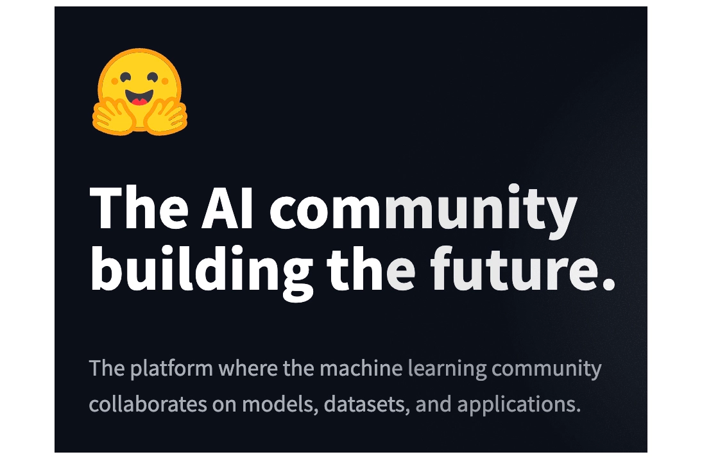

# 18 | 开源模型：如何使用HuggingFace上的模型

你好，我是郑晔！

经过前面几个部分的讲解，我们现在已经完全有能力构建一个属于自己的大模型应用了。不过，之前所有的应用都是基于 OpenAI 的 GPT 模型构建的。在接下来的几讲，我们会谈谈其它的模型。

既然 GPT 模型已经很好用了，为什么要使用其它模型呢？一个很直接的问题就是，如果我们使用 GPT，这就意味着，所有的请求都会发送给第三方。这种做法对于很多企业来说是没有问题的，但还有很多大企业，它们特别在意的就是数据安全性，把数据发到外部是一件无法接受的事情，更有甚者，其内部服务与外部网络是断开的。

所以，在传统开发中，如果为这些企业服务，一个重要的议题就是私有化部署，但像 OpenAI这样的服务显然是无法满足私有化部署的需求。在这种情况下，一个能够运行在本地的大模型就显得至关重要了，之所以我们可以在本地运行模型，是因为有人把已经做好的模型开放了出来，这就是开源的力量。

这一讲，我们讲讲如何使用开源模型。

## Hugging Face

谈及开源模型，目前最知名的 AI 模型开源社区是 Hugging Face。Hugging Face 之于 AI 社区，犹如 Github 之于程序员社区。



Hugging Face 原本是一家针对青少年提供聊天机器人的公司，所以，选择了一个表情符号（）来给公司命名。不过，创始人很快就意识到真正有潜力的并不是聊天机器人本身，而是其背后的模型。

于是，Hugging Face 转型成了一个 AI 社区，它开放了自己应用底层的一些代码，方便访问社区里的模型。大模型的核心机制是 Transformer 架构，其论文发表于 2017 年，而 HuggingFace 的火爆始于 2018 年，一个备受关注的模型架构有了一个可以分享讨论的社区，二者相互促进，相得益彰。

如今的 Hugging Face 主要除了可以分享模型（model），还可以分享数据集（dataset），还有部署起来的应用（Space）。模型也不止是语言模型，而是其它各式各样的模型，比如图像生成模型、语音生成模型等等。为了让用户更好地使用其服务，Hugging Face 还提供了很多的工具，比如简化模型使用的 transformers 程序库、简化 AI 应用开发和部署的 Gradio 等等。

好了，我们已经对 Hugging Face 有了一个初步的了解。今天的 Hugging Face 已经成为了任何一个团队发布模型的首选之地，我们要使用的各种模型几乎都能在 Hugging Face 上找到。接下来，我们就来看看如何在我们的代码里调用 Hugging Face 上的模型。

## 使用 pipeline 调用模型

调用 Hugging Face 模型有两种方式：高层接口和底层接口。高层接口相当于是对底层接口做了封装，让代码使用起来更容易，相对而言，底层接口则有更大的灵活性。在高层接口里，我们核心要知道的一个概念就是管道（pipeline）。和软件领域所有叫管道的概念一样，它要做的就是一步一步地进行处理，一个阶段完成之后，交给下一个阶段，我们来看一个例子：

```python
import torch
from transformers import pipeline
device = "cuda" if torch.cuda.is_available() else "cpu"
messages = [
   {"role": "user", "content": "请写一首赞美秋天的五言绝句"},
]
pipe = pipeline("text-generation", model="Qwen/Qwen2.5-0.5B-Instruct", device=dev
result = pipe(messages)
print(result[-1]['generated_text'][-1]['content'])
```

我简化了一下代码，这段代码的核心就是这两句：

```
pipe = pipeline("text-generation", model="Qwen/Qwen2.5-0.5B-Instruct")
result = pipe(messages)
```

我们先构建了一个管道，第一个参数指定了它的用途，这里是文本生成（text-generation），

```
pipeline 会根据不同的用途进行不同的管道配置。第二个参数是模型，在这个例子里面，
```

我们使用的模型是阿里的通义千问（Qwen），引用模型的方式就是“用户名 / 模型名”，在这里就是“Qwen/Qwen2.5-0.5B-Instruct”。

构建好了管道，就可以调用模型了，我们把消息传给模型，它就会给我们产生一个结果。下面是我一次执行的结果：

- 秋风送爽至，落叶铺金地。丰收稻谷香，丰收喜悦起。

这段代码本身很容易理解，不过，第一次执行这段代码可能会遇到很多问题。有的模型在访问上是需要受到限制的，比如，Meta 的 Llama，需要我们先去做相应的申请。我们要有Hugging Face 账户，再去做对应的申请，然后，还需要配置自己的 Access Token，再去做相应的配置：

```bash
export HUGGINGFACE_TOKEN=<AccessToken>
```

再有，在国内访问 Hugging Face 速度上可能会有些问题。这时，我们可以考虑使用镜像站，这也需要做一些配置：

```bash
export HF_ENDPOINT=<镜像网站>
```

前面说了，pipeline 模型的第一个参数指定了用途。除了像大模型做文本生成，Hugging Face提供了大量的不同模型，可以帮助我们完成其它的工作。比如后面这个例子：

```python
import torch
from transformers import pipeline
device = "cuda" if torch.cuda.is_available() else "cpu"
pipe = pipeline("translation", model="Helsinki-NLP/opus-mt-zh-en", device=device)
result = pipe("今天天气真好，我想出去玩。")
print(result[-1]['translation_text'])
```

这段代码实现了一个翻译功能，我们选择了一个能够将中文翻译成英文的模型。从代码上看，它和前面的代码几乎没有什么区别。只是选择不同的用途以及对应的模型，相应地，返回结果也根据我们的选择有所差异。

下面是一次执行的结果：

```
It's a nice day. I want to go out.
```

顺便说一下，我们在初始化 pipeline 的时候，也可以不传模型，这样的话，在构建的时候，

```
pipeline会选择默认的模型。如果你有兴趣，不妨到 pipeline 的源码中去看看默认的模
```

型都是什么。

事实上，Hugging Face 上有很多的不同模型，能够完成各式各样的任务，非常值得我们去挖掘。我建议你先去了解一下这些模型都有哪些用途，然后，在需要的时候，选择不同的模型。

## 用底层实现调用模型

前面我们已经了解了管道的概念，对高层接口有了基本的了解。不过，管道封装起来的流程是什么样的呢？这就需要我们了解一下底层实现。

下面就是一个使用底层的实现，它实现的功能与上一段代码完全一样，理解了它的实现，你就基本上知道 pipeline 是怎样实现的了。

```python
from transformers import AutoTokenizer, AutoModelForCausalLM
tokenizer = AutoTokenizer.from_pretrained("Qwen/Qwen2.5-0.5B-Instruct")
model = AutoModelForCausalLM.from_pretrained("Qwen/Qwen2.5-0.5B-Instruct")
messages = [
   {"role": "user", "content": "请写一首赞美春天的诗，要求不包含春字"},
]
text = tokenizer.apply_chat_template(
   messages,
   tokenize=False,
   add_generation_prompt=True
)
model_inputs = tokenizer([text], return_tensors="pt").to(model.device)
generated_ids = model.generate(
   **model_inputs,
   max_new_tokens=512
)
generated_ids = [
   output_ids[len(input_ids):] for input_ids, output_ids in zip(model_inputs.inp
]
response = tokenizer.batch_decode(generated_ids, skip_special_tokens=True)[0]
print(response)
```

从代码上看，它的流程复杂多了。但实际上，只要我们理解了大模型的处理过程，这段代码就很容易理解了。这个过程的核心就是三步。

第一步，把输入转换成 Token。

```
text = tokenizer.apply_chat_template(
   messages,
   tokenize=False,
   add_generation_prompt=True
)
model_inputs = tokenizer([text], return_tensors="pt").to(model.device)
```

第二步，大模型根据输入生成相应的内容。

```
generated_ids = model.generate(
   **model_inputs,
   max_new_tokens=512
)
```

第三步，生成的结果是 Token，还需要把它转成文本。

```
generated_ids = [
   output_ids[len(input_ids):] for input_ids, output_ids in zip(model_inputs.inp
]
response = tokenizer.batch_decode(generated_ids, skip_special_tokens=True)[0]
```

还记得我们在02 讲介绍过的大模型处理流程吗？基本上就是这样一个过程。因为过程中涉及到了 Token 和文本之间的转换，所以，这里还有一个 Tokenizer，它就是负责转换的模型。一般来说，大模型都要和对应的 Tokenizer 一起使用，所以，你会看到它俩往往给出的是同一个模型名字：

```
tokenizer = AutoTokenizer.from_pretrained("Qwen/Qwen2.5-0.5B-Instruct")
model = AutoModelForCausalLM.from_pretrained("Qwen/Qwen2.5-0.5B-Instruct")
```

## 流式输出

前面实现的功能都是由大模型一次性生成的。在聊天模式下，我们还需要使用流式输出。在Hugging Face 的 API 里，我们可以使用 Streamer 来实现这一点，从名字上就可以知道，它是用来处理流式输出的。下面就是一个演示了流式输出的例子：

```python
from transformers import AutoTokenizer, AutoModelForCausalLM, TextStreamer
tokenizer = AutoTokenizer.from_pretrained("Qwen/Qwen2.5-0.5B-Instruct")
model = AutoModelForCausalLM.from_pretrained("Qwen/Qwen2.5-0.5B-Instruct")
messages = [
   {"role": "user", "content": "请写一首赞美秋天的五言绝句"},
]
text = tokenizer.apply_chat_template(
   messages,
   tokenize=False,
   add_generation_prompt=True
)
model_inputs = tokenizer([text], return_tensors="pt").to(model.device)
streamer = TextStreamer(tokenizer, skip_prompt=True, skip_special_tokens=True)
generated_ids = model.generate(
   **model_inputs,
   max_new_tokens=512,
   streamer=streamer,
)
```

在这个例子里，我们用到了 TextStreamer，它会直接把生成结果输出到控制台上。如果我们要实现一个控制台应用，它是可以用的。但更多的情况下，我们需要拿到输出结果，再去做相应的处理，比如，服务端把生成的内容发送给客户端。这种情况下，我们可以使用TextIteratorStreamer，下面是一个例子：

```python
from transformers import AutoTokenizer, AutoModelForCausalLM, TextStreamer, TextI
tokenizer = AutoTokenizer.from_pretrained("Qwen/Qwen2.5-0.5B-Instruct")
model = AutoModelForCausalLM.from_pretrained("Qwen/Qwen2.5-0.5B-Instruct")
messages = [
   {"role": "user", "content": "请写一首赞美秋天的五言绝句"},
]
text = tokenizer.apply_chat_template(
   messages,
   tokenize=False,
   add_generation_prompt=True
)
model_inputs = tokenizer([text], return_tensors="pt").to(model.device)
streamer = TextIteratorStreamer(tokenizer, skip_prompt=True, skip_special_tokens=
generation_kwargs = dict(model_inputs, streamer=streamer, max_new_tokens=20)
thread = Thread(target=model.generate, kwargs=generation_kwargs)
thread.start()
for text in streamer:
   print(text)
```

与之前最大的不同是，这段代码启用了多线程，这样一来，生成和输出是异步处理的，不会彼此阻塞，更符合真实代码中的处理。正如 TextIteratorStreamer 这个名字所显示的，它实现了Iterator，所以，我们可以在其上进行迭代。

有了对 Streamer 的理解，我们就可以回到 pipeline 上，给 pipeline 增加流式输出的能力：

```python
import torch
from transformers import pipeline, TextIteratorStreamer
device = "cuda" if torch.cuda.is_available() else "cpu"
messages = [
   {"role": "user", "content": "请写一首赞美秋天的五言绝句"},
]
pipe = pipeline("text-generation", model="Qwen/Qwen2.5-0.5B-Instruct", device=dev
streamer = TextIteratorStreamer(pipe.tokenizer, skip_prompt=True, skip_special_to
generation_kwargs = dict(text_inputs=messages, streamer=streamer)
thread = Thread(target=pipe, kwargs=generation_kwargs)
thread.start()
for text in streamer:
   print(text)
```

至此，我们对如何调用 Hugging Face 上的模型有了一个初步的了解，有了这个基础，我们下一讲来看看如何在项目中使用这些模型。

## 总结时刻

Hugging Face 这个目前最知名的 AI 开源社区，它相当于程序员的 Github。它聚集了大量 AI模型，对我们来说，它是一个值得挖掘的宝藏。

调用 Hugging Face 的模型有两种方式，高层的管道方式，以及底层面对模型的方式。管道的方式更易用，而底层的方式则需要对大模型的处理流程有所了解。管道基本上就是对底层处理流程的封装。

除了使用大模型生成文本之外，Hugging Face 上还有大量的不同用途的模型。我们完全可以根据自己的需要选择相应的模型。

最后，我们还了解了如何使用高层和底层接口实现大模型的流式输出，主要就是使用了Streamer 的概念。

如果今天的内容你只能记住一件事，那请记住，Hugging Face 为我们提供了大量可以完成各种工作的模型。

## 思考题

既然各位已经知道了 Hugging Face，为了不错过好东西，我建议你去看看它上面都有什么样的模型，欢迎在留言区分享你的所得。
