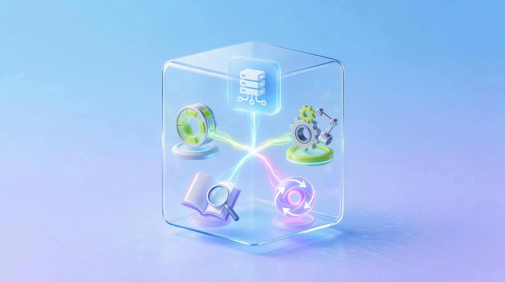
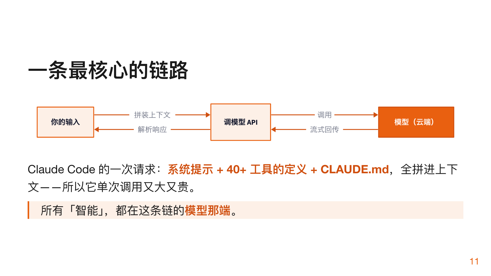
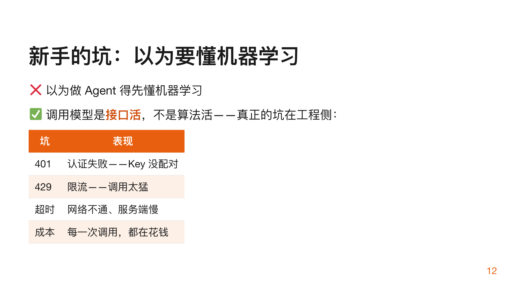
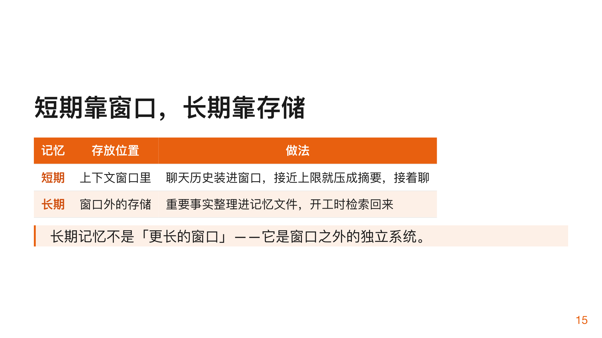
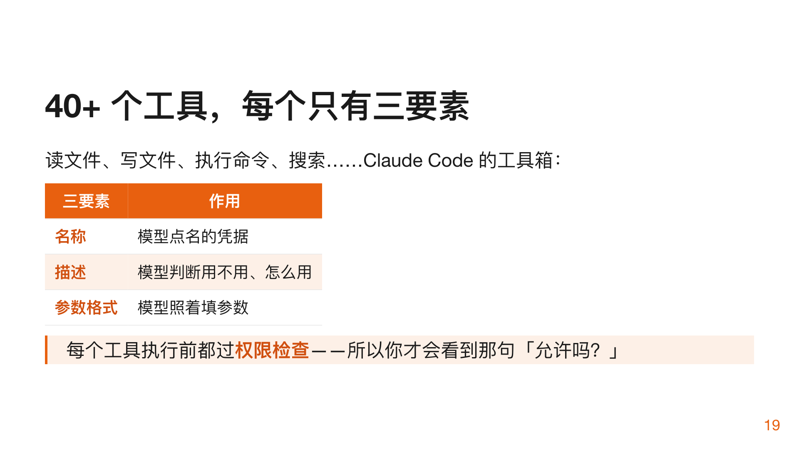
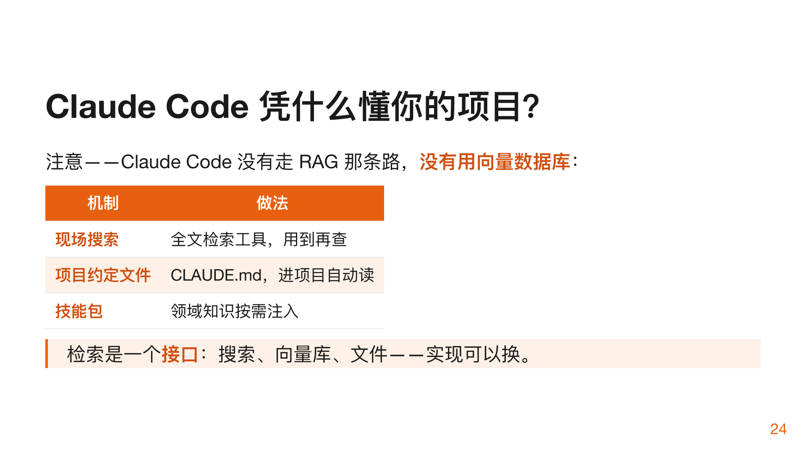
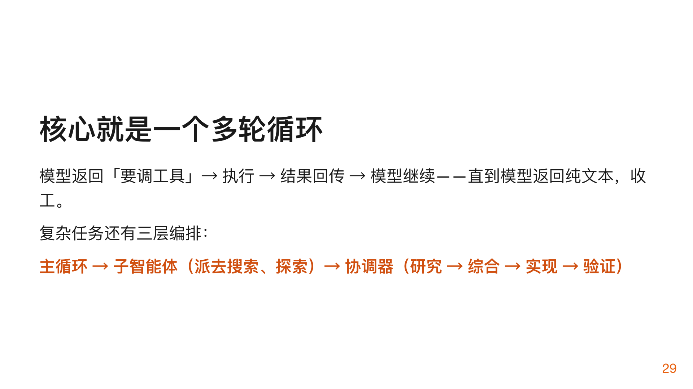
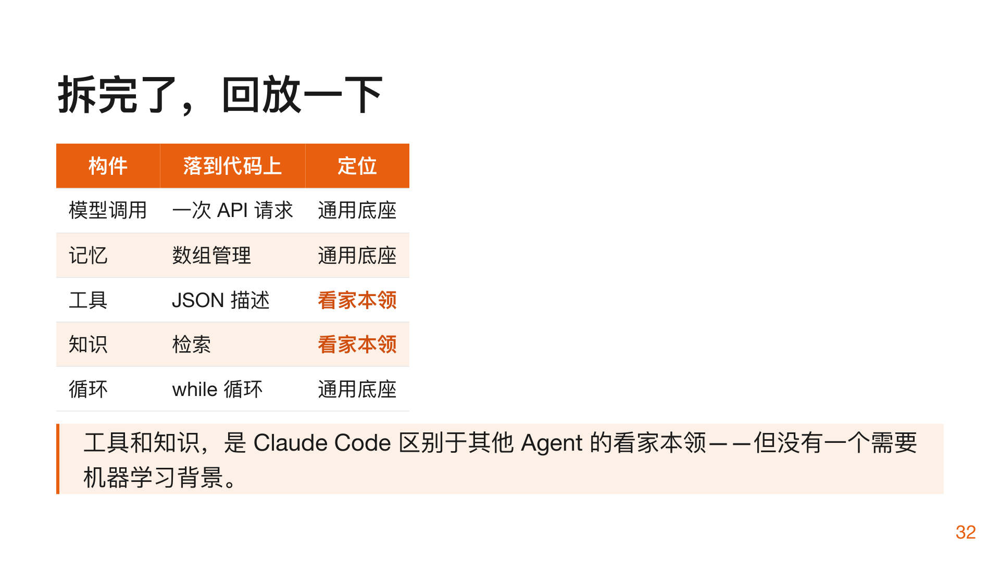
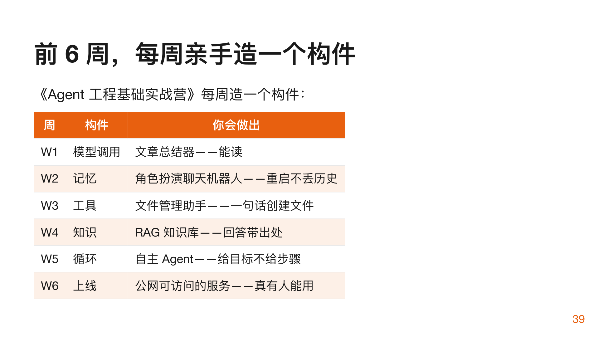

# 拆开ClaudeCode，看懂Agent的五个基本构件

- 距离《程序员的 AI 开发第一课》完结已经过去了一些时间，我对 Agent 开发的理解也日渐加深。为了帮助大家迈开 Agent 开发的第一步，不再被“没有机器学习背景”“demo 能跑但没有体系化认知”等等障碍困扰，我开设了《Agent 工程基础实战营》。这期加餐从我为实战营交付的直播内容整理而来，希望对你有启发。

你好，我是郑晔。

今天跟大家分享的主题叫“Agent 没有魔法”。

很多想入门的同学，会去听那些高大上的课。课本身讲得挺好，可自己基础不够，人家讲的那些先进理念，听着就有点跟不上。中间缺的那一环，就是对基础知识的理解。我跟极客时间合作了好几年专栏，这次就想再做一门 Agent 工程基础实战课，专门帮大家把这块底子打起来。

对于还在门外的同学来说，Agent 展现出了很多“神奇”的能力。今天的分享就是给大家破除这个“神奇”的执念——帮大家看清，很多看上去很神奇的东西，实际上只是好多技术有效叠加的应用成果。

今天的分享分几个部分：首先以 Claude Code 为例，对 Agent 技术进行拆解，帮大家破解迷思；然后从拆到造，看看破除迷思之后我们自己怎么做出一个东西来。时间关系，我没法把每个细节都掰开讲，还是优先给你一个看清全局的视角。

## 拆开 Claude Code：智能到底从哪来

对于没有做过 Agent 开发的人来说，会觉得 Agent 特别神奇。就拿 Claude Code 来说，它会读代码、会写代码、会跑命令，给个目标它就自己干，看上去像有魔法。但今天我们要做的事就是把它拆开看看——拆完你会发现 Agent 真的没有任何魔法在里边。你还会带走一张 Agent心智模型地图，以后看到任何新概念都能挂到这张图上。

我一直希望大家掌握的是一个知识体系，而不是某一项具体技术。我教给你的不是某个 API怎么调，而是一个思考框架、一个知识体系框架。当新东西来的时候，你知道该把它放在哪。

先从 Claude Code 开始。Claude Code 是什么？它是 Anthropic 出的编程 Agent，跑在终端里，你给出需求它就开始干活，替你读代码、写代码、跑命令，给个目标就能自己干。它的价值就是让 AI 编程真正成为程序员的日常工作。

我自己的体验是，2025 年之前我也试过 Cursor、GitHub Copilot 这些工具，但总觉得差了点什么。直到 Claude Code 出来，我把大部分工作都迁了过去。有人担心它在国内方不方便使用，其实不用担心——Claude Code 本身不绑定某个模型，它是一个很好的 Harness，就是那个壳子、一套指导大模型工作的工具。现在国产大模型表现也很好，大多数日常工作用国产模型就能完成。因为它和国产大模型的配合，我现在日常工作基本都在 Claude Code 里完成，无论是写代码还是写文章，包括大家现在看到的这个 PPT 本身也是我用 Claude Code 写出来的。我把我自己的想法灌给它，界面的呈现、字体的细节这些是它做的，但核心的想法，肯定还是我的。也因为它的出现，我的工作方式变了——原来是以自己手敲代码为主，现在变成了跟 AI 协同。那对于大家来说，可能你也有自己喜欢的工具，比如说有人也喜欢用 OpenCode， 有人喜欢用 PI，但你如果还是个习惯手敲代码的程序员，大概会慢慢改掉这个习惯。

那问题来了：Claude Code 看上去这么能干，它的智能是从哪来的？它真的有智能吗？答案是没有，智能全在模型里。最常见的部署形态就是云端模型——你在本地装的 Claude Code 什么也不知道，它只是一堆执行的代码，真正思考的部分都在云端模型里完成。

所以 Claude Code 的价值是什么？智能在模型里，Claude Code 本身是一个工程，让大模型的智能得以发挥。智能是模型的，发挥智能的是工程。模型虽然聪明，可除了“显得聪明”，它其实什么也干不了——它没法替你把代码真正改到磁盘上，真正把活落地的是工程。那这个工程由什么组成？所有 Agent 的构件其实都差不多，难的是把每件都做到能用——这才是Claude Code 的功力。我们逐个拆，每拆一个，你会看到一个新手的坑。

### 构件一：模型调用

第一个构件是模型调用。Claude Code 看上去什么都能答、什么活都能干，但本质上它就是通过 API 发一个请求——和调用任何后端服务没有本质区别。大模型的本职工作就是“预测下一个 token”，给它上下文，它就接着写。

Claude Code 最核心的链路长这样：你的输入拼装上下文，调模型 API，调用云端模型，模型流式回传结果，再解析响应。这中间模型干的事，说白了就是一个 token 一个 token 地往下写——生成了一个 token，又生成了一个 token，再生成一个，如此往复。这是个极简的图，没有任何花哨的部分。而 Claude Code 一次请求会拼上什么？系统提示、40 多个工具的定义、CLAUDE.md 里写的项目约定，甚至还包括这次调用需要用到的代码上下文。所以你给它一句话，传给云端的是一大堆话。所有“智能”都在这条链的模型那端。

新手的第一个坑就是以为做 Agent 得先懂机器学习。其实调用模型是接口活，不是算法活——真正的坑在工程侧：401 是 Key 没配对，429 是调用太猛被限流，还有网络不通、服务端慢导致的超时，以及每一次调用都在花钱的成本问题。

站在今天的角度，大模型已经变成了水电一样的基础设施，你插上插座就有电，不需要懂后面的机器学习原理。接口本身其实非常简单，难的不是调用，是让它稳定地被调用——超时了、限流了、报错了，程序还能正常跑下去，这才是真正要花时间的地方。真正花心思的也不是接口，而是你在提示词里到底写了什么。所以如果你对大模型有想法但还没动手，别担心，就把它当成一个非常普通的接口来用。

### 构件二：记忆

第二个构件是记忆。Claude Code 很了解你：你的代码、你的偏好、聊过的上下文，下次开工都还在。即便你不小心关了它，下次用 resume 命令就能恢复前面的 session。我自己在准备这个直播的时候就切了好几个 session，一会儿写代码一会儿写文稿，需要接着聊哪段就切到哪段。

但有个残酷的现实：大模型本身是没有记忆的。每次调用都是无状态的，说完就忘。所谓“记得你”，只是程序在调用时把历史和关于你的东西重新塞回了每一次调用。现在有些 API 在尝试记住会话，但行业里主流的用法还是 chat completion 这种无状态调用，每次都是全新的请求。

记忆怎么做？短期靠窗口，长期靠存储。

短期就是上下文窗口——把最近几轮会话历史装进去，让它像记得你一样。但上下文窗口不是无限的，再长也有上限，塞多了会话就膨胀，最早聊的东西就得舍弃。常见的处理手段是定期压缩，把历史压成摘要接着聊。但压完了它还会继续膨胀，所以压缩不是做一次就完事，得反复做。长期记忆则是把重要事实整理进窗口外的存储，开工时再检索回来。它不是原封不动把会话全存下来——那样找也不好找，中间要做信息提取，只留真正有用的那部分。长期记忆不是“更长的窗口”，它是窗口之外的独立系统，甚至可以放到数据库里，当成接近无限的记忆来用。

新手在记忆上的坑就是两个极端：

- 要么无限塞历史。有人说现在不是有百万上下文吗，能塞就多塞——可百万上下文处理起来也是要花钱的，每一个 token 都是钱，从工程角度看这么干非常不划算，塞过头还会直接报错，顺便你也就懂了 token 就是钱；

- 要么滑动窗口定量历史，超出的部分直接失效，聊着聊着就忘了你前面说过什么。所以历史是要管理的：压缩、摘要、定期清理。长期记忆本身也有坑，比如你今天说喜好跑步明天说喜好跳绳，喜好到底是什么？维护好历史也需要工程功夫。

说白了，记忆就是上下文管理策略——什么东西放窗口里、什么东西放外面，这是典型的工程问题，不是模型自带的功能。

### 构件三：工具

第三个构件是工具。Claude Code 能替你创建文件、跑命令、改代码，但大模型的本职只是输出文本——从道理上讲它干不了这些活。那它为什么能干？因为在和大模型交互的过程中，我们告诉了它有哪些工具，它反过来告诉我们“你可以执行这段代码、创建这个文件”。真正在底下执行的是谁？是我们的代码。

Claude Code 提供了超过 40 个工具，每个工具只有三要素：名称（模型点名的凭据）、描述（模型判断用不用、怎么用）、参数格式（模型照着填参数）。早期 API 里这叫“函数”，后来因为容易误解才改叫“工具”——其实就是声明一个函数给大模型，大模型告诉你调哪个，你在本地执行掉。每个工具执行前还要过权限检查，所以你才会看到那句“允许吗？”现在很多人开了自动模式，把这句话忽略掉了，但底层该做的检查一点没少。

新手以为工具越多越好，拼命给大模型加工具。早几年工具还得写进提示词里，现在基本是把工具列表当参数传过去——列表越长上下文就越长，而大模型有个特点叫 lost in the middle——中间内容它会迷失。所以 Claude Code 的答案恰恰是一套精简核心工具，真正要打磨的是质量：描述写得含糊模型就点错工具，权限边界不清该问的不问就出事故。

Claude Code 还有个厉害的地方：它底层可以调用各种命令行工具，用 grep 搜代码，需要时还能拉 Python 或 Shell 脚本。我平时会留意看它的执行过程，它有时会把几条命令组合起来在本地干活——所以工具不多，能做的事却几乎是无限的。反过来想，你要自己做一个Agent，也别指望一个 Agent 包打天下：为不同的方面做不同的 Agent，工具列表自然就短了；而有些 AI 项目集成几千个对外接口，就得自己建一个工具 Registry 方便查找。总之，别往一个 Agent 里塞太多工具，总有开发手段能改善这件事。

所以工具就是模型的手脚——描述写得好，工具才听话。而写描述本质上就是写提示词。

### 构件四：知识

第四个构件是知识。Claude Code 看上去很懂你的项目：目录结构、团队规范、该改哪里，问它都知道。但大模型没读过你的代码、你的文档、你公司的规范，它知道的只是互联网上的公共知识。你的事，要靠调用时现场喂给它。

业界最常见的做法是 RAG——检索增强生成。把文档切块入库。为什么非要向量化？因为纯文本检索在语义上容易跑偏，转成向量再按语义检索，命中率会好得多。提问时按语义检索出最相关的几块；检索结果塞进上下文，模型据此回答。但 RAG 这个词本身并不局限于向量数据库——它要先检索，至于检索的是不是向量库，不一定。名字本身就是这个意思：先检索，把检索到的内容增强到请求里，再生成。

Claude Code 并没有走传统 RAG 那条路，它没有用向量数据库。它的做法是：现场搜索（全文检索工具，用到再查）、项目约定文件（CLAUDE.md，进项目自动读）、技能包（领域知识按需注入）。现场搜索不只是 grep，Claude Code 用的还是增强版的检索工具，会拿检索到的内容再做一层增强。那条项目约定文件除了 CLAUDE.md，现在也有叫 AGENTS.md 的。比如你 init 一下生成一个 CLAUDE.md，它对你的项目做整体检索，把核心特征保留下来，每次调用都用。要做 code review 了，就把 code review 的知识写成一个 skill 按需注入。

所以检索是一个接口：搜索、向量库、文件——实现可以换。不用向量库是落后吗？不是。这是 Claude Code 主动的判断：代码搜索是个非常成熟的领域，grep 一下就能精准找到想要的东西，现场搜索更合适。可换到你企业里就不一样了——文件成千上万，不做切块、不做语义理解，光靠关键字检索会很吃力，这时候向量库的价值才显出来。所以哪条路更好没有标准答案，看场景。

这门课真正要练的判断是：先问该不该用，再问怎么用。提示词能解决的不上 RAG，规则能解决的不上 Agent。

如果你手头只有两三篇文章，真没必要上 RAG 系统；如果你需要 100% 准确，而且过滤条件是现成的，那就不该用 Agent——因为大模型的本质是预测下一个词，是概率性的，一旦有概率就有可能不准。这也是我写《10x 程序员工作法》专栏以来，一以贯之的想法——知道一件事的来龙去脉，而不是人云亦云。课里我会反复强调：你要学会的不只是这段代码怎么写，更重要的是它为什么这么写，对程序员来说后者才是更关键的东西。

新手在知识上的坑就是不知道该给模型看什么：什么都塞进上下文，又贵又乱，大模型反而找不到相关的东西；什么都不给，模型只能靠公共知识瞎猜——而且大模型最擅长的就是一本正经地胡说八道。所以“信息供给”本身就是工程：什么该给、什么时候给、给多少。这也是这两年大家在说的“上下文工程”要解决的事。

知识就是按需检索，检索源可以替换。

### 构件五：循环

第五个构件是循环。Claude Code 能自己干完一个任务：规划、执行、观察、调整，一路到收工。但单独看每一次调用，都只是一问一答——没有谁能自己“继续”。循环就是给目标、不给步骤，模型自己规划“思考→行动→观察结果→再行动”，直到任务完成。它和工具的区别也在这儿：工具是你要点名调哪个，循环是你只给一个目标——这也是 Agent 看上去有智能的地方。

核心就是一个多轮循环：模型返回“要调工具”，执行，结果回传，模型继续——直到模型返回纯文本，收工。复杂任务还有三层编排：主循环、子智能体（派去搜索探索）、协调器（研究→综合→实现→验证）。每一层最核心的都是 Agent 循环，一层套一层，直到活儿干完。

新手的坑在护栏设计：把“能自己跑”当成功，一句目标跑几十次调用，跑着跑着就跑偏了，成本失控——死循环在任何程序里如果不主动杀都会耗尽资源；太紧，事事都要人确认，执行一条命令确认一次，退回一问一答，Agent 名存实亡。停止条件和护栏是设计的一部分，不是可选项。

其实很多人没把 Agent 看成一个软件。但它首先是个软件——你得规划好职责：什么归人、什么归代码、什么归模型，哪个要审批、哪个直接执行。这和标准软件设计是一样的：架构图很关键，一开始就把职责划分好。循环就是目标驱动的自主执行，而护栏是你自己的设计。

## 回顾：Agent 的五个基本构件

我们快速回放一下。

- 模型调用，落到代码上就是一次 API 请求，是通用底座；

- 记忆，就是上下文窗口管理，也是通用底座；

- 工具，是 JSON 描述，这是看家本领；

- 知识，是检索，也是看家本领；

- 循环，就是一个 while 循环，通用底座。

模型调用、记忆、循环都是很通用的东西，但工具和知识是你的看家本领——任何通用 Agent配上不同的工具和知识，就是完全不同的 Agent。为什么值得自己开发一个 Agent？因为你手里领域特定的东西是值钱的，它是你这个系统真正的价值所在。通用的底子我可以帮你打好，但你想做出有自己特点的东西，必须把工具和知识配进去。而且你放心，这五块里没有任何一块需要你有机器学习的背景。

所以 Agent 心智模型就是：模型 + 记忆 + 工具 + 知识 + 循环。你学 Agent 开发要掌握的也就是这些——模型怎么回事、记忆怎么回事、工具怎么回事、知识怎么配、循环怎么做。任何新东西来了，有更好的记忆提取算法就放到记忆里，有新的文档就放到知识里，有新的大模型就更新到模型里。每天天花乱坠的新闻，真正值得关注的核心差不多就是这些。

但还缺一块：上线。企业里真正要做的，往往不是一个跑在自己电脑上的 Claude Code，而是一个对外提供的服务——比如帮你搭一个网站，别人打开就能用。这就要求你把 Agent 部署到云端、公网可访问、重启不丢数据、真有人能用。从脚本到服务，是另一道坎。

这些构件都不难，难的是把它真正做出来。有人带着你做一遍，这东西基本就会了——亲手实践一把，你就能从新手变成有经验的老手。你看 Claude Code 自己就带着成本追踪、多层权限防线、错误恢复、流式体验——这些都不是模型给的，是工程替你想到的。每个构件我都点过一个新手的坑——这些坑就是新手和熟手的真正差距。

## 从拆到造

拆是看别人怎么做，造是把它变成自己的。看明白别人是怎么拆成这几个构件的，接下来就轮到你拼了——把五个构件拼在一起，接上你自己的需求、你自己的工具和知识，再给它一个对外访问的能力，那就是你自己的 Agent。

自己动手造，真正的门槛是什么？实话说，知识上我不觉得有哪一块是难的。Claude Code 看着神秘，拆完你会发现也就那么回事，好像我试一试也行。真正的门槛有三件事：

- 第一，破除技术迷雾，真的动手做出一个 Agent 来——哪怕最简单的，比如一个帮你总结文章概要的 Agent，可能几分钟就做好了，门槛真没那么高；

- 第二，构建自己的知识体系，对 Agent 开发有完整理解；

- 第三，跳出技术限制，从更高的角度理解开发——是不是一定要用 Agent？是不是一定要上RAG？这都是你要主动选择的，而不是别人都这么做我就这么做。

迈过这三道坎，就是《Agent 工程基础实战营》要带你做的事。这三件事做完，你后面再往深里学，才有落脚的地方。

后两周我会给大家一些信息上的拓展，比如对这两年大模型技术发展有个简单理解；但更重要的，是把前面做的模块替换成你自己的东西，去打磨属于你自己的 Agent 服务。举个例子，W1 给你的是一个文章总结器，你完全可以把它改成翻译工具——丢一句话进去，它给你翻成中文或者英文。就这么简单一换，它就成了你自己想要的东西。

结课后你应该带走什么？一个自己从 0 造到上线、公网可访问的 Agent 服务；一套可复用的原型代码模板；一份能力盘点与补足优先级清单；一套持续学习的方法与信息源；以及最关键的——一张心智模型地图，新概念往里挂，这就是你继续学习的框架。

最后说两样不过时的东西。

模型两年后会更强，工具两年后会更多，但你亲手从 0 到上线走过一遍的完整体感还在，这张挂新知识的心智模型地图还在——这就是入门课该给你的全部。我也希望我二十多年攒下的这点经验，能帮你把入门这段路趟过去。如果你觉得自己已经是高手，可能不必在工程基础上再下功夫；但如果你是想把脑子里那些零散的知识串成一个体系，欢迎来听我讲讲、跟着我练一练。

我做了这么多年课，最想传达的不是某段代码怎么写。代码讲起来很快，一小时能全部讲完，但那没有意义。把前因后果想清楚，知道为什么这么写，比知道怎么写重要得多。如果你对Agent 开发有兴趣但一直觉得缺基础，欢迎加入我们，大家一起学习。
