# 1.1基础编程模型

- 1.1 基础编程模型

- 我们学习算法的方法是用 Java 编程语言编写的程序来实现算法。这样做是出于以下原因：

- 程序是对算法精确、优雅和完全的描述；可以通过运行程序来学习算法的各种性质；可以在应用程序中直接使用这些算法。

- 相比用自然语言描述算法，这些是重要而巨大的优势。

- 这样做的一个缺点是我们要使用特定的编程语言，这会使分离算法的思想和实现细节变得困难。我们在实现算法时考虑到了这一点，只使用了大多数现代编程语言都具有且能够充分描述算法所必需的语法。

- 我们仅使用了 Java 的一个子集。尽管我们没有明确地说明这个子集的范围，但你也会看到我们只使用了很少的 Java 特性，而且会优先使用大多数现代编程语言所共有的语法。我们的代码是完整的，因此希望你能下载这些代码并用我们的测试数据或是你自己的来运行它们。

- 我们把描述和实现算法所用到的语言特性、软件库和操作系统特性总称为基础编程模型。本节以及 1.2 节会详细说明这个模型，相关内容自成一体，主要是作为文档供读者查阅，以便理解本书的代码。我们的另一本入门级的书籍 An Introduction to Programming in Java: AnInterdisciplinary Approach 也使用了这个模型。

- 作为参考，图 1.1.1 所示的是一个完整的 Java 程序。它说明了我们的基础编程模型的许多基本特点。在讨论语言特性时我们会用这段代码作为例子，但可以先不用考虑代码的实际意义（它实现了经典的二分查找算法，并在白名单过滤应用中对算法进行了检验，请见 1.1.10节）。我们假设你具备某种主流语言编程的经验，因此你应该知道这段代码中的大多数要点。图中的注释应该能够解答你的任何疑问。因为图中的代码某种程度上反映了本书代码的风格，而且对各种 Java 编程惯例和语言构造，在用法上我们都力求一致，所以即使是经验丰富的Java 程序员也应该看一看。

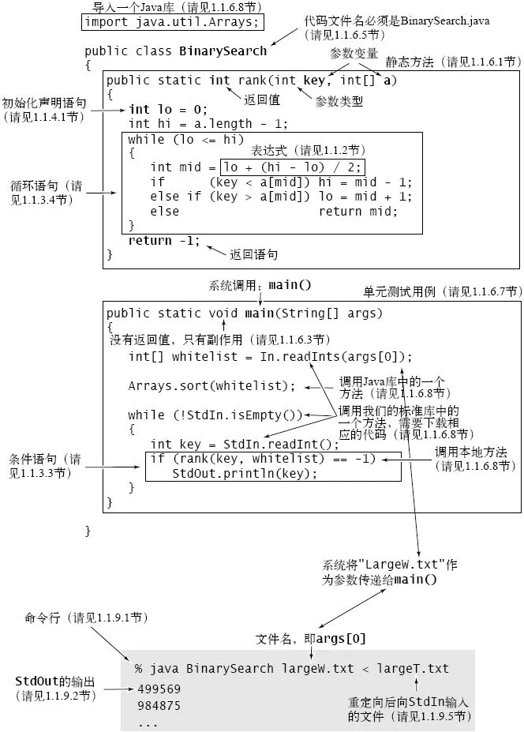

- 图 1.1.1　Java 程序及其命令行的调用1.1.1　Java 程序的基本结构一段 Java 程序（类）或者是一个静态方法（函数）库，或者定义了一个数据类型。要创建静态方法库和定义数据类型，会用到下面七种语法，它们是 Java 语言的基础，也是大多数现代语言所共有的。

- 原始数据类型：它们在计算机程序中精确地定义整数、浮点数和布尔值等。它们的定义包括取值范围和能够对相应的值进行的操作，它们能够被组合为类似于数学公式定义的表达式。语句：语句通过创建变量并对其赋值、控制运行流程或者引发副作用来进行计算。我们会使用六种语句：声明、赋值、条件、循环、调用和返回。数组：数组是多个同种数据类型的值的集合。静态方法：静态方法可以封装并重用代码，使我们可以用独立的模块开发程序。字符串：字符串是一连串的字符，Java 内置了对它们的一些操作。标准输入 / 输出：标准输入输出是程序与外界联系的桥梁。

- 数据抽象：数据抽象封装和重用代码，使我们可以定义非原始数据类型，进而支持面向对象编程。

- 我们将在本节学习前六种语法，数据抽象是下一节的主题。

- 运行 Java 程序需要和操作系统或开发环境打交道。为了清晰和简洁，我们把这种输入命令执行程序的环境称为虚拟终端。请登录本书的网站去了解如何使用虚拟终端，或是现代系统中许多其他高级的编程开发环境的使用方法。

```
在例子中，BinarySearch 类有两个静态方法rank() 和 main()。第一个方法 rank() 含有
```

- 四条语句：两条声明语句，一条循环语句（该语句中又有一条赋值语句和两条条件语句）和一

```
条返回语句。第二个方法 main() 包含三条语句：一条声明语句、一条调用语句和一个循环
```

- 语句（该语句中又包含一条赋值语句和一条条件语句）。

```
要执行一个 Java 程序，首先需要用 javac 命令编译它，然后再用 java 命令运行它。例
如，要运行 BinarySearch，首先要输入 javac BinarySearch.java（这将生成一个叫
BinarySearch.class 的文件，其中含有这个程序的 Java 字节码）；然后再输入 java
BinarySearch（接着是一个白名单文件名）把控制权移交给这段字节码程序。为了理解这
```

- 段程序，我们接下来要详细介绍原始数据类型和表达式，各种 Java 语句、数组、静态方法、字符串和输入输出。1.1.2　原始数据类型与表达式数据类型就是一组数据和对其所能进行的操作的集合。首先考虑以下 4 种 Java 语言最基本的原始数据类型：

```
整型，及其算术运算符（int）；
双精度实数类型，及其算术运算符（double）；
布尔型，它的值  及其逻辑操作（boolean）；
字符型，它的值是你能够输入的英文字母数字字符和符号（char）。
```

- 接下来我们看看如何指明这些类型的值和对这些类型的操作。

- Java 程序控制的是用标识符命名的变量。每个变量都有自己的类型并存储了一个合法的值。在 Java 代码中，我们用类似数学表达式的表达式来实现对各种类型的操作。对于原始类型来

```
说，我们用标识符来引用变量，用 +、-、*、/ 等运算符来指定操作，用字面量，例如 1 或
者 3.14 来表示值，用形如 (x+2.236)/2 的表达式来表示对值的操作。表达式的目的就是
```

- 计算某种数据类型的值。表 1.1.1 对这些基本内容进行了说明。

- 表 1.1.1　Java 程序的基本组成

- 术语例子定义一组数据和对其所能进行的操作的集

```
int double boolean char
```

- 原始数据类型置）

```
由字母、数字、下划线和 $ 组成的
a abc Ab$ a_b ab123 lo hi
```

- 标识符能是数字变量［任意标识符］表示某种数据类型的值

```
+ － * /
```

- 运算符表示某种数据类型的运算

```
int           1  0 －42
```

- 只要能够指定值域和在此值域上的操作，就能定义一个数据类型。表 1.1.2 总结了 Java 的

```
int、double、boolean 和 char 类型的相关信息。许多现代编程语言中的基本数据类型
和它们都很相似。对于 int 和 double 来说，这些操作是我们熟悉的算术运算；对于
boolean 来说则是逻辑运算。需要注意的重要一点是，+、-、*、/ 都是被重载过的——根
```

- 据上下文，同样的运算符对不同类型会执行不同的操作。这些初级运算的关键性质是运算产生的数据的数据类型和参与运算的数据的数据类型是相同的。这也意味着我们经常需要处理近似

```
值，因为很多情况下由表达式定义的准确值并非参与表达式运算的值。例如，5/3 的值是 1
而 5.0/3.0 的值是 1.66666666666667，两者都很接近但并不准确地等于 5/3。下表并不
```

- 完整，我们会在本节最后的答疑部分中讨论更多运算符和偶尔需要考虑到的各种异常情况。

- 表 1.1.2　Java 中的原始数据类型

- 类型值域运算符

```
+（加）
-（减）
```

- 3131

```
int
*（乘）
```

- -2至 +2-1 之间的整数（32 位，二进制补码）

```
/（除）
%（求余）
+（加）
-（减）
double
```

- 双精度实数（64 位，IEEE 754 标准）

```
*（乘）
/（除）
&&（与）
||（或）
boolean
true 或 false
!（非）
^（异或）
char
```

- 字符（16 位）（算术运算符，但很少使用）

- 1.1.2.1　表达式如表 1.1.2 所示，Java 使用的是中缀表达式：一个字面量（或是一个表达式），紧接着是一个运算符，再接着是另一个字面量（或者另一个表达式）。当一个表达式包含一个以上的运算符

```
时，运算符的作用顺序非常重要，因此 Java 语言规范约定了如下的运算符优先级：运算符 *
和 /（以及 %）的优先级高于 + 和 -（优先级越高，越早运算）；在逻辑运算符中，! 拥有最
高优先级，之后是 &&，接下来是 ||。一般来说，相同优先级的运算符的运算顺序是从左至
```

- 右。与在正常的算数表达式中一样，使用括号能够改变这些规则。因为不同语言中的优先级规则会有些许不同，我们在代码中会使用括号并用各种方法努力消除对优先级规则的依赖。

- 1.1.2.2　类型转换

```
如果不会损失信息，数值会被自动提升为高级的数据类型。例如，在表达式 1+2.5 中，1 会
被转换为浮点数 1.0，表达式的值也为 double 值 3.5。转换指的是在表达式中把类型名放
在括号里将其后的值转换为括号中的类型。例如，(int)3.7 的值是 3 而 (double)3 的值
```

- 是 3.0。需要注意的是将浮点型转换为整型将会截断小数部分而非四舍五入，在复杂的表达式中的类型转换可能会很复杂，应该小心并尽量少使用类型转换，最好是在表达式中只使用同一类型的字面量和变量。

- 1.1.2.3　比较

```
下列运算符能够比较相同数据类型的两个值并产生一个布尔值：相等（==）、不等（!=）、小
于（<）、小于等于（<=）、大于（>）和大于等于（>=）。这些运算符被称为混合类型运算
```

- 符，因为它们的结果是布尔型，而不是参与比较的数据类型。结果是布尔型的表达式被称为布尔表达式。我们将会看到这种表达式是条件语句和循环语句的重要组成部分。

- 1.1.2.4　其他原始类型32

```
Java 的int 型能够表示 2
```

- 个不同的值，用一个字长 32 位的机器字即可表示（虽然现在的

```
许多计算机有字长 64 位的机器字，但int 型仍然是 32 位）。与此相似，double 型的标准规
```

- 定为 64 位。这些大小对于一般应用程序中使用的整数和实数已经足够了。为了提供更大的灵活性，Java 还提供了其他五种原始数据类型：

```
64 位整数，及其算术运算符 (long)；
16 位整数，及其算术运算符 (short)；
16 位字符，及其算术运算符 (char)；
8 位整数，及其算术运算符 (byte)；
32 位单精度实数，及其算术运算符 (float)。
在本书中我们大多使用 int 和 double 进行算术运算，因此我们在此不会再详细讨论其他类
```

- 似的数据类型。1.1.3　语句Java 程序是由语句组成的。语句能够通过创建和操作变量、对变量赋值并控制这些操作的执行流程来描述运算。语句通常会被组织成代码段，即花括号中的一系列语句。

- 声明语句：创建某种类型的变量并用标识符为其命名。赋值语句：将（由表达式产生的）某种类型的数值赋予一个变量。Java 还有一些隐式赋值的语法可以使某个变量的值相对于当前值发生变化，例如将一个整型值加 1。条件语句：能够简单地改变执行流程——根据指定的条件执行两个代码段之一。循环语句：更彻底地改变执行流程——只要条件为真就不断地反复执行代码段中的语句。

- 调用和返回语句：和静态方法有关（见 1.1.6 节），是改变执行流程和代码组织的另一种方式。

- 程序就是由一系列声明、赋值、条件、循环、调用和返回语句组成的。一般来说代码的结构都是嵌套的：一个条件语句或循环语句的代码段中也能包含条件语句或是循环语句。例如，

```
rank() 中的 while 循环就包含一个 if 语句。接下来，我们逐个说明各种类型的语句。
```

- 1.1.3.1　声明语句声明语句将一个变量名和一个类型在编译时关联起来。Java 需要我们用声明语句指定变量的名称和类型。这样，我们就清楚地指明了能够对其进行的操作。Java 是一种强类型的语言，因为 Java 编译器会检查类型的一致性（例如，它不会允许将布尔类型和浮点类型的变量相乘）。变量可以声明在第一次使用之前的任何地方——一般我们都在首次使用该变量的时候声明它。变量的作用域就是定义它的地方，一般由相同代码段中声明之后的所有语句组成。

- 1.1.3.2　赋值语句赋值语句将（由一个表达式定义的）某个数据类型的值和一个变量关联起来。在 Java 中，当

```
我们写下c=a+b 时，我们表达的不是数学等式，而是一个操作，即令变量 c 的值等于变量 a
的值与变量 b 的值之和。当然，在赋值语句执行后，从数学上来说c 的值必然会等于 a+b，
但语句的目的是改变 c 的值（如果需要的话）。赋值语句的左侧必须是单个变量，右侧可以是
```

- 能够得到相应类型的值的任意表达式。

- 1.1.3.3　条件语句大多数运算都需要用不同的操作来处理不同的输入。在 Java 中表达这种差异的一种方法是

```
if 语句：
if (<boolean expression>) { <block statements> }
1
```

- 这种描述方式是一种叫做模板的形式记法，我们偶尔会使用这种格式来表示 Java 的语法。尖

```xml
括号（<>）中的是我们已经定义过的语法，这表示我们可以在指定的位置使用该语法的任意
实例。在这里，<boolean expression> 表示一个布尔表达式，例如一个比较操作。
<block statements> 表示一段 Java 语句。我们也可以给出 <boolean expression>
和<block statements> 的形式定义，不过我们不想深入这些细节。if 语句的意义不言自
明：当且仅当布尔表达式的值为真 (true) 时代码段中的语句才会被执行。以下 if-else 语
```

- 句能够在两个代码段之间作出选择：

```
if (<boolean expression>) { <block statements> }
1
else                      { <block statements> }
2
```

- 1.1.3.4　循环语句许多运算都需要重复。Java 语言中处理这种计算的基本语句的格式是：

```
while (<boolean expression>) { <block statements> }
1
while 语句和 if 语句的形式相似（只是用while 代替了 if），但意义大有不同。当布尔表
达式的值为假（false）时，代码什么也不做；当布尔表达式的值为真（true）时，执行代
码段（和 if 一样），然后再次检查布尔表达式的值，如果仍然为真，再次执行代码段。如此
```

- 这般，只要布尔表达式的值为真，就继续执行代码段。我们将循环语句中的代码段称为循环体。

- 1.1.3.5　break 与 continue 语句

```
有些情况下我们也会需要比基本的 if 和 while 语句更加复杂的流程控制。相应地，Java 支
持在while 循环中使用另外两条语句：
break 语句，立即从循环中退出；
continue 语句，立即开始下一轮循环。
```

- 本书很少在代码中使用它们（许多程序员从来都不用），但在某些情况下它们的确能够大大简化代码。1.1.4　简便记法程序有很多种写法，我们追求清晰、优雅和高效的代码。这样的代码经常会使用以下这些广为流传的简便写法（不仅仅是 Java，许多语言都支持它们）。

- 1.1.4.1　声明并初始化可以将声明语句和赋值语句结合起来，在声明（创建）一个变量的同时将它初始化。例如，

```
int i = 1; 创建了名为 i 的变量并赋予其初始值 1。最好在接近首次使用变量的地方声明
```

- 它并将其初始化（为了限制它的作用域）。

- 1.1.4.2　隐式赋值当希望一个变量的值相对于其当前值变化时，可以使用一些简便的写法。

```
递增 / 递减运算符，++i; 等价于 i=i+1; 且表达式为 i+1;。类似地，--i; 等价于
i=i-1;。i++; 和 i--; 的意思分别与上述的 ++i; 和 --i; 相同。
```

- 其他复合运算符，在赋值语句中将一个二元运算符写在等号之前，等价于将左边的变量放在

```
等号右边并作为第一个操作数。例如，i/=2; 等价于 i=i/2;。注意，i += 1; 等价于 i
= i + 1;（以及 ++i;）。
```

- 1.1.4.3　单语句代码段如果条件或循环语句的代码段只有一条语句，代码段的花括号可以省略。

- 1.1.4.4　for 语句

```
很多循环的模式都是这样的：初始化一个索引变量，然后使用 while 循环并将包含索引变量
的表达式作为循环的条件，while 循环的最后一条语句会将索引变量加 1。使用 Java 的 for
```

- 语句可以更紧凑地表达这种循环：

```xml
for (<initialize>; <boolean expression>; <increment>)
1
{
2
  <block statements>
3
}
4
```

- 除了几种特殊情况之外，这段代码都等价于：

```xml
<initialize>;
1
while (<boolean expression>)
2
{
3
  <block statements>
4
  <increment>;
5
}
6
我们将使用 for 语句来表示对这种初始化—递增循环用法的支持。
```

- 表 1.1.3 总结了各种 Java 语句及其示例与定义。

- 表 1.1.3　Java 语句

- 语句示例定义

```
int i;
```

- 声明语句创建一个指定类型

```
double c;
a = b + 3;
```

- 赋值语句将某一数据类型的

```
discriminant = b * b - 4.0 * c;
int i = 1;
```

- 声明并初始化在声明时赋予变量1.1.5　数组数组能够顺序存储相同类型的多个数据。除了存储数据，我们也希望能够访问数据。访问数组个值，它们的编号则为 0 至中的某个元素的方法是将其编号然后索引。如果我们有

```
 之间任意的 i，我们就能够在 Java 代码中用 a[i] 唯一地表示第
```

- 。这样对于 0 到

```
i+1 个元素的值。在 Java 中这种数组被称为一维数组。
```

- 1.1.5.1　创建并初始化数组在 Java 程序中创建一个数组需要三步：

- 声明数组的名字和类型；创建数组；初始化数组元素。

- 在声明数组时，需要指定数组的名称和它含有的数据的类型。在创建数组时，需要指定数组的

```
长度（元素的个数）。例如，在以下代码中，“完整模式”部分创建了一个有 N 个元素的double
数组，所有的元素的初始值都是 0.0。第一条语句是数组的声明，它和声明一个相应类型的
```

- 原始数据类型变量十分相似，只有类型名之后的方括号说明我们声明的是一个数组。第二条语

```
句中的关键字 new 使 Java 创建了这个数组。我们需要在运行时明确地创建数组的原因是
Java 编译器在编译时无法知道应该为数组预留多少空间（对于原始类型则可以）。for 语句初
始化了数组的 N 个元素，将它们的值置为 0.0。在代码中使用数组时，一定要依次声明、创
```

- 建并初始化数组。忽略了其中的任何一步都是很常见的编程错误。

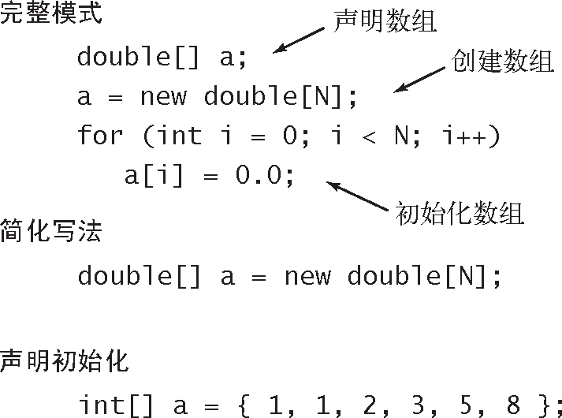

- 声明、创建并初始化一个数组

- 1.1.5.2　简化写法为了精简代码，我们常常会利用 Java 对数组默认的初始化来将三个步骤合为一条语句，即上

```
例中的简化写法。等号的左侧声明了数组，等号的右侧创建了数组。这种写法不需要for 循
环，因为在一个 Java 数组中 double 类型的变量的默认初始值都是 0.0，但如果你想使用不
同的初始值，那么就需要使用 for 循环了。数值类型的默认初始值是 0，布尔型的默认初始
值是 false。例子中的第三种方式用花括号将一列由逗号分隔的值在编译时将数组初始化。
```

- 1.1.5.3　使用数组典型的数组处理代码请见表 1.1.4。在声明并创建数组之后，在代码的任何地方都能通过数组名之后的方括号中的索引来访问其中的元素。数组一经创建，它的大小就是固定的。程序能够

```
通过 a.length 获取数组 a[] 的长度，而它的最后一个元素总是 a[a.length – 1]。
Java 会自动进行边界检查——如果你创建了一个大小为 N 的数组，但使用了一个小于 0 或者
大于 N-1 的索引访问它，程序会因为运行时抛出 ArrayIndexOutOfBoundsException 异
```

- 常而终止。

- 表 1.1.4　典型的数组处理代码

- 任务实现（代码片段）

```
double max = a[0];
for (int i = 1; i < a.length; i++)
```

- 找出数组中最大的元素

```
   if (a[i] > max) max = a[i];
int N = a.length;
double sum = 0.0;
for (int i = 0; i < N; i++)
```

- 计算数组元素的平均值

```
   sum += a[i];
double average = sum / N;
int N = a.length;
double[] b = new double[N];
```

- 复制数组

```
for (int i = 0; i < N; i++)
   b[i] = a[i];
int N = a.length;
for (int i = 0; i < N/2; i++)
{
   double temp = a[i];
```

- 颠倒数组元素的顺序

```
   a[i] = a[N-1-i];
a[N-i-1] = temp;
```

- 1.1.5.4　起别名请注意，数组名表示的是整个数组——如果我们将一个数组变量赋予另一个变量，那么两个变量将会指向同一个数组。例如以下这段代码：

```
int[] a = new int[N];
1
...
2
a[i] = 1234;
3
...
4
int[] b = a;
5
...
6
b[i] = 5678;  // a[i] 的值也会变成5678
7
```

- 这种情况叫做起别名，有时可能会导致难以察觉的问题。如果你是想将数组复制一份，那么应该声明、创建并初始化一个新的数组，然后将原数组中的元素值挨个复制到新数组，如表1.1.4 的第三个例子所示。

- 1.1.5.5　二维数组在 Java 中二维数组就是一维数组的数组。二维数组可以是参差不齐的（元素数组的长度可以和行长度不一致），但大多数情况下（根据合适的参数）我们都会使用，即的数组的二维数组（也可以称数组含有列）。在 Java 中访问二维数组也很简单。二维为

```
数组a[][] 的第 i 行第 j 列的元素可以写作 a[i][j]。声明二维数组需要两对方括号。创
```

- 建二维数组时要在类型名之后分别在方括号中指定行数以及列数，例如：

```
double[][] a = new double[M][N];
1
```

- 的数组。我们约定，第一维是行数，第二维是列数。和一维数我们将这样的数组称为

```
组一样，Java 会将数值类型的数组元素初始化为 0，将布尔型的数组元素初始化为false。
```

- 默认的初始化对二维数组更有用，因为可以节约更多的代码。下面这段代码和刚才只用一行就完成创建和初始化的语句是等价的：

```
double[][] a;
1
a = new double[M][N];
2
for (int i = 0; i < M; i++)
3
  for (int j = 0; j < N; j++)
4
     a[i][j] = 0.0;
5
在将二维数组初始化为 0 时这段代码是多余的，但是如果想要初始化为其他值，我们就需要
嵌套的 for 循环了。
```

- 1.1.6　静态方法本书中的所有 Java 程序要么是数据类型的定义（详见 1.2 节），要么是一个静态方法库。在许多语言中，静态方法被称为函数，因为它们和数学函数的性质类似。静态方法是一组在被调用

```
时会被顺序执行的语句。修饰符 static 将这类方法和 1.2 节的实例方法区别开来。当讨论
```

- 两类方法共有的属性时我们会使用不加定语的方法一词。

- 1.1.6.1　静态方法方法封装了由一系列语句所描述的运算。方法需要参数（某种数据类型的值）并根据参数计算出某种数据类型的返回值（例如数学函数的结果）或者产生某种副作用（例如打印一个值）。

```
BinarySearch 中的静态函数 rank() 是前者的一个例子；main() 则是后者的一个例子。每
个静态方法都是由签名（关键字public static 以及函数的返回值，方法名以及一串各种
```

- 类型的参数）和函数体（即包含在花括号中的代码）组成的，如图 1.1.2 所示。静态函数的例子请见表 1.1.5。

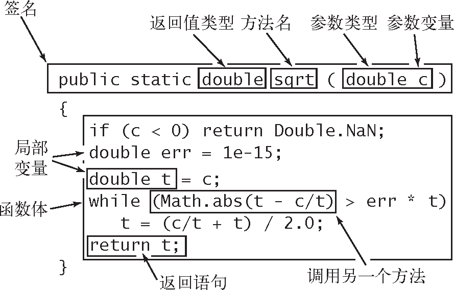

- 图 1.1.2　静态方法解析

- 表 1.1.5　典型静态方法的实现

- 任务实现

```java
public static int abs(int x)
{
   if (x < 0) return -x;
```

- 计算一个整数的绝对值

```java
   else       return x;
}
public static double abs(double x)
{
   if (x < 0.0) return -x;
```

- 计算一个浮点数的绝对值

```java
   else         return x;
}
public static boolean isPrime(int N)
{
   if (N < 2) return false;
   for (int i = 2; i*i <= N; i++)
```

- 判定一个数是否是素数

```java
       if (N % i == 0) return false;
   return true;
}
public static double sqrt(double c)
{
   if (c < 0) return Double.NaN;
   double err = 1e-15;
   double t = c;
```

- 计算平方根（牛顿迭代法）

```java
   while (Math.abs(t - c/t) > err * t)
       t = (c/t + t) / 2.0;
   return t;
}
public static double hypotenuse(double a, d
```

- 计算直角三角形的斜边

```java
{ return Math.sqrt(a*a + b*b); }
public static double H(int N)
{
   double sum = 0.0;
   for (int i = 1; i <= N; i++)
```

- 计算调和级数（请见表 1.4.5）

```
       sum += 1.0 / i;
   return sum;
}
```

- 1.1.6.2　调用静态方法调用静态方法的方法是写出方法名并在后面的括号中列出参数值，用逗号分隔。当调用是表达式的一部分时，方法的返回值将会替代表达式中的方法调用。例如，BinarySearch 中调用

```
rank() 返回了一个 int 值。仅由一个方法调用和一个分号组成的语句一般用于产生副作
用。例如，BinarySearch 的 main() 函数中对系统方法 Arrays.sort() 的调用产生的副作
```

- 用，是将数组中的所有条目有序地排列。调用方法时，它的参数变量将被初始化为调用时所给出的相应表达式的值。返回语句将结束静态方法并将控制权交还给调用者。如果静态方法的目的是计算某个值，返回语句应该指定这个值（如果这样的静态方法在执行完所有的语句之后都没有返回语句，编译器会报错）。

- 1.1.6.3　方法的性质对方法所有性质的完整描述超出了本书的范畴，但以下几点值得一提。

- 方法的参数按值传递：在方法中参数变量的使用方法和局部变量相同，唯一不同的是参数变量的初始值是由调用方提供的。方法处理的是参数的值，而非参数本身。这种方式产生的结果是在静态方法中改变一个参数变量的值对调用者没有影响。本书中我们一般不会修改参数变量。值传递也意味着数组参数将会是原数组的别名（见 1.1.5.4 节）——方法中使用的参数变量能够引用调用者的数组并改变其内容（只是不能改变原数组变量本身）。例如，

```
Arrays.sort() 将能够改变通过参数传递的数组的内容，将其排序。
```

- 方法名可以被重载：例如，Java 的 Math 包使用这种方法为所有的原始数值类型实现了

```
Math.abs()、Math.min() 和 Math.max() 函数。重载的另一种常见用法是为函数定
```

- 义两个版本，其中一个需要一个参数而另一个则为该参数提供一个默认值。方法只能返回一个值，但可以包含多个返回语句：一个 Java 方法只能返回一个值，它的类型是方法签名中声明的类型。静态方法第一次执行到一条返回语句时控制权将会回到调用代码中。尽管可能存在多条返回语句，任何静态方法每次都只会返回一个值，即被执行的第一条返回语句的参数。

```
方法可以产生副作用：方法的返回值可以是 void，这表示该方法没有返回值。返回值为
void 的静态函数不需要明确的返回语句，方法的最后一条语句执行完毕后控制权将会返回
给调用方。我们称 void 类型的静态方法会产生副作用（接受输入、产生输出、修改数组
或者改变系统状态）。例如，我们的程序中的静态方法 main() 的返回值就是 void，因为
它的作用是向外输出。技术上来说，数学方法的返回值都不会是 void（Math.random()
```

- 虽然不接受参数但也有返回值）。

- 2.1 节所述的实例方法也拥有这些性质，尽管两者在副作用方面大为不同。

- 1.1.6.4　递归方法可以调用自己（如果你对递归概念感到奇怪，请完成练习 1.1.16 到练习 1.1.22）。例如，

```
下面给出了 BinarySearch 的 rank() 方法的另一种实现。我们会经常使用递归，因为递归
```

- 代码比相应的非递归代码更加简洁优雅、易懂。下面这种实现中的注释就言简意赅地说明了代码的作用。我们可以用数学归纳法证明这段注释所解释的算法的正确性。我们会在 3.1 节中展开这个话题并为二分查找提供一个这样的证明。

- 编写递归代码时最重要的有以下三点。

```
递归总有一个最简单的情况——方法的第一条语句总是一个包含return 的条件语句。
```

- 递归调用总是去尝试解决一个规模更小的子问题，这样递归才能收敛到最简单的情况。在下面的代码中，第四个参数和第三个参数的差值一直在缩小。递归调用的父问题和尝试解决的子问题之间不应该有交集。在下面的代码中，两个子问题各自操作的数组部分是不同的。

```java
public static int rank(int key, int[] a)
1
{  return rank(key, a, 0, a.length - 1);  }
2
3
public static int rank(int key, int[] a, int lo, int hi)
4
{  //如果key存在于a[]中，它的索引不会小于lo且不会大于hi
5
6
  if (lo > hi) return -1;
7
  int mid = lo + (hi - lo) / 2;
8
  if      (key < a[mid]) return rank(key, a, lo, mid - 1);
9
  else if (key > a[mid]) return rank(key, a, mid + 1, hi);
10
  else                   return mid;
11
}
12
```

- 二分查找的递归实现

- 违背其中任意一条都可能得到错误的结果或是低效的代码（见练习 1.1.19 和练习 1.1.27），而坚持这些原则能写出清晰、正确且容易评估性能的程序。使用递归的另一个原因是我们可以使用数学模型来估计程序的性能。我们会在 3.2 节的二分查找以及其他几个地方分析这个问题。

- 1.1.6.5　基础编程模型

```
静态方法库是定义在一个 Java 类中的一组静态方法。类的声明是public class 加上类
```

- 名，以及用花括号包含的静态方法。存放类的文件的文件名和类名相同，扩展名是 .java。

```
Java 开发的基本模式是编写一个静态方法库（包含一个 main() 方法）来完成一个任务。输
入 java 和类名以及一系列字符串就能调用类中的 main() 方法，其参数为由输入的字符串组
成的一个数组。main() 的最后一条语句执行完毕之后程序终止。在本书中，当我们提到用于
```

- 执行一项任务的 Java 程序时，我们指的是用这种模式开发的代码（可能还包括对数据类型的

```
定义，如 1.2 节所示）。例如，BinarySearch 就是一个由两个静态方法 rank() 和 main()
```

- 组成的 Java 程序，它的作用是将输入中所有不在通过命令行指定的白名单中的数字打印出来。

- 1.1.6.6　模块化编程这个模型的最重要之处在于通过静态方法库实现了模块化编程。我们可以构造许多个静态方法库（模块），一个库中的静态方法也能够调用另一个库中定义的静态方法。这能够带来许多好处：

- 程序整体的代码量很大时，每次处理的模块大小仍然适中；可以共享和重用代码而无需重新实现；很容易用改进的实现替换老的实现；可以为解决编程问题建立合适的抽象模型；缩小调试范围（请见 1.1.6.7 节关于单元测试的讨论）。

- 例如，BinarySearch 用到了三个独立的库，即我们的 StdOut 和 StdIn 以及 Java 的 Arrays，而这三个库又分别用到了其他的库。

- 1.1.6.7　单元测试

```
Java 编程的最佳实践之一就是每个静态方法库中都包含一个 main() 函数来测试库中的所有
方法（有些编程语言不支持多个 main() 方法，因此不支持这种方式）。恰当的单元测试本身
也是很有挑战性的编程任务。每个模块的main() 方法至少应该调用模块中的其他代码并在某
种程度上保证它的正确性。随着模块的成熟，我们可以将 main() 方法作为一个开发用例，
```

- 在开发过程中用它来测试更多的细节；也可以把它编成一个测试用例来对所有代码进行全面的

```
测试。当用例越来越复杂时，我们可能会将它独立成一个模块。在本书中，我们用 main()
```

- 来说明模块的功能并将测试用例留做练习。

- 1.1.6.8　外部库我们会使用来自 4 个不同类型的库中的静态方法，重用每种库代码的方式都稍有不同。它们大多都是静态方法库，但也有部分是数据类型的定义并包含了一些静态方法。

- 系统标准库 java.lang.*：这其中包括 Math 库，实现了常用的数学函数；Integer 和 Double

```
库，能够将字符串转化为 int 和 double 值；String 和 StringBuilder 库，我们稍后会在本
```

- 节和第 5 章中详细讨论；以及其他一些我们没有用到的库。导入的系统库，例如 java.util.Arrays：每个标准的 Java 版本中都含有上千个这种类型的

```
库，不过本书中我们用到的并不多。要在程序的开头使用 import 语句导入才能使用这些
```

- 库（我们也是这样做的）。

```
本书中的其他库：例如，其他程序也可以使用 BinarySearch 的rank() 方法。要使用这些
```

- 库，请在本书的网站上下载它们的源代码并放入你的工作目录中。我们为本书（以及我们的另一本入门教材 An Introduction to Programming in Java: AnInterdisciplinary Approach）开发的标准库 Std*：我们会在下面简要地介绍这些库，它们的源代码和使用方法都能够在本书的网站上找到。

- 要调用另一个库中的方法（存放在相同或者指定的目录中，或是一个系统标准库，或是在类定

```
义前用import 语句导入的库），我们需要在方法前指定库的名称。例如，BinarySearch 的
main() 方法调用了系统库 java.util.Arrays 的 sort() 方法，我们的库 In 中的 readInts()
方法和 StdOut 库中的 println() 方法。
```

- 我们自己及他人使用模块化方式编写的方法库能够极大地扩展我们的编程模型。除了在 Java的标准版本中可用的所有库之外，网上还有成千上万各种用途的代码库。为了将我们的编程模型限制在一个可控范围之内，以将精力集中在算法上，我们只会使用以下所示的方法库，并在1.1.7 节中列出了其中的部分方法。

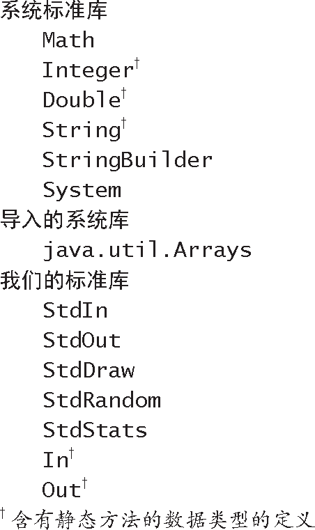

- 本书使用的含有静态方法的库

- 1.1.7　API模块化编程的一个重要组成部分就是记录库方法的用法并供其他人参考的文档。我们会统一使用应用程序编程接口（API）的方式列出本书中使用的每个库方法名称、签名和简短的描述。我们用用例来指代调用另一个库中的方法的程序，用实现描述实现了某个 API 方法的 Java 代码。

- 1.1.7.1　举例在表 1.1.6 的例子中，我们用 java.lang 中 Math 库常用的静态方法说明 API 的文档格式。

```
这些方法实现了各种数学函数——它们通过参数计算得到某种类型的值（random() 除外，
它没有对应的数学函数，因为它不接受参数）。它们的参数都是 double 类型且返回值也都是
double 类型，因此可以将它们看做 double 数据类型的扩展——这种扩展的能力正是现代
```

- 编程语言的特性之一。API 中的每一行描述了一个方法，提供了使用该方法所需要知道的所有

```
信息。Math 库也定义了常数PI（圆周率 π）和 E（自然对数 e），你可以在自己的程序中通
过这些变量名引用它们。例如，Math.sin(Math.PI/2) 的结果是 1.0，
Math.log(Math.E) 的结果也是 1.0（因为 Math.sin() 的参数是弧度而 Math.log()
```

- 使用的是自然对数函数）。

- 表 1.1.6　Java 的数学函数库的 API（节选）

```java
public class <b>Math</b>
    static double abs(double a)
```

- 的绝对值

```
    static double max(double a, double
```

- 和中的较大者

```
b)
    static double min(double a, double
```

- 和中的较小者

```
b)
```

- 注 1：abs()、max() 和 min() 也定义了 int、long 和 float 的版本。

```
    static double sin(double theta)
```

- 正弦函数

```
    static double cos(double theta)
```

- 余弦函数

```
    static double tan(double theta)
```

- 正切函数注 2：角用弧度表示，可以使用 toDegrees() 和 toRadians() 转换角度和弧度。注 3：它们的反函数分别为 asin()、acos() 和 atan()。

```
    static double exp(double a)
```

- 指数函数（）


```
    static double log(double a)
```

- 自然对数函数（，即）

```
    static double pow(double a, double
```

- 的次方（求）

```
b)
    static double random()
```

- [0, 1) 之间的随机数

```
    static double sqrt(double a)
```

- 的平方根

```
    static double E
```

- 常数 e（常数）

```
    static double PI
```

- 常数 π（常数）

- 其他函数请见本书的网站。

- 1.1.7.2　Java 库成千上万个库的在线文档是 Java 发布版本的一部分。为了更好地描述我们的编程模型，我们只是从中节选了本书所用到的若干方法。例如，BinarySearch 中用到了 Java 的 Arrays 库中

```
的 sort() 方法，我们对它的记录如表 1.1.7 所示。
```

- 表 1.1.7　Java 的 Arrays 库节选（java.util.Arrays）

```java
public class <b>Arrays</b>
      static void sort(int[] a)
```

- 将数组按升序排序

```
注：其他原始类型和 Object 对象也有对应版本的方法。
Arrays 库不在 java.lang 中，因此我们需要用 import 语句导入后才能使用它，与
BinarySearch 中一样。事实上，本书的第 2 章讲的正是数组的各种 sort() 方法的实现，包
括 Arrays.sort() 中实现的归并排序和快速排序算法。Java 和很多其他编程语言都实现了
```

- 本书讲解的许多基础算法。例如，Arrays 库还包含了二分查找的实现。为避免混淆，我们一般会使用自己的实现，但对于你已经掌握的算法使用高度优化的库实现当然也没有任何问题。

- 1.1.7.3　我们的标准库为了介绍 Java 编程、为了科学计算以及算法的开发、学习和应用，我们也开发了若干库来提供一些实用的功能。这些库大多用于处理输入输出。我们也会使用以下两个库来测试和分析我

```
们的实现。第一个库扩展了Math.random() 方法（见表 1.1.8），以根据不同的概率密度函
```

- 数得到随机值；第二个库则支持各种统计计算（见表 1.1.9）。

- 表 1.1.8　我们的随机数静态方法库的 API

```java
public class <b>StdRandom</b>
     static    void setSeed(long seed)
```

- 设置随机生成器的种子

```
     static  double random()
0 到 1 之间的实数
     static     int uniform(int N)
0 到 N-1 之间的整数
     static     int uniform(int lo, int
lo 到 hi-1 之间的整数
hi)
     static  double uniform(double lo,
lo 到 hi 之间的实数
double hi)
     static boolean bernoulli(double p)
返回真的概率为 p
     static  double gaussian()
正态分布，期望值为 0，标准差为 1
     static  double gaussian(double m,
正态分布，期望值为 m，标准差为 s
double s)
     static     int discrete(double[]
返回 i 的概率为 a[i]
a)
     static    void shuffle(double[] a)
将数组 a 随机排序
注：库中也包含为其他原始类型和 Object 对象重载的 shuffle() 函数。
```

- 表 1.1.9　我们的数据分析静态方法库的 API

```java
public class <b>StdStats</b>
     static double max(double[] a)
```

- 最大值

```
StdRandom 的 setSeed() 方法为随机数生成器提供种子，这样我们就可以重复和随机数有
```

- 关的实验。以上一些方法的实现请参考表 1.1.10。有些方法的实现非常简单，为什么还要在方法库中实现它们？设计良好的方法库对这个问题的标准回答如下。

- 这些方法所实现的抽象层有助于我们将精力集中在实现和测试本书中的算法，而非生成随机数或是统计计算。每次都自己写完成相同计算的代码，不如直接在用例中调用它们要更简洁易懂。方法库会经过大量测试，覆盖极端和罕见的情况，是我们可以信任的。这样的实现需要大量的代码。例如，我们经常需要使用的各种数据类型的实现，又比如 Java 的 Arrays 库针对

```
不同数据类型对 sort() 进行了多次重载。
```

- 这些是 Java 模块化编程的基础，不过在这里可能有些夸张。但这些方法库的方法名称简单、实现容易，其中一些仍然能作为有趣的算法练习。因此，我们建议你到本书的网站上去学习一下 StdRandom.java 和 StdStats.java 的源代码并好好利用这些经过验证了的实现。使用这些库（以及检验它们）最简单的方法就是从网站上下载它们的源代码并放入你的工作目录。网站上讲解了在各种系统上使用它们的配置目录的方法。

- 表 1.1.10　StdRandom 库中的静态方法的实现

- 期望的结果实现

```java
public static double uniform(d
随机返回 [a,b) 之间的一个 double 值
{  return a + StdRandom.random
public static int uniform(int
随机返回 [0..N) 之间的一个 int 值
{  return (int) (StdRandom.ran
```

- 1.1.7.4　你自己编写的库你应该将自己编写的每一个程序都当做一个日后可以重用的库。

- 编写用例，在实现中将计算过程分解成可控的部分。明确静态方法库和与之对应的 API（或者多个库的多个 API）。

```
实现 API 和一个能够对方法进行独立测试的 main() 函数。
```

- 这种方法不仅能帮助你实现可重用的代码，而且能够教会你如何运用模块化编程来解决一个复杂的问题。

- API 的目的是将调用和实现分离：除了 API 中给出的信息，调用者不需要知道实现的其他细节，而实现也不应考虑特殊的应用场景。API 使我们能够广泛地重用那些为各种目的独立开发的代码。没有任何一个 Java 库能够包含我们在程序中可能用到的所有方法，因此这种能力对于编写复杂的应用程序特别重要。相应地，程序员也可以将 API 看做调用和实现之间的一份契约，它详细说明了每个方法的作用。实现的目标就是能够遵守这份契约。一般来说，做到这一点有很多种方法，而且将调用者的代码和实现的代码分离使我们可以将老算法替换为更新更好的实现。在学习算法的过程中，这也使我们能够感受到算法的改进所带来的影响。1.1.8　字符串

```
字符串是由一串字符（char 类型的值）组成的。一个 String 类型的字面量包括一对双引号
和其中的字符，比如 "Hello, World"。String 类型是 Java 的一个数据类型，但并不是
原始数据类型。我们现在就讨论 String 类型是因为它非常基础，几乎所有 Java 程序都会用
```

- 到它。

- 1.1.8.1　字符串拼接

```
和各种原始数据类型一样，Java 内置了一个串联String 类型字符串的运算符（+）。表
1.1.11 是对表 1.1.2 的补充。拼接两个 String 类型的字符串将得到一个新的 String 值，
```

- 其中第一个字符串在前，第二个字符串在后。

- 表 1.1.11　Java 的 String 数据类型

- 类型值域举例运算符

- 1.1.8.2　类型转换字符串的两个主要用途分别是将用户从键盘输入的内容转换成相应数据类型的值以及将各种数

```
据类型的值转化成能够在屏幕上显示的内容。Java 的 String 类型为这些操作内置了相应的
方法，而且 Integer 和 Double 库还包含了分别和 String 类型相互转化的静态方法（见表
```

- 1.1.12）。

- 表 1.1.12　String 值和数字之间相互转换的 API

```java
public class <b>Integer</b>
        static    int  parseInt(String s)
将字符串 s 转换为整数
        static String  toString(int i)
将整数 i 转换为字符串
public class <b>Double</b>
        static double  parseDouble(String
将字符串 s 转换为浮点数
s)
        static String  toString(double x)
将浮点数 x 转换为字符串
```

- 1.1.8.3　自动转换

```
我们很少明确使用刚才提到的 toString() 方法，因为 Java 在连接字符串的时候会自动将
任意数据类型的值转换为字符串：如果加号（+）的一个参数是字符串，那么 Java 会自动将
其他参数都转换为字符串（如果它们不是的话）。除了像 "The square root of 2.0 is
" + Math.sqrt(2.0) 这样的使用方式之外，这种机制也使我们能够通过一个空字符串 ""
```

- 将任意数据类型的值转换为字符串值。

- 1.1.8.4　命令行参数在 Java 中字符串的一个重要的用途就是使程序能够接收到从命令行传递来的信息。这种机制很简单。当你输入命令 java 和一个库名以及一系列字符串之后，Java 系统会调用库的

```
main() 方法并将那一系列字符串变成一个数组作为参数传递给它。例如，BinarySearch 的
main() 方法需要一个命令行参数，因此系统会创建一个大小为 1 的数组。程序用这个值，也
就是 args[0]，来获取白名单文件的文件名并将其作为 StdIn.readInts() 的参数。另一
种在我们的代码中常见的用法是当命令行参数表示的是数字时，我们会用 parseInt() 和
parseDouble() 方法将其分别转换为整数和浮点数。
字符串的用法是现代程序中的重要部分。现在我们还只是用 String 在外部表示为字符串的
```

- 数字和内部表示为数字类数据类型的值进行转换。在 1.2 节中我们会看到 Java 为我们提供了

```
非常丰富的字符串操作；在 1.4 节中我们会分析 String 类型在 Java 内部的表示方法；在第
```

- 5 章我们会深入学习处理字符串的各种算法。这些算法是本书中最有趣、最复杂也是影响力最大的一部分算法。1.1.9　输入输出

- 我们的标准输入、输出和绘图库的作用是建立一个 Java 程序和外界交流的简易模型。这些库的基础是强大的 Java 标准库，但它们一般更加复杂，学习和使用起来都更加困难。我们先来简单地了解一下这个模型。

- 在我们的模型中，Java 程序可以从命令行参数或者一个名为标准输入流的抽象字符流中获得输入，并将输出写入另一个名为标准输出流的字符流中。

- 我们需要考虑 Java 和操作系统之间的接口，因此我们要简要地讨论一下大多数操作系统和程序开发环境所提供的相应机制。本书网站上列出了关于你所使用的系统的更多信息。默认情况下，命令行参数、标准输入和标准输出是和应用程序绑定的，而应用程序是由能够接受命令输入的操作系统或是开发环境所支持。我们笼统地用终端来指代这个应用程序提供的供输入和显示的窗口。20 世纪 70 年代早期的 Unix 系统已经证明我们可以用这个模型方便直接地和程序以及数据进行交互。我们在经典的模型中加入了一个标准绘图模块用来可视化表示对数据的分析，如图 1.1.3 所示。

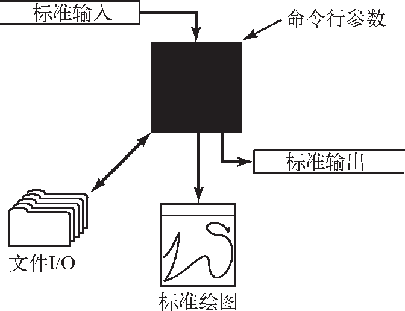

- 图 1.1.3　Java 程序整体结构1.1.9.1　命令和参数终端窗口包含一个提示符，通过它我们能够向操作系统输入命令和参数。本书中我们只会用到几个命令，如表 1.1.13 所示。我们会经常使用 java 命令来运行我们的程序。我们在 1.1.8.4

```
节中提到过，Java 类都会包含一个静态方法 main()，它有一个 String 数组类型的参数
args[]。这个数组的内容就是我们输入的命令行参数，操作系统会将它传递给 Java。Java
```

- 和操作系统都默认参数为字符串。如果我们需要的某个参数是数字，我们会使用类似

```
Integer.parseInt() 的方法将其转换为适当的数据类型的值。图 1.1.4 是对命令的分析。
```

- 表 1.1.13　操作系统常用命令

- 命令参数作用文件名编程序

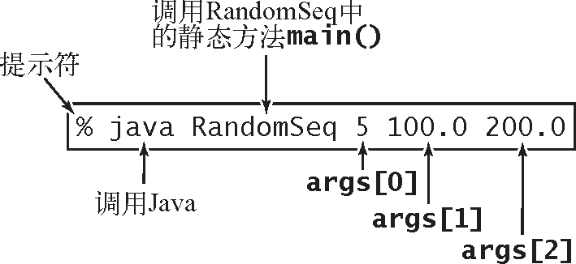

- 图 1.1.4　命令详解1.1.9.2　标准输出我们的 StdOut 库的作用是支持标准输出。一般来说，系统会将标准输出打印到终端窗口。

```java
print() 方法会将它的参数放到标准输出中；println() 方法会附加一个换行符；
printf() 方法能够格式化输出（见 1.1.9.3 节）。Java 在其 System.out 库中提供了类似的
```

- 方法，但我们会用 StdOut 库来统一处理标准输入和输出（并进行了一些技术上的改进），见表1.1.14。

- 表 1.1.14　我们的标准输出库的静态方法的 API

```java
public class <b>StdOut</b>
    static  void  print(String s)
打印 s
    static  void  println(String s)
打印 s 并接一个换行符
    static  void  println()
```

- 打印一个换行符

```
    static  void  printf(String f, ...)
```

- 格式化输出

```
注：其他原始类型和 Object 对象也有对应版本的方法。
```

- 要使用这些方法，请从本书的网站上将 StdOut.java 下载到你的工作目录，并像

```
StdOut.println("Hello, World"); 这样在代码中调用它们。左下方的程序就是一个例
```

- 子。

- 1.1.9.3　格式化输出

```java
public class RandomSeq
1
{
2
  public static void main(String[] args)
3
  {  // 打印N个(lo, hi)之间的随机值
4
     int N = Integer.parseInt(args[0]);
5
     double lo = Double.parseDouble(args[1]);
6
     double hi = Double.parseDouble(args[2]);
7
     for (int i = 0; i < N; i++)
8
     {
9
        double x = StdRandom.uniform(lo, hi);
10
        StdOut.printf("%.2f\n", x);
11
     }
12
  }
13
}
14
StdOut 的用例示例
% java RandomSeq 5 100.0 200.0
1
123.43
2
153.13
3
144.38
4
155.18
5
104.02
6
在最简单的情况下 printf() 方法接受两个参数。第一个参数是一个格式字符串，描述了第
二个参数应该如何在输出中被转换为一个字符串。最简单的格式字符串的第一个字符是 % 并
紧跟一个以字符表示的转换代码。我们最常使用的转换代码包括d（用于 Java 整型的十进制
数）、f（浮点型）和 s（字符串）。在 % 和转换代码之间可以插入一个整数来表示转换之后的
```

- 值的宽度，即输出字符串的长度。默认情况下，转换后会在字符串的左边添加空格以达到需要的宽度，如果我们想在右边加入空格则应该使用负宽度（如果转换得到的字符串比设定宽度要长，宽度会被忽略）。在宽度之后我们还可以插入一个小数点以及一个数值来指定转换后的

```
double值保留的小数位数（精度）或是 String 字符串所截取的长度。使用 printf() 方
```

- 法时需要记住的最重要的一点就是，格式字符串中的转换代码和对应参数的数据类型必须匹

```
配。也就是说，Java 要求参数的数据类型和转换代码表示的数据类型必须相同。printf()
的第一个 String 字符串参数也可以包含其他字符。所有非格式字符串的字符都会被传递到
```

- 输出之中，而格式字符串则会被参数的值所替代（按照指定的方式转换为字符串）。例如，这条语句：

```
StdOut.printf("PI is approximately %.2f\n", Math.PI);
1
```

- 会打印出：

```
PI is approximately 3.14
1
可以看到，在 printf() 中我们需要明确地在第一个参数的末尾加上 \n 来换行。
printf() 函数能够接受两个或者更多的参数。在这种情况下，在格式化字符串中每个参数
```

- 都会有对应的转换代码，这些代码之间可能隔着其他会被直接传递到输出中的字符。也可以直

```
接使用静态方法 String.format() 来用和 printf() 相同的参数得到一个格式化字符串而
```

- 无需打印它。我们可以用格式化打印方便地将实验数据输出为表格形式（这是它们在本书中的主要用途），如表 1.1.15 所示。

- 表 1.1.15　printf() 的格式化方式（更多选项请见本书网站）

- 数据类型转换代码举例格式化字符串举例

```xml
"%14d"
<b>int</b>
d
512
"%-14d"
"%14.2f"
f
"%.7f"
<b>double</b>
1595.1680010754388
e
"%14.4e"
"%14s"
"%-14s"
<b>String</b>
s
"Hello, World"
"%-14.5s"
```

- 1.1.9.4　标准输入

```java
public class Average
1
{
2
   public static void main(String[] args)
3
   {  // 取StdIn中所有数的平均值
4
      double sum = 0.0;
5
      int cnt = 0;
6
      while (!StdIn.isEmpty())
7
      {  // 读取一个数并计算累计之和
8
         sum += StdIn.readDouble();
9
         cnt++;
10
      }
11
      double avg = sum / cnt;
12
      StdOut.printf("Average is %.5f\n", avg);
13
   }
14
}
15
```

- StdIn 的用例举例

```xml
% java Average
1
1.23456
2
2.34567
3
3.45678
4
4.56789
5
<ctrl-d>
6
Average is 2.90123
7
```

- 我们的 StdIn 库从标准输入流中获取数据，这些数据可能为空也可能是一系列由空白字符分隔的值（空格、制表符、换行符等）。默认状态下系统会将标准输出定向到终端窗口——你输入

```
的内容就是输入流（由 <ctrl-d> 或 <ctrl-z> 结束，取决于你使用的终端应用程序）。这
些值可能是 String 或是 Java 的某种原始类型的数据。标准输入流最重要的特点是这些值会
```

- 在你的程序读取它们之后消失。只要程序读取了一个值，它就不能回退并再次读取它。这个特点产生了一些限制，但它反映了一些输入设备的物理特性并简化了对这些设备的抽象。有了输入流模型，这个库中的静态方法大都是自文档化的（它们的签名即说明了它们的用途）。右侧列出了 StdIn 的一个用例。

- 表 1.1.16 详细说明了标准输入库中的静态方法的 API。

- 表 1.1.16　标准输入库中的静态方法的 API

```
Public class <b>StdIn</b>
如果输入流中没有剩余的值则返回 true，否
    static boolean  isEmpty()
false
    static     int  readInt()
读取一个 int 类型的值
    static  double  readDouble()
读取一个 double 类型的值
    static   float  readFloat()
读取一个 float 类型的值
    static    long  readLong()
读取一个 long 类型的值
    static boolean  readBoolean()
读取一个 boolean 类型的值
    static    char  readChar()
读取一个 char 类型的值
    static    byte  readByte()
读取一个 byte 类型的值
    static  String  readString()
读取一个 String 类型的值
    static boolean  hasNextLine()
```

- 输入流中是否还有下一行

```
    static  String  readLine()
```

- 读取该行的其余内容

```
    static  String  readAll()
```

- 读取输入流中的其余内容

- 1.1.9.5　重定向与管道标准输入输出使我们能够利用许多操作系统都支持的命令行的扩展功能。只需要向启动程序的命令中加入一个简单的提示符，就可以将它的标准输出重定向至一个文件。文件的内容既可以永久保存也可以在之后作为另一个程序的输入：

```
% java RandomSeq 1000 100.0 200.0 > data.txt
1
```

- 这条命令指明标准输出流不是被打印至终端窗口，而是被写入一个叫做 data.txt 的文件。每次

```
调用StdOut.print() 或是 StdOut.println() 都会向该文件追加一段文本。在这个例子
```

- 中，我们最后会得到一个含有 1000 个随机数的文件。终端窗口中不会出现任何输出：它们都

```
被直接写入了“>”号之后的文件中。这样我们就能将信息存储以备下次使用。请注意不需要改
```

- 变 RandomSeq 的任何内容——它使用的是标准输出的抽象，因此它不会因为我们使用了该抽象的另一种不同的实现而受到影响。类似，我们可以重定向标准输入以使 StdIn 从文件而不是终端应用程序中读取数据：

```
% java Average < data.txt
1
这条命令会从文件 data.txt 中读取一系列数值并计算它们的平均值。具体来说，“<”号是一个
```

- 提示符，它告诉操作系统读取文本文件 data.txt 作为输入流而不是在终端窗口中等待用户的输

```
入。当程序调用 StdIn.readDouble() 时，操作系统读取的是文件中的值。将这些结合起
```

- 来，将一个程序的输出重定向为另一个程序的输入叫做管道：

```
% java RandomSeq 1000 100.0 200.0 | java Average
1
```

- 这条命令将 RandomSeq 的标准输出和 Average 的标准输入指定为同一个流。它的效果是好像在 Average 运行时 RandomSeq 将它生成的数字输入了终端窗口。这种差别影响非常深远，因为它突破了我们能够处理的输入输出流的长度限制。例如，即使计算机没有足够的空间来存储十亿个数，我们仍然可以将例子中的 1000 换成 1 000 000 000 （当然我们还是需要一

```
些时间来处理它们）。当 RandomSeq 调用 StdOut.println() 时，它就向输出流的末尾添
加了一个字符串；当 Average 调用 StdIn.readInt() 时，它就从输入流的开头删除了一个
```

- 字符串。这些动作发生的实际顺序取决于操作系统：它可能会先运行 RandomSeq 并产生一些输出，然后再运行 Average，来消耗这些输出，或者它也可以先运行 Average，直到它需要一些输入然后再运行 RandomSeq 来产生一些输出。虽然最后的结果都一样，但我们的程序就不再需要担心这些细节，因为它们只会和标准输入和标准输出的抽象打交道。

- 图 1.1.5 总结了重定向与管道的过程。

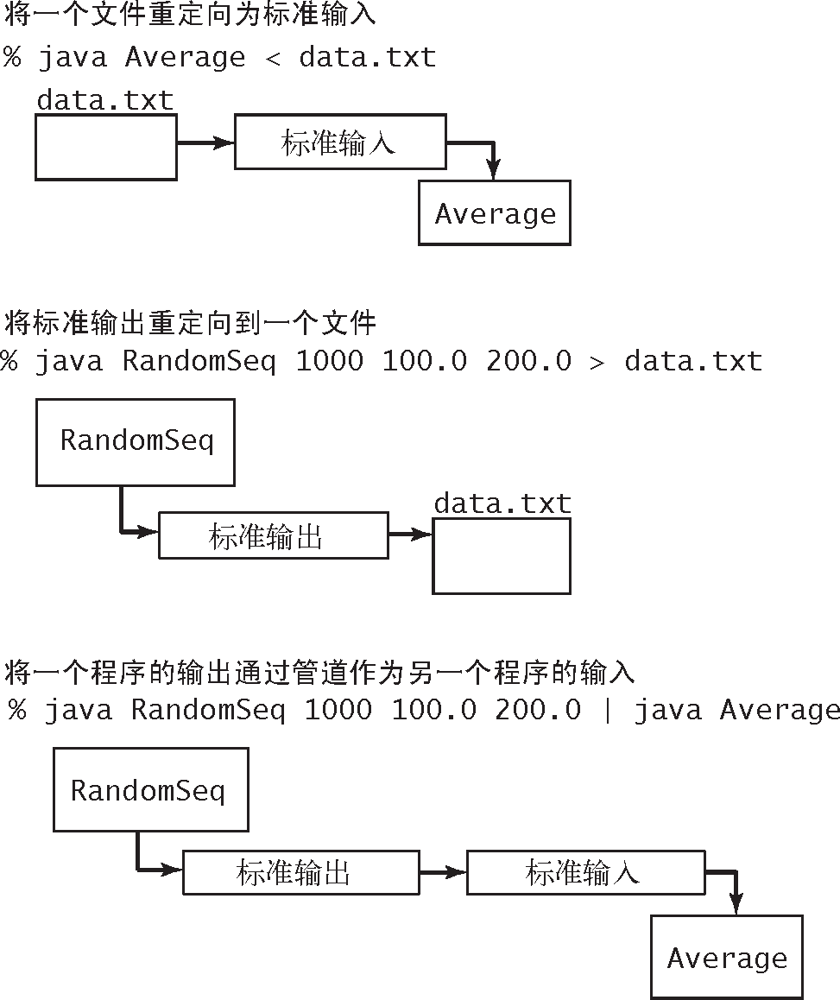

- 图 1.1.5　命令行的重定向与管道1.1.9.6　基于文件的输入输出我们的 In 和 Out 库提供了一些静态方法，来实现向文件中写入或从文件中读取一个原始数据

```
类型（或 String 类型）的数组的抽象。我们会使用 In 库中的 readInts()、
readDoubles() 和 readStrings() 以及 Out 库中重载的多个 write() 方法，name 参
```

- 数可以是文件或网页，如表 1.1.17 所示。例如，借此我们可以在同一个程序中分别使用文件和标准输入达到两种不同的目的，例如 BinarySearch。In 和 Out 两个库也实现了一些数据类型和它们的实例方法，这使我们能够将多个文件作为输入输出流并将网页作为输入流，我们还会在 1.2 节中再次考察它们。

- 表 1.1.17　我们用于读取和写入数组的静态方法的 API

```java
public class <b>In</b>
    static    int[]  readInts(String name)
读取多个 int 值
    static double[]  readDoubles(String name)
读取多个 double 值
    static String[]  readStrings(String name)
读取多个 String 值
public class <b>Out</b>
```

- 注 1：库也支持其他原始数据类型。

```
注 2：库也支持 StdIn 和 StdOut（忽略 name 参数）。
```

- 1.1.9.7　标准绘图库（基本方法）目前为止，我们的输入输出抽象层的重点只有文本字符串。现在我们要介绍一个产生图像输出的抽象层。这个库的使用非常简单并且允许我们利用可视化的方式处理比文字丰富得多的信

```
息。和我们的标准输入输出一样，标准绘图抽象层实现在库 StdDraw 中，可以从本书的网站
```

- 上下载 StdDraw.java 到你的工作目录来使用它。标准绘图库很简单：我们可以将它想象为一个抽象的能够在二维画布上画出点和直线的绘图设备。这个设备能够根据程序调用的

```
StdDraw 中的静态方法画出一些基本的几何图形，这些方法包括画出点、直线、文本字符
```

- 串、圆、长方形和多边形等。和标准输入输出中的方法一样，这些方法几乎也都是自文档化


```
的：StdDraw.line() 能够根据参数的坐标画出一条连接点
```

- 和点的线段，


```
StdDraw.point() 能够根据参数坐标画出一个以
```

- 为中心的点，等等，如图 1.1.6 所示。几何图形可以被填充（默认为黑色）。默认的比例尺为单位正方形（所有的坐标均在 0 和1 之间）。标准的实现会将画布显示为屏幕上的一个窗口，点和线为黑色，背景为白色。

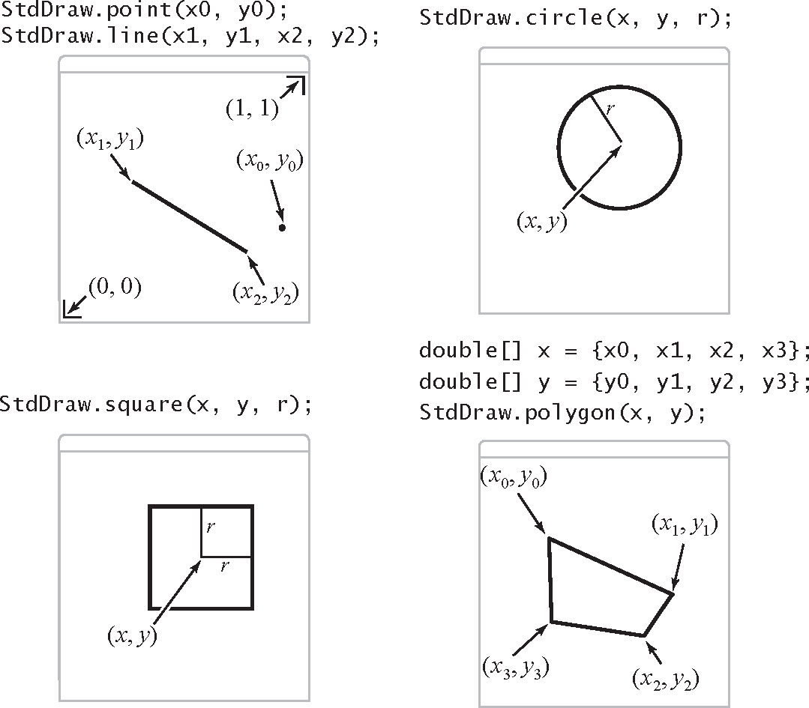

```
图 1.1.6　StdDraw 的用法举例
```

- 表 1.1.18 是对标准绘图库中静态方法 API 的汇总。

- 表 1.1.18　标准绘图库的静态（绘图）方法的 API

```java
public class <b>StdDraw</b>
   static void  line(double x0, double y0, double x1, double y1)
   static void  point(double x, double y)
   static void  text(double x, double y, String s)
   static void  circle(double x, double y, double r)
   static void  filledCircle(double x, double y, double r)
   static void  ellipse(double x, double y, double rw, double rh)
   static void  filledEllipse(double x, double y, double rw,
double rh)
   static void  square(double x, double y, double r)
   static void  filledSquare(double x, double y, double r)
   static void  rectangle(double x, double y, double rw, double
rh)
   static void  filledRectangle(double x, double y, double rw,
double rh)
   static void  polygon(double[] x, double[] y)
   static void  filledPolygon(double[] x, double[] y)
```

- 1.1.9.8　标准绘图库（控制方法）标准绘图库中还包含一些方法来改变画布的大小和比例、直线的颜色和宽度、文本字体、绘图

```
时间（用于动画）等。可以使用在 StdDraw 中预定义的BLACK、BLUE、CYAN、
DARK_GRAY、GRAY、GREEN、LIGHT_GRAY、MAGENTA、ORANGE、PINK、RED、
BOOK_RED、WHITE 和 YELLOW 等颜色常数作为 setPenColor() 方法的参数（可以用
StdDraw.RED 这样的方式调用它们）。画布窗口的菜单还包含一个选项用于将图像保存为适
于在网上传播的文件格式。表 1.1.19 总结了 StdDraw 中静态控制方法的 API。
```

- 表 1.1.19　标准绘图库的静态（控制）方法的 API

```java
public class <b>StdDraw</b>
    static void  setXscale(double x0,
```


- 的范围设为将

```
double x1)
    static void  setYscale(double y0,
```


- 的范围设为将

```
double y1)
    static void  setPenRadius(double r)
```

- 将画笔的粗细半径设为

```
    static void  setPenColor(Color c)
```

- 将画笔的颜色设为

```
在本书中，我们会在数据分析和算法的可视化中使用 StdDraw。表 1.1.20 是一些例子，我们
```

- 在本书的其他章节和练习中还会遇到更多的例子。绘图库也支持动画——当然，这个话题只能在本书的网站上展开了。

- 表 1.1.20　StdDraw 绘图举例

- 数据绘图的实现（代码片段）结果

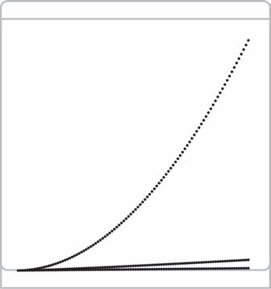

```
int N = 100;
StdDraw.setXscale(0, N);
StdDraw.setYscale(0, N*N);
StdDraw.setPenRadius(.01);
for (int i = 1; i <= N; i++)
```

- 函数值1.1.10　二分查找我们要学习的第一个 Java 程序的示例程序就是著名、高效并且应用广泛的二分查找算法，如下所示。这个例子将会展示本书中学习新算法的基本方法。和我们将要学习的所有程序一样，它既是算法的准确定义，又是算法的一个完整的 Java 实现，而且你还能够从本书的网站上下载它。

- 二分查找

```java
import java.util.Arrays;
1
public class BinarySearch
2
{
3
  public static int rank(int key, int[] a)
4
  {  // 数组必须是有序的
5
     int lo  = 0;
6
     int hi = a.length - 1;
7
     while (lo <= hi)
8
     {  // 被查找的键要么不存在，要么必然存在于a[lo..hi] 之中
9
        int mid = lo + (hi - lo) / 2;
10
        if      (key < a[mid]) hi = mid - 1;
11
        else if (key > a[mid]) lo = mid + 1;
12
        else                   return mid;
13
     }
14
     return -1;
15
  }
16
  public static void main(String[] args)
17
  {
18
     int[] whitelist = In.readInts(args[0]);
19
     Arrays.sort(whitelist);
20
     while (!StdIn.isEmpty())
21
     {  // 读取键值，如果不存在于白名单中则将其打印
22
        int key = StdIn.readInt();
23
        if (rank(key, whitelist) < 0)
24
           StdOut.println(key);
25
     }
26
  }
27
}
28
```

- 这段程序接受一个白名单文件（一列整数）作为参数，并会过滤掉标准输入中的所有存在于

```
白名单中的条目，仅将不在白名单上的整数打印到标准输出中。它在rank() 静态方法中实
```

- 现了二分查找算法并高效地完成了这个任务。关于二分查找算法的完整讨论，包括它的正确性、性能分析及其应用，请见 3.1 节。

```
% java BinarySearch tinyW.txt < tinyT.txt
1
50
2
99
3
13
4
```

- 1.1.10.1　二分查找

- 我们会在 3.2 节中详细学习二分查找算法，但此处先简单地描述一下。算法是由静态方法

```
rank() 实现的，它接受一个整数键和一个已经有序的int 数组作为参数。如果该键存在于
数组中则返回它的索引，否则返回 -1。算法使用两个变量 lo 和 hi，并保证如果键在数组中
则它一定在 a[lo..hi] 中，然后方法进入一个循环，不断将数组的中间键（索引为mid）和
被查找的键比较。如果被查找的键等于 a[mid]，返回 mid；否则算法就将查找范围缩小一
半，如果被查找的键小于 a[mid] 就继续在左半边查找，如果被查找的键大于 a[mid] 就继
```

- 续在右半边查找。算法找到被查找的键或是查找范围为空时该过程结束。二分查找之所以快是因为它只需检查很少几个条目（相对于数组的大小）就能够找到目标元素（或者确认目标元素不存在）。在有序数组中进行二分查找的示例如图 1.1.7 所示。

- 1.1.10.2　开发用例

```
对于每个算法的实现，我们都会开发一个用例 main() 函数，并在书中或是本书的网站上提
```

- 供一个示例输入文件来帮助读者学习该算法并检测它的性能。在这个例子中，这个用例会从命令行指定的文件中读取多个整数，并会打印出标准输入中所有不存在于该文件中的整数。我们使用了图 1.1.8 所示的几个较小的测试文件来展示它的行为，这些文件也是图 1.1.7 中的跟踪和例子的基础。我们会使用较大的测试文件来模拟真实应用并测试算法的性能（请见 1.1.10.3节）。

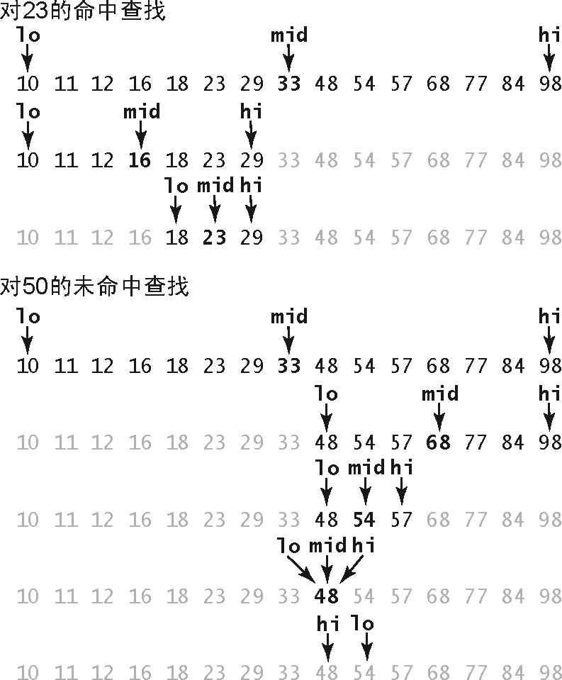

- 图 1.1.7　有序数组中的二分查找

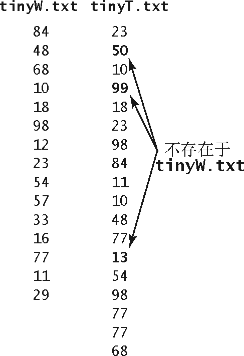

- 图 1.1.8　为 BinarySearch 的测试用例准备的小型测试文件1.1.10.3　白名单过滤如果可能，我们的测试用例都会通过模拟实际情况来展示当前算法的必要性。这里该过程被称为白名单过滤。具体来说，可以想象一家信用卡公司，它需要检查客户的交易账号是否有效。为此，它需要：

- 将客户的账号保存在一个文件中，我们称它为白名单；从标准输入中得到每笔交易的账号；使用这个测试用例在标准输出中打印所有与任何客户无关的账号，公司很可能拒绝此类交易。

- 在一家有上百万客户的大公司中，需要处理数百万甚至更多的交易都是很正常的。为了模拟这种情况，我们在本书的网站上提供了文件 largeW.txt（100 万个整数）和 largeT.txt（1000 万个整数）其基本情况如图 1.1.9 所示。

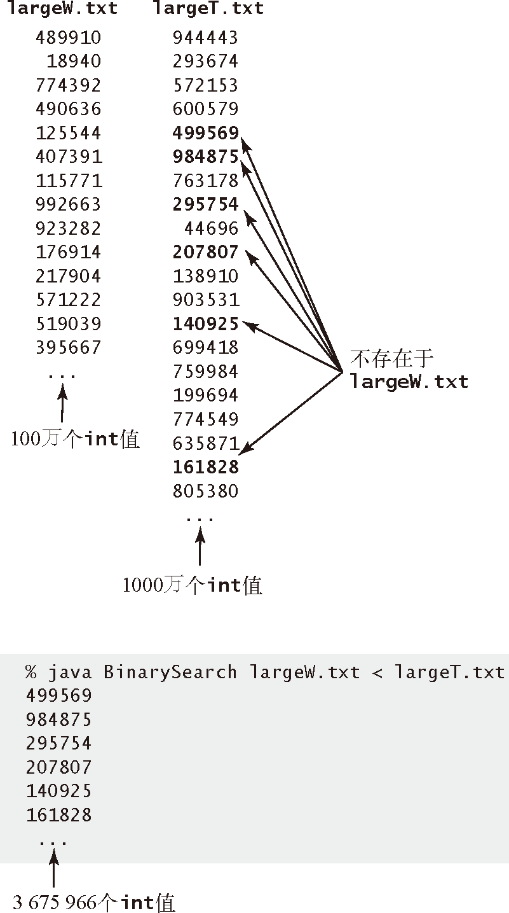

- 图 1.1.9　为 BinarySearch 测试用例准备的大型文件1.1.10.4　性能

```
一个程序只是可用往往是不够的。例如，以下 rank() 的实现也可以很简单，它会检查数组
```

- 的每个元素，甚至都不需要数组是有序的：

```java
public static int rank(int key, int[] a)
1
{
2
  for (int i = 0; i < a.length; i++)
3
     if (a[i] == key) return i;
4
  return -1;
5
}
6
```

- 有了这个简单易懂的解决方案，我们为什么还需要归并排序和二分查找呢？你在完成练习

```
1.1.38 时会看到，计算机用 rank() 方法的暴力实现处理大量输入（比如含有 100 万个条目
```

- 的白名单和 1000 万条交易）非常慢。没有如二分查找或者归并排序这样的高效算法，解决大规模的白名单问题是不可能的。良好的性能常常是极为重要的，因此我们会在 1.4 节中为性能研究做一些铺垫，并会分析我们学习的所有算法的性能特点（包括 2.2 节的归并排序和 3.1 节中的二分查找）。

- 目前，我们在这里粗略地勾勒出我们的编程模型的目标是，确保你能够在计算机上运行类似于BinarySearch 的代码，使用它处理我们的测试数据并为适应各种情况修改它（比如本节练习中所描述的一些情况）以完全理解它的可应用性。我们的编程模型就是设计用来简化这些活动的，这对各种算法的学习至关重要。1.1.11　展望在本节中，我们描述了一个精巧而完整的编程模型，数十年来它一直在（并且现在仍在）为广大程序员服务。但现代编程技术已经更进一步。前进的这一步被称为数据抽象，有时也被称为面向对象编程，它是我们下一节的主题。简单地说，数据抽象的主要思想是鼓励程序定义自己的数据类型（一系列值和对这些值的操作），而不仅仅是那些操作预定义的数据类型的静态方法。

- 面向对象编程在最近几十年得到了广泛的应用，数据抽象已经成为现代程序开发的核心。我们在本书中“拥抱”数据抽象的原因主要有三。

- 它允许我们通过模块化编程复用代码。例如，第 2 章中的排序算法和第 3 章中的二分查找以及其他算法，都允许调用者用同一段代码处理任意类型的数据（而不仅限于整数），包括调用者自定义的数据类型。它使我们可以轻易构造多种所谓的链式数据结构，它们比数组更灵活，在许多情况下都是高效算法的基础。借助它我们可以准确地定义所面对的算法问题。比如 1.5 节中的 union-find 算法、2.4 节中的优先队列算法和第 3 章中的符号表算法，它们解决问题的方式都是定义数据结构并高效地实现它们的一组操作。这些问题都能够用数据抽象很好地解决。

- 尽管如此，但我们的重点仍然是对算法的研究。在了解了这些知识以后，我们将学习面向对象编程中和我们的使命相关的另一个重要特性。答疑问　什么是 Java 的字节码？

- 答　它是程序的一种低级表示，可以运行于 Java 的虚拟机。将程序抽象为字节码可以保证Java 程序员的代码能够运行在各种设备之上。

- 问　 Java 允许整型溢出并返回错误值的做法是错误的。难道 Java 不应该自动检查溢出吗？

- 答　这个问题在程序员中一直是有争议的。简单的回答是它们之所以被称为原始数据类型就是

```
因为缺乏此类检查。避免此类问题并不需要很高深的知识。我们会使用 int 类型表示较小的
数（小于 10 个十进制位）而使用 long 表示 10 亿以上的数。
问　Math.abs(-2147483648) 的返回值是什么？
答　-2147483648。这个奇怪的结果（但的确是真的）就是整数溢出的典型例子。
问　如何才能将一个 double 变量初始化为无穷大？
答　可以使用 Java 的内置常数：Double.POSITIVE_INFINITY 和
Double.NEGATIVE_INFINITY。
问　能够将 double 类型的值和 int 类型的值相互比较吗？
```

- 答　不通过类型转换是不行的，但请记住 Java 一般会自动进行所需的类型转换。例如，如果

```
x 的类型是 int 且值为3，那么表达式(x<3.1) 的值为true——Java 会在比较前将x 转换
为double 类型（因为3.1是一个 double 类型的字面量）。
```

- 问　如果使用一个变量前没有将它初始化，会发生什么？

- 答　如果代码中存在任何可能导致使用未经初始化的变量的执行路径，Java 都会抛出一个编译异常。

```
问　Java 表达式 1/0 和 1.0/0.0 的值是什么？
```

- 答　第一个表达式会产生一个运行时除以零异常（它会终止程序，因为这个值是未定义的）；

```
第二个表达式的值是Infinity（无穷大）。
问　能够使用 < 和 > 比较 String 变量吗？
```

- 答　不行，只有原始数据类型定义了这些运算符。请见 1.1.2.3 节。

- 问　负数的除法和余数的结果是什么？

```
答　表达式 a/b 的商会向 0 取整；a % b 的余数的定义是 (a/b)*b + a % b 恒等于 a。
例如 -14/3 和 14/-3 的商都是 -4，但 -14 % 3 是 -2，而 14 % -3 是 2。
问　为什么使用 (a && b) 而非 (a & b) ？
答　运算符 &、| 和 ^ 分别表示整数的位逻辑操作与、或和异或。因此，10|6 的值为 14，
10^6 的值为 12。在本书中我们很少（偶尔）会用到这些运算符。&& 和 || 运算符仅在独立
```

- 的布尔表达式中有效，原因是短路求值法则：表达式从左向右求值，一旦整个表达式的值已知则停止求值。

```
问　嵌套 if 语句中的二义性有问题吗？
```

- 答　是的。在 Java 中，以下语句：

```
if <expr1> if <expr2> <stmntA> else <stmntB>
1
```

- 等价于：

```
if <expr1> { if <expr2> <stmntA> else <stmntB> }
1
```

- 即使你想表达的是：

```
if <expr1> { if <expr2> <stmntA> } else <stmntB>
1
　避免这种“无主的”else 陷阱的最好办法是显式地写明所有大括号。
问　一个 for 循环和它的 while 形式有什么区别？
答　for 循环头部的代码和 for 循环的主体代码在同一个代码段之中。在一个典型的 for 循
环中，递增变量一般在循环结束之后都是不可用的；但在和它等价的 while 循环中，递增变
量在循环结束之后仍然是可用的。这个区别常常是使用 while 而非 for 循环的主要原因。
问　有些 Java 程序员用 int a[] 而不是 int[] a 来声明一个数组。这两者有什么不同？
```

- 答　在 Java 中，两者等价且都是合法的。前一种是 C 语言中数组的声明方式。后者是 Java

```
提倡的方式，因为变量的类型 int[] 能更清楚地说明这是一个整型的数组。
问　为什么数组的起始索引是 0 而不是 1 ？
```

- 答　这个习惯来源于机器语言，那时要计算一个数组元素的地址需要将数组的起始地址加上该

```
元素的索引。将起始索引设为 1 要么会浪费数组的第一个元素的空间，要么会花费额外的时
间来将索引减 1。
问　如果 a[] 是一个数组，为什么 StdOut.println(a) 打印出的是一个十六进制的整
数，比如 @f62373，而不是数组中的元素呢？
```

- 答　问得好。该方法打印出的是这个数组的地址，不幸的是你一般都不需要它。

- 问　我们为什么不使用标准的 Java 库来处理输入和图形？

```
答　我们的确用到了它们，但我们希望使用更简单的抽象模型。StdIn 和 StdDraw 背后的
```

- Java 标准库是为实际生产设计的，这些库和它们的 API 都有些笨重。要想知道它们真正的模样，请查看 StdIn.java 和 StdDraw.java 的代码。

- 问　我的程序能够重新读取标准输入中的值吗？

```
答　不行，你只有一次机会，就好像你不能撤销 println() 的结果一样。
```

- 问　如果我的程序在标准输入为空之后仍然尝试读取，会发生什么？

```
答　会得到一个错误。StdIn.isEmpty() 能够帮助你检查是否还有可用的输入以避免这种
```

- 错误。

- 问　这条出错信息是什么意思？

```
Exception in thread "main" java.lang.NoClassDefFoundError: StdIn
1
```

- 答　你可能忘记把 StdIn.java 文件放到工作目录中去了。

- 问　在 Java 中，一个静态方法能够将另一个静态方法作为参数吗？

- 答　不行，但问得好，因为有很多语言都能够这么做。

- 练习1.1.1　给出以下表达式的值：

```
　a. ( 0 + 15 ) / 2
　b. 2.0e-6 * 100000000.1
　c. true && false || true && true
```

- 1.1.2　给出以下表达式的类型和值：

```
　a. (1 + 2.236)/2
　b. 1 + 2 + 3 + 4.0
　c. 4.1 >= 4
　d. 1 + 2 + "3"
1.1.3　编写一个程序，从命令行得到三个整数参数。如果它们都相等则打印 equal，否则打
印 not equal。
```

- 1.1.4　下列语句各有什么问题（如果有的话）？

```
　a. if (a > b) then c = 0;
　b. if a > b { c = 0; }
　c. if (a > b) c = 0;
　d. if (a > b) c = 0 else b = 0;
1.1.5　编写一段程序，如果 double 类型的变量 x 和 y 都严格位于 0 和 1 之间则打印
true，否则打印 false。
```

- 1.1.6　下面这段程序会打印出什么？

```
int f = 0;
1
int g = 1;
2
for (int i = 0; i <= 15; i++)
3
{
4
  StdOut.println(f);
5
  f = f + g;
6
  g = f - g;
7
}
8
```

- 1.1.7　分别给出以下代码段打印出的值：

- a.

```
double t = 9.0;
1
while (Math.abs(t - 9.0/t) > .001)
2
  t = (9.0/t + t) / 2.0;
3
StdOut.printf("%.5f\n", t);
4
```

- b.

```
int sum = 0;
1
for (int i = 1; i < 1000; i++)
2
  for (int j = 0; j < i; j++)
3
      sum++;
4
StdOut.println(sum);
5
```

- c.

```
int sum = 0;
1
for (int i = 1; i < 1000; i *= 2)
2
  for (int j = 0; j < 1000; j++)
3
      sum++;
4
StdOut.println(sum);
5
```

- 1.1.8　下列语句会打印出什么结果？给出解释。

```java
　a. System.out.println('b');
　b. System.out.println('b' + 'c');
　c. System.out.println((char) ('a' + 4));
1.1.9　编写一段代码，将一个正整数 N 用二进制表示并转换为一个 String 类型的值 s。
　解答：Java 有一个内置方法 Integer.toBinaryString(N) 专门完成这个任务，但该题
```

- 的目的就是给出这个方法的其他实现方法。下面就是一个特别简洁的答案：

```
String s = "";
1
for (int n = N; n > 0; n /= 2)
2
  s = (n % 2) + s;
3
```

- 1.1.10　下面这段代码有什么问题？

```
int[] a;
1
for (int i = 0; i < 10; i++)
2
  a[i] = i * i;
3
　解答：它没有用 new 为 a[] 分配内存。这段代码会产生一个 variable a might not
have been initialized 的编译错误。
1.1.11　编写一段代码，打印出一个二维布尔数组的内容。其中，使用 * 表示真，空格表示
```

- 假。打印出行号和列号。

- 1.1.12　以下代码段会打印出什么结果？

```java
int[] a = new int[10];
1
for (int i = 0; i < 10; i++)
2
  a[i] = 9 - i;
3
for (int i = 0; i < 10; i++)
4
  a[i] = a[a[i]];
5
for (int i = 0; i < 10; i++)
6
  System.out.println(a[i]);
7
```

- 1.1.13　编写一段代码，打印出一个行列的二维数组的转置（交换行和列）。


```
1.1.14　编写一个静态方法lg()，接受一个整型参数 N，返回不大于
```

- 的最大整数。不要使用 Math 库。

```java
1.1.15　编写一个静态方法 histogram()，接受一个整型数组 a[] 和一个整数 M 为参数并
返回一个大小为M 的数组，其中第i 个元素的值为整数i 在参数数组中出现的次数。如果a[]
中的值均在0 到M-1 之间，返回数组中所有元素之和应该和 a.length 相等。
1.1.16　给出 exR1(6) 的返回值：
public static String exR1(int n)
1
{
2
  if (n <= 0) return "";
3
  return exR1(n-3) + n + exR1(n-2) + n;
4
}
5
```

- 1.1.17　找出以下递归函数的问题：

```java
public static String exR2(int n)
1
{
2
  String s = exR2(n-3) + n + exR2(n-2) + n;
3
  if (n <= 0) return "";
4
  return s;
5
}
6
　答：这段代码中的基础情况永远不会被访问。调用 exR2(3) 会产生调用 exR2(0)、
exR2(-3) 和 exR2(-6)，循环往复直到发生 StackOverflowError。
```

- 1.1.18　请看以下递归函数：

```java
public static int mystery(int a, int b)
1
{
2
  if (b == 0)     return 0;
3
  if (b % 2 == 0) return mystery(a+a, b/2);
4
  return mystery(a+a, b/2) + a;
5
}
6
　mystery(2, 25) 和 mystery(3, 11) 的返回值是多少？给定正整数 a 和 b，
mystery(a,b) 计算的结果是什么？将代码中的 + 替换为 * 并将 return 0 改为 return
1，然后回答相同的问题。
```

- 1.1.19　在计算机上运行以下程序：

```java
public class Fibonacci
1
{
2
  public static long F(int N)
3
  {
4
     if (N == 0) return 0;
5
     if (N == 1) return 1;
6
     return F(N-1) + F(N-2);
7
  }
8
  public static void main(String[] args)
9
  {
10
     for (int N = 0; N < 100; N++)
11
        StdOut.println(N + " " + F(N));
12
  }
13
}
14
　计算机用这段程序在一个小时之内能够得到 F(N) 结果的最大 N 值是多少？开发 F(N) 的
```

- 一个更好的实现，用数组保存已经计算过的值。


```
1.1.20　编写一个递归的静态方法计算 ln
```

- 的值。

- 1.1.21　编写一段程序，从标准输入按行读取数据，其中每行都包含一个名字和两个整数。然

```
后用 printf() 打印一张表格，每行的若干列数据包括名字、两个整数和第一个整数除以第
```

- 二个整数的结果，精确到小数点后三位。可以用这种程序将棒球球手的击球命中率或者学生的考试分数制成表格。

```
1.1.22　使用 1.1.6.4 节中的 rank() 递归方法重新实现 BinarySearch 并跟踪该方法的调
用。每当该方法被调用时，打印出它的参数 lo 和 hi 并按照递归的深度缩进。提示：为递归
```

- 方法添加一个参数来保存递归的深度。

```
1.1.23　为BinarySearch 的测试用例添加一个参数：+ 打印出标准输入中不在白名单上的
值；-，则打印出标准输入中在白名单上的值。
```

- 1.1.24　给出使用欧几里得算法计算 105 和 24 的最大公约数的过程中得到的一系列和的值。扩展该算法中的代码得到一个程序 Euclid，从命令行接受两个参数，计算它们的最大公约数并打印出每次调用递归方法时的两个参数。使用你的程序计算 1 111 111 和 1 234 567 的最大公约数。

- 1.1.25　使用数学归纳法证明欧几里得算法能够计算任意一对非负整数和的最大公约数。

- 提高题

```
1.1.26　将三个数字排序。假设 a、b、c 和t 都是同一种原始数字类型的变量。证明以下代
码能够将 a、b、c 按照升序排列：
if (a > b) { t = a; a = b; b = t; }
1
if (a > c) { t = a; a = c; c = t; }
2
if (b > c) { t = b; b = c; c = t; }
3
1.1.27　二项分布。估计用以下代码计算 binomial(100, 50, 0.25) 将会产生的递归调
```

- 用次数：

```java
public static double binomial(int N, int k, double p)
1
{
2
  if (N == 0 && k == 0) return 1.0;
3
  if (N < 0 || k < 0) return 0.0;
4
  return (1.0 - p)*binomial(N-1, k, p) + p*binomial(N-1, k-1, p);
5
}
6
```

- 将已经计算过的值保存在数组中并给出一个更好的实现。

```
1.1.28　删除重复元素。修改BinarySearch 类中的测试用例来删去排序之后白名单中的所
```

- 有重复元素。

```
1.1.29　等值键。为 BinarySearch 类添加一个静态方法rank()，它接受一个键和一个整
```

- 型有序数组（可能存在重复键）作为参数并返回数组中小于该键的元素数量，以及一个类似的

```
方法 count() 来返回数组中等于该键的元素的数量。注意：如果 i 和 j 分别是
rank(key,a) 和 count(key,a) 的返回值，那么 a[i..i+j-1] 就是数组中所有和 key
```

- 相等的元素。

```
 的布尔数组 a[][]。其中当 i 和 j 互
```

- 1.1.30　数组练习。编写一段程序，创建一个

```
质时（没有相同因子），a[i][j] 为 true，否则为 false。
1.1.31　随机连接。编写一段程序，从命令行接受一个整数 N 和 double 值 p（0 到 1 之间）
作为参数，在一个圆上画出大小为 0.05 且间距相等的 N 个点，然后将每对点按照概率 p 用
```

- 灰线连接。

```
1.1.32　直方图。假设标准输入流中含有一系列 double 值。编写一段程序，从命令行接受一
```


```
 和两个 double 值
 段并使用 StdDraw 画出输入流中的值落
```

- 和分为个整数。将入每段的数量的直方图。

- 1.1.33　矩阵库。编写一个 Matrix 库并实现以下 API：

```java
public class <b>Matrix</b>
   static     double  dot(double[] x, double[] y)
```

- 向量点乘

```
   static double[][]  mult(double[][] a, double[]
```

- 矩阵和矩阵之积

```
[] b)
   static double[][]  transpose(double[][] a)
```

- 转置矩阵

```
   static   double[]  mult(double[][] a, double[]
```

- 矩阵和向量之积

```
x)
   static   double[]  mult(double[] y, double[][]
```

- 向量和矩阵之积

```
a)
```

- 编写一个测试用例，从标准输入读取矩阵并测试所有方法。

- 1.1.34　过滤。以下哪些任务需要（在数组中，比如）保存标准输入中的所有值？哪些可以被无关）？在每个问题实现为一个过滤器且仅使用固定数量的变量和固定大小的数组（和个 0 到 1 的实数。中，输入都来自于标准输入且含有

- 打印出最大和最小的数打印出所有数的中位数

- 打印出第 小的数， 小于 100

- 打印出所有数的平方和

- 打印出 个数的平均值

- 打印出大于平均值的数的百分比

- 将 个数按照升序打印

- 将 个数按照随机顺序打印

- 实验题1.1.35　模拟掷骰子。以下代码能够计算每种两个骰子之和的准确概率分布：

```
int SIDES = 6;
1
double[] dist = new double[2*SIDES+1];
2
for (int i = 1; i <= SIDES; i++)
3
  for (int j = 1; j <= SIDES; j++)
4
     dist[i+j] += 1.0;
5
6
for (int k = 2; k <= 2*SIDES; k++)
7
  dist[k] /= 36.0;
8
　dist[i] 的值就是两个骰子之和为 i 的概率。用实验模拟
```

- 次掷骰子，并在计算两个 1到 6 之间的随机整数之和时记录每个值的出现频率以验证它们的概率。要多大才能够保证你的经验数据和准确数据的吻合程度达到小数点后三位？

- 1.1.36　乱序检查。通过实验检查表 1.1.10 中的乱序代码是否能够产生预期的效果。编写一个程序 ShuffleTest，接受命令行参数和的数组打乱次且在每次打乱之前，将大小为

```
都将数组重新初始化为a[i] = i。打印一个
 的表格，对于所有的列 j，行 i 表示
```


```
的是 i 在打乱后落到 j 的位置的次数。数组中的所有元素的值都应该接近于
```

- 。

```
1.1.37　糟糕的打乱。假设在我们的乱序代码中你选择的是一个 0 到N-1 而非i 到N-1 之间
```

- 种可能性之间。用上一题中的测试检验这的随机整数。证明得到的结果并非均匀地分布在个版本。

- 1.1.38　二分查找与暴力查找。根据 1.1.10.4 节给出的暴力查找法编写一个程序

```
BruteForceSearch，在你的计算机上比较它和 BinarySearch 处理 largeW.txt 和
```

- largeT.txt 所需的时间。

```
1.1.39　随机匹配。编写一个使用 BinarySearch 的程序，它从命令行接受一个整型参数
T，并会分别针对
```


- 和将以下实验运行遍：生成两个大小为的随、、机 6 位正整数数组并找出同时存在于两个数组中的整数的数量。打印一个表格，对于每个次实验中该数量的平均值。，给出
