# 1.3背包、队列和栈

许多基础数据类型都和对象的集合有关。具体来说，数据类型的值就是一组对象的集合，所有操作都是关于添加、删除或是访问集合中的对象。在本节中，我们将学习三种这样的数据类型，分别是背包（Bag）、队列（Queue）和栈（Stack）。它们的不同之处在于删除或者访问对象的顺序不同。

背包、队列和栈数据类型都非常基础并且应用广泛。我们在本书的各种实现中也会不断用到它们。除了这些应用以外，本节中的实现和用例代码也展示了我们开发数据结构和算法的一般方式。

本节的第一个目标是说明我们对集合中的对象的表示方式将直接影响各种操作的效率。对于集合来说，我们将会设计适于表示一组对象的数据结构并高效地实现所需的方法。

本节的第二个目标是介绍泛型和迭代。它们都是简单的 Java 概念，但能极大地简化用例代码。它们是高级的编程语言机制，虽然对于算法的理解并不是必需的，但有了它们我们能够写出更加清晰、简洁和优美的用例（以及算法的实现）代码。

本节的第三个目标是介绍并说明链式数据结构的重要性，特别是经典数据结构链表，有了它我们才能高效地实现背包、队列和栈。理解链表是学习各种算法和数据结构中最关键的第一步。

对于这三种数据结构，我们都会学习其 API 和用例，然后再讨论数据类型的值的所有可能的表示方法以及各种操作的实现。这种模式会在全书中反复出现（且数据结构会越来越复杂）。这里的实现是下文所有实现的模板，值得仔细研究。

### 1.3.1　API

照例，我们对集合型的抽象数据类型的讨论从定义它们的 API 开始，如表 1.3.1 所示。每份API 都含有一个无参数的构造函数、一个向集合中添加单个元素的方法、一个测试集合是否为

```
空的方法和一个返回集合大小的方法。Stack 和 Queue 都含有一个能够删除集合中的特定元
```

素的方法。除了这些基本内容之外，我们将在以下几节中解释这几份 API 反映出的两种 Java特性：泛型与迭代。

表 1.3.1　泛型可迭代的基础集合数据类型的 API

背包

```java
public class <b>Bag<Item></b> implements Iterable<Item><br>
             Bag()
```

- 创建一个空背包

### 1.3.1.1　泛型

集合类的抽象数据类型的一个关键特性是我们应该可以用它们存储任意类型的数据。一种特别的 Java 机制能够做到这一点，它被称为泛型，也叫做参数化类型。泛型对编程语言的影响非常深刻，许多语言并没有这种机制（包括早期版本的 Java）。在这里我们对泛型的使用仅限于

```
一点额外的 Java 语法，非常容易理解。在每份 API 中，类名后的<Item> 记号将 Item 定义
```

为一个类型参数，它是一个象征性的占位符，表示的是用例将会使用的某种具体数据类型。可

```
以将Stack<Item> 理解为某种元素的栈。在实现 Stack 时，我们并不知道 Item 的具体类
```

型，但用例可以用我们的栈处理任意类型的数据，甚至是在我们的实现之后才出现的数据类

```
型。在创建栈时，用例会提供一种具体的数据类型：我们可以将Item 替换为任意引用数据类
型（Item 出现的每个地方都是如此）。这种能力正是我们所需要的。例如，可以编写如下代
码来用栈处理 String 对象：
Stack<String> stack = new Stack<String>();
stack.push("Test");
...
String next = stack.pop();
```

并在以下代码中使用队列处理 Date 对象：

```
Queue<Date> queue = new Queue<Date>();
queue.enqueue(new Date(12, 31, 1999));
...
Date next = queue.dequeue();
```

```
如果你尝试向 stack 变量中添加一个 Date 对象（或是任何其他非 String 类型的数据）或
者向 queue 变量中添加一个 String 对象（或是任何其他非 Date 类型的数据），你会得到
```

一个编译时错误。如果没有泛型，我们必须为需要收集的每种数据类型定义（并实现）不同的API。有了泛型，我们只需要一份 API（和一次实现）就能够处理所有类型的数据，甚至是在未来定义的数据类型。你很快将会看到，使用泛型的用例代码很容易理解和调试，因此全书中我们都会用到它。

### 1.3.1.2　自动装箱

类型参数必须被实例化为引用类型，因此 Java 有一种特殊机制来使泛型代码能够处理原始数

```
据类型。我们还记得 Java 的封装类型都是原始数据类型所对应的引用类型：Boolean、
Byte、Character、Double、Float、Integer、Long 和 Short 分别对应着
boolean、byte、char、double、float、int、long 和 short。在处理赋值语句、
```

方法的参数和算术或逻辑表达式时，Java 会自动在引用类型和对应的原始数据类型之间进行转换。在这里，这种转换有助于我们同时使用泛型和原始数据类型。例如：

```
Stack<Integer> stack = new Stack<Integer>();
stack.push(17);      // 自动装箱 (int -> Integer)
int i = stack.pop(); // 自动拆箱 (Integer -> int)
```

自动将一个原始数据类型转换为一个封装类型被称为自动装箱，自动将一个封装类型转换为一

```
个原始数据类型被称为自动拆箱。在这个例子中，当我们将一个原始类型的值 17 传递给
push() 方法时，Java 将它的类型自动转换（自动装箱）为 Integer。pop() 方法返回了
一个 Integer 类型的值，Java 在将它赋予变量 i 之前将它的类型自动转换（自动拆箱）为
了 int。
```

### 1.3.1.3　可迭代的集合类型

对于许多应用场景，用例的要求只是用某种方式处理集合中的每个元素，或者叫做迭代访问集合中的所有元素。这种模式非常重要，在 Java 和其他许多语言中它都是一级语言特性（不只是库，编程语言本身就含有特殊的机制来支持它）。有了它，我们能够写出清晰简洁的代码且

```
不依赖于集合类型的具体实现。例如，假设用例在Queue 中维护一个交易集合，如下：
Queue<Transaction> collection = new Queue<Transaction>();
```

如果集合是可迭代的，用例用一行语句即可打印出交易的列表：

```
for (Transaction t : collection)
{  StdOut.println(t);  }
这种语法叫做foreach 语句：可以将for 语句看做对于集合中的每个交易 t(foreach)，
```

执行以下代码段。这段用例代码不需要知道集合的表示或实现的任何细节，它只想逐个处理集

```
合中的元素。相同的for 语句也可以处理交易的Bag 对象或是任何可迭代的集合。很难想象
```

还有比这更加清晰和简洁的代码。你将会看到，支持这种迭代需要在实现中添加额外的代码，但这些工作是值得的。

```
有趣的是，Stack 和 Queue 的 API 的唯一不同之处只是它们的名称和方法名。这让我们认
```

识到无法简单地通过一列方法的签名说明一个数据类型的所有特点。在这里，只有自然语言的

```
描述才能说明选择被删除元素（或是在 foreach 语句中下一个被处理的元素）的规则。这些
```

规则的差异是 API 的重要组成部分，而且显然对用例代码的开发十分重要。

### 1.3.1.4　背包

背包是一种不支持从中删除元素的集合数据类型——它的目的就是帮助用例收集元素并迭代遍历所有收集到的元素（用例也可以检查背包是否为空或者获取背包中元素的数量）。迭代的顺序不确定且与用例无关。要理解背包的概念，可以想象一个非常喜欢收集弹子球的人。他将所有的弹子球都放在一个背包里，一次一个，并且会不时在所有的弹子球中寻找某一颗拥有某种

```
特点的弹子球。使用Bag 的 API，用例可以将元素添加进背包并根据需要随时使用 foreach
语句访问所有的元素。用例也可以使用栈或是队列，但使用 Bag 可以说明元素的处理顺序不
重要。下面代码框所示的 Stats 类是 Bag 的一个典型用例。它的任务是简单地计算标准输入
中的所有 double 值的平均值和样本标准差。如果标准输入中有
```

- 个数字，那么平均值为它


- 之后的平方根。在

们的和除以

- ，样本标准差为每个值和平均值之差的平方之和除以


```
这些计算中，数的计算顺序和结果无关，因此我们将它们保存在一个 Bag 对象中并使用
foreach 语法来计算每个和。注意：不需要保存所有的数也可以计算标准差（就像我们在
Accumulator 中计算平均值那样——请见练习 1.2.18）。用 Bag 对象保存所有数字是更复杂
```

的统计计算所必需的。

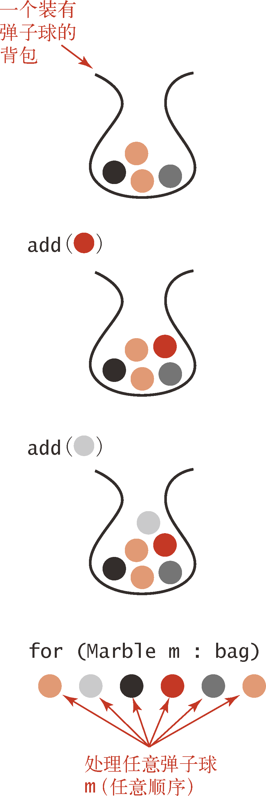

- 图 1.3.1　背包的操作

以下代码框列出的是常用的背包用例。

背包的典型用例

```java
public class Stats
{
  public static void main(String[] args)
  {
     Bag<Double> numbers = new Bag<Double>();
     while (!StdIn.isEmpty())
        numbers.add(StdIn.readDouble());
     int N = numbers.size();
     double sum = 0.0;
     for (double x : numbers)
        sum += x;
     double mean = sum/N;
     sum = 0.0;
     for (double x : numbers)
        sum += (x - mean)*(x - mean);
     double std = Math.sqrt(sum/(N-1));
     StdOut.printf("Mean: %.2f\n", mean);
     StdOut.printf("Std dev: %.2f\n", std);
  }
}
```

使用方法

```
% java Stats
100
99
101
120
98
107
109
81
101
90
Mean: 100.60
Std dev: 10.51
```

### 1.3.1.5　先进先出队列

先进先出队列（或简称队列）是一种基于先进先出（FIFO）策略的集合类型，如图 1.3.2 所示。按照任务产生的顺序完成它们的策略我们每天都会遇到：在剧院门前排队的人们、在收费站前排队的汽车或是计算机上某种软件中等待处理的任务。任何服务性策略的基本原则都是公平。在提到公平时大多数人的第一个想法就是应该优先服务等待最久的人，这正是先进先出策略的准则。队列是许多日常现象的自然模型，它也是无数应用程序的核心。当用例使用

```
foreach 语句迭代访问队列中的元素时，元素的处理顺序就是它们被添加到队列中的顺序。
```

在应用程序中使用队列的主要原因是在用集合保存元素的同时保存它们的相对顺序：使它们入

```
列顺序和出列顺序相同。例如，下页的用例是我们的In 类的静态方法 readInts() 的一种
```

实现。这个方法为用例解决的问题是用例无需预先知道文件的大小即可将文件中的所有整数读

```
入一个数组中。我们首先将所有的整数读入队列中，然后使用 Queue 的 size() 方法得到所
```

需数组的大小，创建数组并将队列中的所有整数移动到数组中。队列之所以合适是因为它能够

```
将整数按照文件中的顺序放入数组中（如果该顺序并不重要，也可以使用 Bag 对象）。这段代
码使用了自动装箱和拆箱来转换用例中的 int 原始数据类型和队列的 Integer 封装类型。
```

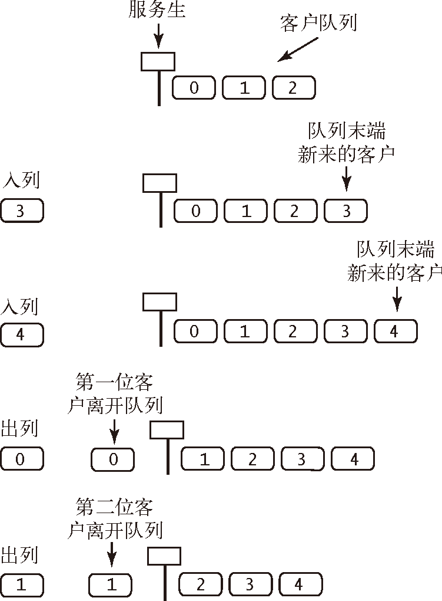

- 图 1.3.2　一个典型的先进先出队列

```java
public static int[] readInts(String
name)
{
  In in = new In(name);
  Queue<Integer> q = new
Queue<Integer>();
  while (!in.isEmpty())
      q.enqueue(in.readInt());
  int N = q.size();
  int[] a = new int[N];
  for (int i = 0; i < N; i++)
     a[i] = q.dequeue();
  return a;
}
Queue 的用例
```

### 1.3.1.6　下压栈

下压栈（或简称栈）是一种基于后进先出（LIFO）策略的集合类型，如图 1.3.3 所示。当你的邮件在桌上放成一叠时，使用的就是栈。新邮件来到时你将它们放在最上面，当你有空时你会一封一封地从上到下阅读它们。现在人们应付的纸质品比以前少得多，但计算机上的许多常用程序遵循相同的组织原则。例如，许多人仍然用栈的方式存放电子邮件——在收信时将邮件压入（push）最顶端，在取信时从最顶端将它们弹出（pop），且第一封一定是最新的邮件（后进，先出）。这种策略的好处是我们能够及时看到感兴趣的邮件，坏处是如果你不把栈清空，某些较早的邮件可能永远也不会被阅读。你在网上冲浪时很可能会遇到栈的另一个例子。点击一个超链接，浏览器会显示一个新的页面（并将它压入一个栈）。你可以不断点击超链接并访问新页面，但总是可以通过点击“回退”按钮重新访问以前的页面（从栈中弹出）。栈的后进先出

```
策略正好能够提供你所需要的行为。当用例使用 foreach 语句迭代遍历栈中的元素时，元素
```

的处理顺序和它们被压入的顺序正好相反。在应用程序中使用栈迭代器的一个典型原因是在用

```
集合保存元素的同时颠倒它们的相对顺序。例如，右侧的用例 Reverse 将会把标准输入中的
```

所有整数逆序排列，同样它也无需预先知道整数的多少。在计算机领域，栈具有基础而深远的影响，下一节我们会仔细研究一个例子，以说明栈的重要性。

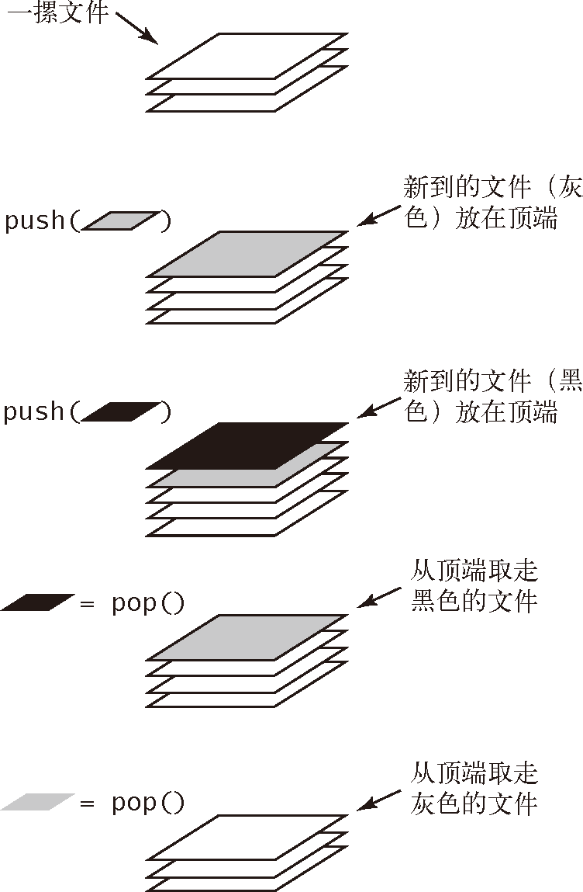

- 图 1.3.3　下压栈的操作

```java
public class Reverse
{
  public static void main(String[] args)
  {
     Stack<Integer> stack;
     stack = new Stack<Integer>();
     while (!StdIn.isEmpty())
        stack.push(StdIn.readInt());
     for (int i : stack)
        StdOut.println(i);
  }
}
Stack 的用例
```

### 1.3.1.7　算术表达式求值

我们要学习的另一个栈用例同时也是展示泛型的应用的一个经典例子。我们在 1.1 节中最初学习的几个程序之一就是用来计算算术表达式的值的，例如：

```
( 1 + ( ( 2 + 3 ) * ( 4 * 5 ) ) )
如果将 4 乘以 5，把 3 加上 2，取它们的积然后加 1，就得到了 101。但 Java 系统是如何
```

完成这些运算的呢？不需要研究 Java 系统的构造细节，我们也可以编写一个 Java 程序来解决这个问题。它接受一个输入字符串（表达式）并输出表达式的值。为了简化问题，首先来看一下这份明确的递归定义：算术表达式可能是一个数，或者是由一个左括号、一个算术表达式、一个运算符、另一个算术表达式和一个右括号组成的表达式。简单起见，这里定义的是未

```
省略括号的算术表达式，它明确地说明了所有运算符的操作数——你可能更熟悉形如 1 + 2
* 3 的表达式，省略了括号，而采用优先级规则。我们将要学习的简单机制也能处理优先级规
则，但在这里我们不想把问题复杂化。为了突出重点，我们支持最常见的二元运算符 *、
+、- 和 /，以及只接受一个参数的平方根运算符 sqrt。我们也可以轻易支持更多数量和种
```

类的运算符来计算多种大家熟悉的数学表达式，包括三角函数、指数和对数函数。我们的重点在于如何解析由括号、运算符和数字组成的字符串，并按照正确的顺序完成各种初级算术运算操作。如何才能够得到一个（由字符串表示的）算术表达式的值呢？E.W.Dijkstra 在 20 世纪60 年代发明了一个非常简单的算法，用两个栈（一个用于保存运算符，一个用于保存操作数）完成了这个任务，其实现过程见下页，求值算法的轨迹如图 1.3.4 所示。

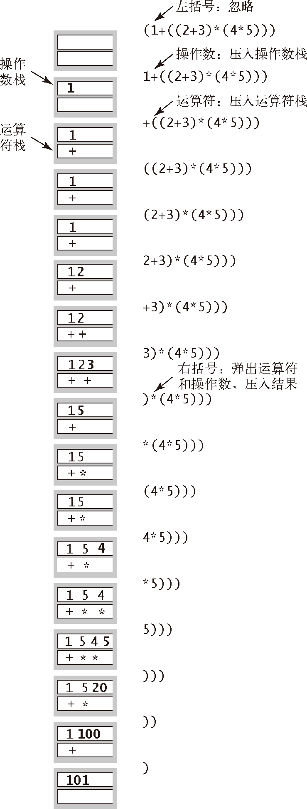

- 图 1.3.4　Dijkstra 的双栈算术表达式求值算法的轨迹

表达式由括号、运算符和操作数（数字）组成。我们根据以下 4 种情况从左到右逐个将这些实体送入栈处理：

- 将操作数压入操作数栈；

- 将运算符压入运算符栈；

- 忽略左括号；

- 在遇到右括号时，弹出一个运算符，弹出所需数量的操作数，并将运算符和操作数的运算结果压入操作数栈。

在处理完最后一个右括号之后，操作数栈上只会有一个值，它就是表达式的值。这种方法乍一看有些难以理解，但要证明它能够计算得到正确的值很简单：每当算法遇到一个被括号包围并由一个运算符和两个操作数组成的子表达式时，它都将运算符和操作数的计算结果压入操作数栈。这样的结果就好像在输入中用这个值代替了该子表达式，因此用这个值代替子表达式得到的结果和原表达式相同。我们可以反复应用这个规律并得到一个最终值。例如，用该算法计算以下表达式得到的结果都是相同的：

```
( 1 + ( ( 2 + 3 ) * ( 4 * 5 ) ) )
( 1 + ( 5 * ( 4 * 5 ) ) )
( 1 + ( 5 * 20 ) )
( 1 + 100 )
101
本页中的 Evaluate 类是该算法的一个实现。这段代码是一个简单的“解释器”：一个能够解释
```

给定字符串所表达的运算并计算得到结果的程序。

- Dijkstra 的双栈算术表达式求值算法

```java
public class Evaluate
1
{
2
  public static void main(String[] args)
3
  {
4
     Stack<String> ops  = new Stack<String>();
5
     Stack<Double> vals = new Stack<Double>();
6
     while (!StdIn.isEmpty())
7
     {  // 读取字符，如果是运算符则压入栈
8
        String s = StdIn.readString();
9
        if      (s.equals("("))               ;
10
        else if (s.equals("+"))    ops.push(s);
11
        else if (s.equals("-"))    ops.push(s);
12
        else if (s.equals("*"))    ops.push(s);
13
        else if (s.equals("/"))    ops.push(s);
14
        else if (s.equals("sqrt")) ops.push(s);
15
        else if (s.equals(")"))
16
        {  // 如果字符为")"，弹出运算符和操作数，计算结果并压入栈
17
           String op = ops.pop();
18
           double v = vals.pop();
19
           if      (op.equals("+"))    v = vals.pop() + v;
20
           else if (op.equals("-"))    v = vals.pop() - v;
21
           else if (op.equals("*"))    v = vals.pop() * v;
22
           else if (op.equals("/"))    v = vals.pop() / v;
23
           else if (op.equals("sqrt")) v = Math.sqrt(v);
24
           vals.push(v);
25
        }  // 如果字符既非运算符也不是括号，将它作为double 值压入栈
26
        else vals.push(Double.parseDouble(s));
27
     }
28
     StdOut.println(vals.pop());
29
  }
30
}
31
这段 Stack 的用例使用了两个栈来计算表达式的值。它展示了一种重要的计算模型：将一
个字符串解释为一段程序并执行该程序得到结果。有了泛型，我们只需实现 Stack 一次即
可使用 String 值的栈和 Double 值的栈。简单起见，这段代码假设表达式没有省略任何
```

- 括号，数字和字符均以空白字符相隔。

```
% java Evaluate
1
( 1 + ( ( 2 + 3 ) * ( 4 * 5 ) ) )
2
101.0
3
4
% java Evaluate
5
( ( 1 + sqrt ( 5.0 ) ) / 2.0 )
6
1.618033988749895
7
```

### 1.3.2　集合类数据类型的实现

```
在讨论 Bag、Stack 和 Queue 的实现之前，我们会先给出一个简单而经典的实现，然后讨
```

论它的改进并得到表 1.3.1 中的 API 的所有实现。

### 1.3.2.1　定容栈

作为热身，我们先来看一种表示容量固定的字符串栈的抽象数据类型，如表 1.3.2 所示。它的

```
API 和 Stack 的 API 有所不同：它只能处理 String 值，它要求用例指定一个容量且不支持
```

迭代。实现一份 API 的第一步就是选择数据的表示方式。对于

```
FixedCapacityStackOfStrings，我们显然可以选择 String 数组。由此我们可以得到
```

表 1.3.2 中底部的实现，它已经是简单得不能再简单了（每个方法都只有一行）。它的实例变

```
量为一个用于保存栈中的元素的数组a[]，和一个用于保存栈中的元素数量的整数N。要删除
一个元素，我们将 N 减 1 并返回 a[N]。要添加一个元素，我们将 a[N] 设为新元素并将 N
加 1。这些操作能够保证以下性质：
```

表 1.3.2　一种表示定容字符串栈的抽象数据类型

```java
public class <b>FixedCapacityStackOfStrings</b>
创建一个容量为 cap
FixedCapacityStackOfStrings(int cap)
    void   push(String item)
```

- 添加一个字符串

```xml
<b>API</b>
  String   pop()
```

- 删除最近添加的字符

```
 boolean   isEmpty()
```

- 栈是否为空

```
     int   size()
```

- 栈中的字符串数量

测试用例

- 复

```java
public static void main(String[] args)
{
  FixedCapacityStackOfStrings s;
  s = new FixedCapacityStackOfStrings(100);
  while (!StdIn.isEmpty())
```

- 数组中的元素顺序和它们被插入的顺序相同；

```
当 N 为 0 时栈为空；
栈的顶部位于 a[N-1]（如果栈非空）。
```

和以前一样，用恒等式的方式思考这些条件是检验实现正常工作的最简单的方式。请你务必完全理解这个实现。做到这一点的最好方法是检验一系列操作中栈内容的轨迹，如表 1.3.3 所示。测试用例会从标准输入读取多个字符串并将它们压入一个栈，当遇到 - 时它会将栈的内容

```
弹出并打印结果。这种实现的主要性能特点是push 和 pop 操作所需的时间独立于栈的长
```

度。许多应用会因为这种简洁性而选择它。但几个缺点限制了它作为通用工具的潜力，我们要改进的也是这一点。经过一些修改（以及 Java 语言机制的一些帮助），我们就能给出一个适用性更加广泛的实现。这些努力是值得的，因为这个实现是本书中其他许多更强大的抽象数据类型的模板。

表 1.3.3　FixedCapacityStackOfStrings 的测试用例的轨迹

```
a[]
```

StdIn

- StdOut

```
N
```

(push)

- (pop)

```
0
1
2
3
4
0
to
1
to
be
2
to
be
or
3
to
be
or
not
4
to
be
or
not
to
5
to
be
or
not
to
to
4
to
be
or
not
to
```

-

```
be
5
to
be
or
not
be
be
4
to
be
or
not
be
```

-

```
not
3
to
be
or
not
be
```

-

```
that
4
to
be
or
that
be
that
3
to
be
or
that
be
```

-

```
or
2
to
be
or
that
be
```

-

```
be
1
to
be
or
that
be
```

-

```
is
2
to
is
or
not
to
```

### 1.3.2.2　泛型

```
FixedCapacityStackOfStrings 的第一个缺点是它只能处理 String 对象。如果需要一
个 double 值的栈，你就需要用类似的代码实现另一个类，也就是把所有的 String 都替换
为 double。这还算简单，但如果我们需要 Transaction 类型的栈或者 Date 类型的队列
```

等，情况就很棘手了。如 1.3.1.1 节的讨论所示，Java 的参数类型（泛型）就是专门用来解决这个问题的，而且我们也看过了几个用例的代码（请见 1.3.1.4 节、1.3.1.5 节、1.3.1.6 节和1.3.1.7 节）。但如何才能实现一个泛型的栈呢？表 1.3.4 中的代码展示了实现的细节。它实现

```
了一个 FixedCapacityStack 类，该类和 FixedCapacityStackOfStrings 类的区别
仅在于加粗部分的代码——我们把所有的 String 都替换为 Item（一个地方除外，会在稍后
```

讨论）并用下面这行代码声明了该类：

```java
public class FixedCapacityStack<Item>
```

Item 是一个类型参数，用于表示用例将会使用的某种具体类型的象征性的占位符。可以将

```
FixedCapacityStack<Item> 理解为某种元素的栈，这正是我们想要的。在实现
FixedCapacityStack 时，我们并不知道 Item 的实际类型，但用例只要能在创建栈时提
```

供具体的数据类型，它就能用栈处理任意数据类型。实际的类型必须是引用类型，但用例可以

```
依靠自动装箱将原始数据类型转换为相应的封装类型。Java 会使用类型参数 Item 来检查类
型不匹配的错误——尽管具体的数据类型还不知道，赋予 Item 类型变量的值也必须是 Item
```

类型的，等等。在这里有一个细节非常重要：我们希望用以下代码在

```
FixedCapacityStack 的构造函数的实现中创建一个泛型的数组：
a = new Item[cap];
```

由于某些历史和技术原因（不在本书讲解范围之内），创建泛型数组在 Java 中是不允许的。我们需要使用类型转换：

```
a = (Item[]) new Object[cap];
```

这段代码才能够达到我们所期望的效果（但 Java 编译器会给出一条警告，不过可以忽略它），我们在本书中会一直使用这种方式（Java 系统库中类似抽象数据类型的实现中也使用了相同的方式）。

表 1.3.4　一种表示泛型定容栈的抽象数据类型

```java
public class <b>FixedCapacityStack</b><Item>
              FixedCapacityStack(int
创建一个容量为 cap
cap)
       void   push(<b>Item</b> item)
```

- 添加一个元素

```xml
<b>API</b>
       <b>Item</b>   pop()
```

- 删除最近添加的元素

```
    boolean   isEmpty()
```

- 栈是否为空

```
        int   size()
```

- 栈中的元素数量

测试用例

- 复

```java
public static void main(String[] args)
{
  FixedCapacityStack<b><String></b> s;
  s = new FixedCapacityStack<b><String></b>(100);
  while (!StdIn.isEmpty())
```

### 1.3.2.3　调整数组大小

选择用数组表示栈内容意味着用例必须预先估计栈的最大容量。在 Java 中，数组一旦创建，其大小是无法改变的，因此栈使用的空间只能是这个最大容量的一部分。选择大容量的用例在栈为空或几乎为空时会浪费大量的内存。例如，一个交易系统可能会涉及数十亿笔交易和数千个交易的集合。即使这种系统一般都会限制每笔交易只能出现在一个集合中，但用例必须保证所有集合都有能力保存所有的交易。另一方面，如果集合变得比数组更大那么用例有可能溢

```
出。为此，push() 方法需要在代码中检测栈是否已满，我们的 API 中也应该含有一个
isFull() 方法来允许用例检测栈是否已满。我们在此省略了它的实现代码，因为我们希望
用例从处理栈已满的问题中解脱出来，如我们的原始 Stack API 所示。因此，我们修改了数
组的实现，动态调整数组a[] 的大小，使得它既足以保存所有元素，又不至于浪费过多的空
```

间。实际上，完成这些目标非常简单。首先，实现一个方法将栈移动到另一个大小不同的数组中：

```java
private void resize(int max)
{  // 将大小为N < = max 的栈移动到一个新的大小为max 的数组中
  Item[] temp = (Item[]) new Object[max];
  for (int i = 0; i < N; i++)
  temp[i] = a[i];
  a = temp;
}
现在，在push() 中，检查数组是否太小。具体来说，我们会通过检查栈大小 N 和数组大小
a.length 是否相等来检查数组是否能够容纳新的元素。如果没有多余的空间，我们会将数
组的长度加倍。然后就可以和从前一样用 a[N++] = item 插入新元素了：
public void push(Item item)
{  // 将元素压入栈顶
  if (N == a.length) resize(2*a.length);
  a[N++] = item;
}
类似，在 pop() 中，首先删除栈顶的元素，然后如果数组太大我们就将它的长度减半。只要
```

稍加思考，你就明白正确的检测条件是栈大小是否小于数组的四分之一。在数组长度被减半之

```
后，它的状态约为半满，在下次需要改变数组大小之前仍然能够进行多次 push() 和 pop()
```

操作。

```
public Item pop()
{  // 从栈顶删除元素
  Item item = a[--N];
  a[N] = null;  // 避免对象游离（请见下节）
  if (N > 0 && N == a.length/4) resize(a.length/2);
  return item;
}
```

在这个实现中，栈永远不会溢出，使用率也永远不会低于四分之一（除非栈为空，那种情况下数组的大小为 1）。我们会在 1.4 节中详细分析这种实现方法的性能特点。

```
push() 和 pop() 操作中数组大小调整的轨迹见表 1.3.5。
```

表 1.3.5　一系列 push() 和 pop() 操作中数组大小调整的轨迹

```
a[]
push()
pop()
N
a.length
0
1
2
3
4
5
6
0
1
null
to
1
1
to
be
2
2
to
be
or
3
4
to
be
or
null
not
4
4
to
be
or
not
to
5
8
to
be
or
not
to
null
null
to
4
8
to
be
or
not
null
null
null
```

-

```
be
5
8
to
be
or
not
be
null
null
be
4
8
to
be
or
not
null
null
null
```

-

```
not
3
8
to
be
or
null
null
null
null
```

-

```
that
4
8
to
be
or
that
null
null
null
that
3
8
to
be
or
null
null
null
null
```

-

```
or
2
4
to
be
null
null
```

-

```
be
1
2
to
null
```

-

```
is
2
2
to
is
```

### 1.3.2.4　对象游离

```
Java 的垃圾收集策略是回收所有无法被访问的对象的内存。在我们对 pop() 的实现中，被弹
```

出的元素的引用仍然存在于数组中。这个元素实际上已经是一个孤儿了——它永远也不会再被访问了，但 Java 的垃圾收集器没法知道这一点，除非该引用被覆盖。即使用例已经不再需要这个元素了，数组中的引用仍然可以让它继续存在。这种情况（保存一个不需要的对象的引

```
用）称为游离。在这里，避免对象游离很容易，只需将被弹出的数组元素的值设为 null 即
```

可，这将覆盖无用的引用并使系统可以在用例使用完被弹出的元素后回收它的内存。

### 1.3.2.5　迭代

```
本节开头已经提过，集合类数据类型的基本操作之一就是，能够使用 Java 的 foreach 语句
```

通过迭代遍历并处理集合中的每个元素。这种方式的代码既清晰又简洁，且不依赖于集合数据类型的具体实现。在讨论迭代的实现之前，我们先看一段能够打印出一个字符串集合中的所有元素的用例代码：

```
Stack<String> collection = new Stack<String>();
...
for (String s : collection)
  StdOut.println(s);
...
这里，foreach 语句只是 while 语句的一种简写方式（就好像 for 语句一样）。它本质上
和以下 while 语句是等价的：
Iterator<String> i = collection.iterator();
while (i.hasNext())
{
  String s = i.next();
  StdOut.println(s);
}
```

这段代码展示了一些在任意可迭代的集合数据类型中我们都需要实现的东西：

```
集合数据类型必须实现一个 iterator() 方法并返回一个 Iterator 对象；
Iterator 类必须包含两个方法：hasNext()（返回一个布尔值）和next()（返回集合
```

- 中的一个泛型元素）。

在 Java 中，我们使用接口机制来指定一个类所必须实现的方法（请见 1.2.5.4 节）。对于可迭代的集合数据类型，Java 已经为我们定义了所需的接口。要使一个类可迭代，第一步就是在

```
它的声明中加入 implements Iterable<Item>，对应的接口（即 java.lang.Iterable）
```

为：

```java
public interface Iterable<Item>
{
  Iterator<Item> iterator();
}
然后在类中添加一个方法 iterator() 并返回一个迭代器 Iterator<Item>。迭代器都是
泛型的，因此我们可以使用参数类型 Item 来帮助用例遍历它们指定的任意类型的对象。对于
```

一直使用的数组表示法，我们需要逆序迭代遍历这个数组，因此我们将迭代器命名为

```
ReverseArrayIterator，并添加了以下方法：
public Iterator<Item> iterator()
{  return new ReverseArrayIterator();  }
迭代器是什么？它是一个实现了 hasNext() 和 next() 方法的类的对象，由以下接口所定
```

义（即 java.util.Iterator）：

```java
public interface Iterator<Item>
{
   boolean hasNext();
   Item next();
   void remove();
}
尽管接口指定了一个remove() 方法，但在本书中remove() 方法总为空，因为我们希望避
免在迭代中穿插能够修改数据结构的操作。对于 ReverseArrayIterator，这些方法都只
```

需要一行代码，它们实现在栈类的一个嵌套类中：

```java
private class ReverseArrayIterator implements Iterator<Item>
{
  private int i = N;
  public boolean hasNext() {  return i > 0;   }
  public Item next()       {  return a[--i];  }
  public void remove()     {                  }
}
请注意，嵌套类可以访问包含它的类的实例变量，在这里就是a[] 和N（这也是我们使用嵌套
类实现迭代器的主要原因）。从技术角度来说，为了和 Iterator 的结构保持一致，我们应该
在两种情况下抛出异常：如果用例调用了 remove() 则抛出
UnsupportedOperationException，如果用例在调用next() 时i 为 0 则抛出
NoSuchElementException。因为我们只会在foreach 语法中使用迭代器，这些情况都不
```

会出现，所以我们省略了这部分代码。还剩下一个非常重要的细节，我们需要在程序的开头加上下面这条语句：

```java
import java.util.Iterator;
因为（某些历史原因）Iterator 不在 java.lang 中（尽管 Iterable 是 java.lang 的一部
分）。现在，使用 foreach 处理该类的用例能够得到的行为和使用普通的 for 循环访问数组
```

一样，但它无须知道数据的表示方法是数组（即实现细节）。对于我们在本书中学习的和 Java库中所包含的所有类似于集合的基础数据类型的实现，这一点非常重要。例如，我们无需改变任何用例代码就可以随意切换不同的表示方法。更重要的是，从用例的角度来来说，无需知晓类的实现细节用例也能使用迭代。

```
算法 1.1 是 Stack API 的一种能够动态改变数组大小的实现。用例能够创建任意类型数据的
栈，并支持用例用 foreach 语句按照后进先出的顺序迭代访问所有栈元素。这个实现的基础
是 Java 的语言特性，包括 Iterable 和 Iterator，但我们没有必要深究这些特性的细
```

节，因为代码本身并不复杂，并且可以用做其他集合数据类型的实现的模板。

```
例如，我们在实现 Queue 的 API 时，可以使用两个实例变量作为索引，一个变量 head 指向
队列的开头，一个变量 tail 指向队列的结尾，如表 1.3.6 所示。在删除一个元素时，使用
head 访问它并将 head 加 1；在插入一个元素时，使用 tail 保存它并将 tail 加 1。如果
```

某个索引在增加之后越过了数组的边界则将它重置为 0。实现检查队列是否为空、是否充满并需要调整数组大小的细节是一项有趣而又实用的编程练习（请见练习 1.3.14）。

表 1.3.6　ResizingArrayQueue 的测试用例的轨迹

```
a[]
```

StdIn

- StdOut

```
N
head
tail
```

(入列)

- (出列)

```
0
1
2
3
4
5
6
7
5
0
5
to
be
or
not
to
to
4
1
5
to
be
or
not
to
```

-

```
be
5
1
6
to
be
or
not
to
be
be
4
2
6
to
be
or
not
to
be
```

-

```
or
3
3
6
to
be
or
not
to
be
```

-

在算法的学习中，算法 1.1 十分重要，因为它几乎（但还没有）达到了任意集合类数据类型的实现的最佳性能：

- 每项操作的用时都与集合大小无关；

- 空间需求总是不超过集合大小乘以一个常数。

```
ResizingArrayStack 的缺点在于某些 push() 和 pop() 操作会调整数组的大小：这项操
```

作的耗时和栈大小成正比。下面，我们将学习一种克服该缺陷的方法，使用一种完全不同的方式来组织数据。

- 算法 1.1　下压（LIFO）栈（能够动态调整数组大小的实现）

```java
import java.util.Iterator;
1
public class ResizingArrayStack<Item> implements Iterable<Item>
2
{
3
  private Item[] a = (Item[]) new Object[1];  // 栈元素
4
  private int N = 0;                          // 元素数量
5
  public boolean isEmpty()  {  return N == 0; }
6
  public int size()         {  return N;      }
7
  private void resize(int max)
8
  {  // 将栈移动到一个大小为max 的新数组
9
     Item[] temp = (Item[]) new Object[max];
10
     for (int i = 0; i < N; i++)
11
        temp[i] = a[i];
12
     a = temp;
13
  }
14
  public void push(Item item)
15
  {  // 将元素添加到栈顶
16
     if (N == a.length) resize(2*a.length);
17
     a[N++] = item;
18
  }
19
  public Item pop()
20
  {  // 从栈顶删除元素
21
     Item item = a[--N];
22
     a[N] = null;  // 避免对象游离（请见1.3.2.4 节）
23
     if (N > 0 && N == a.length/4) resize(a.length/2);
24
     return item;
25
  }
26
  public Iterator<Item> iterator()
27
   {  return new ReverseArrayIterator();  }
28
  private class ReverseArrayIterator implements Iterator<Item>
29
  {  // 支持后进先出的迭代
30
     private int i = N;
31
     public boolean hasNext() {  return i > 0;   }
32
     public    Item next()    {  return a[--i];  }
33
     public    void remove()  {                  }
34
  }
35
}
36
这份泛型的可迭代的 Stack API 的实现是所有集合类抽象数据类型实现的模板。它将所有
```

- 元素保存在数组中，并动态调整数组的大小以保持数组大小和栈大小之比小于一个常数。

### 1.3.3　链表

现在我们来学习一种基础数据结构的使用，它是在集合类的抽象数据类型实现中表示数据的合适选择。这是我们构造非 Java 直接支持的数据结构的第一个例子。我们的实现将成为本书中其他更加复杂的数据结构的构造代码的模板。所以请仔细阅读本节，即使你已经使用过链表。

```
定义。链表是一种递归的数据结构，它或者为空（null），或者是含有泛型元素的结点和
```

- 指向另一个链表的引用。

在这个定义中，结点是一个可能含有任意类型数据的抽象实体，它所包含的指向结点的应用显示了它在构造链表之中的作用。和递归程序一样，递归数据结构的概念一开始也令人费解，但其实它的简洁性赋予了它巨大的价值。

### 1.3.3.1　结点记录

在面向对象编程中，实现链表并不困难。我们首先用一个嵌套类来定义结点的抽象数据类型：

```java
private class Node
{
  Item item;
  Node next;
}
一个 Node 对象含有两个实例变量，类型分别为 Item（参数类型）和 Node。我们会在需要
使用 Node 类的类中定义它并将它标记为 private，因为它不是为用例准备的。和任意数据
类型一样，我们通过new Node() 触发（无参数的）构造函数来创建一个Node 类型的对
象。调用的结果是一个指向 Node 对象的引用，它的实例变量均被初始化为 null。Item 是
```

一个占位符，表示我们希望用链表处理的任意数据类型（我们将会使用 Java 的泛型使之表示

```
任意引用类型）；Node 类型的实例变量显示了这种数据结构的链式本质。为了强调我们在组
织数据时只使用了 Node 类，我们没有定义任何方法且会在代码中直接引用实例变量：如果
first 是一个指向某个 Node 对象的变量，我们可以使用 first.item 和 first.next 访
```

问它的实例变量。这种类型的类有时也被称为记录。它们实现的不是抽象数据类型，因为我们

```
会直接使用其实例变量。但是在我们的实现中，Node 和它的用例代码都会被封装在相同的类
```

中且无法被该类的用例访问，所以我们仍然能够享受数据抽象的好处。

### 1.3.3.2　构造链表

```
现在，根据递归定义，我们只需要一个 Node 类型的变量就能表示一条链表，只要保证它的值
是 null 或者指向另一个 Node 对象且该对象的 next 域指向了另一条链表即可。例如，要
构造一条含有元素to、be 和 or 的链表，我们首先为每个元素创造一个结点：
Node first  = new Node();
Node second = new Node();
Node third  = new Node();
并将每个结点的 item 域设为所需的值（简单起见，我们假设在这些例子中 Item 为
String）：
first.item  = "to";
second.item = "be";
third.item  = "or";
然后设置 next 域来构造链表：
```

```
first.next  = second;
second.next = third;
（注意：third.next 仍然是 null，即对象创建时它被初始化的值。）结果是，third 是一
条链表（它是一个结点的引用，该结点指向 null，即一个空链表），second 也是一条链表
（它是一个结点的引用，且该结点含有一个指向 third 的引用，而 third 是一条链表），
first 也是一条链表（它是一个结点的引用，且该结点含有一个指向 second 的引用，而
second 是一条链表）。图 1.3.5 所示的代码以不同的顺序完成了这些赋值语句。
```

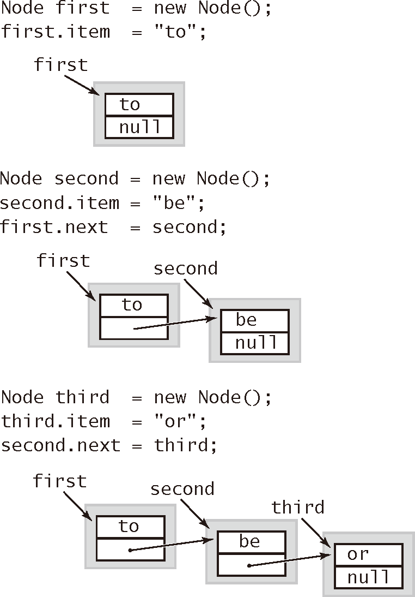

- 图 1.3.5　用链接构造一条链表

```
链表表示的是一列元素。在我们刚刚考察过的例子中，first 表示的序列是 to、be、or。
```

我们也可以用一个数组来表示一列元素。例如，可以用以下数组表示同一列字符串：

```
String[] s = { "to", "be", "or" };
```

不同之处在于，在链表中向序列插入元素或是从序列中删除元素都更方便。下面，我们来学习完成这些任务的代码。

在追踪使用链表和其他链式结构的代码时，我们会使用可视化表示方法：

- 用长方形表示对象；

- 将实例变量的值写在长方形中；

- 用指向被引用对象的箭头表示引用关系。

这种表示方式抓住了链表的关键特性。方便起见，我们用术语链接表示对结点的引用。简单起见，当元素的值为字符串时（如我们的例子所示），我们会将字符串写在长方形之内，而非使用 1.2 节中所讨论的更准确的方式表示字符串对象和字符数组。这种可视化的表示方式使我们能够将注意力集中在链表上。

### 1.3.3.3　在表头插入结点

首先，假设你希望向一条链表中插入一个新的结点。最容易做到这一点的地方就是链表的开

```
头。例如，要在首结点为first 的给定链表开头插入字符串not，我们先将first 保存在
oldfirst 中，然后将一个新结点赋予 first，并将它的 item 域设为 not，next 域设为
oldfirst。以上过程如图 1.3.6 所示。这段在链表开头插入一个结点的代码只需要几行赋值
```

语句，所以它所需的时间和链表的长度无关。

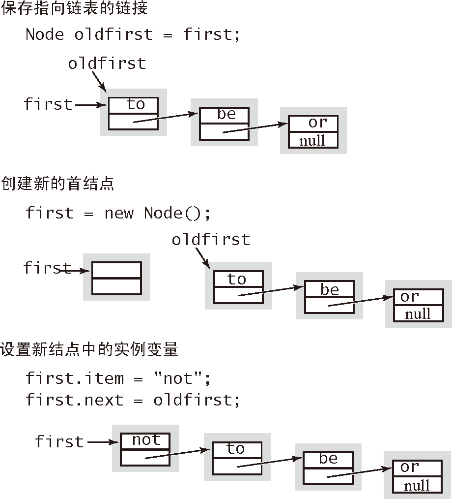

- 图 1.3.6　在链表的开头插入一个新结点

### 1.3.3.4　从表头删除结点

```
接下来，假设你希望删除一条链表的首结点。这个操作更简单：只需将 first 指向
first.next 即可。一般来说你可能会希望在赋值之前得到该元素的值，因为一旦改变了
first 的值，就再也无法访问它曾经指向的结点了。曾经的结点对象变成了一个孤儿，Java
```

的内存管理系统最终将回收它所占用的内存。和以前一样，这个操作只含有一条赋值语句，因此它的运行时间和链表的长度无关。此过程如图 1.3.7 所示。

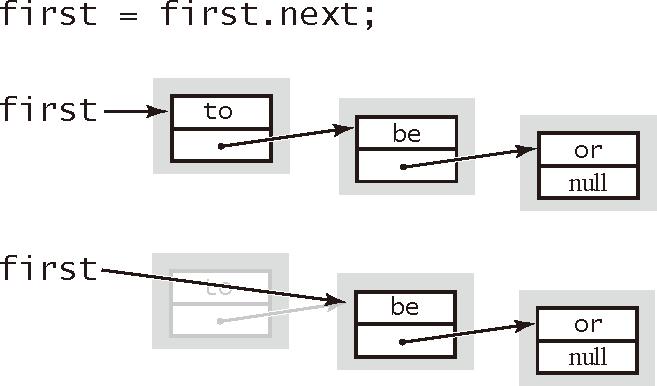

- 图 1.3.7　删除链表的首结点

### 1.3.3.5　在表尾插入结点

如何才能在链表的尾部添加一个新结点？要完成这个任务，我们需要一个指向链表最后一个结点的链接，因为该结点的链接必须被修改并指向一个含有新元素的新结点。我们不能在链表代码中草率地决定维护一个额外的链接，因为每个修改链表的操作都需要添加检查是否要修改该变量（以及作出相应修改）的代码。例如，我们刚刚讨论过的删除链表首结点的代码就可能改变指向链表的尾结点的引用，因为当链表中只有一个结点时，它既是首结点又是尾结点！另外，这段代码也无法处理链表为空的情况（它会使用空链接）。类似这些情况的细节使链表代码特别难以调试。在链表结尾插入新结点的过程如图 1.3.8 所示。

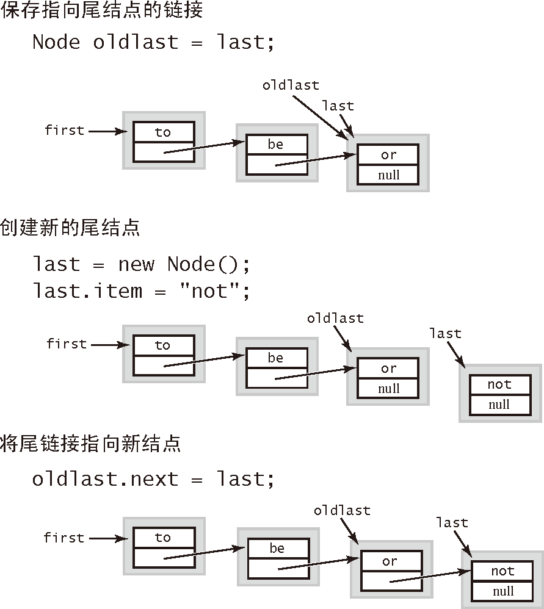

- 图 1.3.8　在链表的结尾插入一个新结点

### 1.3.3.6　其他位置的插入和删除操作

总的来说，我们已经展示了在链表中如何通过若干指令实现以下操作，其中我们可以通过

```
first 链接访问链表的首结点并通过 last 链接访问链表的尾结点：
```

- 在表头插入结点；

- 从表头删除结点；

- 在表尾插入结点。

其他操作，例如以下几种，就不那么容易实现了：

- 删除指定的结点；

- 在指定结点前插入一个新结点。

```
例如，我们怎样才能删除链表的尾结点呢？last 链接帮不上忙，因为我们需要将链表尾结点
的前一个结点中的链接（它指向的正是 last）值改为 null。在缺少其他信息的情况下，唯
一的解决办法就是遍历整条链表并找出指向 last 的结点（请见下文以及练习 1.3.19）。这种
```

解决方案并不是我们想要的，因为它所需的时间和链表的长度成正比。实现任意插入和删除操作的标准解决方案是使用双向链表，其中每个结点都含有两个链接，分别指向不同的方向。我们将实现这些操作的代码留做练习（请见练习 1.3.31）。我们的所有实现都不需要双向链表。

### 1.3.3.7　遍历

```
要访问一个数组中的所有元素，我们会使用如下代码来循环处理 a[] 中的所有元素：
for (int i = 0; i < N; i++)
{
  // 处理a[i]
}
访问链表中的所有元素也有一个对应的方式：将循环的索引变量 x 初始化为链表的首结点，
然后通过 x.item 访问和 x 相关联的元素，并将 x 设为 x.next 来访问链表中的下一个结
点，如此反复直到 x 为 null 为止（这说明我们已经到达了链表的结尾）。这个过程被称为链
表的遍历，可以用以下循环处理链表的每个结点的代码简洁表达，其中 first 指向链表的首
```

结点：

```
for (Node x = first; x != null; x = x.next)
{
  // 处理x.item
}
```

这种方式和迭代遍历一个数组中的所有元素的标准方式一样自然。在我们的实现中，它是迭代器使用的基本方式，它使用例能够迭代访问链表的所有元素而无需知道链表的实现细节。

### 1.3.3.8　栈的实现

```
有了这些预备知识，给出我们的Stack API 的实现就很简单了，如 94 页的算法 1.2 所示。它
将栈保存为一条链表，栈的顶部即为表头，实例变量 first 指向栈顶。这样，当使用
push() 压入一个元素时，我们会按照 1.3.3.3 节所讨论的代码将该元素添加在表头；当使用
pop() 删除一个元素时，我们会按照 1.3.3.4 节讨论的代码将该元素从表头删除。要实现
size() 方法，我们用实例变量 N 保存元素的个数，在压入元素时将 N 加 1，在弹出元素时
将 N 减 1。要实现 isEmpty() 方法，只需检查 first 是否为 null（或者可以检查 N 是否
为 0）。该实现使用了泛型的 Item——你可以认为类名后的 <Item> 表示的是实现中所出现
的所有 Item 都会替换为用例所提供的任意数据类型的名称（请见 1.3.2.2 节）。我们暂时省
```

略了关于迭代的代码并将它们留到算法 1.4 中继续讨论。图 1.3.9 显示了我们所常用的测试用例的轨迹（测试用例代码放在了图后面）。链表的使用达到了我们的最优设计目标：

- 它可以处理任意类型的数据；

- 所需的空间总是和集合的大小成正比；

- 操作所需的时间总是和集合的大小无关。

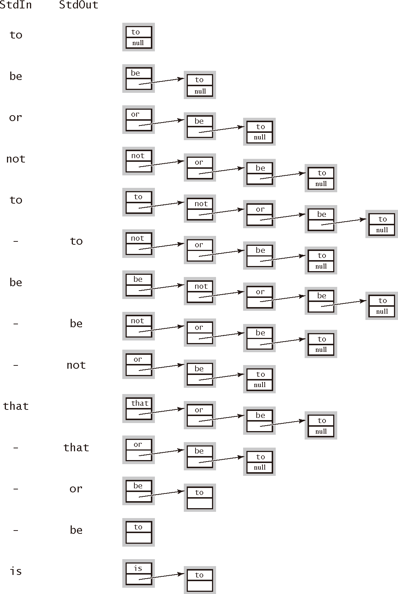

```
图 1.3.9　stack 的开发用例的轨迹
```

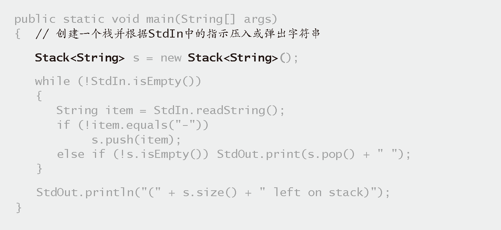

```
Stack 的测试用例
```

这份实现是我们对许多算法的实现的原型。它定义了链表数据结构并实现了供用例使用的方法

```
push() 和pop()，仅用了少量代码就取得了所期望的效果。算法和数据结构是相辅相成的。
```

在本例中，算法的实现代码很简单，但数据结构的性质却并不简单，我们用了好几页纸来说明这些性质。这种数据结构的定义和算法的实现的相互作用很常见，也是本书中我们对抽象数据类型的实现重点。

- 算法 1.2　下压堆栈（链表实现）

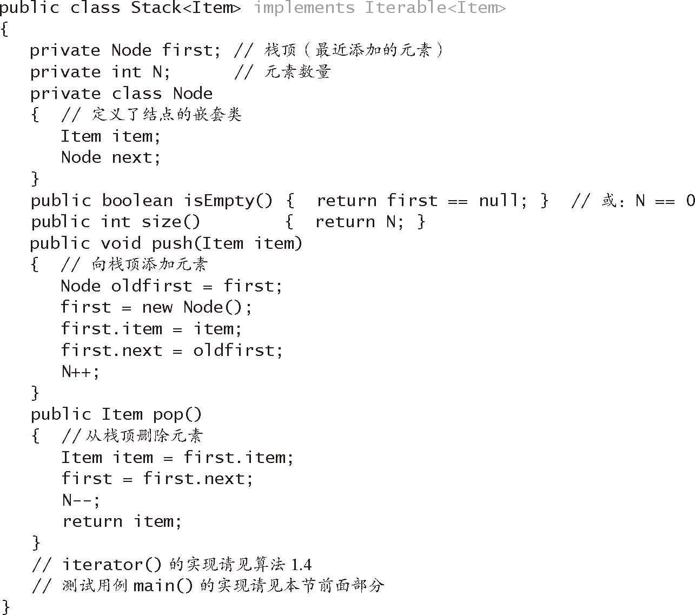

```
这份泛型的Stack 实现的基础是链表数据结构。它可以用于创建任意数据类型的栈。要支
持迭代，请添加算法 1.4 中为Bag数据类型给出的加粗部分的代码。
% more tobe.txt
1
to be or not to - be - - that - - - is
2
3
% java Stack < tobe.txt
4
to be not that or be (2 left on stack)
5
```

### 1.3.3.9　队列的实现

```
基于链表数据结构实现 Queue API 也很简单，如算法 1.3 所示。它将队列表示为一条从最早
插入的元素到最近插入的元素的链表，实例变量 first 指向队列的开头，实例变量last 指
向队列的结尾。这样，要将一个元素入列（enqueue()），我们就将它添加到表尾（请见图
1.3.8 中讨论的代码，但是在链表为空时需要将 first 和 last 都指向新结点）；要将一个元
素出列（dequeue()），我们就删除表头的结点（代码和Stack 的pop() 方法相同，只是当
链表为空时需要更新last 的值）。size() 和 isEmpty() 方法的实现和 Stack 相同。和
Stack 一样，Queue 的实现也使用了泛型参数 Item。这里我们省略了支持迭代的代码并将
它们留到算法 1.4 中继续讨论。下面所示的是一个开发用例，它和我们在Stack 中使用的用
例很相似，它的轨迹如算法 1.3 所示。Queue 的实现使用的数据结构和 Stack 相同——链
```

表，但它实现了不同的添加和删除元素的算法，这也是用例所看到的后进先出和先进后出的区别所在。和刚才一样，我们用链表达到了最优设计目标：它可以处理任意类型的数据，所需的

- 1

空间总是和集合的大小成正比，操作所需的时间总是和集合的大小无关。

```java
public static void main(String[] args)
{  // 创建一个队列并操作字符串入列或出列
  Queue<String> q = new Queue<String>();
  while (!StdIn.isEmpty())
  {
     String item = StdIn.readString();
     if (!item.equals("-"))
          q.enqueue(item);
     else if (!q.isEmpty()) StdOut.print(q.dequeue() + " ");
  }
  StdOut.println("(" + q.size() + " left on queue)");
}
Queue 的测试用例
% more tobe.txt
to be or not to - be - - that - - - is
% java Queue < tobe.txt
to be or not to be (2 left on queue)
```

- 算法 1.3　先进先出队列

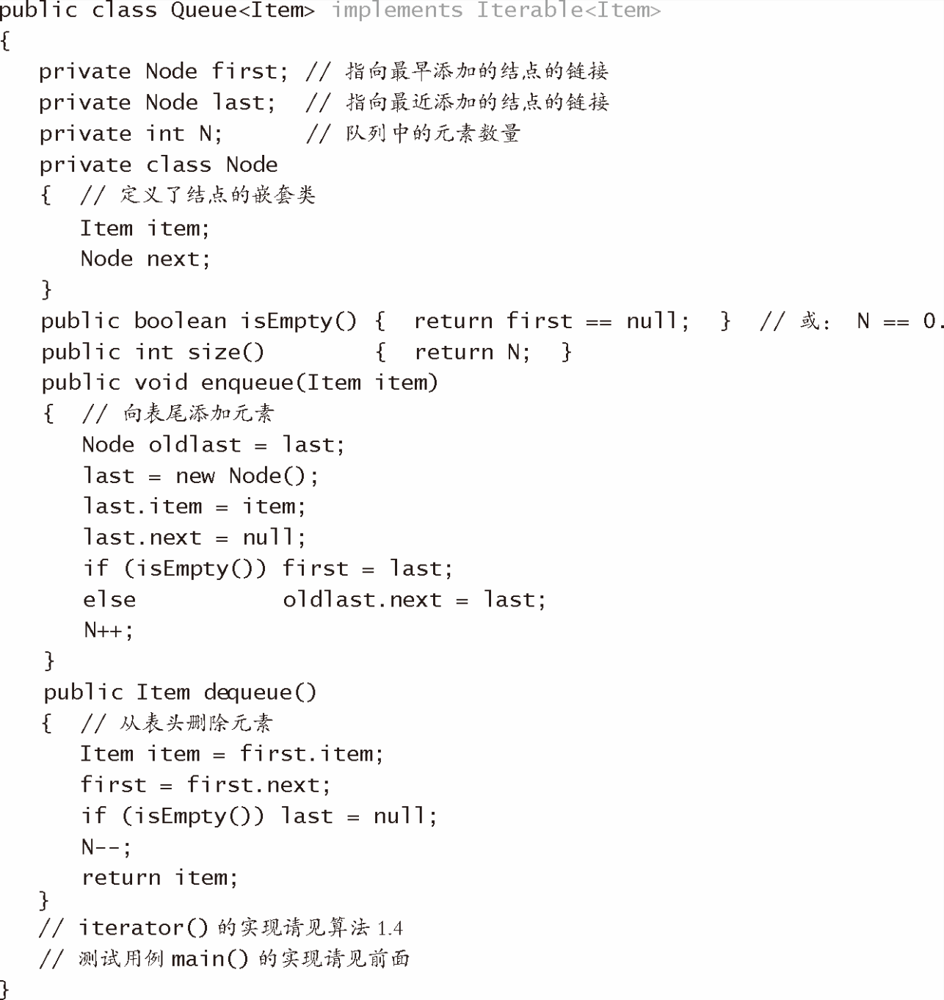

```
这份泛型的Queue 实现的基础是链表数据结构。它可以用于创建任意数据类型的队列。要
支持迭代，请添加算法 1.4 中为Bag 数据类型给出的加粗部分的代码。
Queue 的开发用例的轨迹如图 1.3.10 所示。
```

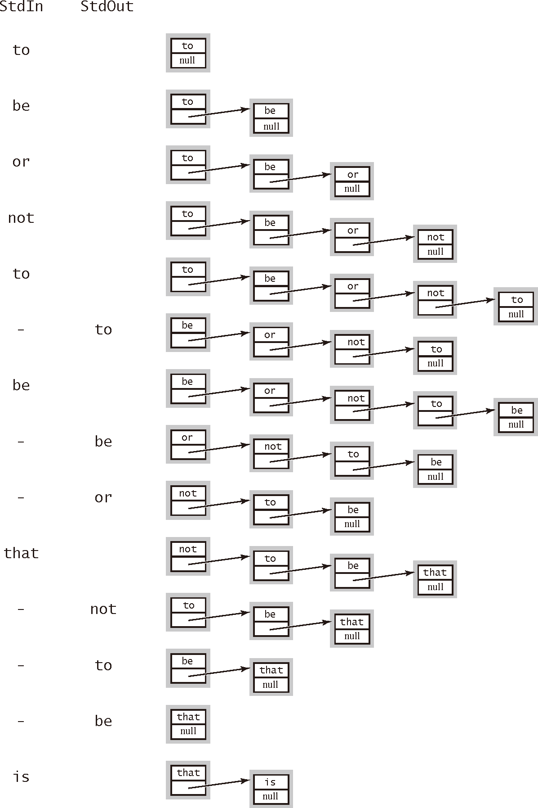

```
图 1.3.10　Queue 的开发用例的轨迹
```

在结构化存储数据集时，链表是数组的一种重要的替代方式。这种替代方案已经有数十年的历史。事实上，编程语言历史上的一块里程碑就是 McCathy 在 20 世纪 50 年代发明的 LISP 语言，而链表则是这种语言组织程序和数据的主要结构。在练习中你会发现，链表编程也会遇到各种问题，且调试十分困难。在现代编程语言中，安全指针、自动垃圾回收（请见 1.2 节答疑部分）和抽象数据类型的使用使我们能够将链表处理的代码封装在若干个类中，正如本文所述。

### 1.3.3.10　背包的实现

```
用链表数据结构实现我们的 Bag API 只需要将 Stack 中的 push() 改名为 add()，并去掉
pop() 的实现即可，如算法 1.4 所示（也可以用相同的方法实现 Queue，但需要的代码更
多）。在这份实现中，加粗部分的代码可以通过遍历链表使 Stack、Queue 和 Bag 变为可迭
代的。对于 Stack，链表的访问顺序是后进先出；对于 Queue，链表的访问顺序是先进先
出；对于 Bag，它正好也是后进先出的顺序，但顺序在这里并不重要。如算法 1.4 中加粗部分
```

的代码所示，要在集合数据类型中实现迭代，第一步就是要添加下面这行代码，这样我们的代码才能引用 Java 的 Iterator 接口：

```java
import java.util.Iterator;
第二步是在类的声明中添加这行代码，它保证了类必然会提供一个 iterator() 方法：
implements Iterable<Item>
iterator() 方法本身只是简单地从实现了 Iterator 接口的类中返回一个对象：
public Iterator<Item> iterator()
{  return new ListIterator(); }
这段代码保证了类必然会实现方法hasNext()、next() 和 remove() 供用例的 foreach
语法使用。要实现这些方法，算法 1.4 中的嵌套类 ListIterator 维护了一个实例变量
current 来记录链表的当前结点。hasNext() 方法会检测 current 是否为 null，
next() 方法会保存当前元素的引用，将 current 变量指向链表中的下个结点并返回所保存
```

的引用。

- 算法 1.4　背包

```java
import java.util.Iterator;
1
public class Bag<Item> implements Iterable<Item>
2
{
3
  private Node first;  // 链表的首结点
4
  private class Node
5
  {
6
      Item item;
7
      Node next;
8
  }
9
  public void add(Item item)
10
  {  // 和Stack 的push() 方法完全相同
11
     Node oldfirst = first;
12
     first = new Node();
13
     first.item = item;
14
     first.next = oldfirst;
15
  }
16
  public Iterator<Item> iterator()
17
  {  return new ListIterator();  }
18
  private class ListIterator implements Iterator<Item>
19
  {
20
      private Node current = first;
21
      public boolean hasNext()
22
      {  return current != null;  }
23
      public void remove() { }
24
      public Item next()
25
      {
26
          Item item = current.item;
27
          current = current.next;
28
          return item;
29
      }
30
  }
31
}
32
这份 Bag 的实现维护了一条链表，用于保存所有通过 add() 添加的元素。size() 和
isEmpty() 方法的代码和 Stack 中的完全相同，因此在此处省略。迭代器会遍历链表并
将当前结点保存在 current 变量中。我们可以将加粗的代码添加到算法 1.2 和算法 1.3 中
使 Stack 和 Queue 变为可迭代的，因为它们背后的数据结构是相同的，只是 Stack 和
Queue 的链表访问顺序分别是后进先出和先进先出而已。
```

### 1.3.4　综述

在本节中，我们所学习的支持泛型和迭代的背包、队列和栈的实现所提供的抽象使我们能够编写简洁的用例程序来操作对象的集合。深入理解这些抽象数据类型非常重要，这是我们研究算法和数据结构的开始。原因有三：第一，我们将以这些数据类型为基石构造本书中的其他更高级的数据结构；第二，它们展示了数据结构和算法的关系以及同时满足多个有可能相互冲突的性能目标时所要面对的挑战；第三，我们将要学习的若干算法的实现重点就是需要其中的抽象数据类型能够支持对对象集合的强大操作，这些实现正是我们的起点。

数据结构

我们现在拥有两种表示对象集合的方式，即数组和链表（如表 1.3.7 所示）。Java 内置了数组，链表也很容易使用 Java 的标准方法实现。两者都非常基础，常常被称为顺序存储和链式存储。在本书后面部分，我们会在各种抽象数据类型的实现中将多种方式结归并扩展这些基本的数据结构。其中一种重要的扩展就是各种含有多个链接的数据结构。例如，3.2 节和 3.3 节的重点就是被称为二叉树的数据结构，它由含有两个链接的结点组成。另一个重要的扩展是复合型的数据结构：我们可以使用背包存储栈，用队列存储数组，等等。例如，第 4 章的主题是图，我们可以用数组的背包表示它。用这种方式很容易定义任意复杂的数据结构，而我们重点研究抽象数据类型的一个重要原因就是试图控制这种复杂度。

表 1.3.7　基础数据结构

数据结构

- 优点缺点

数组

- 通过索引可以直接访问任意元素在初始化时就需要知道元素的数量

我们在本节中研究背包、队列和栈时描述数据结构和算法的方式是全书的原型（本书中的数据结构示例见表 1.3.8）。在研究一个新的应用领域时，我们将会按照以下步骤识别目标并使用数据抽象解决问题：

- 定义 API；

- 根据特定的应用场景开发用例代码；

- 描述一种数据结构（一组值的表示），并在 API 所对应的抽象数据类型的实现中根据它定义类的实例变量；

- 描述算法（实现一组操作的方式），并根据它实现类中的实例方法；

- 分析算法的性能特点。

在下一节中，我们会详细研究最后一步，因为它常常能够决定哪种算法和实现才是解决现实应用问题的最佳选择。

表 1.3.8　本书所给出的数据结构举例

数据结构

- 章节抽象数据类型数据表示

```
UnionFind
```

- 1.5

父链接树

- 整型数组

```
BST
```

- 3.2、3.3

二分查找树

- 含有两个链接的结点

### 答疑

问　并不是所有编程语言都支持泛型，甚至 Java 的早期版本也不支持。有其他替代方案吗？

答　如正文所述，一种替代方法是为每种类型的数据都实现一个不同的集合数据类型。另一种

```
方法是构造一个 Object 对象的栈，并在用例中使用 pop() 时将得到的对象转换为所需的数
```

据类型。这种方式的问题在于类型不匹配错误只能在运行时发现。而在泛型中，如果你的代码将错误类型的对象压入栈中，比如这样：

```
Stack<Apple> stack = new Stack<Apple>();
Apple  a = new Apple();
...
Orange b = new Orange();
...
stack.push(a);
...
stack.push(b);     // 编译时错误
```

会得到一个编译时错误：

```
push(Apple) in Stack<Apple> cannot be applied to (Orange)
```

能够在编译时发现错误足以说服我们使用泛型。

问　为什么 Java 不允许泛型数组？

答　专家们仍然在争论这一点。你可能也需要成为专家才能理解它！对于初学者，请先了解共变数组（covariant array）和类型擦除（type erasure）。

问　如何才能创建一个字符串栈的数组？

答　使用类型转换，比如：

```
Stack<String>[] a = (Stack<String>[]) new Stack[N];
```

警告：这段类型转换的用例代码和 1.3.2.2 节所示的有所不同。你可能会以为需要使用

```
Object 而非 Stack。在使用泛型时，Java 会在编译时检查类型的安全性，但会在运行时抛
弃所有这些信息。因此在运行时语句右侧就变成了Stack<Object>[] 或者只剩下了
Stack[]，因此我们必须将它们转化为 Stack<String>[]。
问　在栈为空时调用 pop() 会发生什么？
```

答　这取决于实现。对于我们在算法 1.2 中给出的实现，你会得到一个

```
NullPointerException 异常。对于我们在本书的网站上给出的实现，我们会抛出一个运
```

行时异常以帮助用户定位错误。一般来说，在应用广泛的代码中这类检查越多越好。

问　既然有了链表，为什么还要学习如何调整数组的大小？

答　我们还将会学习若干抽象数据类型的示例实现，它们需要使用数组来实现一些链表难以实

```
现的操作。ResizingArrayStack 是控制它们的内存使用的样板。
问　为什么将 Node 声明为嵌套类？为什么使用 private ？
答　将 Node 声明为私有的嵌套类之后，我们可以将Node 的方法和实例变量的访问范围限制
```

在包含它的类中。私有嵌套类的一个特点是只有包含它的类能够直接访问它的实例变量，因此

```
无需将它的实例变量声明为public 或是 private。专业背景较强的读者注意：非静态的嵌
套类也被称为内部类，因此从技术上来说我们的Node 类也是内部类，尽管非泛型的类也可以
```

是静态的。

```
问　当我输入 javac Stack.java 编译算法 1.2 和其他程序时，我发现了 Stack.class 和
```

Stack$Node.class 两个文件。第二个文件是做什么用的？

```
答　第二个文件是为内部类 Node 创建的。Java 的命名规则会使用 $ 分隔外部类和内部类。
```

问　Java 标准库中有栈和队列吗？

答　有，也没有。Java 有一个内置的库，叫做 java.util.Stack，但你需要栈的时候请不要使用

```
它。它新增了几个一般不属于栈的方法，例如获取第 i 个元素。它还允许从栈底添加元素
```

（而非栈顶），所以它可以被当做队列使用！尽管拥有这些额外的操作看起来可能很有用，但它们其实是累赘。我们使用某种数据类型不仅仅是为了获得我们能够想象的各种操作，也是为了准确地指定我们所需要的操作。这么做的主要好处在于系统能够防止我们执行一些意外的操作。java.util.Stack 的 API 是宽接口的一个典型例子，我们通常会极力避免出现这种情况。

```
问　是否允许用例向栈或队列中添加空（null）元素？
```

答　在 Java 中实现集合类数据类型时这个问题是很常见的。我们的实现（以及 Java 的栈和

```
队列库）允许插入 null 值。
问　如果用例在迭代中调用 push() 或者 pop()，Stack 的迭代器应该怎么办？
```

答　作为一个快速出错的迭代器，它应该立即抛出一个

```
java.util.ConcurrentModificationException 异常。请见练习 1.3.50。
问　我们能够用 foreach 循环访问数组吗？
答　可以（尽管数组没有实现 Iterable 接口）。以下代码将会打印所有命令行参数：
```

```java
public static void main(String[] args)
{  for (String s : args) StdOut.println(s);  }
问　我们能够用 foreach 循环访问字符串吗？
答　不行，String 没有实现 Iterable 接口。
问　为什么不实现一个单独的 Collection 数据类型并实现添加元素、删除最近插入的元
```

素、删除最早插入的元素、删除随机元素、迭代、返回集合元素数量和其他我们可能需要的方法？这样我们就能在一个类中实现所有这些方法并可以应用于各种用例。

```
答　再次强调一遍，这又是一个宽接口的例子。Java 在java.util.ArrayList 和
java.util.LinkedList 类中实现了类似的设计。避免使用它们的一个原因是这样无法保
```

证高效实现所有这些方法。在本书中，我们总是以 API 作为设计高效算法和数据结构的起点，而设计只含有几个操作的接口显然比设计含有许多操作的接口更简单。我们坚持窄接口的另一个原因是它们能够限制用例的行为，这将使用例代码更加易懂。如果一段用例代码使用

```
Stack<String>，而另一段用例代码使用 Queue<Transaction>，我们就可以知道后进先
```

出的访问顺序对于前者很重要，而先进先出的访问顺序对于后者很重要。

### 练习

```
1.3.1　为 FixedCapacityStackOfStrings 添加一个方法 isFull()。
1.3.2　给定以下输入，java Stack 的输出是什么？
it was - the best - of times - - - it was - the - -
```

1.3.3　假设某个用例程序会进行一系列入栈和出栈的混合栈操作。入栈操作会将整数 0 到 9按顺序压入栈；出栈操作会打印出返回值。下面哪种序列是不可能产生的？

```
　a. 4 3 2 1 0 9 8 7 6 5
　b. 4 6 8 7 5 3 2 9 0 1
　c. 2 5 6 7 4 8 9 3 1 0
　d. 4 3 2 1 0 5 6 7 8 9
　e. 1 2 3 4 5 6 9 8 7 0
　f. 0 4 6 5 3 8 1 7 2 9
　g. 1 4 7 9 8 6 5 3 0 2
　h. 2 1 4 3 6 5 8 7 9 0
```

1.3.4　编写一个 Stack 的用例 Parentheses，从标准输入中读取一个文本流并使用栈判定其中

```
的括号是否配对完整。例如，对于 [()]{}{[()()]()} 程序应该打印 true，对于 [(]) 则
打印 false。
1.3.5　当 N 为 50 时下面这段代码会打印什么？从较高的抽象层次描述给定正整数 N 时这段
```

代码的行为。

```
Stack<Integer> stack = new Stack<Integer>();
while (N > 0)
{
  stack.push(N % 2);
  N = N / 2;
}
for (int d : stack) StdOut.print(d);
StdOut.println();
```

```
　答：打印 N 的二进制表示（当 N 为 50 时打印 110010）。
1.3.6　下面这段代码对队列 q 进行了什么操作？
Stack<String> stack = new Stack<String>();
while (!q.isEmpty())
  stack.push(q.dequeue());
while (!stack.isEmpty())
  q.enqueue(stack.pop());
1.3.7　为 Stack 添加一个方法 peek()，返回栈中最近添加的元素（而不弹出它）。
1.3.8　给定以下输入，给出 DoublingStackOfStrings 的数组的内容和大小。
it was - the best - of times - - - it was - the - -
```

1.3.9　编写一段程序，从标准输入得到一个缺少左括号的表达式并打印出补全括号之后的中序表达式。例如，给定输入：

```
1 + 2 ) * 3 - 4 ) * 5 - 6 ) ) )
```

你的程序应该输出：

```
( ( 1 + 2 ) * ( ( 3 - 4 ) * ( 5 - 6 ) ) )
1.3.10　编写一个过滤器 InfixToPostfix，将算术表达式由中序表达式转为后序表达式。
```

1.3.11　编写一段程序 EvaluatePostfix，从标准输入中得到一个后序表达式，求值并打印结果

```
（将上一题的程序中得到的输出用管道传递给这一段程序可以得到和 Evaluate 相同的行
```

为）。

```
1.3.12　编写一个可迭代的 Stack 用例，它含有一个静态的copy() 方法，接受一个字符串的
```

栈作为参数并返回该栈的一个副本。注意：这种能力是迭代器价值的一个重要体现，因为有了它我们无需改变基本 API 就能够实现这种功能。

1.3.13　假设某个用例程序会进行一系列入列和出列的混合队列操作。入列操作会将整数 0 到9 按顺序插入队列；出列操作会打印出返回值。下面哪种序列是不可能产生的？

```
　a. 0 1 2 3 4 5 6 7 8 9
　b. 4 6 8 7 5 3 2 9 0 1
　c. 2 5 6 7 4 8 9 3 1 0
　d. 4 3 2 1 0 5 6 7 8 9
1.3.14　编写一个类 ResizingArrayQueueOfStrings，使用定长数组实现队列的抽象，
```

然后扩展实现，使用调整数组的方法突破大小的限制。

```
1.3.15　编写一个 Queue 的用例，接受一个命令行参数 k 并打印出标准输入中的倒数第 k 个
字符串（假设标准输入中至少有 k 个字符串）。
1.3.16　使用 1.3.1.5 节中的 readInts() 作为模板为 Date 编写一个静态方法
readDates()，从标准输入中读取由练习 1.2.19 的表格所指定的格式的多个日期并返回一个
```

它们的数组。

```
1.3.17　为 Transaction 类完成练习 1.3.16。
```

### 链表练习

这部分练习是专门针对链表的。建议：使用正文中所述的可视化表达方式画图。

```sql
1.3.18　假设 x 是一条链表的某个结点且不是尾结点。下面这条语句的效果是什么？
x.next = x.next.next;
　答：删除 x 的后续结点。
1.3.19　给出一段代码，删除链表的尾结点，其中链表的首结点为 first。
1.3.20　编写一个方法 delete()，接受一个 int 参数 k，删除链表的第 k 个元素（如果它
```

存在的话）。

```
1.3.21　编写一个方法 find()，接受一条链表和一个字符串 key 作为参数。如果链表中的
某个结点的 item 域的值为 key，则方法返回 true，否则返回 false。
1.3.22　假设 x 是一条链表中的某个结点，下面这段代码做了什么？
t.next = x.next;
x.next = t;
　答：插入结点 t 并使它成为 x 的后续结点。
```

1.3.23　为什么下面这段代码和上一道题中的代码效果不同？

```
x.next = t;
t.next = x.next;
　答：在更新 t.next 时，x.next 已经不再指向 x 的后续结点，而是指向 t 本身！
1.3.24　编写一个方法 removeAfter()，接受一个链表结点作为参数并删除该结点的后续结
```

点（如果参数结点或参数结点的后续结点为空则什么也不做）。

```
1.3.25　编写一个方法insertAfter()，接受两个链表结点作为参数，将第二个结点插入链
```

表并使之成为第一个结点的后续结点（如果两个参数为空则什么也不做）。

```
1.3.26　编写一个方法 remove()，接受一条链表和一个字符串 key 作为参数，删除链表中
所有 item 域为 key 的结点。
1.3.27　编写一个方法max()，接受一条链表的首结点作为参数，返回链表中键最大的节点的
```

值。假设所有键均为正整数，如果链表为空则返回 0。

1.3.28　用递归的方法解答上一道练习。

```
1.3.29　用环形链表实现Queue。环形链表也是一条链表，只是没有任何结点的链接为空，且
只要链表非空则 last.next 的值为 first。只能使用一个 Node 类型的实例变量
（last）。
```

1.3.30　编写一个函数，接受一条链表的首结点作为参数，（破坏性地）将链表反转并返回结果链表的首结点。

```
　迭代方式的解答：为了完成这个任务，我们需要记录链表中三个连续的结点：reverse、
first 和 second。在每轮迭代中，我们从原链表中提取结点 first 并将它插入到逆链表的
开头。我们需要一直保持 first 指向原链表中所有剩余结点的首结点，second 指向原链表
中所有剩余结点的第二个结点，reverse 指向结果链表中的首结点。
public Node reverse(Node x)
{
  Node first   = x;
  Node reverse = null;
  while (first != null)
  {
     Node second = first.next;
     first.next  = reverse;
     reverse     = first;
     first       = second;
  }
  return reverse;
}
```

在编写和链表相关的代码时，我们必须小心处理异常情况（链表为空或是只有一个或两个结点）和边界情况（处理首尾结点）。它们通常比处理正常情况要困难得多。

- 个结点，我们先递归颠倒最后个结点，然后小心地将原

递归解答：假设链表含有

链表中的首结点插入到结果链表的末端。

```
public Node reverse(Node first)
{
  if (first == null) return null;
  if (first.next == null) return first;
  Node second = first.next;
  Node rest = reverse(second);
  second.next = first;
  first.next  = null;
  return rest;
}
1.3.31　实现一个嵌套类 DoubleNode 用来构造双向链表，其中每个结点都含有一个指向前
驱元素的引用和一项指向后续元素的引用（如果不存在则为 null）。为以下任务实现若干静
```

态方法：在表头插入结点、在表尾插入结点、从表头删除结点、从表尾删除结点、在指定结点之前插入新结点、在指定结点之后插入新结点、删除指定结点。

### 提高题

```
1.3.32　Steque。一个以栈为目标的队列（或称 steque），是一种支持 push、pop 和
enqueue 操作的数据类型。为这种抽象数据类型定义一份 API 并给出一份基于链表的实现。
```

2

```
1.3.33　Deque。一个双向队列（或者称为 deque）和栈或队列类似，但它同时支持在两端添
加或删除元素。Deque 能够存储一组元素并支持表 1.3.9 中的 API：
```

表 1.3.9　泛型双向队列的 API

```java
public class <b>Deque</b><Item> implements Iterable<Item>
             Deque()
```

- 创建空双向队列

```
   boolean   isEmpty()
```

- 双向队列是否为空

```
       int   size()
```

- 双向队列中的元素数量

```
      void   pushLeft(Item item)
```

- 向左端添加一个新元素

```
      void   pushRight(Item item)
```

- 向右端添加一个新元素

```
      Item   popLeft()
```

- 从左端删除一个元素

```
      Item   popRight()
```

- 从右端删除一个元素

```
　编写一个使用双向链表实现这份 API 的 Deque 类，以及一个使用动态数组调整实现这份
API 的 ResizingArrayDeque 类。
```

1.3.34　随机背包。随机背包能够存储一组元素并支持表 1.3.10 中的 API：

表 1.3.10　泛型随机背包的 API

```java
public class <b>RandomBag</b><Item> implements Iterable<Item>
             RandomBag()
```

- 创建一个空随机背包

```
　编写一个RandomBag 类来实现这份 API。请注意，除了形容词随机之外，这份 API 和 Bag
```

的 API 是相同的，这意味着迭代应该随机访问背包中的所有元素（对于每次迭代，所有的

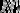

种排列出现的可能性均相同）。提示：用数组保存所有元素并在迭代器的构造函数中随机打乱它们的顺序。

1.3.35　随机队列。随机队列能够存储一组元素并支持表 1.3.11 中的 API：

表 1.3.11　泛型随机队列的 API

```java
public class <b>RandomQueue</b><Item>
             RandomQueue()
```

- 创建一条空的随机队列

```
   boolean   isEmpty()
```

- 队列是否为空

```
      void   enqueue(Item item)
```

- 添加一个元素

```
      Item   dequeue()
```

- 删除并随机返回一个元素（取样且不放回）

```
      Item   sample()
```

- 随机返回一个元素但不删除它（取样且放回）

```
　编写一个 RandomQueue 类来实现这份 API。提示：使用（能够动态调整大小的）数组表示
数据。删除一个元素时，随机交换某个元素（索引在 0 和 N-1 之间）和末位元素（索引为N-
1）的位置，然后像 ResizingArrayStack 一样删除并返回末位元素。编写一个用例，使用
RandomQueue<Card> 在桥牌中发牌（每人 13 张）。
1.3.36　随机迭代器。为上一题中的RandomQueue<Item> 编写一个迭代器，随机返回队列
```

中的所有元素。

```
1.3.37　Josephus 问题。在这个古老的问题中，
```

- 个身陷绝境的人一致同意通过以下方式

减少生存人数。他们围坐成一圈（位置记为 0 到

- 的）并从第一个人开始报数，报到


人会被杀死，直到最后一个人留下来。传说中 Josephus 找到了不会被杀死的位置。编写一个

```
Queue 的用例 Josephus，从命令行接受
```

- 和并打印出人们被杀死的顺序（这也将显示

Josephus 在圈中的位置）。

```
% java Josephus 7 2
1 3 5 0 4 2 6
```

1.3.38　删除第 k 个元素。实现一个类并支持表 1.3.12 中的 API：

表 1.3.12　泛型一般队列的 API

```java
public class <b>GeneralizedQueue</b><Item>
             GeneralizedQueue()
```

- 创建一条空队列

```
   boolean   isEmpty()
```

- 队列是否为空

```sql
      void   insert(Item x)
```

- 添加一个元素

```sql
      Item   delete(int k)
删除并返回最早插入的第 k 个元素
```

首先用数组实现该数据类型，然后用链表实现该数据类型。注意：我们在第 3 章中介绍的算

```sql
法和数据结构可以保证 insert() 和 delete() 的实现所需的运行时间和和队列中的元素数
```

量成对数关系——请见练习 3.5.27。

1.3.39　环形缓冲区。环形缓冲区，又称为环形队列，是一种定长为

- 的先进先出的数据结

构。它在进程间的异步数据传输或记录日志文件时十分有用。当缓冲区为空时，消费者会在数

```
据存入缓冲区前等待；当缓冲区满时，生产者会等待将数据存入缓冲区。为RingBuffer 设
```

计一份 API 并用（回环）数组将其实现。

1.3.40　前移编码。从标准输入读取一串字符，使用链表保存这些字符并清除重复字符。当你读取了一个从未见过的字符时，将它插入表头。当你读取了一个重复的字符时，将它从链表中删去并再次插入表头。将你的程序命名为 MoveToFront：它实现了著名的前移编码策略，这种策略假设最近访问过的元素很可能会再次访问，因此可以用于缓存、数据压缩等许多场景。

1.3.41　复制队列。编写一个新的构造函数，使以下代码

```
Queue<Item> r = new Queue<Item>(q);
　得到的 r 指向队列 q 的一个新的独立的副本。可以对 q 或 r 进行任意入列或出列操作但它
们不会相互影响。提示：从q 中取出所有元素再将它们插入 q 和 r。
```

1.3.42　复制栈。为基于链表实现的栈编写一个新的构造函数，使以下代码

```
Stack<Item> t = new Stack<Item>(s);
　得到的 t 指向栈 s 的一个新的独立的副本。
```

1.3.43　文件列表。文件夹就是一列文件和文件夹的列表。编写一个程序，从命令行接受一个文件夹名作为参数，打印出该文件夹下的所有文件并用递归的方式在所有子文件夹的名下（缩进）列出其下的所有文件。提示：使用队列，并参考 java.io.File。

1.3.44　文本编辑器的缓冲区。为文本编辑器的缓冲区设计一种数据类型并实现表 1.3.13 中的API。

表 1.3.13　文本缓冲区的 API

```
Public class <b>Buffer</b>
             Buffer()
```

- 创建一块空缓冲区

```sql
      void   insert(char c)
在光标位置插入字符 c
      char   delete()
```

- 删除并返回光标位置的字符

```
      void   left(int k)
将光标向左移动 k 个位置
      void   right(int k)
将光标向右移动 k 个位置
```

提示：使用两个栈。

1.3.45　栈的可生成性。假设我们的栈测试用例将会进行一系列混合的入栈和出栈操作，序列

```
中的整数0,1,...,N-1（按此先后顺序排列）表示入栈操作，
```

- 个减号表示出栈操作。设计

- 无关，即不

一个算法，判定给定的混合序列是否会使数组向下溢出（你所使用的空间量与

能用某种数据结构存储所有整数）。设计一个线性时间的算法判定我们的测试用例能否产生某个给定的排列（这取决于出栈操作指令的出现位置）。

- 次出栈操作会在前次入栈操作前完成，否则栈不会向下

解答：除非对于某个整数

- ，前

溢出。如果某个排列可以产生，那么它产生的方式一定是唯一的：如果输出排列中的下一个整数在栈顶，则将它弹出，否则将它压入栈之中。

1.3.46　栈可生成性问题中禁止出现的排列。若三元组 (a,b,c) 中 a<b<c 且 c 最先被弹出，a第二，b 第三（c 和 a 以及 a 和 b 之间可以间隔其他整数），那么当且仅当排列中不含这样的三元组时（如上题所述的）栈才可能生成它。

部分解答：设有一个这样的三元组 (a,b,c)。c 会在 a 和 b 之前被弹出，但 a 和 b 会在 c 之前被压入。因此，当 c 被压入时，a 和 b 都已经在栈之中了。所以，a 不可能在 b 之前被弹出。

1.3.47　可连接的队列、栈或 steque。为队列、栈或 steque（请见练习 1.3.32）添加一个能

```
够（破坏性地）连接两个同类对象的额外操作catenation。
```

1.3.48　双向队列与栈。用一个双向队列实现两个栈，保证每个栈操作只需要常数次的双向队列操作（请见练习 1.3.33）。

1.3.49　栈与队列。用有限个栈实现一个队列，保证每个队列操作（在最坏情况下）都只需要常数次的栈操作。警告：非常难！

```
1.3.50　快速出错的迭代器。修改 Stack 的迭代器代码，确保一旦用例在迭代器中（通过
push() 或pop() 操作）修改集合数据就抛出一个
java.util.ConcurrentModificationException 异常。解答：用一个计数器记录
push() 和 pop() 操作的次数。在创建迭代器时，将该值记录到 Iterator 的一个实例变量
中。在每次调用hasNext() 和next() 之前，检查该值是否发生了变化，如果变化则抛出异
```

常。

[1]：这里原书应该是因为版面原因没有使用列表，如果版面允许可以使用和 部分相同的列表显示这三个目标。——译者注[2]：、 都是对队列同一端的操作， 和 对应，但操作的是队列的另一端。——译者注
