# 1.4算法分析

随着使用计算机的经验的增长，人们在使用计算机解决困难问题或是处理大量数据时不可避免的将会产生这样的疑问：

我的程序会运行多长时间？

为什么我的程序耗尽了所有内存？

在重建某个音乐或照片库、安装某个新应用程序、编辑某个大型文档或是处理一大批实验数据时，你肯定也问过自己这些问题。这些问题太模糊了，我们无法准确回答——答案取决于许多因素，比如你所使用的计算机的性能、被处理的数据的性质和完成任务所使用的程序（实现了某种算法）。这些因素都会产生大量需要分析的信息。

尽管有这些困难，你在本节中将会看到，为这些基础问题给出实质性的答案有时其实非常简单。这个过程的基础是科学方法，它是科学家们为获取自然界知识所使用的一系列为大家所认同的方法。我们将会使用数学分析为算法成本建立简洁的模型并使用实验数据验证这些模型。

### 1.4.1　科学方法

科学家用来理解自然世界的方法对于研究计算机程序的运行时间同样有效：

- 细致地观察真实世界的特点，通常还要有精确的测量；

- 根据观察结果提出假设模型；

- 根据模型预测未来的事件；

- 继续观察并核实预测的准确性；

- 如此反复直到确认预测和观察一致。

科学方法的一条关键原则是我们所设计的实验必须是可重现的，这样他人也可以自己验证假设的真实性。所有的假设也必须是可证伪的，这样我们才能确认某个假设是错误的（并需要修正）。正如爱因斯坦的一句名言所说：“再多的实验也不一定能够证明我是对的，但只需要一个实验就能证明我是错的。”我们永远也没法知道某个假设是否绝对正确，我们只能验证它和我们的观察的一致性。

### 1.4.2　观察

我们的第一个挑战是决定如何定量测量程序的运行时间。在这里这个任务比自然科学中的要简单得多。我们不需要向火星发射火箭或者牺牲一些实验室的小动物或是分裂某个原子——只需要运行程序即可。事实上，每次运行程序都是在进行一次科学实验，将这个程序和自然世界联系起来并回答我们的一个核心问题：我的程序会运行多长时间？

我们对大多数程序的第一个定量观察就是计算性任务的困难程度可以用问题的规模来衡量。一般来说，问题的规模可以是输入的大小或是某个命令行参数的值。根据直觉，程序的运行时间应该随着问题规模的增长而变长，但我们每次在开发和运行一个程序时想问的问题都是运行时间的增长有多快。

从许多程序中得到的另一个定量观察是运行时间和输入本身相对无关，它主要取决于问题规模。如果这个关系不成立，我们就需要进行一些实验来更好地理解并更好地控制运行时间对输入的敏感度。但这个关系常常是成立的，因此我们现在来重点研究如何更好地将问题规模和运行时间的关系量化。

### 1.4.2.1　举例

右侧的 ThreeSum 程序是一个可运行的示例。它会统计一个文件中所有和为 0 的三整数元组的数量（假设整数不会溢出）。这种计算可能看起来有些不自然，但其实它和许多基础计算性任务都有着深刻的联系（例如，请见练习 1.4.26）。作为测试输入，我们使用的是本书网站上

```
的 1Mints.txt 文件。它含有 100 万个随机生成的 int 值。1Mints.txt 中的第二个、第八个和第
```

十个元组的和均为 0。文件中还有多少组这样的数据？ThreeSum 能够告诉我们答案，但它所

```
需的时间可以接受吗？问题的规模 N 和 ThreeSum 的运行时间有什么关系？我们的第一个实
```

验就是在计算机上运行 ThreeSum 并处理本书网站上的 1Kints.txt、2Kints.txt、4Kints.txt 和8Kints.txt 文件，它们分别含有 1Mints.txt 中的 1000、2000、4000 和 8000 个整数。你可以很快得到这样的整数元组在 1Kints.txt 中共有 70 组，在 2Kints.txt 中共有 528 组，如图 1.4.1所示。这个程序需要用比之前长得多的时间得到在 4Kints.txt 中共有 4039 组和为 0 的整数。在等待它处理 8Kints.txt 的时候，你会发现你在问自己：“我的程序还要运行多久？”你会看到，对于这个程序，回答这个问题很简单。实际上，你常常能在程序运行的时候就给出一个较为准确的预测。

```java
public class ThreeSum
{
  public static int count(int[] a)
  {  // 统计和为0的元组的数量
     int N = a.length;
     int cnt = 0;
     for (int i = 0; i < N; i++)
        for (int j = i+1; j < N; j++)
           for (int k = j+1; k < N; k++)
              if (a[i] + a[j] + a[k] == 0)
                 cnt++;
     return cnt;
  }
  public static void main(String[] args)
  {
     int[] a = In.readInts(args[0]);
     StdOut.println(count(a));
  }
}
对于给定的 N，这段程序需要运行多长时间
% more 1Mints.txt
324110
-442472
626686
-157678
508681
123414
-77867
155091
129801
287381
604242
686904
-247109
 77867
982455
-210707
-922943
-738817
 85168
855430
...
```

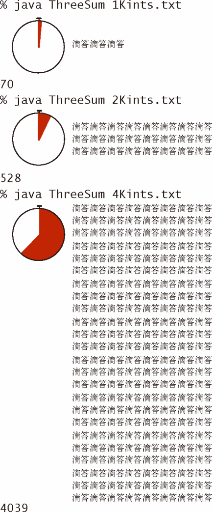

- 图 1.4.1　记录一个程序的运行时间

### 1.4.2.2　计时器

准确测量给定程序的确切运行时间是很困难的。不过幸运的是我们一般只需要近似值就可以了。我们希望能够把需要几秒钟或者几分钟就能完成的程序和需要几天、几个月甚至更长时间才能完成的程序区别开来，而且我们希望知道对于同一个任务某个程序是不是比另一个程序快一倍。因此，我们仍然需要准确的测量手段来生成实验数据，并根据它们得出并验证关于程序

```
的运行时间和问题规模的假设。为此，我们使用了如表 1.4.1 所示的Stopwatch 数据类型。
它的 elapsedTime() 方法能够返回自它创建以来所经过的时间，以秒为单位。它的实现基
于 Java 系统的 currentTimeMillis() 方法，该方法能够返回以毫秒记数的当前时间。它
在构造函数中保存了当前时间，并在 elapsedTime() 方法被调用时再次调用该方法来计算
```

得到对象创建以来经过的时间。

表 1.4.1　一种表示计时器的抽象数据类型

```java
public class <b>Stopwatch</b>
<b>API</b>
             Stopwatch()
```

- 创建一个计时器

```
    double   elapseTime()
```

- 返回对象创建以来所经过的时间

典型用例

```java
public static void main(String[] args)
{
  int N = Integer.parseInt(args[0]);
  int[] a = new int[N];
  for (int i = 0; i ^lt; N; i++)
     a[i] = StdRandom.uniform(-1000000, 1000000);
  <b>Stopwatch timer = new Stopwatch();</b>
  int cnt = ThreeSum.count(a);
  double time = <b>timer.elapsedTime();</b>
  StdOut.println(cnt + " triples " + time + " seconds");
}
```

使用方法

```
% java Stopwatch 1000
```

### 1.4.2.3　实验数据的分析

```
DoublingTest 是Stopwatch 的一个更加复杂的用例，并能够为 ThreeSum 产生实验数据。它
会生成一系列随机输入数组，在每一步中将数组长度加倍，并打印出ThreeSum.count() 处
```

理每种输入规模所需的运行时间。这些实验显然是可重现的——你也可以在自己的计算机上运行它们，多少次都行。在运行 DoublingTest 时，你会发现自己进入了一个“预测—验证”的循环：它会快速打印出几行数据，但随即慢了下来。每当它打印出一行结果时，你都会开始琢磨它还需要多久才能打出下一行。当然，因为大家使用的计算机不同，你得到的实际运行时间很可能和我们的计算机得到的不一样。事实上，如果你的计算机比我们的快一倍，你所得到的运行时间应该大致是我们所得到的一半。由此我们马上可以得出一条有说服力的猜想：程序在不同的计算机上的运行时间之比通常是一个常数。尽管如此，你还是会提出更详细的问题：作为问题规模的一个函数，我的程序的运行时间是多久？为了帮助你回答这个问题，我们来将数据绘制成图表。图 1.4.2 就是产生结果，使用的分别是标准比例尺和对数比例尺。其中

- 轴表示

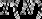

- 轴表示程序的运行时间，。由对数的图像我们立即可以得到一个关于运行时间的猜


想——因为数据和斜率为 3 的直线完全吻合。该直线的公式为（其中 a 为常数）：

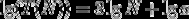

它等价于：

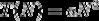

- 的函数。我们可以用其中一个数据点来解出 a 的

这就是我们想要的运行时间关于输入规模

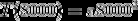

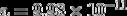

值——例如，

- ——因此我们就可以用以下公式预测，可得值较大时程序的运行时间：

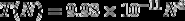

我们可以根据对数图像中的数据点距离这条直线的远近来不严格地检验这条假设。一些统计学方法可以帮助我们更加仔细地分析出 a 和指数 b 的近似值，但我们的快速计算已经足以在大

- 时

多数情况下估计出程序的运行时间。例如，我们预计，在我们的计算机上，当

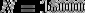

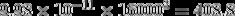

- 秒，也就是约 6.8 分钟（实际时间为

程序的运行时间约为409.3 秒）。在等待计算机得出 DoublingTest 在

- 的实验数据时，也可以用这个方法

来预测它何时将会结束，然后等待并验证你的结果是否正确。

实验程序

```java
public class DoublingTest
{
  public static double timeTrial(int N)
  {  // 为处理N 个随机的六位整数的ThreeSum.count() 计时
     int MAX = 1000000;
     int[] a = new int[N];
     for (int i = 0; i < N; i++)
        a[i] = StdRandom.uniform(-MAX, MAX);
     Stopwatch timer = new Stopwatch();
     int cnt = ThreeSum.count(a);
     return timer.elapsedTime();
  }
  public static void main(String[] args)
  {  // 打印运行时间的表格
     for (int N = 250; true; N += N)
     {  // 打印问题规模为N 时程序的用时
        double time = timeTrial(N);
        StdOut.printf("%7d %5.1f\n", N, time);
     }
  }
}
```

实验结果

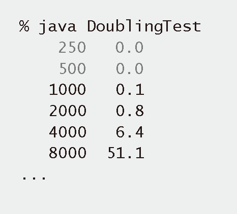

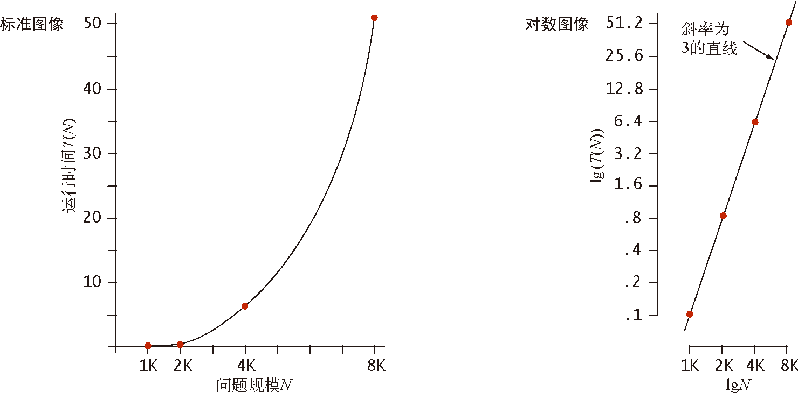

```
图 1.4.2　实验数据（ThreeSum.count() 的运行时间）的分析
```

到现在为止，这个过程和科学家们在尝试理解真实世界的奥秘时进行的过程完全相同。对数图

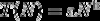

- 的猜想。这种公式被称为幂次法则。许

像中的直线等价于我们对数据符合公式多自然和人工的现象都符合幂次法则，因此假设程序的运行时间符合幂次法则也是合情合理的。事实上，对于算法的分析，我们有许多数学模型强烈支持这种函数和其他类似的假设，我们现在就来学习它们。

### 1.4.3　数学模型

在计算机科学的早期，D. E. Knuth 认为，尽管有许多复杂的因素影响着我们对程序的运行时间的理解，原则上我们仍然可能构造出一个数学模型来描述任意程序的运行时间。Knuth 的基本见地很简单——一个程序运行的总时间主要和两点有关：

- 执行每条语句的耗时；

- 执行每条语句的频率。

前者取决于计算机、Java 编译器和操作系统，后者取决于程序本身和输入。如果对于程序的所有部分我们都知道了这些性质，可以将它们相乘并将程序中所有指令的成本相加得到总运行时间。

```
第一个挑战是判定语句的执行频率。有些语句的分析很容易：例如，ThreeSum.count() 中
将 cnt 的值设为 0 的语句只会执行一次。有些则需要深入分析：例如，
```

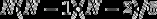

```
ThreeSum.count() 中的 if 语句会执行
```

- 次（从输入数组中能够取得

的三个不同整数的数量——请见练习 1.4.1）。其他则取决于输入数据，例如，

```
ThreeSum.count() 中的指令 cnt++ 执行的次数为输入中和为 0 的整数三元组的数量，这
```

可能是 0 也可能是任意值。对于 DoublingTest 的情况，输入值是随机产生的，我们可以用概率分析得到该值的期望（请见练习 1.4.40）。

### 1.4.3.1　近似

这种频率分析可能会产生复杂冗长的数学表达式。例如，刚才我们所讨论的 ThreeSum 中的

```
if 语句的执行次数为：
```

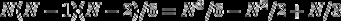

- 时，

一般在这种表达式中，首项之后的其他项都相对较小（例如，当

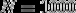

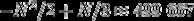

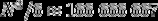

- 就小得多了），如图 1.4.3 所示。我，相对于

们常常使用约等于号（~）来忽略较小的项，从而大大简化我们所处理的数学公式。该符号使我们能够用近似的方式忽略公式中那些非常复杂但幂次较低，且对最终结果的贡献无关紧要的项：

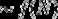

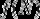

- 表示所有随着的增大除以的结果趋近于 1 的函数。我们用定义。我们用

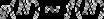

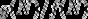

- 表示随着的增大趋近于 1。

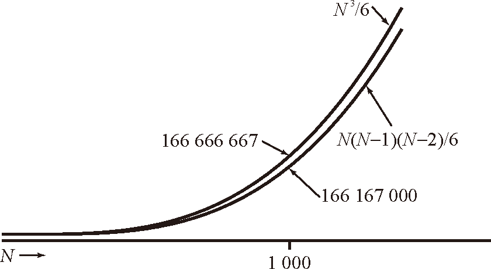

- 图 1.4.3　首项近似

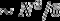

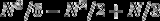

- 表示 ThreeSum 中的 if 语句的执行次数，因为

例如，我们用

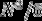

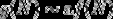

- 的结果随着的增大趋向于 1。一般我们用到的近似方式都是

除以

- ，其

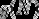

- 的增长的数量级（如表 1.4.2 所示）。我们一般不会指定底数，因为常数 a 能够弥补

中这些细节。这种形式的函数覆盖了我们在对程序运行时间的研究中经常遇到的几种函数，如表1.4.3 所示（指数级别是一个例外，我们会在第 6 章中讲到）。我们会详细说明这几种函数并在处理完 ThreeSum 之后简要讨论为什么它们会出现在算法分析领域之中。

表 1.4.2　典型的近似

函数

- 近似增长的数量级

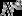

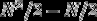

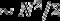


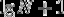

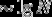


3

- 1

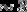

表 1.4.3　常见的增长数量级函数

增长的数量级

描述

- 函数

- 1

常数级别

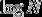

对数级别

线性级别

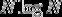

线性对数级别

平方级别

立方级别

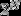

指数级别

### 1.4.3.2　近似运行时间

按照 Knuth 的方法，要得到一个 Java 程序的总运行时间的数学表达式，（原则上）我们需要研究我们的 Java 编译器来找出每条 Java 指令所对应的机器指令数，并根据我们的计算机的指令规范得到每条机器指令的运行时间，然后才能得到一个总运行时间。对于 ThreeSum，这个时间的大致总结如表 1.4.4 所示。我们根据执行的频率将 Java 的语句分块，计算出每种频率的首项近似，判定每条指令的执行成本并计算出总和。请注意，某些执行频率可能会依赖于

```
输入。在本例中，cnt++ 的执行次数显然就是依赖于输入的——它就是和为 0 的整数三元组
```

的数量，范围在 0 到

- 之间。通过用常数…表示各个代码块的执行时间，我


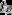

- 、、

们假设每个 Java 代码块所对应的机器指令集所需的执行时间都是固定的。除此之外，我们基本不会涉及任何特定系统的细节（这些常数的值）。从这里我们观察到的一个关键现象是执行最频繁的指令决定了程序执行的总时间——我们将这些指令称为程序的内循环。对于

```
ThreeSum 来说，它的内循环是将 k 加 1、判断它是否小于 N 以及判断给定的三个整数之和
```

是否为 0 的语句（也许还包括记数的语句，不过这取决于输入）。这种情况是很典型的：许多程序的运行时间都只取决于其中的一小部分指令。

### 1.4.3.3　对增长数量级的猜想

总之，1.4.2.3 节中的实验和表 1.4.4 中的数学模型都支持以下猜想：

- 性质 A。ThreeSum（在个数中找出三个和为 0 的整数元组的数量）的运行时间的增长

- 数量级为。

- 为 ThreeSum 处理个整数的运行时间。根据前文所述的数学模型有例证。设

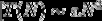

- ，其中常数 a 取决于计算机的具体型号。在许多计算机上完成的实验（包括你我的计算机）都验证了这个近似。

在本书中，我们使用性质表示需要用实验验证的猜想。数学分析的最终结果和我们的实验分析

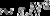

的最终结果完全相同——ThreeSum 的运行时间是

- ，其中常数 a 取决于计算机的具体

型号。这次吻合既验证了实验结果和数学模型，也揭示了该程序的更多性质，因为我们不需要

- 的指数。稍加努力，我们就能确定某个特定系统上的 a 的值，不过这一般都

实验就能确定

只在有性能压力的情形下才需要由专家来完成。

- 图 1.4.4　程序语句执行频率的分析

表 1.4.4　程序运行时间的分析（示例）

语句块

- 运行时间（以秒记）频率总时间

E

- (取决于输入)

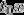

### 1.4.3.4　算法的分析

类似于性质 A 的猜想的意义很重要，因为它们将抽象世界中的一个 Java 程序和真实世界中运行它的一台计算机联系了起来。增长数量级概念的应用使我们能够继续向前迈进一步：将程序

和它实现的算法隔离开来。ThreeSum 的运行时间的增长数量级是

- ，这与它是由 Java 实现

或是它运行在你的笔记本电脑上或是某人的手机上或是一台超级计算机上无关。决定这一点的主要因素是它需要检查输入中任意三个整数的所有可能组合。你所使用的算法（有时还要算上输入模型）决定了增长的数量级。将算法和某台计算机上的具体实现分离开来是一个强大的概念，因为这使我们对算法性能的知识可以应用于任何计算机。例如，我们可以说 ThreeSum是暴力算法“计算所有不同的整数三元组的和，统计和为 0 的组数”的一种实现，可以预料的是

- 成正比的。实际上，

在任何计算机上使用任何语言对该算法的实现所需的运行时间都是和经典算法的性能理论大部分都发表于数十年前，但它们仍然适用于今天的计算机。

### 1.4.3.5　成本模型

我们使用了一个成本模型来评估算法的性质。这个模型定义了我们所研究的算法中的基本操作。例如，适合于右侧所示的 3-sum 问题的成本模型是我们访问数组元素的次数。

- 3-sum 的成本模型。在研究解决 3-sum 问题的算法时，我们记录的是数组的访问次数（访问数组元素的次数，无论读写）。

在这个成本模型之下，我们可以用精确的数学语言说明算法而非某个特定实现的性质，如下：

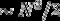

- 命题 B。3-sum 的暴力算法使用了次数组访问来计算个整数中和为 0 的整数三

- 元组的数量。

- 个整数三元组中的所有 3 个整数。证明。该算法访问了

我们使用术语命题来表示在某个成本模型下算法的数学性质。在全书中我们都会使用某个确定的成本模型研究所讨论的算法。我们希望通过明确成本模型使给定实现所需的运行时间的增长数量级和它背后的算法的成本的增长数量级相同（换句话说，成本模型应该和内循环中的操作相关）。我们会研究算法准确的数学性质（命题）并对实现的性能作出猜想（性质），可以通过实验验证这些猜想。在本例中，命题 B 的数学结论支持了性质 A 中由科学方法得到并由实验验证过的猜想。

### 1.4.3.6　总结

对于大多数程序，得到其运行时间的数学模型所需的步骤如下：

- 确定输入模型，定义问题的规模；

- 识别内循环；

- 根据内循环中的操作确定成本模型；

- 对于给定的输入，判断这些操作的执行频率。这可能需要进行数学分析——我们在本书中会在学习具体的算法时给出一些例子。

如果一个程序含有多个方法，我们一般会分别讨论它们，例如我们在 1.1 节中见过的示例程序BinarySearch。

```
 的数组 a[]，内循环是一个 while 循环中的所有语
```

二分查找。它的输入模型是大小为

句，成本模型是比较操作（比较两个数组元素的值）。3.1 节中的命题 B 详细完整地给出了 1.1

节中讨论的内容，该命题说明它所需的比较次数最多为

- 。

- 和由标准输入得到的个整数，且我们假设

白名单。它的输入模型是白名单的大小


```
，内循环是一个 while 循环中的所有语句，成本模型是比较操作（承自二分查
```

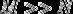

找）。由二分查找的分析我们可以立即得到对白名单问题的分析——比较次数最多为

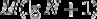

- 。

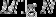

根据以下因素我们可以知道，白名单问题计算所需时间的增长数量级最多为

- ：

- 如果 很小，输入—输出可能会成为主要成本。

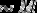

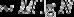

- 比较的次数取决于输入——在 和 之间，取决于标准输入中有多少个整数在白名单中以及二分查找需要多久才能找出它们（一般来说为）。

```
我们假设 Arrays.sort() 的成本远小于。Arrays.sort() 使用的是 2.2 节中的归并排
```

- 序算法。我们会看到归并排序的运行时间的增长数量级为（请见第 2 章的命题 G），因此这个假设是合理的。

因此，该模型支持了我们在 1.1 节中作出的假设，即当

- 和很大时二分查找算法也能够完

成计算。如果我们将标准输入流的长度加倍，可以预计的是运行时间也将加倍；如果我们将白名单的大小加倍，可以预计的是运行时间只会稍有增加。

在算法分析中进行数学建模是一个多产的研究领域，但它多少超出了本书的范畴。通过二分查找、归并排序和其他许多算法你仍会看到，理解特定的数学模型对于理解基础算法的运行效率是很关键的，因此我们常常会详细地证明它们或是引用经典研究中的结论。在其中，我们会遇到各种数学分析中广泛使用的函数和近似函数。作为参考，我们分别在表 1.4.5 和表 1.4.6 中对它们的部分信息进行了总结。

表 1.4.5　算法分析中的常见函数

描述

- 记号定义


向下取整（floor）

- 的最大整数不大于


向上取整（ceiling）

- 的最小整数不小于

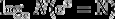

自然对数

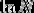

表 1.4.6　算法分析中常用的近似函数

描述

- 近似函数

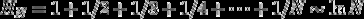

调和级数求和

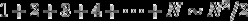

等差数列求和


等比数列求和

- ，其中


斯特灵公式


二项式系数

- 为小常数，其中


指数函数

### 1.4.4　增长数量级的分类

我们在实现算法时使用了几种结构性的原语（普通语句、条件语句、循环、嵌套语句和方法调

- 的若干函数之一。表 1.4.7 总结了这些函数

用），所以成本增长的数量级一般都是问题规模

以及它们的称谓、与之对应的典型代码以及一些例子。

表 1.4.7　对增长数量级的常见假设的总结

描述

- 增长的数量级典型的代码说明

```
a = b + c;
```

- 1

常数级别

- 普通语句

- （请见 1.1.10.2 节，二分查找）

对数级别

- 二分策略

```
double max = a[0];
for (int i = 1; i < N; i++)
```

线性级别

- 循环

```
  if (a[i] > max) max = a[i];
```

- [ 请见算法 2.4]

线性对数级别

- 分治

```
for (int i = 0; i < N; i++)
  for (int j = i+1; j < N; j++)
```

平方级别

- 双层循环

```
     if (a[i] + a[j] == 0)
        cnt++;
for (int i = 0; i < N; i++)
  for (int j = i+1; j < N; j++)
     for (int k = j+1; k < N; k++)
```

立方级别

- 三层循环

```
        if (a[i] + a[j] + a[k] == 0
           cnt++;
```

### 1.4.4.1　常数级别

运行时间的增长数量级为常数的程序完成它的任务所需的操作次数一定，因此它的运行时间不

- 。大多数的 Java 操作所需的时间均为常数。

依赖于

### 1.4.4.2　对数级别

运行时间的增长数量级为对数的程序仅比常数时间的程序稍慢。运行时间和问题规模成对数关系的程序的经典例子就是二分查找（请见 1.1.10.2 节的 BinarySearch）。对数的底数和增长的数量级无关（因为不同的底数仅相当于一个常数因子），所以我们在说明对数级别时一般使用

- 。

### 1.4.4.3　线性级别

```
使用常数时间处理输入数据中的所有元素或是基于单个 for 循环的程序是十分常见的。此类
```

程序的增长数量级是线性的——它的运行时间和

- 成正比。

### 1.4.4.4　线性对数级别

- 的关系为的程序。和之前一样，对数的

我们用线性对数描述运行时间和问题规模

```
底数和增长的数量级无关。线性对数算法的典型例子是Merge.sort（请见算法 2.4）和
Quick.sort()（请见算法 2.5）。
```

### 1.4.4.5　平方级别

```
 的程序一般都含有两个嵌套的 for 循环，对由
```

- 个元素得

一个运行时间的增长数量级为

```
到的所有元素对进行计算。初级排序算法Selection.sort()（请见算法 2.1）和
Insertion.sort()（请见算法 2.2）都是这种类型的典型程序。
```

### 1.4.4.6　立方级别

```
 的程序一般都含有三个嵌套的 for 循环，对由
```

- 个元素得

一个运行时间的增长数量级为

到的所有三元组进行计算。本节中的 ThreeSum 就是一个典型的例子。

### 1.4.4.7　指数级别

在第 6 章中（也只会在第 6 章）我们将会遇到运行时间和

- 或者更高级别的函数成正比的程


- 的算法，其中 b>1 且为常数，尽管不同

序。一般我们会使用指数级别来描述增长数量级为的 b 值得到的运行时间可能完全不同。指数级别的算法非常慢——不可能用它们解决大规模的问题。但指数级别的算法仍然在算法理论中有着重要的地位，因为它们看起来仍然是解决许多问题的最佳方案。


- 或者或者

以上是最常见分类，但肯定不是最全面的。算法的增长数量级可能是是其他类似的函数。实际上，详细的算法分析可能会用到若干个世纪以来发明的各种数学工具。

我们所学习的一大部分算法的性能特点都很简单，可以使用我们所讨论过的某种增长数量级函数精确地描述。因此，我们可以在某个成本模型下提出十分准确的命题。例如，归并排序所需


- 到之间，由此我们立即可知归并排序所需的运行时间的增长

的比较次数在数量级是线性对数的。简单起见，我们将这句话简写为归并排序是线性对数的。

图 1.4.5 显示了增长数量级函数在实际应用中的重要性。其中 x 轴为问题规模，y 轴为运行时间。这些图表清晰的说明了平方级别和立方级别的算法对于大规模的问题是不可用的。许多重要的问题的直观解法是平方级别的，但我们也发现了它们的线性对数级别的算法。此类算法（包括归并排序）在实践中非常重要，因为它们能够解决的问题规模远大于平方级别的解法能够处理的规模。因此，在本书中我们自然希望为各种基础问题找到对数级别、线性级别或是线性对数级别的算法。


- 图 1.4.5　典型的增长数量级函数

### 1.4.5　设计更快的算法

学习程序的增长数量级的一个重要动力是为了帮助我们为同一个问题设计更快的算法。为了说明这一点，我们下面来讨论一个解决 3-sum 问题的更快的算法。我们甚至还没有开始学习算法，怎么知道如何设计一个更快的算法呢？这个问题的答案是，我们已经讨论并使用过两个经典的算法，即归并排序和二分查找。也知道归并排序是线性对数级别的，二分查找是对数级别的。如何利用它们解决 3-sum 问题呢？

### 1.4.5.1　热身运动 2-sum

我们先来考虑这个问题的简化版本，即找出一个输入文件中所有和为 0 的整数对的数量。简单起见，我们还假设所有整数均各不相同。这个问题很容易在平方级别解决，只需将

```
ThreeSum.count() 中关于 k 的循环和 a[k] 去掉即可得到一个双层循环来检查所有的整
```

数对，如表 1.4.7 中的平方级别条目所示（我们将这个实现称为 TwoSum）。下面这个实现显示了归并排序和二分查找是如何在线性对数级别解决 2-sum 问题的。改进后的算法的思想是

```
当且仅当 -a[i] 存在于数组中（且 a[i] 非零）时，a[i] 存在于某个和为 0 的整数对之
```

中。要解决这个问题，我们首先将数组排序（为二分查找做准备），然后对于数组中的每个

```
a[i]，使用 BinarySearch 的rank() 方法对-a[i] 进行二分查找。如果结果为 j 且 j>i，
```

我们就将计数器加 1。这个简单的条件测试覆盖了三种情况：

- 如果二分查找不成功则会返回 -1，因此我们不会增加计数器的值；

```
如果二分查找返回的 j>i，我们就有 a[i] + a[j] = 0，增加计数器的值；
如果二分查找返回的j 在 0 和i 之间，我们也有 a[i] + a[j] = 0，但不能增加计数器
```

- 的值，以避免重复计数。

这样得到的结果和平方级别的算法得到的结果完全相同，但它所需的时间要少得多。归并排序

- 成正比，二分查找所需的时间和成正比，因此整个算法的运行时

所需的时间和

- 成正比。像这样设计一个更快的算法并不仅仅是一种学院派的练习——更快的算

间和法使我们能够解决更庞大的问题。例如，你现在可以在可接受的时间范围内在计算机上解决100 万个整数（1Mints.txt）的 2-sum 问题了，但如果用平方级别的算法你肯定需要等上很长很长的时间（请见练习 1.4.41）。

2-sum 问题的线性对数级别的解法

### 1.4.5.2　3-sum 问题的快速算法

```
这种方式对 3-sum 问题同样有效。和刚才一样，我们假设所有整数均各不相同。当且仅当 -
(a[i] + a[j]) 在数组中（不是 a[i] 也不是 a[j]）时，整数对 (a[i] 和 a[j]) 为某
```


个和为 0 的三元组的一部分。下面代码框中的代码会将数组排序并进行

- 次二分

- 成正比。因此总运行时间和成正比。可以注

查找，每次查找所需的时间都和意到，在这种情况下排序的成本是次要因素。这个解法也使我们能够解决更大规模的问题（请见练习 1.4.42）。图 1.4.6 显示了用这 4 种算法解决我们提到过的几种问题规模时的成本的悬殊差距。这样的差距显然是我们追求更快的算法的动力。

- 图 1.4.6　解决 2-sum 和 3-sum 问题的各种算法的成本

### 1.4.5.3　下界

表 1.4.8 总结了本节所讨论的内容。我们立即产生了一个有趣的疑问：我们还能找到比 2-sum问题的 TwoSumFast 和 3-sum 问题的 ThreeSumFast 快得多的算法吗？是否存在解决 2-sum问题的线性级别的算法，3-sum 问题的线性对数级别的算法？对于 2-sum，这个问题的回答是没有（成本模型仅允许使用并计算这些整数的线性或是平方级别的函数中的比较操作）；对于3-sum，回答是不知道，不过专家们相信 3-sum 可能的最优算法是平方级别的。为算法在最坏情况下的运行时间给出一个下界的思想是非常有意义的，我们会在 2.2 节中学习排序时再次讨论它。复杂的下界是很难找到的，但它非常有助于指引我们追求更加有效的算法。


3-sum 问题的

- 解法

表 1.4.8　运行时间的总结

算法

- 运行时间的增长数量级

```
TwoSum
```

```
TwoSumFast
ThreeSum
```

```
ThreeSumFast
```

本节中所讨论的例子为我们学习本书中的其他算法打下了基础。在本书中，我们会按照以下方式解决各种新的问题。

- 实现并分析该问题的一种简单的解法。我们通常将它们称为暴力算法，例如 ThreeSum 和TwoSum。

- 考查算法的各种改进，它们通常都能降低算法所需的运行时间的增长数量级，例如TwoSumFast 和 ThreeSumFast。

- 用实验证明新的算法更快。

在许多情况下，我们会学习解决同一个问题的多种算法，因为对于实际问题来说运行时间只是选择算法时所要考虑的各种因素之一。在本书中我们会在解决各种基础问题时逐渐理解这一点。

### 1.4.6　倍率实验

下面这种方法可以简单有效地预测任意程序的性能并判断它们的运行时间大致的增长数量级。

- 开发一个输入生成器来产生实际情况下的各种可能的输入（例如 DoublingTest 中的

```
timeTrial() 方法能够生成随机整数）。
```

- 运行下方的 DoublingRatio 程序，它是 DoublingTest 的修改版本，能够计算每次实验和上一次的运行时间的比值。


- 反复运行直到该比值趋近于极限。

这个实验对于比值没有极限的算法无效，但它仍然适用于许多程序，我们可以得出以下结论。

- 它们的运行时间的增长数量级约为。

- 要预测一个程序的运行时间，将上次观察得到的运行时间乘以 并将 加倍，如此反复。如果你希望预测的输入规模不是 乘以 2 的幂，可以相应地调整这个比例（请见练习 1.4.9）。

如下所示，ThreeSum 的比例约为 8，因此我们可以预测程序对于

- 、32 000 和 64


000 的运行时间将分别为 408.8、3270.4 和 26 163.2 秒，也就是处理 8000 个整数所需的时间（51.1 秒）连续乘以 8 即可。


该测试基本类似于 1.4.2.3 节所描述的过程（运行实验，绘出对数图像得到运行时间为

- 的的值，然后算出），但它更容易使用。事实上，可以手工通过

猜想，从直线的斜率得到DoublingRatio 准确地预测程序的性能。在比例趋近于极限时，只需要不断乘以该比例即可得到更大规模的问题的运行时间。这里，增长数量级的近似模型是一个幂次法则，指数为该比例的以 2 为底的对数。

为什么这个比例会趋向于一个常数？简单的数学计算显示我们讨论过的所有常见的增长数量级函数（指数级别除外）均会出现这种情况：


- 命题 C。（倍率定理）如果，那么。证明。


一般来说，数学模型中的对数项是不能忽略的，但在倍率假设中它在预测性能的公式中的作用并不那么重要。

在有性能压力的情况下应该考虑对编写过的所有程序进行倍率实验——这是一种估计运行时间的增长数量级的简单方法，或许它能够发现一些性能问题，比如你的程序并没有想象的那样高效。一般来说，我们可以用以下方式对程序的运行时间的增长数量级作出假设并预测它的性能。

### 1.4.6.1　评估它解决大型问题的可行性

对于编写的每个程序，你都需要能够回答这个基本问题：“该程序能在可接受的时间内处理这些数据吗？”对于大量数据，要回答这个问题我们需要一个比乘以 2 更大的系数（比如 10）来进行推断，如表 1.4.9 所示。无论是投资银行家处理每日的金融数据还是工程师对设计进行模拟测试，定期运行需要若干个小时才能完成的程序是很常见的，表 1.4.9 的重点也就是这些情况。了解程序的运行时间的增长数量级能够为你提供精确的信息，从而理解你能够解决的问题规模的上限。理解诸如此类的问题，是研究性能的首要原因。没有这些知识，你将对一个程序所需的时间一无所知；而如果你有了它们，一张信封的背面就足够你计算出运行所需的时间并采取相应的行动。

### 1.4.6.2　评估使用更快的计算机所产生的价值

你可能会面对的另一个基本问题是：“如果我能够得到一台更快的计算机，解决问题的速度能够加快多少？”一般来说，如果新计算机比老的快

- 倍，运行时间也将变为原来的分之一。

但你一般都会用新计算机来处理更大规模的问题，这将会如何影响所需的运行时间呢？同样，增长的数量级信息也正是你回答这个问题所需要的。

著名的摩尔定律告诉我们，18 个月后计算机的速度和内存容量都会翻一番，5 年后计算机的速度和内存容量都会变为现在的 10 倍。表 1.4.9 说明如果你使用的是平方或者立方级别的算法，摩尔定律就不适用了。进行倍率测试并检查随着输入规模的倍增前后运行时间之比是趋向于 2 而非 4 或者 8 即可验证这种情况。

表 1.4.9　根据增长的数量级函数作出的预测

- 的数据需要若干小时的某

运行时间的增长数量级

- 处理输入规模为

- 系数为 2系数为 10的预计时间在快 10 倍的计算机

描述

- 函数处理


- 210

线性级别

- 一天几个小时

- 210

线性对数级别

- 一天几个小时

- 4100

平方级别

- 几个星期一天

- 81000

立方级别

- 几个月几个星期


指数级别

- 永远永远

### 1.4.7　注意事项

在对程序的性能进行仔细分析时，得到不一致或是有误导性的结果的原因可能有许多种。它们都是由于我们的猜想基于的一个或多个假设并不完全正确所造成的。我们可以根据新的假设得出新的猜想，但我们考虑的细节越多，在分析中需要注意的方面也就越多。

### 1.4.7.1　大常数

在首项近似中，我们一般会忽略低级项中的常数系数，但这可能是错的。例如，当我们取函数


- 的近似为时，我们的假设是 c 很小。如果事实不是这样（比如 c 可能是


- 或是），该近似就是错误的。因此，我们要对可能的大常数保持敏感。

### 1.4.7.2　非决定性的内循环

内循环是决定性因素的假设并不总是正确的。错误的成本模型可能无法得到真正的内循环，问

- 也许没有大到对指令的执行频率的数学描述中的首项大大超过其他低级项并可以

题的规模

忽略它们的程度。有些程序在内循环之外也有大量指令需要考虑。换句话说，成本模型可能还需要改进。

### 1.4.7.3　指令时间

每条指令执行所需的时间总是相同的假设并不总是正确的。例如，大多数现代计算机系统都会使用缓存技术来组织内存，在这种情况下访问大数组中的若干个并不相邻的元素所需的时间可能很长。如果让 DoublingRatio 运行的时间长一些，你可能可以观察到缓存对 ThreeSum 所产生的效果。在运行时间的比例看似收敛到 8 以后，由于缓存，对于大数组该比例也可能突然变为很大的值。

### 1.4.7.4　系统因素

一般来说，你的计算机总是同时运行着许多程序。Java 只是争夺资源的众多应用程序之一，而且 Java 本身也有许多能够大大影响程序性能的选项和设置。某种垃圾收集器或是 JIT 编译器或是正在从因特网中进行的下载都可能极大地影响实验的结果。这些因素可能会干扰到实验必须是可重现的这条科学研究的基本原则，因为此时此刻计算机中所发生的一切是无法再次重现的。原则上来说此时系统中运行的其他程序应该是可以忽略或可以控制的。

### 1.4.7.5　不分伯仲

在我们比较执行相同任务的两个程序时，常常出现的情况是其中一个在某些场景中更快而在另一些场景中更慢。我们已经提到过的一些因素可能会造成这种差异。有些程序员（以及一些学生）特别喜欢投入大量精力进行比赛并找出“最佳”的实现，但此类工作最好还是留给专家。

### 1.4.7.6　对输入的强烈依赖

在研究程序的运行时间的增长数量级时，我们首先作出的几个假设之一就是运行时间应该和输入相对无关。当这个条件无法满足时，我们很可能无法得到一致的结果或是验证我们的猜想。例如，假设我们为回答：“输入中是否存在和为 0 的三个整数？”而修改 ThreeSum 并返回

```
boolean 值，将 cnt++ 替换为 return true 并在最后加上 return false 作为结尾，
```

那么如果输入中的头三个整数的和为 0，该程序的运行时间的增长数量级为常数级别；如果输入不含有这样的三个整数，程序的运行时间的增长数量级则为立方级别。

### 1.4.7.7　多个问题参量

我们过去的重点一直是使用仅需要一个参量的函数来衡量程序的性能，参量一般是命令行参数或是输入的规模。但是，多个参量也是可能的。典型的例子是需要构造一个数据结构并使用该数据结构进行一系列操作的算法。在这种应用程序中数据结构的大小和操作的次数都是问题的参量。我们已经见过一个这样的例子，即对使用二分查找的白名单问题的分析，其中白名单中


- 个整数而输入中有个整数，运行时间一般和成正比。

有

尽管需要注意的问题很多，对于每个程序员来说，对程序的运行时间的增长数量级的理解都是非常有价值的，而且我们这里所描述的方法也都十分强大并且应用范围广泛。Knuth 证明了原则上我们只要正确并完整地使用了这些方法就能够对程序作出详细准确的预测。计算机系统一般都非常复杂，完整精确的分析最好留给专家们，但相同的方法也可以有效地近似估计出任何程序所需的运行时间。火箭科学家需要大致知道一枚试验火箭的着陆地点是在大海里还是在城市中；医学研究者需要知道一次药物测试是会杀死还是治愈实验对象；任何使用计算机程序的科学家或是工程师也应该能够预计它是会运行一秒钟还是一年。

### 1.4.8　处理对于输入的依赖

对于许多问题，刚才所提到的注意事项中最突出的一个就是对于输入的依赖，因为在这种情况下程序的运行时间的变化范围可能非常大。1.4.7.6 节中 ThreeSum 的修改版本的运行时间的范围根据输入的不同可能在常数级别到立方级别之间，因此如果我们想要预测它的性能，就需要对它进行更加细致的分析。在这里我们会简略讨论一些有效的方法，我们会在学习本书中的其他算法时用到它们。

### 1.4.8.1　输入模型

一种方法是更加小心地对我们所要解决的问题所处理的输入建模。例如，我们可能会假设

```
ThreeSum 的所有输入均为随机 int 值。使用这种方法的困难主要有两点：
```

- 输入模型可能是不切实际的；

- 对输入的分析可能极端困难，所需的数学技巧远非一般的学生或者程序员所能掌握。

其中前者更为重要，因为计算的目的就是发现输入的性质。例如，如果我们编写了一个程序来处理基因组，我们怎样才能估计出它在处理不同的基因组时的性能呢？描述自然界中的基因组的优秀模型正是科学家们所寻找的，因此预计我们的程序在处理自然界中得到的数据时所需的运行时间实际上也是在为寻找这个模型做出贡献！第二个困难只和最重要的几个算法的数学结果有关，我们将会看到几个用简单可靠的输入模型加上经典的数学分析帮助我们预测程序性能的例子。

### 1.4.8.2　对最坏情况下的性能的保证

有些应用程序要求程序对于任意输入的运行时间均小于某个指定的上限。为了提供这种性能保证，理论研究者们要从极度悲观的角度来估计算法的性能：在最坏情况下程序的运行时间是多少？例如，这种保守的做法对于运行在核反应堆、心脏起搏器或者刹车控制器之中的软件可能是十分必要的。我们希望保证此类软件能够在某个指定的时间范围内完成任务，否则结果会非常糟糕。科学家们在研究自然界时一般不会去考虑最坏的情况：在生物学中，最坏的情况也许是人类的灭绝；在物理学中，最坏的情况也许是宇宙的结束。但是在计算机系统中最坏情况是非常现实的忧虑，因为程序的输入可能来自另外一个（可能是恶意的）用户而非自然界。例如，没有使用提供性能保证算法的网站无法抵御拒绝服务攻击，这是一种黑客用大量请求淹没服务器的攻击，会使网站的运行速度相比正常状态大幅下降。因此，我们的许多算法的设计已经考虑了为性能提供保证，例如：

- 命题 D。在 Bag（请见算法 1.4）、Stack（请见算法 1.2）和 Queue（请见算法 1.3）的链表实现中所有的操作在最坏情况下所需的时间都是常数级别的。证明。由代码可知，每个操作所执行的指令数量均小于一个很小的常数。注意：该论证依赖

```
于一个（合理的）假设，即 Java 系统能够在常数时间内创建一个新的 Node 对象。
```

### 1.4.8.3　随机化算法

为性能提供保证的一种重要方法是引入随机性。例如，我们将在 2.3 节中学习的快速排序算法（可能是使用最广泛的排序算法）在最坏情况下的性能是平方级别的，但通过随机打乱输入，根据概率我们能够保证它的性能是线性对数的。每次运行该算法，它所需的时间均不相同，但它的运行时间超过线性对数级别的可能性小到可以忽略。与此类似，我们将在 3.4 节中学习的用于符号表的散列算法（同样也可能是使用最广泛的同类算法）在最坏情况下的性能是线性级别的，但根据概率我们可以保证它的运行时间是常数级别的。这些保证并不是绝对的，但它们失效的可能性甚至小于你的电脑被闪电击中的可能性。因此，这种保证在实际中也可以用来作为最坏情况下的性能保证。

### 1.4.8.4　操作序列

对于许多应用来说，算法的“输入”可能并不只是数据，还包括用例所进行的一系列操作的顺

- 个值然后再将它们全部弹出的所得到的性

序。例如，对于一个下压栈来说，用例先压入

- 次压入弹出的混合操作序列所得到的性能可能大不相同。我们的分析要将这些情况

能，和

都考虑进去（或者包含一个操作序列的合理模型）。

### 1.4.8.5　均摊分析

相应地，提供性能保证的另一种方法是通过记录所有操作的总成本并除以操作总数来将成本均摊。在这里，我们可以允许执行一些昂贵的操作，但保持所有操作的平均成本较低。这种类型分析的典型例子是我们在 1.3 节中对基于动态调整数组大小的 Stack 数据结构（请见 1.3.2.5节的算法 1.1）的研究。简单起见，假设

- 是 2 的幂。如果数据结构初始为空，次连续的

```
push() 调用需要访问数组元素多少次？计算这个答案很简单，数组访问的次数为
```


```
 次push() 调用，其余的项表示每次数组长度加倍时初始化数据结构所访
```

其中，首项表示

问数组的次数。因此，每次操作访问数组的平均次数为常数，但最后一次操作所需的时间是线性的。这种计算被称为均摊分析，因为我们将少量昂贵操作的成本通过各种大量廉价的操作摊

```
平了。VisualAccumulator 能够很容易地展示这个过程，如图 1.4.7 所示。
图 1.4.7　向一个 RandomBag 对象中添加元素时的均摊成本
```

- 命题 E。在基于可调整大小的数组实现的 Stack 数据结构中（请见算法 1.1），对空数据结构所进行的任意操作序列对数组的平均访问次数在最坏情况下均为常数。

```
）的 push() 操作，对于
```

- 变为简略证明。对于每次使数组大小增加（假设大小从


```
 次 push() 操作。
```

- 到之间的任意的最近，考虑使栈大小增长到


```
 次访问和所有 push() 操作所需的
```

- 次数组访问（每次将使数组长度加倍所需的


```
push() 操作均需访问一次数组）取平均，我们可以得到每次操作的平均成本为 9 次数组
```

- 的任意操作序列所需的数组访问次数和成正比则更加复杂（请访问。要证明长度为

- 见练习 1.4.32）。

这种分析应用范围很广，我们会使用可动态调整大小的数组作为数据结构实现本书中的若干算法。

算法分析者的任务就是尽可能地揭示关于某个算法的更多信息，而程序员的任务则是利用这些信息开发有效解决现实问题的程序。在理想状态下，我们希望根据算法能够得到清晰简洁的代码并能够为我们感兴趣的输入提供良好的保证和性能。我们在本章中讨论的许多经典算法之所以对众多应用都十分重要就是因为它们具备这些性质。以它们作为样板，在编程中遇到典型问题时你也能独立给出很好的解决方法。

### 1.4.9　内存

和运行时间一样，一个程序对内存的使用也和物理世界直接相关：计算机中的电路很大一部分的作用就是帮助程序保存一些值并在稍后取出它们。在任意时刻需要保存的值越多，需要的电路也就越多。你可能知道计算机能够使用的内存上限（知道这一点的人应该比知道运行时间限制的人要多）因为你很可能已经在内存上花了不少额外的支出。

计算机上的 Java 对内存的使用经过了精心的设计（程序的每个值在每次运行时所需的内存量都是一样的），但实现了 Java 的设备非常多，而内存的使用是和实现相关的。简单起见，我们用典型这个词暗示和机器相关的值。

Java 最重要的特性之一就是它的内存分配系统。它的任务是把你从对内存的操作之中解脱出来。显然，你肯定已经知道应该在适当的时候利用这个功能，但是你也应该（至少是大概）知道程序对内存的需求在何时会成为解决问题的障碍。

分析内存的使用比分析程序所需的运行时间要简单得多，主要原因是它所涉及的程序语句较少（只有声明语句）且在分析中我们会将复杂的对象简化为原始数据类型，而原始数据类型的内存使用是预先定义好的，而且非常容易理解：只需将变量的数量和它们的类型所对应的字节数

```
分别相乘并汇总即可。例如，因为 Java 的int 数据类型是 -2 147 483 648 到 2 147 483 647
之间的整数值的集合，即总数为 232 个不同的值，典型的 Java 实现使用 32 位来表示 int
```

值。其他原始数据类型的内存使用也是基于类似的考虑：典型的 Java 实现使用 8 位表示字

```
节，用 2 字节（16 位）表示一个char 值，用 4 字节（32 位）表示一个 int 值，用 8 字节
（64 位）表示一个 double 或者 long 值，用 1 字节表示一个 boolean 值（因为计算机访
```

问内存的方式都是一次 1 字节），见表 1.4.10。根据可用内存的总量就能够计算出保存这些值的极限数量。例如，如果计算机有 1 GB 内存（10 亿字节），那么同一时间最多能在内存中保

```
存 2.56 亿万个 int 值或是 1.28 亿万个 double 值。
```

表 1.4.10　原始数据类型的常见内存、需求

类型

- 字节

```
boolean
```

- 1

```
byte
```

- 1

```
char
```

- 2

```
int
```

- 4

```
float
```

- 4

```
long
```

- 8

```
double
```

- 8

从另一方面来说，对内存使用的分析和硬件以及 Java 的不同实现中的各种差异有关，因此我们举出的这个特定的例子并不是一成不变的，你应该以它为参考来学习在条件允许的情况下如何分析内存的使用。例如，许多数据结果都涉及对机器地址的表示，而在各种计算机中一个机器地址所需的内存又各有不同。为了保持一致，我们假设表示机器地址需要 8 字节，这是现在广泛使用的 64 位构架中的典型表示方式，许多老式的 32 位构架只使用 4 字节表示机器地址。

### 1.4.9.1　对象

要知道一个对象所使用的内存量，需要将所有实例变量使用的内存与对象本身的开销（一般是16 字节）相加。这些开销包括一个指向对象的类的引用、垃圾收集信息以及同步信息。另外，一般内存的使用都会被填充为 8 字节（64 位计算机中的机器字）的倍数。例如，一个

```
Integer 对象会使用 24 字节（16 字节的对象开销，4 字节用于保存它的 int 值以及 4 个填
充字节）。类似地，一个Date 对象（请见表 1.2.12）需要使用 32 字节：16 字节的对象开
销，3 个 int 实例变量各需 4 字节，以及 4 个填充字节。对象的引用一般都是一个内存地
址，因此会使用 8 字节。例如，一个Counter 对象（请见表 1.2.11）需要使用 32 字节：16
字节的对象开销，8 字节用于它的 String 型实例变量（一个引用），4 字节用于 int 实例变
```

量，以及 4 个填充字节。当我们说明一个引用所占的内存时，我们会单独说明它所指向的对象

```
所占用的内存，因此这个内存使用总量并没有包含 String 值所使用的内存。常见对象的内
```

存需求列在了图 1.4.8 中。

- 图 1.4.8　典型对象的内存需求

### 1.4.9.2　链表

```
嵌套的非静态（内部）类，例如我们的 Node 类（请见 1.3.3.1 节），还需要额外的 8 字节
（用于一个指向外部类的引用）。因此，一个 Node 对象需要使用 40 字节（16 字节的对象开
销，指向 Item 和 Node 对象的引用各需 8 字节，另外还有 8 字节的额外开销）。因为
Integer 对象需要使用 24 字节，一个含有
```

- 个整数的基于链表的栈（请见算法 1.2）需要

```
使用（）字节，包括 Stack 对象的 16 字节的开销，引用类型实例变量 8 字节，int 型实例
变量 4 字节，4 个填充字节，每个元素需要 64 字节，一个Node 对象的 40 字节和一个
Integer 对象的 24 字节。
```

### 1.4.9.3　数组

图 1.4.9 总结了 Java 中的各种类型的数组对内存的典型需求。Java 中数组被实现为对象，它们一般都会因为记录长度而需要额外的内存。一个原始数据类型的数组一般需要 24 字节的头信息（16 字节的对象开销，4 字节用于保存长度以及 4 填充字节）再加上保存值所需的内

```
 个 int 值的数组需要使用（
```

- ）字节（会被填充为 8 的倍


存。例如，一个含有

```
 个 double 值的数组需要使用（
```

- ）字节。一个对象的数组就是一


数），一个含有

个对象的引用的数组，所以我们应该在对象所需的内存之外加上引用所需的内存。例如，一个

```
 个 Date 对象（请见表 1.2.12）的数组需要使用 24 字节（数组开销）加上
```

- 字节

含有


（所有引用）加上每个对象的 32 字节，总共（


- ）字节。二维数组是一个数组的数

```
 的double 类型的二维数组需要使用 24 字
```

组（每个数组都是一个对象）。例如，一个


- 字节（所有元素数组的引用）加上 字节（所有元素数组的

节（数组的数组的开销）加上


```
 的 double 类型的数组），总共（ 字节；当数组元素是对
```

开销）加上 字节（

- 个长度为

象时计算方法类似，结果相同，用来保存充满指向数组对象的引用的数组以及所有这些对象本身。

```
图 1.4.9　int 值、double 值、对象和数组的数组对内存的典型需求
```

### 1.4.9.4　字符串对象

```
我们可以用相同的方式说明 Java 的 String 类型对象所需的内存，只是对于字符串来说别名
是非常常见的。String 的标准实现含有 4 个实例变量：一个指向字符数组的引用（8 字节）
和三个 int 值（各 4 字节）。第一个 int 值描述的是字符数组中的偏移量，第二个 int 值是
```

一个计数器（字符串的长度）。按照图 1.4.10 中所示的实例变量名，对象所表示的字符串由

```
value[offset] 到 value[offset + count - 1] 中的字符组成。String 对象中的第
三个 int 值是一个散列值，它在某些情况下可以节省一些计算，我们现在可以忽略它。因
此，每个 String 对象总共会使用 40 字节（16 字节表示对象，三个int 实例变量各需 4 字
```

节，加上数组引用的 8 字节和 4 个填充字节）。这是除字符数组之外字符串所需的内存空间，

```
所有字符所需的内存需要另记，因为String 的 char 数组常常是在多个字符串之间共享的。
因为 String 对象是不可变的，这种设计使 String 的实现在能够在多个对象都含有相同的
value[] 数组时节省内存。
```

### 1.4.9.5　字符串的值和子字符串

```
 的String 对象一般需要使用 40 字节（String 对象本身）加上（
```


一个长度为

- ）

- ）字节。但字符串处理经常会和子字符串打交道，所以


字节（字符数组），总共（

```
Java 对字符串的表示希望能够避免复制字符串中的字符。当你调用 substring() 方法时，
就创建了一个新的 String 对象（40 字节），但它仍然重用了相同的 value[] 数组，因此该
```

字符串的子字符串只会使用 40 字节的内存。含有原始字符串的字符数组的别名存在于子字符串中，子字符串对象的偏移量和长度域标记了子字符串的位置。换句话说，一个子字符串所需的额外内存是一个常数，构造一个子字符串所需的时间也是常数，即使字符串和子字符串的长度极大也是这样。某些简陋的字符串表示方法在创建子字符串时需要复制其中的字符，这将需要线性的时间和空间。确保子字符串的创建所需的空间（以及时间）和其长度无关是许多基础字符串处理算法的效率的关键所在。字符串的值与子字符串示例如图 1.4.10 所示。


```
图 1.4.10　一个 String 对象和一个子字符串
```

这些基础机制能够有效帮助我们估计大量程序对内存的使用情况，但许多复杂的因素仍然会使这个任务变得更加困难。我们已经提到了别名可能产生的潜在影响。另外，当涉及函数调用时，内存的消耗就变成了一个复杂的动态过程，因为 Java 系统的内存分配机制扮演一个重要的角色，而这套机制又和 Java 的实现有关。例如，当你的程序调用一个方法时，系统会从内存中的一个特定区域为方法分配所需要的内存（用于保存局部变量），这个区域叫做栈（Java系统的下压栈）。当方法返回时，它所占用的内存也被返回给了系统栈。因此，在递归程序中创建数组或是其他大型对象是很危险的，因为这意味着每一次递归调用都会使用大量的内存。

```
当通过 new 创建对象时，系统会从堆内存的另一块特定区域为该对象分配所需的内存（这里
```

的堆和我们将在 2.4 节学习的二叉堆数据结构不同）。而且，你要记住所有对象都会一直存在，直到对它的引用消失为止。此时系统的垃圾回收进程会将它所占用的内存收回到堆中。这种动态过程使准确估计一个程序的内存使用变得极为困难。

### 1.4.10　展望

良好的性能是非常重要的。速度极慢的程序和不正确的程序一样无用，因此显然有必要在一开始就关注程序的运行成本，这能够让你大致估计出所要解决的问题的规模，而聪明的做法是时刻关注程序中的内循环代码的组成。

但在编程领域中，最常见的错误或许就是过于关注程序的性能。你的首要任务应该是写出清晰正确的代码。仅仅为了提高运行速度而修改程序的事最好留给专家们来做。事实上，这么做常常会降低生产效率，因为它会产生复杂而难以理解的代码。C.A.R. Hoare（快速排序的发明人，也是一位推动编写清晰而正确的代码的领军人物）曾将这种想法总结为：“不成熟的优化是所有罪恶之源。”Knuth 为这句话加上了一个定语“在编程领域中（或者至少是大部分罪恶）”。另外，如果降低成本带来的效益并不明显，那么对运行时间的改进就不值得了。例如，如果一个程序所需的运行时间只是一瞬间而已，那么即使是将它的速度提高十倍也是无关紧要的。即使程序的运行需要好几分钟，实现并调试一个新算法所需要的时间也可能会大大超过直接运行一个稍微慢一点的算法——这种时候就应该让计算机代劳。更糟糕的情况是你可能花了大量的时间和心血去实现一个理论上能够改进程序的想法，但实际上什么也没发生。

在编程领域中，第二常见的错误或许是完全忽略了程序的性能。较快的算法一般都比暴力算法更复杂，所以很多人宁可使用较慢的算法也不愿应付复杂的代码。但是，几行优秀的代码有时能够给你带来巨大的收益。许多人在使用平方级别的暴力算法去解决问题的盲目等待中浪费了大量的时间，但实际上线性级别或是线性对数级别的算法能够在几分之一的时间内完成任务。当我们需要处理大规模问题时，通常，除了寻找更好的算法之外我们别无选择。

我们将使用本节所述的各种方法来评估算法对内存的使用，并在多个成本模型下对算法进行数学分析从而得到相应的近似函数，然后根据近似函数提出对算法所需的运行时间的增长数量级的猜想并通过实验验证它们。改进程序，使之更加清晰、高效和优雅应该是我们一贯的目标。如果你在开发一个程序的全过程中都能关注它的运行成本，那么你都会从该程序的每次执行中受益。

### 答疑

```
问　为什么不用 StdRandom 生成随机数来代替 1Mints.txt ？
答　在开发中，这样做能够使调试代码和重复实验更简单。每次调用 StdRandom 都会产生不
```

同的值，所以修正一个 bug 之后并再次运行程序可能并不能测试这次修正！可以使用

```
StdRandom 中的 setSeed() 方法来解决这个问题，但 1Mints.txt 类参考文件能够使添加测
```

试用例变得更容易。另外，不同的程序员还能够比较程序在不同计算机上的性能而不必担心输入模型的不同。只要你的程序已经调试完毕且你已经大致了解了它的性能，当然有必要用随机数据测试它。例如，DoublingTest 和 DoublingRatio 使用的就是这种方式。

问　我在计算机上运行了 DoublingRatio，但我得到的结果和书上的不一致。有些比例的收敛值并不是 8，为什么？

答　这就是为什么我们在 1.4.7 节中讨论了注意事项。最可能的情况是你计算机上的操作系统在实验进行中还开小差去干了点儿别的活儿。消除这种问题的一种方式是花更多时间做更多次实验。比如，可以修改 DoublingTest，让它对于每个

- 都进行 1000 次实验，这样对于每个

- 它都能给出对运行时间更加精确的估计值。

问　在近似函数的定义中，“随着

- 的增大”确切的意思是什么？


- 的正式定义为。

答

问　我还见到过其他表示增长的数量级的符号，它们都表示什么意思？


答　使用最广泛的记法是“大 O”：对于

- 和，如果存在常数 c 和使得对于所有


- 都有，则我们称为。这种记法在描述算法性能的渐进上限时十分有用，这在

算法理论领域是十分重要的，但它在预测算法性能或是比较算法时并没有什么作用。

问　上题中，为什么说没有作用呢？

答　主要原因是它描述的仅仅是运行时间的上限，而算法的实际性能可能要好得多。一个算法的运行时间可能既是 也是 的。因此，它不能解释类似倍率实验等测试（请见 1.4.6 节命题C）。

问　那为什么“大 O”符号的应用非常广泛呢？

答　因为它简化了对增长数量级的上限的研究，甚至也适用于一些无法进行精确分析的复杂算法。另外，它还可以和计算理论中用于将算法按照它们在最坏情况下的性能分类的“大

Omega”和“大 Theta”符号一起使用。如果存在常数 c 和

- 使得对于都有，则我们称

- 为。如果既是 也是，则我们称为。“大 Omega”记法通常用来表示最坏情

况下的性能下限，而“大 Theta”记法则通常用于描述算法的最优性能，即不存在有更好的最坏情况下的渐进增长数量级的算法。算法的最优性显然是实际应用中值得考虑的一点，但你会看到，还有其他许多因素需要考虑。

问　渐进性能的上限难道不重要吗？

答　重要，但我们希望讨论的是给定成本模型下所有语句执行的准确频率，因为它们能够提供更多关于算法性能的信息，而且从我们所讨论的算法中获取这些频率是可能的。例如，我们可

```
”，以及“在最坏情况下 cnt++ 执行的次数为
```

以说“ThreeSum 访问数组的次数为

- ”，它们虽然有些冗长但给出的信息比“ThreeSum 的运行时间为”要多得多。

- 时，根据双倍测试会得到它的运行时间为

问　当一个算法的运行时间的增长数量级为的猜想（其中 a 为常数）。这有问题吗？

答　需要注意的是，我们不能根据实验数据推测它们所符合的某个特定的数学模型。但如果我

- 在 16 000 到 32 000 之间时， 和

们只是在预测性能，这并不是什么问题。例如，当

- 的图像非常接近。这些数据同时与两条曲线吻合。随着的增大，两条曲线更为接

近。想要用实验来检验一个算法的运行时间是线性对数级别而非线性级别是要费一番工夫的。

```
问　int[] a = new int[N] 表示
```

- 次数组访问吗（所有数组元素均会被初始化为 0）？

答　大多数情况下是的，我们在本书中也是这样假设的，不过复杂编译器的实现会在遇到大型稀疏数组时尽力避免这种开销。

### 练习

1.4.1　证明从

- 个数中取三个整数的不同组合的总数为。提示：使用数

学归纳法。

```
1.4.2　修改 ThreeSum，正确处理两个较大的 int 值相加可能溢出的情况。
```

```
1.4.3　修改 DoublingTest，使用 StdDraw 产生类似于正文中的标准图像和对数图像，根据需
```

要调整比例使图像总能够充满窗口的大部分区域。

1.4.4　参照表 1.4.4 为 TwoSum 建立一张类似的表格。

1.4.5　给出下面这些量的近似：

a.

b.

c.

d.

e.

f.

g.

1.4.6　给出以下代码段的运行时间的增长数量级（作为

- 的函数）：

a.

```
int sum = 0;
for (int n = N; n > 0; n /= 2)
 for(int i = 0; i < n; i++)
     sum++;
```

b.

```
int sum = 0;
for (int i = 1; i < N; i *= 2)
   for (int j = 0; j < i; j++)
       sum++;
```

c.

```
int sum = 0;
for (int i = 1; i < N; i *= 2)
  for (int j = 0; j < N; j++)
      sum++;
```

1.4.7　以统计涉及输入数字的算术操作（和比较）的成本模型分析 ThreeSum。

1.4.8　编写一个程序，计算输入文件中相等的整数对的数量。如果你的第一个程序是平方级

```
别的，请继续思考并用 Array.sort() 给出一个线性对数级别的解答。
```

1.4.9　已知由倍率实验可得某个程序的时间倍率为

- 且问题规模为 时程序的运行时间为，的问题时所需的运行时间。

给出一个公式预测该程序在处理规模为

1.4.10　修改二分查找算法，使之总是返回和被查找的键匹配的索引最小的元素（且仍然能够保证对数级别的运行时间）。

```
1.4.11　为 StaticSETofInts（请见表 1.2.15）添加一个实例方法 howMany()，找出给定
```

- 成正比。

键的出现次数且在最坏情况下所需的运行时间和

```
 个 int 值）中的所有公共元
```

1.4.12　编写一个程序，有序打印给定的两个有序数组（含有

- 成正比。

素，程序在最坏情况下所需的运行时间应该和

1.4.13　根据正文中的假设分别给出表示以下数据类型的一个对象所需的内存量：

```
　a. Accumulator
　b. Transaction
　c. FixedCapacityStackOfStrings，其容量为 且含有
```

- 个元素

```
　d. Point2D
　e. Interval1D
　f. Interval2D
　g. Double
```

### 提高题

1.4.14　4-sum。为 4-sum 设计一个算法。

1.4.15　快速 3-sum。作为热身，使用一个线性级别的算法（而非基于二分查找的线性对数级别的算法）实现 TwoSumFaster 来计算已排序的数组中和为 0 的整数对的数量。用相同的思想为 3-sum 问题给出一个平方级别的算法。

```
 个 double 值的数组
```

1.4.16　最接近的一对（一维）。编写一个程序，给定一个含有

```
a[]，在其中找到一对最接近的值：两者之差（绝对值）最小的两个数。程序在最坏情况下所
```

需的运行时间应该是线性对数级别的。

```
 个 double 值的数组
```

1.4.17　最遥远的一对（一维）。编写一个程序，给定一个含有

```
a[]，在其中找到一对最遥远的值：两者之差（绝对值）最大的两个数。程序在最坏情况下所
```

需的运行时间应该是线性级别的。

1.4.18　数组的局部最小元素。编写一个程序，给定一个含有

- 个不同整数的数组，找到一

```
个局部最小元素：满足 a[i]<a[i － 1]，且 a[i]<a[i+1] 的索引 i。程序在最坏情况下
```

所需的比较次数为。

```
　答：检查数组的中间值 a[N/2] 以及和它相邻的元素 a[N/2-1] 和 a[N/2+1]。如果
a[N/2] 是一个局部最小值则算法终止；否则则在较小的相邻元素的半边中继续查找。
 个不同整数的 数组 a[]。设计一个运行时
```

1.4.19　矩阵的局部最小元素。给定一个含有

```
 成正比的算法来找出一个局部最小元素：满足 a[i][j]<a[i+1][j]、a[i][j]
```

间和

```
<a[i][j+1]、a[i][j]<a[i-1][j] 以及 a[i][j]<a[i][j-1] 的索引 i 和 j。程序的
```

- 成正比。

运行时间在最坏情况下应该和

1.4.20　双调查找。如果一个数组中的所有元素是先递增后递减的，则称这个数组为双调的。

```
 个不同int 值的双调数组，判断它是否含有给定的整数。程
```

编写一个程序，给定一个含有

序在最坏情况下所需的比较次数为。

```
1.4.21　无重复值之中的二分查找。用二分查找实现 StaticSETofInts（请见表 1.2.15），
保证 contains() 的运行时间为，其中 为参数数组中不同整数的数量。
```

1.4.22　仅用加减实现的二分查找（Mihai Patrascu）。编写一个程序，给定一个含有

- 个不

```
同 int 值的按照升序排列的数组，判断它是否含有给定的整数。只能使用加法和减法以及常
```

- 成正比。

数的额外内存空间。程序的运行时间在最坏情况下应该和

答：用斐波纳契数代替 2 的幂（二分法）进行查找。用两个变量保存 和 并在 之间查找。在每一步中，使用减法计算，检查 处的元素，并根据结果将搜索范围变为 或是。

1.4.23　分数的二分查找。设计一个算法，使用对数级别的比较次数找出有理数，其中，比

- ？提示：两个分母均小于的有理数之差不小于。

较形式为给定的数是否小于

1.4.24　扔鸡蛋。假设你面前有一栋

- 层的大楼和许多鸡蛋，假设将鸡蛋从 层或者更高的地

方扔下鸡蛋才会摔碎，否则则不会。首先，设计一种策略来确定 的值，其中扔

- 次鸡蛋

后摔碎的鸡蛋数量为

- ，然后想办法将成本降低到。

1.4.25　扔两个鸡蛋。和上一题相同的问题，但现在假设你只有两个鸡蛋，而你的成本模型则是扔鸡蛋的次数。设计一种策略，最多扔 次鸡蛋即可判断出 的值，然后想办法把这个成本降低到 次。这和查找命中（鸡蛋完好无损）比未命中（鸡蛋被摔碎）的成本小得多的情形类似。

1.4.26　三点共线。假设有一个算法，接受平面上的

- 个点并能够返回在同一条直线上的三

个点的组数。证明你能够用这个算法解决 3-sum 问题。强烈提示：使用代数证明当且仅当a+b+c=0 时、 和 在同一条直线上。

1.4.27　两个栈实现的队列。用两个栈实现一个队列，使得每个队列操作所需的堆栈操作均摊后为一个常数。提示：如果将所有元素压入栈再弹出，它们的顺序就被颠倒了。如果再次重复这个过程，它们的顺序则会复原。

1.4.28　一个队列实现的栈。使用一个队列实现一个栈，使得每个栈操作所需的队列操作数量为线性级别。提示：要删除一个元素，将队列中的所有元素一一出列再入列，除了最后一个元素，应该将它删除并返回（这种方法的确非常低效）。

1.4.29　两个栈实现的 steque。用两个栈实现一个 steque（请见练习 1.3.32），使得每个steque 操作所需的栈操均摊后为一个常数。

1.4.30　一个栈和一个 steque 实现的双向队列。使用一个栈和 steque 实现一个双向队列（请见练习 1.3.32），使得双向队列的每个操作所需的栈和 steque 操作均摊后为一个常数。

1.4.31　三个栈实现的双向队列。使用三个栈实现一个双向队列，使得双向队列的每个操作所需的栈操作均摊后为一个常数。

1.4.32　均摊分析。请证明，对一个基于大小可变的数组实现的空栈的

- 次操作访问数组的

- 成正比。

次数和

```
1.4.33　32 位计算机中的内存需求。给出 32 位计算机中Integer、Date、Counter、
int[]、double[]、double[][]、String、Node 和 Stack（链表表示）对象所需的内
```

存，设引用需要 4 字节，表示对象开销为 8 字节，所需内存均会被填充为 4 字节的倍数。

1.4.34　热还是冷。你的目标是猜出 1 到

- 之间的一个秘密的整数。每次猜完一个整数后，

你会知道你的猜测和这个秘密整数是否相等（如果是则游戏结束）。如果不相等，你会知道你的猜测相比上一次猜测距离该秘密整数是比较热（接近）还是比较冷（远离）。设计一个算法在 之内找到这个秘密整数，然后再设计一个算法在 之内找到这个秘密整数。

1.4.35　下压栈的时间成本。解释下表中的数据，它显示了各种下压栈的实现的一般时间成本，其中成本模型会同时记录数据引用的数量（指向被压入栈之中的数据的引用，指向的可能是数组，也可能是某个对象的实例变量）和被创建的对象数量。

下压栈（的各种实现）的时间成本

```
压入 N 个 int 值的成本
```

数据结构

- 元素类型数据的引用创建的对象

```
int
```

基于链表

```
Integer
```

```
int
```

基于大小可变的数组

```
Integer
```

1.4.36　下压栈的空间成本。解释下表中的数据，它显示了各种下压栈的实现的一般空间成本，其中链表的节点为一个静态的嵌套类，从而避免非静态嵌套类的开销。

下压栈（的各种实现）的空间成本

```
N 个 int 值所需的空间（字节）
```

数据结构

- 元素类型

### 实验题

1.4.37　自动装箱的性能代价。通过实验在你的计算机上计算使用自动装箱和自动拆箱所付出

```
的性能代价。实现一个 FixedCapacityStackOfInts，并使用类似 DoublingRatio 的用例
比较它和泛型 FixedCapacityStack<Integer> 在进行大量 push() 和 pop() 操作时的
```

性能。

1.4.38　3-sum 的初级算法的实现。通过实验评估以下 ThreeSum 内循环的实现性能：

```
for (int i = 0; i < N; i++)
   for (int j = 0; j < N; j++)
       for (int k = 0; k < N; k++)
           if (i < j && j < k)
               if (a[i] + a[j] + a[k] == 0)
                   cnt++;
```

为此实现另一个版本的 DoublingTest，计算该程序和 ThreeSum 的运行时间的比例。

1.4.39　改进倍率测试的精度。修改 DoublingRatio，使它接受另一个命令行参数来指定对于

```
 值调用timeTrial() 方法的次数。用程序对每个
```

- 执行 10、100 和 1000 遍实验并

每个

评估结果的准确程度。

```
 个随机int 值中和为 0 的整数三元组的数量
```

1.4.40　随机输入下的 3-sum 问题。猜测找出

所需的时间并验证你的猜想。如果你擅长数学分析，请为此问题给出一个合适的数学模型，其

- 到之间，且不能是一个小整数。

中所有值均匀地分布在


1.4.41　运行时间。使用 DoublingRatio 估计在你的计算机上用 TwoSumFast、TwoSum、ThreeSumFast 以及 ThreeSum 处理一个含有 100 万个整数的文件所需的时间。

1.4.42　问题规模。设在你的计算机上用 TwoSumFast、TwoSum、ThreeSumFast 以及


ThreeSum 能够处理的问题的规模为

- 个整数。使用 Doub lingRatio 估计的最大值。


1.4.43　大小可变的数组与链表。通过实验验证对于栈来说基于大小可变的数组的实现快于基于链表的实现的猜想（请见练习 1.4.35 和练习 1.4.36）。为此实现另一个版本的DoublingRatio，计算两个程序的运行时间的比例。

1.4.44　生日问题。编写一个程序，从命令行接受一个整数

- 作为参数并使用

```
StdRandom.uniform() 生成一系列 0 到 之间的随机整数。通过实验验证产生第一个重复
```

的随机数之前生成的整数数量为。

1.4.45　优惠券收集问题。用和上一题相同的方式生成随机整数。通过实验验证生成所有可能的整数值所需生成的随机数总量为。
