# 1.5案例研究：union-find算法

为了说明我们设计和分析算法的基本方法，我们现在来学习一个具体的例子。我们的目的是强调以下几点：

- 优秀的算法因为能够解决实际问题而变得更为重要；

- 高效算法的代码也可以很简单；

- 理解某个实现的性能特点是一项有趣而令人满足的挑战；

- 在解决同一个问题的多种算法之间进行选择时，科学方法是一种重要的工具；

- 迭代式改进能够让算法的效率越来越高。

我们会在本书中不断巩固这些主题思想。本节中的例子是一个原型，它将会为我们用相同的方法解决许多其他问题打下坚实的基础。

我们将要讨论的问题并非无足轻重，它是一个非常基础的计算性问题，而我们开发的解决方案将会用于多种实际应用之中，从物理化学中的渗流到通信网络中的连通性等。我们首先会给出一个简单的方案，然后对它的性能进行研究并由此得出应该如何继续改进我们的算法。

### 1.5.1　动态连通性

首先我们详细地说明一下问题：问题的输入是一列整数对，其中每个整数都表示一个某种类型

```
的对象，一对整数 p q 可以被理解为“p 和 q 是相连的”。我们假设“相连”是一种等价关系，这
```

也就意味着它具有：

```
自反性：p 和 p 是相连的；
对称性：如果p 和q 是相连的，那么q 和p 也是相连的；
传递性：如果 p 和 q 是相连的且 q 和 r 是相连的，那么 p 和 r 也是相连的。
```

等价关系能够将对象分为多个等价类。在这里，当且仅当两个对象相连时它们才属于同一个等价类。我们的目标是编写一个程序来过滤掉序列中所有无意义的整数对（两个整数均来自于同

```
一个等价类中）。换句话说，当程序从输入中读取了整数对 p q 时，如果已知的所有整数对都
不能说明 p 和 q 是相连的，那么则将这一对整数写入到输出中。如果已知的数据可以说明p
和 q 是相连的，那么程序应该忽略 p q 这对整数并继续处理输入中的下一对整数。图 1.5.1
```

用一个例子说明了这个过程。为了达到所期望的效果，我们需要设计一个数据结构来保存程序已知的所有整数对的足够多的信息，并用它们来判断一对新对象是否是相连的。我们将这个问题通俗地叫做动态连通性问题。这个问题可能有以下应用。

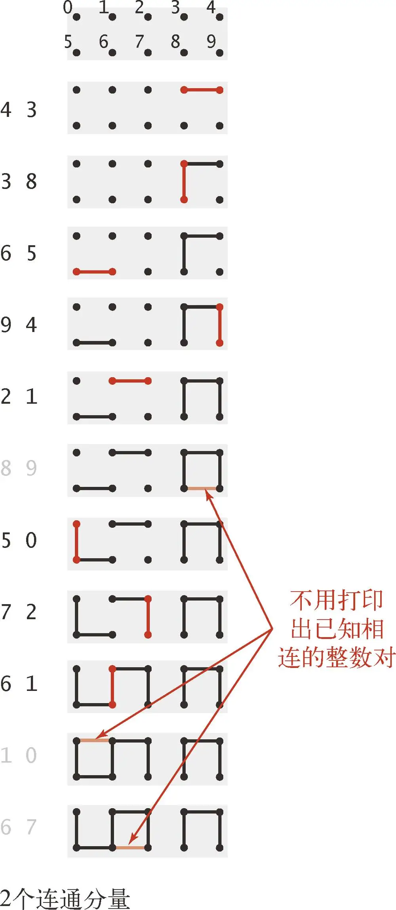

- 图 1.5.1　动态连通性问题

### 1.5.1.1　网络

输入中的整数表示的可能是一个大型计算机网络中的计算机，而整数对则表示网络中的连接。

```
这个程序能够判定我们是否需要在 p 和 q 之间架设一条新的连接才能进行通信，或是我们可
```

以通过已有的连接在两者之间建立通信线路；或者这些整数表示的可能是电子电路中的触点，而整数对表示的是连接触点之间的电路；或者这些整数表示的可能是社交网络中的人，而整数对表示的是朋友关系。在此类应用中，我们可能需要处理数百万的对象和数十亿的连接。

### 1.5.1.2　变量名等价性

某些编程环境允许声明两个等价的变量名（指向同一个对象的多个引用）。在一系列这样的声明之后，系统需要能够判别两个给定的变量名是否等价。这种较早出现的应用（如 FORTRAN语言）推动了我们即将讨论的算法的发展。

### 1.5.1.3　数学集合

```
在更高的抽象层次上，可以将输入的所有整数看做属于不同的数学集合。在处理一个整数对 p
q 时，我们是在判断它们是否属于相同的集合。如果不是，我们会将 p 所属的集合和 q 所属
```

的集合归并到同一个集合。

为了进一步限定话题，我们会在本节以下内容中使用网络方面的术语，将对象称为触点，将整数对称为连接，将等价类称为连通分量或是简称分量。简单起见，假设我们有用 0 到


- 个触点。这样做并不会降低算法的通用性，因为我们在第 3 章中将会学习

的整数所表示的


一组高效的算法，将整数标识符和任意名称关联起来。

图 1.5.2 是一个较大的例子，意在说明连通性问题的难度。你很快就可以找到图左侧中部一个只含有一个触点的分量，以及左下方一个含有 5 个触点的分量，但让你验证其他所有触点是否都是相互连通的可能就有些困难了。对于程序来说，这个任务更加困难，因为它所处理的只有触点的名字和连接而并不知道触点在图像中的几何位置。我们如何才能快速知道这种网络中任意给定的两个触点是否相连呢？

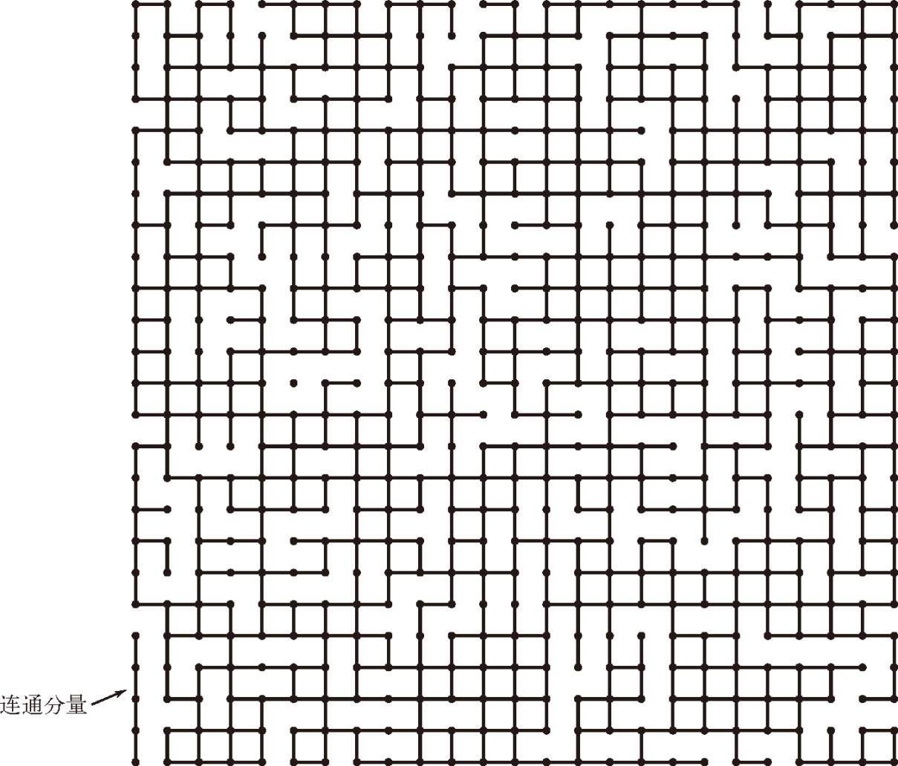

- 图 1.5.2　中等规模的连通性问题举例（625 个触点，900 条边，3 个连通分量）

我们在设计算法时面对的第一个任务就是精确地定义问题。我们希望算法解决的问题越大，它完成任务所需的时间和空间可能就越多。我们不可能预先知道这其间的量化关系，而且我们通常只会在发现解决问题很困难，或是代价巨大，或是在幸运地发现算法所提供的信息比原问题

```
所需要的更加有用时修改问题。例如，连通性问题只要求我们的程序能够判别给定的整数对 p
q 是否相连，但并没有要求给出两者之间的通路上的所有连接。这样的要求会使问题更加困
```

难，并得到另一组不同的算法，我们会在 4.1 节中学习它们。

为了说明问题，我们设计了一份 API 来封装所需的基本操作：初始化、连接两个触点、判断包含某个触点的分量、判断两个触点是否存在于同一个分量之中以及返回所有分量的数量。详细的 API 如表 1.5.1 所示。

表 1.5.1　union-find 算法的 API

```java
public class <b>UF</b>
             UF(int N)
```

- 以整数标识（0 到个触）初始化

```
      void   union(int p, int q)
在 p 和 q 之间添加一条连接
       int   find(int p)
p（0 到
```

- ）所在的分量的标识符

```
   boolean   connected(int p, int q)
如果 p 和 q 存在于同一个分量中则返回
       int   count()
```

- 连通分量的数量

```
如果两个触点在不同的分量中，union() 操作会将两个分量归并。find() 操作会返回给定
触点所在的连通分量的标识符。connected() 操作能够判断两个触点是否存在于同一个分量
之中。count() 方法会返回所有连通分量的数量。一开始我们有
```

- 个分量，将两个分量归并

```
的每次 union() 操作都会使分量总数减一。
```

我们马上就将看到，为解决动态连通性问题设计算法的任务转化为了实现这份 API。所有的实现都应该：

- 定义一种数据结构表示已知的连接；

```
基于此数据结构实现高效的 union()、find()、connected() 和 count() 方法。
```

众所周知，数据结构的性质将直接影响到算法的效率，因此数据结构和算法的设计是紧密相关

```
的。API 已经说明触点和分量都会用 int 值表示，所以我们可以用一个以触点为索引的数组
id[] 作为基本数据结构来表示所有分量。我们将使用分量中的某个触点的名称作为分量的标
```

- 个分量，

识符，因此你可以认为每个分量都是由它的触点之一所表示的。一开始，我们有

```
每个触点都构成了一个只含有它自己的分量，因此我们将id[i] 的值初始化为 i，其中 i 在
0 到 N-1 之间。对于每个触点 i，我们将 find() 方法用来判定它所在的分量所需的信息保
存在 id[i] 之中。connected() 方法的实现只用一条语句 find(p) == find(q)，它返
回一个布尔值，我们在所有方法的实现中都会用到 connected() 方法。
```

总之，我们的起点就是算法 1.5。我们维护了两个实例变量，一个是连通分量的个数，一个是

```
数组id[]。find() 和 union() 的实现是本节剩余内容将要讨论的主题。
```

- 算法 1.5　union-find 的实现

```java
public class UF
1
{
2
  private int[] id;     // 分量id（以触点作为索引）
3
  private int count;    // 分量数量
4
  public UF(int N)
5
  {  // 初始化分量id数组
6
     count = N;
7
     id = new int[N];
8
     for (int i = 0; i < N; i++)
9
        id[i] = i;
10
  }
11
  public int count()
12
  {  return count;  }
13
  public boolean connected(int p, int q)
14
  {  return find(p) == find(q);  }
15
  public int  find(int p)
16
  public void union(int p, int q)
17
  // 请见1.5.2.1节用例（quick-find）、1.5.2.3节用例（quick-union）和算法1.5（加权quic
18
  public static void main(String[] args)
19
  {  // 解决由StdIn得到的动态连通性问题
20
     int N = StdIn.readInt();              // 读取触点数量
21
     UF uf = new UF(N);                    // 初始化N个分量
22
     while (!StdIn.isEmpty())
23
     {
24
        int p = StdIn.readInt();
25
        int q = StdIn.readInt();           // 读取整数对
26
        if (uf.connected(p, q)) continue;  // 如果已经连通则忽略
27
        uf.union(p, q);                    // 归并分量
28
        StdOut.println(p + " " + q);      // 打印连接
29
     }
30
     StdOut.println(uf.count() + "components");
31
  }
32
}
33
% java UF < tinyUF.txt
1
4 3
2
3 8
3
6 5
4
9 4
5
2 1
6
5 0
7
7 2
8
6 1
9
2 components
10
这份代码是我们对 UF 的实现。它维护了一个整型数组 id[]，使得 find() 对于处在同一
个连通分量中的触点均返回相同的整数值。union() 方法必须保证这一点。
为了测试 API 的可用性并方便开发，我们在 main() 方法中包含了一个用例用于解决动态连
通性问题。它会从输入中读取 N 值以及一系列整数对，并对每一对整数调用 connected()
```

方法：如果某一对整数中的两个触点已经连通，程序会继续处理下一对数据；如果不连通，程

```
序会调用 union() 方法并打印这对整数。在讨论实现之前，我们也准备了一些测试数据（如
```

右侧的代码框所示）：文件 tinyUF.txt 含有 10 个触点和 11 条连接，图 1.5.1 使用的就是它；文件 mediumUF.txt 含有 625 个触点和 900 条连接，如图 1.5.2 所示；例子文件 largeUF.txt含有 100 万个触点和 200 万条连接。我们的目标是在可以接受的时间范围内处理和largeUF.txt 规模类似的输入。

```
% more tinyUF.txt
10
4 3
3 8
6 5
9 4
2 1
8 9
5 0
7 2
6 1
1 0
6 7
% more mediumUF.txt
625
528 503
548 523
...
900条连接
% more largeUF.txt
1000000
786321 134521
696834 98245
...
200万条连接
```

为了分析算法，我们将重点放在不同算法访问任意数组元素的总次数上。我们这样做相当于隐式地猜测各种算法在一台特定的计算机上的运行时间在这个量乘以某个常数的范围之内。这个猜想基于代码，用实验验证它并不困难。我们将会看到，这个猜想是算法比较的一个很好的开始。

- union-find 的成本模型。在研究实现 union-find 的 API 的各种算法时，我们统计的是数组的访问次数（访问任意数组元素的次数，无论读写）。

### 1.5.2　实现

```
我们将讨论三种不同的实现，它们均根据以触点为索引的 id[] 数组来确定两个触点是否存在
```

于相同的连通分量中。

### 1.5.2.1　quick-find 算法

```
一种方法是保证当且仅当 id[p] 等于 id[q] 时 p 和 q 是连通的。换句话说，在同一个连通
分量中的所有触点在 id[] 中的值必须全部相同。这意味着 connected(p, q) 只需要判断
id[p] == id[q]，当且仅当p 和q 在同一连通分量中该语句才会返回true。为了调用
union(p, q) 确保这一点，我们首先要检查它们是否已经存在于同一个连通分量之中。如果
是我们就不需要采取任何行动，否则我们面对的情况就是 p 所在的连通分量中的所有触点的
id[] 值均为同一个值，而 q 所在的连通分量中的所有触点的 id[] 值均为另一个值。要将两
个分量合二为一，我们必须将两个集合中所有触点所对应的id[] 元素变为同一个值，如表
1.5.2 所示。为此，我们需要遍历整个数组，将所有和 id[p] 相等的元素的值变为 id[q] 的
值。我们也可以将所有和 id[q] 相等的元素的值变为 id[p] 的值——两者皆可。根据上述
文字得到的find() 和union() 的代码简单明了，如下面的代码框所示。图 1.5.3 显示的是
```

我们的开发用例在处理测试数据 tinyUF.txt 时的完整轨迹。

```java
public int find(int p)
{  return id[p];  }
public void union(int p, int q)
{  // 将p和q归并到相同的分量中
  int pID = find(p);
  int qID = find(q);
  // 如果p和q已经在相同的分量之中则不需要采取任何行动
  if (pID == qID) return;
  // 将p的分量重命名为q的名称
  for (int i = 0; i < id.length; i++)
      if (id[i] == pID) id[i] = qID;
  count--;
}
```

quick-find

表 1.5.2　quick-find 概览

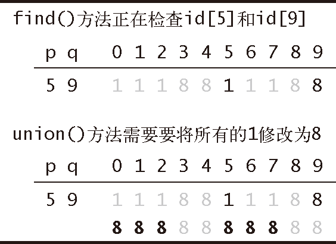

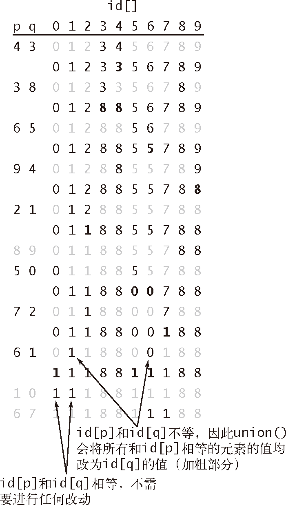

- 图 1.5.3　quick-find 的轨迹

### 1.5.2.2　quick-find 算法的分析

```
find() 操作的速度显然是很快的，因为它只需要访问 id[] 数组一次。但 quick-find 算法一
般无法处理大型问题，因为对于每一对输入 union() 都需要扫描整个 id[] 数组。
命题 F。在 quick-find 算法中，每次 find() 调用只需要访问数组一次，而归并两个分量的
```


```
union() 操作访问数组的次数在
```

- 到之间。

```
证明。由代码马上可以知道，每次 connected() 调用都会检查 id[] 数组中的两个元素
是否相等，即会调用两次 find() 方法。归并两个分量的 union() 操作会调用两次
find()，检查 id[] 数组中的全部
```

- 个元素并改变它们中 1 到个元素的值。

假设我们使用 quick-find 算法来解决动态连通性问题并且最后只得到了一个连通分量，那么这


```
 次union()，即至少
```

- 次数组访问——我们马上可

至少需要调用

以猜想动态连通性的 quick-find 算法是平方级别的。将这种分析推广我们可以得到，quick-find算法的运行时间对于最终只能得到少数连通分量的一般应用是平方级别的。在计算机上用倍率测试可以很容易验证这个猜想（指导性的例子请见练习 1.5.23）。现代计算机每秒钟能够执行

- 较小的话这个成本并不是很明显。但是在现代应用中我

数亿甚至数十亿条指令，因此如果

们也很可能需要处理几百万甚至数十亿的触点和连接，例如我们的测试文件 largeUF.txt。如果你还不相信并且觉得自己的计算机足够快，请使用 quick-find 算法找出 largeUF.txt 中所有整数对所表示的连通分量的数量。结论无可争议，使用 quick-find 算法解决这种问题是不可行的，我们需要寻找更好的算法。

### 1.5.2.3　quick-union 算法

```
我们要讨论的下一个算法的重点是提高 union() 方法的速度，它和 quick-find 算法是互补
的。它也基于相同的数据结构——以触点作为索引的 id[] 数组，但我们赋予这些值的意义不
同，我们需要用它们来定义更加复杂的结构。确切地说，每个触点所对应的 id[] 元素都是同
```

一个分量中的另一个触点的名称（也可能是它自己）——我们将这种联系称为链接。在实现

```
find() 方法时，我们从给定的触点开始，由它的链接得到另一个触点，再由这个触点的链接
```

到达第三个触点，如此继续跟随着链接直到到达一个根触点，即链接指向自己的触点（你将会看到，这样一个触点必然存在）。当且仅当分别由两个触点开始的这个过程到达了同一个根触

```
点时它们存在于同一个连通分量之中。为了保证这个过程的有效性，我们需要union(p, q)
来保证这一点。它的实现很简单：我们由 p 和 q 的链接分别找到它们的根触点，然后只需将
一个根触点链接到另一个即可将一个分量重命名为另一个分量，因此这个算法叫做 quick-
union。和刚才一样，无论是重命名含有 p 的分量还是重命名含有 q 的分量都可以，右侧的
这段实现重命名了 p 所在的分量。图 1.5.5 显示了 quick-union 算法在处理 tinyUF.txt 时的轨
```

迹。图 1.5.4 能够很好地说明图 1.5.5（见 1.5.2.4 节）中的轨迹，我们接下来要讨论的就是它。

```java
private int find(int p)
{  // 找出分量的名称
  while (p != id[p]) p = id[p];
  return p;
}
public void union(int p, int q)
{  // 将p和q的根节点统一
  int pRoot = find(p);
  int qRoot = find(q);
  if (pRoot == qRoot) return;
  id[pRoot] = qRoot;
  count--;
}
```

quick-union

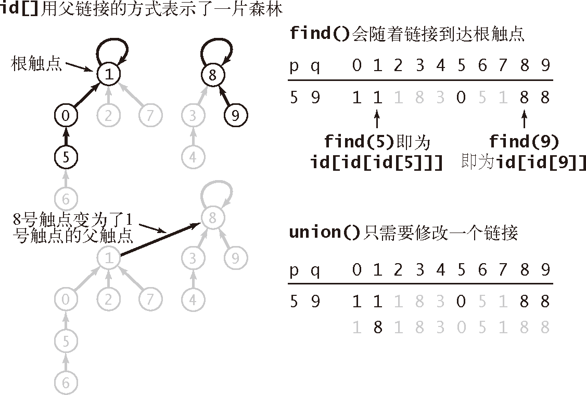

- 图 1.5.4　quick-union 算法概述

### 1.5.2.4　森林的表示

quick-union 算法的代码很简洁，但有些难以理解。用节点（带标签的圆圈）表示触点，用从一个节点到另一个节点的箭头表示链接，由此得到数据结构的图像表示使我们理解算法的操作

```
变得相对容易。我们的得到的结构是树——从技术上来说，id[] 数组用父链接的形式表示了
```

一片森林。为了简化图表，我们常常会省略链接的箭头（因为它们的指向全部朝上）和树的根

```
节点中指向自己的链接。tinyUF.txt 的id[] 数组所对应的森林如图 1.5.5 所示。无论我们从任
```

何触点所对应的节点开始跟随链接，最终都将达到含有该节点的树的根节点。可以用归纳法证明这个性质的正确性：在数组被初始化之后，每个节点的链接都指向它自己；如果在某次

```
union() 操作之前这条性质成立，那么操作之后它必然也成立。因此，quick-union 中的
find() 方法能够返回根节点所对应的触点的名称（这样connected() 才能够判定两个触点
```

是否在同一棵树中）。这种表示方法对于这个问题很实用，因为当且仅当两个触点存在于相同的分量之中时它们对应的节点才会在同一棵树中。另外，构造树并不困难：quick-union 中

```
union() 的实现只用了一条语句就将一个根节点变为另一个根节点的父节点，从而归并了两
```

棵树。

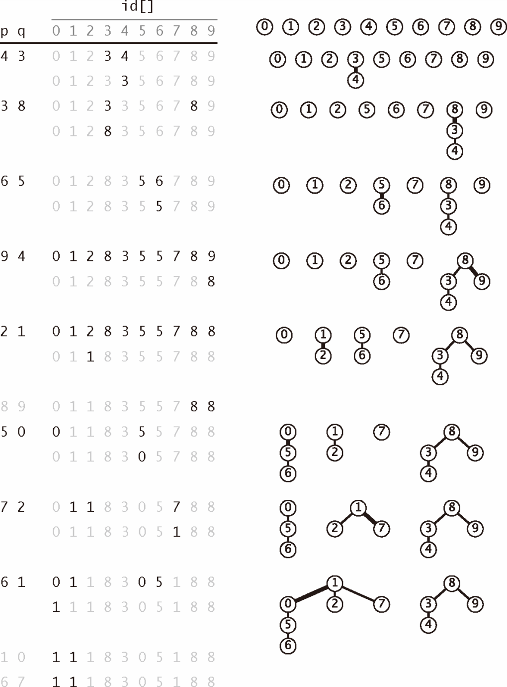

- 图 1.5.5　quick-union 算法的轨迹（以及相应的森林）

### 1.5.2.5　quick-union 算法的分析

quick-union 算法看起来比 quick-find 算法更快，因为它不需要为每对输入遍历整个数组。但它能够快多少呢？分析 quick-union 算法的成本比分析 quick-find 算法的成本更困难，因为这

```
依赖于输入的特点。在最好的情况下，find() 只需要访问数组一次就能够得到一个触点所在
```

- 次数组访问，如图 1.5.6 中的 0 触点（这

的分量的标识符；而在最坏情况下，这需要


```
个估计是较为保守的，因为 while 循环中经过编译的代码对 id[p] 的第二次引用一般都不
```

会访问数组）。由此我们不难构造一个最佳情况的输入使得解决动态连通性问题的用例的运行时间是线性级别的；另一方面，我们也可以构造一个最坏情况的输入，此时它的运行时间是平方级别的（请见图 1.5.6 和下面的命题 G）。幸好我们不需要面对分析 quick-union 算法的问题，我们也不会仔细对比 quick-union 算法和 quick-find 算法的性能，因为我们下面将会学习一种比两者的效率都高得多的算法。目前，我们可以将 quick-union 算法看做是 quick-find 算

```
法的一种改良，因为它解决了 quick-find 算法中最主要的问题（union() 操作总是线性级别
```

的）。对于一般的输入数据这个变化显然是一次改进，但 quick-union 算法仍然存在问题，我们不能保证在所有情况下它都能比 quick-find 算法快得多（对于某些输入，quick-union 算法并不比 quick-find 算法快）。

- 定义。一棵树的大小是它的节点的数量。树中的一个节点的深度是它到根节点的路径上的链接数。树的高度是它的所有节点中的最大深度。

```
命题 G。quick-union 算法中的 find() 方法访问数组的次数为 1 加上给定触点所对应的节
点的深度的两倍。union() 和 connected() 访问数组的次数为两次 find() 操作（如
果 union() 中给定的两个触点分别存在于不同的树中则还需要加 1）。
```

- 证明。请见代码。

同样，假设我们使用 quick-union 算法解决了动态连通性问题并最终只得到了一个分量，由命题 G 我们马上可以知道算法的运行时间在最坏情况下是平方级别的。假设输入的整数对是有序的 0-1、0-2、0-3 等，

- 对之后我们的个触点将全部处于相同的集合之中且由

quick-union 算法得到的树的高度为

- ，其中 0 链接到 1，1 链接到 2，2 链接到 3，如此

```
下去（请见图 1.5.6）。由命题 G 可知，对于整数对 0-i，union() 操作访问数组的次数为
```

- （触点 0 的深度为的深度为 0）。因此，处理对整数所需的所有，触点


```
find() 操作访问数组的总次数为
```

- 。

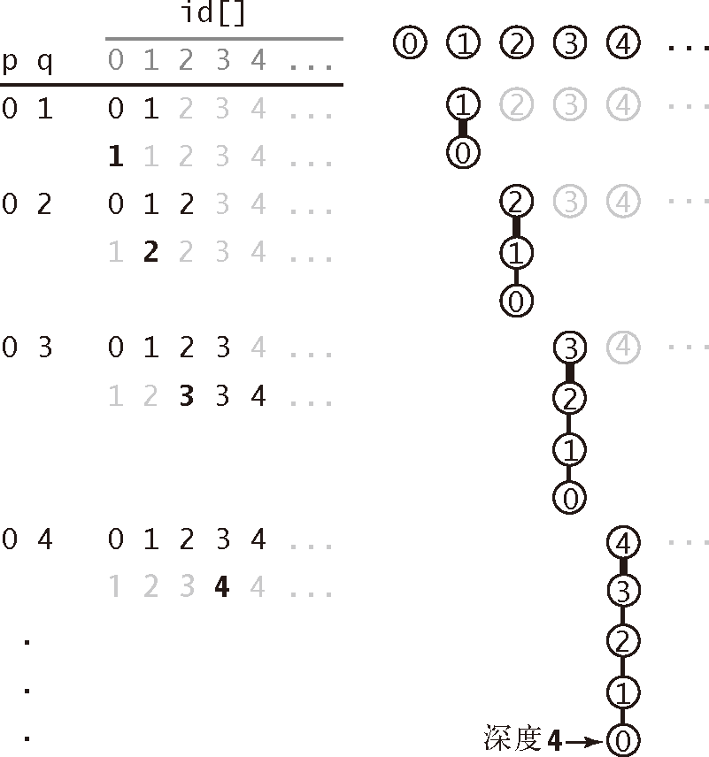

- 图 1.5.6　quick-union 算法的最坏情况

### 1.5.2.6　加权 quick-union 算法

幸好，我们只需简单地修改 quick-union 算法就能保证像这样的糟糕情况不再出现。与其在

```
union() 中随意将一棵树连接到另一棵树，我们现在会记录每一棵树的大小并总是将较小的
```

树连接到较大的树上。这项改动需要添加一个数组和一些代码来记录树中的节点数，如算法1.5 所示，但它能够大大改进算法的效率。我们将它称为加权 quick-union 算法（如图 1.5.7 所示）。该算法在处理 tinyUF.txt 时构造的森林如图 1.5.8 中左侧的图所示。即使对于这个较小的例子，该算法构造的树的高度也远远小于未加权的版本所构造的树的高度。

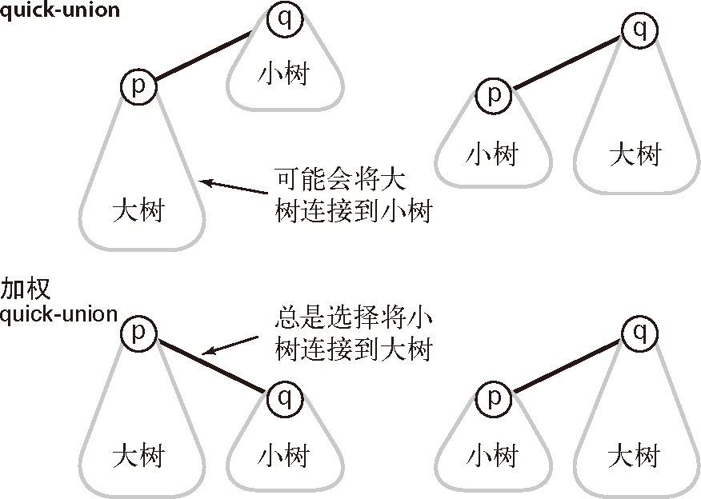

- 图 1.5.7　加权 quick-union

### 1.5.2.7　加权 quick-union 算法的分析

图 1.5.8 显示了加权 quick-union 算法的最坏情况。其中将要被归并的树的大小总是相等的（且总是 2 的幂）。这些树的结构看起来很复杂，但它们均含有

- 个节点，因此高度都正好是


- 个节点的树时，我们得到的树含有个节点，由此将树。另外，当我们归并两个含有

- 。由此推广我们可以证明加权 quick-union 算法能够保证对数级别的性

的高度增加到了


能。加权 quick-union 算法的实现如算法 1.5 所示。

```
% java WeightedQuickUnionUF < mediumUF.txt
528 503
548 523
...
3 components
% java WeightedQuickUnionUF < largeUF.txt
786321 134521
696834 98245
...
6 components
```

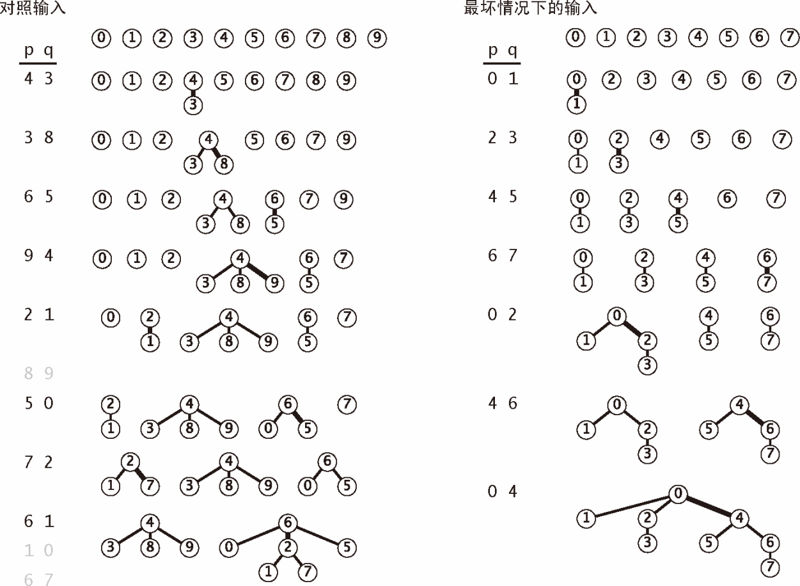

- 图 1.5.8　加权 quick-union 算法的轨迹（森林）

- 算法 1.5（续）　union-find 算法的实现（加权 quick-union 算法）

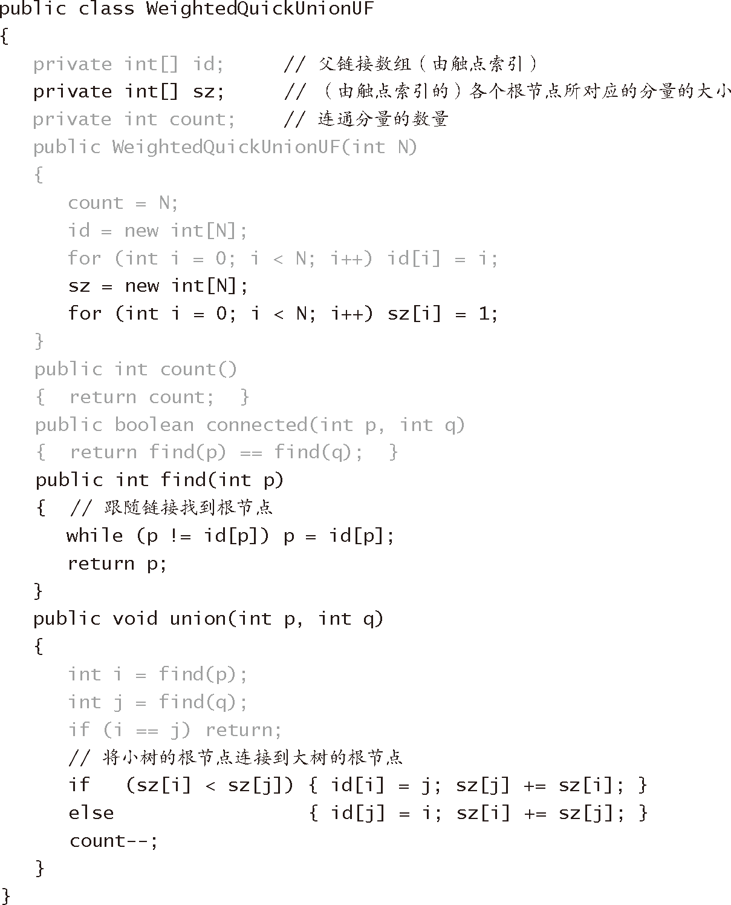

- 根据正文所述的森林表示方法这段代码很容易理解。我们加入了一个由触点索引的实例变量

```
数组 sz[]，这样union() 就可以将小树的根节点连接到大树的根节点。这使得算法能够
```

- 处理规模较大的问题。

- 命题 H。对于个触点，加权 quick-union 算法构造的森林中的任意节点的深度最多为


- 。


- 的树的高度最多为证明。我们可以用归纳法证明一个更强的命题，即森林中大小为。等于 1 时树的高度为 0。根据归纳法，我们假设大小为的树的高度最在原始情况下，当


- 且和大小为的树归并时，多为，其中。设，当我们将大小为


- quick-union 算法和加权 quick-union 算法中触点与深度示例如图 1.5.9 所示。小树中的所有

- 节点的深度增加了 1，但它们现在所在的树的大小为，而


- ，性质成立。

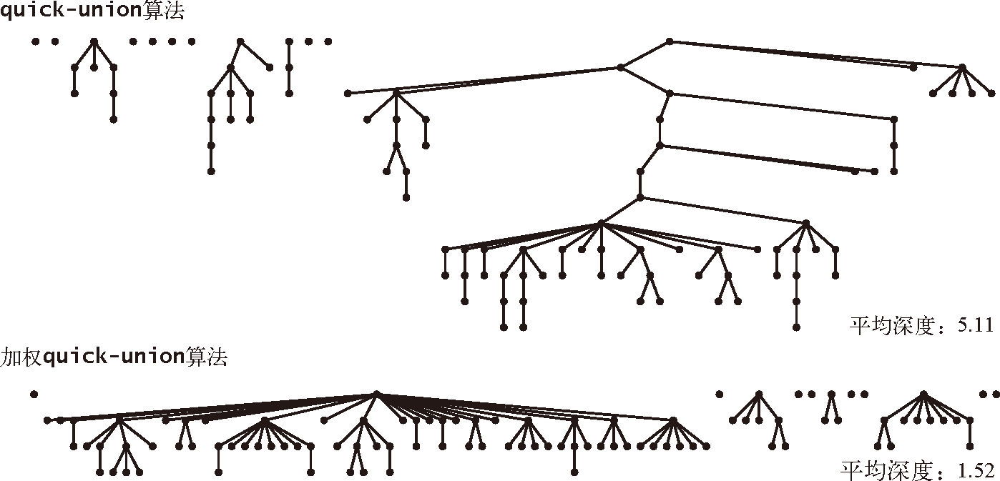

```
图 1.5.9　quick-union 算法与加权 quick-union 算法的对比（100 个触点，88 次 union() 操作）
 个触点，在最坏情况下 find()、connected()
```

- 推论。对于加权 quick-union 算法和


```
和 union() 的成本的增长数量级为
```

- 。证明。在森林中，对于从一个节点到它的根节点的路径上的每个节点，每种操作最多都只会访问数组常数次。

对于动态连通性问题，命题 H 和它的推论的实际意义在于加权 quick-union 算法是三种算法中唯一可以用于解决大型实际问题的算法。加权 quick-union 算法处理

- 个触点和条连接时


- 次，其中 c 为常数。这个结果和 quick-find 算法（以及某些情况下的

最多访问数组quick-union 算法）需要访问数组至少

- 次形成了鲜明的对比。因此，有了加权 quick-


union 算法我们就能保证能够在合理的时间范围内解决实际中的大规模动态连通性问题。只需要多写几行代码，我们所得到的程序在处理实际应用中的大型动态连通性问题时就会比简单的算法快数百万倍。

图 1.5.9 显示的是一个含有 100 个触点的例子。从图中我们可以很明显地看到，加权 quick-union 算法中远离根节点的节点相对较少。事实上，只含有一个节点的树被归并到更大的树中的情况很常见，这样该节点到根节点的距离也只有一条链接而已。针对大规模问题的经验性研究告诉我们，加权 quick-union 算法在解决实际问题时一般都能在常数时间内完成每个操作（如表 1.5.3 所示）。我们可能很难找到比它效率更高的算法了。

表 1.5.3　各种 union-find 算法的性能特点

- 个触点时成本的增长数量级（最坏情况下）存在

算法

```
union()
```

- 构造函数

quick-find 算法

quick-union 算法

- 树的高度

加权 quick-union 算法

使用路径压缩的加权 quick-union 算法

- 非常非常地接近但仍没有达到（请见练习

- 1

理想情况

### 1.5.2.8　最优算法

我们可以找到一种能够保证在常数时间内完成各种操作的算法吗？这个问题非常困难并且困扰了研究者们许多年。在寻找答案的过程中，大家研究了 quick-union 算法和加权 quick-union算法的各种变体。例如，下面这种路径压缩方法很容易实现。理想情况下，我们希望每个节点都直接链接到它的根节点上，但我们又不想像 quick-find 算法那样通过修改大量链接做到这一点。我们接近这种理想状态的方式很简单，就是在检查节点的同时将它们直接链接到根节点。这种方法乍一看很激进，但它的实现非常容易，而且这些树并没有阻止我们进行这种修改的特殊结构：如果这么做能够改进算法的效率，我们就应该实现它。要实现路径压缩，只需要为

```
find() 添加一个循环，将在路径上遇到的所有节点都直接链接到根节点。我们所得到的结果
```

是几乎完全扁平化的树，它和 quick-find 算法理想情况下所得到的树非常接近。这种方法即简单又有效，但在实际情况下已经不太可能对加权 quick-union 算法继续进行任何改进了（请见练习 1.5.24）。对该情况的理论研究结果非常复杂也值得我们注意：路径压缩的加权 quick-union 算法是最优的算法，但并非所有操作都能在常数时间内完成。也就是说，使用路径压缩的加权 quick-union 算法的每个操作在在最坏情况下（即均摊后）都不是常数级别的，而且不存在其他算法能够保证 union-find 算法的所有操作在均摊后都是常数级别的（在非常一般的cell probe 模型之下）。使用路径压缩的加权 quick-union 算法已经是我们对于这个问题能够给出的最优解了。

### 1.5.2.9　均摊成本的图像

与对其他任何数据结构实现的讨论一样，我们应该按照 1.4 节中的讨论在实验中用典型的用例验证我们对算法性能的猜想。图 1.5.10 详细显示了我们的动态连通性问题的开发用例在使用各种算法处理一份含有 625 个触点的样例数据（mediumUF.txt）时的性能。绘制这种图像很

```
 个连接时，用一个变量 cost 记录其间访问数组（id[]
```

简单（请见练习 1.5.16）：在处理第

```
或 sz[]）的次数，并用一个变量 total 记录到目前为止数组访问的总次数。我们在 (i,
cost) 处画一个灰点，在 (i, total/i) 处画一个红点，红点表示的是每个操作的平均成
```

本，即均摊成本。图像能够帮助我们更好地理解算法的行为。对于 quick-find 算法，每次

```
union() 操作都至少访问数组 625 次（每归并一个分量还要加 1，最多再加 625），每次
connected() 操作都访问数组 2 次。一开始，大多数连接都会产生一个 union() 调用，因
此累计平均值徘徊在 625 左右；后来，大多数连接产生的 connected() 调用会跳过
union()，因此累计平均值开始下降，但仍保持了相对较高的水平（能够产生大量
connected() 调用并跳过 union() 的输入性能要好得多，例子请见练习 1.5.23）。对于
```

quick-union 算法，所有的操作在初始阶段访问数组的次数都不多；到了后期，树的高度成为一个重要因素，均摊成本的增长很明显。对于加权 quick-union 算法，树的高度一直很小，没有任何昂贵的操作，均摊成本也很低。这些实验验证了我们的结论，显然非常有必要实现加权quick-union 算法，在解决实际问题时已经没有多少进一步改进的空间了。

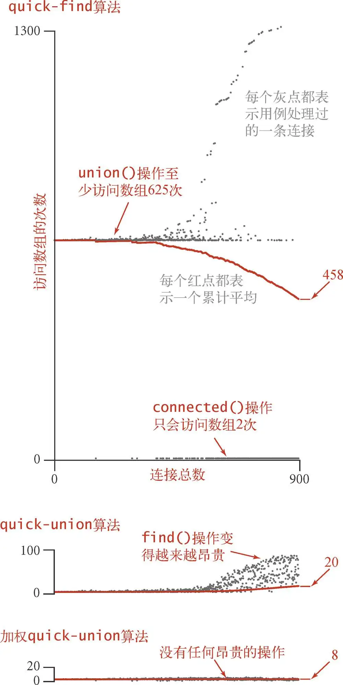

- 图 1.5.10　所有操作的总成本（625 个触点）

### 1.5.3　展望

直观感觉上，我们学习的每种 UF 的实现都改进了上一个版本的实现，但这个过程并不突兀，因为我们可以总结学者们对这些算法多年的研究。我们很明确地说明了问题，解决方法的实现也很简单，因此可以用经验性的数据评估各个算法的优劣。另外，还可以通过这些研究验证将算法的性能量化的数学结论。只要可能，我们在本书中研究各种基础问题时都会遵循类似于本节中讨论 union-find 问题时的基本步骤，在这里我们要再次强调它们。

- 完整而详细地定义问题，找出解决问题所必需的基本抽象操作并定义一份 API。

- 简洁地实现一种初级算法，给出一个精心组织的开发用例并使用实际数据作为输入。

- 当实现所能解决的问题的最大规模达不到期望时决定改进还是放弃。

- 逐步改进实现，通过经验性分析或（和）数学分析验证改进后的效果。

- 用更高层次的抽象表示数据结构或算法来设计更高级的改进版本。

- 如果可能尽量为最坏情况下的性能提供保证，但在处理普通数据时也要有良好的性能。

- 在适当的时候将更细致的深入研究留给有经验的研究者并继续解决下一个问题。

我们从 union-find 问题中可以看到，算法设计在解决实际问题时能够为程序的性能带来惊人的提高，这种潜力使它成为热门研究领域。还有什么其他类型的设计行为可能将成本降为原来的数百万甚至数十亿分之一呢？

设计高效的算法是一种很有成就感的智力活动，同时也能够产生直接的实际效益。正如动态连通性问题所示，为解决一个简单的问题我们学习了许多算法，它们不但有用有趣，也精巧而引人入胜。我们还将遇到许多新颖独特的算法，它们都是人们在数十年以来为解决许多实际问题而发明的。随着计算机算法在科学和商业领域的应用范围越来越广，能够使用高效的算法来解决老问题并为新问题开发有效的解决方案也越来越重要了。

### 答疑

```sql
问　我希望为 API 添加一个 delete() 方法来允许用例删除连接。能够给我一些建议吗？
```

答　目前还没有人能够发明既能处理删除操作而又和本节中所介绍的算法同样简单而高效的算法。这个主题在本书中会反复出现。在我们讨论的一些数据结构中删除比添加要困难得多。

问　cell-probe 模型是什么？

答　它是一种计算模型，其中我们只会记录对随机内存的访问，内存大小足以保存所有输入且假设其他操作均没有成本。

### 练习

1.5.1　使用 quick-find 算法处理序列 9-0 3-4 5-8 7-2 2-1 5-7 0-3 4-2 。对于输入的每一对整

```
数，给出 id[] 数组的内容和访问数组的次数。
```

1.5.2　使用 quick-union 算法（请见 1.5.2.3 节代码框）完成练习 1.5.1。另外，在处理完输入

```
的每对整数之后画出id[] 数组表示的森林。
```

1.5.3　使用加权 quick-union 算法（请见算法 1.5）完成练习 1.5.1。

1.5.4　在正文的加权 quick-union 算法示例中，对于输入的每一对整数（包括对照输入和最坏

```
情况下的输入），给出 id[] 和 sz[] 数组的内容以及访问数组的次数。
```


1.5.5　在一台每秒能够处理

- 条指令的计算机上，估计 quick-find 算法解决含有个触点

```
 条连接的动态连通性问题所需的最短时间（以天记）。假设内循环 for 的每一次迭代需
```


和要执行 10 条机器指令。

1.5.6　使用加权 quick-union 算法完成练习 1.5.5。

```
1.5.7　分别为 quick-find 算法和 quick-union 算法实现 QuickFindUF 类和 QuickUnionUF
```

类。

```java
1.5.8　用一个反例证明 quick-find 算法中的 union() 方法的以下直观实现是错误的：
public void union(int p, int q)
{
  if (connected(p, q)) return;
  // 将p 的分量重命名为q 的分量
  for (int i = 0; i < id.length; i++)
      if (id[i] == id[p]) id[i] = id[q];
  count--;
}
1.5.9　画出下面的 id[] 数组所对应的树。这可能是加权 quick-union 算法得到的结果吗？解
```

释为什么不可能，或者给出能够得到该数组的一系列操作。

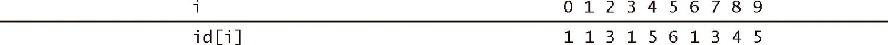

```
1.5.10　在加权 quick-union 算法中，假设我们将 id[find(p)] 的值设为 q 而非
id[find(q)]，所得的算法是正确的吗？
```

答：是，但这会增加树的高度，因此无法保证同样的性能。

1.5.11　实现加权 quick-find 算法，其中我们总是将较小的分量重命名为较大的分量的标识符。这种改变会对性能产生怎样的影响？

### 提高题

1.5.12　使用路径压缩的 quick-union 算法。根据路径压缩修改 quick-union 算法（请见

```
1.5.2.3 节），在 find() 方法中添加一个循环来将从 p 到根节点的路径上的每个触点都连接
```

到根节点。给出一列输入，使该方法能够产生一条长度为 4 的路径。注意：该算法的所有操作的均摊成本已知为对数级别。

1.5.13　使用路径压缩的加权 quick-union 算法。修改加权 quick-union 算法（算法 1.5），实现如练习 1.5.12 所述的路径压缩。给出一列输入，使该方法能够产生一棵高度为 4 的树。注意：该算法的所有操作的均摊成本已知被限制在反 Ackermann 函数的范围之内，且对于实际

- 值均小于 5。

应用中可能出现的所有

1.5.14　根据高度加权的 quick-union 算法。给出 UF 的一个实现，使用和加权 quick-union算法相同的策略，但记录的是树的高度并总是将较矮的树连接到较高的树上。用算法证明

个触点的树的高度不会超过其大小的对数级别。

1.5.15　二项树。请证明，对于加权 quick-union 算法，在最坏情况下树中每一层的节点数均

- 个节点的树中节点的平均深度。

为二项式系数。在这种情况下，计算含有

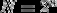

1.5.16　均摊成本的图像。修改你为练习 1.5.7 给出的实现，绘出如正文所示的均摊成本的图像。

```
1.5.17　随机连接。设计 UF 的一个用例 ErdosRenyi，从命令行接受一个整数 N，在 0 到 N-
1 之间产生随机整数对，调用 connected() 判断它们是否相连，如果不是则调用union()
```

方法（和我们的开发用例一样）。不断循环直到所有触点均相互连通并打印出生成的连接总

```
数。将你的程序打包成一个接受参数N 并返回连接总数的静态方法count()，添加一个
main() 方法从命令行接受N，调用 count() 并打印它的返回值。
1.5.18　随机网格生成器。编写一个程序 RandomGrid，从命令行接受一个 int 值 N，生成
```

- 的网格中的所有连接。它们的排列随机且方向随机（即 (p q) 和 (q p) 出现的可能

一个

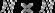

性是相等的），将这个结果打印到标准输出中。可以使用 RandomBag 将所有连接随机排列

```java
（请见练习 1.3.34），并使用如右下所示的 Connection 嵌套类来将 p 和 q 封装到一个对象
中。将程序打包成两个静态方法：generate()，接受参数 N 并返回一个连接的数组；
main()，从命令行接受参数 N，调用 generate()，遍历返回的数组并打印出所有连接。
private class Connection
{
  int p;
  int q;
  public Connection(int p, int q)
  {  this.p = p; this.q = q;  }
}
```

封装连接的嵌套类

1.5.19　动画。编写一个 RandomGrid（请见练习 1.5.18）的用例，和我们的开发用例一样使

```
用UnionFind 来检查触点的连通性并在处理的同时用StdDraw 将它们绘出。
```

1.5.20　动态生长。使用链表或大小可变的数组实现加权 quick-union 算法，去掉需要预先知

```
道对象数量的限制。为 API 添加一个新方法 newSite()，它应该返回一个类型为 int 的标
```

识符。

### 实验题

1.5.21　Erdös-Renyi 模型。使用练习 1.5.17 的用例验证这个猜想：得到单个连通分量所需


生成的整数对数量为

- 。

```
1.5.22　Erdös-Renyi 模型的倍率实验。开发一个性能测试用例，从命令行接受一个int 值 T
并进行 T 次以下实验：使用练习 1.5.17 的用例生成随机连接，和我们的开发用例一样使用
UnionFind 来检查触点的连通性，不断循环直到所有触点均相互连通。对于每个 N，打印出 N
```

值和平均所需的连接数以及前后两次运行时间的比值。使用你的程序验证正文中的猜想：

quick-find 算法和 quick-union 算法的运行时间是平方级别的，加权 quick-union 算法则接近线性级别。

1.5.23　在 Erdös-Renyi 模型下比较 quick-find 算法和 quick-union 算法。开发一个性能测

```
试用例，从命令行接受一个 int 值 T 并进行 T 次以下实验：使用练习 1.5.17 的用例生成随
```

机连接。保存这些连接并和我们的开发用例一样分别用 quick-find 算法和 quick-union 算法检

```
查触点的连通性，不断循环直到所有触点均相互连通。对于每个N，打印出 N 值和两种算法的
```

运行时间的比值。

1.5.24　适用于 Erdös-Renyi 模型的快速算法。在练习 1.5.23 的测试中增加加权 quick-union算法和使用路径压缩的加权 quick-union 算法。你能分辨出这两种算法的区别吗？

```
1.5.25　随机网格的倍率测试。开发一个性能测试用例，从命令行接受一个 int 值T 并进行T
次以下实验：使用练习 1.5.18 的用例生成一个 N×N 的随机网格，所有连接的方向随机且排列
```

随机。和我们的开发用例一样使用 UnionFind 来检查触点的连通性，不断循环直到所有触点均

```
相互连通。对于每个N，打印出 N 值和平均所需的连接数以及前后两次运行时间的比值。使用
```

你的程序验证正文中的猜想：quick-find 算法和 quick-union 算法的运行时间是平方级别的，

```
加权 quick-union 算法则接近线性级别。注意：随着N 值加倍，网格中触点的数量会乘 4，因
```

此平方级别的算法的运行时间会变为原来的 16 倍，线性级别的算法的运行时间则变为原来的4 倍。

```
1.5.26　Erdös-Renyi 模型的均摊成本图像。开发一个用例，从命令行接受一个 int 值 N，
在 0 到 N-1 之间产生随机整数对，调用connected() 判断它们是否相连，如果不是则调用
union() 方法（和我们的开发用例一样）。不断循环直到所有触点均相互连通。按照正文的样
```

式将所有操作的均摊成本绘制成图像。

## 第 2 章　排序

排序就是将一组对象按照某种逻辑顺序重新排列的过程。比如，信用卡账单中的交易是按照日期排序的——这种排序很可能使用了某种排序算法。在计算时代早期，大家普遍认为 30% 的计算周期都用在了排序上。如果今天这个比例降低了，可能的原因之一是如今的排序算法更加高效，而并非排序的重要性降低了。现在计算机的广泛使用使得数据无处不在，而整理数据的第一步通常就是进行排序。所有的计算机系统都实现了各种排序算法以供系统和用户使用。

即使你只是使用标准库中的排序函数，学习排序算法仍然有三大实际意义：

- 对排序算法的分析将有助于你全面理解本书中比较算法性能的方法；

- 类似的技术也能有效解决其他类型的问题；

- 排序算法常常是我们解决其他问题的第一步。

更重要的是这些算法都很经典、优雅和高效。排序在商业数据处理和现代科学计算中有着重要的地位，它能够应用于事物处理、组合优化、天体物理学、分子动力学、语言学、基因组学、天气预报和很多其他领域。其中一种排序算法（快速排序，见 2.3 节）甚至被誉为 20 世纪科学和工程领域的十大算法之一。

在本章中我们将学习几种经典的排序算法，并高效地实现了“优先队列”这种基础数据类型。我们将讨论比较排序算法的理论基础并在本章结尾总结若干排序算法和优先队列的应用。
