# 2.3快速排序

本节的主题是快速排序，它可能是应用最广泛的排序算法了。快速排序流行的原因是它实现简单、适用于各种不同的输入数据且在一般应用中比其他排序算法都要快得多。快速排序引人注

- 的数组排序所需的时

目的特点包括它是原地排序（只需要一个很小的辅助栈），且将长度为


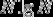

- 成正比。我们已经学习过的排序算法都无法将这两个优点结合起来。另外，快速

间和排序的内循环比大多数排序算法都要短小，这意味着它无论是在理论上还是在实际中都要更快。它的主要缺点是非常脆弱，在实现时要非常小心才能避免低劣的性能。已经有无数例子显示许多种错误都能致使它在实际中的性能只有平方级别。幸好我们将会看到，由这些错误中学到的教训也大大改进了快速排序算法，使它的应用更加广泛。

### 2.3.1　基本算法

快速排序是一种分治的排序算法。它将一个数组分成两个子数组，将两部分独立地排序。快速排序和归并排序是互补的：归并排序将数组分成两个子数组分别排序，并将有序的子数组归并以将整个数组排序；而快速排序将数组排序的方式则是当两个子数组都有序时整个数组也就自然有序了。在第一种情况中，递归调用发生在处理整个数组之前；在第二种情况中，递归调用发生在处理整个数组之后。在归并排序中，一个数组被等分为两半；在快速排序中，切分（partition）的位置取决于数组的内容。快速排序的大致过程如图 2.3.1 所示。

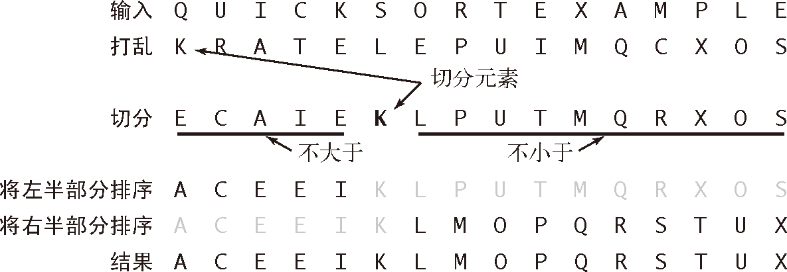

- 图 2.3.1　快速排序示意图

快速排序的实现过程如算法 2.5 所示。

- 算法 2.5　快速排序

```java
public class Quick
1
{
2
  public static void sort(Comparable[] a)
3
  {
4
     StdRandom.shuffle(a);          // 消除对输入的依赖
5
     sort(a, 0, a.length - 1);
6
  }
7
8
  private static void sort(Comparable[] a, int lo, int hi)
9
  {
10
     if (hi <= lo) return;
11
     int j = partition(a, lo, hi);  // 切分（请见“快速排序的切分”）
12
     sort(a, lo, j-1);              // 将左半部分a[lo .. j-1]排序
13
     sort(a, j+1, hi);              // 将右半部分a[j+1 .. hi]排序
14
  }
15
}
16
快速排序递归地将子数组 a[lo..hi] 排序，先用 partition() 方法将 a[j] 放到一个
```

- 合适位置，然后再用递归调用将其他位置的元素排序。

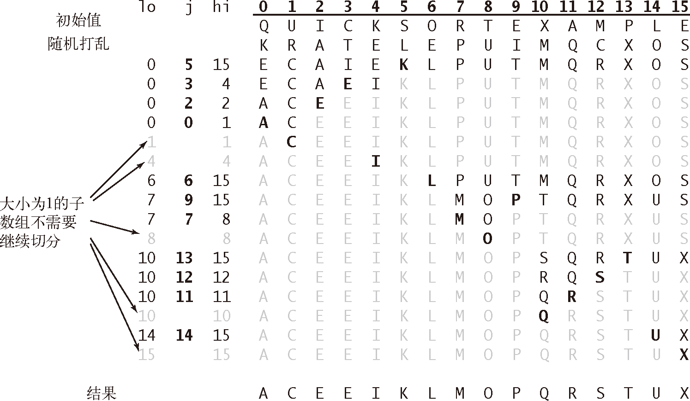

该方法的关键在于切分，这个过程使得数组满足下面三个条件：

```
对于某个 j，a[j] 已经排定；
a[lo] 到 a[j-1] 中的所有元素都不大于 a[j]；
a[j+1] 到 a[hi] 中的所有元素都不小于 a[j]。
```

我们就是通过递归地调用切分来排序的。

因为切分过程总是能排定一个元素，用归纳法不难证明递归能够正确地将数组排序：如果左子数组和右子数组都是有序的，那么由左子数组（有序且没有任何元素大于切分元素）、切分元素和右子数组（有序且没有任何元素小于切分元素）组成的结果数组也一定是有序的。算法2.5 就是实现了这个思路的一个递归程序。它是一个随机化的算法，因为它在将数组排序之前会将其随机打乱。我们这么做的原因是希望能够预测（并依赖）该算法的性能特性，之后我们会详细讨论。

```
要完成这个实现，需要实现切分方法。一般策略是先随意地取 a[lo] 作为切分元素，即那个
```

将会被排定的元素，然后我们从数组的左端开始向右扫描直到找到一个大于等于它的元素，再从数组的右端开始向左扫描直到找到一个小于等于它的元素。这两个元素显然是没有排定的，

```
因此我们交换它们的位置。如此继续，我们就可以保证左指针 i 的左侧元素都不大于切分元
素，右指针 j 的右侧元素都不小于切分元素。当两个指针相遇时，我们只需要将切分元素
a[lo] 和左子数组最右侧的元素（a[j]）交换然后返回 j 即可。切分方法的大致过程如图
```

2.3.2 所示。

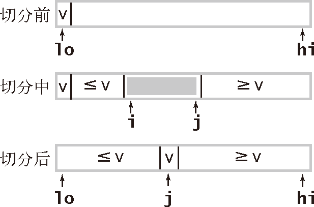

- 图 2.3.2　快速排序的切分示意图

这段快速排序的实现代码中还有几个细节问题值得一提，因为它们都可能导致实现错误或是影响性能，我们会在下面讨论。本节稍后我们会研究算法的三个高层次的改进。

快速排序的切分的实现如下所示。

- 快速排序的切分

```java
private static int partition(Comparable[] a, int lo, int hi)
1
{  // 将数组切分为a[lo..i-1], a[i], a[i+1..hi]
2
  int i = lo, j = hi+1;              // 左右扫描指针
3
  Comparable v = a[lo];              // 切分元素
4
  while (true)
5
  {  // 扫描左右，检查扫描是否结束并交换元素
6
     while (less(a[++i], v)) if (i == hi) break;
7
     while (less(v, a[--j])) if (j == lo) break;
8
     if (i >= j) break;
9
     exch(a, i, j);
10
  }
11
  exch(a, lo, j);       // 将v = a[j]放入正确的位置
12
  return j;             // a[lo..j-1] <= a[j] <= a[j+1..hi] 达成
13
}
14
这段代码按照 a[lo] 的值 v 进行切分。当指针 i 和 j 相遇时主循环退出。在循环中，
a[i] 小于 v 时我们增大 i，a[j] 大于 v 时我们减小 j，然后交换 a[i] 和 a[j] 来保
证 i 左侧的元素都不大于 v，j 右侧的元素都不小于 v。当指针相遇时交换 a[lo] 和
a[j]，切分结束（这样切分值就留在 a[j] 中了）。
```

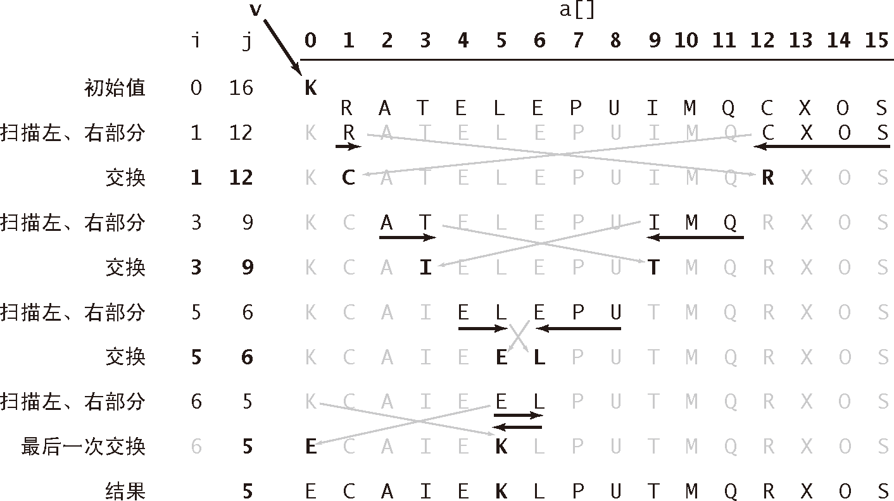

- 切分轨迹（每次交换前后的数组内容）

### 2.3.1.1　原地切分

如果使用一个辅助数组，我们可以很容易实现切分，但将切分后的数组复制回去的开销也许会使我们得不偿失。一个初级 Java 程序员甚至可能会将空数组创建在递归的切分方法中，这会大大降低排序的速度。

### 2.3.1.2　别越界

如果切分元素是数组中最小或最大的那个元素，我们就要小心别让扫描指针跑出数组的边界。

```
partition() 实现可进行明确的检测来预防这种情况。测试条件（j == lo）是冗余的，
因为切分元素就是 a[lo]，它不可能比自己小。数组右端也有相同的情况，它们都是可以去
```

掉的（请见练习 2.3.17）。

### 2.3.1.3　保持随机性

数组元素的顺序是被打乱过的。因为算法 2.5 对所有的子数组都一视同仁，它的所有子数组也都是随机排序的。这对于预测算法的运行时间很重要。保持随机性的另一种方法是在

```
partition() 中随机选择一个切分元素。
```

### 2.3.1.4　终止循环

有经验的程序员都知道保证循环结束需要格外小心，快速排序的切分循环也不例外。正确地检测指针是否越界需要一点技巧，并不像看上去那么容易。一个最常见的错误是没有考虑到数组中可能包含和切分元素的值相同的其他元素。

### 2.3.1.5　处理切分元素值有重复的情况

如算法 2.5 所示，左侧扫描最好是在遇到大于等于切分元素值的元素时停下，右侧扫描则是遇到小于等于切分元素值的元素时停下。尽管这样可能会不必要地将一些等值的元素交换，但在某些典型应用中，它能够避免算法的运行时间变为平方级别（请见练习 2.3.11）。稍后我们会讨论另一种可以更好地处理含有大量重复值的数组的方法。

### 2.3.1.6　终止递归

有经验的程序员还知道保证递归总是能够结束也是需要小心的，快速排序也不例外。例如，实现快速排序时一个常见的错误就是不能保证将切分元素放入正确的位置，从而导致程序在切分元素正好是子数组的最大或是最小元素时陷入了无限的递归循环之中。

### 2.3.2　性能特点

数学上已经对快速排序进行了详尽的分析，因此我们能够精确地说明它的性能。大量经验也证明了这些分析，它们是算法调优时的重要工具。

快速排序切分方法的内循环会用一个递增的索引将数组元素和一个定值比较。这种简洁性也是快速排序的一个优点，很难想象排序算法中还能有比这更短小的内循环了。例如，归并排序和希尔排序一般都比快速排序慢，其原因就是它们还在内循环中移动数据。

快速排序另一个速度优势在于它的比较次数很少。排序效率最终还是依赖切分数组的效果，而这依赖于切分元素的值。切分将一个较大的随机数组分成两个随机子数组，而实际上这种分割可能发生在数组的任意位置（对于元素不重复的数组而言）。下面我们来分析这个算法，看看这种方法和理想方法之间的差距。

快速排序的最好情况是每次都正好能将数组对半分。在这种情况下快速排序所用的比较次数正

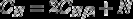


- 公式。表示将两个子数组排序的成本，表示用

好满足分治递归的

切分元素和所有数组元素进行比较的成本。由归并排序的命题 F 的证明可知，这个递归公式的


- 。尽管事情并不总会这么顺利，但平均而言切分元素都能落在数组的中间。将

解每个切分位置的概率都考虑进去只会使递归更加复杂、更难解决，但最终结果还是类似的。我们对快速排序的信心来自于这个结论的证明。如果你不喜欢数学公式，可以跳过这个证明，相信它即可；如果你喜欢，你会发现它很有趣。

- 命题 K。将长度为的无重复数组排序，快速排序平均需要次比较（以及 1/6

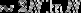

- 的交换）。

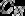

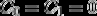

- 为将个不同元素排序平均所需的比较次数。显然证明。令，对于

- ，由递归程序可以得到以下归纳关系：

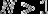

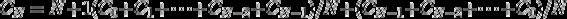

- ），第二项是将左子数组（长度可能是 0 到

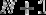

- 第一项是切分的成本（总是）排序

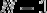

- 的平均成本，第三项是将右子数组（长度和左子数组相同）排序的平均成本。将等式左右两并整理各项得到：边乘以

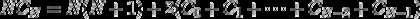

- 时的相同等式可得：将该等式减去

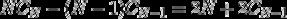

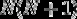

- 可得：整理等式并将两边除以


- 归纳法推导可得：


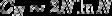

- 括号内的量是曲线 2/x 下从 3 到的离散近似面积加一，积分得到。注意

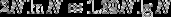

- ，也就是说平均比较次数只比最好情况多 39%。到要得到命题中的交换次数需要一个类似（但更加复杂的）分析。

在实际应用中，当数组元素可能重复时，精确的分析会相当复杂，但不难证明即使存在重复的

- （在 2.3.3.3 节中我们会改进快速排序在这种情况下的性

元素，平均比较次数也不会大于能）。

尽管快速排序有很多优点，它的基本实现仍有一个潜在的缺点：在切分不平衡时这个程序可能会极为低效。例如，如果第一次从最小的元素切分，第二次从第二小的元素切分，如此这般，每次调用只会移除一个元素。这会导致一个大子数组需要切分很多次。我们要在快速排序前将数组随机排序的主要原因就是要避免这种情况。它能够使产生糟糕的切分的可能性降到极低，我们就无需为此担心了。

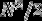

- 命题 L。快速排序最多需要约次比较，但随机打乱数组能够预防这种情况。证明。根据刚才的证明，在每次切分后两个子数组之一总是空的情况下，比较次数为：

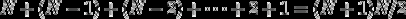

- 这不仅说明算法所需的时间是平方级别的，也显示了算法所需的空间是线性的，而这对于大数组来说是不可接受的。但是（经过一些复杂的工作）通过扩展对一般情况的分析我们可以

- 的增大，运行时间会趋近于平均数，且得到比较次数的标准差约为。因此，随着

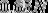

- 不可能与平均数偏差太大。例如，对于一个有 100 万个元素的数组，由 Chebyshev 不等式可以粗略地估计出运行时间是平均所需时间的 10 倍的概率小于 0.000 01（且真实的概率还要小得多）。对于大数组，运行时间是平方级别的概率小到可以忽略不计（请见练习2.3.10）。例如，快速排序所用的比较次数和插入排序或者选择排序一样多的概率比你的电脑在排序时被闪电击中的概率都要小得多！


- 的数组，算法 2.5 的运行时间在的某个常

总的来说，可以肯定的是对于大小为

数因子的范围之内。归并排序也能做到这一点，但是快速排序一般会更快（尽管它的比较次数多 39%），因为它移动数据的次数更少。这些保证都来自于数学概率，你完全可以相信它。

### 2.3.3　算法改进

快速排序是由 C.A.R Hoare 在 1960 年发明的，从那时起就有很多人在研究并改进它。改进快速排序总是那么吸引人，发明更快的排序算法就好像是计算机科学界的“老鼠夹子”，而快速排序就是夹子里的那块奶酪。几乎从 Hoare 第一次发表这个算法开始，人们就不断地提出各种改进方法。并不是所有的想法都可行，因为快速排序的平衡性已经非常好，改进所带来的提高可能会被意外的副作用所抵消。但其中一些，也是我们现在要介绍的，非常有效。

如果你的排序代码会被执行很多次或者会被用在大型数组上（特别是如果它会被发布成一个库函数，排序的对象数组的特性是未知的），那么下面所讨论的这些改进意见值得你参考。需要注意的是，你需要通过实验来确定改进的效果并为实现选择最佳的参数。一般来说它们能将性能提升 20% ～ 30%。

### 2.3.3.1　切换到插入排序

和大多数递归排序算法一样，改进快速排序性能的一个简单办法基于以下两点：

- 对于小数组，快速排序比插入排序慢；

```
因为递归，快速排序的 sort() 方法在小数组中也会调用自己。
```

因此，在排序小数组时应该切换到插入排序。简单地改动算法 2.5 就可以做到这一点：将

```
sort() 中的语句
if (hi <= lo) return;
```

替换成下面这条语句来对小数组使用插入排序：

```
if (hi <= lo + M) { Insertion.sort(a, lo, hi); return; }
转换参数 M 的最佳值是和系统相关的，但是 5 ～ 15 之间的任意值在大多数情况下都能令人满
```

意（请见练习 2.3.25）。

### 2.3.3.2　三取样切分

改进快速排序性能的第二个办法是使用子数组的一小部分元素的中位数来切分数组。这样做得到的切分更好，但代价是需要计算中位数。人们发现将取样大小设为 3 并用大小居中的元素切分的效果最好（请见练习 2.3.18 和练习 2.3.19）。我们还可以将取样元素放在数组末尾作为

```
“哨兵”来去掉 partition() 中的数组边界测试。使用三取样切分的快速排序轨迹如图 2.3.3
```

所示。

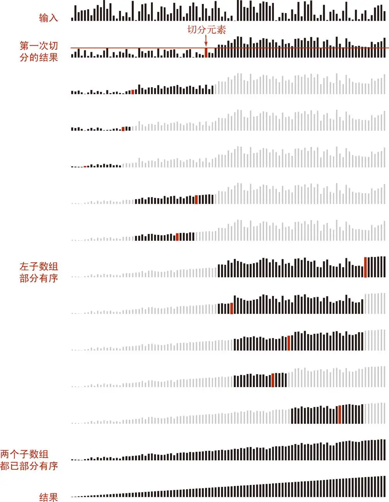

- 图 2.3.3　使用了三取样切分和插入排序转换的快速排序

### 2.3.3.3　熵最优的排序

实际应用中经常会出现含有大量重复元素的数组，例如我们可能需要将大量人员资料按照生日排序，或是按照性别区分开来。在这些情况下，我们实现的快速排序的性能尚可，但还有巨大的改进空间。例如，一个元素全部重复的子数组就不需要继续排序了，但我们的算法还会继续将它切分为更小的数组。在有大量重复元素的情况下，快速排序的递归性会使元素全部重复的子数组经常出现，这就有很大的改进潜力，将当前实现的线性对数级的性能提高到线性级别。

一个简单的想法是将数组切分为三部分，分别对应小于、等于和大于切分元素的数组元素。这种切分实现起来比我们目前使用的二分法更复杂，人们为解决它想出了许多不同的办法。这也是 E. W. Dijkstra 的荷兰国旗问题引发的一道经典的编程练习，因为这就好像用三种可能的主键值将数组排序一样，这三种主键值对应着荷兰国旗上的三种颜色。

Dijkstra 的解法如“三向切分的快速排序”中极为简洁的切分代码所示。它从左到右遍历数组一

```
次，维护一个指针 lt 使得 a[lo..lt-1] 中的元素都小于 v，一个指针 gt 使得
a[gt+1..hi] 中的元素都大于 v，一个指针 i 使得 a[lt..i-1] 中的元素都等于 v，
a[i..gt] 中的元素都还未确定，如图 2.3.4 所示。一开始 i 和 lo 相等，我们使用
Comparable 接口（而非 less()）对 a[i] 进行三向比较来直接处理以下情况：
a[i] 小于 v，将 a[lt] 和 a[i] 交换，将 lt 和 i 加一；
a[i] 大于 v，将 a[gt] 和 a[i] 交换，将 gt 减一；
a[i] 等于 v，将 i 加一。
```

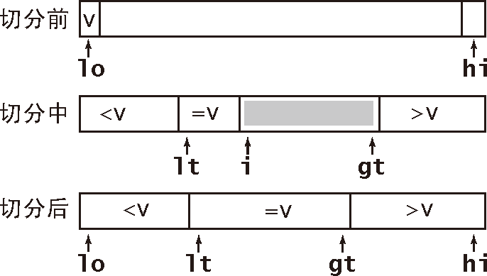

- 图 2.3.4　三向切分的示意图

```
这些操作都会保证数组元素不变且缩小 gt-i 的值（这样循环才会结束）。另外，除非和切分
```

元素相等，其他元素都会被交换。

20 世纪 70 年代，快速排序发布不久后这段代码就出现了，但它并没有流行开来，因为在数组中重复元素不多的普通情况下它比标准的二分法多使用了很多次交换。90 年代，J. Bently 和D. McIlroy 找到一个聪明的方法解决了这个问题（请见练习 2.3.22），使得三向切分的快速排序比归并排序和其他排序方法在包括重复元素很多的实际应用中更快。之后，J. Bently 和 R.Sedgewick 证明了这一点，我们会在下面讨论。

但我们已经证明过归并排序是最优的。如何才能突破它的下界？这个问题的答案在于 2.2 节的命题 I 讨论的是对任意输入的最差性能，而我们目前在讨论时已经知道输入数组的一些信息了。对于含有以任意概率分布的重复元素的输入，归并排序无法保证最佳性能。

三向切分的快速排序的实现如下所示。

- 三向切分的快速排序

```java
public class Quick3way
1
{
2
3
  private static void sort(Comparable[] a, int lo, int hi)
4
  {  // 调用此方法的公有方法sort()请见算法2.5
5
     if (hi <= lo) return;
6
     int lt = lo, i = lo+1, gt = hi;
7
     Comparable v = a[lo];
8
     while (i <= gt)
9
     {
10
        int cmp = a[i].compareTo(v);
11
        if      (cmp < 0) exch(a, lt++, i++);
12
        else if (cmp > 0) exch(a, i, gt--);
13
        else              i++;
14
     }  // 现在 a[lo..lt-1] < v = a[lt..gt] < a[gt+1..hi]成立
15
     sort(a, lo, lt - 1);
16
     sort(a, gt + 1, hi);
17
  }
18
}
19
```

- 这段排序代码的切分能够将和切分元素相等的元素归位，这样它们就不会被包含在递归调用处理的子数组之中了。对于存在大量重复元素的数组，这种方法比标准的快速排序的效率高得多（请见正文）。

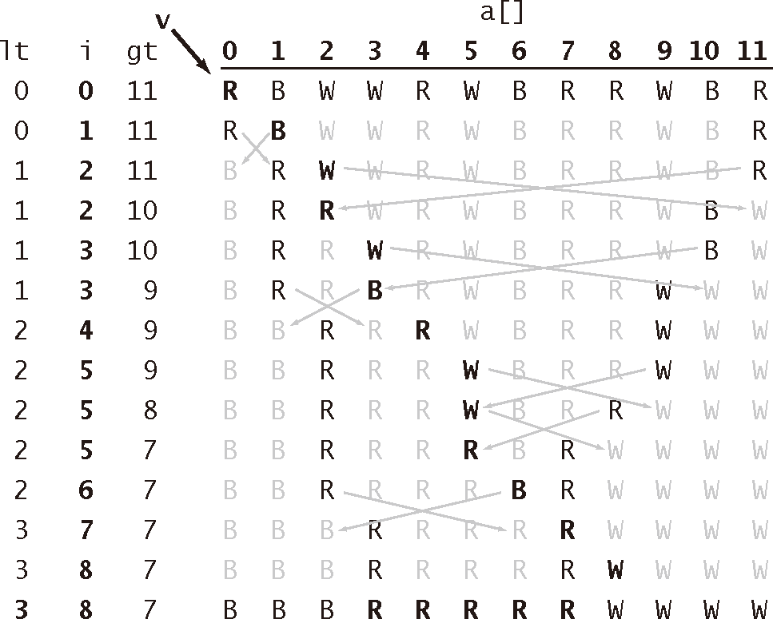

- 三向切分的轨迹（每次迭代循环之后的数组内容）三向分切的快速排序的可视轨迹如图 2.3.5 所示。

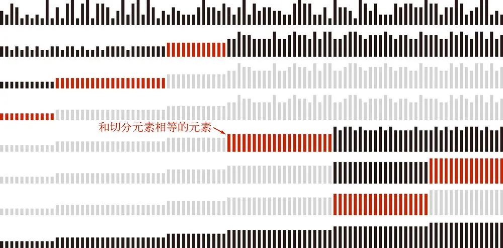

- 图 2.3.5　三向切分的快速排序的可视轨迹

例如，对于只有若干不同主键的随机数组，归并排序的时间复杂度是线性对数的，而三向切分

- 倍是运行时间的一个

快速排序则是线性的。从上面的可视轨迹就可以看出，主键值数量的

保守的上界。

- 个不同值的个主键，对于从 1

这些准确的结论来自于对主键概率分布的分析。给定包含

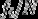

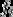

- 的每个为第个主键值出现的次数，为

到

- ，定义，即为随机抽取一个数组元素

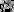

- 个主键值出现的概率。那么所有主键的香农信息量（对信息含量的一种标准的度量方

时第法）可以定义为：

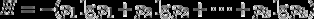

给定任意一个待排序的数组，通过统计每个主键值出现的频率就可以计算出它包含的信息量。值得一提的是，可以通过这个信息量得出三向切分的快速排序所需要的比较次数的上下界。

- 命题 M。不存在任何基于比较的排序算法能够保证在次比较之内将个元素排

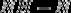

- 为由主键值出现频率定义的香农信息量。序，其中

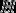

- 略证。将 2.2 节的命题 I 中下界的证明（相对简单地）一般化即可证明该结论。


- 命题 N。对于大小为的数组，三向切分的快速排序需要次比较。其中

- 为由主键值出现频率定义的香农信息量。略证。将命题 K 中快速排序的普通情况的分析（相对困难地）通用化即可证明该结论。在所有主键都不重复的情况下，它比最优解所需比较多 39%（但仍在常数因子的范围之内）。

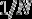

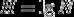

- ），这和 2.2 节的

请注意，当所有的主键值均不重复时有

- （所有主键的概率均为

命题 I 以及命题 K 是一致的。三向切分的最坏情况正是所有主键均不相同。当存在重复主键时，它的性能就会比归并排序好得多。更重要的是，这两个性质一起说明了三向切分是信息量最优的，即对于任意分布的输入，最优的基于比较的算法平均所需的比较次数和三向切分的快速排序平均所需的比较次数相互处于常数因子范围之内。

对于标准的快速排序，随着数组规模的增大其运行时间会趋于平均运行时间，大幅偏离的情况

- 倍是成正比

非常罕见，因此可以肯定三向切分的快速排序的运行时间和输入的信息量的

的。在实际应用中这个性质很重要，因为对于包含大量重复元素的数组，它将排序时间从线性对数级降低到了线性级别。这和元素的排列顺序没有关系，因为算法会在排序之前将其打乱以避免最坏情况。元素的概率分布决定了信息量的大小，没有基于比较的排序算法能够用少于信息量决定的比较次数完成排序。这种对重复元素的适应性使得三向切分的快速排序成为排序库函数的最佳算法选择——需要将包含大量重复元素的数组排序的用例很常见。

经过精心调优的快速排序在绝大多数计算机上的绝大多数应用中都会比其他基于比较的排序算法更快。快速排序在今天的计算机业界中的广泛应用正是因为我们讨论过的数学模型说明了它在实际应用中比其他方法的性能更好，而近几十年的大量实验和经验也证明了这个结论。

在第 5 章中我们会发现，这些并不是快速排序发展的终点，因为有人研究出了完全不需要比较的排序算法！但快速排序的另一个版本在那个环境下仍然是最棒的，和这里一样。

### 答疑

问　有没有将数组平分的办法，而不是根据切分元素的最后位置来切分数组？

答　这个问题困扰了专家们十多年。这和用数组的中位数切分的想法类似。我们在 2.5.3.4 节中讨论了寻找中位数的问题。在线性时间内找到是可能的，但用现有的算法（基于快速排序的切分），这么做的代价远远超过将数组平分而节省的 39%。

问　随机地将数组打乱似乎占了排序用时的一大部分，这么做值得吗？

答　值得。这能够防止出现最坏情况并使运行时间可以预计。Hoare 在 1960 年提出这个算法的时候就推荐了这种方法——它是一种（也是第一批）偏爱随机性的算法。

问　为什么都将注意力放在重复元素上？

答　这个问题直接影响到实际应用中的性能。它曾被忽略了数十年，结果是一些老的实现对含有大量重复元素的数组排序时用时超过平方级别，这在实际应用中肯定出现过。像算法 2.5 等较好的实现对于这种数组的复杂度是线性对数级别的，但在很多情况下，如本节最后将其改进为信息量最佳的线性级别是很值得的。

### 练习

```
2.3.1　按照partition() 方法的轨迹的格式给出该方法是如何切分数组 E A S Y Q U E
S T I O N 的。
2.3.2　按照本节中快速排序所示轨迹的格式给出快速排序是如何将数组 E A S Y Q U E S
T I O N 排序的（出于练习的目的，可以忽略开头打乱数组的部分）。
 的数组，在 Quick.sort() 执行时，其最大的元素最多会被交换多少
```

2.3.3　对于长度为

次？

2.3.4　假如跳过开头打乱数组的操作，给出六个含有 10 个元素的数组，使得

```
Quick.sort() 所需的比较次数达到最坏情况。
```

2.3.5　给出一段代码将已知只有两种主键值的数组排序。

2.3.6　编写一段代码来计算

- 的准确值，在、1000 和 10 000 的情况下比较准确

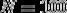

- 的差距。

值和估计值

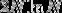

2.3.7　在使用快速排序将

- 个不重复的元素排序时，计算大小为 0、1 和 2 的子数组的数

量。如果你喜欢数学，请推导；如果你不喜欢，请做一些实验并提出猜想。

```
2.3.8　Quick.sort() 在处理
```

- 个全部重复的元素时大约需要多少次比较？

```
2.3.9　请说明 Quick.sort() 在处理只有两种主键值的数组时的行为，以及在处理只有三种
```

主键值的数组时的行为。


2.3.10　Chebyshev 不等式表明，一个随机变量的标准差距离均值大于

- 的概率小于。万，用 Chebyshev 不等式计算快速排序所使用的比较次数大于 1000 亿次的概

对于


率（

- ）。

2.3.11　假如在遇到和切分元素重复的元素时我们继续扫描数组而不是停下来，证明使用这种方法的快速排序在处理只有若干种元素值的数组时的运行时间是平方级别的。

```
2.3.12　按照代码所示轨迹的格式给出信息量最佳的快速排序第一次是如何切分数组 B A B
A B A B A C A D A B R A 的。
```

2.3.13　在最佳、平均和最坏情况下，快速排序的递归深度分别是多少？这决定了系统为了追踪递归调用所需的栈的大小。在最坏情况下保证递归深度为数组大小的对数级的方法请见练习2.3.20。

2.3.14　证明在用快速排序处理大小为

- 的不重复数组时，比较第大和第大元素的概率为

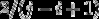

- ，并用该结论证明命题 K。

### 提高题

2.3.15　螺丝和螺帽。(G. J. E. Rawlins) 假设有

- 个螺丝和个螺帽混在一堆，你需要快速

将它们配对。一个螺丝只会匹配一个螺帽，一个螺帽也只会匹配一个螺丝。你可以试着把一个螺丝和一个螺帽拧在一起看看谁大了，但不能直接比较两个螺丝或者两个螺帽。给出一个解决这个问题的有效方法。

```
2.3.16　最佳情况　编写一段程序来生成使算法 2.5 中的 sort() 方法表现最佳的数组（无重
```

- 且不包含重复元素，每次切分后两个子数组的大小最多差 1（子数组

复元素）：数组大小为

- 个相同元素的数组的切分情况相同）。（对于这道练习，我们不需要在排序开

的大小与含有

始时打乱数组。）以下练习描述了快速排序的几个变体。它们每个都需要分别实现，但你也很自然地希望使用 SortCompare 进行实验来评估每种改动的效果。

```
2.3.17　哨兵。修改算法 2.5，去掉内循环 while 中的边界检查。由于切分元素本身就是一个
哨兵（v 不可能小于 a[lo]），左侧边界的检查是多余的。要去掉另一个检查，可以在打乱数
组后将数组的最大元素放在 a[length-1] 中。该元素永远不会移动（除非和相等的元素交
```

换），可以在所有包含它的子数组中成为哨兵。注意：在处理内部子数组时，右子数组中最左侧的元素可以作为左子数组右边界的哨兵。

2.3.18　三取样切分。为快速排序实现正文所述的三取样切分（参见 2.3.3.2 节）。运行双倍测试来确认这项改动的效果。

2.3.19　五取样切分。实现一种基于随机抽取子数组中 5 个元素并取中位数进行切分的快速排序。将取样元素放在数组的一侧以保证只有中位数元素参与了切分。运行双倍测试来确定这项改动的效果，并和标准的快速排序以及三取样切分的快速排序（请见上一道练习）进行比较。附加题：找到一种对于任意输入都只需要少于 7 次比较的五取样算法。

2.3.20　非递归的快速排序。实现一个非递归的快速排序，使用一个循环来将弹出栈的子数组切分并将结果子数组重新压入栈。注意：先将较大的子数组压入栈，这样就可以保证栈最多只


- 个元素。

会有

2.3.21　将重复元素排序的比较次数的下界。完成命题 M 的证明的第一部分。参考命题 I 的证

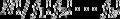

- 个主键值时所有元素存在种不同的排列，其中第个主键值

明并注意当有

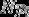

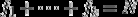

- ，按照命题 M 的记法），且

出现的频率为

- （即。

2.3.22　快速三向切分。（J. Bently，D. McIlroy）用将重复元素放置于子数组两端的方式实现

```
一个信息量最优的排序算法。使用两个索引 p 和 q，使得 a[lo..p-1] 和 a[q+1..hi] 的
元素都和 a[lo] 相等。使用另外两个索引 i 和 j，使得 a[p..i-1] 小于 a[lo]，
a[j+i..q] 大于 a[lo]。在内循环中加入代码，在 a[i] 和 v 相当时将其与 a[p] 交换
（并将 p 加 1），在 a[j] 和 v 相等且 a[i] 和 a[j] 尚未和 v 进行比较之前将其与 a[q]
交换。添加在切分循环结束后将和 v 相等的元素交换到正确位置的代码，如图 2.3.6 所示。请
```

注意：这里实现的代码和正文中给出的代码是等价的，因为这里额外的交换用于和切分元素相等的元素，而正文中的代码将额外的交换用于和切分元素不等的元素。

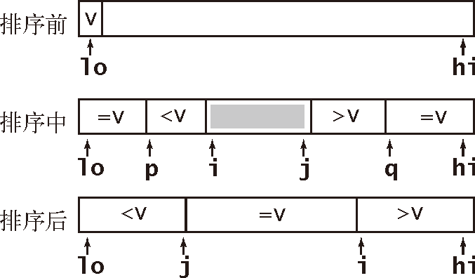

- 图 2.3.6　Bently-McIlroy 三向切分

2.3.23　Java 的排序库函数。在练习 2.3.22 的代码中使用 Tukey's ninther 方法来找出切分元素——选择三组，每组三个元素，分别取三组元素的中位数，然后取三个中位数的中位数作为切分元素，且在排序小数组时切换到插入排序。


2.3.24　取样排序。（W. Frazer，A. McKellar）实现一个快速排序，取样大小为

- 。首先

将取样得到的元素排序，然后在递归函数中使用样品的中位数切分。分为两部分的其余样品元素无需再次排序并可以分别应用于原数组的两个子数组。这种算法被称为取样排序。

### 实验题

2.3.25　切换到插入排序。实现一个快速排序，在子数组元素少于

- 时切换到插入排序。用


- 分别为和的随机数组，根据经验给出使其在你的计

快速排序处理大小

- 、、

- 值。将从 0 变化到 30 的每个值所得到的平均运行时间绘成曲

算环境中运行速度最快的

```
线。注意：你需要为算法 2.2 添加一个需要三个参数的 sort() 方法以使
Insertion.sort(a, lo, hi) 将子数组 a[lo..hi] 排序。
```

2.3.26　子数组的大小。编写一个程序，在快速排序处理大小为

- 的数组的过程中，当子数

- 时，排序方法需要切换为插入排序。将子数组的大小绘制成直方图。用

组的大小小于

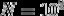

- 、20 和 50 测试你的程序。，

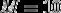

2.3.27　忽略小数组。用实验对比以下处理小数组的方法和练习 2.3.25 的处理方法的效果：在快速排序中直接忽略小数组，仅在快速排序结束后运行一次插入排序。注意：可以通过这些实验估计出电脑的缓存大小，因为当数组大小超出缓存时这种方法的性能可能会下降。

2.3.28　递归深度。用经验性的研究估计切换阈值为

- 的快速排序在将大小为的不重复数


- 、20 和 50，和

组排序时的平均递归深度，其中

- 、、。

2.3.29　随机化。用经验性的研究对比随机选择切分元素和正文所述的一开始就将数组随机化

- 时进行切换，将大小为的不重复数组排序，其中

这两种策略的效果。在子数组大小为

- 、20 和 50，和、、。

2.3.30　极端情况。用初始随机化和非初始随机化的快速排序测试练习 2.1.35 和练习 2.1.36中描述的大型非随机数组。在将这些大数组排序时，乱序对快速排序的性能有何影响？

2.3.31　运行时间直方图。编写一个程序，接受命令行参数

- 和，用快速排序对大小为


- 次排序，并将所有运行时间绘制成直方图。令

的随机浮点数数组进行

- 、、

- 值越大越好。这个练习最关键的地方在于找到适当的比例绘制

和

- ，为了使曲线更平滑，

出实验结果。
