# 2.4优先队列

许多应用程序都需要处理有序的元素，但不一定要求它们全部有序，或是不一定要一次就将它们排序。很多情况下我们会收集一些元素，处理当前键值最大的元素，然后再收集更多的元素，再处理当前键值最大的元素，如此这般。例如，你可能有一台能够同时运行多个应用程序的电脑（或者手机）。这是通过为每个应用程序的事件分配一个优先级，并总是处理下一个优先级最高的事件来实现的。例如，绝大多数手机分配给来电的优先级都会比游戏程序的高。

在这种情况下，一个合适的数据结构应该支持两种操作：删除最大元素和插入元素。这种数据类型叫做优先队列。优先队列的使用和队列（删除最老的元素）以及栈（删除最新的元素）类似，但高效地实现它则更有挑战性。

在本节中，简单地讨论优先队列的基本表现形式（其一或者两种操作都能在线性时间内完成）之后，我们会学习基于二叉堆数据结构的一种优先队列的经典实现方法，用数组保存元素并按照一定条件排序，以实现高效地（对数级别的）删除最大元素和插入元素操作。

优先队列的一些重要的应用场景包括模拟系统，其中事件的键即为发生的时间，而系统需要按照时间顺序处理所有事件；任务调度，其中键值对应的优先级决定了应该首先执行哪些任务；数值计算，键值代表计算错误，而我们需要按照键值指定的顺序来修正它们。在第 6 章中我们会学习一个具体的例子，展示优先队列在粒子碰撞模拟中的应用。

通过插入一列元素然后一个个地删掉其中最小的元素，我们可以用优先队列实现排序算法。一种名为堆排序的重要排序算法也来自于基于堆的优先队列的实现。稍后在本书中我们会学习如何用优先队列构造其他算法。在第 4 章中我们会看到优先队列如何恰到好处地抽象若干重要的图搜索算法；在第 5 章中，我们将使用本节所示的方法开发出一种数据压缩算法。这些只是优先队列作为算法设计工具所起到的举足轻重的作用的一部分例子。

### 2.4.1　API

优先队列是一种抽象数据类型（请见 1.2 节），它表示了一组值和对这些值的操作，它的抽象层使我们能够方便地将应用程序（用例）和我们将在本节中学习的各种具体实现隔离开来。和1.2 节一样，我们会详细定义一组应用程序编程接口（API）来为数据结构的用例提供足够的信息（参见表 2.4.1）。优先队列最重要的操作就是删除最大元素和插入元素，所以我们会把精

```sql
力集中在它们身上。删除最大元素的方法名为 delMax()，插入元素的方法名为
insert()。按照惯例，我们只会通过辅助函数 less() 来比较两个元素，和排序算法一
```

样。如果允许重复元素，最大表示的是所有最大元素之一。为了将 API 定义完整，我们还需要加入构造函数（和我们在栈以及队列中使用的类似）和一个空队列测试方法。为了保证灵活

```
性，我们在实现中使用了泛型，将实现了 Comparable 接口的数据的类型作为参数 Key。这
```

使得我们可以不必再区别元素和元素的键，对数据类型和算法的描述也将更加清晰和简洁。例如，我们将用“最大元素”代替“最大键值”或是“键值最大的元素”。

表 2.4.1　泛型优先队列的 API

```java
public class  <b>MaxPQ</b><Key extends Comparable<Key>>
              MaxPQ()
```

- 创建一个优先队列

```sql
              MaxPQ(int max)
创建一个初始容量为 max 的优先队列
              MaxPQ(Key[] a)
用 a[] 中的元素创建一个优先队列
         void Insert(Key v)
```

- 向优先队列中插入一个元素

```
          Key max()
```

- 返回最大元素

```
          Key delMax()
```

- 删除并返回最大元素

```
      boolean isEmpty()
```

- 返回队列是否为空

```
          int size()
```

- 返回优先队列中的元素个数

为了用例代码的方便，API 包含的三个构造函数使得用例可以构造指定大小的优先队列（还可以用给定的一个数组将其初始化）。为了使用例代码更加清晰，我们会在适当的地方使用另一

```
个类 MinPQ。它和 MaxPQ 类似，只是含有一个 delMin() 方法来删除并返回队列中键值最
小的那个元素。MaxPQ 的任意实现都能很容易地转化为 MinPQ 的实现，反之亦然，只需要改
变一下 less() 比较的方向即可。
```

优先队列的调用示例

- 个字符串，每个字符串都对映

为了展示优先队列的抽象模型的价值，考虑以下问题：输入


- 个整数（及其关联的字符串）。

着一个整数，你的任务就是从中找出最大的（或是最小的）


这些输入可能是金融事务，你需要从中找出最大的那些；或是农产品中的杀虫剂含量，这时你需要从中找出最小的那些；或是服务请求、科学实验的结果，或是其他应用。在某些应用场景中，输入量可能非常巨大，甚至可以认为输入是无限的。解决这个问题的一种方法是将输入排

- 个最大的元素，但我们已经说明输入将会非常庞大。另一种方法是将每个

序然后从中找出

- 个最大元素比较，但除非较小，否则这种比较的代价会非常高昂。

新的输入和已知的

```sql
只要我们能够高效地实现 insert() 和 delMin()，下面的优先队列用例中调用了 MinPQ
的 TopM 就能使用优先队列解决这个问题，这就是本节中我们的目标。在现代基础性计算环境
```

- 非常常见，这些实现使我们能够解决以前缺乏足够资源去解决的问题，如表

中超大的输入

2.4.2 所示。

表 2.4.2　从

- 个输入中找到最大的个元素所需成本

- 增长的数量级

示例

- 时间空间

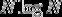

排序算法的用例

调用初级实现的优先队列

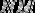

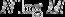

调用基于堆实现的优先队列

- 一个优先队列的用例

```java
public class TopM
1
{
2
  public static void main(String[] args)
3
  {  // 打印输入流中最大的M行
4
     int M = Integer.parseInt(args[0]);
5
     MinPQ<Transaction> pq = new MinPQ<Transaction>(M+1);
6
     while (StdIn.hasNextLine())
7
     {  // 为下一行输入创建一个元素并放入优先队列中
8
        pq.insert(new Transaction(StdIn.readLine()));
9
        if (pq.size() > M)
10
        pq.delMin();        // 如果优先队列中存在M+1个元素则删除其中最小的元素
11
     }  // 最大的M个元素都在优先队列中
12
13
     Stack<Transaction> stack = new Stack<Transaction>();
14
     while (!pq.isEmpty()) stack.push(pq.delMin());
15
     for (Transaction t : stack) StdOut.println(t);
16
  }
17
}
18
```

- 从输入流获得一系列字符串，输入流的每一行表示一个交易。这从命令行输入一个整数

```
 行。它用到了 Transaction 类（请见表
```

- 段代码调用了 MinPQ 并会打印数字最大的

- 1.2.6、练习 1.2.19 和练习 2.1.21），构造了一个用数字作为键的优先队列。当优先队列的时就删掉其中最小的元素。处理完所有交易，优先队列中存放着以增序排列的大小超过

- 最大的 M 个交易，然后这段代码将它们放入到一个栈中，遍历这个栈以颠倒它们的顺序，从而将它们按降序打印出来。

```
% more tinyBatch.txt
1
Turing      6/17/1990   644.08
2
vonNeumann  3/26/2002  4121.85
3
Dijkstra    8/22/2007  2678.40
4
vonNeumann  1/11/1999  4409.74
5
Dijkstra   11/18/1995   837.42
6
Hoare       5/10/1993  3229.27
7
vonNeumann  2/12/1994  4732.35
8
Hoare       8/18/1992  4381.21
9
Turing      1/11/2002    66.10
10
Thompson    2/27/2000  4747.08
11
Turing      2/11/1991  2156.86
12
Hoare       8/12/2003  1025.70
13
vonNeumann 10/13/1993  2520.97
14
Dijkstra    9/10/2000   708.95
15
Turing     10/12/1993  3532.36
16
Hoare       2/10/2005  4050.20
17
```

```
% java TopM 5 < tinyBatch.txt
1
Thompson    2/27/2000  4747.08
2
vonNeumann  2/12/1994  4732.35
3
vonNeumann  1/11/1999  4409.74
4
Hoare       8/18/1992  4381.21
5
vonNeumann  3/26/2002  4121.85
6
```

### 2.4.2　初级实现

我们在第 1 章中讨论过的 4 种基础数据结构是实现优先队列的起点。我们可以使用有序或无序的数组或链表。在队列较小时，大量使用两种主要操作之一时，或是所操作元素的顺序已知时，它们十分有用。因为这些实现相对简单，我们在这里只给出文字描述并将实现代码作为练习（请见练习 2.4.3）。

### 2.4.2.1　数组实现（无序）

```sql
或许实现优先队列的最简单方法就是基于 2.1 节中下压栈的代码。insert() 方法的代码和栈
的 push() 方法完全一样。要实现删除最大元素，我们可以添加一段类似于选择排序的内循
环的代码，将最大元素和边界元素交换然后删除它，和我们对栈的 pop() 方法的实现一样。
```

和栈类似，我们也可以加入调整数组大小的代码来保证数据结构中至少含有四分之一的元素而又永远不会溢出。

### 2.4.2.2　数组实现（有序）

```sql
另一种方法就是在 insert() 方法中添加代码，将所有较大的元素向右边移动一格以使数组
```

保持有序（和插入排序一样）。这样，最大的元素总会在数组的一边，优先队列的删除最大元

```
素操作就和栈的 pop() 操作一样了。
```

### 2.4.2.3　链表表示法

```
和刚才类似，我们可以用基于链表的下压栈的代码作为基础，而后可以选择修改 pop() 来找
到并返回最大元素，或是修改 push() 来保证所有元素为逆序并用 pop() 来删除并返回链表
```

的首元素（也就是最大的元素）。

使用无序序列是解决这个问题的惰性方法，我们仅在必要的时候才会采取行动（找出最大元素）；使用有序序列则是解决问题的积极方法，因为我们会尽可能未雨绸缪（在插入元素时就保持列表有序），使后续操作更高效。

实现栈或是队列与实现优先队列的最大不同在于对性能的要求。对于栈和队列，我们的实现能够在常数时间内完成所有操作；而对于优先队列，我们刚刚讨论过的所有初级实现中，插入元素和删除最大元素这两个操作之一在最坏情况下需要线性时间来完成（如表 2.4.3 所示）。我们接下来要讨论的基于数据结构堆的实现能够保证这两种操作都能更快地执行。

表 2.4.3　优先队列的各种实现在最坏情况下运行时间的增长数量级

数据结构

- 插入元素删除最大元素

- 1

有序数组

- 1

无序数组

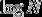

堆

- 11

理想情况

在一个优先队列上执行的一系列操作如表 2.4.4 所示。

表 2.4.4　在一个优先队列上执行的一系列操作

操作

- 参数返回值大小内容（无序）内容（有序）

```
P
1
```

插入元素

- PP

```
Q
2
P  <b>Q</b>
P  <b>Q</b>
```

插入元素

```xml
E
3
P  Q  <b>E</b>
<b>E</b>  P
```

插入元素

```
2
P  E
E  P
```

删除最大元素

- Q

```
X
3
P  E  <b>X</b>
E  P  <b>X</
```

插入元素

```xml
A
4
P  E  X  <b>A</b>
<b>A</b>  E
```

插入元素

```
M
5
P  E  X  A  <b>M</b>
A  E  <b>M</
```

插入元素

### 2.4.3　堆的定义

数据结构二叉堆能够很好地实现优先队列的基本操作。在二叉堆的数组中，每个元素都要保证大于等于另两个特定位置的元素。相应地，这些位置的元素又至少要大于等于数组中的另两个元素，以此类推。如果我们将所有元素画成一棵二叉树，将每个较大元素和两个较小的元素用边连接就可以很容易看出这种结构。

- 定义。当一棵二叉树的每个结点都大于等于它的两个子结点时，它被称为堆有序。

相应地，在堆有序的二叉树中，每个结点都小于等于它的父结点（如果有的话）。从任意结点向上，我们都能得到一列非递减的元素；从任意结点向下，我们都能得到一列非递增的元素。特别地：

- 命题 O。根结点是堆有序的二叉树中的最大结点。证明。根据树的性质归纳可得。

二叉堆表示法

如果我们用指针来表示堆有序的二叉树，那么每个元素都需要三个指针来找到它的上下结点（父结点和两个子结点各需要一个）。但如图 2.4.1 所示，如果我们使用完全二叉树，表达就会变得特别方便。要画出这样一棵完全二叉树，可以先定下根结点，然后一层一层地由上向

- 个结点全部连接完毕。完

下、从左至右，在每个结点的下方连接两个更小的结点，直至将

全二叉树只用数组而不需要指针就可以表示。具体方法就是将二叉树的结点按照层级顺序放入数组中，根结点在位置 1，它的子结点在位置 2 和 3，而子结点的子结点则分别在位置 4、5、6 和 7，以此类推。

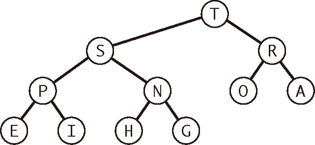

- 图 2.4.1　一棵堆有序的完全二叉树

- 定义。二叉堆是一组能够用堆有序的完全二叉树排序的元素，并在数组中按照层级储存（不使用数组的第一个位置）。

- 的结点的父结点的位置为

（简单起见，在下文中我们将二叉堆简称为堆）在一个堆中，位置

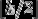

- 和

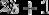

- ，而它的两个子结点的位置则分别为。这样在不使用指针的情况下（我们

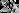

在第 3 章中讨论二叉树时会用到它们）我们也可以通过计算数组的索引在树中上下移动：从

```
a[k] 向上一层就令 k 等于 k/2，向下一层则令 k 等于 2k 或 2k+1。
```

用数组（堆）实现的完全二叉树的结构是很严格的，但它的灵活性已经足以让我们高效地实现优先队列。用它们我们将能实现对数级别的插入元素和删除最大元素的操作。利用在数组中无需指针即可沿树上下移动的便利和以下性质，算法保证了对数复杂度的性能。


- 命题 P。一棵大小为的完全二叉树的高度为。

- 达到 2 的幂时树的高度会加 1。证明。通过归纳很容易可以证明这一点，且当

堆的表示如图 2.4.2 所示。

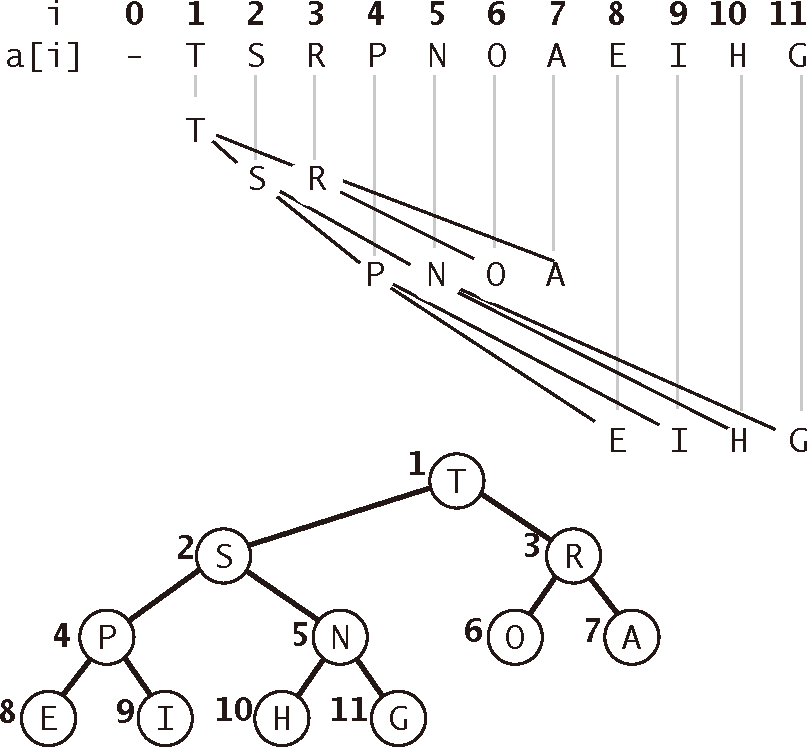

- 图 2.4.2　堆的表示

### 2.4.4　堆的算法

```
 的私有数组 pq[] 来表示一个大小为
 的堆，我们不会使用 pq[0]，堆
```

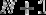

我们用长度为

```
元素放在 pq[1] 至 pq[N] 中。在排序算法中，我们只通过私有辅助函数 less() 和
exch() 来访问元素，但因为所有的元素都在数组 pq[] 中，我们在 2.4.4.2 节中会使用更加
```

紧凑的实现方式，不再将数组作为参数传递。堆的操作会首先进行一些简单的改动，打破堆的状态，然后再遍历堆并按照要求将堆的状态恢复。我们称这个过程叫做堆的有序化（reheapifying）。

```java
private boolean less(int i, int j)
{  return pq[i].compareTo(pq[j]) < 0;  }
private void exch(int i, int j)
{  Key t = pq[i]; pq[i] = pq[j]; pq[j] = t;  }
```

堆实现的比较和交换方法

堆实现的比较和交换方法如右上方的代码框所示。

在有序化的过程中我们会遇到两种情况。当某个结点的优先级上升（或是在堆底加入一个新的元素）时，我们需要由下至上恢复堆的顺序。当某个结点的优先级下降（例如，将根结点替换为一个较小的元素）时，我们需要由上至下恢复堆的顺序。首先，我们会学习如何实现这两种辅助操作，然后再用它们实现插入元素和删除最大元素的操作。

### 2.4.4.1　由下至上的堆有序化（上浮）

```java
private void swim(int k)
{
  while (k > 1 && less(k/2, k))
  {
     exch(k/2, k);
     k = k/2;
  }
}
```

由下至上的堆有序化（上浮）的实现如果堆的有序状态因为某个结点变得比它的父结点更大而被打破，那么我们就需要通过交换它和它的父结点来修复堆。交换后，这个结点比它的两个子结点都大（一个是曾经的父结点，另一个比它更小，因为它是曾经父结点的子结点），但这个结点仍然可能比它现在的父结点更大。我们可以一遍遍地用同样的办法恢复秩序，将这个结点不断向上移动直到我们遇到了一个

- 的结点的父结点的位置是

更大的父结点。只要记住位置

- ，这个过程实现起来很简单。

```
swim() 方法中的循环可以保证只有位置
```

- 上的结点大于它的父结点时堆的有序状态才会被打

破。因此只要该结点不再大于它的父结点，堆的有序状态就恢复了。至于方法名，当一个结点太大的时候它需要浮（swim）到堆的更高层。由下至上的堆有序化的实现代码如右上方所示。

图 2.4.3 展示的是由下至上的堆有序化示意图。

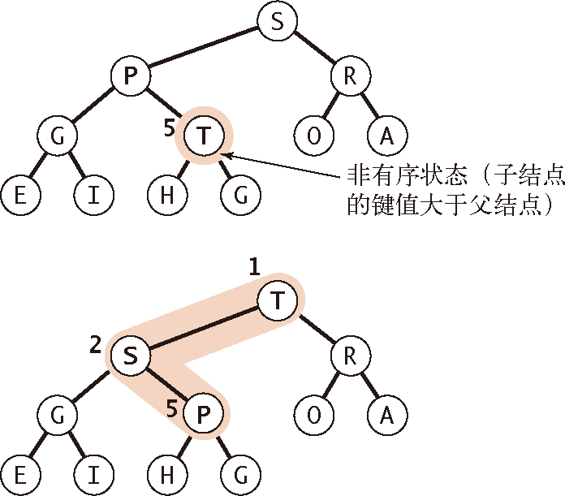

- 图 2.4.3　由下至上的堆有序化（上浮）

### 2.4.4.2　由上至下的堆有序化（下沉）

如果堆的有序状态因为某个结点变得比它的两个子结点或是其中之一更小了而被打破了，那么我们可以通过将它和它的两个子结点中的较大者交换来恢复堆。交换可能会在子结点处继续打破堆的有序状态，因此我们需要不断地用相同的方式将其修复，将结点向下移动直到它的子结

- 的结点的子结点位于和可以直接得

点都比它更小或是到达了堆的底部。由位置为

到对应的代码。至于方法名，由上至下的堆有序化的示意图及实现代码分别见图 2.4.4 和下页的代码框。当一个结点太小的时候它需要沉（sink）到堆的更低层。

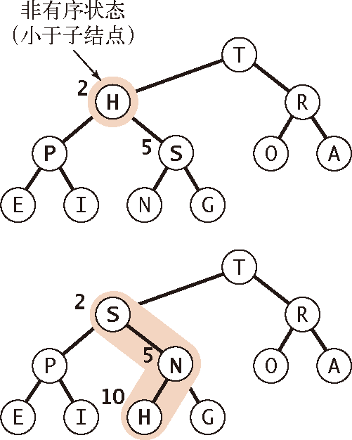

- 图 2.4.4　由上至下的堆有序化（下沉）

如果我们把堆想象成一个严密的黑社会组织，每个子结点都表示一个下属（父结点则表示它的

```
直接上级），那么这些操作就可以得到很有趣的解释。swim() 表示一个很有能力的新人加入
组织并被逐级提升（将能力不够的上级踩在脚下），直到他遇到了一个更强的领导。sink()
```

则类似于整个社团的领导退休并被外来者取代之后，如果他的下属比他更厉害，他们的角色就会交换，这种交换会持续下去直到他的能力比其下属都强为止。这些理想化的情景在现实生活中可能很罕见，但它们能够帮助你理解堆的这些基本行为。

```
sink() 和 swim() 方法是高效实现优先队列 API 的基础，原因如下（具体的实现请见算法
```

2.6）。

```java
private void sink(int k)
{
  while (2*k <= N)
  {
     int j = 2*k;
     if (j < N && less(j, j+1)) j++;
     if (!less(k, j)) break;
     exch(k, j);
     k = j;
  }
}
```

由上至下的堆有序化（下沉）的实现

插入元素。我们将新元素加到数组末尾，增加堆的大小并让这个新元素上浮到合适的位置（如图 2.4.5 左半部分所示）。

删除最大元素。我们从数组顶端删去最大的元素并将数组的最后一个元素放到顶端，减小堆的大小并让这个元素下沉到合适的位置（如图 2.4.5 右半部分所示）。

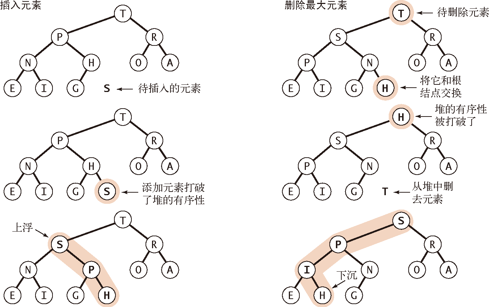

- 图 2.4.5　堆的操作

算法 2.6 解决了我们在本节开始时提出的一个基本问题：它对优先队列 API 的实现能够保证插入元素和删除最大元素这两个操作的用时和队列的大小仅成对数关系。

- 算法 2.6　基于堆的优先队列

```java
public class MaxPQ<Key extends Comparable<Key>>
1
{
2
  private Key[] pq;             // 基于堆的完全按二叉树
3
  private int N = 0;            // 存储于pq[1..N]中，pq[0]没有使用
4
5
  public MaxPQ(int maxN)
6
  {  pq = (Key[]) new Comparable[maxN+1];  }
7
8
  public boolean isEmpty()
9
  {  return N == 0;  }
10
11
  public int size()
12
  {  return N;  }
13
14
  public void insert(Key v)
15
  {
16
     pq[++N] = v;
17
     swim(N);
18
  }
19
20
  public Key delMax()
21
  {
22
     Key max = pq[1];           // 从根结点得到最大元素
23
     exch(1, N--);              // 将其和最后一个结点交换
24
     pq[N+1] = null;            // 防止对象游离
25
     sink(1);                   // 恢复堆的有序性
26
     return max;
27
  }
28
29
  // 辅助方法的实现请见本节前面的代码框
30
  private boolean less(int i, int j)
31
  private void exch(int i, int j)
32
  private void swim(int k)
33
  private void sink(int k)
34
}
35
优先队列由一个基于堆的完全二叉树表示，存储于数组 pq[1..N] 中，pq[0] 没有使用。
在 insert() 中，我们将 N 加一并把新元素添加在数组最后，然后用 swim() 恢复堆的
秩序。在 delMax() 中，我们从 pq[1] 中得到需要返回的元素，然后将 pq[N] 移动到
pq[1]，将 N 减一并用 sink() 恢复堆的秩序。同时我们还将不再使用的 pq[N+1] 设为
null，以便系统回收它所占用的空间。和以前一样（请见 1.3 节），这里省略了动态调整数
```

- 组大小的代码。其他的构造函数请见练习 2.4.19。

- 命题 Q。对于一个含有个元素的基于堆的优先队列，插入元素操作只需不超过（

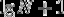

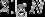

- 次比较。）次比较，删除最大元素的操作需要不超过证明。由命题 P 可知，两种操作都需要在根结点和堆底之间移动元素，而路径的长度不超


- 。对于路径上的每个结点，删除最大元素需要两次比较（除了堆底元素），一次用来过找出较大的子结点，一次用来确定该子结点是否需要上浮。

对于需要大量混杂的插入和删除最大元素操作的典型应用来说，命题 Q 意味着一个重要的性能突破，总结请见表 2.4.3。使用有序或是无序数组的优先队列的初级实现总是需要线性时间来完成其中一种操作，但基于堆的实现则能够保证在对数时间内完成它们。这种差别使得我们能够解决以前无法解决的问题。

### 2.4.4.3　多叉堆

基于用数组表示的完全三叉树构造堆并修改相应的代码并不困难。对于数组中 1 至

- 的个

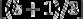

- 的结点大于等于位于和的结点，小于等于位于

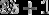

元素，位置

- 、

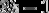

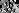

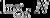

- 叉树也并不困难。我们需要在树高（

的结点。甚至对于给定的

- ，将其修改为任意的个子结点找到最大者的代价之间找到折中，这取决于实现的细节以及不同

）和在每个结点的操作的预期相对频繁程度。

堆上的优先队列操作如图 2.4.6 所示。

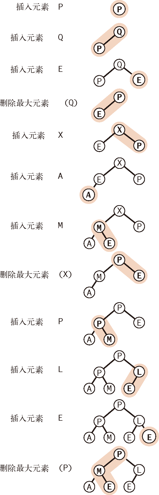

- 图 2.4.6　在堆上的优先队列操作

### 2.4.4.4　调整数组大小

```sql
我们可以添加一个没有参数的构造函数，在 insert() 中添加将数组长度加倍的代码，在
delMax() 中添加将数组长度减半的代码，就像在 1.3 节中的栈那样。这样，算法的用例就无
```

需关注各种队列大小的限制。当优先队列的数组大小可以调整、队列长度可以是任意值时，命题 Q 指出的对数时间复杂度上限就只是针对一般性的队列长度 N 而言了（请见练习 2.4.22）。

### 2.4.4.5　元素的不可变性

优先队列存储了用例创建的对象，但同时假设用例代码不会改变它们（改变它们就可能打破堆的有序性）。我们可以将这个假设转化为强制条件，但程序员通常不会这么做，因为增加代码的复杂性会降低性能。

### 2.4.4.6　索引优先队列

在很多应用中，允许用例引用已经进入优先队列中的元素是有必要的。做到这一点的一种简单

- 的多个元素，

方法是给每个元素一个索引。另外，一种常见的情况是用例已经有了总量为

而且可能还同时使用了多个（平行）数组来存储这些元素的信息。此时，其他无关的用例代码可能已经在使用一个整数索引来引用这些元素了。这些考虑引导我们设计了表 2.4.5 中的API。

表 2.4.5　关联索引的泛型优先队列的 API

```java
public class  <b>IndexMinPQ</b><Item extends Comparable<Item>>
创建一个最大容量为 maxN 的优先队列
              IndexMinPQ(int maxN)
范围为 0 至 maxN-1
        void  insert(int k, Item item)
插入一个元素，将它和索引 k 相关联
        void  change(int k, Item item)
将索引为 k 的元素设为 item
     boolean  contains(int k)
是否存在索引为 k 的元素
        void  delete(int k)
删去索引 k 及其相关联的元素
```

理解这种数据结构的一个较好方法是将它看成一个能够快速访问其中最小元素的数组。事实上它还要更好——它能够快速访问数组的一个特定子集中的最小元素（指所有被插入的元素）。

```sql
换句话说，可以将名为 pq 的 IndexMinPQ 类优先队列看做数组 pq[0..N-1] 中的一部分
元素的代表。将 pq.insert(k, item) 看做将 k 加入这个子集并使 pq[k] = item，
pq.change(k, item) 则代表令 pq[k]=item。这两种操作没有改变其他操作所依赖的数
据结构，其中最重要的就是 delMin()（删除最小元素并返回它的索引）和 change()（改
变数据结构中的某个元素的索引——即 pq[i]=item）。这些操作在许多应用中都很重要并且
```

依赖于对元素的引用（索引）。练习 2.4.33 说明了如何用较少的代码将算法 2.6 扩展为极高效的索引优先队列。一般来说，当堆发生变化时，我们会用下沉（元素减小时）或上浮（元素变大时）操作来恢复堆的有序性。在这些操作中，我们可以用索引查找元素。能够定位堆中的任

```sql
意元素也使我们能够在 API 中加入一个 delete() 操作。
```

- 命题 Q（续）。在一个大小为的索引优先队列中，插入元素（insert）、改变优先级

- （change）、删除（delete）和删除最小元素（remove the minimum）操作所需的比较次数

- 成正比（如表 2.4.6 所示）。和

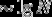

- 证明。已知堆中所有路径最长即为，从代码中很容易得到这个结论。

表 2.4.6　含有

- 个元素的基于堆的索引优先队列所有操作在最坏情况下的成本

操作

- 比较次数的增长数量级

```sql
insert()
```

```
change()
contains()
```

- 1

```sql
delete()
min()
```

- 1

```
minIndex()
```

- 1

这段讨论针对的是找出最小元素的队列；和以前一样，我们也在本书网站上实现了一个找出最大元素的版本 IndexMaxPQ。

### 2.4.4.7　索引优先队列用例

```
下面的用例调用了 IndexMinPQ 的代码 Multiway 解决了多向归并问题：它将多个有序的输
```

入流归并成一个有序的输出流。许多应用中都会遇到这个问题。输入可能来自于多种科学仪器的输出（按时间排序），或是来自多个音乐或电影网站的信息列表（按名称或艺术家名字排序），或是商业交易（按账号或时间排序），或者其他。如果有足够的空间，你可以把它们简单地读入一个数组并排序，但如果用了优先队列，无论输入有多长你都可以把它们全部读入并排序。

- 使用优先队列的多向归并

```java
public class Multiway
1
{
2
  public static void merge(In[] streams)
3
  {
4
     int N = streams.length;
5
     IndexMinPQ<String> pq = new IndexMinPQ<String>(N);
6
7
     for (int i = 0; i < N; i++)
8
        if (!streams[i].isEmpty())
9
            pq.insert(i, streams[i].readString());
10
11
     while (!pq.isEmpty())
12
     {
13
        StdOut.println(pq.min());
14
        int i = pq.delMin();
15
16
        if (!streams[i].isEmpty())
17
            pq.insert(i, streams[i].readString());
18
     }
19
  }
20
21
  public static void main(String[] args)
22
  {
23
    int N = args.length;
24
    In[] streams = new In[N];
25
    for (int i = 0; i < N; i++)
26
        streams[i] = new In(args[i]);
27
    merge(streams);
28
  }
29
}
30
```

- 这段代码调用了 IndexMinPQ 来将作为命令行参数输入的多行有序字符串归并为一行有序的输出（请见正文）。每个输入流的索引都关联着一个元素（输入中的下个字符串）。初始化之后，代码进入一个循环，删除并打印出队列中最小的字符串，然后将该输入的下一个字符串添加为一个元素。为了节约，下面将所有的输出排在了一行——实际输出应该是一个字符串一行。

```
% more m1.txt
1
A B C F G I I Z
2
% more m2.txt
3
B D H P Q Q
4
% more m3.txt
5
A B E F J N
6
% java Multiway m1.txt m2.txt m3.txt
1
A A B B B C D E F F G H I I J N P Q Q Z
2
```

### 2.4.5　堆排序

我们可以把任意优先队列变成一种排序方法。将所有元素插入一个查找最小元素的优先队列，然后再重复调用删除最小元素的操作来将它们按顺序删去。用无序数组实现的优先队列这么做相当于进行一次插入排序。用基于堆的优先队列这样做等同于哪种排序？一种全新的排序方法！下面我们就用堆来实现一种经典而优雅的排序算法——堆排序。

堆排序可以分为两个阶段。在堆的构造阶段中，我们将原始数组重新组织安排进一个堆中；然后在下沉排序阶段，我们从堆中按递减顺序取出所有元素并得到排序结果。为了和我们已经学习过的代码保持一致，我们将使用一个面向最大元素的优先队列并重复删除最大元素。为了排

```
序的需要，我们不再将优先队列的具体表示隐藏，并将直接使用 swim() 和 sink() 操作。
```

这样我们在排序时就可以将需要排序的数组本身作为堆，因此无需任何额外空间。

### 2.4.5.1　堆的构造

- 个给定的元素构造一个堆有多难？我们当然可以在与成正比的时间内完成这项

由

```
任务，只需从左至右遍历数组，用 swim() 保证扫描指针左侧的所有元素已经是一棵堆有序
```

的完全树即可，就像连续向优先队列中插入元素一样。一个更聪明更高效的办法是从右至左用

```
sink() 函数构造子堆。数组的每个位置都已经是一个子堆的根结点了，sink() 对于这些子
堆也适用。如果一个结点的两个子结点都已经是堆了，那么在该结点上调用 sink() 可以将
```

它们变成一个堆。这个过程会递归地建立起堆的秩序。开始时我们只需要扫描数组中的一半元

```
素，因为我们可以跳过大小为 1 的子堆。最后我们在位置 1 上调用 sink() 方法，扫描结
```

束。在排序的第一阶段，堆的构造方法和我们的想象有所不同，因为它的目标是产生一个堆有序的结果，其中最大元素位于数组的开头（次大的元素在附近），而非期望的把最大元素放到最后。

- 命题 R。用下沉操作由个元素构造堆只需少于次比较以及少于次交换。


- 证明。观察可知，构造过程中处理的堆都较小。例如，要构造一个 127 个元素的堆，我们会处理 32 个大小为 3 的堆，16 个大小为 7 的堆，8 个大小为 15 的堆，4 个大小为 31 的堆，2 个大小为 63 的堆和 1 个大小为 127 的堆，因此（最坏情况下）需要 32×1 + 16×2 +8×3 + 4×4 + 2×5 + 1×6 = 120 次交换（以及两倍的比较）。完整证明请见练习 2.4.20。

堆排序的实现过程如算法 2.7 所示。

- 算法 2.7　堆排序

```java
public static void sort(Comparable[] a)
1
{
2
  int N = a.length;
3
  for (int k = N/2; k >= 1; k--)
4
     sink(a, k, N);
5
  while (N > 1)
6
  {
7
     exch(a, 1, N--);
8
     sink(a, 1, N);
9
  }
10
}
11
这段代码用 sink() 方法将 a[1] 到 a[N] 的元素排序（sink() 被修改过，以 a[] 和 N
作为参数）。for 循环构造了堆，然后 while 循环将最大的元素 a[1] 和 a[N] 交换并修
复了堆，如此重复直到堆变空。将 exch() 和 less() 的实现中的索引减一即可得到和其
他排序算法一致的实现（将 a[0] 至 a[N-1] 排序）。堆排序具体流程示意图显示在图
```

- 2.4.7 中。

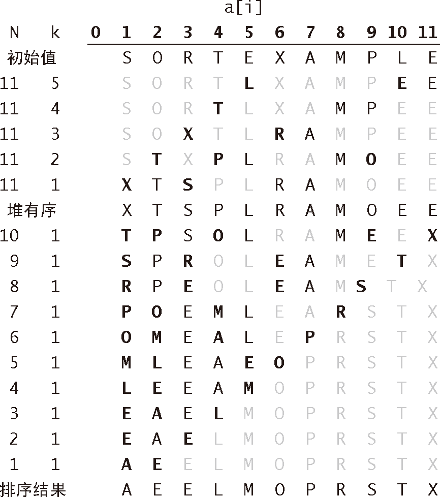

- 堆排序的轨迹（每次下沉后的数组内容）

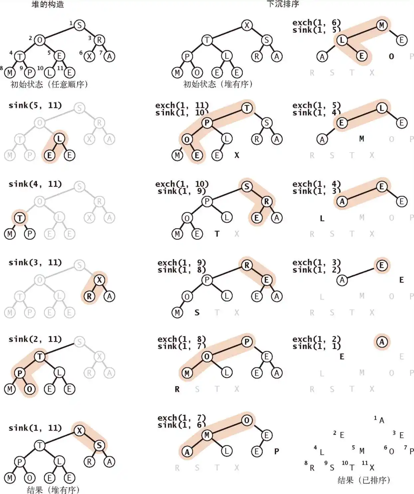

- 图 2.4.7　堆排序：堆的构造（左）和下沉排序（右）

### 2.4.5.2　下沉排序

堆排序的主要工作都是在第二阶段完成的。这里我们将堆中的最大元素删除，然后放入堆缩小后数组中空出的位置。这个过程和选择排序有些类似（按照降序而非升序取出所有元素），但所需的比较要少得多，因为堆提供了一种从未排序部分找到最大元素的有效方法。

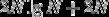

- 命题 S。将个元素排序，堆排序只需少于（）次比较（以及一半次数的

- 交换）。

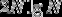

- 项来自于堆的构造（见命题 R）。项来自于每次下沉操作最大可能需要证明。

- 次比较（见命题 P 与命题 Q）。

算法 2.7 完整地实现了这些思想，也就是经典的堆排序算法。它的发明人是 J. W. J.Williams，并由 R. W. Floyd 在 1964 年改进。尽管这段程序中循环的任务各不同（第一段循

```
环构造堆，第二段循环在下沉排序中销毁堆），它们都是基于 sink() 方法。我们将该实现和
优先队列的 API 独立开来是为了突出这个排序算法的简洁性（sort() 方法只需 8 行代码，
sink() 函数 8 行），并使其可以嵌入其他代码之中。
```

和以前一样，通过研究可视轨迹（如图 2.4.8 所示）我们可以深入了解算法的操作。一开始算法的行为似乎杂乱无章，因为随着堆的构建较大的元素都被移动到了数组的开头，但接下来算法的行为看起来就和选择排序一模一样了（除了它比较的次数少得多）。

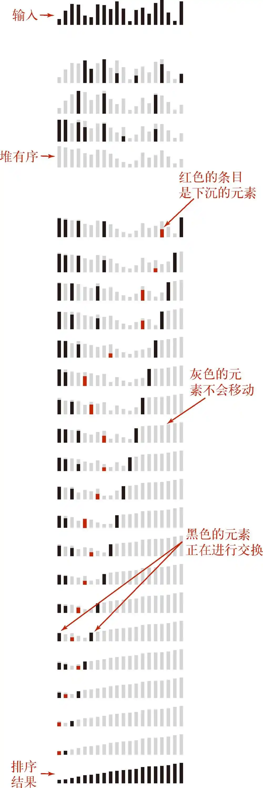

- 图 2.4.8　堆排序的可视轨迹

和我们学过的其他算法一样，很多人都研究过许多改进基于堆的优先队列的实现和堆排序的方法。我们这里简要地看看其中之一。

### 2.4.5.3　先下沉后上浮

大多数在下沉排序期间重新插入堆的元素会被直接加入到堆底。Floyd 在 1964 年观察发现，我们正好可以通过免去检查元素是否到达正确位置来节省时间。在下沉中总是直接提升较大的子结点直至到达堆底，然后再使元素上浮到正确的位置。这个想法几乎可以将比较次数减少一半——接近了归并排序所需的比较次数（随机数组）。这种方法需要额外的空间，因此在实际应用中只有当比较操作代价较高时才有用（例如，当我们在将字符串或者其他键值较长类型的元素进行排序时）。

堆排序在排序复杂性的研究中有着重要的地位，因为它是我们所知的唯一能够同时最优地利用

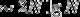

空间和时间的方法——在最坏的情况下它也能保证使用

- 次比较和恒定的额外空

间。当空间十分紧张的时候（例如在嵌入式系统或低成本的移动设备中）它很流行，因为它只用几行就能实现（甚至机器码也是）较好的性能。但现代系统的许多应用很少使用它，因为它无法利用缓存。数组元素很少和相邻的其他元素进行比较，因此缓存未命中的次数要远远高于大多数比较都在相邻元素间进行的算法，如快速排序、归并排序，甚至是希尔排序。

另一方面，用堆实现的优先队列在现代应用程序中越来越重要，因为它能在插入操作和删除最大元素操作混合的动态场景中保证对数级别的运行时间。我们会在本书后续章节见到更多的例子。

### 答疑

问　我还是不明白优先队列是做什么用的。为什么我们不直接把元素排序然后再一个个地引用有序数组中的元素？

```
答　在某些数据处理的例子里，比如 TopM 和 Multiway，总数据量太大，无法排序（甚至
```

无法全部装进内存）。如果你需要从 10 亿个元素中选出最大的十个，你真的想把一个 10 亿规模的数组排序吗？但有了优先队列，你就只用一个能存储十个元素的队列即可。在其他的例子中，我们甚至无法同时获取所有的数据，因此只能先从优先队列中取出并处理一部分，然后再根据结果决定是否向优先队列中添加更多的数据。

```
问　为什么不像我们在其他排序算法中那样使用 Comparable 接口，而在 MaxPQ 中使用泛
型的 Item 呢？
答　这么做的话 delMax() 的用例就需要将返回值转换为某种具体的类型，比如 String。
```

一般来说，应该尽量避免在用例中进行类型转换。

```
问　为什么在堆的表示中不使用 a[0] ？
答　这么做可以稍稍简化计算。实现从 0 开始的堆并不困难，a[0] 的子结点是 a[1] 和
a[2]，a[1] 的子结点是 a[3] 和 a[4]，a[2] 的子结点是 a[5] 和 a[6]，以此类推。但
大多数程序员更喜欢我们的简单方法。另外，将 a[0] 的值用作哨兵（作为 a[1] 的父结点）
```

在某些堆的应用中很有用。

问　在我看来，在堆排序中构造堆时，逐个向堆中添加元素比 2.4.5.1 节中描述的由底向上的复杂方法更简单。为什么要这么做？

答　对于一个排序算法来说，这么做能够快上 20%，而且所需的代码更少（不会用到

```
swim() 函数）。理解算法的难度并不一定与它的简洁性或者效率相关。
问　如果我去掉 MaxPQ 的实现中的 extends Comparable<Key> 这句话会怎样？
```

答　和以前一样，回答这类问题的最简单的办法就是你自己直接试试。如果这么做 MaxPQ 会报出一个编译错误：

```
MaxPQ.java:21: cannot find symbol
symbol  : method compareTo(Item)
　Java 这样告诉你它不知道 Item 对象的 compareTo() 方法，因为你没有声明 Item
extends Comparable<Item>。
```

### 练习

```
2.4.1　用序列 P R I O * R * * I * T * Y * * * Q U E * * * U * E （字母表
```

示插入元素，星号表示删除最大元素）操作一个初始为空的优先队列。给出每次删除最大元素返回的字符。

2.4.2　分析以下说法：要实现在常数时间找到最大元素，为何不用一个栈或队列，然后记录已插入的最大元素并在找出最大元素时返回它的值？

2.4.3　用以下数据结构实现优先队列，支持插入元素和删除最大元素的操作：无序数组、有序数组、无序链表和链表。将你的 4 种实现中每种操作在最坏情况下的运行时间上下限制成一张表格。

2.4.4　一个按降序排列的数组也是一个面向最大元素的堆吗？

2.4.5　将 E A S Y Q U E S T I O N 顺序插入一个面向最大元素的堆中，给出结果。

```
2.4.6　按照练习 2.4.1 的规则，用序列 P R I O * R * * I * T * Y * * * Q U E *
* * U * E 操作一个初始为空的面向最大元素的堆，给出每次操作后堆的内容。
```

2.4.7　在堆中，最大的元素一定在位置 1 上，第二大的元素一定在位置 2 或者 3 上。对于一个大小为 31 的堆，给出第

- 大的元素可能出现的位置和不可能出现的位置，其中、3、

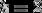

4（设元素值不重复）。

2.4.8　回答上一道练习中第

- 小元素的可能和不可能的位置。

```
2.4.9　给出 A B C D E 五个元素可能构造出来的所有堆，然后给出 A A A B B 这五个元
```

素可能构造出来的所有堆。

```
2.4.10　假设我们不想浪费堆有序的数组 pq[] 中的那个位置，将最大的元素放在 pq[0]，
它的子结点放在 pq[1] 和 pq[2]，以此类推。pq[k] 的父结点和子结点在哪里？
```

2.4.11　如果你的应用中有大量的插入元素的操作，但只有若干删除最大元素操作，哪种优先队列的实现方法更有效：堆、无序数组、有序数组？

2.4.12　如果你的应用场景中大量的找出最大元素的操作，但插入元素和删除最大元素操作相对较少，哪种优先队列的实现方法更有效：堆、无序数组、有序数组？

```
2.4.13　想办法在 sink() 中避免检查 j < N。
```

2.4.14　对于没有重复元素的大小为

- 的堆，一次删除最大元素的操作中最少要交换几个元

素？构造一个能够达到这个交换次数的大小为 15 的堆。连续两次删除最大元素呢？三次呢？

```
2.4.15　设计一个程序，在线性时间内检测数组 pq[] 是否是一个面向最小元素的堆。
```

2.4.16　对于

- ，构造数组使得堆排序使用的比较次数最多以及最少。

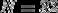

2.4.17　证明：构造大小为

- 的面向最小元素的优先队列，然后进行次替换最小元素

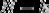

- 个元素中的前大元素均会留在优先队列中。

操作（删除最小元素后再插入元素）后，

```sql
2.4.18　在 MaxPQ 中，如果一个用例使用 insert() 插入了一个比队列中的所有元素都大的
新元素，随后立即调用 delMax()。假设没有重复元素，此时的堆和进行这些操作之前的堆
完全相同吗？进行两次 insert()（第一次插入一个比队列所有元素都大的元素，第二次插
入一个更大的元素）操作接两次 delMax() 操作呢？
```

2.4.19　实现 MaxPQ 的一个构造函数，接受一个数组作为参数。使用正文 2.4.5.1 节中所述的自底向上的方法构造堆。

2.4.20　证明：基于下沉的堆构造方法使用的比较次数小于

- ，交换次数小于。

### 提高题

2.4.21　基础数据结构。说明如何使用优先队列实现第 1 章中的栈、队列和随机队列这几种数据结构。

2.4.22　调整数组大小。在 MaxPQ 中加入调整数组大小的代码，并和命题 Q 一样证明对于一

- 的队列其数组访问的上限。

般性长度为

2.4.23　Multiway 的堆。只考虑比较的成本且假设找到

- 个元素中的最大者需要次比较，在

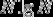

- 向堆的情况下找出使比较次数的系数最小的值。首先，假设使用的

堆排序中使用

```
是一个简单通用的 sink() 方法；其次，假设 Floyd 方法在内循环中每轮可以节省一次比
```

较。

2.4.24　使用链接的优先队列。用堆有序的二叉树实现一个优先队列，但使用链表结构代替数组。每个结点都需要三个链接：两个向下，一个向上。你的实现即使在无法预知队列大小的情况下也能保证优先队列的基本操作所需的时间为对数级别。

2.4.25　计算数论。编写程序 CubeSum.java，在不使用额外空间的条件下，按大小顺序打印


- 的结果，其中和为 0 至之间的整数。也就是说，不要全部计算个和然

所有

后排序，而是创建一个最小优先队列，初始状态为


- 。这样只要优先队列非空，删除并打印最小的元

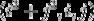

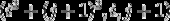

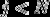

- 。用这段程序找出 0 到

素

- 。然后如果，插入元素

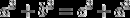


- 之间所有满足的不同整数 a,b,c,d。

```
2.4.26　无需交换的堆。因为 sink() 和 swim() 中都用到了初级函数 exch()，所以所有
```

元素都被多加载并存储了一次。回避这种低效方式，用插入排序给出新的实现（请见练习2.1.25）。

```
2.4.27　找出最小元素。在 MaxPQ 中加入一个 min() 方法。你的实现所需的时间和空间都
```

应该是常数。


2.4.28　选择过滤。编写一个 TopM 的用例，从标准输入读入坐标

- ，从命令行得到值

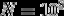


- 个点。在且时，预计，然后打印出距离原点的欧几里得距离最小的

程序的运行时间。

2.4.29　同时面向最大和最小元素的优先队列。设计一个数据类型，支持如下操作：插入元素、删除最大元素、删除最小元素（所需时间均为对数级别），以及找到最大元素、找到最小元素（所需时间均为常数级别）。提示：用两个堆。

2.4.30　动态中位数查找。设计一个数据类型，支持在对数时间内插入元素，常数时间内找到中位数并在对数时间内删除中位数。提示：用一个面向最大元素的堆再用一个面向最小元素的堆。

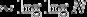

2.4.31　快速插入。用基于比较的方式实现 MinPQ 的 API，使得插入元素需要

- 次

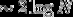

```
 次比较。提示：在 swim() 方法中用二分查找来寻找祖先
```

比较，删除最小元素需要结点。

2.4.32　下界。请证明，不存在一个基于比较的对 MinPQ 的 API 的实现能够使得插入元素和

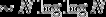

- 次比较。

删除最小元素的操作都保证只使用

2.4.33　索引优先队列的实现。按照 2.4.4.6 节的描述修改算法 2.6 来实现索引优先队列 API中的基本操作：

```
使用 pq[] 保存索引，添加一个数组 keys[] 来保存元素，再添加一个数组 qp[] 来保存
pq[] 的逆序——qp[i] 的值是 i 在 pq[] 中的位置（即索引 j，pq[j]=i）。修改算法 2.6
的代码来维护这些数据结构。若 i 不在队列之中，则总是令 qp[i] = -1 并添加一个方法
contains() 来检测这种情况。你需要修改辅助函数 exch() 和 less()，但不需要修改
sink() 和 swim()。
```

部分答案：

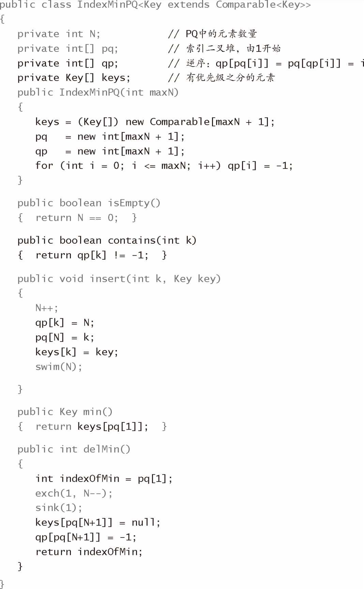

```sql
2.4.34　索引优先队列的实现（附加操作）。向练习 2.4.33 的实现中添加 minIndex()、
change() 和 delete() 方法。
```

解答：

```java
public int minIndex()
{  return pq[1];  }
public void change(int k, Key Key)
{
  keys[k] = key;
  swim(qp[k]);
  sink(qp[k]);
}
public void delete(int k)
{
  int index = qp[k];
  exch(index, N--);
  swim(index);
  sink(index);
  keys[k] = null;
  qp[k] = -1;
}
2.4.35　离散概率分布的取样。编写一个 Sample 类，其构造函数接受一个 double 类型的
数组 p[] 作为参数并支持以下操作：random()——返回任意索引 i 及其概率 p[i]/T（T
是 p[] 中所有元素之和）；change(i, v)——将 p[i] 的值修改为 v。提示：使用完全二
叉树，每个结点对应一个权重 p[i]。在每个结点记录其下子树的权重之和。为了产生一个随
机的索引，取 0 到 T 之间的一个随机数并根据各个结点的权重之和来判断沿着哪条子树搜索
下去。在更新 p[i] 时，同时更新从根结点到 i 的路径上的所有结点。不要像堆的实现那样
```

显式使用指针。

### 实验题

2.4.36　性能测试 I。编写一个性能测试用例，用插入元素操作填满一个优先队列，然后用删除最大元素操作删去一半元素，再用插入元素操作填满优先队列，再用删除最大元素操作删去所有元素。用一列随机的长短不同的元素多次重复以上过程，测量每次运行的用时，打印平均用时或是将其绘制成图表。

2.4.37　性能测试 II。编写一个性能测试用例，用插入元素操作填满一个优先队列，然后在一秒钟之内尽可能多地连续反复调用删除最大元素和插入元素的操作。用一列随机的长短不同的元素多次重复以上过程，将程序能够完成的删除最大元素操作的平均次数打印出来或是绘成图表。

2.4.38　练习测试。编写一个练习用例，用算法 2.6 中实现的优先队列的接口方法处理实际应用中可能出现的高难度或是极端情况。例如，元素已经有序、元素全部逆序、元素全部相同或是所有元素只有两个值。


2.4.39　构造函数的代价。对于

- 和、，根据经验判断堆排序时构造堆占总耗

时的比例。

2.4.40　Floyd 方法。根据正文中 Floyd 的先沉后浮思想实现堆排序。对于

- 和、

- 大小的随机不重复数组，记录你的程序所使用的比较次数和标准实现所使用的比较次数。

2.4.41　Multiway 堆。根据正文中的描述实现基于完全堆有序的三叉树和四叉树的堆排序。

- 和大小的随机不重复数组，记录你的程序所使用的比较次数和标准实

对于

- 、

现所使用的比较次数。

2.4.42　堆的前序表示。用前序法而非级别表示一棵堆有序的树，并基于此实现堆排序。对于

- 和大小的随机不重复数组，记录你的程序所使用的比较次数和标准实现所、

使用的比较次数。
