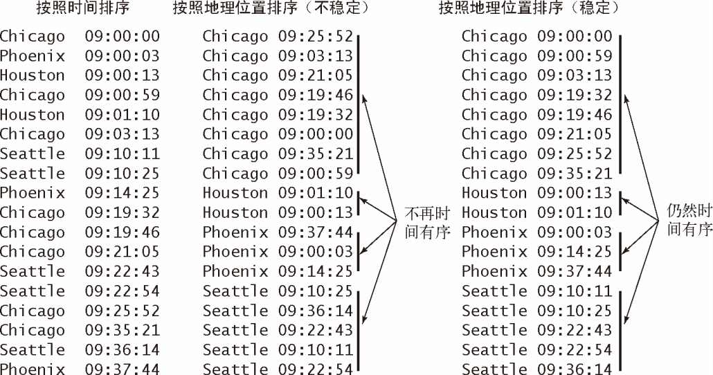
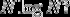
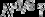
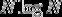
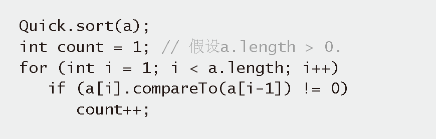
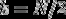
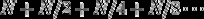
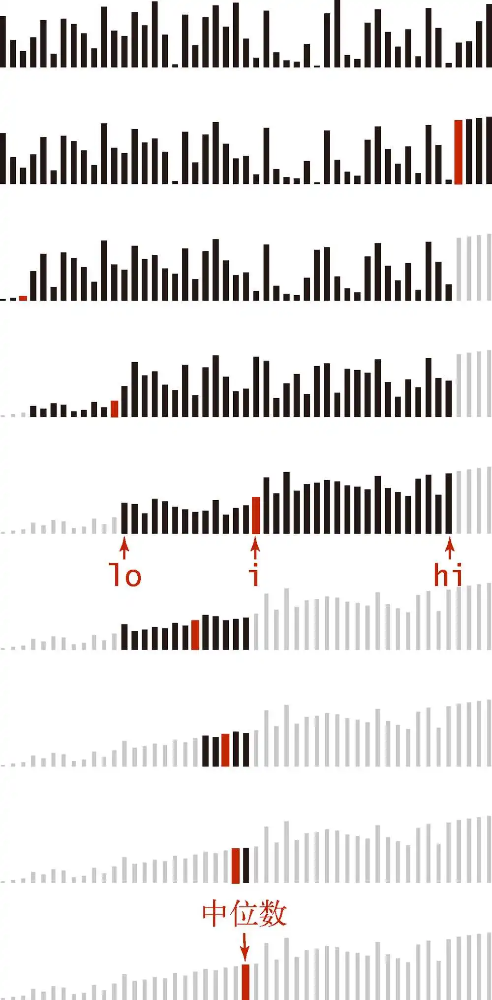
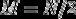
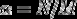

# 2.5应用

排序算法和优先队列在许多场景中有着广泛的应用。本节中我们将简要地浏览一遍这些应用，研究如何能让我们已经学习过的高效算法在这些应用中大展身手，然后讨论一下应该如何使用我们的排序和优先队列的代码。

排序如此有用的一个主要原因是，在一个有序的数组中查找一个元素要比在一个无序的数组中查找简单得多。人们用了一个多世纪发现在一本按姓氏排序的电话黄页中查找某个人的电话号码最容易。现在，数字音乐作家们将歌曲文件按照作家名或是歌曲名排序，搜索引擎按照搜索结果的重要性的高低显示结果，电子表格按照某一列的排序结果显示所有栏，矩阵处理工具将一个对称矩阵的真实特征值按照降序排列，等等。只要队列是有序的，很多其他任务也更容易完成，比如在本书最后的有序索引中查找某项，或是从一列长长的邮件列表或者投票人列表或者网站列表中删去重复项，或是在统计学计算中剔除异常值、查找中位数或者计算比例。

在许多看似无关的领域中，排序其实仍然是一个重要的子问题。数据压缩、计算机图形学、计算生物学、供应链管理、组合优化、社会选择和投票等，不一而足。我们在本章中学习的算法也在开发本书其他章节的强大算法的过程中起到了关键作用。

通用排序算法是最重要的，因此我们首先会考虑一些在构建适用于多种情况的排序算法时需要注意的实际问题。虽然部分话题只适用于 Java，但每个问题都仍然是所有系统需要解决的。

我们的主要目的是为了说明，尽管我们所学习的各种算法的思想相对简单，但它们的适用领域仍然广泛。经过验证的各种排序算法的应用列表很长，我们在这里只会涉及其中的一小部分，一些是科学领域的，一些是算法领域的，还有一些是商业领域的。在练习中你们还能找到更多例子，本书的网站上还有更多。另外，为了更好的说明问题，后续章节还会不时地引用本章的内容！

### 2.5.1　将各种数据排序

```
我们的实现的排序对象是由实现了 Comparable 接口的对象组成的数组。Java 的约定使得我
们能够利用 Java 的回调机制将任意实现了 Comparable 接口的数据类型排序。如 2.1 节所
述，实现 Comparable 接口只需要定义一个 compareTo() 函数并在其中定义该数据类型中
的大小关系。我们的代码直接能够将 String、Integer、Double 和一些其他例如 File
和 URL 类型的数组排序，因为它们都实现了 Comparable 接口。同一段代码能够适应所有这
```

些类型的数据是非常方便的，但一般的应用程序中需要排序的数据类型都是应用程序自己定义

```
的。相应，在自定义的数据类型中实现一个 compareTo() 方法也是很常见的，这样就实现
了 Comparable 接口，也就使得这种数据类型可以被排序了（也可以用其构造优先队列）。
```

### 2.5.1.1　交易事务

排序算法的一种典型应用就是商业数据处理。例如，设想一家互联网商业公司为每笔交易记录都保存了所有的相关信息，包括客户名、日期、金额等。如今，一家成功的商业公司需要能够处理数百万的这种交易数据。如我们在练习 2.1.21 中看到的，一种合适的方法是将交易记录

```
按金额大小排序，我们在类的定义中实现一个恰当的 compareTo() 方法就可以做到这一
点。这样我们在处理 Transaction 类型的数组 a[] 时就可以先将其排序，比如这样
Quick.sort(a)。我们的排序算法对 Transaction 类型一无所知，但 Java 的
Comparable 接口使我们可以为该类型定义大小关系，这样我们的任意排序算法都能够用于
Transaction 对象了。或者我们也可以令 Transaction 对象按照日期排序（如下面的代
码所示），将 compareTo() 方法实现为比较 Date 字段。因为 Date 对象本身也实现了
Comparable 接口，我们可以直接调用它的 compareTo() 方法而不用自己实现了。将这种
```

类型按照用户名排序也是合理的。使算法的用例能够灵活地用不同的字段排序则是我们在稍后将要面对的另一项有趣的挑战。

```
public int compareTo(Transaction that)
{  return this.when.compareTo(that.when);  }
将交易记录按照日期排序的 compareTo() 方法
```

### 2.5.1.2　指针排序

我们使用的方法在经典教材中被称为指针排序，因为我们只处理元素的引用而不移动数据本身。在其他编程语言例如 C 和 C++ 之中，程序员需要明确地指出操作的是数据还是指向数据的指针，而在 Java 中，指针操作是隐式的。除了原始数字类型之外，我们操作的总是数据的引用（指针），而非数据本身。指针排序增加了一层间接性，因为数组保存的是待排序的对象的引用，而非对象本身。我们会简要讨论一些相关的问题。对于多个引用数组，我们可以将同一组数据的不同部分按照多种方式排序（可能会用到下面提到的多键）。

### 2.5.1.3　不可变的键

如果在排序后用例还能够修改键值，那么数组就很可能不再是有序的了。类似，优先队列在用例能够修改键值的情况下也不太可能正常工作。在 Java 中，可以用不可变的数据类型作为键

```
来避免这个问题。大多数你可能用作键的数据类型，例如 String、Integer、Double 和
File 都是不可变的。
```

### 2.5.1.4　廉价的交换

使用引用的另一个好处是我们不必移动整个元素。对于元素大而键小的数组来说这带来的节约是巨大的，因为比较只需要访问元素的一小部分，而排序过程中元素的大部分都不会被访问到。对于几乎任意大小的元素，使用引用使得在一般情况下交换的成本和比较的成本几乎相同（代价是需要额外的空间存储这些引用）。如果键值很长，那么交换的成本甚至会低于比较的成本。研究将数字排序的算法性能的一种方法就是观察其所需的比较和交换总数，因为这里隐式地假设了比较和交换的成本是相同的。由此得出的结论则适用于 Java 中的许多应用，因为我们都是在将引用排序。

### 2.5.1.5　多种排序方法

```
在很多应用中我们都希望根据情况将一组对象按照不同的方式排序。Java 的 Comparator 接
口允许我们在一个类之中实现多种排序方法。它只有一个 compare() 方法来比较两个对象。
```

如果一种数据类型实现了这个接口，我们可以像 2.5.1.6 节中的例子那样将另一个实现了

```
Comparator 接口的对象传递给 sort() 方法（sort() 再将其传递给 less()）。
Comparator 接口允许我们为任意数据类型定义任意多种排序方法。用 Comparator 接口来
代替 Comparable 接口能够更好地将数据类型的定义和两个该类型的对象应该如何比较的定
义区分开来。事实上，比较两个对象的确可以有多种标准，Comparator 接口使得我们能够
在其中进行选择。例如，想在忽略大小写的情况下将字符串数组 a[] 排序，可以使用 Java 的
String 类型中定义的 CASE_INSENSITVE_ORDER 比较器并调用 Insertion.sort(a,
String.CASE_INSENSITIVE_ORDER)。你也知道，精确定义的字符串排序规则十分复杂，
而各种自然语言又差异很大，所以 Java 的 String 类型含有很多比较器。
```

### 2.5.1.6　多键数组

一般在应用程序中，一个元素的多种属性都可能被用作排序的键。在交易的例子中，有时可能需要将交易按照客户排序（例如，找出每个客户进行的所有交易）；有时又可能需要按照金额排序（例如，需要找出交易金额较高的交易）；有时还可能用另一个属性来排序。要实现这种

```
灵活性，Comparator 接口正合适。我们可以定义多种比较器，如 2.5.1.7 节展示的
Transaction 类的另一种实现那样。在这样定义之后，要将 Transaction 对象的数组按
```

照时间排序可以调用：

```
Insertion.sort(a, new Transaction.WhenOrder())
```

或者这样来按照金额排序：

```java
Insertion.sort(a, new Transaction.HowMuchOrder())
sort() 方法在每次比较中都会回调 Transaction 类中用例指定的 compare() 方法。为
了避免每次排序都创建一个新的 Comparator 对象，我们使用了 public final 来定义这
些比较器（代码如下，就像 Java 定义的 CASE_INSENSITIVE_ORDER 一样）。
public static void sort(Object[] a, Comparator c)
{
  int N = a.length;
  for (int i = 1; i < N; i++)
     for (int j = i; j > 0 && less(c, a[j], a[j-1]); j--)
        exch(a, j, j-1);
}
private static boolean less(Comparator c, Object v, Object w)
{  return c.compare(v, w) < 0;  }
private static void exch(Object[] a, int i, int j)
{  Object t = a[i]; a[i] = a[j]; a[j] = t;  }
使用了 Comparator 的插入排序
```

### 2.5.1.7　使用比较器实现优先队列

比较器的灵活性也可以用在优先队列上。我们可以按照以下步骤来扩展算法 2.6 的标准实现来支持比较器：

```
导入 java.util.Comparator；
为 MaxPQ 添加一个实例变量 comparator 以及一个构造函数，该构造函数接受一个比较
器作为参数并用它将 comparator 初始化；
在 less() 中检查 comparator 属性是否为 null（如果不是的话就用它进行比较）。
```

实现代码如下：

```java
import java.util.Comparator;
public class Transaction
{
  ...
  private final String who;
  private final Date when;
  private final double amount;
  ...
  public static class WhoOrder implements Comparator<Transaction>
  {
     public int compare(Transaction v, Transaction w)
     {  return v.who.compareTo(w.who);  }
  }
  public static class WhenOrder implements Comparator<Transaction>
  {
     public int compare(Transaction v, Transaction w)
     {  return v.when.compareTo(w.when);  }
  }
  public static class HowMuchOrder implements Comparator<Transaction>
  {
     public int compare(Transaction v, Transaction w)
     {
        if (v.amount < w.amount) return -1;
        if (v.amount > w.amount) return +1;
        return 0;
     }
  }
}
使用了Comparator的插入排序
例如，修改后可以使用 Transaction 的多种字段构造不同的优先队列，分别按照时间、地
点、账号排序。如果你在 MinPQ 中去掉了 Key extends Comparable<Key> 这句话，甚
```

至可以支持尚未定义过比较方法的键。

### 2.5.1.8　稳定性

如果一个排序算法能够保留数组中重复元素的相对位置则可以被称为是稳定的。这个性质在许多情况下很重要。例如，考虑一个需要处理大量含有地理位置和时间戳的事件的互联网商业应用程序。首先，我们在事件发生时将它们挨个存储在一个数组中，这样在数组中它们已经是按照时间顺序排好了的。现在假设在进一步处理前将按照地理位置切分。一种简单的方法是将数组按照位置排序。如果排序算法不是稳定的，排序后的每个城市的交易可能不会再是按照时间顺序排列的了。很多情况下，不熟悉排序稳定性的程序员在第一次遇见这种情形时会惊讶于不稳定的排序算法似乎把数据弄得一团糟。在本章中，我们学习过的一部分算法是稳定的（插入排序和归并排序），但很多不是（选择排序、希尔排序、快速排序和堆排序）。有很多办法能够将任意排序算法变成稳定的（请见练习 2.5.18），但一般只有在稳定性是必要的情况下稳定的排序算法才有优势。人们很容易觉得算法具有稳定性是理所当然的，但事实上没有任何实际应用中常见的方法不是用了大量额外的时间和空间才做到了这一点（研究人员开发了这样的算法，但应用程序员发现它们太复杂了，无法使用）。

从另一个键上排序的稳定性如图 2.5.1 所示。



- 图 2.5.1　从另一个键上排序的稳定性

### 2.5.2　我应该使用哪种排序算法

在本章中我们学习了许多种排序算法，这个问题就变得很自然了。排序算法的好坏很大程度上取决于它的应用场景和具体实现，但我们也学习了一些通用的算法，它们能在很多情况下达到和最佳算法接近的性能。

表 2.5.1 总结了在本章中我们学习过的排序算法的各种重要性质。除了希尔排序（它的复杂度只是一个近似）、插入排序（它的复杂度取决于输入元素的排列情况）和快速排序的两个版本（它们的复杂度和概率有关，取决于输入元素的分布情况）之外，将这些运行时间的增长数量级乘以适当的常数就能够大致估计出其运行时间。这里的常数有时和算法有关（比如堆排序的比较次数是归并排序的两倍，且两者访问数组的次数都比快速排序多得多），但主要取决于算法的实现、Java 编译器以及你的计算机，这些因素决定了需要执行的机器指令的数量以及每

- 得到的实验数

条指令所需的执行时间。最重要的是，因为这些都是常数，你能通过较小的


- 所需的运行时间。

据和我们的标准双倍测试来推测较大的

表 2.5.1　各种排序算法的性能特点

- 将 N 个元素排序的复杂度

算法

- 是否稳定是否为原地排序备注时间复杂度空间复杂度


- 1

选择排序

- 否是

- 和之间1

插入排序

- 是是介于取决于



- 1

希尔排序

- 否是






快速排序

- 否是运行效

- 运行效

- 和之间

三向快速排序

- 否是介于

- 情况

归并排序

- 是否

- 1

堆排序

- 否是

- 性质 T。快速排序是最快的通用排序算法。例证。自从数十年前快速排序发明以来，它在无数计算机系统中的无数实现已经证明了这一点。总的来说，快速排序之所以最快是因为它的内循环中的指令很少（而且它还能利用缓


- 存，因为它总是顺序地访问数据），所以它的运行时间的增长数量级为，而这里的 c 比其他线性对数级别的排序算法的相应常数都要小。在使用三向切分之后，快速排序对于实际应用中可能出现的某些分布的输入变成线性级别的了，而其他的排序算法则仍然需要线性对数时间。

因此，在大多数实际情况中，快速排序是最佳选择。当然，面对多种排序方法和各式计算机及系统，这么一句干巴巴的话很难让人信服。例如，我们已经见过一个明显的例外：如果稳定性很重要而空间又不是问题，归并排序可能是最好的。我们会在第 5 章中见到更多例外。有了

```
SortCompare 这样的工具，再加上一点时间和努力，你能够更仔细地比较这些算法的性能并
```

实现我们讨论过的各种改进方案，详见本节最后的若干练习。也许证明性质 T 的最好方式正如这里所说，在运行时间至关重要的任何排序应用中认真地考虑使用快速排序。

### 2.5.2.1　将原始类型数据排序

一些性能优先的应用的重点可能是将数字排序，因此更合理的做法是跳过引用直接将原始数据

```
类型的数据排序。例如，想想将一个 double 类型的数组和一个 Double 类型的数组排序的
```

差别。对于前者我们可以直接交换这些数并将数组排序；而对于后者，我们交换的是存储了这

```
些数字的 Double 对象的引用。如果我们只是在将一大组数排序的话，跳过引用可以为我们
```

节省存储所有引用所需的空间和通过引用来访问数字的成本，更不用说那些调用

```
compareTo() 和 less() 方法的开销了。把 Comparable 接口替换为原始数据类型名，重
定义 less() 方法或者干脆将调用 less() 的地方替换为 a[i] < a[j] 这样的代码，我们
```

就能得到可以将原始数据类型的数据更快地排序的各种算法（请见练习 2.1.26）。

### 2.5.2.2　Java 系统库的排序算法

为了演示表 2.5.1 所示的数据，这里我们考虑 Java 系统库中的主要排序方法

```
java.util.Arrays.sort()。根据不同的参数类型，它实际上代表了一系列排序方法：
```

- 每种原始数据类型都有一个不同的排序方法；

```
一个适用于所有实现了 Comparable 接口的数据类型的排序方法；
一个适用于实现了比较器 Comparator 的数据类型的排序方法。
```

Java 的系统程序员选择对原始数据类型使用（三向切分的）快速排序，对引用类型使用归并排序。这些选择实际上也暗示着用速度和空间（对于原始数据类型）来换取稳定性（对于引用类型），如刚才讨论的那样。

我们讨论过的这些算法和思想是包括 Java 的许多现代系统的核心组成部分。当为实际应用开

```
发 Java 程序时，你会发现 Java 的 Arrays.sort() 实现（可能再加上你自己实现的
compareTo() 或者 compare()）已经基本够用了，因为它使用的三向快速排序和归并排序
```

都是经典。

```
在本书中我们一般都会使用我们自己的 Quick.sort() 或者 Merge.sort()（在稳定性比
空间更重要时）。你也可以使用 Arrays.sort()，或者在特殊的情况下使用其他排序算法。
```

### 2.5.3　问题的归约

使用排序算法来解决其他问题的思想是算法设计领域的基本技巧——归约的一个例子。因为归约十分重要，我们会在第 6 章详细讨论它，同时研究几个具体实例。归约指的是为解决某个问题而发明的算法正好可以用来解决另一种问题。应用程序员对于归约的概念已经很熟悉了（无论是否明确地知道这一点）——每次你在使用解决问题 B 的方法来解决问题 A 时，你都是在将 A 归约为 B。实际上，实现算法的一个目标就是使算法的适用性尽可能广泛，使得问题的归约更简单。作为例子，我们先看看几个简单的排序问题。很多这种问题都以算法测验的形式出现，而解决它们的第一想法往往是平方级别的暴力破解。但很多情况下如果先将数据排序，那么解决剩下的问题就只需要线性级别的时间了，这样归约后的运行时间的增长数量级就由平方级别降低到了线性对数级别。

### 2.5.3.1　找出重复元素：

```
在一个 Comparable 对象的数组中是否存在重复元素？有多少重复元素？哪个值出现得最频
```

繁？对于小数组，用平方级别的算法将所有元素互相比较一遍就足以解答这些问题。但这么做对于大数组行不通。但有了排序，你就能在线性对数的时间内回答这些问题：首先将数组排序，然后遍历有序的数组，记录连续出现的重复元素即可。例如，下面就是一段统计数组中不重复的元素个数的代码。只要稍稍修改这段代码你就能回答上面的问题，还可以打印所有不同元素的值、所有重复元素的值，等等，即使数组很大也无妨。



```
统计 a[] 中不重复元素的个数
```

### 2.5.3.2　排名

- 个整数的数组，其中 0 到的每个数都只出现一次。

一组排列（或是排名）就是一组


两个排列之间的 Kendall tau 距离就是在两组数列中顺序不同的数对的数目。例如，0 3 1 6 25 4 和 1 0 3 6 4 2 5 之间的 Kendall tau 距离是 4，因为 0-1、3-1、2-4、5-4 这 4 对数字在两组排列中的相对顺序不同，但其他数字的相对顺序都是相同的。这种统计方法的应用十分广泛。在社会学中它被用于研究社会选择和投票理论，在分子生物学中被用于使用基因表达图谱比较基因，在网络中被用于搜索引擎结果的排名，等等。某个排列和标准排列（即每个元素都在正确位置上的排列）的 Kendall tau 距离就是其中逆序数对的数量。根据插入排序设计一个平方级别的算法来计算它并不困难（请回想 2.1 节中的命题 C）。高效地计算 Kendall tau 距离可以留给已经熟悉那些经典的排序算法的程序员（或者学生）作为一个有趣的练习（请见练习2.5.19）。

### 2.5.3.3　优先队列

在 2.4 节中我们已经见过两个被归约为优先队列操作的问题的例子。一个是 2.4.2.1 节中的TopM，它能够找到输入流中

- 个最大的元素；另一个是 2.4.4.7 节中的 Multiway，它能够将


- 个输入流归并为一个有序的输出流。这两个问题都可以轻易用长度为的优先队列解

决。

### 2.5.3.4　中位数与顺序统计

一个和排序有关但又不需要完全排序的重要应用就是找出一组元素的中位数（中间值，它不大于一半的元素又不小于另一半元素）。查找中位数在统计学计算和许多数据处理的应用程序中

- 小的元素（如下页代码所示）。“选择”

都很常见。它是一种特殊的选择：找到一组数中的第在处理实验数据和其他数据中应用广泛，使用中位数和其他顺序统计来切分一个数组也很常见。一般，我们只需要处理一个很大的数组中的一小部分，在这种情况下，一个程序可以选择，比如将前 10% 的元素完全排序即可。2.4 节中我们的 TopM 用优先队列为无界限输入解决了这个问题。除了 TopM，另一种选择是直接将数组中的元素排序。在调用

```
Quick.sort(a) 之后，数组中的
```

- 个最小的元素就是数组的前个元素，其中小于数组

长度。但这种方法需要调用排序，所以运行时间的增长数量级是线性对数的。

```java
public static Comparable
select(Comparable[] a, int k)
{
  StdRandom.shuffle(a);
  int lo = 0, hi = a.length - 1;
  while (hi > lo)
  {
     int j = partition(a, lo, hi);
     if     (j == k)  return a[k];
     else if (j > k)  hi = j - 1;
     else if (j < k)  lo = j + 1;
  }
  return a[k];
}
```

- 小元素

找到一组数中的第

- 很小或者很大时找出数组中的个最小值都很简单，但当和数组大

还有更好的办法吗？当



小成一定比例时这个任务就变得比较困难了，比如找到中位数（

- ）。让人惊讶的是其

```sql
实上面的 select() 方法能够在线性时间内解决这个问题（这个实现需要在用例中进行类型
转换；去掉这个限制的代码请见本书的网站）。为了完成这个任务，select() 用两个变量
hi 和 lo 来限制含有要选择的
```

- 元素的子数组，并用快速排序的切分法来缩小子数组的范

```
围。请回想 partition() 方法，它会将数组的 a[lo] 至 a[hi] 重新排列并返回一个整数
j 使得 a[lo..j-1] 小于等于 a[j] 且 a[j+1..hi] 大于等于 a[j]。那么，如果 k =
j，问题就解决了。如果 k < j，我们就需要切分左子数组（令 hi = j-1）；如果 k > j，
我们则需要切分右子数组（令 lo = j+1）。这个循环保证了数组中 lo 左边的元素都小于等
于 a[lo..hi]，而 hi 右边的元素都大于等于 a[lo..hi]。我们不断地切分直到子数组中
 个元素，此时 a[k] 含有最小的（
）个元素，a[0] 到 a[k-1] 都小于等于
```


只含有第

```
a[k]，而 a[k+1] 及其后的元素都大于等于 a[k]。至于为何这个算法是线性级别的，是因
```



为假设每次都正好将数组二分，那么比较的总次数为（

- ），直到找的元素，这个和显然小于

到第

- 。和快速排序一样，这里也需要一点数学知识来得到比较


的上界，它比快速排序略高。这个算法和快速排序的另一个共同点是这段分析依赖于使用随机的切分元素，因此它的性能保证也来自于概率。

用快速排序的切分来查找中位数的可视轨迹如图 2.5.2 所示。



- 图 2.5.2　用切分找出中位数

- 命题 U。平均来说，基于切分的选择算法的运行时间是线性级别的。证明。该命题的分析和快速排序的命题 K 的证明类似，但要复杂得多。结论就是算法的平


- 值都均比较次数为，这对于所有合法的


- 是线性的。例如，这个公式说明找到中位数 () 平均需要次比较。注意，最坏的情况下算法的运行时间仍然是平方级别的，但与快速排序一样，将数组乱序化可以有效防止这种情况出现。

设计一个能够保证在最坏情况下也只需要线性比较次数的算法是计算复杂性领域的一个经典问题，但到目前为止仍然没有一个能够实用的算法。

### 2.5.4　排序应用一览

排序的直接应用极为普遍和广泛，无法一一列举。你可以将歌曲按照曲名或是歌手排序，将邮件按照时间或是发件人排序（或者来电按照时间或来电者排序），将照片按照日期排序。大学会将学生的账户按照姓名或是 ID 排序。信用卡公司会将上百万甚至上亿的交易按照日期或是金额排序。科学家会将实验数据按照时间或其他标准排序来精确地模拟现实世界，从粒子或者天体的运动，到物质的结构，到社会中的人际关系。实际上，很难找到和排序无关的任何计算性应用！为了更好地说明这一点，我们在这一小节中举几个比应用归约更加复杂的例子，其中几个我们会在本书的其他章节更加详细地研究。

### 2.5.4.1　商业计算

世界已经被信息的海洋所淹没。政府组织、金融机构和商业公司都依赖排序来管理大量的信息。无论这些信息是按照名字或者数字排序的账号、按照日期或者金额排序的交易、按照邮编或者地址排序的邮件、按照名称或者日期排序的文件等，处理这些数据必然需要排序算法。一般这些信息都会存储在大型的数据库里，能够按照多个键排序以提高搜索效率。一个普遍使用的有效方法是先收集新的信息并添加到数据库，将其按感兴趣的键排序，然后将每个键的排序结果归并到已存在的数据库中。从计算机发明的早期开始，我们学习过的这些方法就已经被用来构建庞大的基础数据，处理它们的方法则是所有这些商业活动的基石。今天，我们能够按部就班地处理上百万甚至上亿大小的数组——没有线性对数级别的排序算法也就没法将它们排序，进一步处理这些数据也会极端困难，甚至是不可能的。

### 2.5.4.2　信息搜索

有序的信息确保我们可以用经典的二分查找法（见第 1 章）来进行高效的搜索。你会看到许多其他种类的查询也可以用相同的方式完成。有多少元素小于给定的元素？有哪些在给定的范围之内？在第 3 章中我们不但会解答这些问题，还会具体学习排序算法和二分查找的各种扩展，使得我们能够用删除和插入的混合操作解答这些问题，并保证所有操作的对数级别的性能。

### 2.5.4.3　运筹学

运筹学指的是研究数学模型并将其应用于问题解决和决策的领域。在本书中我们会看到若干运筹学和算法研究的关系的例子。这里我们先来看排序算法在运筹学的经典问题——调度中的应


- 个任务，第个任务需要耗时秒。我们需要在完成所有任务的同

用。假设我们需要完成

时尽量确保客户满意，将每个任务的平均完成时间最小化。按照最短优先的原则，只要我们将任务按照处理时间升序排列就可以达到目标。因此我们可以将任务按照耗时排序，或是将它们插入到一个最小优先队列中。如果加上其他各种限制，我们可以得到不同的调度问题，这在工

- 个相

业界的应用中很常见，也被很好地研究过。另一个例子是负载均衡问题。假设我们有

- 个任务，我们的目标是用尽可能短的时间在这些处理器上完成所有的任

同的处理器以及

务。这个问题是 NP- 困难的（请见第 6 章），因此我们实际上不可能算出一种最优的方案。但一种较优调度方法是最大优先。我们将任务按照耗时降序排列，将每个任务依次分配给当前可

- 个处理器维护一个优

用的处理器。要实现这种算法，我们先要逆序排列这些任务，然后为

先队列，每个元素的优先级就是对应的处理器上运行的任务的耗时之和。每一步中，我们都删去优先级最低的那个处理器，将下一个任务分配给这个处理器，然后再将它重新插入优先队列。

### 2.5.4.4　事件驱动模拟

很多科学上的应用都涉及模拟，用大量计算来将现实世界的某个方面建模以期能够更好地理解它。在计算机发明之前，科学家们除了构建数学模型之外别无选择，而现在计算机模型很好地补充了这些数学模型。逼真地模拟现实世界是很有挑战的，而使用正确的算法使得我们能够在有限的时间内完成这些模拟，而不是无奈地接受不精确的实验结果或是无尽地等待计算的完成。我们会在第 6 章中展示能够说明这一点的一个具体例子。

### 2.5.4.5　数值计算

在科学计算中，精确度非常重要（我们距离真正的答案有多远），特别是当我们在计算机中使用的只是真正的实数的近似值——浮点数来进行上百万次计算的时候。一些数值计算算法使用优先队列和排序来控制计算中的精确度。例如，在求曲线下区域的面积时，数值积分的一个方法就是使用一个优先队列存储一组小间隔中每段的近似精确度。积分的过程就是删去精确度最低的间隔并将其分为两半（这样两半都能变得更加精确），然后将两半都重新加入优先队列。如此这般，直到达到预期的精确程度。

### 2.5.4.6　组合搜索

人工智能领域一个解决“疑难杂症”的经典范式就是定义一组状态、由一组状态演化到另一组状态可能的步骤以及每个步骤的优先级，然后定义一个起始状态和目标状态（也就是问题的解决办法）。著名的 A* 算法的解决办法就是将起始状态放入优先队列中，然后重复下面的方法直到到达目的地：删去优先级最高的状态，然后将能够从该状态在一步之内达到的所有状态全部加入优先队列（除了刚刚删去的那个状态之外）。和事件驱动模拟一样，这个过程简直就是为优先队列量身定做的。它将问题的解决转化为了定义一个适当的优先级函数问题。例子请见练习2.5.32。

除了这些直接应用之外（我们只说了很小的一部分而已），排序和优先队列在算法设计领域也是很重要的抽象概念，因此本书会经常用到它们。下面我们举了一些本书后续内容中的应用作为例子，它们都依赖于本章中的排序算法和优先队列数据类型的高效实现。

- Prim 算法和 Dijkstra 算法它们都是第 4 章中的经典算法。第 4 章的主题是图的处理算法，图是由结点和连接两个结点的边组成的一种重要的基础模型。图算法的基石就是图的搜索，也就是一个结点一个结点地查找，优先队列在其中扮演了重要的角色。

- Kruskal 算法这是图中的加权图的另一个经典算法，其中边的处理顺序取决于它的权重。算法的运行时间是由排序所需的时间决定的。

- 霍夫曼压缩这是一个经典的数据压缩算法。它处理的数据中的每个元素都有一个小整数作为权重，而处理的过程就是将权重最小的两个元素归并成一个新元素，并将其权重相加得到新元素的权重。使用优先队列可以立即实现这个算法。其他几种数据压缩算法也是基于排序的。

- 字符串处理字符串处理算法在现代密码学和基因组学中起着关键性的作用。它们也常常依赖于排序算法（一般都会使用第 5 章中所讨论的特殊的字符串排序算法）。例如，在第 6 章中我们在学习找出给定字符串中的最长重复子字符串算法时会先将字符串的后缀排序。

### 答疑

问　Java 的系统库中有优先队列这种数据类型吗？

```
答　有，请见 java.util.PriorityQueue。
```

### 练习

```
2.5.1　在下面这段 String 类型的 compareTo() 方法的实现中，第三行对提高运行效率有
```

何帮助？

```
public int compareTo(String that)
{
  if (this == that) return 0;  // 这一行
  int n = Math.min(this.length(), that.length());
  for (int i = 0; i < n; i++)
  {
     if      (this.charAt(i) < that.charAt(i)) return -1;
     else if (this.charAt(i) > that.charAt(i)) return +1;
  }
  return this.length() - that.length();
}
```

2.5.2　编写一段程序，从标准输入读入一列单词并打印出其中所有由两个单词组成的组合词。例如，如果输入的单词为 after、thought 和 afterthought，那么 afterthought 就是一个组合词。

```java
2.5.3　找出下面这段账户余额 Balance 类的实现代码的错误。为什么 compareTo() 方法
对 Comparable 接口的实现有缺陷？
public class Balance implements Comparable<Balance>
{
  ...
  private double amount;
  public int compareTo(Balance that)
  {
     if (this.amount < that.amount - 0.005) return -1;
     if (this.amount > that.amount + 0.005) return +1;
     return 0;
  }
  ...
}
```

说明如何修正这个问题。

```
2.5.4　实现一个方法 String[] dedup(String[] a)，返回一个有序的 a[]，并删去其
```

中的重复元素。

2.5.5　说明为何选择排序是不稳定的。

```sql
2.5.6　用递归实现 select()。
2.5.7　用 select() 找出
```

- 个元素中的最小值平均大约需要多少次比较？

2.5.8　编写一段程序 Frequency，从标准输入读取一列字符串并按照字符串出现频率由高到低的顺序打印出每个字符串及其出现次数。

2.5.9　为将右侧所示的数据排序编写一个新的数据类型。

```
输入DJIA每天的成交量
 1-Oct-28 3500000
 2-Oct-28 3850000
 3-Oct-28 4060000
 4-Oct-28 4330000
 5-Oct-28 4360000
...
30-Dec-99 554680000
31-Dec-99 374049984
 3-Jan-00 931800000
 4-Jan-00 1009000000
 5-Jan-00 1085500032
 ...
```

- 输出

```
19-Aug-40 130000
26-Aug-40 160000
24-Jul-40 200000
10-Aug-42 210000
23-Jun-42 210000
...
23-Jul-02 2441019904
17-Jul-02 2566500096
15-Jul-02 2574799872
19-Jul-02 2654099968
24-Jul-02 2775559936
2.5.10　创建一个数据类型 Version 来表示软件的版本，例如 115.1.1、115.10.1、
115.10.2。为它实现 Comparable 接口，其中 115.1.1 的版本低于 115.10.1。
2.5.11　描述排序结果的一种方法是创建一个保存 0 到 a.length-1 的排列 p[]，使得
p[i] 的值为 a[i] 元素的最终位置。用这种方法描述插入排序、选择排序、希尔排序、归并
```

排序、快速排序和堆排序对一个含有 7 个相同元素的数组的排序结果。

### 提高题

2.5.12　调度。编写一段程序 SPT.java，从标准输入中读取任务的名称和所需的运行时间，用2.5.4.3 节所述的最短处理时间优先的原则打印出一份调度计划，使得任务完成的平均时间最小。

```
2.5.13　负载均衡。编写一段程序 LPT.java，接受一个整数 M 作为命令行参数，从标准输入中
```

读取任务的名称和所需的运行时间，用 2.5.4.3 节所述的最长处理时间优先原则打印出一份调

```
度计划，将所有任务分配给 M 个处理器并使得所有任务完成所需的总时间最少。
2.5.14　逆域名排序。为域名编写一个数据类型 Domain 并为它实现一个 compareTo() 方
```

法，使之能够按照逆向的域名排序。例如，域名 cs.princeton.edu 的逆是 edu.princeton.cs。

```
这在网络日志处理时很有用。提示：使用 s.split("\\.") 将域名用点分为若干部分。编写
一个 Domain 的用例，从标准输入读取域名并将它们按照逆域名有序地打印出来。
```

2.5.15　垃圾邮件大战。在非法垃圾邮件之战的伊始，你有一大串来自各个域名（也就是电子邮件地址中 @ 符号后面的部分）的电子邮件地址。为了更好地伪造回信地址，你应该总是从相同的域中向目标用户发送邮件。例如，从 wayne@cs.princeton.edu 向rs@cs.princeton.edu 发送垃圾邮件就很不错。你会如何处理这份电子邮件列表来高效地完成这个任务呢？

2.5.16　公正的选举。为了避免对名字排在字母表靠后的候选人的偏见，加州在 2003 年的州长选举中将所有候选人按照以下字母顺序排列：

```
R W Q O J M V A H B S G Z X N T C I E K U P D Y F L
　创建一个遵守这种顺序的数据类型并编写一个用例 California，在它的静态方法 main() 中
```

将字符串按照这种方式排序。假设所有字符串全部都是大写的。

```
2.5.17　检测稳定性。扩展练习 2.1.16 中的 check() 方法，对指定数组调用 sort()，如果
排序结果是稳定的则返回 true，否则返回 false。不要假设 sort() 只会使用 exch() 移
```

动数据。

2.5.18　强制稳定。编写一段能够将任意排序方法变得稳定的封装代码，创建一种新的数据类

```
型作为键，将键的原始索引保存在其中，并在调用 sort() 之后再恢复原始的键。
```

2.5.19　Kendall tau 距离。编写一段程序 KendallTau.java，在线性对数时间内计算两组排列之间的 Kendall tau 距离。

2.5.20　空闲时间。假设有一台计算机能够并行处理

- 个任务。编写一段程序并给定一系列

任务的起始时间和结束时间，找出这台机器最长的空闲时间和最长的繁忙时间。

```
2.5.21　多维排序。编写一个 Vector 数据类型并将
```

- 维整型向量排序。排序方法是先按照一

维数字排序，一维数字相同的向量则按照二维数字排序，再相同的向量则按照三维数字排序，如此这般。

2.5.22　股票交易。投资者对一只股票的买卖交易都发布在电子交易市场中。他们会指定最高买入价和最低卖出价，以及在该价位买卖的笔数。编写一段程序，用优先队列来匹配买家和卖家并用模拟数据进行测试。可以使用两个优先队列，一个用于买家一个用于卖家，当一方的报价能够和另一方的一份或多份报价匹配时就进行交易。

```sql
2.5.23　选择的取样：实验使用取样来改进 select() 函数的想法。提示：使用中位数可能
```

并不总是有效。

2.5.24　稳定的优先队列。实现一个稳定的优先队列（将重复的元素按照它们被插入的顺序返回）

```
2.5.25　平面上的点。为表 1.2.3 的 Point2D 类型编写三个静态的比较器，一个按照
```

- 坐标坐标比较，一个按照点到原点的距离进行比较。编写两个非静态的比较器，

比较，一个按照一个按照两点到第三点的距离比较，一个按照两点相对于第三点的幅角比较。

2.5.26　简单多边形。给定平面上的

- 个点，用它们画出一个多边形。提示：找到坐标最

- 坐标的点时取坐标最小者，然后将其他点按照以为原点的幅角

小的点

- ，在有多个最小

大小的顺序依次连接起来。

```
2.5.27　平行数组的排序。在将平行数组排序时，可以将索引排序并返回一个 index[] 数
组。为 Insertion 添加一个 indirectSort() 方法，接受一个 Comparable 的对象数组
a[] 作为参数，但它不会将 a[] 中的元素重新排列，而是返回一个整形数组 index[] 使得
a[index[0]] 到 a[index[N-1]] 正好是升序的。
```

2.5.28　按文件名排序。编写一个 FileSorter 程序，从命令行接受一个目录名并打印出按照文

```
件名排序后的所有文件。提示：使用 File 数据类型。
2.5.29　按大小和最后修改日期将文件排序。为 File 数据类型编写比较器，使之能够将文件
```

按照大小、文件名或最后修改日期将文件升序或者降序排列。在程序 LS 中使用这些比较器，

```
它接受一个命令行参数并根据指定的顺序列出目录的内容。例如，"-t" 指按照时间戳排序。
```

支持多个选项以消除排序位次相同者，同时必须确保排序的稳定性。

2.5.30　Boerner 定理。真假判断：如果你先将一个矩阵的每一列排序，再将矩阵的每一行排序，所有的列仍然是有序的。证明你的结论。

### 实验题

```
2.5.31　重复元素。编写一段程序，接受命令行参数 M、N 和 T，然后使用正文中的代码进行
T 遍实验：生成
 间的 int 值并计算重复值的个数。令
```


- 个 0 到，、





- 和以及和、、。根据概率论，重复值的个数应该约为



，其中

- 。打印一张表格来确认你的实验验证了这个公式。

2.5.32　8 字谜题。8 字谜题是 S. Loyd 于 19 世纪 70 年代发明的一个游戏。游戏需要一个三乘三的九宫格，其中八格中填上了 1 到 8 这 8 个数字，一格空着。你的目标就是将所有的格子排序。可以将一个格子向上下或者左右移动（但不能是对角线方向）到空白的格子中。编写一个程序用 A* 算法解决这个问题。先用到达九宫格的当前位置所需的步数加上错位的格子数量作为优先级函数（注意，步数至少大于等于错位的格子数）。尝试用其他函数代替错位的格子数量，比如每个格子距离它的正确位置的曼哈顿距离，或是这些距离的平方之和。

2.5.33　随机交易。开发一个接受参数

- 的生成器，根据你能想到的任意假设条件生成个

```
随机的 Transaction 对象（请见练习 2.1.21 和练习 2.1.22）。对于
```

- 和、、

- 个交易排序的性能。，比较用希尔排序、归并排序、快速排序和堆排序将

## 第 3 章　查找

现代计算机和网络使我们能够访问海量的信息。高效检索这些信息的能力是处理它们的重要前提。本章描述的都是数十年来在广泛应用中经过实践检验的经典查找算法。没有这些算法，现代信息世界的基础计算设施都无从谈起。

我们会使用符号表这个词来描述一张抽象的表格，我们会将信息（值）存储在其中，然后按照指定的键来搜索并获取这些信息。键和值的具体意义取决于不同的应用。符号表中可能会保存很多键和很多信息，因此实现一张高效的符号表也是一项很有挑战性的任务。

符号表有时被称为字典，类似于那本将单词的释义按照字母顺序排列起来的历史悠久的参考书。在英语字典里，键就是单词，值就是单词对应的定义、发音和词源。符号表有时又叫做索引，即书本最后将术语按照字母顺序列出以方便查找的那部分。在一本书的索引中，键就是术语，而值就是书中该术语出现的所有页码。

在说明了基本的 API 和两种重要的实现之后，我们会学习用三种经典的数据类型来实现高效的符号表：二叉查找树、红黑树和散列表。在总结中我们会看到它们的若干扩展和应用，它们的实现都 ** 有赖于我们在本章中将会学到的高效算法。
