# 3.1符号表

符号表最主要的目的就是将一个键和一个值联系起来。用例能够将一个键值对插入符号表并希望在之后能够从符号表的所有键值对中按照键直接找到相对应的值。本章会讲解多种构造这样的数据结构的方法，它们不光能够高效地插入和查找，还可以进行其他几种方便的操作。要实现符号表，我们首先要定义其背后的数据结构，并指明创建并操作这种数据结构以实现插入、查找等操作所需的算法。

查找在大多数应用程序中都至关重要，许多编程环境也因此将符号表实现为高级的抽象数据结构，包括 Java——我们会在 3.5 节中讨论 Java 的符号表实现。表 3.1.1 给出的例子是在一些典型的应用场景中可能出现的键和值。我们马上会看到一些参考性的用例，3.5 节的目的就是向你展示如何在程序中有效地使用符号表。本书中我们还会在其他算法中使用符号表。

- 定义。符号表是一种存储键值对的数据结构，支持两种操作：插入（put），即将一组新的键值对存入表中；查找（get），即根据给定的键得到相应的值。

表 3.1.1　典型的符号表应用

应用

- 查找的目的键值

字典

- 找出单词的释义单词释义

图书索引

- 找出相关的页码术语一串页码

- 计算机 ID

文件共享

- 找到歌曲的下载地址歌曲名

账户管理

- 处理交易账户号码交易详情

网络搜索

- 找出相关网页关键字网页名称

编译器

- 找出符号的类型和值变量名类型和值

### 3.1.1　API

符号表是一种典型的抽象数据类型（请见第 1 章）：它代表着一组定义清晰的值以及相应的操作，使得我们能够将类型的实现和使用区分开来。和以前一样，我们要用应用程序编程接口（API）来精确地定义这些操作（如表 3.1.2 所示），为数据类型的实现和用例提供一份“契约”。

表 3.1.2　一种简单的泛型符号表 API

```java
 public class  <b>ST</b><Key, Value>
               ST()
```

- 创建一张符号表

```
将键值对存入表中（若值为空则将键 k
         void  put(Key key, Value val)
```

- 除）

```sql
获取键 key 对应的值（若键 key 不存
        Value  get(Key key)
null）
         void  delete(Key key)
从表中删去键 key（及其对应的值）
      boolean  contains(Key key)
键 key 在表中是否有对应的值
      boolean  isEmpty()
```

- 表是否为空

```
          int  size()
```

- 表中的键值对数量

```
Iterable<Key>  keys()
```

- 表中的所有键的集合

在查看用例代码之前，为了保证代码的一致、简洁和实用，我们要先说明具体实现中的几个设计决策。

### 3.1.1.1　泛型

和排序一样，在设计方法时我们没有指定处理对象的类型，而是使用了泛型。对于符号表，我们通过明确地指定查找时键和值的类型来区分它们的不同角色，而不是像 2.4 节的优先队列那样将键和元素本身混为一谈。在考虑了这份基本的 API 后（例如，这里没有说明键的有序

```
性），我们会用 Comparable 的对象来扩展典型的用例，这也会为数据类型带来许多新的方
```

法。

### 3.1.1.2　重复的键

我们的所有实现都遵循以下规则：

- 每个键只对应着一个值（表中不允许存在重复的键）；

- 当用例代码向表中存入的键值对和表中已有的键（及关联的值）冲突时，新的值会替代旧的值。

这些规则定义了关联数组的抽象形式。你可以将符号表想象成一个数组，键即索引，值即数组的元素。在一个一般的数组中，键就是整型的索引，我们用它来快速访问数组的内容；在一个关联数组（符号表）中，键可以是任意类型，但我们仍然可以用它来快速访问数组的内容。一

```
些编程语言（非 Java）直接支持程序员使用 st[key] 来代替 st.get(key)，
st[key]=val 来代替 st.put(key, val)，其中 key（键）和 val（值）都可以是任意
```

类型的对象。

### 3.1.1.3　空（null）键

键不能为空。和 Java 中的许多其他机制一样，使用空键会产生一个运行时异常（请见本节答疑的第三条）。

### 3.1.1.4　空（null）值

我们还规定不允许有空值。这个规定的直接原因是在我们的 API 定义中，当键不存在时

```
get() 方法会返回空，这也意味着任何不在表中的键关联的值都是空。这个规定产生了两个
（我们所期望的）结果：第一，我们可以用 get() 方法是否返回空来测试给定的键是否存在
于符号表中；第二，我们可以将空值作为 put() 方法的第二个参数存入表中来实现删除，也
```

就是 3.1.1.5 节的主要内容。

### 3.1.1.5　删除操作

在符号表中，删除的实现可以有两种方法：延时删除，也就是将键对应的值置为空，然后在某个时候删去所有值为空的键；或是即时删除，也就是立刻从表中删除指定的键。刚才已经说

```sql
过，put(key, null) 是 delete(key) 的一种简单的（延时型）实现。而实现（即时型）
delete() 就是为了替代这种默认的方案。在我们的符号表实现中不会使用默认的方案，而
在本书的网站上 put() 实现的开头有这样一句防御性代码：
if (val == null) { delete(key); return; }
```

这保证了符号表中任何键的值都不为空。为了节省版面我们没有在本书中附上这段代码（我们

```
也不会在调用 put() 时使用 null）。
```

### 3.1.1.6　便捷方法

```
为了用例代码的清晰，我们在 API 中加入了 contains() 和 isEmpty() 方法，它们的实现
```

如表 3.1.3 所示，只需要一行。

表 3.1.3　默认实现

方法

- 默认实现

```sql
void delete(Key key)
put(key, null);
boolean contains(key key)
return get(key) != null;
boolean isEmpty()
return size() == 0;
```

为节省篇幅，我们不想重复这些代码，但我们约定它们存在于所有符号表 API 的实现中，用例程序可以自由使用它们。

### 3.1.1.7　迭代

为了方便用例处理表中的所有键值，我们有时会在 API 的第一行加上

```
implementsIterable<Key> 这句话，强制所有实现都必须包含 iterator() 方法来返回
一个实现了 hasNext() 和 next() 方法的迭代器，如 1.3 节的栈和队列所述。但是对于符
号表我们采用了一个更简单的方法。我们定义了 keys() 方法来返回一个 Iterable<Key>
```

对象以方便用例遍历所有的键。这么做是为了和以后的有序符号表的所有方法保持一致，使得用例可以遍历表的键集的一个指定的部分。

### 3.1.1.8　键的等价性

要确定一个给定的键是否存在于符号表中，首先要确立对象等价性的概念。我们在 1.2.5.8 节

```
深入讨论过这一点。在 Java 中，按照约定所有的对象都继承了一个 equals() 方法，Java
也为它的标准数据类型例如 Integer、Double 和 String 以及一些更加复杂的类型，如
File 和 URL，实现了 equals() 方法——当使用这些数据类型时你可以直接使用内置的实
现。例如，如果 x 和 y 都是 String 类型，当且仅当 x 和 y 的长度相同且每个位置上的字母
都相同时，x.equals(y) 返回 true。而自定义的键则需要如 1.2 节所述重写 equals()
方法。你可以参考我们为 Date 类型（请见 1.2.5.8 节）实现的 equals() 方法为你自己的数
据类型实现 equals() 方法。和 2.4.4.5 节中讨论的优先队列一样，最好使用不可变的数据类
```

型作为键，否则表的一致性是无法保证的。

### 3.1.2　有序符号表

```
典型的应用程序中，键都是 Comparable 的对象，因此可以使用 a.compareTo(b) 来比较
a 和 b 两个键。许多符号表的实现都利用了 Comparable 接口带来的键的有序性来更好地实
现 put() 和 get() 方法。更重要的是在这些实现中，我们可以认为符号表都会保持键的有
```

序并大大扩展它的 API，根据键的相对位置定义更多实用的操作。例如，假设键是时间，你可能会对最早的或是最晚的键或是给定时间段内的所有键等感兴趣。在大多数情况下用实现

```
put() 和 get() 方法背后的数据结构都不难实现这些操作。于是，对于 Comparable 的
```

键，在本章中我们实现了表 3.1.4 中的 API。

表 3.1.4　一种有序的泛型符号表的 API

```java
 public class <b>ST</b><Key extends Comparable<key>, Value>
              ST()
```

- 创建一张有序符号表

```
将键值对存入表中（若值为空则将键 ke
         void put(Key key, Value val)
```

- 除）

```sql
        Value get(Key key)
获取键 key 对应的值（若键 key 不存在
         void delete(Key key)
从表中删去键 key（及其对应的值）
      boolean contains(Key key)
键 key 是否存在于表中
      boolean isEmpty()
```

- 表是否为空

```
          int size()
```

- 表中的键值对数量

```
          Key min()
```

- 最小的键

```
          Key max()
```

- 最大的键

```sql
          Key floor(Key key)
小于等于 key 的最大键
          Key ceiling(Key key)
大于等于 key 的最小键
          int rank(Key key)
小于 key 的键的数量
          Key select(int k)
排名为 k 的键
         void  deleteMin()
```

- 删除最小的键

```
         void  deleteMax()
```

- 删除最大的键

```
          int  size(Key lo, Key hi)
[lo..hi] 之间键的数量
Iterable<Key>
keys(Key lo, Key hi)
[lo..hi] 之间的所有键，已排序
只要你见到类的声明中含有泛型变量 Key extends Comparable<Key>，那就说明这段程
序是在实现这份 API，其中的代码依赖于 Comparable 的键并且实现了更加丰富的操作。上
```

面所有这些操作一起为用例定义了一个有序符号表。

### 3.1.2.1　最大键和最小键

对于一组有序的键，最自然的反应就是查询其中的最大键和最小键。我们在 2.4 节讨论优先队列时已经遇到过这些操作。在有序符号表中，我们也有方法删除最大键和最小键（以及它们所

```
关联的值）。有了这些，符号表就具有了类似于 2.4 节中 IndexMinPQ() 的能力。主要的区
```

别在于优先队列中可以存在重复的键但符号表中不行，而且有序符号表支持的操作更多。

### 3.1.2.2　向下取整和向上取整

对于给定的键，向下取整（floor）操作（找出小于等于该键的最大键）和向上取整（ceiling）操作（找出大于等于该键的最小键）有时是很有用的。这两个术语来自于实数的取整函数（对

- 向下取整即为小于等于的最大整数，向上取整则为大于等于的最小整数）。

一个实数

### 3.1.2.3　排名和选择

检验一个新的键是否插入合适位置的基本操作是排名（rank，找出小于指定键的键的数量）和选择（select，找出排名为

- 的键）。要测试一下你是否完全理解了它们的作用，请确认对于 0

```sql
到 size()-1 的所有 i 都有 i==rank(select(i))，且所有的键都满足
key==select(rank(key))。2.5 节中我们在学习排序时已经遇到过对这两种操作的需求
```

了。对于符号表，我们的挑战是在实现插入、删除和查找的同时快速实现这两种操作。

有序符号表的操作示例如表 3.1.5 所示。

表 3.1.5　有序符号表的操作示例

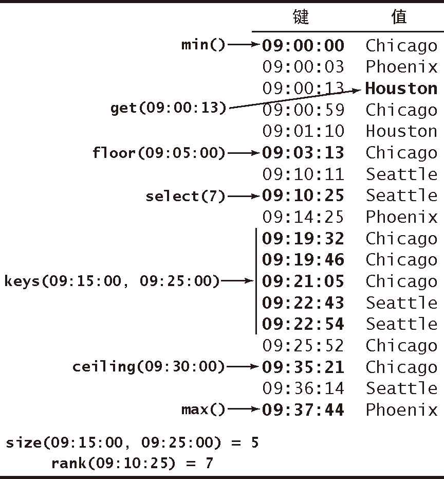

### 3.1.2.4　范围查找

给定范围内（在两个给定的键之间）有多少键？是哪些？在很多应用中能够回答这些问题并接

```
受两个参数的 size() 和 keys() 方法都很有用，特别是在大型数据库中。能够处理这类查
```

询是有序符号表在实践中被广泛应用的重要原因之一。

### 3.1.2.5　例外情况

当一个方法需要返回一个键但表中却没有合适的键可以返回时，我们约定抛出一个异常（另一

```sql
种合理的方法是在这种情况下返回空）。例如，在符号表为空时，min()、max()、
deleteMin()、deleteMax()、floor() 和 ceiling() 都会抛出异常，当 k<0 或
k>=size() 时 select(k) 也会抛出异常。
```

### 3.1.2.6　便捷方法

```
在基础 API 中我们已经见过了 contains() 和 isEmpty() 方法，为了用例的清晰我们又在
```

API 中添加了一些冗余的方法。为了节约版面，除非特别声明，我们约定所有有序符号表 API的实现都含有如表 3.1.6 所示的方法。

表 3.1.6　有序符号表中冗余有序性方法的默认实现

方法

- 默认的实现

```sql
void deleteMin()
delete(min());
void deleteMax()
delete(max());
if (hi.compareTo(lo) < 0)
   return 0;
else if (contains(hi))
int size(Key lo, Key hi)
   return rank(hi) - rank(lo) + 1;
else
   return rank(hi) - rank(lo);
Iterable<Key> keys()
return keys(min(), max());
```

### 3.1.2.7　（再谈）键的等价性

```
Java 的一条最佳实践就是维护所有 Comparable 类型中 compareTo() 方法和 equals()
方法的一致性。也就是说，任何一种 Comparable 类型的两个值 a 和 b 都要保证
(a.compareTo(b)==0) 和 a.equals(b) 的返回值相同。为了避免任何潜在的二义性，我
们不会在有序符号表的实现中使用 equals() 方法。作为替代，我们只会使用
compareTo() 方法来比较两个键，即我们用布尔表达式 a.compareTo(b)==0 来表示“a
和 b 相等吗？”。一般来说，这样的比较都代表着在符号表中的一次成功查找（找到了 b）。和
排序算法一样，Java 为许多经常作为键的数据类型提供了标准的 compareTo() 方法，为你
自定义的数据类型实现一个 compareTo() 方法也不困难（参见 2.5 节）。
```

### 3.1.2.8　成本模型

```
无论我们是使用 equals() 方法（对于符号表的键不是 Comparable 对象而言）还是
compareTo() 方法（对于符号表的键是 Comparable 对象而言），我们使用比较一词来表示
```

将一个符号表条目和一个被查找的键进行比较操作。在大多数的符号表实现中，这个操作都出现在内循环。在少数的例外中，我们则会统计数组的访问次数。

- 查找的成本模型。在学习符号表的实现时，我们会统计比较的次数（等价性测试或是键的相互比较）。在内循环不进行比较（极少）的情况下，我们会统计数组的访问次数。

```
符号表实现的重点在于其中使用的数据结构和 get()、put() 方法。在下文中我们不会总是
```

给出其他方法的实现，因为将它们作为练习能够更好地检验你对实现背后的数据结构的理解程度。为了区别不同的实现，我们在特定的符号表实现的类名前加上了描述性前缀。在用例代码

```
中，除非我们想使用一个特定的实现，我们都会使用 ST 表示一个符号表实现。在本章和其他
```

章节中，经过学习和讨论过大量符号表的使用和实现后你会慢慢地理解这些 API 的设计初衷。同时我们也会在答疑和练习中讨论算法设计时的更多选择。

### 3.1.3　用例举例

虽然我们会在 3.5 节中详细说明符号表的更多应用，在学习它的实现之前我们还是应该先看看如何使用它。相应地我们这里考察两个用例：一个用来跟踪算法在小规模输入下的行为测试用例，和一个用来寻找更高效的实现的性能测试用例。

### 3.1.3.1　行为测试用例

为了在小规模的输入下跟踪算法的行为，我们用以下测试用例测试我们对符号表的所有实现。

```
这段代码会从标准输入接受多个字符串，构造一张符号表来将 i 和第 i 个字符串相关联，然
后打印符号表。在本书中我们假设所有的字符串都只有一个字母。一般我们会使用 "S E A R
C H E X A M P L E"。按照我们的约定，用例会将键 S 和 0，键 R 和 3 关联起来，等
等。但 E 的值是 12（而非 1 或者 6），A 的值为 8（而非 2），因为我们的关联型数组意味着
每个键的值取决于最近一次 put() 方法的调用。对于符号表的简单实现（无序），用例的输出
```

中键的顺序是不确定的（这和具体实现有关）；对于有序符号表，用例应该将键按顺序打印出来。这是一种索引用例，它是我们将在 3.5 节中讨论的一种重要的符号表应用的一个特殊情况。

测试用例的实现代码如下所示。测试用例的键、值及输出如图 3.1.1 所示。

```java
public static void main(String[] args)
{
  ST<String, Integer> st;
  st = new ST<String, Integer>();
  for (int i = 0; !StdIn.isEmpty(); i++)
  {
     String key = StdIn.readString();
     st.put(key, i);
  }
  for (String s : st.keys())
     StdOut.println(s + " " + st.get(s));
}
```

简单的符号表测试用例

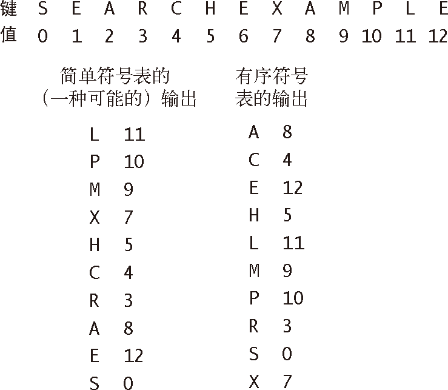

- 图 3.1.1　测试用例的键、值和输出

### 3.1.3.2　性能测试用例

```
FrequencyCounter 用例会从标准输入中得到的一列字符串并记录每个（长度至少达到指定
```

的阈值）字符串的出现次数，然后遍历所有键并找出出现频率最高的键。这是一种字典，我们会在 3.5 节中更加详细地讨论这种应用。这个用例回答了一个简单的问题：哪个（不小于指定长度的）单词在一段文字中出现的频率最高？在本章中，我们会用这个用例以及三段文字来进行性能测试：狄更斯的《双城记》中的前五行（tinyTale.txt），《双城记》全书（tale.txt），以及一个知名的叫做 Leipzig Corpora Collection 的数据库（leipzig1M.txt），内容为一百万条随机从网络上抽取的句子。例如，这是 tinyTale.txt 的内容：

```
% more tinyTale.txt
it was the best of times it was the worst of times
it was the age of wisdom it was the age of foolishness
it was the epoch of belief it was the epoch of incredulity
it was the season of light it was the season of darkness
it was the spring of hope it was the winter of despair
```

小型测试输入

这段文字共有 60 个单词，去掉重复的单词还剩 20 个，其中 4 个出现了 10 次（频率最高）。

```
对于这段文字，FrequencyCounter 可能会打印出 it、was、the 或者 of 中的某一个单词
```

（具体会打印出哪一个取决于符号表的具体实现），以及它出现的频率 10。表 3.1.7 总结了大型测试输入流的性质。

表 3.1.7　大型测试输入流的性质

- tinyTale.txttale.txtleipzig1M.txt

- 单词数不同的单词数单词数不同的单词数单词数不

- 6020135 63510 67921 191 4555

所有单词

长度大于等于 8 的单词

- 3314 3505 1314 239 5972

长度大于等于 10 的单词

- 224 5822 2601 610 8291

```
FrequencyCounter 用例实现过程如下所示。
```

- 符号表的用例

```java
public class FrequencyCounter
1
2
{
3
4
  public static void main(String[] args)
5
6
  {
7
8
     int minlen = Integer.parseInt(args[0]);   // 最小键长
9
10
     ST<String, Integer> st = new ST<String, Integer>();
11
12
     while (!StdIn.isEmpty())
13
14
     {  // 构造符号表并统计频率
15
16
        String word = StdIn.readString();
17
18
        if (word.length() < minlen) continue;  // 忽略较短的单词
19
20
        if (!st.contains(word)) st.put(word, 1);
21
22
        else                    st.put(word, st.get(word) + 1);
23
24
     }
25
26
     // 找出出现频率最高的单词
27
28
     String max = " ";
29
30
     st.put(max, 0);
31
32
     for (String word : st.keys())
33
34
        if (st.get(word) > st.get(max))
35
36
           max = word;
37
38
     StdOut.println(max + " " + st.get(max));
39
40
  }
41
42
}
43
```

- 这个符号表的用例统计了标准输入中各个单词的出现频率，然后将频率最高的单词打印出来。命令行参数指定了表中的键的最短长度。

```
% java FrequencyCounter 1 < tinyTale.txt
1
it 10
2
3
% java FrequencyCounter 8 < tale.txt
4
business 122
5
6
% java FrequencyCounter 10 < leipzig1M.txt
7
government 24763
8
```

研究符号表处理大型文本的性能要考虑两个方面的因素：首先，每个单词都会被作为键进行搜索，因此处理性能和输入文本的单词总量必然有关；其次，输入的每个单词都会被存入符号表（输入中不重复单词的总数也就是所有键都被插入以后符号表的大小），因此输入流中不同的

```
单词的总数也是相关的。我们需要这两个量来估计 FrequencyCounter 的运行时间（作为
```

开始，请见练习 3.1.6）。我们会在学习了一些算法之后再回头说明一些细节，但你应该对类似

```
这样的符号表应用的需求有一个大致的印象。例如，用 FrequencyCounter 分析
```

leipzig1M.txt 中长度不小于 8 的单词意味着，在一个含有数十万键值对的符号表中进行上百万次的查找，而互联网中的一台服务器可能需要在含有上百万个键值对的表中处理上亿的交易。

```
这个用例和所有这些例子都提出了一个简单的问题：我们的实现能够在一张用多次 get() 和
put() 方法构造出的巨型符号表中进行大量的 get() 操作吗？如果我们的查找操作不多，那
```

么任意实现都能够满足需要。但没有一个高效的符号表作为基础是无法使用

```
FrequencyCounter 这样的程序来处理大型问题的。FrequencyCounter 是一种极为常见
```

的应用的代表，它的这些特性也是许多其他符号表应用的共性：

- 混合使用查找和插入的操作；

- 大量的不同键；

- 查找操作比插入操作多得多；

- 虽然不可预测，但查找和插入操作的使用模式并非随机。

我们的目标就是实现一种符号表来满足这些能够解决典型的实际问题的用例的需要。

```
下面，我们将会学习两种初级的符号表实现并通过 FrequencyCounter 分别评估它们的性
```

能。在之后的几节中，你会学习一些经典的实现，即使对于庞大的输入和符号表它们的性能仍然非常优秀。

### 3.1.4　无序链表中的顺序查找

符号表中使用的数据结构的一个简单选择是链表，每个结点存储一个键值对，如算法 3.1 中的

```
代码所示。get() 的实现即为遍历链表，用 equals() 方法比较需被查找的键和每个结点中
的键。如果匹配成功我们就返回相应的值，否则我们返回 null。put() 的实现也是遍历链
表，用 equals() 方法比较需被查找的键和每个结点中的键。如果匹配成功我们就用第二个
```

参数指定的值更新和该键相关联的值，否则我们就用给定的键值对创建一个新的结点并将其插入到链表的开头。这种方法也被称为顺序查找：在查找中我们一个一个地顺序遍历符号表中的

```sql
所有键并使用 equals() 方法来寻找与被查找的键匹配的键。
算法 3.1（SequentialSearchST）用链表实现了符号表的基本 API，我们在第 1 章中的基
础数据结构中学习过它。这里我们将 size()、keys() 和即时型的 delete() 方法留做练
```

习。这些练习能够巩固并加深你对链表和符号表的基本 API 的理解。

这种基于链表的实现能够用于和我们的用例类似的、需要大型符号表的应用吗？我们已经说过，分析符号表算法比分析排序算法更困难，因为不同的用例所进行的操作序列各不相同。对

```
于 FrequencyCounter，最常见的情形是虽然查找和插入的使用模式是不可预测的，但它们
```

的使用肯定不是随机的。因此我们主要研究最坏情况下的性能。为了方便，我们使用命中表示一次成功的查找，未命中表示一次失败的查找。使用基于链表的符号表的索引用例的轨迹如图3.1.2 所示。

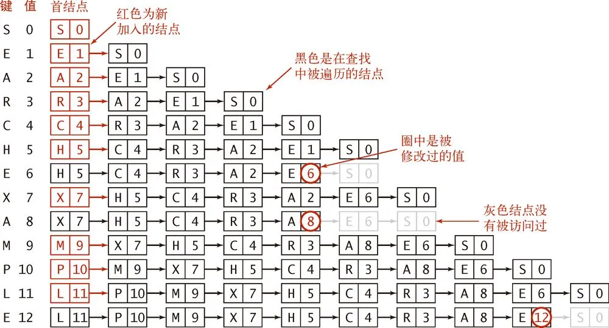

- 图 3.1.2　使用基于链表的符号表的索引用例的轨迹

- 算法 3.1　顺序查找（基于无序链表）

```java
public class SequentialSearchST<Key, Value>
1
2
{
3
4
  private Node first;        // 链表首结点
5
6
  private class Node
7
8
  {  // 链表结点的定义
9
10
     Key key;
11
12
     Value val;
13
14
     Node next;
15
16
     public Node(Key key, Value val, Node next)
17
18
     {
19
20
        this.key  = key;
21
22
        this.val  = val;
23
24
        this.next = next;
25
26
     }
27
28
  }
29
30
  public Value get(Key key)
31
32
  {  // 查找给定的键，返回相关联的值
33
34
     for (Node x = first; x != null; x = x.next)
35
36
        if (key.equals(x.key))
37
38
           return x.val;    // 命中
39
40
     return null;           // 未名中
41
42
  }
43
44
  public void put(Key key, Value val)
45
46
  {  // 查找给定的键，找到则更新其值，否则在表中新建结点
47
48
     for (Node x = first; x != null; x = x.next)
49
50
        if (key.equals(x.key))
51
52
        {  x.val = val; return;  }      // 命中，更新
53
54
     first = new Node(key, val, first); // 未命中，新建结点
55
56
  }
57
58
}
59
符号表的实现使用了一个私有内部 Node 类来在链表中保存键和值。get() 的实现会顺序
地搜索链表查找给定的键（找到则返回相关联的值）。put() 的实现也会顺序地搜索链表查
```

- 找给定的键，如果找到则更新相关联的值，否则它会用给定的键值对创建一个新的结点并将

```sql
其插入到链表的开头。size()、keys() 和即时型的 delete() 方法的实现留做练习。
```

- 命题 A。在含有对键值的基于（无序）链表的符号表中，未命中的查找和插入操作都需


- 次比较。命中的查找在最坏情况下需要次比较。特别地，向一个空表中插入个要

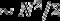

- 次比较。不同的键需要证明。在表中查找一个不存在的键时，我们会将表中的每个键和给定的键比较。因为不允许出现重复的键，每次插入操作之前我们都需要这样查找一遍。

- 个不同的键需要次比较。推论。向一个空表中插入

查找一个已经存在的键并不需要线性级别的时间。一种度量方法是查找表中的每个键，并将总时间除以

- 。在查找表中的每个键的可能性都相同的情况下时，这个结果就是一次查找平均所

需的比较数。我们将它称为随机命中。尽管符号表用例的查找模式不太可能是随机的，这个模


- ：算法

型也总能适应得很好。我们很容易就可以得到随机命中所需的平均比较次数为

```
3.1 中的 get() 方法查找第一个键需要 1 次比较，查找第二个键需要 2 次比较，如此这般，
```


平均比较次数为

- 。

这些分析完全证明了基于链表的实现以及顺序查找是非常低效的，无法满足

```
FrequencyCounter 处理庞大输入问题的需求。比较的总次数和查找次数与插入次数的乘积
```


- ，而对于 Leipzig Corpora 数据库这个数字大于

成正比。对于《双城记》这个数字大于

- 14

10

- 。

```
按照惯例，为了验证分析结果我们需要进行一些实验。这里我们用 FrequencyCounter 以
及命令行参数 8 来分析 tale.txt。这将需要 14 350 次 put()（已经说过，输入中的每个单词
都需要一次 put() 操作来更新它的出现频率，contains() 方法的调用是可以避免的，这里
```

忽略了它的成本）。符号表将包含 5737 个键，也就是说大约三分之一的操作都将表增大了，

```
其余操作为查找。为了将性能可视化我们使用了 VisualAccumulator（请见表 1.2.14）将
每次 put() 操作转换为两个点：对于第
 次 put() 操作，我们会在横坐标为
```

- ，纵坐标为该

```
 次 put() 操作累
```

次操作所进行的比较次数的位置画一个灰点，以及横坐标为

- ，纵坐标为前

计所需的平均比较次数的位置画一个黑点，如图 3.1.3 所示。和所有科学实验数据一样，这其中包含了很多信息供我们研究（这张图含有 14 350 个灰点和 14 350 个黑点）。这里，我们的

```
主要兴趣在于这张表证实了我们关于 put() 平均需要访问半条链表的猜想。虽然实际的数据
```

比一半稍少，但对这个事实（以及图表曲线的形状）最好的解释应该是应用的特性，而非算法（请见练习 3.1.36）。

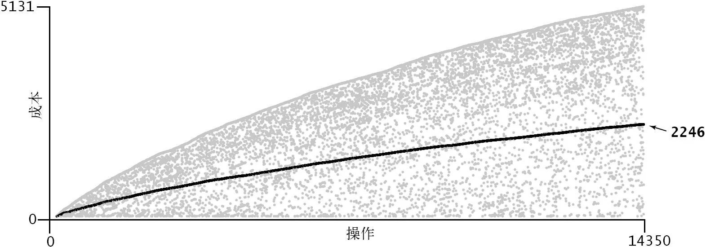

```
图 3.1.3　使用 SequentialSearchST，运行 java FrequencyCounter 8 < tale.txt 的成本
```

尽管某个具体用例的性能特点可能是复杂的，但只要使用我们准备的文本或者随机有序输入以及我们在第 1 章中介绍的 DoublingTest 程序，我们还是能够轻松估计出

```
FrequencyCounter 的性能并测试验证的。我们将这些测试留给练习和接下来将要学习的更
```

加复杂的实现。如果你并不觉得我们需要更快的实现，请一定完成这些练习！（或者用

```
FrequencyCounter 调用 SequentialSearchST 来处理 leipzig1M.txt ！）
```

### 3.1.5　有序数组中的二分查找

下面我们要学习有序符号表 API 的完整实现。它使用的数据结构是一对平行的数组，一个存储

```
键一个存储值。算法 3.2（BinarySearchST）可以保证数组中 Comparable 类型的键有
序，然后使用数组的索引来高效地实现 get() 和其他操作。
这份实现的核心是 rank() 方法，它返回表中小于给定键的键的数量。对于 get() 方法，只
要给定的键存在于表中，rank() 方法就能够精确地告诉我们在哪里能够找到它（如果找不
```

到，那它肯定就不在表中了）。

```
对于 put() 方法，只要给定的键存在于表中，rank() 方法就能够精确地告诉我们到哪里去
```

更新它的值，以及当键不在表中时将键存储到表的何处。我们将所有更大的键向后移动一格来腾出位置（从后向前移动）并将给定的键值对分别插入到各自数组中的合适位置。结合我们测

```
试用例的轨迹来研究 BinarySearchST 也是学习这种数据结构的好方法。
```

这段代码为键和值使用了两个数组（另一种方式请见练习 3.1.12）。和我们在第 1 章中对泛型

```
的栈和队列的实现一样，这段代码也需要创建一个 Key 类型的 Comparable 对象的数组和一
个 Value 类型的 Object 对象的数组，并在构造函数中将它们转化回 Key[] 和
Value[]。和以前一样，我们可以动态调整数组，使得用例无需担心数组大小（请注意，你
```

会发现这种方法对于大数组实在是太慢了）。

使用基于有序数组的符号表实现的索引用例的轨迹如表 3.1.8 所示。

表 3.1.8　使用基于有序数组的符号表实现的索引用例的轨迹

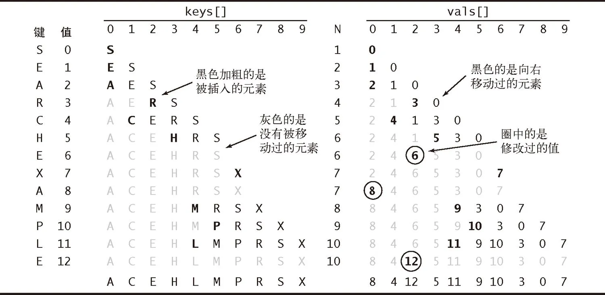

- 算法 3.2　二分查找（基于有序数组）

```java
public class BinarySearchST<Key extends Comparable<Key>, Value>
1
{
2
  private Key[] keys;
3
  private Value[] vals;
4
  private int N;
5
  public BinarySearchST(int capacity)
6
  {   // 调整数组大小的标准代码请见算法1.1
7
      keys = (Key[]) new Comparable[capacity];
8
      vals = (Value[]) new Object[capacity];
9
  }
10
  public int size()
11
  {  return N;  }
12
  public Value get(Key key)
13
  {
14
     if (isEmpty()) return null;
15
     int i = rank(key);
16
     if (i < N && keys[i].compareTo(key) == 0) return vals[i];
17
     else                                      return null;
18
  }
19
20
  public int rank(Key key)
21
  // 请见算法3.2（续1）
22
23
  public void put(Key key, Value val)
24
  {  // 查找键，找到则更新值，否则创建新的元素
25
     int i = rank(key);
26
     if (i < N && keys[i].compareTo(key) == 0)
27
     {  vals[i] = val; return;  }
28
     for (int j = N; j > i; j--)
29
     {  keys[j] = keys[j-1]; vals[j] = vals[j-1];  }
30
     keys[i] = key; vals[i] = val;
31
     N++;
32
  }
33
34
  public void delete(Key key)
35
  // 该方法的实现请见练习3.1.16
36
}
37
这段符号表的实现用两个数组来保存键和值。和 1.3 节中基于数组的栈一样，put() 方法
```

- 会在插入新元素前将所有较大的键向后移动一格。这里省略了调整数组大小部分的代码。

### 3.1.5.1　二分查找

我们使用有序数组存储键的原因是，第 1 章中作为例子出现的经典二分查找法能够根据数组的索引大大减少每次查找所需的比较次数。我们会使用有序索引数组来标识被查找的键可能存在的子数组的大小范围。在查找时，我们先将被查找的键和子数组的中间键比较。如果被查找的键小于中间键，我们就在左子数组中继续查找，如果大于我们就在右子数组中继续查找，否则

```
中间键就是我们要找的键。算法 3.2（续 1）中实现 rank() 方法的代码使用了刚才讨论的二
```

分查找法。这个实现值得我们仔细研究。作为开始，我们来看看这段等价的递归代码。

```
public int rank(Key key, int lo, int hi)
{
  if (hi < lo) return lo;
  int mid = lo + (hi - lo) / 2;
  int cmp = key.compareTo(keys[mid]);
  if     (cmp < 0)
       return rank(key, lo, mid-1);
  else if (cmp > 0)
       return rank(key, mid+1, hi);
  else return mid;
}
```

递归的二分查找

```
调用这里的 rank(key, 0, N-1) 所进行的比较和调用算法 3.2（续 1）的实现所进行的比
较完全相同。但如 1.1 节中讨论的，这个版本更好地暴露了算法的结构。递归的 rank() 保
```

留了以下性质：

```
如果表中存在该键，rank() 应该返回该键的位置，也就是表中小于它的键的数量；
如果表中不存在该键，rank() 还是应该返回表中小于它的键的数量。
好好想想算法 3.2（续 1）中非递归的 rank() 为什么能够做到这些（你可以证明两个版本的
等价性，或者直接证明非递归版本中的循环在结束时 lo 的值正好等于表中小于被查找的键的
键的数量），所有程序员都能从这些思考中有所收获。（提示：lo 的初始值为 0，且永远不会
```

变小）

- 算法 3.2（续 1）基于有序数组的二分查找（迭代）

```
public int rank(Key key)
1
{
2
  int lo = 0, hi = N-1;
3
  while (lo <= hi)
4
  {
5
     int mid = lo + (hi - lo) / 2;
6
     int cmp = key.compareTo(keys[mid]);
7
     if      (cmp < 0) hi = mid - 1;
8
     else if (cmp > 0) lo = mid + 1;
9
     else return mid;
10
  }
11
  return lo;
12
}
13
该方法实现了正文所述的经典算法来计算小于给定键的键的数量。它首先将 key 和中间键
```

- 比较，如果相等则返回其索引；如果小于中间键则在左半部分查找；大于则在右半部分查找。

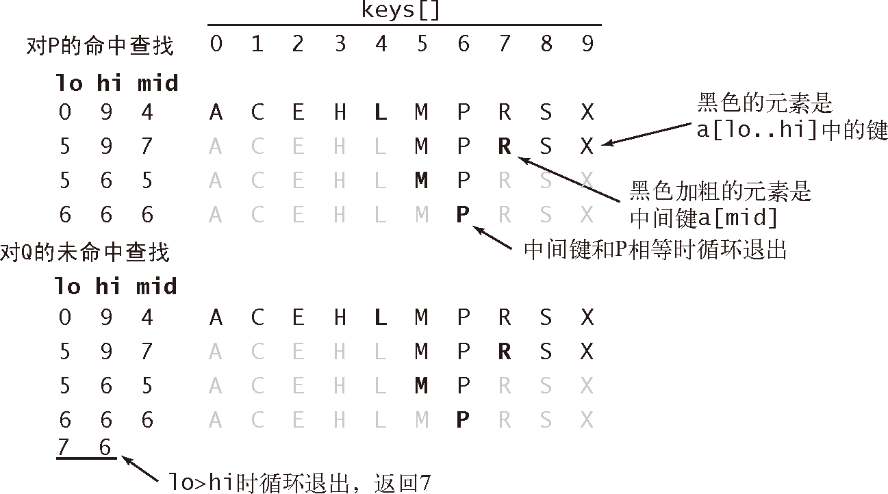

- 在有序数组中使用二分法查找排名的轨迹

- 算法 3.2（续 2）基于二分查找的有序符号表的其他操作

```sql
public Key min()
1
{  return keys[0];  }
2
3
public Key max()
4
{  return keys[N-1];  }
5
6
public Key select(int k)
7
{  return keys[k];  }
8
9
public Key ceiling(Key key)
10
{
11
  int i = rank(key);
12
  return keys[i];
13
}
14
15
public Key floor(Key key)
16
// 请见练习3.1.17
17
18
public Key delete(Key key)
19
// 请见练习3.1.16
20
21
public Iterable<Key> keys(Key lo, Key hi)
22
{
23
  Queue<Key> q = new Queue<Key>();
24
  for (int i = rank(lo); i < rank(hi); i++)
25
     q.enqueue(keys[i]);
26
  if (contains(hi))
27
     q.enqueue(keys[rank(hi)]);
28
  return q;
29
}
30
```

- 这些方法，以及练习 3.1.16 和练习 3.1.17，组成了我们对使用二分查找的有序符号表的完

```sql
整实现。min()、max() 和 select() 方法都很简单，只需按照给定的位置从数组中返回
相应的值即可。rank() 方法实现了二分查找，是其他方法的基石。floor() 和
delete() 方法虽然也不难，但稍微复杂一些，在此留做练习。
```

### 3.1.5.2　其他操作

因为键被保存在有序数组中，算法 3.2（续 2）中和顺序有关的大多数操作都一目了然。例

```sql
如，调用 select(k) 就相当于返回 keys[k]。我们将 delete() 和 floor() 留做练习。
你应该研究一下 ceiling() 和带两个参数的 keys() 方法的实现，并完成练习来巩固和加
```

深你对有序符号表的 API 及其实现的理解。

### 3.1.6　对二分查找的分析

```
rank() 的递归实现还能够让我们立即得到一个结论：二分查找很快，因为递归关系可以说明
```

算法所需比较次数的上界。


- 命题 B。在个键的有序数组中进行二分查找最多需要（）次比较（无论是否成

- 功）。


- 证明。这里的分析和对归并排序的分析（第 2 章的命题 F）类似（但相对简单）。令

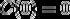

- 的符号表中查找一个键所需进行的比较次数。显然我们有为在大小为，

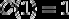

- 我们可以写出一个和递归方法直接对应的归纳关系式：，且对于


- 无论查找会在中间元素的左侧还是右侧继续，子数组的大小都不会超过，我们需要一次比较来检查中间元素和被查找的键是否相等，并决定继续查找左侧还是右侧的子数组。当


- 为 2 的幂减 1 时（），这种递推很容易。首先，因为，所


- 以我们有：


- 用这个公式代换不等式右边的第一项可得：


- 次可得：将上面这一步重复


- 最后的结果即：


- ，确切的结论更加复杂，但不难通过以上论证推广得到（请见练习 3.1.20）。对于一般的

- 二分查找所需时间必然在对数范围之内。

```sql
刚才给出的实现中，ceiling() 只是调用了一次 rank()，而接受两个参数的默认 size()
方法调用了两次 rank()，因此这份证明也保证了这些操作（包括 floor()）所需的时间最
多是对数级别的（min()、max() 和 select() 操作所需的时间都是常数级别的）。
尽管能够保证查找所需的时间是对数级别的，BinarySearchST 仍然无法支持我们用类似
FrequencyCounter 的程序来处理大型问题，因为 put() 方法还是太慢了。二分查找减少
```

了比较的次数但无法减少运行所需时间，因为它无法改变以下事实：在键是随机排列的情况下，构造一个基于有序数组的符号表所需要访问数组的次数是数组长度的平方级别（在实际情

```
况下键的排列虽然不是随机的，但仍然很好地符合这个模型）。BinarySearchST 的操作的
```

成本如表 3.1.9 所示。

表 3.1.9　BinarySearchST 的操作的成本

方法

- 运行所需时间的增长数量级

```
put()
```


```sql
get()
delete()
```

```
contains()
size()
```

- 1

```
min()
```

- 1

```
max()
```

- 1

```
floor()
```

```
ceiling()
```

```sql
rank()
select()
```

- 1

```
deleteMin()
```

```
deleteMax()
```

- 1

- 命题 B（续）。向大小为的有序数组中插入一个新的元素在最坏情况下需要访问次


- 个元素在最坏情况下需要访问次数组。数组，因此向一个空符号表中插入

- 证明。同命题 A。


- 个不同键的《双城记》，构建符号表需要访问数组约次；而对于含有个不

对于含有


同键的 Leipzig 项目则需要访问数组

- 次。虽然现代计算机可勉强实现，但这样的成本还是

过高了。

```
回头看看 FrequencyCounter 在参数为 8 时 put() 操作的性能，我们可以看到平均情况下
的比较次数（包括访问数组的次数）从 SequentialSearchST 的 2246 次降低到了
BinarySearchST 的 484 次（如图 3.1.4 所示）。这比我们在分析中预测的还要更好，额外
```

的部分可能能够再次通过应用的性质得到解释（请见练习 3.1.36）。这次改进令人印象深刻，但你会看到，我们还能做得更好。

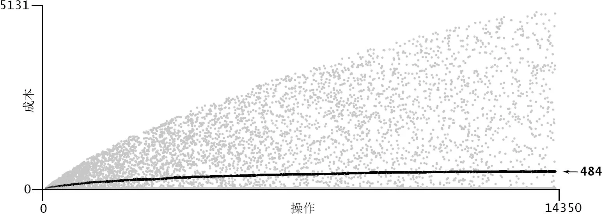

```
图 3.1.4　使用 BinarySearchST，运行 java FrequencyCounter 8 < tale.txt 的成本
```

### 3.1.7　预览

一般情况下二分查找都比顺序查找快得多，它也是众多实际应用程序的最佳选择。对于一个静态表（不允许插入）来说，将其在初始化时就排序是值得的，如第 1 章中的二分查找所示（请见表 1.2.15）。即使查找前所有的键值对已知（这在应用程序中是一种常见的情况），为

```
BinarySearchST 添加一个能够初始化并将符号表排序的构造函数也是有意义的（请见练习
```

3.1.12）。当然，二分查找也不适合很多应用。例如，它无法处理 Leipzig Corpora 数据库，因为查找和插入操作是混合进行的，而且符号表也太大了。如我们所强调的那样，现代应用需要同时能够支持高效的查找和插入两种操作的符号表实现。也就是说，我们需要在构造庞大的符号表的同时能够任意插入（也许还有删除）键值对，同时也要能够完成查找操作。

表 3.1.10 给出了本节中介绍的符号表的初级实现的性能特点。表中给出的是总成本中的最高级项（对于二分查找是数组的访问次数，对于其他则是比较次数），即运行时间的增长数量级。

表 3.1.10　简单的符号表实现的成本总结

- 最坏情况下的成本（N 次插入后）平均情况下的成本（N 次随机插

算法（数据结构）

- 查找插入查找插入

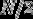

顺序查找（无序链表）


二分查找（有序数组）


核心的问题在于我们能否找到能够同时保证查找和插入操作都是对数级别的算法和数据结构。答案是令人兴奋的“可以”！这个答案也正是本章的重点所在。和第 2 章讨论的高效排序算法一样，能够高效地查找和插入的符号表是算法领域对世界最重要的贡献之一，也是我们今天能够享受的丰富计算性基础设施的开发基础。

我们如何能够实现这个目标呢？要支持高效的插入操作，我们似乎需要一种链式结构。但单链接的链表是无法使用二分查找法的，因为二分查找的高效来自于能够快速通过索引取得任何子数组的中间元素（但得到一条链表的中间元素的唯一方法只能是沿链表遍历）。为了将二分查找的效率和链表的灵活性结合起来，我们需要更加复杂的数据结构。能够同时拥有两者的就是二叉查找树，它也是我们下面两节的主题。我们会将散列表留到 3.4 节中讨论。

在本章中我们会学习 6 种符号表的实现，这里我们先给出一个简单的预览。表 3.1.11 包含一系列数据结构以及它们适用和不适用于某个应用场景的原因，按照我们学习它们的先后顺序排列。

表 3.1.11　符号表的各种实现的优缺点

使用的数据结构

- 实现优点

```
SequentialSearchST
```

链表（顺序查找）

- 适用于小型问题

在学习中我们会仔细了解每种算法和实现的各种性质，这里的简单特性是为了帮助你在学习它们的同时能够从全局的高度来理解它们。一句话，我们有若干种高效的符号表实现，它们能够并且已经被应用于无数程序之中了。

### 答疑

```
问　为什么符号表不像 2.4 节中优先队列那样使用一个 Comparable 的 Item 类型，而是对
```

于键和值使用不同的数据类型？

答　这的确是一种可行的办法。这两者代表了将键和值关联起来的两种不同方式——我们可以构造一种将键包含在其中的数据结构来隐式关联键值或是显式地将键和值区分开来。对于符号表，我们选择突出关联数组的抽象形式。同时也请注意，符号表的用例在查找时只会指定一个键，而非一个键值对。

```
问　为什么要用 equals() ？为什么不一直使用 compareTo() ？
```

答　并不是所有的数据产生的键值对都能够进行比较，尽管有时候将它们保存在符号表可以。举一个比较极端的例子，你可能会用一幅照片或者一首歌作为键，但没法比较它们，只能知道它们是否相等（也要花点儿工夫）。

```
问　为什么键的值不能为空（null）？
答　因为我们会用 Key 调用 compareTo() 或者 equals() 方法，因此我们假设它是一个
Object。但是当 a 为 null 时 a.compareTo(b) 会抛出一个空指针异常。如果能消除这种
```

可能性，用例的代码能够更简单。

```
问　为什么不和排序一样使用一个类似于 less() 的方法？
```

答　在符号表中等价性比较特殊，因此我们还需要一个方法来测试等价性。为了避免增加本质

```
上功能相同的方法，我们使用了 Java 内置的 equals() 和 compareTo()。
问　在 BinarySearchST 中的类型转换之前，为什么不将 keys[] 和 vals[] 一样声明为
Object[]（而是 Comparable[]）？
答　问得好。如果你这么做，你会得到一个 ClassCastException，因为键只能是
Comparable 的（以保证 keys[] 中的元素都有 compareTo() 方法）。因此将 keys[] 声
明为 Comparable[] 是必需的。深入程序语言的设计细节来解释这里的原因可能会有些跑
题。在本书所有使用泛型的 Comparable 对象和数组的代码中我们都会照此办理。
```

问　如果我们需要将多个值关联到同一个键怎么办？例如，如果我们在应用程序中用 Date 日期作为键，那不会需要处理重复的键吗？

答　可能会，也可能不会。例如，两列火车不可能同时在同一条轨道上到达同一个车站（但它们可以在不同的铁轨上同时到站）。处理这种情形有两个办法：用其他信息来消除重复或者使

```
用 Queue 类型来存储所有有相同键的值。我们会在 3.5 节中详细讨论符号表的应用。
```

问　3.1.7 节中将表预排序的想法看起来是个好主意，为什么把它留作一道练习（请见练习3.1.12）？

答　的确，在某些应用中它确实是最佳的选择。但在一个希望实现快速查找的数据结构中为了“图方便”而加入一个低效的插入方法会变成一个性能陷阱，因为一个普通用例可能会在一张很大的表中混合使用查找和插入操作却发现运行所需的时间是平方级别的。这种陷阱太常见了，因此当你使用他人开发的软件，尤其是接口繁多时，你应该加倍小心。当对象含有大量“便捷”方法而导致到处都是性能陷阱，而用例却可能认为所有的方法都同样高效时，这个问题就非常

```
严重了。Java 的 ArrayList 类就是这样的一个例子（请见练习 3.5.27）。
```

### 练习

3.1.1　编写一段程序，创建一张符号表并建立字母成绩和数值分数的对应关系，如下表所示。从标准输入读取一系列字母成绩，计算并打印 GPA（字母成绩对应的分数的平均值）。

A+

- AA-B+BB-C+CC-DF

4.33

- 4.003.673.333.002.672.332.001.671.000.00

```
3.1.2　开发一个符号表的实现 ArrayST，使用（无序）数组来实现我们的基本 API。
3.1.3　开发一个符号表的实现 OrderedSequentialSearchST，使用有序链表来实现我们
```

的有序符号表 API。

```sql
3.1.4　开发抽象数据类型 Time 和 Event 来处理表 3.1.5 中的例子中的数据。
3.1.5　实现 SequentialSearchST 中的 size()、delete() 和 keys() 方法。
 的函数给出 FrequencyCounter 调用的
```

3.1.6　用输入中的单词总数

- 和不同单词总数


```
put() 和 get() 方法的次数。
```


3.1.7　对于

- 和个小于 1000 的随机非负整数中、、、、，在

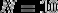

```
FrequencyCounter 平均能够找到多少个不同的键？
```

3.1.8　在《双城记》中，使用频率最高的长度大于等于 10 的单词是什么？

```
3.1.9　在 FrequencyCounter 中添加追踪 put() 方法的最后一次调用的代码。打印出最后
```

插入的那个单词以及在此之前总共从输入中处理了多少个单词。用你的程序处理 tale.txt 中长度分别大于等于 1、8 和 10 的单词。

```
3.1.10　给出用SequentialSearchST 将键E A S Y Q U E S T I O N 插入一个空符号
```

表的过程的轨迹。一共进行了多少次比较？

```
3.1.11　给出用 BinarySearchST 将键 E A S Y Q U E S T I O N 插入一个空符号表
```

的过程的轨迹。一共进行了多少次比较？

```
3.1.12　修改 BinarySearchST，用一个 Item 对象的数组而非两个平行数组来保存键和
值。添加一个构造函数，接受一个 Item 的数组为参数并将其归并排序。
 次 put() 和
 次 get() 操作的应用程序，你会使用
```

3.1.13　对于一个会随机混合进行本节中的哪种符号表的实现？说明理由。

```
 次 put() 和
 次 get() 操作的应用程序，你会使用
```

3.1.14　对于一个会随机混合进行本节中的哪种符号表的实现？说明理由。

```
3.1.15　假设在一个 BinarySearchST 的用例程序中，查找操作的次数是插入操作的 1000
```

- 和次查找时，请估计插入操作在总耗时中的比例。

倍。当分别进行

- 、

```sql
3.1.16　为 BinarySearchST 实现 delete() 方法。
3.1.17　为 BinarySearchST 实现 floor() 方法。
3.1.18　证明 BinarySearchST 中 rank() 方法的实现的正确性。
3.1.19　修改 FrequencyCounter，打印出现频率最高的所有单词，而非其中之一。提示：
请用 Queue。
```

3.1.20　补全命题 B 的证明（证明

- 的一般情况）。提示：先证明的单调性，即对于所


有的

- ，

### 提高题

```
 对键值比较 BinarySearchST 和
```

3.1.21　内存使用。基于 1.4 节中的假设，对于

```
SequentialSearchST 的内存使用情况。不需要记录键值本身占用的内存，只统计它们的
引用。对于 BinarySearchST，假设数组大小可以动态调整，数组中被占用的空间比例为
```

25% ～ 100%。

3.1.22　自组织查找。自组织查找指的是一种能够将数组元素重新排序使得被访问频率较高的元素更容易被找到的查找算法。请修改你为练习 3.1.2 给出的答案，在每次查找命中时：将被找到的键值对移动到数组的开头，将所有中间的键值对向右移动一格。这个启发式的过程被称为前移编码。

3.1.23　二分查找的分析。请证明对于大小为

- 的符号表，一次二分查找所需的最大比较次


- 的二进制表示的位数，因为右移一位的操作会将二进制的变为二进制的

数正好是

。

```
3.1.24　插值法查找。假设符号表的键支持算术操作（例如，它们可能是 Double 或者
Interger 类型的值）。编写一个二分查找来模拟查字典的行为，例如当单词的首字母在字母
```


- 为符号表的第一个键，

表的开头时我们也会在字典的前半部分进行查找。具体来说，设


- 时，先和进行比较，而非取中间

为符号表的最后一个键，当要查找

- 1

```
元素。用 SearchCompare
调用 FrequencyCounter 来比较你的实现和
BinarySearchST 的性能。
3.1.25　缓存。因为默认的 contains() 的实现中调用了 get()，所以
FrequencyCounter 的内循环会将同一个键查找两三遍：
if (!st.contains(word)) st.put(word, 1);
else                    st.put(word, st.get(word) + 1);
```

为了能够提高这样的用例代码的效率，我们可以用一种叫缓存的技术手段，即将访问最频繁的

```
键的位置保存在一个变量中。修改 SequentialSearchST 和 BinarySearchST 来实现这
```

个点子。

```
3.1.26　基于字典的频率统计。修改 FrequencyCounter，接受一个字典文件作为参数，统
```

计标准输入中出现在字典中的单词的频率，并将单词和频率打印为两张表格，一张按照频率高低排序，一张按照字典顺序排序。

```
3.1.27　小符号表。假设一段 BinarySearchST 的用例插入了
```

- 个不同的键并会进行次


- 的增长数量级。

查找。当构造表的成本和所有查找的总成本相同时，给出

```sql
3.1.28　有序的插入。修改 BinarySearchST，使得插入一个比当前所有键都大的键只需要
常数时间（这样在构造符号表时有序地使用 put() 插入键值对就只需要线性时间了）
3.1.29　测试用例。编写一段测试代码 TestBinarySearch.java 用来测试正文中 min()、
max()、floor()、ceiling()、select()、rank()、deleteMin()、deleteMax()
和 keys() 的实现。可以参考 3.1.3.1 节的索引用例，添加代码使其在适当的情况下接受更多
```

的命令行参数。

```sql
3.1.30　验证。向 BinarySearchST 中加入断言（assert）语句，在每次插入和删除数据后
检查算法的有效性和数据结构的完整性。例如，对于每个索引必有 i==rank(select(i))
```

且数组应该总是有序的。

### 实验题

```
3.1.31　性能测试。编写一段性能测试程序，先用 put() 构造一张符号表，再用 get() 进行
```

访问，使得表中的每个键平均被命中 10 次，且有大致相同次数的未命中访问。键为长度从 2到 50 不等的随机字符串。重复这样的测试若干遍，记录每遍的运行时间，打印平均运行时间或将它们绘制成图。

3.1.32　练习。编写一段练习程序，用困难或者极端的但在实际应用中可能出现的情况来测试我们的有序符号表 API。一些简单的例子包括有序的键列、逆序的键列、所有键全部相同或者只含有两种不同的值。

```
3.1.33　自组织查找。编写一段程序调用自组织查找的实现（请见练习 3.1.22），用 put() 构
```

- 的符号表，然后根据预先定义好的概率分布进行次命中查找。对于

造一个大小为


- 和，用这段程序比较你在练习 3.1.22 中的实现和、、

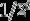

```
BinarySearchST 的运行时间，在预定义的概率分布中查找命中第
```

- 小的键的概率为。


3.1.34　Zipf 法则。用命中第

- 小的键的概率为的分布重新完成上一道练习，其中


- 为调和级数（请见表 1.4.6）。这种分布被称为 Zipf 法则。比较前移编码和上一道练习中

的在特定分布下的最优安排，该安排将所有键按升序排列（即按照它们的期望频率的降序排列）。

3.1.35　性能验证 I。用各种不同的

- 运行双倍测试，取《双城记》的前个单词，验证

```
FrequencyCounter 在使用 SequentialSearchST 时所需的运行时间是
```

- 的平方级别的

猜想。

```
3.1.36　性能验证 II。解释 FrequencyCounter 在使用 BinarySearchST 时比使用
SequentialSearchST 时的性能提高程度好于预期的原因。
3.1.37　put/get 的比例。当 FrequencyCounter 使用 BinarySearchST 在 100 万个长
 个二进位的随机整数中统计每个值的出现频率时，根据经验判断 BinarySearchST
```

度为


```
中 put() 操作和 get() 操作的耗时比，其中
```

- 、20 和 30。再统计 tale.txt 并评估耗


时比，并比较两次的结果。

```
3.1.38　均摊成本图。修改 FrequencyCounter、SequentialSearchST 和
BinarySearchST，统计计算中每次 put() 操作的成本并生成类似本节所示的图。
3.1.39　实际耗时。修改 FrequencyCounter，用 Stopwatch 和 StdDraw 绘图，其中
轴为 get() 和 put() 的调用次数之和，
```

- 轴为总运行时间，每次调用时就根据已运行时间

```
画一个点。分别用 SequentialSearchST 和 BinarySearchST 处理《双城记》并讨论运
```

行的结果。注意：曲线中突然的跳跃可能是缓存导致的，这已经超出了这个问题的讨论范围。

3.1.40　二分查找的临界点。找出使用二分查找比顺序查找要快 10 000 倍和 1000 倍的

- 的大小并通过实验验证它。

值。分析并预测

3.1.41　插值查找的临界点。找出使用插值查找比二分查找要快 1 倍、2 倍和 10 倍的

- 值，

其中假设所有键为随机的 32 二进位整数（请见练习 3.1.24）。分析并预测

- 的大小并通过实

验验证它。

[1]：应该是一个类似于 的类，但实际上正文中并没有任何关于这个 类的内容。——译者注
