# 3.2二叉查找树

在本节中我们将学习一种能够将链表插入的灵活性和有序数组查找的高效性结合起来的符号表实现。具体来说，就是使用每个结点含有两个链接（链表中每个结点只含有一个链接）的二叉查找树来高效地实现符号表，这也是计算机科学中最重要的算法之一。

首先，我们需要定义一些术语。我们所使用的数据结构由结点组成，结点包含的链接可以为空

```
（null）或者指向其他结点。在二叉树中，每个结点只能有一个父结点（只有一个例外，也
```

就是根结点，它没有父结点），而且每个结点都只有左右两个链接，分别指向自己的左子结点和右子结点（如图 3.2.1 所示）。尽管链接指向的是结点，但我们可以将每个链接看做指向了另一棵二叉树，而这棵树的根结点就是被指向的结点。因此我们可以将二叉树定义为一个空链接，或者是一个有左右两个链接的结点，每个链接都指向一棵（独立的）子二叉树。在二叉查找树中，每个结点还包含了一个键和一个值，键之间也有顺序之分以支持高效的查找。

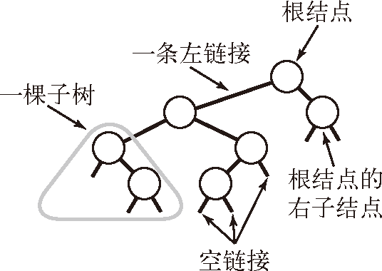

- 图 3.2.1　详解二叉树

```
定义。一棵二叉查找树（BST）是一棵二叉树，其中每个结点都含有一个 Comparable 的
```

- 键（以及相关联的值）且每个结点的键都大于其左子树中的任意结点的键而小于右子树的任意结点的键。

我们在画出二叉查找树时会将键写在结点上。我们使用“A 是 E 的左子结点”的说法用键指代结点。我们用连接结点的线表示链接，并将键对应的值写在结点旁边（若值不确定则省略）。除了空结点只表示为向下的一条线段以外，每个结点的链接都指向它下方的结点。和以前一样，我们在例子中只会使用索引测试用例生成的单个字母作为键，如图 3.2.2 所示。

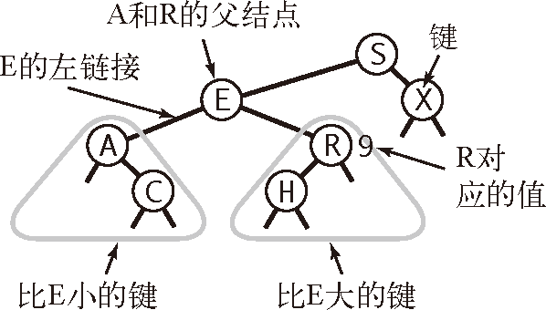

- 图 3.2.2　详解二叉查找树

### 3.2.1　基本实现

算法 3.3 定义了二叉查找树（BST）的数据结构，我们会在本节中用它实现有序符号表的

```
API。首先我们要研究一下这个经典的数据类型，以及与它的特点紧密相关的 get()（查找）
和 put()（插入）方法的实现。
```

### 3.2.1.1　数据表示

和链表一样，我们嵌套定义了一个私有类来表示二叉查找树上的一个结点。每个结点都含有一个键、一个值、一条左链接、一条右链接和一个结点计数器（有需要时我们会在图中将结点计数器的值写在结点上方）。左链接指向一棵由小于该结点的所有键组成的二叉查找树，右链接

```
指向一棵由大于该结点的所有键组成的二叉查找树。变量 N 给出了以该结点为根的子树的结
```

点总数。你将会看到，它简化了许多有序符号表的操作的实现。算法 3.3 中实现的私有方法

```
size() 会将空链接的值当作 0，这样我们就能保证以下公式对于二叉树中的任意结点 x 总是
```

成立。

```
size(x) = size(x.left) + size(x.right) + 1
```

一棵二叉查找树代表了一组键（及其相应的值）的集合，而同一个集合可以用多棵不同的二叉查找树表示（如图 3.2.3 所示）。如果我们将一棵二叉查找树的所有键投影到一条直线上，保证一个结点的左子树中的键出现在它的左边，右子树中的键出现在它的右边，那么我们一定可以得到一条有序的键列。我们会利用二叉查找树的这种天生的灵活性，用多棵二叉查找树表示同一组有序的键来实现构建和使用二叉查找树的高效算法。

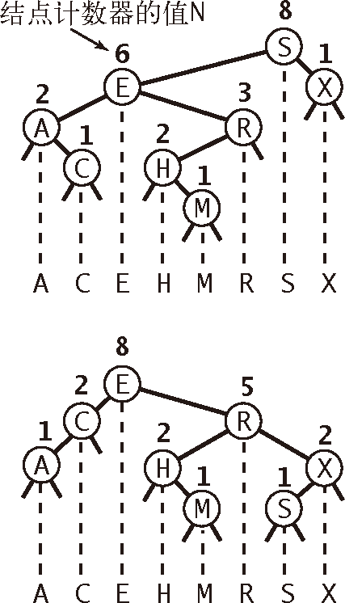

- 图 3.2.3　两棵能够表示同一组键的二叉查找树

### 3.2.1.2　查找

一般来说，在符号表中查找一个键可能得到两种结果。如果含有该键的结点存在于表中，我们

```
的查找就命中了，然后返回相应的值。否则查找未命中（并返回 null）。根据数据表示的递
```

归结构我们马上就能得到，在二叉查找树中查找一个键的递归算法：如果树是空的，则查找未命中；如果被查找的键和根结点的键相等，查找命中，否则我们就（递归地）在适当的子树中继续查找。如果被查找的键较小就选择左子树，较大则选择右子树。算法 3.3（续 1）中递归

```
的 get() 方法完全实现了这段算法。它的第一个参数是一个结点（子树的根结点），第二个参
```

数是被查找的键。代码会保证只有该结点所表示的子树才会含有和被查找的键相等的结点。和二分查找中每次迭代之后查找的区间就会减半一样，在二叉查找树中，随着我们不断向下查找，当前结点所表示的子树的大小也在减小（理想情况下是减半，但至少会有一个结点）。当找到一个含有被查找的键的结点（命中）或者当前子树变为空（未命中）时这个过程才会结束。从根结点开始，在每个结点中查找的进程都会递归地在它的一个子结点上展开，因此一次查找也就定义了树的一条路径。对于命中的查找，路径在含有被查找的键的结点处结束。对于未命中的查找，路径的终点是一个空链接，如图 3.2.4 所示。

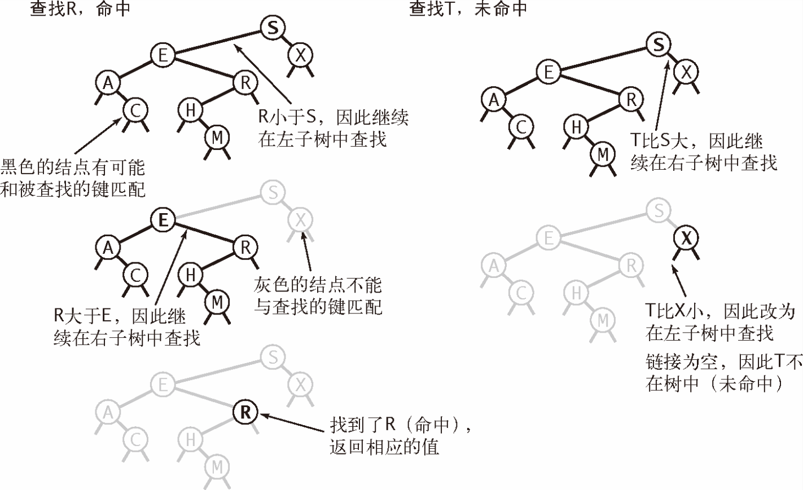

- 图 3.2.4　二叉查找树中的查找命中（左）和未命中（右）

- 算法 3.3　基于二叉查找树的符号表

```java
public class BST<Key extends Comparable<Key>, Value>
1
{
2
  private Node root;               // 二叉查找树的根结点
3
4
  private class Node
5
  {
6
     private Key key;              // 键
7
     private Value val;            // 值
8
     private Node left, right;     // 指向子树的链接
9
     private int N;                // 以该结点为根的子树中的结点总数
10
11
     public Node(Key key, Value val, int N)
12
     {  this.key = key; this.val = val; this.N = N; }
13
  }
14
15
  public int size()
16
  {  return size(root);  }
17
18
  private int size(Node x)
19
  {
20
     if (x == null) return 0;
21
     else           return x.N;
22
  }
23
24
  public Value get(Key key)
25
  // 请见算法3.3（续1）
26
27
  public void put(Key key, Value val)
28
  // 请见算法3.3（续1）
29
30
  // max()、min()、floor()、ceiling()方法请见算法3.3（续2）
31
  // select()、rank()方法请见算法3.3（续3）
32
  // delete()、deleteMin()、deleteMax()方法请见算法3.3（续4）
33
  // keys()方法请见算法3.3（续5）
34
}
35
这段代码用二叉查找树实现了有序符号表的 API，树由 Node 对象组成，每个对象都含有一
对键值、两条链接和一个结点计数器 N。每个 Node 对象都是一棵含有 N 个结点的子树的
```

- 根结点，它的左链接指向一棵由小于该结点的所有键组成的二叉查找树，右链接指向一棵由

```
大于该结点的所有键组成的二叉查找树。root 变量指向二叉查找树的根结点 Node 对象
```

- （这棵树包含了符号表中的所有键值对）。本节会陆续给出其他方法的实现。

算法 3.3（续 1）的实现过程如下所示。

- 算法 3.3（续 1）二叉查找树的查找和排序方法的实现

```java
public Value get(Key key)
1
{  return get(root, key);  }
2
private Value get(Node x, Key key)
3
{  // 在以x为根结点的子树中查找并返回key所对应的值；
4
  // 如果找不到则返回null
5
  if (x == null) return null;
6
  int cmp = key.compareTo(x.key);
7
  if      (cmp < 0) return get(x.left, key);
8
  else if (cmp > 0) return get(x.right, key);
9
  else return x.val;
10
}
11
12
public void put(Key key, Value val)
13
{  // 查找key，找到则更新它的值，否则为它创建一个新的结点
14
  root = put(root, key, val);
15
}
16
17
private Node put(Node x, Key key, Value val)
18
{
19
  // 如果key存在于以x为根结点的子树中则更新它的值；
20
  // 否则将以key和val为键值对的新结点插入到该子树中
21
  if (x == null) return new Node(key, val, 1);
22
  int cmp = key.compareTo(x.key);
23
  if      (cmp < 0) x.left  = put(x.left,  key, val);
24
  else if (cmp > 0) x.right = put(x.right, key, val);
25
  else x.val = val;
26
  x.N = size(x.left) + size(x.right) + 1;
27
  return x;
28
}
29
这段代码实现了有序符号表 API 中的 put() 和 get() 方法，它们的递归实现也是本章稍
```

- 后将会讨论的其他几种实现的模板。每个方法的实现既可以看做是实用的代码，也可以看做是之前讨论的递推猜想的证明。

### 3.2.1.3　插入

算法 3.3（续 1）中的查找代码几乎和二分查找的一样简单，这种简洁性是二叉查找树的重要特性之一。而二叉查找树的另一个更重要的特性就是插入的实现难度和查找差不多。当查找一个不存在于树中的结点并结束于一条空链接时，我们需要做的就是将链接指向一个含有被查找

```
的键的新结点（详见图 3.2.5）。算法 3.3（续 1）中递归的 put() 方法的实现逻辑和递归查
```

找很相似：如果树是空的，就返回一个含有该键值对的新结点；如果被查找的键小于根结点的键，我们会继续在左子树中插入该键，否则在右子树中插入该键。

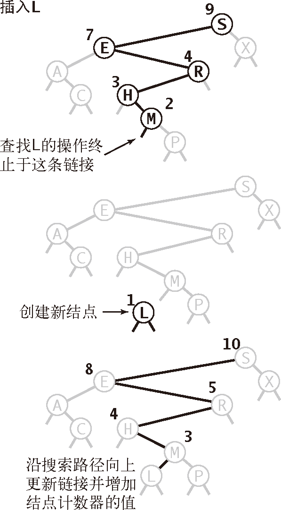

- 图 3.2.5　二叉查找树的插入操作

### 3.2.1.4　递归

这些递归实现值得我们花点儿时间去理解其中的运行细节。可以将递归调用前的代码想象成沿着树向下走：它会将给定的键和每个结点的键相比较并根据结果向左或者向右移动到下一个结

```
点。然后可以将递归调用后的代码想象成沿着树向上爬。对于 get() 方法，这对应着一系列
的返回指令（return），但是对于 put() 方法，这意味着重置搜索路径上每个父结点指向子
```

结点的链接，并增加路径上每个结点中的计数器的值。在一棵简单的二叉查找树中，唯一的新链接就是在最底层指向新结点的链接，重置更上层的链接可以通过比较语句来避免。同样，我们只需要将路径上每个结点中的计数器的值加 1，但我们使用了更加通用的代码，使之等于结点的所有子结点的计数器之和加 1。在本节和下一节中，我们会学习一些更加高级但原理相同的算法，但它们在搜索路径上需要改变的链接更多，也需要适应性更强的代码来更新结点计数器。基本的二叉查找树的实现常常是非递归的（请见练习 3.2.13）——我们在实现中使用了递归，一来是为了便于读者理解代码的工作方式，二来也是为学习更加复杂的算法做准备。

图 3.2.6 是对我们的标准索引用例轨迹的一份详细的研究，它向你展示了二叉树是如何生长的。新结点会连接到树底层的空链接上，树的其他部分则不会改变。例如，第一个被插入的键就是根结点，第二个被插入的键是根结点的两个子结点之一，以此类推。因为每个结点都含有两个链接，树会逐渐长大而不是萎缩。不仅如此，因为只有查找或者插入路径上的结点才会被访问，所以随着树的增长，被访问的结点数量占树的总结点数的比例也会不断的降低。

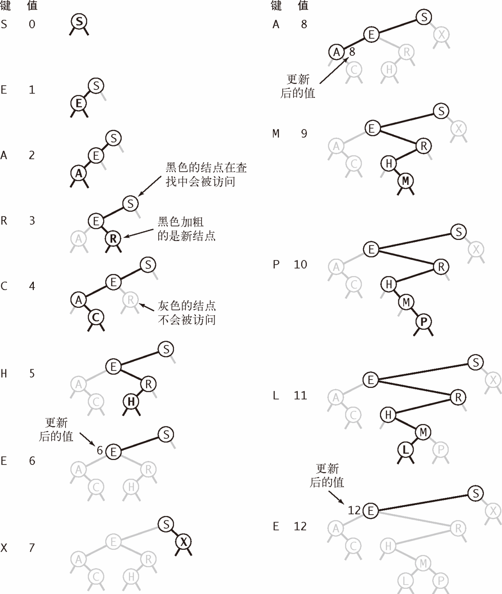

- 图 3.2.6　使用二叉查找树的标准索引用例的轨迹

### 3.2.2　分析

使用二叉查找树的算法的运行时间取决于树的形状，而树的形状又取决于键被插入的先后顺

- 个结点的树是完全平衡的，每条空链接和根结点的距离都

序。在最好的情况下，一棵含有


- 个结点。如图 3.2.7 所示。但在一般情况

为

- 。在最坏的情况下，搜索路径上可能有

下树的形状和最好情况更接近。

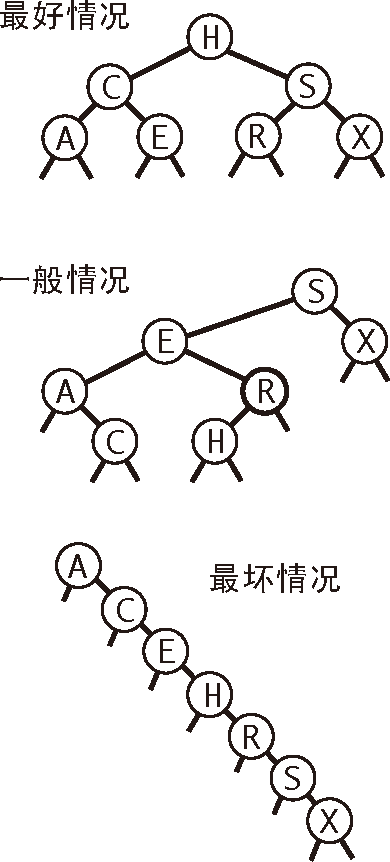

- 图 3.2.7　二叉查找树的可能形状

对于很多应用来说，图 3.2.8 所示的简单模型都是适用的：我们假设键的分布是（均匀）随机的，或者说它们的插入顺序是随机的。对这个模型的分析而言，二叉查找树和快速排序几乎就是“双胞胎”。树的根结点就是快速排序中的第一个切分元素（左侧的键都比它小，右侧的键都比它大），而这对于所有的子树同样适用，这和快速排序中对子数组的递归排序完全对应。这使我们能够分析得到二叉查找树的一些性质。

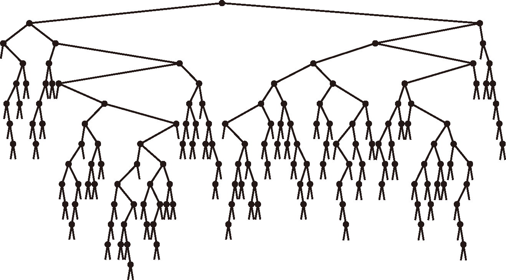

- 图 3.2.8　一棵典型的二叉查找树，由 256 个随机键组成

- 命题 C。在由个随机键构造的二叉查找树中，查找命中平均所需的比较次数为


- （约）。证明。一次结束于给定结点的命中查找所需的比较次数为查找路径的深度加 1。如果将树中的所有结点的深度加起来，我们就能够得到一棵树的内部路径长度。因此，在二叉查找树中的平均比较次数即为平均内部路径长度加 1。我们可以使用 2.3 节的命题 K 的证明得到


- 为由个随机排序的不同键构造得到的二叉查找树的内部路径长度，则查找命它：令


- 我们可以根据二叉查中的平均成本为（）。我们有，且对于


- 找树的递归结构直接得到一个归纳关系式：


- 这一项表示根结点使得树中的所有个非根结点的路径上都加了 1。表达其中


- 的二叉查找树的方法相同。整理式的其他项代表了所有子树，它们的计算方法和大小为

- 表达式后我们会发现，这个归纳公式和我们在 2.3 节中为快速排序得到的公式几乎完全相


- 同，因此我们同样可以得到。

- 命题 D。在由个随机键构造的二叉查找树中插入操作和查找未命中平均所需的比较次数

- 为（约）。

- 证明。插入操作和查找未命中平均比查找命中需要一次额外的比较。这一点由归纳法不难得到（请见练习 3.2.16）。

命题 C 说明在二叉查找树中查找随机键的成本比二分查找高约 39%。命题 D 说明这些额外的成本是值得的，因为插入一个新键的成本是对数级别的——这是基于二分查找的有序数组所不具备的灵活性，因为它的插入操作所需访问数组的次数是线性级别的。和快速排序一样，比较

- 越大这个公式越准确。

次数的标准差很小，因此

实验

我们的随机键模型和典型的符号表使用情况是否相符？按照惯例，这个问题的答案需要具体问题具体分析，因为在不同的应用场景中性能的差别可能很大。幸好，对于大多数用例，这个模型都能很好地适应。

```
作为例子，我们研究用 FrequencyCounter 处理长度大于等于 8 的单词时 put() 操作的成
本。从图 3.2.9 可以看到，每次操作的平均成本从 BinarySearchST 的 484 次数组访问降低
```

到了二叉查找树的 13 次，这也再次验证了理论模型所预测的对数级别的性能。根据命题 C 和命题 D，这个数值的合理大小应该是符号表大小的自然对数的两倍左右，因为对于一个几乎充满的符号表，大多数操作都是查找。这个预测至少有以下不准确性：

- 很多操作都是在较小的符号表中进行的；

- 键不随机；


- 符号表可能太小，近似值 不准确。

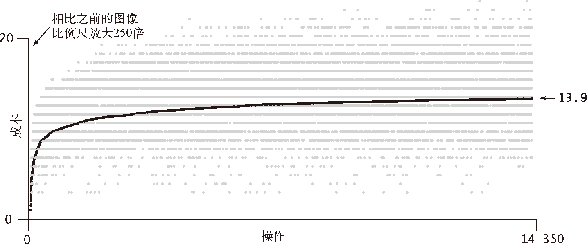

```
图 3.2.9　使用二叉查找树，运行 java FrequencyCounter 8 < tale.txt 的成本
无论如何，通过表 3.2.1 你都能看到，对于 FrequencyCounter 这个预测的误差只有若干次
```

比较。事实上，大多数误差都能通过对近似值的数学表达式的改进得到解释（请见练习3.2.35）。

表 3.2.1　使用二叉查找树的 FrequencyCounter 的每次 put() 操作平均所需的比较次数

- tale.txtleipzig1M.txt

- 比较次数单词数不同单词数单词数不同单模型预测实际次数

- 135 63510 67918.617.521 191 455534 5

所有单词

长度大于等于 8 的单词

- 14 3505 13117.613.94 239 597299 5

长度大于等于 10 的单词

- 4 5822 26015.413.11 610 829165 5

### 3.2.3　有序性相关的方法与删除操作

二叉查找树得以广泛应用的一个重要原因就是它能够保持键的有序性，因此它可以作为实现有序符号表 API（请见 3.1.2 节）中的众多方法的基础。这使得符号表的用例不仅能够通过键还能通过键的相对顺序来访问键值对。下面，我们要研究有序符号表 API 中各个方法的实现。

### 3.2.3.1　最大键和最小键

如果根结点的左链接为空，那么一棵二叉查找树中最小的键就是根结点；如果左链接非空，那

```
么树中的最小键就是左子树中的最小键。这不仅描述了算法 3.3（续 2）中 min() 方法的递归
```

实现，同时也递推地证明了它能够在二叉查找树中找到最小的键。简单的循环也能等价实现这

```
段描述，但为了保持一致性我们使用了递归。我们可以让递归调用返回键 Key 而非结点对象
Node，但我们后面还会用到这方法来找出含有最小键的结点。找出最大键的方法也是类似
```

的，只是变为查找右子树而已。

### 3.2.3.2　向上取整和向下取整

```
如果给定的键 key 小于二叉查找树的根结点的键，那么小于等于 key 的最大键
floor(key) 一定在根结点的左子树中；如果给定的键 key 大于二叉查找树的根结点，那么
只有当根结点右子树中存在小于等于 key 的结点时，小于等于 key 的最大键才会出现在右子
树中，否则根结点就是小于等于 key 的最大键。这段描述说明了 floor() 方法的递归实
```

现，同时也递推地证明了它能够计算出预期的结果。将“左”变为“右”（同时将小于变为大于）

```
就能够得到 ceiling() 的算法。向下取整函数的计算如图 3.2.10 所示。
```

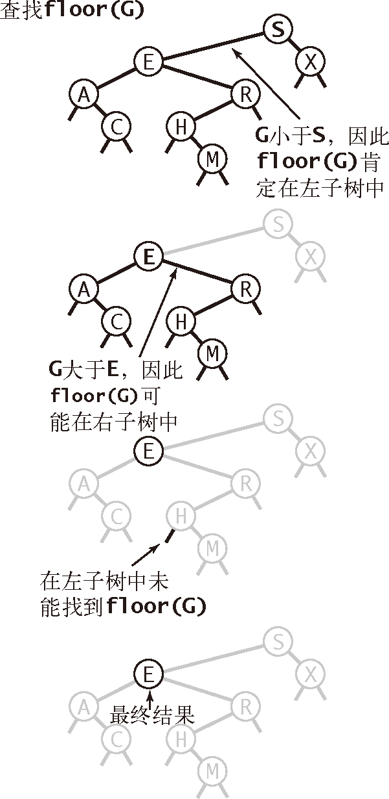

```
图 3.2.10　计算 floor() 函数
```

### 3.2.3.3　选择操作

二叉查找树中的选择操作和 2.5 节中我们学习过的基于切分的数组选择操作类似。我们在二叉

```
查找树的每个结点中维护的子树结点计数器变量 N 就是用来支持此操作的。
```

- 算法 3.3（续 2）二叉查找树中 max()、min()、floor()、ceiling() 方法的实现

```
public Key min()
1
{
2
  return min(root).key;
3
}
4
private Node min(Node x)
5
{
6
  if (x.left == null) return x;
7
  return min(x.left);
8
}
9
public Key floor(Key key)
10
{
11
  Node x = floor(root, key);
12
  if (x == null) return null;
13
  return x.key;
14
}
15
private Node floor(Node x, Key key)
16
{
17
  if (x == null) return null;
18
  int cmp = key.compareTo(x.key);
19
  if (cmp == 0) return x;
20
  if (cmp < 0)  return floor(x.left, key);
21
  Node t = floor(x.right, key);
22
  if (t != null) return t;
23
  else           return x;
24
}
25
```

- 每个公有方法都对应着一个私有方法，它接受一个额外的链接作为参数指向某个结点，通过

```
正文中描述的递归方法查找返回 null 或者含有指定 Key 的结点 Node。max() 和
ceiling() 的实现分别与 min() 和 floor() 方法基本相同，只是将代码中的 left 和
right（以及＞和＜）调换而已。
```

- 的键（即树中正好有个小于它的键）。如果左子树中的结点数大

假设我们想找到排名为

- 的键；如果等于，那么我们就继续（递归地）在左子树中查找排名为

于

- ，我们就返回小于

根结点中的键；如果

- ，我们就（递归地）在右子树中查找排名为（）的键。


```sql
和刚才一样，这段描述既说明了 select() 方法的递归实现同时也证明了它的正确性，此过
```

程如图 3.2.11 所示。

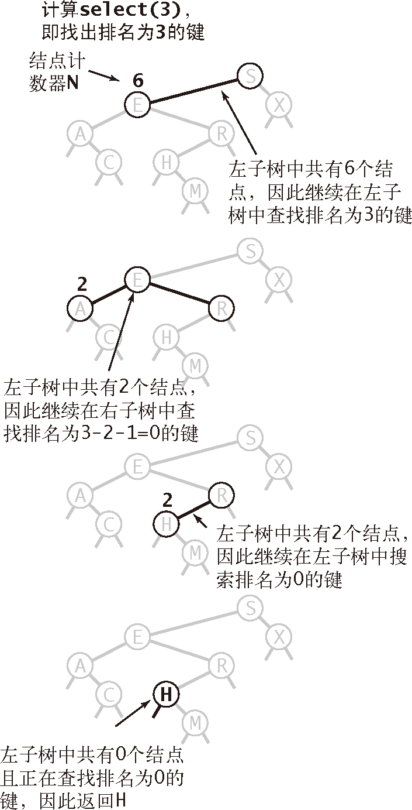

```sql
图 3.2.11　二叉查找树中的 select() 操作
```

### 3.2.3.4　排名

```sql
rank() 是 select() 的逆方法，它会返回给定键的排名。它的实现和 select() 类似：如
```

果给定的键和根结点的键相等，我们返回左子树中的结点总数

- ；如果给定的键小于根结点，

我们会返回该键在左子树中的排名（递归计算）；如果给定的键大于根结点，我们会返回


（根结点）加上它在右子树中的排名（递归计算）。

二叉查找树中选择和排名操作的实现如算法 3.3（续 3）所示。

- 算法 3.3（续 3）二叉查找树中 select() 和 rank() 方法的实现

```sql
public Key select(int k)
1
{
2
  return select(root, k).key;
3
}
4
private Node select(Node x, int k)
5
{   // 返回排名为k的结点
6
   if (x == null) return null;
7
   int t = size(x.left);
8
   if      (t > k) return select(x.left,  k);
9
   else if (t < k) return select(x.right, k-t-1);
10
   else            return x;
11
}
12
public int rank(Key key)
13
{  return rank(key, root);  }
14
private int rank(Key key, Node x)
15
{  // 返回以x为根结点的子树中小于x.key的键的数量
16
  if (x == null) return 0;
17
  int cmp = key.compareTo(x.key);
18
  if      (cmp < 0) return rank(key, x.left);
19
  else if (cmp > 0) return 1 + size(x.left) + rank(key, x.right);
20
  else              return size(x.left);
21
}
22
```

- 这段代码使用了和我们已经在本章中学习过的其他实现中一样的递归模式实现了

```sql
select() 和 rank() 方法。它依赖于本节开始处给出的 size() 方法来统计每个结点以
```

- 下的子结点总数。

### 3.2.3.5　删除最大键和删除最小键

```sql
二叉查找树中最难实现的方法就是 delete() 方法，即从符号表中删除一个键值对。作为热
身运动，我们先考虑 deleteMin() 方法（删除最小键所对应的键值对），如图 3.2.12 所示。
和 put() 一样，我们的递归方法接受一个指向结点的链接，并返回一个指向结点的链接。这
```

样我们就能够方便地改变树的结构，将返回的链接赋给作为参数的链接。对于

```
deleteMin()，我们要不断深入根结点的左子树中直至遇见一个空链接，然后将指向该结点
```

的链接指向该结点的右子树（只需要在递归调用中返回它的右链接即可）。此时已经没有任何链接指向要被删除的结点，因此它会被垃圾收集器清理掉。我们给出的标准递归代码在删除结点后会正确地设置它的父结点的链接并更新它到根结点的路径上的所有结点的计数器的值。

```
deleteMax() 方法的实现和 deleteMin() 完全类似。
```

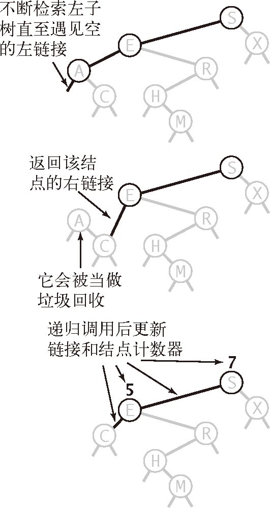

- 图 3.2.12　删除二叉查找树中的最小结点

### 3.2.3.6　删除操作

我们可以用类似的方式删除任意只有一个子结点（或者没有子结点）的结点，但应该怎样删除一个拥有两个子结点的结点呢？删除之后我们要处理两棵子树，但被删除结点的父结点只有一

```
条空出来的链接。T. Hibbard 在 1962 年提出了解决这个难题的第一个方法，在删除结点 x 后
用它的后继结点填补它的位置。因为 x 有一个右子结点，因此它的后继结点就是其右子树中
的最小结点。这样的替换仍然能够保证树的有序性，因为 x.key 和它的后继结点的键之间不
存在其他的键。我们能够用 4 个简单的步骤完成将 x 替换为它的后继结点的任务（具体过程
```

如图 3.2.13 所示）：

```
将指向即将被删除的结点的链接保存为 t；
将 x 指向它的后继结点 min(t.right)；
将 x 的右链接（原本指向一棵所有结点都大于 x.key 的二叉查找树）指向
deleteMin(t.right)，也就是在删除后所有结点仍然都大于 x.key 的子二叉查找树；
将 x 的左链接（本为空）设为 t.left（其下所有的键都小于被删除的结点和它的后继结
```

- 点）。

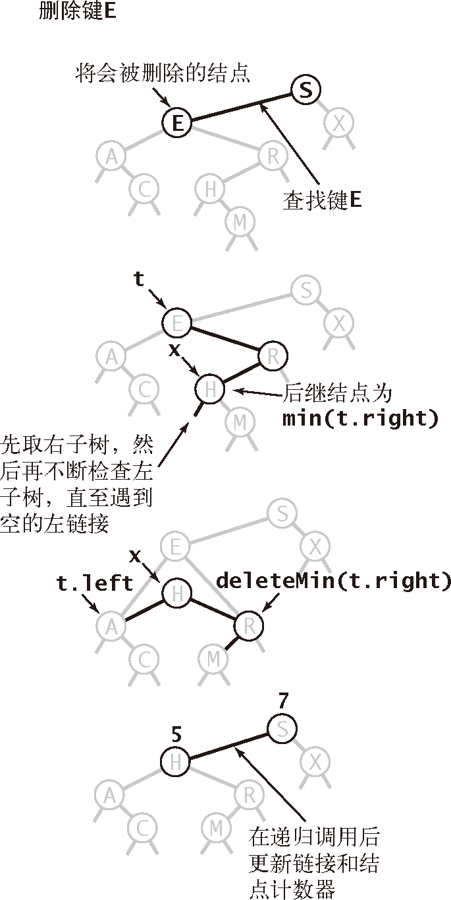

- 图 3.2.13　二叉查找树中的删除操作

在递归调用后我们会修正被删除的结点的父结点的链接，并将由此结点到根结点的路径上的所有结点的计数器减 1（这里计数器的值仍然会被设为其所有子树中的结点总数加一）。尽管这种方法能够正确地删除一个结点，它的一个缺陷是可能会在某些实际应用中产生性能问题。这个问题在于选用后继结点是一个随意的决定，且没有考虑树的对称性。可以使用它的前趋结点吗？实际上，前趋结点和后继结点的选择应该是随机的。详细讨论请见练习 3.2.42。

二叉查找树中删除操作的实现如算法 3.3（续 4）所示。

- 算法 3.3（续 4）二叉查找树的 delete() 方法的实现

```java
public void deleteMin()
1
{
2
  root = deleteMin(root);
3
}
4
5
private Node deleteMin(Node x)
6
{
7
  if (x.left == null) return x.right;
8
  x.left = deleteMin(x.left);
9
  x.N = size(x.left) + size(x.right) + 1;
10
  return x;
11
}
12
13
public void delete(Key key)
14
{  root = delete(root, key);  }
15
16
private Node delete(Node x, Key key)
17
{
18
  if (x == null) return null;
19
  int cmp = key.compareTo(x.key);
20
  if      (cmp < 0) x.left  = delete(x.left,  key);
21
  else if (cmp > 0) x.right = delete(x.right, key);
22
  else
23
  {
24
     if (x.right == null) return x.left;
25
     if (x.left == null) return x.right;
26
     Node t = x;
27
     x = min(t.right);  // 请见算法3.3（续2）
28
     x.right = deleteMin(t.right);
29
     x.left = t.left;
30
  }
31
  x.N = size(x.left) + size(x.right) + 1;
32
  return x;
33
}
34
如前文所述，这段代码实现了 Hibbard 的二叉查找树中对结点的即时删除。delete() 方
```

- 法的代码很简洁，但不简单。也许理解它的最好办法就是读懂正文中的讲解，试着自己实现它并对比自己的代码和这段代码。一般情况下这段代码的效率不错，但对于大规模的应用来

```
说可能会有一点问题（请见练习 3.2.42）。deleteMax() 的实现和 deleteMin() 类似，
```

- 只需左右互换即可。

### 3.2.3.7　范围查找

```
要实现能够返回给定范围内键的 keys() 方法，我们首先需要一个遍历二叉查找树的基本方
```

法，叫做中序遍历。要说明这个方法，我们先看看如何能够将二叉查找树中的所有键按照顺序打印出来。要做到这一点，我们应该先打印出根结点的左子树中的所有键（根据二叉查找树的定义它们应该都小于根结点的键），然后打印出根结点的键，最后打印出根结点的右子树中的所有键（根据二叉查找树的定义它们应该都大于根结点的键），如右侧的代码所示。

```java
private void print(Node x)
{
  if (x == null) return;
  print(x.left);
  StdOut.println(x.key);
  print(x.right);
}
```

按顺序打印二叉查找树中的所有键

和以前一样，刚才的描述也递推地证明了这段代码能够顺序打印树中的所有键。为了实现接受

```
两个参数并能够将给定范围内的键返回给用例的 keys() 方法，我们可以修改一下这段代
码，将所有落在给定范围以内的键加入一个队列 Queue 并跳过那些不可能含有所查找键的子
树。和 BinarySearchST 一样，用例不需要知道我们使用 Queue 来收集符合条件的键。我
们使用什么数据结构来实现 Iterable<Key> 并不重要，用例只要能够使用 Java 的
foreach 语句遍历返回的所有键就可以了。
```

二叉查找树的范围查找操作的实现如算法 3.3（续 5）所示。

- 算法 3.3（续 5）二叉查找树的范围查找操作

```java
public Iterable<Key> keys()
1
{  return keys(min(), max());  }
2
3
public Iterable<Key> keys(Key lo, Key hi)
4
{
5
   Queue<Key> queue = new Queue<Key>();
6
   keys(root, queue, lo, hi);
7
   return queue;
8
}
9
10
private void keys(Node x, Queue<Key> queue, Key lo, Key hi)
11
{
12
  if (x == null) return;
13
  int cmplo = lo.compareTo(x.key);
14
  int cmphi = hi.compareTo(x.key);
15
  if (cmplo < 0) keys(x.left, queue, lo, hi);
16
  if (cmplo <= 0 && cmphi >= 0) queue.enqueue(x.key);
17
  if (cmphi > 0) keys(x.right, queue, lo, hi);
18
}
19
```

- 为了确保以给定结点为根的子树中所有在指定范围之内的键加入队列，我们会（递归地）查找根结点的左子树，然后查找根结点，然后（递归地）查找根结点的右子树。

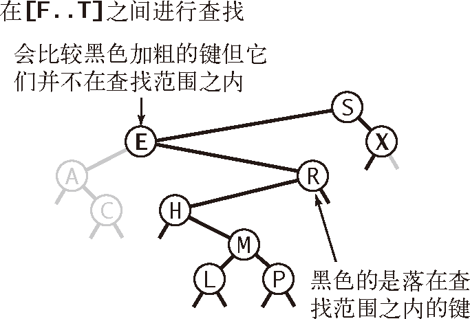

- 二叉查找树的范围查找

### 3.2.3.8　性能分析

二叉查找树中和有序性相关的操作的效率如何？要研究这个问题，我们首先要知道树的高度（即树中任意结点的最大深度）。给定一棵树，树的高度决定了所有操作在最坏情况下的性能（范围查找除外，因为它的额外成本和返回的键的数量成正比）。

- 命题 E。在一棵二叉查找树中，所有操作在最坏情况下所需的时间都和树的高度成正比。证明。树的所有操作都沿着树的一条或两条路径行进。根据定义，路径的长度不可能大于树的高度。

我们估计树的高度（即最坏情况下的成本）将会大于我们在 3.2.2 节中定义的平均内部路径长度（这个平均值已经包含了所有较短的路径），但会高多少呢？也许在你看来这个问题和命题C 和命题 D 解答的问题类似，但它的解答其实要困难得多，完全超出了本书的范畴。1979年，J. Robson 证明了随机键构造的二叉查找树的平均高度为树中结点数的对数级别，随后 L.


Devroye 证明了对于足够大的

- ，这个值趋近于。因此，如果我们的应用中的插入

操作能够适用于这个随机模型，我们距离实现一个支持对数级别的所有操作的符号表的目标就


已经不远了。我们可以认为随机构造的树中的所有路径长度都小于

- ，但如果构造树的键

不是随机的怎么办？在下一节中你会看到在实际应用中这个问题其实没有意义，因为还有平衡二叉查找树，它能保证无论键的插入顺序如何，树的高度都将是总键数的对数。

总的来说，二叉查找树的实现并不困难，且当树的构造和随机模型近似时在各种实际应用场景中它都能进行快速地查找和插入。对于我们的例子（以及其他许多实际应用场景）来说，二叉查找树将不可能完成的任务变为可能。另外，许多程序员都偏爱基于二叉查找树的符号表的原

```sql
因是它还支持高效的 rank()、select()、delete() 以及范围查找等操作。但同时，正如
```

我们所强调过的，在某些场景中二叉查找树在最坏情况下的恶劣性能仍然是不可接受的。二叉查找树的基本实现的良好性能依赖于其中的键的分布足够随机以消除长路径。对于快速排序，我们可以先将数组打乱；而对于符号表的 API，我们无能为力，因为符号表的用例控制着各种操作的先后顺序。但最坏情况在实际应用也有可能出现——用例将所有键按照顺序或者逆序插入符号表就会增加这种情况出现的概率，而在没有明确的警告来避免这种行为时有些用例肯定会尝试这么做。这就是我们寻找更好的算法和数据结构的主要原因，这些算法和数据结构我们会在下一节学习。

本书中简单的符号表实现的成本列在表 3.2.2 中。

表 3.2.2　简单的符号表实现的成本总结

### 答疑

问　我见过二叉查找树，但它的实现没有使用递归。这两种方式各有哪些优缺点？

答　一般来说，递归的实现更容易验证其正确性，而非递归的实现效率更高。在练习 3.2.13

```
中你需要用另一种方法实现 get()，你可能会注意到性能上的改进。如果树不是平衡的，函
```

数调用的栈的深度可能会成为递归实现的一个问题。我们使用递归的一个主要原因是使读者能够轻松过渡到下一节中的平衡二叉查找树，而且递归版本显然更易于实现和调试。

```sql
问　维护 Node 对象中的结点计数器似乎需要很多代码，这有必要吗？为什么不只用一个变量
来保存整棵树中的结点总数来实现用例中的 size() 方法？
答　rank() 和 select() 方法需要知道每个结点所代表的子树中的结点总数。如果你不需
```

要实现这些操作，可以去掉这个变量以简化代码（请见练习 3.2.12）。要保证所有结点中的计数器的正确性的确很容易出错，但这个值在调试中同样有用。你也可以用递归的方法实现用例

```
中的 size() 函数，但这样统计所有结点的运行时间可能是线性的。这十分危险，因为如果
```

不知道这么一个简单的操作会如此耗时，用例的性能可能会变得很差。

### 练习

```
3.2.1　将 E A S Y Q U E S T I O N 作为键按顺序插入一棵初始为空的二叉查找树中
（方便起见设第 i 个键对应的值为 i），画出生成的二叉查找树。构造这棵树需要多少次比
```

较？

```
3.2.2　将 A X C S E R H 作为键按顺序插入将会构造出一棵最坏情况下的二叉查找树结
```

构，最下方的结点的两个链接全部为空，其他结点都含有一个空链接。用这些键给出构造最坏情况下的树的其他 5 种排列。

```
3.2.3　给出 A X C S E R H 的 5 种能够构造出最优二叉查找树的排列。
```

3.2.4　假设某棵二叉查找树的所有键均为 1 至 10 的整数，而我们要查找 5。那么以下哪个不可能是键的检查序列？

a. 10, 9, 8, 7, 6, 5

b. 4, 10, 8, 7, 5, 3

c. 1, 10, 2, 9, 3, 8, 4, 7, 6, 5

d. 2, 7, 3, 8, 4, 5

e. 1, 2, 10, 4, 8, 5

3.2.5　假设已知某棵二叉查找树中的每个结点的查找频率，且我们可以以任意顺序用它们构造一棵树。我们是应该按照查找频率的顺序由高到低或是由低到高将它们插入，还是用其他某种顺序？证明你的结论。

```
3.2.6　为二叉查找树添加一个方法 height() 来计算树的高度。实现两种方案：一种使用递
归（用时为线性级别，所需空间和树高成正比），一种模仿 size() 在每个结点中添加一个变
```

量（所需空间为线性级别，查询耗时为常数）。

```
3.2.7　为二叉查找树添加一个方法 avgCompares() 来计算一棵给定的树中的一次随机命中
```

查找平均所需的比较次数（即树的内部路径长度除以树的大小再加 1）。实现两种方案：一种

```
使用递归（用时为线性级别，所需空间和树高成正比），一种模仿 size() 在每个结点中添加
```

一个变量（所需空间为线性级别，查询耗时为常数）。

```
3.2.8　编写一个静态方法 optCompares()，接受一个整型参数 N 并计算一棵最优（完美平
```

衡的）二叉查找树中的一次随机查找命中平均所需的比较次数，如果树中的链接数量为 2 的幂，那么所有的空链接都应该在同一层，否则则分布在最底部的两层中。

3.2.9　对于

- 、3、4、5 和 6，画出用个键可能构造出的所有不同形状的二叉查找

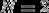

树。

```sql
3.2.10　编写一个测试用例 TestBST.java 来测试正文中 min()、max()、floor()、
ceiling()、select()、rank()、delete()、deleteMin()、deleteMax() 和
keys() 方法的实现。可以参考 3.1.3.1 节的标准索引用例，使它接受其他合适的命令行参
```

数。

3.2.11　高度为

- 且含有个结点的二叉树能有多少种形状？使用个不同的键能有多少种

- 的二叉查找树？（参考练习 3.2.2）

不同的方式构造一棵高度为

```sql
3.2.12　实现一种二叉查找树，舍弃 rank() 和 select() 方法并且不在 Node 对象中使用
```

计数器。

```
3.2.13　为二叉查找树实现非递归的 put() 和 get() 方法。
　部分解答，以下是 get() 方法的实现：
public Value get(Key key)
{
  Node x = root;
  while (x != null)
  {
     int cmp = key.compareTo(x.key);
     if (cmp == 0) return x.val;
     else if (cmp < 0) x = x.left;
     else if (cmp > 0) x = x.right;
  }
  return null;
}
　put() 的实现更复杂一些，因为它需要保存一个指向底层结点的链接，以便使之成为新结
```

点的父结点。你还需要额外遍历一遍查找路径来更新所有的结点计数器以保证结点插入的正确

```sql
性。因为在性能优先的实现中查找的次数比插入多得多，有必要使用这段 get() 代码，而相
应的 put() 实现则无关紧要。
3.2.14　实现非递归的 min()、max()、floor()、ceiling()、rank() 和 select()
```

方法。

3.2.15　对于右下方的二叉查找树，给出计算下列方法的过程中结点的访问序列。

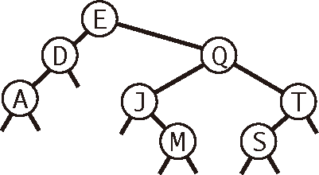

```sql
　a. floor("Q")
　b. select(5)
　c. ceiling("Q")
　d. rank("J")
　e. size("D", "T")
　f. keys("D", "T")
```

3.2.16　设一棵树的外部路径长度为从根结点到空链接的所有路径上的结点总数。证明对于大

- 的任意二叉树，其外部路径长度和内部路径长度之差为（可以参考命题 C）

小为


3.2.17　从练习 3.2.1 构造的二叉查找树中将所有键按照插入顺序逐个删除并画出每次删除所得到的树。

3.2.18　从练习 3.2.1 构造的二叉查找树中将所有键按照字母顺序逐个删除并画出每次删除所得到的树。

3.2.19　从练习 3.2.1 构造的二叉查找树中逐次删除树的根结点并画出每次删除所得到的树。

```
 个结点的二叉查找树，接受两个参数的 size() 方法所需的运
```

3.2.20　请证明：对于含有

行时间最多为树高的倍数加上查找范围内的键的数量。

```
3.2.21　为二叉查找树添加一个 randomKey() 方法来在和树高成正比的时间内从符号表中随
```

机返回一个键。

3.2.22　请证明：若一棵二叉查找树中的一个结点有两个子结点，那么它的后继结点不会有左子结点，前趋结点不会有右子结点。

```sql
3.2.23　delete() 方法符合交换律吗？（先删除 x 后删除 y 和先删除 y 后删除 x 能够得到
```

相同的结果吗？）

3.2.24　请证明：使用基于比较的算法构造一棵二叉查找树所需的最小比较次数为


- 。

### 提高题

3.2.25　完美平衡。编写一段程序，用一组键构造一棵和二分查找等价的二叉查找树。也就是说，在这棵树中查找任意键所产生的比较序列和在这组键中使用二分查找所产生的比较序列完全相同。

3.2.26　准确的概率。计算用

- 个随机的互不相同的键构造出练习 3.2.9 中的每一棵树的概

率。

```
 对键值比较二叉查找树和 BinarySearchST
```

3.2.27　内存使用。基于 1.4 节的假设，对于

```
以及 SequentialSearchST 的内存使用情况。不需要记录键值本身占用的内存，只统计它
们的引用。用图精确描述一棵以 String 为键、Integer 为值的二叉查找树（比如
FrequencyCounter 构造的那种）的内存使用情况，然后估计 FrequencyCounter 在使
```

用二叉查找树处理《双城记》时树的内存使用情况（精确到字节）。

```
3.2.28　缓存。修改二叉查找树的实现，将最近访问的结点 Node 保存在一个变量中，这样
get() 或 put() 再次访问同一个键时就只需要常数时间了（参考练习 3.1.25）。
3.2.29　二叉树检查。编写一个递归的方法 isBinaryTree()，接受一个结点 Node 为参
 相符则返回 true，否则返回
```

数。如果以该结点为根的子树中的结点总数和计数器的值

```
false。注意：这项检查也能保证数据结构中不存在环，因此这的确是一棵二叉树！
3.2.30　有序性检查。编写一个递归的方法 isOrdered()，接受一个结点 Node 和 min、
max 两个键作为参数。如果以该结点为根的子树中的所有结点都在 min 和 max 之间，min
和 max 的确分别是树中的最小和最大的结点且二叉查找树的有序性对树中的所有键都成立，
返回 true，否则返回 false。
3.2.31　等值键检查。编写一个方法 hasNoDuplicates()，接受一个结点 Node 为参数。
如果以该结点为根的二叉查找树中不含有等值的键则返回 true，否则返回 false。假设树
```

已经通过了前几道练习的检查。

```
3.2.32　验证。编写一个方法 isBST()，接受一个结点 Node 为参数。若该结点是一个二叉
查找树的根结点则返回 true，否则返回 false。提示：这个任务比看起来要困难，它和你
```

调用前三题中各个方法的顺序有关。

解答：

```sql
private boolean isBST()
{
  if (!isBinaryTree(root)) return false;
  if (!isOrdered(root, min(), max())) return false;
  if (!hasNoDuplicates(root)) return false;
  return true;
}
3.2.33　选择 / 排名检查。编写一个方法，对于 0 到 size()-1 之间的所有 i，检查 i 和
rank(select(i)) 是否相等，并检查二叉查找树中的的任意键 key 和
select(rank(key)) 是否相等。
```

```
3.2.34　线性符号表。你的目标是实现一个扩展的符号表 ThreadedST，支持以下两个运行时
```

间为常数的操作：

```sql
Key next(Key key)，key的下一个键（若key为最大键则返回空）
Key prev(Key key)，key的上一个键（若key为最小键则返回空）
　要做到这一点需要在结点中增加 pred 和 succ 两个变量来保存结点的前趋和后继结点，并
相应修改 put()、deleteMin()、deleteMax() 和 delete() 方法来维护这两个变量。
```

3.2.35　改进的分析。为了更好地解释正文表格中的试验结果请改进它的数学模型。证明随着

- 的增大，在一棵随机构造的二叉查找树中，一次命中查找所需的平均比较次数会趋近于


- ，即欧拉常数。提示：参考 2.3 节，其中


- 的积分趋近于

中对快速排序的分析，

- 。

```
3.2.36　迭代器。能否实现一个非递归版本的 keys() 方法，其使用的额外空间和树的高度成
```

正比（和查找范围内的键的多少无关）？

```
3.2.37　按层遍历。编写一个方法 printLevel()，接受一个结点 Node 作为参数，按照层
```

级顺序打印以该结点为根的子树（即按每个结点到根结点的距离的顺序，同一层的结点应该按

```
从左至右的顺序）。提示：使用队列 Queue。
3.2.38　绘图。为二叉查找树添加一个方法 draw()，按照正文中的样式将树绘制出来。提
```

示：在结点中用变量保存坐标并用递归的方法设置这些变量。

### 实验题

3.2.39　平均情况。用经验数据评估在一棵由

- 个随机结点构造的二叉查找树中，一次命中


- 和

的查找和未命中的查找平均所需的比较次数的平均差和标准差，其中

- 、，

重复实验 100 遍。将你的实验结果和练习 3.2.35 给出的计算平均比较次数的公式进行对比。

3.2.40　树的高度。用经验数据评估一棵由

- 个随机结点构造的二叉查找树的平均高度，其

- 和，重复实验 100 遍。将你的试验结果和正文中给出的估计值

中

- 、

进行对比。

3.2.41　数组表示。开发一个二叉查找树的实现，用三个数组表示一棵树（预先分配为构造函数中所指定的最大长度）：一个数组用来保存键，一个数组用来保存左链接的索引，一个数组用来保存右链接的索引。比较你的程序和标准实现的性能。

3.2.42　Hibbard 删除方法的性能问题。编写一个程序，从命令行接受一个参数

- 并构造一

- 个随机键生成的二叉查找树，然后进入一个循环。在循环中它先删除一个随机键

棵由

```sql
（delete(select(StdRandom.uniform(N)))），然后再插入一个随机键，如此循环
```


- 再加 1）。对于

次。循环结束后，计算并打印树的内部平均路径长度（内部路径长度除以


- 和、，运行你的程序来验证一个有些违反直觉的假设：这个过程会增加树的的平方根成正比。使用能够随机选择前趋或后继结点的

平均路径长度，增加的长度和

```sql
delete() 方法重复这个实验。
3.2.43　put()/get() 方法的比例。用经验数据评估当使用 FrequencyCounter 来统计
100 万个随机整数中每个数的出现频率时，二叉查找树中 put() 方法和 get() 方法所消耗
```

的时间的比例。

3.2.44　绘制成本图。改造二叉查找树的实现来绘制本节所示的那种能够显示计算中每次

```
put() 操作成本的图。
3.2.45　实际耗时。改造 FrequencyCounter，使用 Stopwatch 和 StdDraw 绘图，其中
 轴表示 get() 和 put() 调用的总数，
```

- 轴为总运行时间，每次调用之后即在当前运行时

```
间处绘制一个点。使用 SequentialSearchST 和你的程序处理《双城记》，再用
BinarySearchST 处理一遍，最后用二叉查找树处理一遍，然后讨论运行的结果。注意：曲
```

线中突然的跳跃可能是缓存导致的，这已经超出了这个问题的讨论范围（请见练习 3.1.39）。

```
3.2.46　二叉查找树的临界点。使用随机 double 值作为键，分别找出使得二叉查找树的符号
```

表比二分查找要快 10、100 倍和 1000 倍的

- 值。分析并预测的大小并通过实验验证它。

3.2.47　平均查找耗时。用实验研究和计算在一棵由

- 个随机结点构造的二叉查找树中到达

- 再加 1）的平均差和标准差，对于 100 到 10

任意结点的平均路径长度（内部路径长度除以

000 之间的每个

- 重复实验 1000 遍。将结果绘制成和图 3.2.14 相似的一张 Tufte 图，并画


- 的曲线（请见练习 3.2.35 和练习 3.2.39）。

上函数

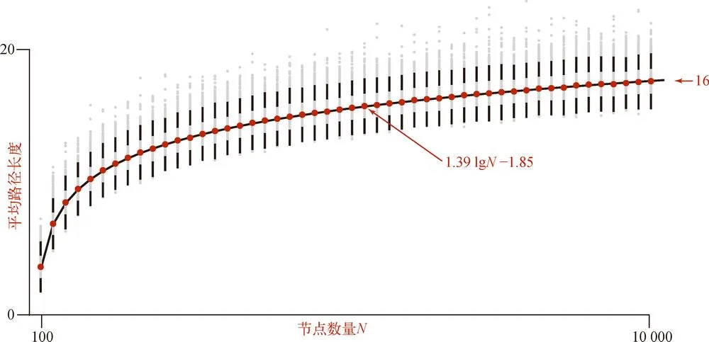

- 图 3.2.14　一棵随机构造的二叉查找树中由根到达任意结点的平均路径长度
