# 3.4散列表

如果所有的键都是小整数，我们可以用一个数组来实现无序的符号表，将键作为数组的索引而

```
数组中键 i 处储存的就是它对应的值。这样我们就可以快速访问任意键的值。在本节中我们
```

将要学习散列表。它是这种简易方法的扩展并能够处理更加复杂的类型的键。我们需要用算术操作将键转化为数组的索引来访问数组中的键值对。

使用散列的查找算法分为两步。第一步是用散列函数将被查找的键转化为数组的一个索引。理想情况下，不同的键都能转化为不同的索引值。当然，这只是理想情况，所以我们需要面对两个或者多个键都会散列到相同的索引值的情况。因此，散列查找的第二步就是一个处理碰撞冲突的过程，如图 3.4.1 所示。在描述了多种散列函数的计算后，我们会学习两种解决碰撞的方法：拉链法和线性探测法。

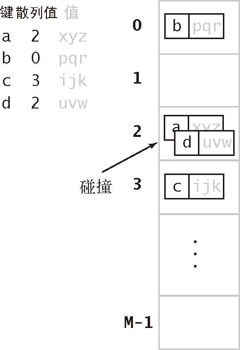

- 图 3.4.1　散列表的核心问题

散列表是算法在时间和空间上作出权衡的经典例子。如果没有内存限制，我们可以直接将键作为（可能是一个超大的）数组的索引，那么所有查找操作只需要访问内存一次即可完成。但这种理想情况不会经常出现，因为当键很多时需要的内存太大。另一方面，如果没有时间限制，我们可以使用无序数组并进行顺序查找，这样就只需要很少的内存。而散列表则使用了适度的空间和时间并在这两个极端之间找到了一种平衡。事实上，我们不必重写代码，只需要调整散列算法的参数就可以在空间和时间之间作出取舍。我们会使用概率论的经典结论来帮助我们选择适当的参数。

概率论是数学分析的重大成果。虽然它不在本书的讨论范围之内，但我们将要学习的散列算法利用了这些知识，这些算法虽然简单但应用广泛。使用散列表，你可以实现在一般应用中拥有（均摊后）常数级别的查找和插入操作的符号表。这使得它在很多情况下成为实现简单符号表的最佳选择。

### 3.4.1　散列函数

我们面对的第一个问题就是散列函数的计算，这个过程会将键转化为数组的索引。如果我们有

- 个键值对的数组，那么我们就需要一个能够将任意键转化为该数组范围内的

一个能够保存


- 范围内的整数）的散列函数。我们要找的散列函数应该易于计算并且能够均

索引（匀分布所有的键，即对于任意键，0 到

- 之间的每个整数都有相等的可能性与之对应

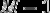

（与键无关）。这个要求似乎有些难以理解。那么要理解散列，就首先要仔细思考如何去实现这样一个函数。

散列函数和键的类型有关。严格地说，对于每种类型的键都我们都需要一个与之对应的散列函数。如果键是一个数，比如社会保险号，我们就可以直接使用这个数；如果键是一个字符串，比如一个人的名字，我们就需要将这个字符串转化为一个数；如果键含有多个部分，比如邮件地址，我们需要用某种方法将这些部分结合起来。对于许多常见类型的键，我们可以利用Java 提供的默认实现。我们会简略讨论多种数据类型的散列函数。你应该看看它们是如何实现的，因为你也需要为自定义的类型实现散列函数。

### 3.4.1.1　典型的例子

假设在我们的应用中，键是美国的社会保险号。一个社会保险号含有 9 位数字并被分为三个部分，例如 123-45-6789。第一组数字表示该号码签发的地区（例如，第一组号码为 035 的社会保险号来自罗得岛州，214 则来自马里兰州），另两组数字表示个人身份。社会保险号共有 10


- ）个，但假设我们的应用程序只需要处理几百个，我们可以使用一个大小 M=1000 的

亿（散列表。散列函数的一种实现方法是使用键（社会保险号）中的三个数字。用第三组中的三个数字似乎比用第一组中的三个数字更好（因为我们的客户不太可能完全平均地分布在各个地区），但下面会讲到，更好的方法是用所有 9 个数字得到一个整数，然后再考虑整数的散列函数。

### 3.4.1.2　正整数

- 的数组，对于任意正整数

将整数散列最常用方法是除留余数法。我们选择大小为素数

- ，

```
 的余数。这个函数的计算非常容易（在 Java 中为 k% M）并能够有效地将键散
```

- 除以

计算

布在 0 到

- 的范围内。如果不是素数，我们可能无法利用键中包含的所有信息，这

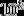

- 为

可能导致我们无法均匀地散列散列值。例如，如果键是十进制数而

- ，那么我们只能

- 位，这可能会产生一些问题。举个简单的例子，假设键为电话号码的区号且

利用键的后

- 。由于历史原因，美国的大部分区号中间位都是 0 或者 1，因此这种方法会将大量

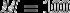

的键散列为小于 20 的索引，但如果使用素数 97，散列值的分布显然会更好（一个离 100 更远的素数会更好），如右侧所示。与之类似，互联网中使用的 IP 地址也不是随机的，所以如果我们想用除留余数法将其散列就需要用素数（特别地，这不是 2 的幂）大小的数组。

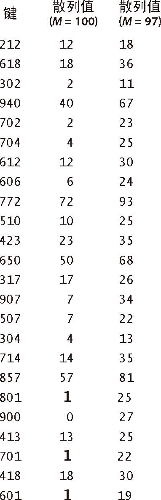

除留余数法

### 3.4.1.3　浮点数

如果键是 0 到 1 之间的实数，我们可以将它乘以

- 并四舍五入得到一个 0 至之间的

索引值。尽管这个方法很容易理解，但它是有缺陷的，因为这种情况下键的高位起的作用更大，最低位对散列的结果没有影响。修正这个问题的办法是将键表示为二进制数然后再使用除留余数法（Java 就是这么做的）。

### 3.4.1.4　字符串

除留余数法也可以处理较长的键，例如字符串，我们只需将它们当作大整数即可。例如，右侧

```
的代码就能够用除留余数法计算 String S 的散列值：
int hash = 0;
for (int i = 0; i < s.length(); i++)
  hash = (R * hash + s.charAt(i)) % M;
```

散列字符串键

```
Java 的 charAt() 函数能够返回一个 char 值，即一个非负 16 位整数。如果 R 比任何字符
的值都大，这种计算相当于将字符串当作一个 N 位的 R 进制值，将它除以 M 并取余。一种叫
Horner 方法的经典算法用 N 次乘法、加法和取余来计算一个字符串的散列值。只要 R 足够
```

小，不造成溢出，那么结果就能够如我们所愿，落在 0 至

- 之内。使用一个较小的素

```
数，例如 31，可以保证字符串中的所有字符都能发挥作用。Java 的 String 的默认实现使用
```

了一个类似的方法。

### 3.4.1.5　组合键

```
如果键的类型含有多个整型变量，我们可以和 String 类型一样将它们混合起来。例如，假
设被查找的键的类型是 Date，其中含有几个整型的域：day（两个数字表示的日），month
（两个数字表示的月）和 year（4 个数字表示的年）。我们可以这样计算它的散列值：
int hash = (((day * R + month) % M ) * R + year) % M;
只要 R 足够小不造成溢出，也可以得到一个 0 至
```

- 之间的散列值。在这种情况下我们可

```
以通过选择一个适当的 M，比如 31，来省去括号内的 % M 计算。和字符串的散列算法一样，
```

这个方法也能处理有任意多整型变量的类型。

表 3.4.1　所有例子中的键的散列值

```
S
E
A
R
C
H
X
M
P
L
```

键

```
2
0
0
4
4
4
2
4
3
3
```

散列值 (M = 5)

```
6
10
4
14
5
4
15
1
14
6
```

散列值 (M = 16)

### 3.4.1.6　Java 的约定

每种数据类型都需要相应的散列函数，于是 Java 令所有数据类型都继承了一个能够返回一个

```
32 比特整数的 hashCode() 方法。每一种数据类型的 hashCode() 方法都必须和
equals() 方法一致。也就是说，如果 a.equals(b) 返回 true，那么 a.hashCode() 的
返回值必然和 b.hashCode() 的返回值相同。相反，如果两个对象的 hashCode() 方法的
返回值不同，那么我们就知道这两个对象是不同的。但如果两个对象的 hashCode() 方法的
返回值相同，这两个对象也有可能不同，我们还需要用 equals() 方法进行判断。请注意，
这说明如果你要为自定义的数据类型定义散列函数，你需要同时重写 hashCode() 和
equals() 两个方法。默认散列函数会返回对象的内存地址，但这只适用于很少的情况。
Java 为很多常用的数据类型重写了 hashCode() 方法（包括 String、Integer、
Double、File 和 URL）。
```

### 3.4.1.7　将 hashCode() 的返回值转化为一个数组索引

因为我们需要的是数组的索引而不是一个 32 位的整数，我们在实现中会将默认的

```
hashCode() 方法和除留余数法结合起来产生一个 0 到
```

- 的整数，方法如下：

```
private int hash(Key x)
{  return (x.hashCode() & 0x7fffffff) % M;  }
```

这段代码会将符号位屏蔽（将一个 32 位整数变为一个 31 位非负整数），然后用除留余数法计

```
算它除以 M 的余数。在使用这样的代码时我们一般会将数组的大小 M 取为素数以充分利用原
```

散列值的所有位。注意：为了避免混乱，我们在例子中不会使用这种计算方法而是使用表3.4.1 所示的散列值作为替代。

### 3.4.1.8　自定义的 hashCode() 方法

```java
散列表的用例希望 hashCode() 方法能够将键平均地散布为所有可能的 32 位整数。也就是
说，对于任意对象 x，你可以调用 x.hashCode() 并认为有均等的机会得到 232 个不同整数
中的任意一个 32 位整数值。Java 中的 String、Integer、Double、File 和 URL 对象
的 hashCode() 方法都能实现这一点。而对于自己定义的数据类型，你必须试着自己实现这
一点。3.4.1.5 节中的 Date 例子展示了一种可行的方案：用实例变量的整数值和除留余数法
得到散列值。在 Java 中，所有的数据类型都继承了 hashCode() 方法，因此还有一个更简
单的做法：将对象中的每个变量的 hashCode() 返回值转化为 32 位整数并计算得到散列
值，如 Transaction 类所示。
public class Transaction
{
  ...
  private final String who;
  private final Date when;
  private final double amount;
  public int hashCode()
  {
      int hash = 17;
      hash = 31 * hash + who.hashCode();
      hash = 31 * hash + when.hashCode();
      hash = 31 * hash
          + ((Double) amount).hashCode();
      return hash;
  }
  ...
}
自定义类型中 hashCode() 方法的实现
对于原始类型的对象，可以将其转化为对应的数据类型然后再调用 hashCode() 方法。和以
```

前一样，系数的具体值（这里是 31）并不是很重要。

### 3.4.1.9　软缓存

如果散列值的计算很耗时，那么我们或许可以将每个键的散列值缓存起来，即在每个键中使用

```
一个 hash 变量来保存它的 hashCode() 的返回值（请见练习 3.4.25）。第一次调用
hashCode() 方法时，我们需要计算对象的散列值，但之后对 hashCode() 方法的调用会直
接返回 hash 变量的值。Java 的 String 对象的 hashCode() 方法就使用了这种方法来减
```

少计算量。

总的来说，要为一个数据类型实现一个优秀的散列方法需要满足三个条件：

- 一致性——等价的键必然产生相等的散列值；

- 高效性——计算简便；

- 均匀性——均匀地散列所有的键。

设计同时满足这三个条件的散列函数是专家们的事。有了各种内置函数，Java 程序员在使用

```
散列时只需要调用 hashCode() 方法即可，我们没有理由不信任它们。
```

但是，在有性能要求时应该谨慎使用散列，因为糟糕的散列函数经常是性能问题的罪魁祸首：程序可以工作但比预想的慢得多。保证均匀性的最好办法也许就是保证键的每一位都在散列值的计算中起到了相同的作用；实现散列函数最常见的错误也许就是忽略了键的高位。无论散列函数的实现是什么，当性能很重要时你应该测试所使用的所有散列函数。计算散列函数和比较两个键，哪个耗时更多？你的散列函数能够将一组键均匀地散布在 0 到

- 之间吗？用简

单的实现测试这些问题能够预防未来的悲剧。例如，图 3.4.2 就显示出，对于《双城记》我们

```
的 hash() 方法在使用了 Java 的 String 类型的 hashCode() 方法后能够得到一个合理的
```

分布。

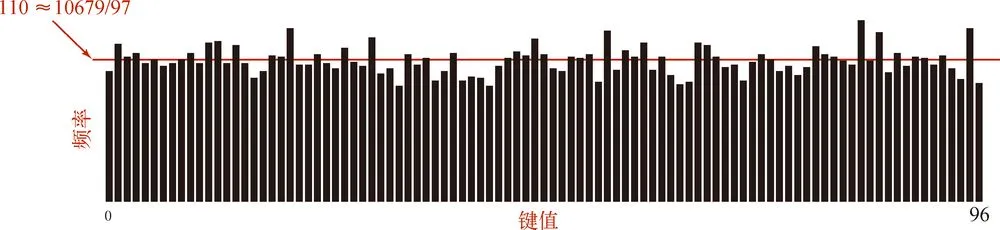

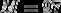

- 图 3.4.2　《双城记》中每个单词的散列值的出现频率（10 679 个键，即单词，）

这些讨论的背后是我们在使用散列时作出的一个重要假设。这个假设是一个我们实际上无法达到的理想模型，但它是我们实现散列函数时的指导思想。

- 假设 J（均匀散列假设）。我们使用的散列函数能够均匀并独立地将所有的键散布于 0 到之间。

- 讨论。我们在实现散列函数时随意指定了很多参数，这显然无法实现一个能够在数学意义上均匀并独立地散布所有键的散列函数。坚深的理论研究告诉我们想要找到一个计算简单但又

```
拥有一致性和均匀性的散列函数是不太可能的。在实际应用中，和使用 Math.random()
```

- 生成随机数一样，大多数程序员都会满足于随机数生成器类的散列函数。很少有人会去检验独立性，而这个性质一般都不会满足。

尽管验证这个假设很困难，假设 J 仍然是考察散列函数的重要方式，原因有两点。首先，设计散列函数时尽量避免随意指定参数以防止大量的碰撞，这是我们的重要目标；其次，尽管我们可能无法验证假设本身，它提示我们使用数学分析来预测散列算法的性能并在实验中进行验证。

### 3.4.2　基于拉链法的散列表

一个散列函数能够将键转化为数组索引。散列算法的第二步是碰撞处理，也就是处理两个或多

- 的数组中的每个元素指向一条链

个键的散列值相同的情况。一种直接的办法是将大小为

表，链表中的每个结点都存储了散列值为该元素的索引的键值对。这种方法被称为拉链法，因为发生冲突的元素都被存储在链表中。这个方法的基本思想就是选择足够大的

- ，使得所有

链表都尽可能短以保证高效的查找。查找分两步：首先根据散列值找到对应的链表，然后沿着链表顺序查找相应的键。

拉链法的一种实现方法是使用原始的链表数据类型（请见练习 3.4.2）来扩展

```
SequentialSearchST（算法 3.1）。另一种更简单的方法（但效率稍低）是采用一般性的策
```

- 个元素分别构建符号表来保存散列到这里的键，这样也可以重用我们之前的代码。

略，为

```
算法 3.5 实现的 SeparateChainingHashST 使用了一个 SequentialSearchST 对象的
数组，在 put() 和 get() 的实现中先计算散列函数来选定被查找的
SequantialSearchST 对象，然后使用符号表的 put() 和 get() 方法来完成相应的任
```

务。

- 条链表保存个键，无论键在各个链表中的分布如何，链表的平均长度肯定

因为我们要用


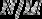

是

- 。例如，假设所有的键都落在了第一条链表上，所有链表的平均长度仍然是

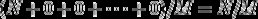

- 。拉链法在实际情况中很有用，因为每条链表确实都大约

- 个键值对。在一般情况中，我们能够由它验证假设 J 并且可以依赖这种高效的查找

含有和插入实现。

在标准索引用例中使用基于拉链法的散列表如图 3.4.3 所示。

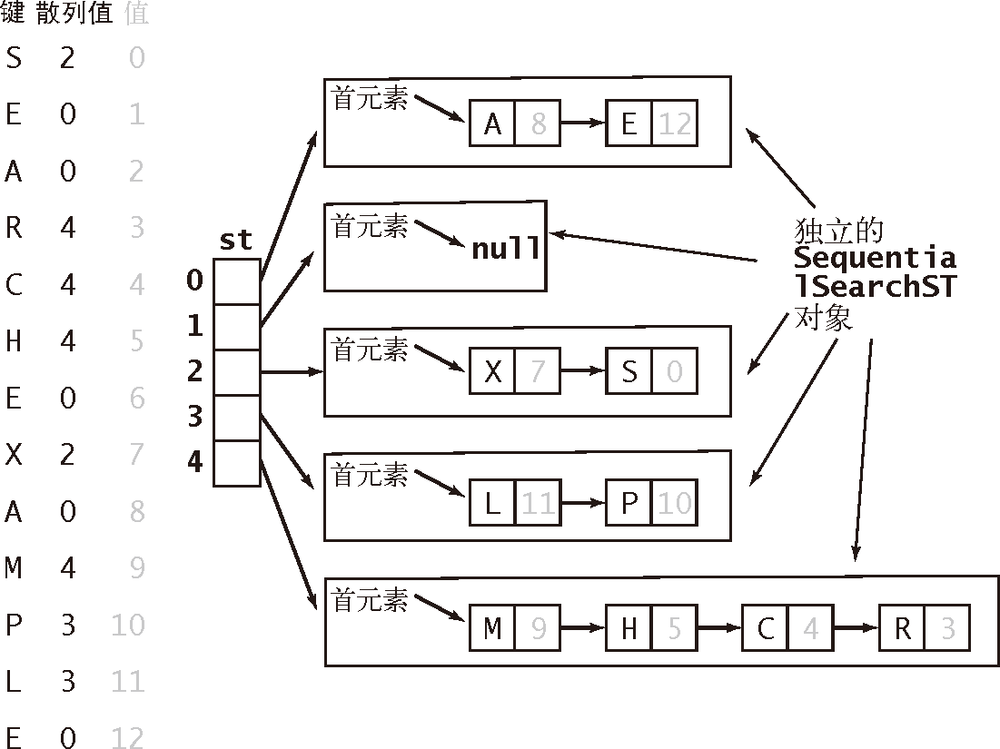

- 图 3.4.3　标准索引用例使用基于拉链法的散列表

- 算法 3.5　基于拉链法的散列表

```java
public class SeparateChainingHashST<Key, Value>
1
{
2
  private int N;                           // 键值对总数
3
  private int M;                           // 散列表的大小
4
  private SequentialSearchST<Key, Value>[] st;  // 存放链表对象的数组
5
6
  public SeparateChainingHashST()
7
  {  this(997);  }
8
  public SeparateChainingHashST(int M)
9
  {  // 创建M条链表
10
     this.M = M;
11
     st = (SequentialSearchST<Key, Value>[]) new SequentialSearchST[M];
12
     for (int i = 0; i < M; i++)
13
        st[i] = new SequentialSearchST();
14
  }
15
16
  private int hash(Key key)
17
  {  return (key.hashCode() & 0x7fffffff) % M; }
18
19
  public Value get(Key key)
20
  {  return (Value) st[hash(key)].get(key);  }
21
22
  public void put(Key key, Value val)
23
  {  st[hash(key)].put(key, val);  }
24
25
  public Iterable<Key> keys()
26
  // 请见练习3.4.19
27
}
28
```

- 这段简单的符号表实现维护着一条链表的数组，用散列函数来为每个键选择一条链表。简单

```
起见，我们使用了 SequentialSearchST。在创建 st[] 时需要进行类型转换，因为
```

- Java 不允许泛型的数组。默认的构造函数会使用 997 条链表，因此对于较大的符号表，这

```
种实现比 SequentialSearchST 大约会快 1000 倍。当你能够预知所需要的符号表的大
```

- 小时，这段短小精悍的方案能够得到不错的性能。一种更可靠的方案是动态调整链表数组的大小，这样无论在符号表中有多少键值对都能保证链表较短（请见 3.4.4 节及练习3.4.18）。

- 命题 K。在一张含有条链表和个键的的散列表中，（在假设 J 成立的前提下）任意一

- 的常数因子范围内的概率无限趋向于 1。条链表中的键的数量均在简略的证明。有了假设 J，这个问题就变成了一个经典的概率论问题。在这里我们为有一些概率论基础知识的读者给出一个简要的证明。个键的概率为：由二项分布可知，一条给定的链表正好含有


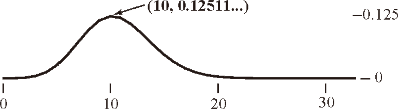

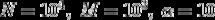

- 二项分布 ()个键中取了其中个。这个键被散列到给定的链表的概率均为因为我们实际上是从

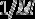

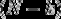

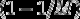

- 个键不被散列到给定的链表中的概率均为，而剩下的。令

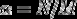

- ，这个公式可以写为：


- ，经典的泊松分布可以非常近似地表示它：对于较小的

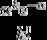

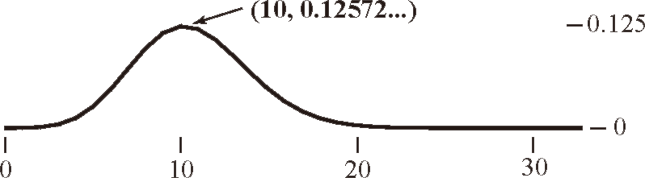

- 泊松分布 (

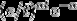

- 个键的概率不会超过由此可得，一条链表中含有超过。对于实际应用来说，

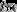

- 这个数字非常小。例如，如果平均链表长度为 10，那么一个键的散列值落在一条长度超过


- 20 的链表的概率不超过；如果平均链表长度为 20，那么一个键的

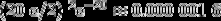

- 散列值落在一条长度超过 40 的链表的概率不超过。这个结果一定时，最长链表的平均长度的增长速并不能保证每条链表都很短，但我们可以知道当

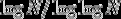

- 度为。

这段数学分析非常有力，但需要注意的是它完全依赖于假设 J。如果散列函数不是均匀和独立

- 成正比，也就是和顺序查找类似。假设 J 比我们见过

的，那么查找和插入的成本就可能和

的其他和概率有关的算法中相应的假设都有效，但也更加难以验证。在计算散列值时，我们假

- 个索引中的任意一个，无论键有多复杂。我们没法用实

设每个键都有均等的机会被散列到

验来验证所有可能的数据类型，所以我们会进行更复杂的实验，在实际应用中可能出现的一组键中随机取样进行验证，然后统计结果并分析。好消息是我们在测试中仍然可以使用这个算法来验证假设 J 和由它得出的数学推论。

- 性质 L。在一张含有条链表和个键的的散列表中，未命中查找和插入操作所需的比较

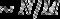

- 次数为。例证。在实际应用中，散列表算法的高性能并不需要散列函数完全符合假设 J 意义上的均匀性。自 20 世纪 50 年代以来，无数程序员都见证了命题 K 所预言的性能改进，即使有些

```
散列函数不是均匀的，命题也成立。例如，图 3.4.4 所示的 FrequencyCounter 使用的
散列表（其中的 hash() 方法是基于 Java 的 String 类型的 hashCode() 方法）中的链
```

- 表长度和理论模型完全一致。这条性质的例外之一是在许多情况下散列函数未能使用键的所有信息而造成的性能低下。除此之外，大量经验丰富的程序员给出的应用实例令我们确信，的数组能够将查找和插入操作的效率提高倍。在基于拉链法的散列表中使用大小为

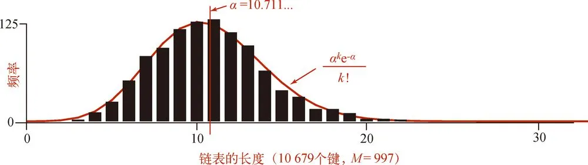

```
图 3.4.4　使用 SeparateChainingHashST，运行 java FrequencyCounter 8 < tale.txt 时所有链表的长度
```

### 3.4.2.1　散列表的大小

在实现基于拉链法的散列表时，我们的目标是选择适当的数组大小

- ，既不会因为空链表而

浪费大量内存，也不会因为链表太长而在查找上浪费太多时间。而拉链法的一个好处就是这并不是关键性的选择。如果存入的键多于预期，查找所需的时间只会比选择更大的数组稍长；如果少于预期，虽然有些空间浪费但查找会非常快。当内存不是很紧张时，可以选择一个足够大

- 仍然能够将性能提高

的

- ，使得查找需要的时间变为常数；当内存紧张时，选择尽量大的

```
 倍。例如对于 FrequencyCounter，从图 3.4.5 可以看出，每次操作所需要的比较次数
```

```
从使用 SequentialSearchST 时的上千次降低到了使用 SeparateChainingHashST 时
```

的若干次，正如我们所料。另一种方法是动态调整数组的大小以保持短小的链表（请见练习3.4.18）。

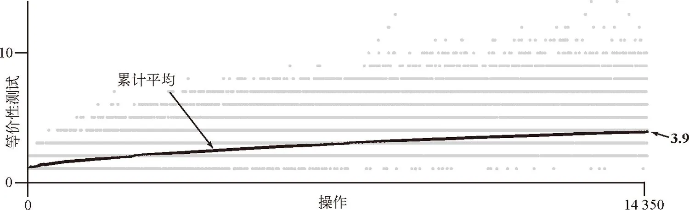

```
图 3.4.5　使用 SeparateChainingHashST，运行 java FrequencyCounter 8 < tale.txt 的成本（
```

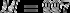

- ）

### 3.4.2.2　删除操作

```sql
要删除一个键值对，先用散列值找到含有该键的 SequentialSearchST 对象，然后调用该
对象的 delete() 方法（请见练习 3.1.5）。这种重用已有代码的方式比重新实现链表的删除
```

更好。

### 3.4.2.3　有序性相关的操作

散列最主要的目的在于均匀地将键散布开来，因此在计算散列后键的顺序信息就丢失了。如果你需要快速找到最大或者最小的键，或是查找某个范围内的键，或是实现表 3.1.4 中有序符号表 API 中的其他任何方法，散列表都不是合适的选择，因为这些操作的运行时间都将会是线性的。

基于拉链法的散列表的实现简单。在键的顺序并不重要的应用中，它可能是最快的（也是使用最广泛的）符号表实现。当使用 Java 的内置数据类型作为键，或是在使用含有经过完善测试

```
的 hashCode() 方法的自定义类型作为键时，算法 3.5 能够提供快速而方便的查找和插入操
```

作。下面，我们会介绍另一种解决碰撞冲突的有效方法。

### 3.4.3　基于线性探测法的散列表

- 的数组保存个键值对，其中

实现散列表的另一种方式就是用大小为

- 。我们需要

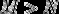

依靠数组中的空位解决碰撞冲突。基于这种策略的所有方法被统称为开放地址散列表。

开放地址散列表中最简单的方法叫做线性探测法：当碰撞发生时（当一个键的散列值已经被另一个不同的键占用），我们直接检查散列表中的下一个位置（将索引值加 1）。这样的线性探测可能会产生三种结果：

- 命中，该位置的键和被查找的键相同；

- 未命中，键为空（该位置没有键）；

- 继续查找，该位置的键和被查找的键不同。

我们用散列函数找到键在数组中的索引，检查其中的键和被查找的键是否相同。如果不同则继续查找（将索引增大，到达数组结尾时折回数组的开头），直到找到该键或者遇到一个空元素，如图 3.4.6 所示。我们习惯将检查一个数组位置是否含有被查找的键的操作称作探测。在这里它可以等价于我们一直使用的比较，不过有些探测实际上是在测试键是否为空。

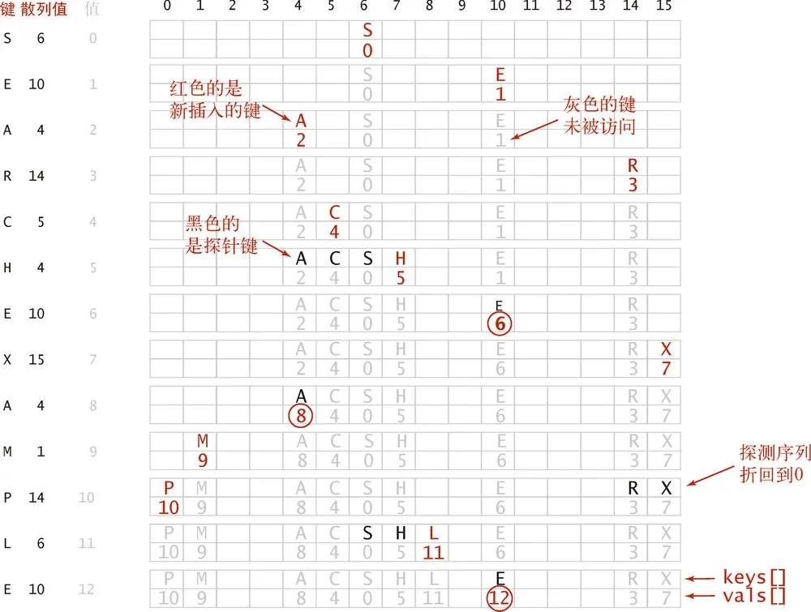

- 图 3.4.6　标准索引用例使用的基于线性探测的符号表的轨迹

开放地址类的散列表的核心思想是与其将内存用作链表，不如将它们作为在散列表的空元素。

```
这些空元素可以作为查找结束的标志。在 LinearProbingHashST 中可以看到（算法
```

3.6），使用这种思想来实现符号表的 API 是十分简单的。我们在实现中使用了并行数组，一条保存键，一条保存值，并像前面讨论的那样使用散列函数产生访问数据所需的数组索引。

- 算法 3.6　基于线性探测的符号表

```java
public class LinearProbingHashST<Key, Value>
1
{
2
  private int N;         // 符号表中键值对的总数
3
  private int M = 16;    // 线性探测表的大小
4
  private Key[] keys;    // 键
5
  private Value[] vals;  // 值
6
  public LinearProbingHashST()
7
  {
8
     keys = (Key[])   new Object[M];
9
     vals = (Value[]) new Object[M];
10
  }
11
  private int hash(Key key)
12
  {  return (key.hashCode() & 0x7fffffff) % M; }
13
14
  private void resize()        // 请见3.4.4节
15
16
  public void put(Key key, Value val)
17
  {
18
     if (N >= M/2) resize(2*M);  // 将M加倍（请见正文）
19
20
     int i;
21
     for (i = hash(key); keys[i] != null; i = (i + 1) % M)
22
        if (keys[i].equals(key)) { vals[i] = val; return; }
23
     keys[i] = key;
24
     vals[i] = val;
25
     N++;
26
  }
27
28
  public Value get(Key key)
29
  {
30
     for (int i = hash(key); keys[i] != null; i = (i + 1) % M)
31
        if (keys[i].equals(key))
32
            return vals[i];
33
     return null;
34
  }
35
}
36
这段符号表的实现将键和值分别保存在两个数组中（与 BinarySearchST 类型中一样），
使用空（标记为 null）来表示一簇键的结束。如果一个新键的散列值是一个空元素，那么
```

- 就将它保存在那里；如果不是，我们就顺序查找一个空元素来保存它。要查找一个键，我们

```
从它的散列值开始顺序查找，如果找到则命中，如果遇到空元素则未命中。keys() 方法的
```

- 实现请见练习 3.4.19。

### 3.4.3.1　删除操作

如何从基于线性探测的散列表中删除一个键？仔细想一想，你会发现直接将该键所在的位置设

```
为 null 是不行的，因为这会使得在此位置之后的元素无法被查找。例如，假设在轨迹图的例
子中（图 3.4.6）我们需要用这种方法删除键 C，然后查找 H。H 的散列值是 4，但它实际存
储在这一簇键的结尾，即 7 号位置。如果我们将 5 号位置设为 null，get() 方法将无法找
到 H。因此，我们需要将簇中被删除键的右侧的所有键重新插入散列表。这个过程比想象的要
```

复杂，所以你最好以练习（请见练习 3.4.17）为例跟踪右侧这段代码的运行全过程。

```java
public void delete(Key key)
{
  if (!contains(key)) return;
  int i = hash(key);
  while (!key.equals(keys[i]))
     i = (i + 1) % M;
  keys[i] = null;
  vals[i] = null;
  i = (i + 1) % M;
  while (keys[i] != null)
  {
     Key   keyToRedo = keys[i];
     Value valToRedo = vals[i];
     keys[i] = null;
     vals[i] = null;
     N--;
     put(keyToRedo, valToRedo);
     i = (i + 1) % M;
  }
  N--;
  if (N > 0 && N == M/8) resize(M/2);
}
```

基于线性探测的散列表的删除操作

- 的比值，但意义有所不同。我

和拉链法一样，开放地址类的散列表的性能也依赖于

- 称为散列表的使用率。对于基于拉链法的散列表，是每条链表的长度，因此一般大

们将于 1；对于基于线性探测的散列表，

- 是表中已被占用的空间的比例，它是不可能大于 1 的。

```
事实上，在 LinearProbingHashST 中我们不允许
```

- 达到 1（散列表被占满），因为此时未

命中的查找会导致无限循环。为了保证性能，我们会动态调整数组的大小来保证使用率在 1/8到 1/2 之间。这个策略是基于数学上的分析，我们会在讨论实现的细节之前介绍。

### 3.4.3.2　键簇

线性探测的平均成本取决于元素在插入数组后聚集成的一组连续的条目，也叫做键簇，如图

```
3.4.7 所示。例如，在示例中插入键 C 会产生一个长度为 3 的键簇（A C S）。这意味着插入
H 需要探测 4 次，因为 H 的散列值为该键簇的第一个位置。显然，短小的键簇才能保证较高
```

的效率。随着插入的键越来越多，这个要求很难满足，较长的键簇会越来越多，如图 3.4.8 所示。另外，因为（基于均匀性假设）数组的每个位置都有相同的可能性被插入一个新键，长键簇更长的可能性比短键簇更大，因为新键的散列值无论落在簇中的任何位置都会使簇的长度加1（甚至更多，如果这个簇和相邻的簇之间只有一个空元素相隔的话）。下面我们要将键簇的影响量化来预测线性探测法的性能，并使用这些信息在我们的实现中设置适当的参数值。

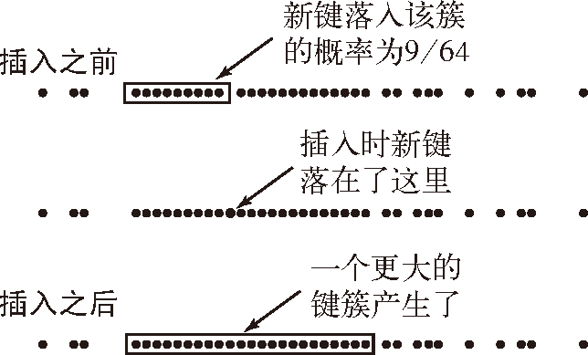

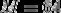

- 图 3.4.7　线性探测法中的键簇（）

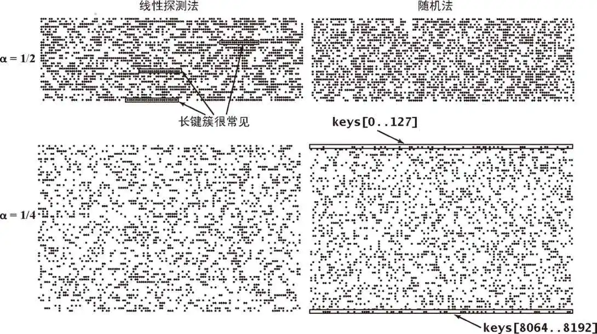

- 图 3.4.8　数组的使用模式（2048 个键，每行 128 个）

### 3.4.3.3　线性探测法的性能分析

尽管最后的结果的形式相对简单，准确分析线性探测法的性能是非常有难度的。Knuth 在1962 年作出的以下推导是算法分析史上的一个里程碑。

- 命题 M。在一张大小为并含有个键的基于线性探测的散列表中，基于假设

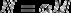

- J，命中和未命中的查找所需的探测次数分别为：

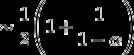

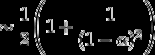

- 和约为 1/2 时，查找命中所需要的探测次数约为 3/2，未命中所需要的约为 5/2。特别是当趋近于 1 时，这些估计值的精确度会下降，但不需要担心这些情况，因为我们会保证当散列表的使用率小于 1/2。讨论。要计算平均值，首先要计算在散列表中每个位置上出现查找未命中所需要的探测次数，然后将所有探测次数之和除以。所有查找未命中都至少需要一次探测，因此我们从

- 第一次探测之后开始计数。考虑在一张半满的（）线性探测散列表中可能出现的

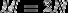

- 以下两种极端情况：在最好的情况下，偶数位置的数组元素都是空的，奇数位置的数组元素

- 都是满的；在最坏的情况下，前半张表是空的，后半张表是满的。键簇的平均长度在两种情

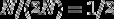

- ，但未命中的查找所需的平均探测次数在最好情况下为 1（所有的况下都是

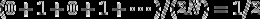

- ，在最坏情况下为 1 加查找都至少需要一次探测）加上

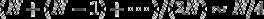

- 上。将这段证明一般化可得未命中的查找平均所需的比较次数和键簇长度的平方成正比。如果一个键簇的长度为，那么

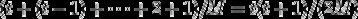

- 就是在这段键簇中查找未命中所需的平均探测次数。因为所有键簇的总长度肯定为，所以将表中所有键簇所得的平均探测次数相

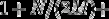

- ( 每个键簇的长度的平方之和加可以得到，一次未命中的查找的平均成本为)，再除以。因此，给定一张散列表，我们就可以快速计算该表中一次未命中查找的平

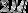

- 均成本（请见练习 3.4.21）。一般情况下，键簇的形成需要一个复杂的动态过程（也就是线性探测算法），很难分析并找出特点，而且这也远远超出了本书的讨论范围。

命题 M 告诉我们（在假设 J 的前提下）当散列表快满的时候查找所需的探测次数是巨大的（

- 越趋近于 1，由公式可知探测的次数也越来越大），但当使用率小于 1/2 时探测的预计次

数只在 1.5 到 2.5 之间。下面，我们为此来考虑动态调整散列表数组的大小。

### 3.4.4　调整数组大小

```java
private void resize(int cap)
{
  LinearProbingHashST<Key, Value> t;
  t = new LinearProbingHashST<Key, Value>(cap);
  for (int i = 0; i < M; i++)
     if (keys[i] != null)
         t.put(keys[i], vals[i]);
  keys = t.keys;
  vals = t.vals;
  M    = t.M;
}
```

调整线性探测散列表

我们可以使用第 1 章中介绍的调整数组大小的方法来保证散列表的使用率永远都不会超过

```sql
1/2。首先，我们的 LinearProbingHashST 需要一个新的构造函数，它接受一个固定的容
量作为参数（在算法 3.6 的构造函数中加入一行代码就可以在创建数组之前将 M 设为给定的
值）。然后，我们需要右边给出的resize() 方法。它会创建一个新的给定大小的
LinearProbingHashST，保存原表中的 keys 和 values 变量，然后将原表中所有的键重
新散列并插入到新表中。这使我们可以将数组的长度加倍。put() 方法中的第一条语句会调
用 resize() 来保证散列表最多为半满状态。这段代码构造的散列表比原来大一倍，因此
的值就会减半。和其他需要调整数组大小的应用场景一样，我们也需要在 delete() 方法的
```

最后加上：

```
if (N > 0 && N <= M/8) resize(M/2);
```

以保证所使用的内存量和表中的键值对数量的比例总在一定范围之内。动态调整数组大小可以

- 不大于 1/2。

为我们保证

### 3.4.4.1　拉链法

```sql
我们可以用相同的方法在拉链法中保持较短的链表（平均长度在 2 到 8 之间）：在 resize()
中将 LinearProbingHashST 替换为 SeparateChainingHashST，当 N >= 8*M 时调用
resize(2*M)，并在 delete() 中（在 N >= 0 && N <= 2*M 时）调用
resize(M/2)。对于拉链法，如果你能准确地估计用例所需的散列表的大小
```

- ，调整数组的

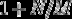

- 即可。

工作并不是必需的，只需要根据查找耗时和（

- ）成正比来选取一个适当的

而对于线性探测法，调整数组的大小是必需的，因为当用例插入的键值对数量超过预期时它的查找时间不仅会变得非常长，还会在散列表被填满时进入无限循环。

### 3.4.4.2　均摊分析

从理论角度来说，当我们动态调整数组大小时，需要找出均摊成本的上限，因为我们知道使散列表长度加倍的插入操作需要大量的探测。

- 命题 N。假设一张散列表能够自己调整数组的大小，初始为空。基于假设 J，执行任意顺序次查找、插入和删除操作所需的时间和成正比，所使用的内存量总是在表中的键的总的数的常数因子范围内。

- 证明。对于拉链法和线性探测法，结合命题 K 和命题 M 可知，这个命题只是对我们在第 1章 中第一次讨论过的数组增长的均摊分析的简单重复而已。

```
如图 3.4.9 和图 3.4.10 所示，在 FrequencyCounter 的例子中，累计平均的曲线很好地显
```

示出散列表中调整数组大小的动态行为。每次数组长度加倍之后，累计平均值都会增加约 1，因为表中的每个键都需要重新计算散列值。然后该值慢慢下降，因为半数左右的键被重新分配到了表中的不同位置。随着表中的键的增加，该值下降的速度也慢慢降低。

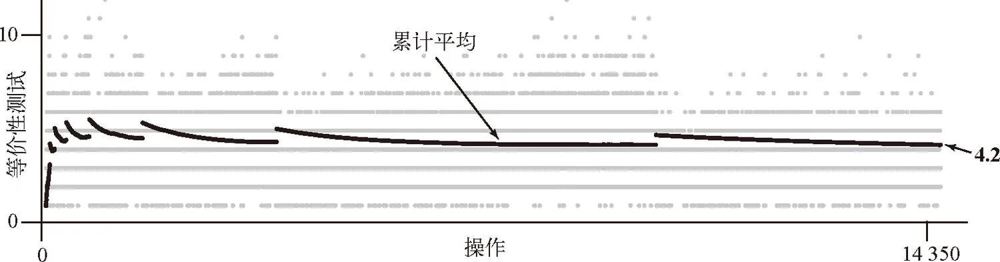

```
图 3.4.9　使用能够自动调整数组大小的 SeparateChainingHashST，运行 java FrequencyCounter 8<
tale.txt 的成本
```

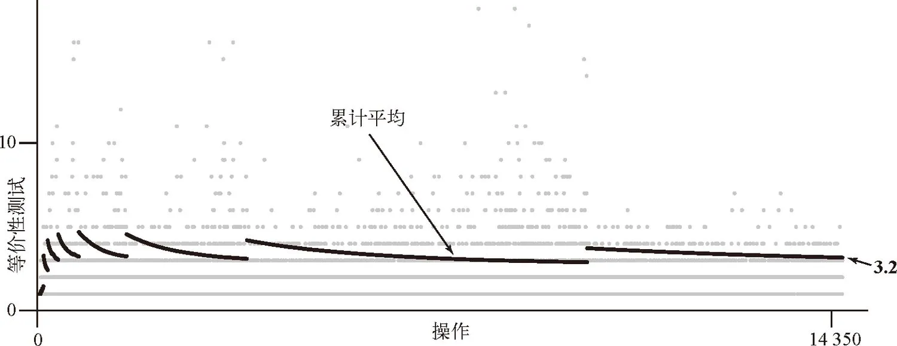

```
图 3.4.10　使用能够自动调整数组大小的 LinearProbingHashST，运行 java FrequencyCounter 8 < tale.txt
```

- 的成本

### 3.4.5　内存使用

我们说过，如果我们希望将散列表的性能调整到最优，理解它的内存使用情况是非常重要的。虽然这种调整是专家们的事儿，但通过估计引用的使用数量来粗略计算所需的内存量仍然是很好的练习。方法如下：除了存储键和值所需的空间之外，我们实现的

```
SeparateChainingHashST 保存了
 个 SequentialSearchST 对象和它们的引用。每
```

```
个 SequentialSearchST 对象需要 16 字节，它的每个引用需要 8 字节。另外还有
```

- 个

```
node 对象，每个都需要 24 字节以及 3 个引用（key、value 和 next），比二叉查找树的
```

每个结点还多需要一个引用。在使用动态调整数组大小来保证表的使用率在 1/8 到 1/2 之间的

- 到个引用。可以看出，根据内存用量来选择散列表的实现并

情况下，线性探测使用

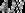

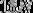

不容易。对于原始数据类型，这些计算又有所不同（请见练习 3.4.24）。

符号表的内存使用如表 3.4.2 所示。

表 3.4.2　符号表的内存使用

- N 个元素所需的内存（引用类型）

方法

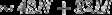

基于拉链法的散列表

- 和之间

基于线性探测的散列表

- 在

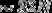

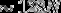

各种二叉查找树

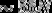

自计算机发展的伊始，研究人员就研究了（并且现在仍在继续研究）散列表并找到了很多方法来改进我们所讨论过的几种基本算法。你能找到大量关于这个主题的文献。大多数改进都能降低时间 - 空间的曲线：在查找耗时相同的情况下使用更少的空间，或使在使用相同空间的情况下进行更快的查找。其他方法包括提供更好的性能保证，如最坏情况下的查找成本；改进散列函数的设计等。我们会在练习中讨论其中的部分方法。

拉链法和线性探测法的详细比较取决于实现的细节和用例对空间和时间的要求。即使基于性能考虑，选择拉链法而非线性探测法也不一定是合理的（请见练习 3.5.31）。在实践中，两种方法的性能差别主要是因为拉链法为每个键值对都分配了一小块内存而线性探测则为整张表使用了两个很大的数组。对于非常大的散列表，这些做法对内存管理系统的要求也很不相同。在现代系统中，在性能优先的情景下，最好由专家去把握这种平衡。

有了这些假设，期望散列表能够支持和数组大小无关的常数级别的查找和插入操作是可能的。对于任意的符号表实现，这个期望都是理论上的最优性能。但散列表并非包治百病的灵丹妙药，因为：

- 每种类型的键都需要一个优秀的散列函数；

- 性能保证来自于散列函数的质量；

- 散列函数的计算可能复杂而且昂贵；

- 难以支持有序性相关的符号表操作。

在考察了这些基本问题之后，我们会在 3.5 节的开头将散列表和我们学习过的其他符号表的实现方法进行比较。

### 答疑

```
问　Java 的 Integer、Double 和 Long 类型的 hashCode() 方法是如何实现的？
答　Integer 类型会直接返回该整数的 32 位值。对于 Double 和 Long 类型，Java 会返回
```

值的机器表示的前 32 位和后 32 位异或的结果。这些方法可能不够随机，但它们的确能够将值散列。

```
问　当能够动态调整数组大小时，散列表的大小总是 2 的幂，这不是个问题吗？这样 hash()
方法就只使用了 hashCode() 返回值的低位。
答　是的，这个问题在默认实现中特别明显。解决这个问题的一种方法是先用一个大于 M 的
```

素数来散列键值对，例如：

```
private int hash(Key x)
{
  int t = x.hashCode() & 0x7fffffff;
  if (lgM < 26) t = t % primes[lgM+5];
  return t % M;
}
```


这段代码假设我们使用了一个变量

- ，它的值等于（直接初始化为该值，并在将数组

```
长度加倍或者减半时增大或者减小它），以及一个数组 primes[]，其中含有大于各个 2 的幂
```

- 3

的最小素数（请见右表

- ）。代码中的常数 5 是随意取的一个值——我们希望第一次取余操作

（%）能够将所有值散列在小于该素数的范围之内，而第二次取余操作则将其中的 5 个值映射

```
到小于 M 的所有值中。请注意，对于很大的 M 这是没有意义的。
```


将散列表大小设为素数

```
问　我忘记了，为什么不将 hash(x) 实现为 x.hashCode() % M ？
答　散列值必须在 0 到 M-1 之间，而在 Java 中，取余（%）的结果可能是负数。
问　那为什么不将 hash(x) 实现为 Math.abs(x.hashCode()) % M ？
答　问得好，不幸的是对于最大的整数 Math.abs() 会返回一个负值。对于许多典型情况，
```

这种溢出不会造成什么问题，但对于散列表这可能使你的程序在几十亿次插入之后崩溃，这很

```
难说。例如，Java 中字符串 "polygenelubricants" 的散列值为
```


- 。找出散列值为这

个数（以及为 0）的其他字符串已经变成了一种有趣的算法谜题。

```
问　在算法 3.5 中为什么使用 SequentialSearchST 而非 BinarySearchST 或者
RedBlackBST ？
```

答　一般来说，我们希望散列到每个索引值上的键越少越好，而对于小规模符号表初级实现的性能一般更好。在某些情况下，使用这些复杂的实现也许能够稍稍将性能提高，但最好让专家来进行这种调优。

问　散列表的查找比红黑树更快吗？

```
答　这取决于键的类型，它决定了 hashCode() 的计算成本是否大于 compareTo() 的比较
```

成本。对于常见的键类型以及 Java 的默认实现，这两者的成本是近似的，因此散列表会比红黑树快得多，因为它所需的操作次数是固定的。但需要注意的是，如果要进行有序性相关的操作，这个问题就没有意义了，因为散列表无法高效地支持这些操作。进一步的讨论请见 3.5节。

问　为什么不能让基于线性探测的散列表充满四分之三？

- 值并用命题 M 来估计相应的查找成本。对于

答　没什么特别的原因。你可以选择任意的


- ，查找命中的平均成本为 2.5，未命中的为 8.5。但如果你允许增长到 7/8，查找未

命中的平均成本就会达到 32.5，这可能已经超出了你的承受能力。随着

- 趋近于 1，命题 M

得出的估计值的准确度会下降，但你不应该使散列表的占有率达到那种程度。

### 练习

```
3.4.1　将键 E A S Y Q U T I O N 依次插入一张初始为空且含有
```

- 条链表的基于拉


```
链法的散列表中。使用散列函数 11 k % M 将第
```

- 个字母散列到某个数组索引上。

```
3.4.2　重新实现 SeparateChainingHashST，直接使用 SequentialSearchST 中链表
```

部分的代码。

3.4.3　修改你为上一道练习给出的实现，为每个键值对添加一个整型变量，将其值设为插入

```
该键值对时散列表中元素的数量。实现一个方法，将该变量的值大于给定整数 k 的键（及其
```

相应的值）全部删除。注意：这个额外的功能在为编译器实现符号表时很有用。

```
3.4.4　使用散列函数 (a * k) % M 将 S E A R C H X M P L 中的第
```

- 个键散列为一个

```
数组索引。编写一段程序找出 a 和最小的 M，使得该散列函数得到的每个索引都不相同（没
```

有碰撞）。这样的函数也被称为完美散列函数。

```
3.4.5　下面这段 hashCode() 的实现合法吗？
public int hashCode()
{ return 17; }
```

如果合法，请描述它的使用效果，否则请解释原因。

3.4.6　假设键为

- 位整数。对于一个使用素数的除留余数法的散列函数，请证明对于键的

每一位，都存不同的两个键，它们的散列值只有该位不同。

```
3.4.7　考虑对于整型的键将除留余数法的散列函数实现为 (a * k) % M，其中 a 为一个任
```

意的固定素数。这样是否足以利用键的所有位使得我们可以使用一个非素数 M 了呢？


3.4.8　对于

- 和个键插入一张、、、、，请估计将


```sql
SeparateChainingHashST 的散列表后还剩多少空链表？提示：参考练习 2.5.31。
3.4.9　为 SeparateChainingHashST 实现一个即时的 delete() 方法。
3.4.10　将键 E A S Y Q U T I O N 依次插入一张初始为空且大小为
```

- 的基于线性


```
探测法的散列表中。使用散列函数 11 k % M 将第
```

- 个字母散列到某个数组索引上。对于


- 将本题重新完成一遍。


```
3.4.11　将键 E A S Y Q U T I O N 依次插入一张初始为空大小为
```

- 的基于线性探


```
测法的散列表中，数组只要达到半满即自动将长度加倍。使用散列函数 11 k % M 将第
```

- 个

字母散列到某个数组索引上。给出得到的散列表的内容。

3.4.12　设有键 A 到 G，散列值如下所示。将它们按照一定顺序插入到一张初始为空大小为 7的基于线性探测的散列表中（这里数组的大小不会动态调整）。下面哪个选项是不可能由插入这些键产生的？给出这些键在构造散列表时可能所需的最大和最小探测次数，并给出相应的插入顺序来证明你的答案。

a. E F G A C B D

b. C E B G F D Ac. B D F A C E G

d. C G B A D E F

e. F G B D A C E

f. G E C A D B F

- ABCDEFG

键

散列值（M=7）

- 2004442

3.4.13　在下面哪些情况中基于线性探测的散列表中的一次随机的命中查找所需的时间是线性的？

a. 所有键均被散列到同一个索引上

b. 所有键均被散列到不同的索引上

c. 所有键均被散列到同一个偶数索引上

d. 所有键均被散列到不同的偶数索引上

3.4.14　对于未命中的查找回答上一道练习的问题，假设被查找的键被散列到表中任意位置的可能性均等。

3.4.15　在最坏情况下，向一张初始为空、基于线性探测法并能够动态调整数组大小的散列表

- 个键需要多少次比较？

中插入

3.4.16　假设有一张大小为

- 的基于线性探测的散列表已经半满了，被占用的元素随机分

布。请估计所有索引值中能够被 100 整除的位置都被占用的概率。

```sql
3.4.17　使用 3.4.3.1 节的 delete() 方法从标准索引测试用例使用的
LinearProbingHashST 中删除键 C 并给出结果散列表的内容。
3.4.18　为 SeparateChainingHashST 添加一个构造函数，使用例能够指定查找操作可以
```

接受的在链表中进行的平均探测次数。动态调整数组的大小以保证链表的平均长度小于该值，

```
并使用答疑中所述的方法来保证 hash() 方法的系数总是素数。
3.4.19　为 SeparateChainingHashST 和 LinearProbingHashST 实现 keys() 方法。
3.4.20　为 LinearProbingHashST 添加一个方法来计算一次命中查找的平均成本，假设表
```

中每个键被查找的可能性相同。

```
3.4.21　为 LinearProbingHashST 添加一个方法来计算一次未命中查找的平均成本，假设
```

使用了一个随机的散列函数。请注意：要解决这个问题并不一定要计算所有的散列函数。

```
3.4.22　为下列数据类型实现 hashCode() 方法：Point2D、Interval、Interval2D 和
Date。
3.4.23　对于字符串类型的键，考虑 R = 256 和 M = 255 的除留余数法的散列函数。请证
```

明这是一个糟糕的选择，因为任意排列的字母所得字符串的散列值均相同。

```
3.4.24　对于 double 类型，分析拉链法、线性探测法和二叉查找树的内存使用情况。将结果
```

整理成类似于表 3.4.2 的表格。

### 提高题

```
3.4.25　散列值的缓存。修改 3.4.1.8 节的 Transaction 类并维护一个变量 hash，在
hashCode() 方法第一次为一个对象计算散列值后将值保存在 hash 中，这样随后的调用就
```

不必重新计算了。请注意：这种方法仅适用于不可变的数据类型。

```sql
3.4.26　线性探测法中的延时删除。为 LinearProbingHashST 添加一个 delete() 方
法，在删除一个键值对时将其值设为 null，并在调用 resize() 方法时将键值对从表中删
除。这种方法的主要难点在于决定何时应该调用 resize() 方法。请注意：如果后来的
put() 方法为该键指定了一个新的值，你应该用新值将 null 覆盖掉。你的程序在决定扩张
```

或者收缩数组时不但要考虑到数组的空元素，也要考虑到这种死掉的元素。

```
3.4.27　二次探测。修改 SeparateChainingHashST，进行二次散列并选择两条链表中的
较短者。将键 E A S Y Q U T I O N 依次插入一张初始为空且大小为
```

- 的基于拉链


```
法的散列表中，以 11 k % M 作为第一个散列函数，17 k % M 作为第二个散列函数来将第
```

个字母散列到某个数组索引上。给出插入过程的轨迹以及随机的命中查找和未命中查找在该符号表中所需的平均探测次数。

```
3.4.28　二次散列。修改 LinearProbingHashST，进行二次散列以得到探测起始点。确切
地说，是将（所有的）(i + 1) % M 替换为 (i + k) % M，其中 k 是一个非零、和 M 互
质且和键相关的整数。提示：可以令 M 为素数来满足互质的条件。使用上一道练习中给出的
两个散列函数，将键　E A S Y Q U T I O N 依次插入一张初始为空且大小为
```

- 的


基于线性探测的散列表中。给出插入过程的轨迹以及随机的命中查找和未命中查找所需的平均探测次数。

```sql
3.4.29　删除操作。分别为前两题中所述的散列表实现即时的 delete() 方法。
3.4.30　卡方值（chi—square statistic）。为 SeparateChainingHashST 添加一个方法来计
```


- 并含有个元素的散列表，这个值的定义为：

算散列表的

- 。对于大小为


- 为散列值为的键的数量。这个统计数据是检测我们的散列函数产生的随机值是否

其中，


- 和之间

满足假设的一种方法。如果满足，对于

- ，这个值落在


的概率为

- 。

3.4.31　Cuckoo 散列函数。实现一个符号表，在其中维护两张散列表和两个散列函数。一个给定的键只能存在于一张散列表之中。在插入一个新键时，在其中一张散列表中插入该键。如果这张表中该键的位置已经被占用了，就用新键替代老键并将老键插入到另一张散列表中（如果在这张表中该键的位置也被占用了，那么就将这个占用者重新插入第一张散列表，把位置腾给被插入的键），如此循环往复。动态调整数组大小以保持两张表都不到半满。这种实现中查找所需的比较次数在最坏情况下是一个常数，插入操作所需的时间在均摊后也是常数。

```
 个 hashCode() 方法返回值均相同且长度均为
```


3.4.32　散列攻击。找出

- 的字符串。假

```
设 String 类型的 hashCode() 方法的实现如下：
public int hashCode()
{
  int hash = 0;
  for (int i = 0; i < length(); i ++)
     hash = (hash * 31) + charAt(i);
  return hash;
}
　重要提示：Aa 和 BB 的散列值相同。
3.4.33　糟糕的散列函数。考虑 Java 的早期版本中 String 类型的 hashCode() 方法的实
```

现，如下所示：

```
public int hashCode()
{
  int hash = 0;
  int skip = Math.max(1, length()/8);
  for (int i = 0; i < length(); i += skip)
     hash = (hash * 37) + charAt(i);
  return hash;
}
```

说明你认为设计者选择这种实现的原因以及为什么它被替换成了上一道练习中的实现。

### 实验题

```
3.4.34　散列的成本。用各种常见的数据类型进行实验以得到 hash() 方法和 compareTo()
```

方法的耗时比的经验数据。

3.4.35　卡方检验。使用你为练习 3.4.30 给出的答案验证常用数据类型的散列函数产生的值是否随机。


3.4.36　链表长度的范围。编写一段程序，向一张长度为

- 的基于拉链法的散列表中插

```
 个随机的 int 键，找出表中最长和最短的链表的长度，其中
```


- 和

入

- 、、

。

```
3.4.37　混合使用。用实验研究在 SeparateChainingHashST 中使用正 RedBlackBST 代
替 SequentialSearchST 来处理碰撞的性能。这种方案的优点是即使散列函数很糟糕它仍
```

然能够保证对数级别的性能，缺点是需要维护两种不同的符号表实现。实际效果如何呢？

3.4.38　拉链法的分布。编写一段程序，向一张大小为

- 的基于线性探测法的散列表中插入

- 个小于的随机非负整数并在每次插入后打印出当前探测的总次数。讨论你的结果4

在何种程度上验证了命题 K。


3.4.39　线性探测法的分布。向一张大小为

- 的基于线性探测法的散列表中插入个随机

- 和

非负整数并根据表中的键簇计算一次未命中查找的平均成本，其中

- 、、

。讨论你的结果在何种程度上验证了命题 M。

```
3.4.40　绘图。改进 LinearProbingHashST 和 SeparateChainingHashST 的实现，使
```

之绘出和正文中类似的图表。

3.4.41　二次探测。用实验研究来评估二次探测法的效果（请见练习 3.4.27）。

3.4.42　二次散列。用实验研究来评估二次散列法的效果（请见练习 3.4.28）。

3.4.43　停车问题（D.　Knuth)。用实验研究来验证一个猜想：向一张大小为

- 的基于线性


- 个随机键所需的比较次数为。

探测法的散列表中插入

- ，其中

[1]：这里似乎和表的内容不相符，表中 的值是小于 的最大素数。——译者注[2]：这个题目和拉链无关，是原书的bug。——译者注
