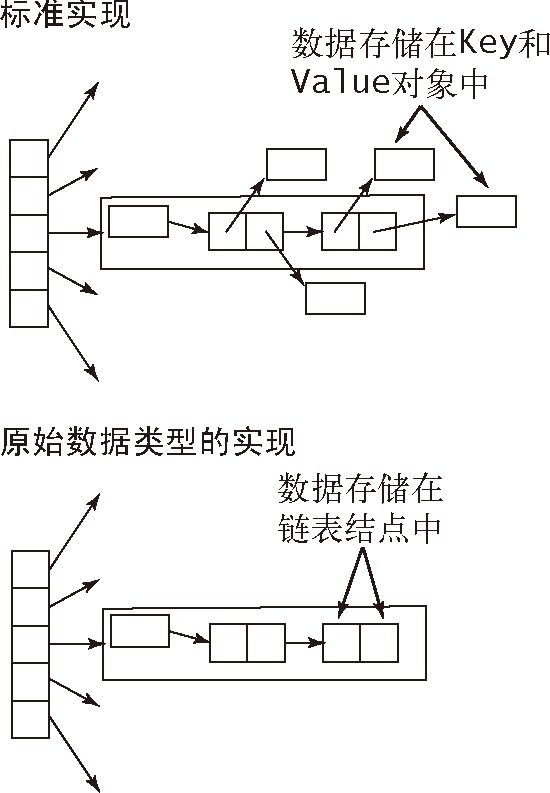
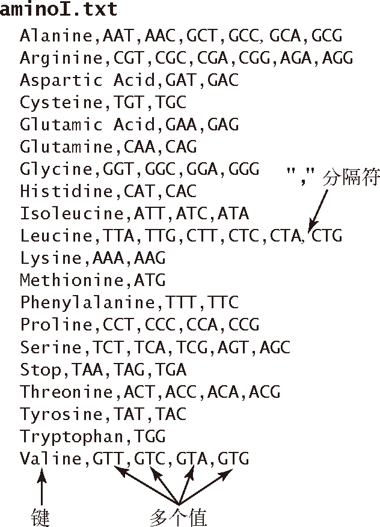
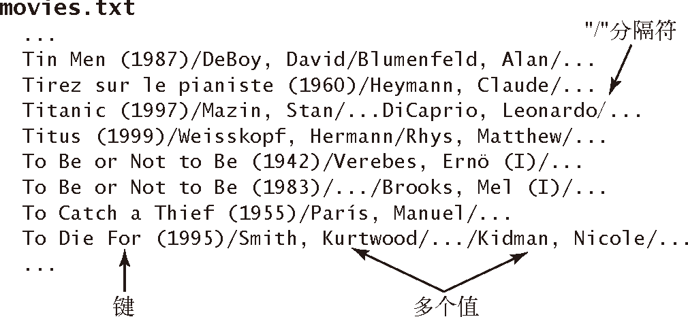
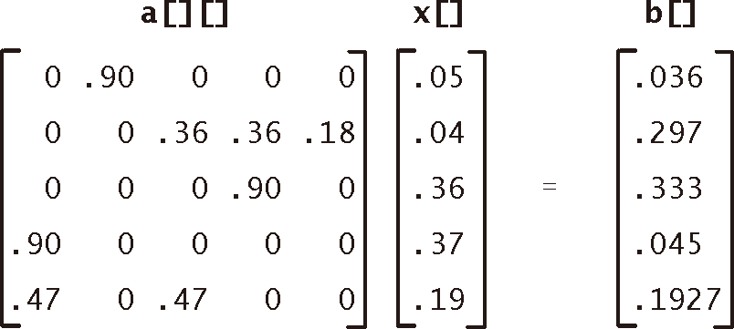
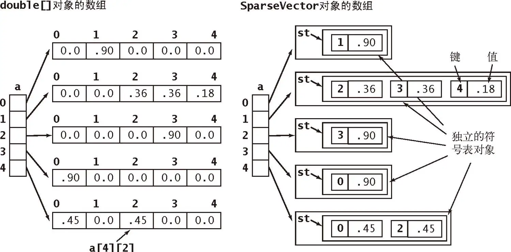

# 3.5应用

在计算机发展的早期，符号表帮助程序员从使用机器语言的数字地址进化到在汇编语言中使用符号名称；在现代应用程序中，符号名称的含义能够通行于跨越全球的计算机网络。快速查找算法曾经并继续在计算机领域中扮演着重要角色。符号表的现代应用包括科学数据的组织，例如在基因组数据中寻找分子标记或模式从而绘制全基因组图谱；网络信息的组织，从搜索在线贸易到数字图书馆；以及互联网基础构架的实现，例如包在网络结点中的路由、共享文件系统和流媒体等。高效的查找算法确保了这些以及无数其他重要的应用程序成为可能。在本节中我们会考察几个有代表性的例子。

- 能够快速并灵活地从文件中提取由逗号分隔的信息的一个字典程序和一个索引程序。逗号分隔的格式（及类似格式）常用于存储网络信息。

- 为一组文件构建逆向索引的一个程序。

- 一个表示稀疏矩阵的数据类型。它用符号表处理的问题规模能够远远大于这种数据类型的标准实现。

在第 6 章中，我们会学习一种适合于数据库或者文件系统的符号表，它能够保存的数据量超过你的想象。

符号表在本书其他章节的算法中也会起到关键的作用。例如，我们会使用符号表来表示图（第4 章）以及处理字符串（第 5 章）。

在本章中我们已经看到，实现能够快速进行各种操作的符号表是一项很有挑战性的任务。另一方面，我们学习过的实现都经过了仔细研究，应用广泛并且在许多环境中都可用（包括 Java的标准库）。从现在开始，符号表就将成为你的编程工具箱中的一件重要武器。

### 3.5.1　我应该使用符号表的哪种实现

表 3.5.1 总结了由本章中多个命题和性质得到的各种符号表算法的性能特点（散列表的最坏情况除外，它的结果来自于研究文献并且也不太可能在实际应用中遇到）。从表中显然可以知道，对于典型的应用程序，应该在散列表和二叉查找树之间进行选择。

相对二叉查找树，散列表的优点在于代码更简单，且查找时间最优（常数级别，只要键的数据类型是标准的或者简单到我们可以为它写出满足（或者近似满足）均匀性假设的高效散列函数即可）。二叉查找树相对于散列表的优点在于抽象结构更简单（不需要设计散列函数），红黑树可以保证最坏情况下的性能且它能够支持的操作更多（如排名、选择、排序和范围查找）。根据经验法则，大多数程序员的第一选择都是散列表，在其他因素更重要时才会选择红黑树。在第 5 章中我们会遇到这个经验法则的例外：当键都是长字符串时，我们可以构造出比红黑树更灵活而又比散列表更高效的数据结构。

表 3.5.1　各种符号表实现的渐进性能的总结

- 平均情况最坏情况下的运行时间的增长数量级（N 次插入之后）之后）

算法（数据结构）

- 查找插入查找命中


顺序查询（无序链表）


二分查找（有序数组）


二叉树查找（二叉查找树）


2-3 树查找（红黑树）


- *


拉链法（链表数组）

- *


线性探测法（并行数组）


* 需要均匀并独立的散列函数。

我们的符号表实现已经可以广泛应用于各种应用程序，但经过简单的修改后这些算法还可以适应并支持其他一些使用广泛的场景，有必要在这里提一下。

### 3.5.1.1　原始数据类型

假设我们有一张符号表，其中整型的键对应着浮点型的值。如果使用我们的标准实现，键和值

```
会被储存在 Integer 和 Double 类中，因此我们需要两个额外的引用来访问每个键值对。如
```

果应用程序只会使用几千个键进行几千次查找，那么这些引用可能没什么问题。但如果是对几十亿个键进行几十亿次查找，那么这些引用就会造成巨大的额外开销。使用原始数据类型代替

```
Key 类型可以为每个键值对节省一个引用。当键的值也是原始数据类型时我们又可以节约另
```

外一个引用。图 3.5.1 显示了在拉链法中使用原始数据类型的情况，这种交换也适用于符号表的其他实现。对于性能优先的应用程序，这种改进并不困难并且值得一试（请见练习 3.5.4）。



- 图 3.5.1　拉链法的内存使用情况

### 3.5.1.2　重复键

符号表的实现有时需要专门考虑重复键的可能性。许多应用都希望能够为同一个键绑定多个值。例如在一个交易处理系统中，多笔交易的客户属性都是相同的。符号表不允许重复键，因此用例只能自己管理重复键。本节稍后我们会遇到一个这样的示例程序。我们可以考虑在实现中允许数据结构保存重复的键值对，并在查找时返回给定的键所对应的任意值之一。我们也可以加入一个方法来返回给定的键对应的所有值。修改我们实现的二叉查找树和散列表来在数据结构中保存重复的键并不困难。修改红黑树可能会稍有挑战（请见练习 3.5.9 和练习3.5.10）。这种实现在许多文献中都可以找到（包括本书以前的版本）。

### 3.5.1.3　Java 标准库

Java 的 java.util.TreeMap 和 java.util.HashMap 分别是基于红黑树和拉链法的散列表的符号表

```sql
实现。TreeMap 没有直接支持 rank()、select() 和我们的有序符号表 API 中的一些其他
```

方法，但它支持一些能够高效实现这些方法的操作。HashMap 和我们的

```
LinearProbingHashST 的实现基本相同——它也会动态调整数组的大小来保持使用率大约
```

不超过 75%。

为了保持前后一致，我们在本书中一般会使用 3.3 节中基于红黑树的符号表或是 3.4 节中基于线性探测法的符号表。为了节省篇幅并保证符号表的用例和具体实现的独立性，我们在调用代

```
码中将使用 ST 来代替有序符号表 RedBlackBST，用 HashST 来代替有序性操作无关紧要且
拥有散列函数的 LinearProbingHashST。尽管我们知道某些应用可能需要改变或者扩展这
```

些算法和数据结构，我们仍然要这样约定。你应该使用哪种符号表？随便，只要记得测试你的选择是否能够提供所需要的性能就好。

### 3.5.2　集合的 API

某些符号表的用例不需要处理值，它们只需要能够将键插入表中并检测一个键在表中是否存在。因为我们不允许重复的键，这些操作对应着下面这组 API（表 3.5.2），它们只处理表中所有键的集合，和相应的值无关。

表 3.5.2　集合数据类型的一组基本 API

```java
public class  <b>SET</b><Key>
              SET()
```

- 创建一个空的集合

```sql
        void  add(Key key)
将键 key 加入集合
        void  delete(Key key)
从集合中删除键 key
     boolean  contains(Key key)
键 key 是否在集合之中
```

只要忽略键关联的值或者使用一个简单的类进行封装，你就可以将任何符号表的实现变成一个

```java
SET 类的实现（请见练习 3.5.1 至练习 3.5.3）。
public class DeDup
{
  public static void main(String[] args)
  {
     HashSET<String> set;
     set = new HashSET<String>();
     while (!StdIn.isEmpty())
     {
        String key = StdIn.readString();
        if (!set.contains(key))
        {
           set.add(key);
           StdOut.print(key + ＂＂);
        }
     }
  }
}
Dedup 过滤器
用并（union）、交（intersection）、补（complement）和其他数学集合的操作扩展 SET 类需
```

要的 API 更复杂（例如，complement 操作需要先定义所有可能的键的集合），使用的算法也更有趣，练习 3.5.17 会讨论它们。

```sql
基于符号表 ST，SET 类分有序和无序两个版本。如果键都是 Comparable 的，我们可以为
有序的键定义 min()、max()、floor()、ceiling()、deleteMin()、
deleteMax()、rank()、select() 以及需要两个参数的 size() 和 get() 方法来构成
一组完整的 API。为了遵守我们关于符号表 ST 的约定，我们在用例中用 SET 表示有序的集
合，用 HashSET 表示无序的集合。
为了演示 SET 的使用方法，我们来看一组过滤器（filter）程序。它会从标准输入读取一组字
```

符串并将其中一些写入标准输出。这种程序源自于早期内存很小无法容纳所有数据的计算机系统。它们在今天仍有用武之地，那就是当你的程序需要从网络中获取输入时。在例子中我们使用 tinyTale. txt（请见表 3.1.7）作为输入。为了保证可读性，我们将输入中的换行符保留到了输出中，不过代码并没有这么做。

### 3.5.2.1　dedup

```
过滤器例子的原型是一个调用 SET 或者 HashSET 来去掉输入流中的重复项的程序，一般叫
```

做 dedup（如右侧代码所示）。我们会保存一个已知字符串的集合。如果下一个键已经存在于集合中，忽略之；如果不在，将它加入集合并打印它。标准输出中键的顺序和它们在标准输入中的顺序相同，只是去掉了重复项。这个过程需要的空间和输入中不同的键的数量成正比（一般比键的总量要小得多）。

```
% java DeDup < tinyTale.txt
it was the best of times worst
age wisdom foolishness
epoch belief incredulity
season light darkness
spring hope winter despair
```

### 3.5.2.2　白名单和黑名单

过滤器的另一个经典应用是用一个文件中保存的键来判定输入流中的哪些键可以被传递到输出流。这个通用程序有许多天然的应用，最简单的例子就是白名单。其中，文件中的键被定义为好键。用例可以选择将所有不在白名单上的键传递到标准输出并忽略所有白名单上的键（就像第 1 章中我们的第一个程序处理的那个例子一样），也可以选择只将所有在白名单上的键传递

```
到标准输出并忽略所有不在白名单上的键（如右侧这段代码所示，使用 HashSET 实现的
WhiteFilter）。例如，电子邮件程序可能会允许用户通过这样一个过滤器指定朋友的邮件
地址并将所有来自其他人的邮件当成垃圾邮件。我们根据指定的列表构造一个 HashSET，然
```

后从标准输入中读取所有键。如果下个键存在于集合之中则打印它，否则就忽略它。黑名单则与之相反，名单上的所有键都被定义为坏键。同样，黑名单过滤器也有两种自然的应用。在电子邮件的例子中，用户可能会指定一些已知的垃圾邮件发送者的地址并要求程序放过所有不是

```
由这些地址发来的邮件。我们可以用 HashSET 实现一个 BlackFilter，过滤条件只需要和
WhiteFilter 相反即可。实际应用中，信用卡公司用黑名单过滤被盗用的信用卡号，因特网
```

路由器用白名单来实现防火墙。它们使用的名单可能非常巨大，输入无限并且响应时间要求非常严格。我们已经学习过的符号表实现能够很好地满足这些需求。

```java
public class WhiteFilter
{
  public static void main(String[] args)
  {
     HashSET<String> set;
     set = new HashSET<String>();
     In in = new In(args[0]);
     while (!in.isEmpty())
        set.add(in.readString());
     while (!StdIn.isEmpty())
     {
        String word = StdIn.readString();
        if (set.contains(word))
           StdOut.print(word + ＂＂);
     }
  }
}
```

白名单过滤器

```
% more list.txt
was it the of
% java WhiteFilter list.txt < tinyTale.txt
it was the of it was the of
it was the of it was the of
it was the of it was the of
it was the of it was the of
it was the of it was the of
% java BlackFilter list.txt < tinyTale.txt
best times worst times
age wisdom age foolishness
epoch belief epoch incredulity
season light season darkness
spring hope winter despair
```

### 3.5.3　字典类用例

```
符号表使用最简单的情况就是用连续的 put() 操作构造一张符号表以备 get() 查询。许多
```

应用程序都将符号表看做一个可以方便地查询并更新其中信息的动态字典。以下列出了这类用例中的一些常见例子。

- 电话黄页。当符号表中的键是人名而值是电话号码时，这张符号表就成了一个电话本。但和一本纸质印刷的电话黄页的一个重大不同是我们可以向其中添加新的名字或者更新其中的电话号码。我们也可以将电话号码作为键而将人名作为值——如果你从来没这么做过，试着在浏览器的搜索栏中输入你的电话（包括区号）并搜索一下。

- 字典。将一个单词和它的含义关联起来就得到了“字典”。几个世纪以来人们都会在家里和办公室里放一本纸质的字典以查找单词（键）的定义和拼写（值）。现在，有了优秀的符号表实现，人们在电脑上可以使用内置的拼写检查器并快速查到单词的意义。

- 账户信息。如今股民们都会在网上实时获取股票的价格信息。这些网络服务会关联股票名称（键）和当前价格（值）以及丰富的其他信息。类似的商业应用非常多，比如金融机构会将名字或者账号与账户信息关联，学校会将学生的姓名或者学号与他的成绩关联，等等。

- 基因组学。在现代基因组学中符号的作用非常重要。最简单的例子就是 A、C、T 和 G 这几个字母代表了活体组织中 DNA 的四种核苷酸。另一个比较简单的例子是密码子（核苷酸三联体）和氨基酸的对应关系（TTA 表示亮氨酸，TCT 表示丝氨酸，等等），以及氨基酸序列和蛋白质之间的对应关系。基因组学的研究者每天都需要使用各种符号表来组织这些信息。

- 实验数据。从天体物理学到动物学，现代科学家被各种实验数据包围着。有效的组织和访问这些信息才能理解它们的含义，而符号表正是一个关键的入手点。基于符号表的高级数据结

- 构和算法如今已经成为科学研究的一个重要部分。

- 编译器。符号表最早期的应用之一就是组织程序代码的信息。最初，计算机程序只是一串简单的数字，但程序员们很快发现使用符号来表示操作和内存地址（变量名）要方便得多。将名称和数字关联起来就需要一张符号表。随着程序的增长，符号表操作的性能逐渐变成了程序开发效率的瓶颈，为此而开发的数据结构和算法就是我们在本章中学习的内容。

- 文件系统。我们都在使用符号表定期整理计算机系统中的数据。也许其中最明显的例子就是文件系统了，因为是它将文件名（键）和文件内容的地址（值）关联起来。音乐播放器同样使用文件系统关联了歌曲名（键）和歌曲的位置（值）。

- 互联网 DNS。域名系统（DNS）是互联网信息组织的基础，它可以将人类能够理解的 URL（键，如 www.princeton.edu 或是 www.wikipedia.org）和计算机网络中路由器能够理解的IP 地址（值，如 208.216.181.15 或是 207.142.131.206 ）关联起来。这个系统被称为下一代“电话黄页”。有了它，人们就可以使用便于记忆的域名，而机器也可以高效地处理对应的数字。为此，全球互联网的路由器中每秒钟进行的符号表查找次数是个天文数字，所以性能显然非常重要。每年，互联网上都会新增上百万台电脑和其他设备，因此互联网路由器中的符号表也需要能够动态地适应它们。

将以上几个典型应用总结一下，如表 3.5.3 所示。

表 3.5.3- 典型的字典类应用

应用领域

- 键值

电话黄页

- 人名电话号码

尽管已经涉及了许多领域，表 3.5.3 中选取的仍然只是几个有代表性的例子来说明符号表应用的广泛程度。每当使用一个名称来指代某种东西时，都用到了符号表。也许你只是用到了计算机的文件系统或是互联网，但在某个角落肯定有一张符号表在默默工作。

作为一个具体的例子，我们来看看一个从文件或者网页中提取由逗号分隔的信息（.csv 文件格式）的程序。这种格式存储的列表的信息不需要任何专用的程序就可以读取：数据都是文本，每行中各项均由逗号隔开。在本书的网站上你会找到很多 .csv 文件，都和我们刚才提到过的应用领域相关，包括 amino.csv（密码子和氨基酸的编码关系）、DJIA.csv（道琼斯工业平均指数历史上每天的开盘价、成交量和收盘价）、ip.csv（DNS 数据库中的一部分条目）和upc.csv（广泛用于识别商品的 Uniform Product Code 条形码），如右侧代码框所示。电子表格等数据处理应用程序都能读写 .csv 文件，我们的例子程序说明你也能够编写 Java 程序来根据需要处理这些数据。

```
% more amino.csv
TTT,Phe,F,Phenylalanine
TTC,Phe,F,Phenylalanine
TTA,Leu,L,Leucine
TTG,Leu,L,Leucine
TCT,Ser,S,Serine
TCC,Ser,S,Serine
...
GAA,Gly,G,Glutamic Acid
GAG,Gly,G,Glutamic Acid
GGT,Gly,G,Glycine
GGC,Gly,G,Glycine
GGA,Gly,G,Glycine
GGG,Gly,G,Glycine
% more DJIA.csv
...
20-Oct-87,1738.74,608099968,1841.01
19-Oct-87,2164.16,604300032,1738.74
16-Oct-87,2355.09,338500000,2246.73
15-Oct-87,2412.70,263200000,2355.09
...
30-Oct-29,230.98,10730000,258.47
29-Oct-29,252.38,16410000,230.07
28-Oct-29,295.18,9210000,260.64
25-Oct-29,299.47,5920000,301.22
...
% more ip.csv
...
www.ebay.com,66.135.192.87
www.princeton.edu,128.112.128.15
www.cs.princeton.edu,128.112.136.35
www.harvard.edu,128.103.60.24
www.yale.edu,130.132.51.8
www.cnn.com,64.236.16.20
www.google.com,216.239.41.99
www.nytimes.com,199.239.136.200
www.apple.com,17.112.152.32
www.slashdot.org,66.35.250.151
www.espn.com,199.181.135.201
www.weather.com,63.111.66.11
www.yahoo.com,216.109.118.65
...
% more UPC.csv
...
0002058102040,,"1 1/4"" STANDARD STORM DOOR"
0002058102057,,"1 1/4"" STANDARD STORM DOOR" 0002058102125,,"DELUXE STORM DOOR UN
0002082012728,"100/ per box","12 gauge shells"
0002083110812,"Classical CD","'Bits and Pieces'"
002083142882,CD,"Garth Brooks - Ropin' The Wind" 0002094000003,LB,"PATE PARISIEN"
0002098000009,LB,"PATE TRUFFLE COGNAC-M&H 8Z RW"
0002100001086,"16 oz","Kraft Parmesan"
0002100002090,"15 pieces","Wrigley's Gum"
0002100002434,"One pint","Trader Joe's milk"
...
```

典型的含有由逗号分隔的值的文件（.csv）

```
下页的 LookupCSV 根据命令行指定的文件中的数据构建了一组键值对，并会打印出由标准输
```

入读取的键对应的值。命令行参数包括一个文件名和两个整数，分别用来指定键和值所在的位置。

这个例子的目的在于展示符号表的作用和灵活性。哪个网站的 IP 地址是 128.112.136.35 ？www.cs.princeton.edu；哪种氨基酸对应着密码子 TCA ？丝氨酸；DJIA 在 1929 年 10 月 29号的价格是多少？252.38；哪种商品的条形码是 0002100001086 ？卡夫芝士粉（KraftParmesan ）。有了 LookupCSV 和合适的 .csv 文件，可以轻易查到这类问题的答案。

在处理交互性的查询时，性能一般都不是问题（因为你的计算机在你打字的工夫就能检索上百

```
万条信息），所以在使用 LookupCSV 时符号表的高效性并不明显。但是当程序需要进行（大
```

量的）查找时，符号表的性能就很重要了。例如，互联网上的一台路由器每秒钟可能需要查找

```
上百万个 IP 地址。在本书中，我们已经通过 FrequencyCounter 看到了高性能的必要性，
```

在本节中你还会看到其他几个例子。

练习里有几个更加复杂的处理 .csv 文件的测试用例。例如，我们可以将一个字典动态化，允许它接受从标准输入中得到的指令来改变一个键的值，或是为它添加范围查找的功能，或者我们可以为同一个文件构造多个字典。

- 字典的查找

```java
public class LookupCSV
1
{
2
  public static void main(String[] args)
3
  {
4
     In in = new In(args[0]);
5
     int keyField = Integer.parseInt(args[1]);
6
     int valField = Integer.parseInt(args[2]);
7
     ST<String, String> st = new ST<String, String>();
8
     while (in.hasNextLine())
9
     {
10
        String line = in.readLine();
11
        String[] tokens = line.split(“,”);
12
        String key = tokens[keyField];
13
        String val = tokens[valField];
14
        st.put(key, val);
15
     }
16
     while (!StdIn.isEmpty())
17
     {
18
        String query = StdIn.readString();
19
        if (st.contains(query))
20
           StdOut.println(st.get(query));
21
     }
22
  }
23
}
24
```

- 这段数据驱动的符号表用例会从一个文件中读取键值对并根据标准输入中的键打印出相应的值。其中键和值都是字符串，键和值所在的位置由命令行参数指定。

```
% java LookupCSV ip.csv 1 0
1
128.112.136.35
2
www.cs.princeton.edu
3
% java LookupCSV amino.csv 0 3
1
TCC
2
Serine
3
% java LookupCSV DJIA.csv 0 3
1
29-Oct-29
2
230.07
3
% java LookupCSV UPC.csv 0 2
1
0002100001086
2
Kraft Parmesan
3
```

### 3.5.4　索引类用例

字典的主要特点是每个键都有一个与之关联的值，因此基于关联型抽象数组来为一个键指定一个值的符号表数据类型正合适。每个账号都唯一地表示一个客户，每个条码都唯一地表示一种商品，等等。但一般说来，一个给定的键当然有可能和多个值相关联。例如，在我们的amino.csv 的例子中，每个密码子都对应着一种氨基酸，但一种氨基酸有可能对应着多个密码子。如下页的 aminoI.txt 所示，文件的每一行都包含一个氨基酸和它对应的多个密码子。

我们使用索引来描述一个键和多个值相关联的符号表，下面是更多的例子。



一个小型索引文件（20 行）

- 商业交易。公司使用客户账户来跟踪一天内所有交易的一种方法是为当日所有交易建立一个索引，其中键是客户的账号，值是和该账号有关的所有交易。

- 网络搜索。当你输入一个关键字并得到一系列含有这个关键字的网站时，你就是在使用网络搜索引擎创建的索引。每个键（查询）都关联着一个值（一组网页），当然实际情况会更加复杂，因为我们经常会指定多个关键字。

- 电影和演员。本书网站上的 movies.txt 来自于 IMDB（互联网电影数据库）。每一行都含有一部电影的名称（键），随后是在其中出演的演员列表（值），用斜杠分隔，如图 3.5.2 所示。



- 图 3.5.2　一个巨型索引文件（250 000 多行）的一小部分

```
将每个键关联的所有值都放入一个数据结构中（比如一个 Queue）并用它作为值就可以轻松
构造一个索引。根据这一点来扩展 LookupCSV 很简单，我们将它留作一道练习（请见练习
3.5.12）。这里我们看一下 LookupIndex，它能够从一个文件，例如 aminoI.txt 或 movies.txt
```

（分隔符不一定和 .csv 文件一样必须是逗号，但需要能够从命令行指定），构造一个索引。构

```
造完成后 LookupIndex 能够接受查询并打印出键对应的所有值。更有意思的是
LookupIndex 也会为每个文件构造一个反向索引，也就是将键和值的角色互换。在氨基酸的
例子中，它的功能相当于 LookupCSV（找到给定密码子所对应的氨基酸）。在电影和演员的
```

例子中，它使我们能够找到一个演员出演过的所有电影。这项信息隐藏于数据当中，但没有符号表我们就很难获取它。请仔细研究这个例子，因为它深刻地揭示了符号表的本质特征。

表 3.5.4 总结了典型的索引类应用的符号表中键值的对应情况。

表 3.5.4　典型的索引类应用

应用领域

- 键值

基因组学

- 氨基酸一系列密码子

商业交易

- 账号一系列交易

网络搜索

- 关键字一系列网页

IMDB

- 电影一系列演员

反向索引

反向索引一般是指用值来查找键的操作，比如我们有大量的数据并且希望知道某个键都在哪些

```
地方出现过。这是另一种符号表的典型用例，它会进行一系列 get() 和 put() 的混合调
用。和以前一样，我们将每个键和一个 SET 类型的值关联起来，这个值中包含了该键出现的
```

所有位置。位置信息的性质和用途取决于应用场景：在一本书中，位置可能是书的页码；在一段程序中，位置可能是代码的行号；在基因组中，位置可能是一段基因序列的某个位点，等等。

- 互联网电影数据库（IMDB）。在上文的例子中，输入是将每部电影和它的演员关联起来的一个索引。它的反向索引则会将每个演员和他出演过的所有电影相关联。

- 图书索引。每本教科书都会有一个索引。你能在其中查找到一个术语和它出现过的所有页码。创建优秀的索引当然需要作者的努力来去掉常见和无关的词语，但文档处理系统能够使用符号表将整个过程自动化。一种有趣的特殊情况叫做对照索引（concordance），它会给出每个单词在书中出现的所有位置（请见练习 3.5.20）。

- 编译器。在一个使用了许多符号的庞大程序中，能够知道每个名称的使用位置很有帮助。在以前，一张打印的以追踪各个符号在程序中使用位置的符号表曾经是程序员最重要的工具之一。在现代计算机系统中，符号表是程序员用来管理各种名称的工具软件的基础。

- 文件搜索。现代操作系统都提供了根据关键字搜索文件的功能。对于这个索引，键就是关键字，值则是含有该关键字的所有文件的集合。

- 基因组学。基因组学研究中的一个典型（或许有些过于简化了）情况是科学家希望知道一个给定的核苷酸序列在一个基因或者一组基因中的位置。某些特定序列或者近似序列的存在也许都有重大的意义。这种研究首先就需要一个序列和基因的对照索引，但也需要一些修改，因为基因是无法像句子一样被切分为单词的（请见练习 3.5.15）。

常见反向索引用例的符号表的键值对应情况如表 3.5.5 所示。

表 3.5.5　典型的反向索引

应用领域

- 键值

IMDB

- 演员一系列电影

图书

- 术语一系列页码

编译器

- 标识符一系列使用位置

文件搜索

- 关键字文件集合

基因组学

- 基因片段一系列位置

- 索引（以及反向索引）的查找

```java
public class LookupIndex
1
{
2
  public static void main(String[] args)
3
  {
4
     In in = new In(args[0]);   // （索引数据库）
5
     String sp = args[1];       // （分隔符）
6
     ST<String, Queue<String>> st = new ST<String, Queue<String>>();
7
     ST<String, Queue<String>> ts = new ST<String, Queue<String>>();
8
     while (in.hasNextLine())
9
     {
10
        String[] a = in.readLine().split(sp);
11
        String key = a[0];
12
        for (int i = 1; i < a.length; i++)
13
        {
14
           String val = a[i];
15
           if (!st.contains(key)) st.put(key, new Queue<String>());
16
           if (!ts.contains(val)) ts.put(val, new Queue<String>());
17
           st.get(key).enqueue(val);
18
           ts.get(val).enqueue(key);
19
        }
20
     }
21
     while (!StdIn.isEmpty())
22
     {
23
        String query = StdIn.readLine();
24
        if (st.contains(query))
25
          for (String s : st.get(query))
26
             StdOut.println(" " + s);
27
        if (ts.contains(query))
28
          for (String s : ts.get(query))
29
             StdOut.println(" " + s);
30
    }
31
  }
32
}
33
% java LookupIndex aminoI.txt ","
1
Serine
2
 TCT
3
 TCA
4
 TCG
5
 AGT
6
 AGC
7
TCG
8
 Serine
9
10
% java LookupIndex movies.txt "/"
11
Bacon, Kevin
12
 Mystic River (2003)
13
 Friday the 13th (1980)
14
 Flatliners (1990)
15
 Few Good Men, A (1992)
16
 ...
17
Tin Men (1987)
18
 Blumenfeld, Alan
19
 DeBoy, David
20
 ...
21
```

- 这段数据驱动的符号表用例会从一个文件中读取键值对并根据标准输入中的键打印出相应的值。其中键为字符串，值为一列字符串，分隔符由命令行参数指定。

```
下面的 FileIndex 从命令行接受多个文件名并使用一张符号表来构造一个反向索引，它能够
将任意文件中的任意一个单词和一个出现过这个单词的所有文件的文件名构成的 SET 对象关
```

联起来。在接受标准输入的查询时，输出单词对应的文件列表。这个过程与工具软件在网络上或是在你的计算机上查找信息的过程类似，即根据输入的关键字得到所有该关键字出现过的位置。这类工具的开发者一般会在下面几点上下工夫来改进这个过程：

- 查询形式；

- 被索引的文件或网页的集合；

- 文件或网页在结果中的排列顺序。

例如，你肯定已经习惯了在网络搜索引擎（它们的基础都是将网络上的大部分页面进行索引）的查询中输入多个关键字进行查找，并得到一组按照相关性或者重要性（对于你或是对于广告商而言）由高到低排序的结果。本节最后的练习中讨论了这里的一些改进。我们会在以后学习和网络搜索有关的各种算法，但符号表仍然会是整个过程的核心工具。

```
和 LookupIndex 一样，你也应该从本书的网站上下载 FileIndex 并用它来为你的电脑上
```

的一些文件或是你感兴趣的一些网站建立索引，从而更好地理解符号表的使用。你将会发现即

```
使是根据巨型文件构造庞大的索引，这个工具的耗时也不多，因为每个 put() 操作和 get()
```

请求的处理都非常快。确保巨型的动态索引实现即时响应是算法技术的重要胜利之一。

- 文件索引

```java
import java.io.File;
1
public class FileIndex
2
{
3
  public static void main(String[] args)
4
  {
5
     ST<String, SET<File>> st = new ST<String, SET<File>>();
6
     for (String filename : args)
7
     {
8
        File file = new File(filename);
9
        In in = new In(file);
10
        while (!in.isEmpty())
11
        {
12
           String word = in.readString();
13
           if (!st.contains(word)) st.put(word, new SET<File>());
14
           SET<File> set = st.get(word);
15
           set.add(file);
16
        }
17
     }
18
     while (!StdIn.isEmpty())
19
     {
20
        String query = StdIn.readString();
21
        if (st.contains(query))
22
            for (File file : st.get(query))
23
              StdOut.println(" " + file.getName());
24
     }
25
   }
26
}
27
```

- 这段符号表用例能够为一组文件创建索引。我们将每个文件中的每个单词都记录在符号表中

```
并维护一个 SET 对象来保存出现过该单词的文件。In 对象接受的名称也可以是网页，因
```

- 此这段代码也可以用来为一组网页创建反向索引。

```
% more ex1.txt
1
it was the best of times
2
3
% more ex2.txt
4
it was the worst of times
5
6
% more ex3.txt
7
it was the age of wisdom
8
9
% more ex4.txt it
10
was the age of foolishness
11
% java FileIndex ex*.txt
1
age
2
 ex3.txt
3
 ex4.txt
4
best
5
 ex1.txt
6
was
7
 ex1.txt
8
 ex2.txt
9
 ex3.txt
10
 ex4.txt
11
```

### 3.5.5　稀疏向量

下面这个例子展示的是符号表在科学和数学计算领域所起到的重要作用。我们会考察一种重要而常见的计算，它在典型的实际应用中常常是性能的瓶颈，然后我们会演示符号表如何解决这个瓶颈并能够处理规模大得多的问题。实际上，这个计算正是 S. Brin 和 L. Page 发明的PageRank 算法的核心，这个算法在 2000 年左右造就了 Google（它同时也是一个著名的数学抽象模型，在很多其他场景中都会用到）。

我们要考察的简单计算就是矩阵和向量的乘法（如图 3.5.3 所示）：给定一个矩阵和一个向量

- 项的值为矩阵的第行和给定的向量的点乘。为了简化问题，我们

并计算结果向量，其中第

- 行列的方阵，向量的大小也为。在 Java 中，用代码实现这种操作非常简单，

只考虑


- 成正比，因为维结果向量中的每一项都需要计算次乘法。因为需要

但所需的时间和

- 成正比。实现代码如下所示。

存储整个矩阵，计算所需的空间也和



- 图 3.5.3　矩阵和向量的乘法

- 往往非常巨大。例如，在刚才提到的 Google 的应用中，等于互联网中

在实际应用中，

所有网页的总数。在 PageRank 算法发明的时候，这个数字大概在百亿到千亿之间，但之后


- 的值应该远远大于

一直在暴增。因此，

- 。没人能够负担起这么多内存和时间来进行这

种计算，所以我们需要更好的算法。

幸好，这里的矩阵常常是稀疏的，即其中大多数项都是 0。实际上，在 Google 的应用中，每行中的非零项的数量是一个较小的常数：每个网页中指向其他页面的链接其实都很少（相比互联网中所有网页的总数而言）。因此，我们可以将这个矩阵表示为由稀疏向量组成的一个数

```
组，使用 HashST 的稀疏向量实现如下面的 SparseVector 所示。
...
double[][] a = new double[N][N];
double[] x = new double[N];
double[] b = new double[N];
...
// 初始化a[][]和x[]
...
for (int i = 0; i < N; i++)
{
  sum = 0.0;
  for (int j = 0; j < N; j++)
     sum += a[i][j]*x[j];
  b[i] = sum;
}
```

矩阵和向量相乘的标准实现

- 能够完成点乘的稀疏向量

```java
public class SparseVector
1
{
2
  private HashST<Integer, Double> st;
3
  public SparseVector()
4
   {  st = new HashST<Integer, Double>();  }
5
  public int size()
6
  {  return st.size();  }
7
  public void put(int i, double x)
8
   {  st.put(i, x);  }
9
  public double get(int i)
10
  {
11
     if (!st.contains(i)) return 0.0;
12
     else return st.get(i);
13
  }
14
  public double dot(double[] that)
15
  {
16
      double sum = 0.0;
17
      for (int i : st.keys())
18
          sum += that[i]*this.get(i);
19
      return sum;
20
  }
21
}
22
```

- 这个符号表的用例实现了稀疏向量的主要功能并高效完成了点乘操作。我们将一个向量中的每一项和另一个向量中对应项相乘并将所有结果相加，所需的乘法操作数量等于稀疏向量中的非零项的数目。

稀疏矩阵的表示如图 3.5.4 所示。



- 图 3.5.4　稀疏矩阵的表示

```
这里我们不再使用 a[i][j] 来访问矩阵中第 i 行第 j 列的元素，而是使用 a[i].put(j,
val) 来表示矩阵中的值并使用 a[i].get(j) 来获取它。从下面这段代码可以看到，用这种
```

方式实现的矩阵和向量的乘法比数组表示法的实现更简单（也能更清晰地描述乘法的过程）。

- 加上矩阵中的非零元素的数量成正比。

更重要的是，它所需的时间仅和

虽然对于较小或是不那么稀疏的矩阵，使用符号表的代价可能会非常高昂，但你应该理解它对于巨型稀疏矩阵的意义。为了更好地说明这一点，设想一个超大的应用（就像 Brin 和 Page

- 可能超过 100 亿或者 1000 亿而平均每行中的非零元素小于 10。对于

面对的问题一样），

这种应用，使用符号表能够将矩阵和向量乘法的速度提升 10 亿倍甚至更多。这种应用虽然简单但非常重要，不愿意挖掘其中省时省力的潜力的程序员解决实际问题能力的潜力也必然是有限的，能够将运行速度提升几十亿倍的程序员勇于面对看似无法解决的问题。

构造 Google 所使用的矩阵是一种图的应用（当然也是符号表的一种应用），尽管是一个巨型的稀疏矩阵。有了这个矩阵，PageRank 算法的计算就变成了简单的矩阵和向量之间的乘法运算，不断用结果向量取代计算所使用的向量，重复这个迭代过程直到收敛（这一点是由概率论

```
的基础定理所保证的）。因此，使用一个类似于 SparseVector 的类能够将这种应用程序所
```

需的空间和时间改进几百或者几千亿倍，甚至更多。

在许多科学计算中类似的改进都是可能的，因此稀疏向量和矩阵的应用十分广泛，并且一般都会被集成到科学计算专用的库中。在处理庞大的向量或矩阵的时候，你最好用一些简单的性能测试来保证不会错过类似的改进机会。另外，大多数编程语言都拥有处理原始数据类型数组的能力，因此像例子中那样用数组来保存密集的向量也许能提供更好的性能。对于这些应用，有必要深入了解它们的运行瓶颈从而选择合适的数据类型实现。

符号表之所以是算法技术为现代计算机基础设施建设的一大重要贡献，是因为在很多实际应用中它都能够节省大量的运行成本，使得各个领域内许多原来完全无法想象的问题的解决成为可能。科学或是工程领域能够将运行效率提升一千亿倍的发明极少——我们已经在几个例子中看到，符号表做到了，并且这些改进的影响非常深远。但我们学习过的数据结构和算法的演化并没有结束：它们才出现了几十年，我们也并没有完全了解它们的性质。鉴于它们的重要性，符号表的各种实现仍然是全球学者的研究热点。随着它的应用范围不断扩展，我们会在更多领域看到它的新发展。

```
...
SparseVector[] a;
a = new SparseVector[N];
double[] x = new double[N];
double[] b = new double[N];
...
// 初始化 a[] 和 x[]
...
for (int i = 0; i < N; i++)
  b[i] = a[i].dot(x);
```

稀疏矩阵和向量的乘法

### 答疑

```
问　SET 能够包含 null 吗？
```

答　不行。和符号表一样，键必须是非空的对象。

```
问　SET 可以是 null 吗？
答　不行。一个 SET 集合可以是空的（不包含任何对象），但不能为 null。和 Java 的其他
数据类型一样，一个 SET 类型的变量的值可以是 null，但这仅仅意味着它没有指向任何
SET 对象。对 SET 使用 new 的结果必然是一个非空的对象。
```

问　如果能够将所有数据都存储在内存中，那就没有必要使用过滤器了，对吗？

答　是的。过滤器最大的用处在于处理输入数据量未知的情况。在其他情况下，它可能会是一种有用的思维方式，但也不是万能的。

```
问　我在一张电子表格中保存了一些数据。我需要开发一个类似于 LookupCSV 的程序查找这
```

些数据吗？

答　你的电子表格程序应该能够将它们导出为 .csv 的文件，这样你就可以直接使用

```
LookupCSV 了。
问　FileIndex 程序有什么用？操作系统不能解决这个问题吗？
```

答　如果操作系统能够满足你的需求，当然应该直接使用它的解决方案。和我们的许多例子程

```
序一样，FileIndex 也是为了向你展示这些应用程序的基本原理并为你提供其他的可能性。
问　为什么 SparseVector 的 dot() 方法不接受一个 SparseVector 对象作为参数并返
回一个 SparseVector 对象？
```

答　这也是一个不错的设计，它所需的代码比我们的设计稍稍复杂一些，因此也是一道不错的编程练习（请见练习 3.5.16）。对于普通矩阵的处理，我们也许还应该再增加一个

```
SparseMatrix 数据类型。
```

### 练习

```
3.5.1　分别使用 ST 和 HashST 来实现 SET 和 HashSET（为键关联虚拟值并忽略它们）。
3.5.2　删除 SequentialSearchST 中和值相关的所有代码来实现
SequentialSearchSET。
3.5.3　删除 BinarySearchST 中和值相关的所有代码来实现 BinarySearchSET。
3.5.4　分别为 int 和 double 两种原始数据类型的键实现 HashSTint 类和
HashSTdouble 类（将 LinearProbingHashST 中的泛型改为原始数据类型）。
3.5.5　分别为 int 和 double 两种原始数据类型的键实现 STint 类和 STdouble 类（将
RedBlackBST 中的泛型改为原始数据类型）。用经过修改的 SparseVector 作为用例测试
```

你的答案。

```
3.5.6　分别为 int 和 double 两种原始数据类型的键实现 HashSETint 类和
HashSETdouble 类（删去你为练习 3.5.4 给出的答案中所有关于值的代码）。
3.5.7　分别为 int 和 double 两种原始数据类型的键实现 SETint 类和 SETdouble 类
```

（删去你为练习 3.5.5 给出的答案中所有关于值的代码）。

```sql
3.5.8　修改 LinearProbingHashST，允许在表中保存重复的键。对于 get() 方法，返回
给定键所关联的任意值；对于 delete() 方法，删除表中所有和给定键相等的键值对。
3.5.9　修改二叉查找树 BST，允许在树中保存重复的键。对于 get() 方法，返回给定键所关
联的任意值；对于 delete() 方法，删除树中所有和给定键相等的结点。
3.5.10　修改红黑树 RedBlackBST，允许在树中保存重复的键。对于 get() 方法，返回给定
键所关联的任意值；对于 delete() 方法，删除树中所有和给定键相等的结点。
3.5.11　开发一个和 SET 相似的类 MultiSET，允许出现相等的键，也就是实现了数学上的
```

多重集合。

```
3.5.12　修改 LookupCSV，将每个键和输入中与该键对应的所有值相关联（而非和关联型抽
```

象数组的一样，仅关联最近出现的那个值）。

```
3.5.13　修改 LookupCSV 为 RangeLookupCSV，从标准输入接受两个键并打印出 .csv 文件
```

中所有在该范围之内的键值对。

```
3.5.14　编写并测试方法 invert()，它接受参数 ST<String, Bag<String>> 并返回给
```

定符号表的反向索引（一个相同类型的符号表）。

3.5.15　编写一个程序，从标准输入接受一个字符串并从命令行参数获得一个整数

- 作为参


- 元文法（

数，在标准输出中有序打印出在字符串中找到的

- ），以及每个

在字符串中的位置。

```sql
3.5.16　为 SparseVector 添加一个 sum() 方法，接受一个 SparseVector 对象作为参
数并将两者相加的结果返回为一个 SparseVector 对象。请注意：你需要使用 delete()
```

方法来处理向量中的一项变为 0 的情况（请特别注意精度）。

### 提高题

```
3.5.17　数学集合。你的目标是实现表 3.5.6 中 MathSET 的 API 来处理（可变的）数学集
```

合。

表 3.5.6　一种简单的集合数据类型的 API

```
Public class <b>MathSET</b><Key>
             MathSET(Key[] universe)
```

- 创建一个集合

```sql
        void add(Key key)
将 key 加入集合
MathSET<Key> complement()
所有在 Universe 中并且不在该集合
        void union(MathSET<Key> a)
将 a 中所有不在该集合中的键加入该
        void intersection(MathSET<Key>
将该集合中所有不在 a 中的键删除（
a)
        void delete(Key key)
将 key 从集合中删去
     boolean contains(Key key)
集合中是否存在键 key
     boolean isEmpty()
```

- 集合是否为空

```
         int size()
```

- 集合中键的总数

```
　请使用符号表来实现它。附加题：使用 boolean 类型的数组来表示集合。
```

3.5.18　多重集合。请参考练习 3.5.2、练习 3.5.3 以及前面的练习，为无序和有序的多重集合

```
（可以含有相同的键的集合）给出 MultiHashSET 和 MultiSET 的 API，并分别用
SeparateChainingMultiSET 和 BinarySearchMultiSET 实现它们。
3.5.19　符号表中的等值键。（有序的和无序的）MultiST 的 API 分别和表 3.1.2 以及表
3.1.4 中定义的符号表 API 相同，只是允许存在等值的键。因此，get() 方法的行为是返回给
```

定键所关联的任意值。另外，我们还需要添加一个新方法来返回和给定键关联的所有值：

```
Iterable<Value> getAll(Key key)
　根据我们的 SeparateChainingHashST 和 BinarySearchST 的代码来实现
SeparateChainingMultiST 和 BinarySearchMultiST 的 API。
```

3.5.20　对照索引。编写一个 ST 的用例 Concordance，为从标准输入得到的字符串构建对照索引并打印出来（请见 320 页“图书索引”段落中“对照索引”的定义）。

3.5.21　反向对照索引。编写一个程序 InvertedConcordance，从标准输入接受一个对照索引并在标准输出中打印出原始的字符串。注意：这个计算和著名的“死海卷轴”故事有关。最早发现原始石板的团队仅公开了用一种不为人知的方式生成的对照索引。一段时间之后其他研究者才找到了如何将这种索引还原的方法，并最终将石板上的全文公之于众。

```
3.5.22　完全索引的 CSV 文件。编写一个 ST 的用例 FullLookupCSV，构造一个 ST 对象
```

的数组（每列一个），以及一个允许使用者指定键和值的列的测试用例。

3.5.23　稀疏矩阵。为稀疏二维矩阵设计一组 API 并将它实现，支持矩阵的加法和乘法操作。包含分别能够指定行和列向量的构造函数。

3.5.24　不重叠的区间查找。给定对象的一组互不重叠的区间，编写一个函数接受一个对象作为参数并判断它是否存在于其中任何一个区间之内。例如，如果对象是整数而区间为 1643-2033，5532-7643，8999-10332，5666653-5669321，那么查询 9122 的结果为第三个区间，而 8122 的结果是不在任何区间。

3.5.25　登记员的日程安排。东北部某著名大学的注册主任最近作出的安排中有一位老师需要在同一时间为两个不同的班级授课。请用一种方法来检查类似的冲突，帮助这位主任不要再犯同样的错误。简单起见，假设每节课的时间为 50 分钟，分别从 9:00、10:00、11:00、1:00、2:00 和 3:00 开始。

3.5.26　LRU 缓存。创建一个支持以下操作的数据结构：访问和删除。访问操作会将不存在于数据结构中的元素插入。删除操作会删除并返回最近最少访问的元素。提示：将元素按照访问的先后顺序保存在一条双向链表之中，并保存指向开头和结尾元素的指针。将元素和元素在链表中的位置分别作为键和相应的值保存在一张符号表中。当你访问一个元素时，将它从链表中删除并重新插入链表的头部。当你删除一个元素时，将它从链表的尾部和符号表中删除。

3.5.27　列表。实现表 3.5.7 中的 API：

表 3.5.7　列表数据类型的 API

```
Public class <b>List</b><Item> implements Iterable<Item>
             List()
```

- 创建一个列表

```
        void addFront(Item item)
将 item 添加到列表的头部
　提示：使用两个符号表，一个用来快速定位列表中的第 i 个元素，另一个用来快速根据元
素查找。（Java 的 java.util.List 包含类似的方法，但它的实现的操作并不都是高效的。）
3.5.28　uniQueue。创建一个类似于队列的数据类型，但每个元素只能插入队列一次。用一
```

个符号表来记录所有已经被插入的元素并忽略所有将它们重新插入的请求。

3.5.29　支持随机访问的符号表。创建一个数据结构，能够向其中插入键值对，查找一个键并返回相应的值以及删除并返回一个随机的键。提示：将一个符号表和一个随机队列结合起来实现该数据结构。

### 实验题

3.5.30　重复元素（续）。使用 3.5.2.1 节的 dedup 过滤器重新完成练习 2.5.31。比较两种解


决方法的运行时间。然后使用 dedup 运行试验，其中

- 和。使用随机的、

```
long 值重新完成试验并讨论结果。
```

3.5.31　拼写检查。将本书网站上的 dictionary.txt 文件作为命令行参数，用 3.5.2.2 节的BlackFilter 程序打印出从标准输入接受的文本文件中所有拼写错误的单词。在这个测试中分别

```
使用 RedBlackBST、SeparateChainingHashST 和 LinearProbingHashST 处理
```

WarAndPeace.txt（本书网站提供）并讨论结果。

3.5.32　字典。在一个性能优先的场景中研究类似于 LookupCSV 用例的性能。请设计一个查询生成器来代替标准输入并用大量的输入和查询来测试用例的性能。

3.5.33　索引。在一个性能优先的场景中研究类似于 LookupIndex 用例的性能。请设计一个查询生成器来代替标准输入并用大量的输入和查询来测试用例的性能。

3.5.34　稀疏向量。用实验来比较使用稀疏矩阵和使用标准数组实现矩阵向量乘法的性能。

```
3.5.35　原始数据类型。对于 LinearProbingHashST 和 RedBlackBST，评估使用原始数
据类型来表示 Integer 和 Double 值的情况。如果在一张巨型的符号表中进行大量的查找，
```

这么做能节省多少空间和时间？

## 第 4 章　图

在许多计算机应用中，由相连的结点所表示的模型起到了关键的作用。这些结点之间的连接很自然地会让人们产生一连串的疑问：沿着这些连接能否从一个结点到达另一个结点？有多少个结点和指定的结点相连？两个结点之间最短的连接是哪一条？

要描述这些问题，我们要使用一种抽象的数学对象，叫做图。本章中，我们会详细研究图的基本性质，为学习各种算法并回答这种类型的疑问作好准备。这些算法是解决许多重要的实际问题的基础，没有优秀的算法，这些问题的解决无法想象。

图论作为数学领域中的一个重要分支已经有数百年的历史了。人们发现了图的许多重要而实用的性质，发明了许多重要的算法，其中许多困难问题的研究仍然十分活跃。本章中，我们会介绍一系列基础的图算法，它们在各种应用中都十分重要。

和我们已经研究过的许多其他问题域一样，关于图的算法研究相对来说才开始不久。尽管有些基础的算法在几个世纪前就已发现了，但大多数有趣的结论都是近几十年才被发现。得益于我们已经学习过的那些算法，即使是由最简单的图论算法得到的程序也是很有用的，而那些我们将要学习的复杂算法则都是已知的最优美和最有意思的算法的一部分。

为了展示图论应用的广泛领域，在探索这片富饶之地之前，我们先来看以下几个示例。

地图。正在计划旅行的人也许想知道“从普罗维登斯到普林斯顿的最短路线”。对最短路径上经历过交通堵塞的旅行者可能会问：“从普罗维登斯到普林斯顿的哪条路线最快？”要回答这些问题，我们都要处理有关结点（十字路口）之间多条连接（公路）的信息。

网页信息。当我们在浏览网页时，页面上都会包含其他网页的引用（链接）。通过单击链接，我们可以从一个页面跳到另一个页面。整个互联网就是一张图，结点是网页，连接就是超链接。图算法是帮助我们在网络上定位信息的搜索引擎的关键组件。

电路。在一块电路板上，晶体管、电阻、电容等各种元件是精密连接在一起的。我们使用计算机来控制制造电路板的机器并检查电路板的功能是否正常。我们既要检查短路这类简单问题，也要检查这幅电路图中的导线在蚀刻到芯片上时是否会出现交叉等复杂问题。第一类问题的答案仅取决于连接（导线）的属性，而第二个问题则会涉及导线、各种元件以及芯片的物理特性等详细信息。

任务调度。商品的生产过程包含了许多工序以及一些限制条件，这些条件会决定某些任务的先后次序。如何安排才能在满足限制条件的情况下用最少的时间完成这些生产工序呢？

商业交易。零售商和金融机构都会跟踪市场中的买卖信息。在这种情形下，一条连接可以表示现金和商品在买方和卖方之间的转移。在此情况下，理解图的连接结构原理可能有助于增强人们对市场的理解。

配对。学生可以申请加入各种机构，例如社交俱乐部、大学或是医学院等。这里结点就对应学生和机构，而连接则对应递交的申请。我们希望找到申请者与他们感兴趣的空位之间配对的方法。

计算机网络。计算机网络是由能够发送、转发和接收各种消息的站点互相连接组成的。我们感兴趣的是这种互联结构的性质，因为我们希望网络中的线路和交换设备能够高效率地处理网络流量。

软件。编译器会使用图来表示大型软件系统中各个模块之间的关系。图中的结点即构成整个系统的各种类和模块，连接则为类的方法之间的可能调用关系（静态分析），或是系统运行时的实际调用关系（动态分析）。我们需要分析这幅图来决定如何以最优的方式为程序分配资源。

社交网络。当你在使用社交网站时，会和你的朋友之间建立起明确的关系。这里，结点对应人而连接则联系着你和你的朋友或是关注者。分析这些社交网络的性质是当前图算法的一个重要应用。对它感兴趣的不止是社交网络的公司，还包括政治、外交、娱乐、教育、市场等许多其他机构（参见表 4.0.1）。

表 4.0.1　图的典型应用

应用

- 结点连接

地图

- 十字路口公路

网络内容

- 网页超链接

电路

- 元器件导线

任务调度

- 任务限制条件

商业交易

- 客户交易

配对

- 学生申请

计算机网络

- 网站物理连接

软件

- 方法调用关系

社交网络

- 人友谊关系

这些示例展示了图作为一种抽象模型的应用范围以及我们在处理图时可能会遇到的各种计算问题。人们研究过的关于图的问题数以千计，但它们大多数都能用一些简单的图模型解决——本章我们将会学习几个最重要的模型。在实际应用中，处理庞大的数据是很常见的，因此解决方法是否可行完全取决于算法的效率。

在本章中，我们会依次学习 4 种最重要的图模型：无向图（简单连接）、有向图（连接有方向性）、加权图（连接带有权值）和加权有向图（连接既有方向性又带有权值）。
