# 4.1无向图

在我们首先要学习的这种图模型中，边（edge）仅仅是两个顶点（vertex）之间的连接。为了和其他图模型相区别，我们将它称为无向图。这是一种最简单的图模型，我们先来看一下它的定义。

- 定义。图是由一组顶点和一组能够将两个顶点相连的边组成的。

就定义而言，顶点叫什么名字并不重要，但我们需要一个方法来指代这些顶点。一般使用 0 至

- 来表示一张含有个顶点的图中的各个顶点。这样约定是为了方便使用数组的索引来


编写能够高效访问各个顶点中信息的代码。用一张符号表来为顶点的名字和 0 到

- 的整

数值建立一一对应的关系并不困难（请见 4.1.7 节），因此直接使用数组索引作为结点的名称

```
更方便且不失一般性（也不会损失什么效率）。我们用 v-w 的记法来表示连接 v 和 w 的边，
w-v 是这条边的另一种表示方法。
```

在绘制一幅图时，用圆圈表示顶点，用连接两个顶点的线段表示边，这样就能直观地看出图的结构。但这种直觉有时也可能会误导我们，因为图的定义和绘出的图像是无关的。例如，图4.1.1 中的两组图表示的是同一幅图，因为图的构成只有（无序的）顶点和边（顶点对）。

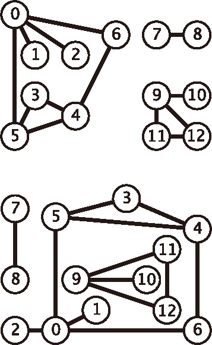

- 图 4.1.1　同一幅图的两种表示

特殊的图。我们的定义允许出现两种简单而特殊的情况，参见图 4.1.2：

- 自环，即一条连接一个顶点和其自身的边；

- 连接同一对顶点的两条边称为平行边。

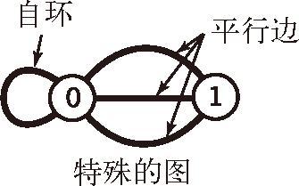

- 图 4.1.2　特殊的图

数学家常常将含有平行边的图称为多重图，而将没有平行边或自环的图称为简单图。一般来说，实现允许出现自环和平行边（因为它们会在实际应用中出现），但我们不会将它们作为示例。因此，我们用两个顶点就可以指代一条边了。

### 4.1.1　术语表

和图有关的术语非常多，其中大多数定义都很简单，我们在这里集中介绍。

当两个顶点通过一条边相连时，我们称这两个顶点是相邻的，并称这条边依附于这两个顶点。某个顶点的度数即为依附于它的边的总数。子图是由一幅图的所有边的一个子集（以及它们所依附的所有顶点）组成的图。许多计算问题都需要识别各种类型的子图，特别是由能够顺序连接一系列顶点的边所组成的子图。

- 定义。在图中，路径是由边顺序连接的一系列顶点。简单路径是一条没有重复顶点的路径。环是一条至少含有一条边且起点和终点相同的路径。简单环是一条（除了起点和终点必须相同之外）不含有重复顶点和边的环。路径或者环的长度为其中所包含的边数。

大多数情况下，我们研究的都是简单环和简单路径并会省略掉简单二字。当允许重复的顶点时，我们指的都是一般的路径和环。当两个顶点之间存在一条连接双方的路径时，我们称一个

```
顶点和另一个顶点是连通的。我们用类似 u-v-w-x 的记法来表示 u 到 x 的一条路径，用 u-
v-w-x-u 表示从 u 到 v 到 w 到 x 再回到 u 的一条环。我们会学习几种查找路径和环的算
```

法。另外，路径和环也会帮我们从整体上考虑一幅图的性质，参见图 4.1.3。

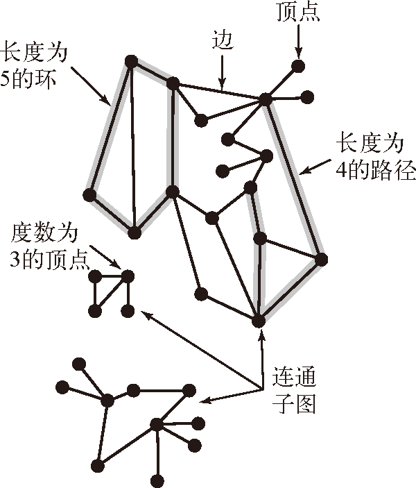

- 图 4.1.3　图的详解

- 定义。如果从任意一个顶点都存在一条路径到达另一个任意顶点，我们称这幅图是连通图。一幅非连通的图由若干连通的部分组成，它们都是其极大连通子图。

直观上来说，如果顶点是物理存在的对象，例如绳节或是念珠，而边也是物理存在的对象，例如绳子或是电线，那么将任意顶点提起，连通图都将是一个整体，而非连通图则会变成两个或多个部分。一般来说，要处理一张图就需要一个个地处理它的连通分量（子图）。

无环图是一种不包含环的图。我们将要学习的几个算法就是要找出一幅图中满足一定条件的无环子图。我们还需要一些术语来表示这些结构。

- 定义。树是一幅无环连通图。互不相连的树组成的集合称为森林。连通图的生成树是它的一幅子图，它含有图中的所有顶点且是一棵树。图的生成树森林是它的所有连通子图的生成树的集合，参见图 4.1.4 和图 4.1.5。

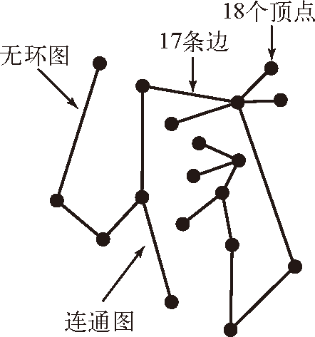

- 图 4.1.4　一棵树

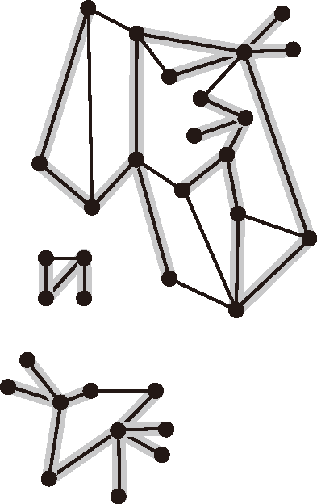

- 图 4.1.5　生成树森林

树的定义非常通用，稍做改动就可以变成用来描述程序行为的（函数调用层次）模型和数据结构（二叉查找树、2-3 树等）。树的数学性质很直观并且已被系统地研究过，因此我们就不给

- 个结点的图满足下列 5 个条件之一时，它就

出它们的证明了。例如，当且仅当一幅含有


是一棵树：

- 有 条边且不含有环；

- 有 条边且是连通的；

- 是连通的，但删除任意一条边都会使它不再连通；

- 是无环图，但添加任意一条边都会产生一条环；

- 中的任意一对顶点之间仅存在一条简单路径。

我们会学习几种寻找生成树和森林的算法，以上这些性质在分析和实现这些算法的过程中扮演着重要的角色。

图的密度是指已经连接的顶点对占所有可能被连接的顶点对的比例。在稀疏图中，被连接的顶点对很少；而在稠密图中，只有少部分顶点对之间没有边连接。一般来说，如果一幅图中不同

- 的一个小的常数倍以内，那么我们就认为这幅图是稀疏的，否则则

的边的数量在顶点总数

是稠密的，参见图 4.1.6。这条经验规律虽然会留下一片灰色地带（比如当边的数量为


- 时），但实际应用中稀疏图和稠密图之间的区别是十分明显的。我们将会遇到的应用

使用的几乎都是稀疏图。

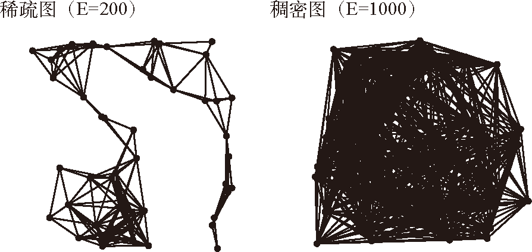

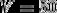

- 图 4.1.6　两幅图 ()

二分图是一种能够将所有结点分为两部分的图，其中图的每条边所连接的两个顶点都分别属于不同的部分。图 4.1.7 即为一幅二分图的示例，其中红色的结点是一个集合，黑色的结点是另一个集合。二分图会出现在许多场景中，我们会在本节的最后详细研究其中的一个场景。

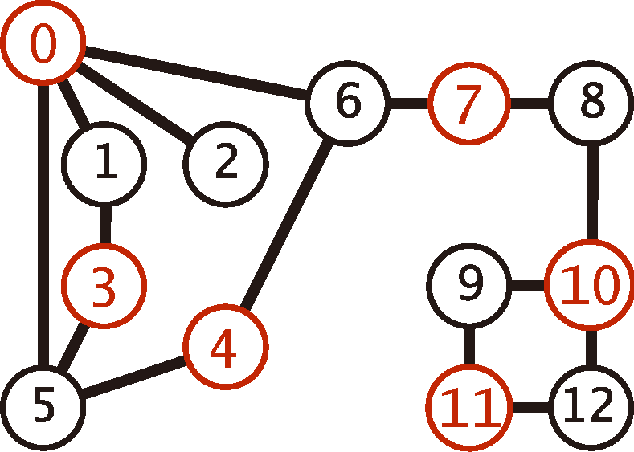

- 图 4.1.7　二分图

现在，我们已经做好了学习图处理算法的准备。我们首先会研究一种表示图的数据类型的 API及其实现，然后会学习一些查找图和鉴别连通分量的经典算法。最后，我们会考虑真实世界中的一些图的应用，它们的顶点的名字可能不是整数并且会含有数目庞大的顶点和边。

### 4.1.2　表示无向图的数据类型

要开发处理图问题的各种算法，我们首先来看一份定义了图的基本操作的 API，参见表4.1.1。有了它我们才能完成从简单的基本操作到解决复杂问题的各种任务。

表 4.1.1　无向图的 API

```java
     public class  <b>Graph</b>
                   Graph(int V)
```

- 个顶点但不含有边的创建一个含有

```
                   Graph(In in)
从标准输入流 in 读入一幅图
              int  V()
```

- 顶点数

```
              int  E()
```

- 边数

```
             void  addEdge(int v, int
向图中添加一条边 v-w
w)
```

这份 API 含有两个构造函数，有两个方法用来分别返回图中的顶点数和边数，有一个方法用来

```
添加一条边，toString() 方法和 adj() 方法用来允许用例遍历给定顶点的所有相邻顶点
（遍历顺序不确定）。值得注意的是，本节将学习的所有算法都基于 adj() 方法所抽象的基本
```

操作。

- 个整数组成：首先是对 0

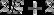

第二个构造函数接受的输入由

- ，然后是，再然后是


- 之间的整数，每个整数对都表示一条边。例如，我们使用了由图 4.1.8 中的 tinyG.txt

到

和 mediumG.txt 所描述的两个示例。

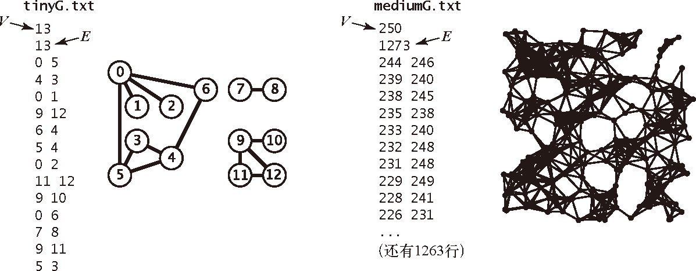

```
图 4.1.8　Graph 的构造函数的输入格式（两个示例）
调用 Graph 的几段用例代码请见表 4.1.2。
```

表 4.1.2　最常用的图处理代码

任务

- 实现

- 复制

```java
public static int degree(Graph G, i
{
  int degree = 0;
计算 v 的度数
  for (int w : G.adj(v)) degree++
  return degree;
}
```

### 4.1.2.1　图的几种表示方法

我们要面对的下一个图处理问题就是用哪种方式（数据结构）来表示图并实现这份 API，这包含以下两个要求：

- 它必须为可能在应用中碰到的各种类型的图预留出足够的空间；

```
Graph 的实例方法的实现一定要快——它们是开发处理图的各种用例的基础。
```

这些要求比较模糊，但它们仍然能够帮助我们在三种图的表示方法中进行选择。


```
邻接矩阵。我们可以使用一个 乘 的布尔矩阵。当顶点 v 和顶点 w 之间有相连接的边时，
定义 v 行 w 列的元素值为 true，否则为 false。这种表示方法不符合第一个条件——含
```

- 有上百万个顶点的图是很常见的， 个布尔值所需的空间是不能满足的。

```
边的数组。我们可以使用一个 Edge 类，它含有两个 int 实例变量。这种表示方法很简洁
但不满足第二个条件——要实现 adj() 需要检查图中的所有边。
```

- 邻接表数组。我们可以使用一个以顶点为索引的列表数组，其中的每个元素都是和该顶点相邻的顶点列表，参见图 4.1.9。这种数据结构能够同时满足典型应用所需的以上两个条件，我们会在本章中一直使用它。

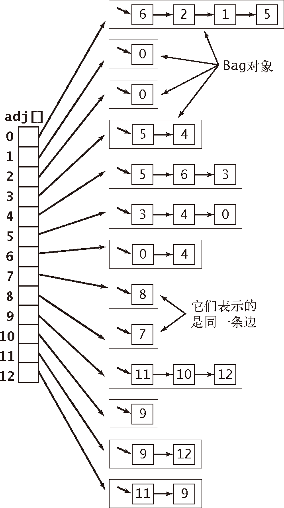

- 图 4.1.9　邻接表数组示意（无向图）

除了这些性能目标之外，经过缜密的检查，我们还发现了另一些在某些应用中可能会很重要的东西。例如，允许存在平行边相当于排除了邻接矩阵，因为邻接矩阵无法表示它们。

### 4.1.2.2　邻接表的数据结构

非稠密图的标准表示称为邻接表的数据结构，它将每个顶点的所有相邻顶点都保存在该顶点对应的元素所指向的一张链表中。我们使用这个数组就是为了快速访问给定顶点的邻接顶点列

```
表。这里使用 1.3 节中的 Bag 抽象数据类型来实现这个链表，这样我们就可以在常数时间内
添加新的边或遍历任意顶点的所有相邻顶点。后面框注“Graph 数据类型”中的 Graph 类的实
```

现就是基于这种方法，而图 4.1.9 中所示的正是用这种方法处理 tinyG.txt 所得到的数据结构。

```
要添加一条连接 v 与 w 的边，我们将 w 添加到 v 的邻接表中并把 v 添加到 w 的邻接表中。
因此，在这个数据结构中每条边都会出现两次。这种 Graph 的实现的性能有如下特点：
```

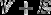

- 使用的空间和 成正比；

- 添加一条边所需的时间为常数；

```
遍历顶点 v 的所有相邻顶点所需的时间和 v 的度数成正比（处理每个相邻顶点所需的时间
```

- 为常数）。

对于这些操作，这样的特性已经是最优的了，这已经可以满足图处理应用的需要，而且支持平

```
行边和自环（我们不会检测它们）。注意，边的插入顺序决定了 Graph 的邻接表中顶点的出现
```

顺序，参见图 4.1.10。多个不同的邻接表可能表示着同一幅图。当使用构造函数从标准输入中

```
读入一幅图时，这就意味着输入的格式和边的顺序决定了 Graph 的邻接表数组中顶点的出现
顺序。因为算法在使用 adj() 来处理所有相邻的顶点时不会考虑它们在邻接表中的出现顺
```

序，这种差异不会影响算法的正确性，但在调试或是跟踪邻接表的轨迹时我们还是需要注意这

```
一点。为了简化操作，假设 Graph 有一个测试用例来从命令行参数指定的文件中读取一幅图
并将它打印出来（参见表 4.1.2 中的 toString() 方法的实现），以显示邻接表中的各个顶点
```

的出现顺序，这也是算法处理它们的顺序（请见练习 4.1.7）。

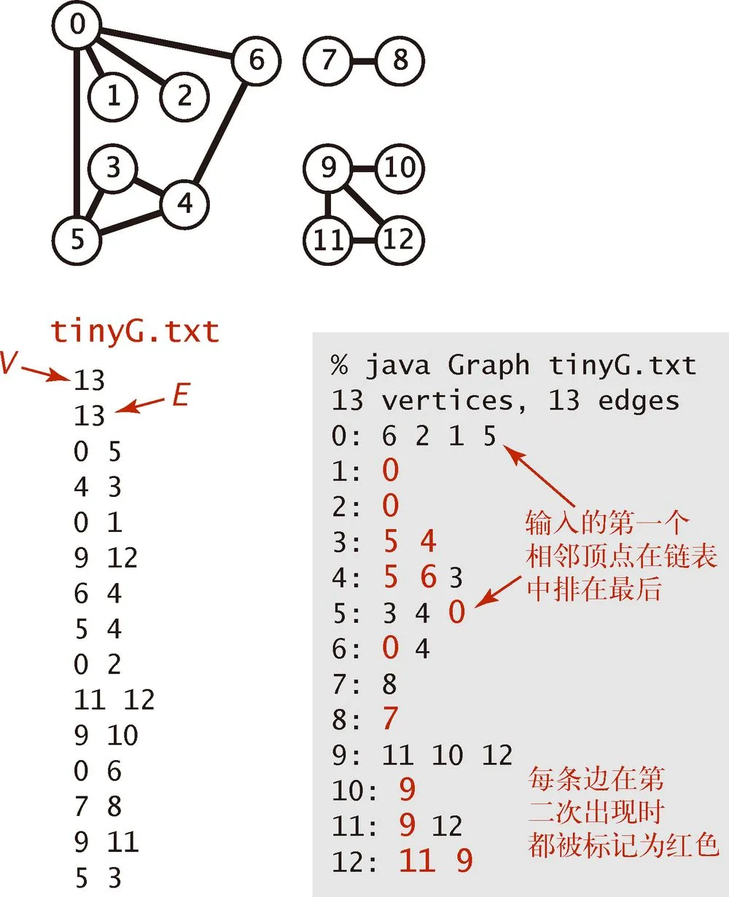

- 图 4.1.10　由边得到的邻接表

- Graph 数据类型

```java
public class Graph
1
{
2
  private final int V;          // 顶点数目
3
  private int E;                // 边的数目
4
  private Bag<Integer>[] adj;   // 邻接表
5
  public Graph(int V)
6
  {
7
     this.V = V; this.E = 0;
8
     adj = (Bag<Integer>[]) new Bag[V];      // 创建邻接表
9
     for (int v = 0; v < V; v++)             // 将所有链表初始化为空
10
        adj[v] = new Bag<Integer>();
11
  }
12
  public Graph(In in)
13
  {
14
     this(in.readInt());          // 读取V并将图初始化
15
     int E = in.readInt();        // 读取E
16
     for (int i = 0; i < E; i++)
17
     {  // 添加一条边
18
        int v = in.readInt();        // 读取一个顶点
19
        int w = in.readInt();        // 读取另一个顶点
20
        addEdge(v, w);               // 添加一条连接它们的边
21
     }
22
  }
23
  public int V()  {  return V;  }
24
  public int E()  {  return E;  }
25
  public void addEdge(int v, int w)
26
  {
27
     adj[v].add(w);                            // 将w添加到v的链表中
28
     adj[w].add(v);                            // 将v添加到w的链表中
29
     E++;
30
   }
31
  public Iterable<Integer> adj(int v)
32
  {  return adj[v];  }
33
}
34
这份 Graph 的实现使用了一个由顶点索引的整型链表数组。每条边都会出现两次，即当存
在一条连接 v 与 w 的边时，w 会出现在 v 的链表中，v 也会出现在 w 的链表中。第二个
```

- ，再然后是一列整数对，大小在 0构造函数从输入流中读取一幅图，开头是，然后是

```
 之间。toString() 方法请见表 4.1.2。
```

- 到

在实际应用中还有一些操作可能是很有用的，例如：

- 添加一个顶点；

- 删除一个顶点。

```
实现这些操作的一种方法是扩展之前的 API，使用符号表（ST）来代替由顶点索引构成的数
```

组（这样修改之后就不需要约定顶点名必须是整数了）。我们可能还需要：

- 删除一条边；

```
检查图是否含有边 v-w。
要实现这些方法（不允许存在平行边），我们可能需要使用 SET 代替 Bag 来实现邻接表。我
```

们称这种方法为邻接集。本书中不会使用这些数据结构，因为：

- 用例代码不需要添加顶点、删除顶点和边或是检查一条边是否存在；

- 当用例代码需要进行上述操作时，由于频率很低或者相关的邻接链表很短，因此可以直接使用穷举法遍历链表来实现；

```
使用 SET 和 ST 会令算法的实现变得更加复杂，分散了读者对算法本身的注意力；
```

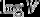

- 在某些情况下，它们会使性能损失。

使我们的算法适应其他设计（例如，不允许出现平行边或是自环）并避免不必要的性能损失并不困难。表 4.1.3 总结了之前提到过的所有其他实现方法的性能特点。常见的应用场景都需要处理庞大的稀疏图，因此我们会一直使用邻接表。

表 4.1.3　典型 Graph 实现的性能复杂度

```
添加一条边 v-w
检查 w 和 v 是否相邻
遍历 v 的所有相邻顶点
```

数据结构

- 所需空间

- 1

边的列表

### 4.1.2.3　图的处理算法的设计模式

因为我们会讨论大量关于图处理的算法，所以设计的首要目标是将图的表示和实现分离开来。为此，我们会为每个任务创建一个相应的类，用例可以创建相应的对象来完成任务。类的构造函数一般会在预处理中构造各种数据结构，以有效地响应用例的请求。典型的用例程序会构造一幅图，将图传递给实现了某个算法的类（作为构造函数的参数），然后调用用例的方法来获取图的各种性质。作为热身，我们先来看看这份 API，参见表 4.1.4。

表 4.1.4　图处理算法的 API（热身）

```java
public class  <b>Search</b>
              Search(Graph G, int s)
找到和起点 s 连通的所有顶点
     boolean  marked(int v)
v 和 s 是连通的吗
         int  count()
与 s 连通的顶点总数
```

我们用起点（source）区分作为参数传递给构造函数的顶点与图中的其他顶点。在这份 API

```
中，构造函数的任务是找到图中与起点连通的其他顶点。用例可以调用 marked() 方法和
count() 方法来了解图的性质。方法名 marked() 指的是这种基本算法使用的一种实现方
```

式，本章中会一直使用到这种算法：在图中从起点开始沿着路径到达其他顶点并标记每个路过

```
的顶点。后面框注中的图处理用例 TestSearch 接受由命令行得到的一个输入流的名称和起
始结点的编号，从输入流中读取一幅图（使用 Graph 的第二个构造函数），用这幅图和给定的
起始结点创建一个 Search 对象，然后用 marked() 打印出图中和起点连通的所有顶点。它
也调用了 count() 并打印了图是否是连通的（当且仅当搜索能够标记图中的所有顶点时图才
```

是连通的）。

```java
public class TestSearch
{
  public static void main(String[] args)
  {
     Graph G = new Graph(new In(args[0]));
     int s = Integer.parseInt(args[1]);
     Search search = new Search(G, s);
     for (int v = 0; v < G.V(); v++)
        if (search.marked(v))
           StdOut.print(v + " ");
     StdOut.println();
     if (search.count() != G.V())
        StdOut.print("NOT ");
     StdOut.println("connected");
  }
}
```

图处理的用例（热身）

```
% java TestSearch tinyG.txt 0
0 1 2 3 4 5 6
NOT connected
% java TestSearch tinyG.txt 9
9 10 11 12
NOT connected
```

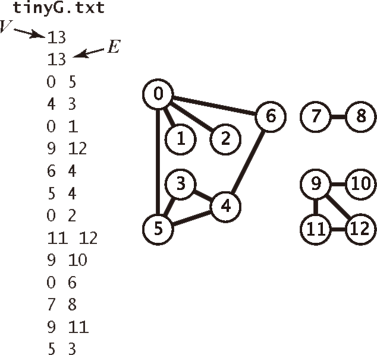

```
我们已经见过 Search API 的一种实现：第 1 章中的 union-find 算法。它的构造函数会创建一
个 UF 对象，对图中的每一条边进行一次 union() 操作并调用 connected(s,v) 来实现
marked(v) 方法。实现 count() 方法需要一个加权的 UF 实现并扩展它的 API，以便使用
count() 方法返回 wt[find(v)]（请见练习 4.1.8）。这种实现简单而高效，但下面我们要
```

学习的实现还可以更进一步。它基于的是深度优先搜索（DFS）的。这是一种重要的递归方法，它会沿着图的边寻找和起点连通的所有顶点。深度优先搜索是本章中将学习的好几种关于图的算法的基础。

### 4.1.3　深度优先搜索　通道

我们常常通过系统地检查每一个顶点和每一条边来获取图的各种性质。要得到图的一些简单性质（比如，计算所有顶点的度数）很容易，只要检查每一条边即可（任意顺序）。但图的许多其他性质和路径有关，因此一种很自然的想法是沿着图的边从一个顶点移动到另一个顶点。尽管存在各种各样的处理策略，但后面将要学习的几乎所有与图有关的算法都使用了这个简单的抽象模型，其中最简单的就是下面介绍的这种经典的方法。

### 4.1.3.1　走迷宫

思考图的搜索过程的一种有益的方法是，考虑另一个和它等价但历史悠久而又特别的问题——在一个由各种通道和路口组成的迷宫中找到出路。有些迷宫的规则很简单，但大多数迷宫则需要很复杂的策略才行。用迷宫代替图、通道代替边、路口代替顶点仅仅只是一些文字游戏，但就目前来说，这么做可以帮助我们直观地认识问题，参见图 4.1.11。探索迷宫而不迷路的一种古老办法（至少可以追溯到忒修斯和米诺陶的传说）叫做 Tremaux 搜索，参见图 4.1.12。要探索迷宫中的所有通道，我们需要：

- 选择一条没有标记过的通道，在你走过的路上铺一条绳子；

- 标记所有你第一次路过的路口和通道；

- 当来到一个标记过的路口时（用绳子）回退到上个路口；

- 当回退到的路口已没有可走的通道时继续回退。

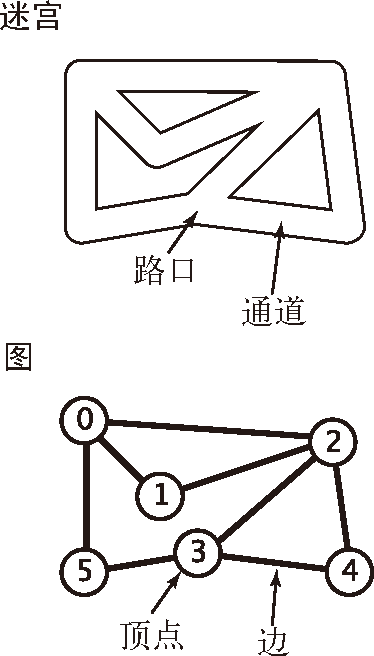

- 图 4.1.11　等价的迷宫模型

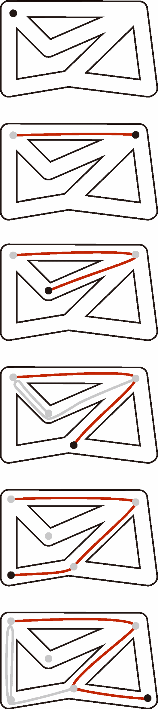

- 图 4.1.12　Tremaux 搜索

绳子可以保证你总能找到一条出路，标记则能保证你不会两次经过同一条通道或者同一个路口。要知道是否完全探索了整个迷宫需要的证明更复杂，只有用图搜索才能够更好地处理问题。Tremaux 搜索很直接，但它与完全搜索一张图仍然稍有不同，因此我们接下来看看图的搜索方法。

```java
public class DepthFirstSearch
{
  private boolean[] marked;
  private int count;
  public DepthFirstSearch(Graph G, int s)
  {
     marked = new boolean[G.V()];
     dfs(G, s);
  }
  private void dfs(Graph G, int v)
  {
     marked[v] = true;
     count++;
     for (int w : G.adj(v))
        if (!marked[w]) dfs(G, w);
  }
  public boolean marked(int w)
  {  return marked[w];  }
  public int count()
  {  return count;  }
}
```

深度优先搜索

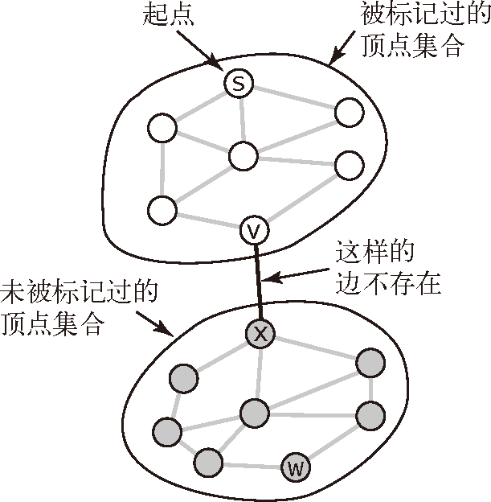

### 4.1.3.2　热身

搜索连通图的经典递归算法（遍历所有的顶点和边）和 Tremaux 搜索类似，但描述起来更简单。要搜索一幅图，只需用一个递归方法来遍历所有顶点。在访问其中一个顶点时：

- 将它标记为已访问；

- 递归地访问它的所有没有被标记过的邻居顶点。

```
这种方法称为深度优先搜索（DFS）。Search API 的一种实现使用了这种方法，如深度优先
搜索框注所示。它使用一个 boolean 数组来记录和起点连通的所有顶点。递归方法会标记给
```

定的顶点并调用自己来访问该顶点的相邻顶点列表中所有没有被标记过的顶点。如果图是连通的，每个邻接链表中的元素都会被检查到。

- 命题 A。深度优先搜索标记与起点连通的所有顶点所需的时间和顶点的度数之和成正比。

```
证明。首先，我们要证明这个算法能够标记与起点 s 连通的所有顶点（且不会标记其他顶
点）。因为算法仅通过边来寻找顶点，所以每个被标记过的顶点都与 s 连通。现在，假设某
个没有被标记过的顶点 w 与 s 连通。因为 s 本身是被标记过的，由 s 到 w 的任意一条路
径中至少有一条边连接的两个顶点分别是被标记过的和没有被标记过的，例如 v-x。根据
算法，在标记了 v 之后必然会发现 x，因此这样的边是不存在的。前后矛盾。每个顶点都
```

- 只会被访问一次保证了时间上限（检查标记的耗时和度数成正比）。

### 4.1.3.3　单向通道

代码中方法的调用和返回机制对应迷宫中绳子的作用：当已经处理过依附于一个顶点的所有边时（搜索了路口连接的所有通道），我们就只能“返回”（return，两者的意义相同）。为了更好地与迷宫的 Tremaux 搜索对应起来，我们可以想象一座完全由单向通道构造的迷宫（每个方向都有一个通道）。和在迷宫中会经过一条通道两次（方向不同）一样，在图中我们也会路过每条边两次（在它的两个端点各一次）。在 Tremaux 搜索中，要么是第一次访问区别了边的遍历方向的画法一条边，要么是沿着它从一个被标记过的顶点退回。在无向图的深度优先搜索

```
中，在碰到边 v-w 时，要么进行递归调用（w 没有被标记过），要么跳过这条边（w 已经被标
记过）。第二次从另一个方向 w-v 遇到这条边时，总是会忽略它，因为它的另一端 v 肯定已
```

经被访问过了（在第一次遇到这条边的时候）。

### 4.1.3.4　跟踪深度优先搜索

通常，理解算法的最好方法是在一个简单的例子中跟踪它的行为。深度优先算法尤其是这样。在跟踪它的轨迹时，首先要注意的是，算法遍历边和访问顶点的顺序与图的表示是有关的，而不只是与图的结构或是算法有关。因为深度优先搜索只会访问和起点连通的顶点，所以使用图

```
4.1.13 所示的一幅小型连通图为例。在示例中，顶点 2 是顶点 0 之后第一个被访问的顶点，
因为它正好是 0 的邻接表的第一个元素。要注意的第二点是，如前文所述，深度优先搜索中
```

每条边都会被访问两次，且在第二次时总会发现这个顶点已经被标记过。这意味着深度优先搜索的轨迹可能会比你想象的长一倍！示例图仅含有 8 条边，但需要追踪算法在邻接表的 16 个元素上的操作。

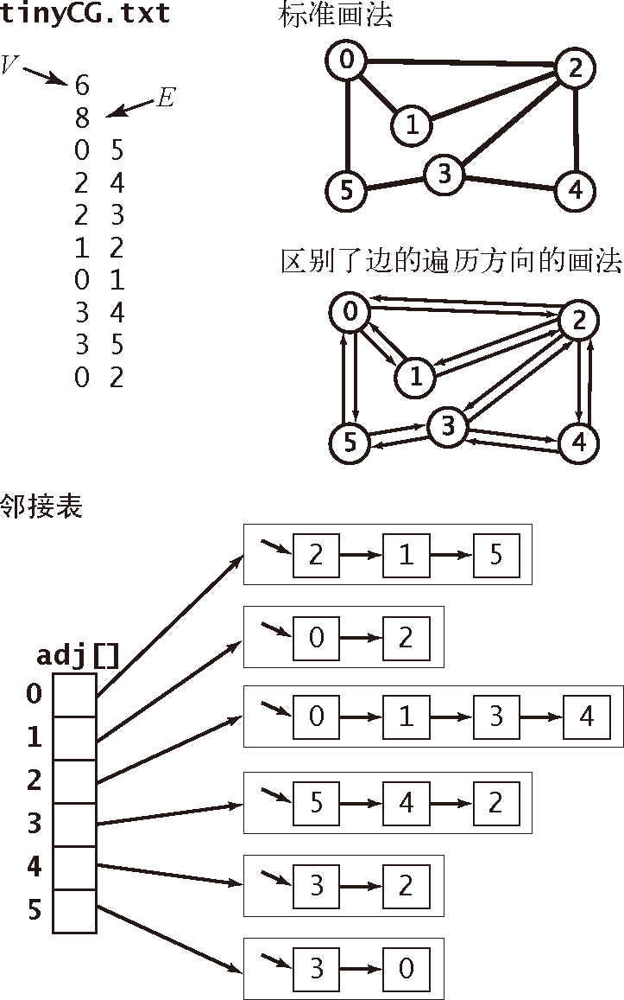

- 图 4.1.13　一幅连通的无向图

### 4.1.3.5　深度优先搜索的详细轨迹

```
图 4.1.14 显示的是示例中每个顶点被标记后算法使用的数据结构，起点为顶点 0。查找开始
于构造函数调用递归的 dfs() 来标记和访问顶点 0，后续处理如下所述。
```

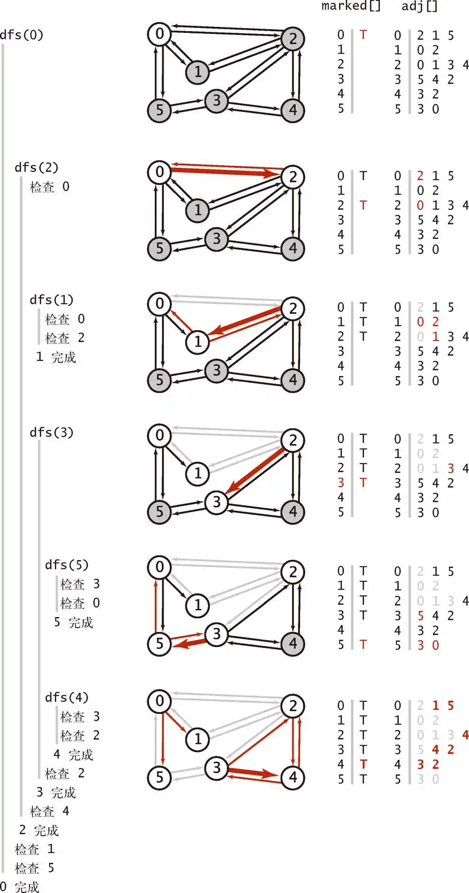

- 图 4.1.14　使用深度优先搜索的轨迹，寻找所有和顶点 0 连通的顶点

```
因为顶点 2 是 0 的邻接表的第一个元素且没有被标记过，dfs() 递归调用自己来标记并访
问顶点 2（效果是系统会将顶点 0 和 0 的邻接表的当前位置压入栈中）。
现在，顶点 0 是 2 的邻接表的第一个元素且已经被标记过了，因此 dfs() 跳过了它。接
下来，顶点 1 是 2 的邻接表的第二个元素且没有被标记，dfs() 递归调用自己来标记并访
问顶点 1。
对顶点 1 的访问和前面有所不同：因为它的邻接表中的所有顶点（0 和 2）都已经被标记
过了，因此不需要再进行递归，方法从 dfs(1) 中返回。下一条被检查的边是 2-3（在 2
的邻接表中顶点 1 之后的顶点是 3），因此 dfs() 递归调用自己来标记并访问顶点 3。
顶点 5 是 3 的邻接表的第一个元素且没有被标记，因此 dfs() 递归调用自己来标记并访
问顶点 5。
顶点 5 的邻接表中的所有顶点（3 和 0）都已经被标记过了，因此不需要再进行递归。
顶点 4 是 3 的邻接表的下一个元素且没有被标记过，因此 dfs() 递归调用自己来标记并
访问顶点 4。这是最后一个需要被标记的顶点。
在顶点 4 被标记了之后，dfs() 会检查它的邻接表，然后再检查 3 的邻接表，然后是 2
的邻接表，然后是 0 的，最后发现不需要再进行任何递归调用，因为所有的顶点都已经被
```

- 标记过了。

这种简单的递归模式只是一个开始——深度优先搜索能够有效处理许多和图有关的任务。例如，本节中，我们已经可以用深度优先搜索来解决在第 1 章首次提到的一个问题。

连通性。给定一幅图，回答“两个给定的顶点是否连通？”或者“图中有多少个连通子图？”等类似问题。

我们可以轻易地用处理图问题的标准设计模式给出这些问题的答案，还要将这些解答与在 1.5节中学习的 union-find 算法进行比较。

问题“两个给定的顶点是否连通？”等价于“两个给定的顶点之间是否存在一条路径？”，也许也可以叫做路径检测问题。但是，在 1.5 节学习的 union-find 算法的数据结构并不能解决找出这样一条路径的问题。深度优先搜索是我们已经学习过的几种方法中第一个能够解决这个问题的算法。它能够解决的另一个问题如下所述。

单点路径。给定一幅图和一个起点 s，回答“从 s 到给定目的顶点 v 是否存在一条路径？如果有，找出这条路径。”等类似问题。

深度优先搜索算法之所以极为简单，是因为它所基于的概念为人所熟知并且非常容易实现。事实上，它是一个既小巧而又强大的算法，研究人员用它解决了无数困难的问题。上述两个问题只是我们将要研究的许多问题的开始。

### 4.1.4　寻找路径

单点路径问题在图的处理领域中十分重要。根据标准设计模式，我们将使用如下 API（请见表4.1.5）。

表 4.1.5　路径的 API

```java
     public class  <b>Paths</b>
P th (G
h G
i t
构造函数接受一个起点 s 作为参数，计算 s 到与 s 连通的每个顶点之间的路径。在为起点 s
创建了 Paths 对象后，用例可以调用 pathTo() 实例方法来遍历从 s 到任意和 s 连通的顶
```

点的路径上的所有顶点。现在暂时查找所有路径，以后会实现只查找具有某些属性的路径。

```java
% java Paths tinyCG.txt 0
0 to 0: 0
0 to 1: 0-2-1
0 to 2: 0-2
0 to 3: 0-2-3
0 to 4: 0-2-3-4
0 to 5: 0-2-3-5
public static void main(String[] args)
{
  Graph G = new Graph(new In(args[0]));
  int s = Integer.parseInt(args[1]);
  Paths search = new Paths(G, s);
  for (int v = 0; v < G.V(); v++)
  {
     StdOut.print(s + " to " + v + ": ");
     if (search.hasPathTo(v))
        for (int x : search.pathTo(v))
           if (x == s) StdOut.print(x);
           else StdOut.print("-" + x);
     StdOut.println();
  }
}
Paths 实现的测试用例
```

上一页右下角框注中的用例从输入流中读取了一个图并从命令行得到一个起点，然后打印出从起点到与它连通的每个顶点之间的一条路径。

### 4.1.4.1　实现

```
算法 4.1 基于深度优先搜索实现了 Paths。它扩展了 4.1.3.2 节中的热身代码
DepthFirstSearch，添加了一个实例变量 edgeTo[] 整型数组来起到 Tremaux 搜索中绳
子的作用。这个数组可以找到从每个与 s 连通的顶点回到 s 的路径。它会记住每个顶点到起
点的路径，而不是记录当前顶点到起点的路径。为了做到这一点，在由边 v-w 第一次访问任
意 w 时，将 edgeTo[w] 设为 v 来记住这条路径。换句话说，v-w 是从 s 到 w 的路径上的
最后一条已知的边。这样，搜索的结果是一棵以起点为根结点的树，edgeTo[] 是一棵由父
链接表示的树。算法 4.1 的代码的右侧是一个小示例。要找出 s 到任意顶点 v 的路径，算法
4.1 实现的 pathTo() 方法用变量 x 遍历整棵树，将 x 设为 edgeTo[x]，就像 1.5 节中的
```

union-find 算法一样，然后在到达 s 之前，将遇到的所有顶点都压入栈中。将这个栈返回为一

```
个 Iterable 对象帮助用例遍历 s 到 v 的路径。
```

- 算法 4.1　使用深度优先搜索查找图中的路径

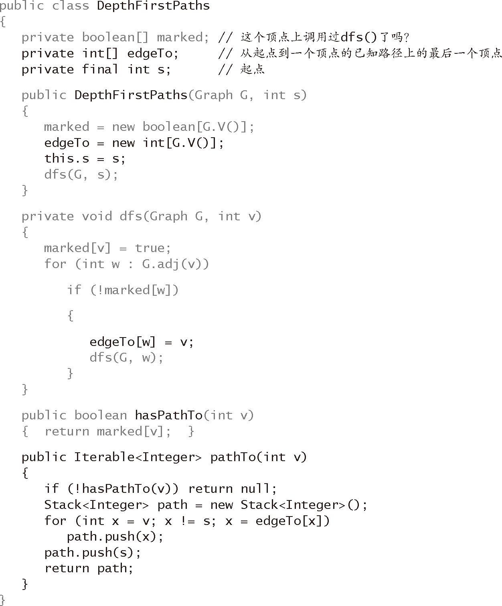

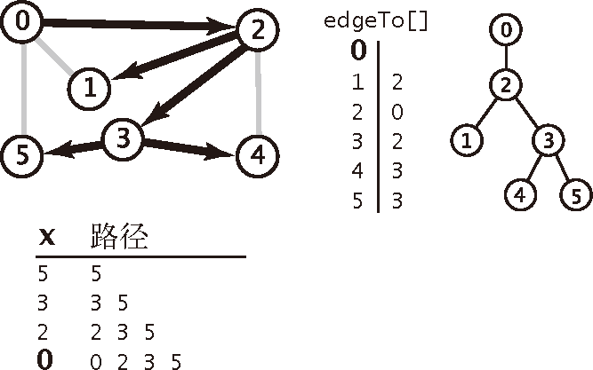

```
pathTo(5) 的计算轨迹
这段 Graph 的用例使用了深度优先搜索，以找出图中从给定的起点 s 到它连通的所有顶点
的路径。来自 DepthFirstSearch（4.1.3.2 节）的代码均为灰色。为了保存到达每个顶
点的已知路径，这段代码使用了一个以顶点编号为索引的数组 edgeTo[]，edgeTo[w]=v
表示 v-w 是第一次访问 w 时经过的边。edgeTo[] 数组是一棵用父链接表示的以 s 为根
且含有所有与 s 连通的顶点的树。
```

### 4.1.4.2　详细轨迹

```
图 4.1.15 显示的是示例中每个顶点被标记后 edgeTo[] 的内容，起点为顶点 0。marked[]
和 adj[] 的内容与 4.1.3.5 节中的 DepthFirstSearch 的轨迹相同，递归调用和边检查的
详细描述也完全一样，这里不再赘述。深度优先搜索向 edgeTo[] 数组中顺序添加了 0-2、
2-1、2-3、3-5 和 3-4。这些边构成了一棵以起点为根结点的树并提供了 pathTo() 方法
所需的信息，使得调用者可以按照前文所述的方法找到从 0 到顶点 1、2、3、4、5 的路
```

径。

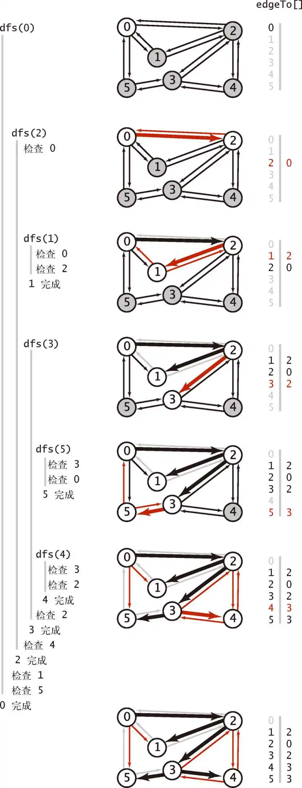

- 图 4.1.15　使用深度优先搜索的轨迹，寻找所有起点为 0 的路径

```
DepthFirstPaths 与 DepthFirstSearch 的构造函数仅有几条赋值语句不同，因此
```

4.1.3.2 节中的命题 A 仍然适用。另外，我们还有以下命题。

- 命题 A（续）。使用深度优先搜索得到从给定起点到任意标记顶点的路径所需的时间与路径的长度成正比。

```
证明。根据对已经访问过的顶点数量的归纳可得，DepthFirstPaths 中的 edgeTo[] 数
组表示了一棵以起点为根结点的树。pathTo() 方法构造路径所需的时间和路径的长度成
```

- 正比。

### 4.1.5　广度优先搜索

深度优先搜索得到的路径不仅取决于图的结构，还取决于图的表示和递归调用的性质。我们很自然地还经常对下面这些问题感兴趣。

```
单点最短路径。给定一幅图和一个起点 s，回答“从 s 到给定目的顶点 v 是否存在一条路
```

- 径？如果有，找出其中最短的那条（所含边数最少）。”等类似问题。

解决这个问题的经典方法叫做广度优先搜索（BFS)。它也是许多图算法的基石，因此我们会在本节中详细学习。深度优先搜索在这个问题上没有什么作为，因为它遍历整个图的顺序和找出最短路径的目标没有任何关系。相比之下，广度优先搜索正是为了这个目标才出现的。要找

```
到从 s 到 v 的最短路径，从 s 开始，在所有由一条边就可以到达的顶点中寻找 v，如果找不
到我们就继续在与 s 距离两条边的所有顶点中查找 v，如此一直进行。深度优先搜索就好像
```

是一个人在走迷宫，广度优先搜索则好像是一组人在一起朝各个方向走这座迷宫，每个人都有自己的绳子。当出现新的叉路时，可以假设一个探索者可以分裂为更多的人来搜索它们，当两个探索者相遇时，会合二为一（并继续使用先到达者的绳子），参见图 4.1.16。


- 图 4.1.16　广度优先的迷宫搜索

在程序中，在搜索一幅图时遇到有多条边需要遍历的情况时，我们会选择其中一条并将其他通道留到以后再继续搜索。在深度优先搜索中，我们用了一个可以下压的栈（这是由系统管理的，以支持递归搜索方法）。使用 LIFO（后进先出）的规则来描述压栈和走迷宫时先探索相邻的通道类似。从有待搜索的通道中选择最晚遇到过的那条。在广度优先搜索中，我们希望按照与起点的距离的顺序来遍历所有顶点，看起来这种顺序很容易实现：使用（FIFO，先进先出）队列来代替栈（LIFO，后进先出）即可。我们将从有待搜索的通道中选择最早遇到的那条。

实现算法 4.2 实现了广度优先搜索算法。它使用了一个队列来保存所有已经被标记过但其邻接表还未被检查过的顶点。先将起点加入队列，然后重复以下步骤直到队列为空：

```
取队列中的下一个顶点 v 并标记它；
将与 v 相邻的所有未被标记过的顶点加入队列。
算法 4.2 中的 bfs() 方法不是递归的。不像递归中隐式使用的栈，它显式地使用了一个队
列。和深度优先搜索一样，它的结果也是一个数组 edgeTo[]，也是一棵用父链接表示的根
结点为 s 的树。它表示了 s 到每个与 s 连通的顶点的最短路径。用例也可以使用算法 4.1 中
为深度优先搜索实现的相同的 pathTo() 方法得到这些路径。
```

图 4.1.17 和图 4.1.18 显示了用广度优先搜索处理样图时，算法使用的数据结构在每次循环的

```
迭代开始时的内容。首先，顶点 0 被加入队列，然后循环开始搜索。
```

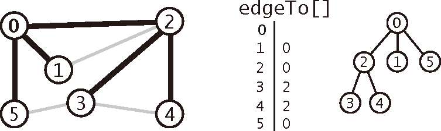

```
图 4.1.17　使用广度优先搜索寻找所有起点为 0 的路径的结果
```

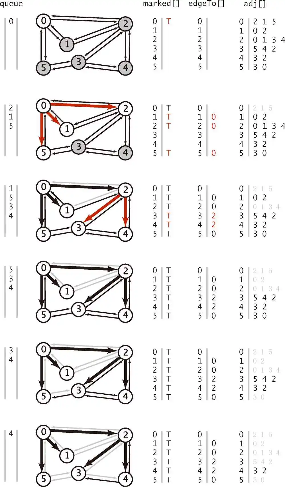

```
图 4.1.18　使用广度优先搜索的轨迹，寻找所有起点为 0 的路径
从队列中删去顶点 0 并将它的相邻顶点 2、1 和 5 加入队列中，标记它们并分别将它们在
edgeTo[] 中的值设为 0。
从队列中删去顶点 2 并检查它的相邻顶点 0 和 1，发现两者都已经被标记。将相邻的顶点
3 和 4 加入队列，标记它们并分别将它们在 edgeTo[] 中的值设为 2。
从队列中删去顶点 1 并检查它的相邻顶点 0 和 2，发现它们都已经被标记了。
从队列中删去顶点 5 并检查它的相邻顶点 3 和 0，发现它们都已经被标记了。
从队列中删去顶点 3 并检查它的相邻顶点 5、4 和 2，发现它们都已经被标记了。
从队列中删去顶点 4 并检查它的相邻顶点 3 和 2，发现它们都已经被标记了。
```

- 算法 4.2　使用广度优先搜索查找图中的路径

```java
public class BreadthFirstPaths
1
{
2
  private boolean[] marked; // 到达该顶点的最短路径已知吗？
3
  private int[] edgeTo;     // 到达该顶点的已知路径上的最后一个顶点
4
  private final int s;      // 起点
5
6
  public BreadthFirstPaths(Graph G, int s)
7
  {
8
     marked = new boolean[G.V()];
9
     edgeTo = new int[G.V()];
10
     this.s = s;
11
     bfs(G, s);
12
  }
13
14
  private void bfs(Graph G, int s)
15
  {
16
     Queue<Integer> queue = new Queue<Integer>();
17
     marked[s] = true;          // 标记起点
18
     queue.enqueue(s);          // 将它加入队列
19
     while (!queue.isEmpty())
20
     {
21
        int v = queue.dequeue(); // 从队列中删去下一顶点
22
        for (int w : G.adj(v))
23
           if (!marked[w])       // 对于每个未被标记的相邻顶点
24
           {
25
              edgeTo[w] = v;     // 保存最短路径的最后一条边
26
              marked[w] = true;  // 标记它，因为最短路径已知
27
              queue.enqueue(w);  // 并将它添加到队列中
28
           }
29
     }
30
  }
31
32
  public boolean hasPathTo(int v)
33
  {  return marked[v];  }
34
35
  public Iterable<Integer> pathTo(int v)
36
  // 和深度优先搜索中的实现相同（请见算法4.1）
37
38
}
39
% java BreadthFirstPaths tinyCG.txt 0
1
0 to 0: 0
2
0 to 1: 0-1
3
0 to 2: 0-2
4
0 to 3: 0-2-3
5
0 to 4: 0-2-4
6
0 to 5: 0-5
7
这段 Graph 的用例使用了广度优先搜索，以找出图中从构造函数得到的起点 s 到与其他所
有顶点的最短路径。bfs() 方法会标记所有与 s 连通的顶点，因此用例可以调用
hasPathTo() 来判定一个顶点与 s 是否连通并使用 pathTo() 得到一条从 s 到 v 的路
径，确保没有其他从 s 到 v 的路径所含的边比这条路径更少。
对于这个例子来说，edgeTo[] 数组在第二步之后就已经完成了。和深度优先搜索一样，一
```

旦所有的顶点都已经被标记，余下的计算工作就只是在检查连接到各个已被标记的顶点的边而已。

```
命题 B。对于从 s 可达的任意顶点 v，广度优先搜索都能找到一条从 s 到 v 的最短路径
```

- （没有其他从 s 到 v 的路径所含的边比这条路径更少）。的顶点，之后是零个或多个证明。由归纳易得队列总是包含零个或多个到起点的距离为

```
 为整数，起始值为 0。这意味着顶点是按照它们和 s
```

- 的顶点，其中


- 到起点的距离为

```
的距离的顺序加入或者离开队列的。从顶点 v 加入队列到它离开队列之前，不可能找出到
v 的更短的路径，而在v离开队列之后发现的所有能够到达 v 的路径都不可能短于 v 在树
```

- 中的路径长度。

- 命题 B（续）。广度优先搜索所需的时间在最坏情况下和成正比。

```
证明。和命题 A 一样（请见 4.1.3.2 节），广度优先搜索标记所有与 s 连通的顶点所需的时
```

- 间也与它们的度数之和成正比。如果图是连通的，这个和就是所有顶点的度数之和，也就是。

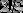

```
注意，我们也可以用广度优先搜索来实现已经用深度优先搜索实现的 Search API，因为它检
```

查所有与起点连通的顶点和边的方法只取决于查找的能力。

我们在本章开头说过，深度优先搜索和广度优先搜索是我们首先学习的几种通用的图搜索的算法之一。在搜索中我们都会先将起点存入数据结构中，然后重复以下步骤直到数据结构被清空：

- 取其中的下一个顶点并标记它；

```
将 v 的所有相邻而又未被标记的顶点加入数据结构。
```

这两个算法的不同之处仅在于从数据结构中获取下一个顶点的规则（对于广度优先搜索来说是最早加入的顶点，对于深度优先搜索来说是最晚加入的顶点）。这种差异得到了处理图的两种完全不同的视角，尽管无论使用哪种规则，所有与起点连通的顶点和边都会被检查到。

图 4.1.19 和图 4.1.20 显示了深度优先搜索和广度优先搜索处理样图 mediumG.txt 的过程，它们清晰地展示了两种方法中搜索路径的不同。深度优先搜索不断深入图中并在栈中保存了所有分叉的顶点；广度优先搜索则像扇面一般扫描图，用一个队列保存访问过的最前端的顶点。深度优先搜索探索一幅图的方式是寻找离起点更远的顶点，只在碰到死胡同时才访问近处的顶点；广度优先搜索则会首先覆盖起点附近的顶点，只在临近的所有顶点都被访问了之后才向前进。深度优先搜索的路径通常较长而且曲折，广度优先搜索的路径则短而直接。根据应用的不同，所需要的性质也会有所不同（也许路径的性质也会变得无关紧要）。在 4.4 节中，我们会

```
学习 Paths 的 API 的其他实现来寻找有特定属性的路径。
```

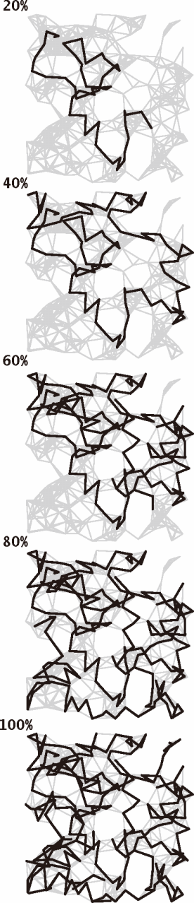

- 图 4.1.19　使用深度优先搜索查找路径（250 个顶点）

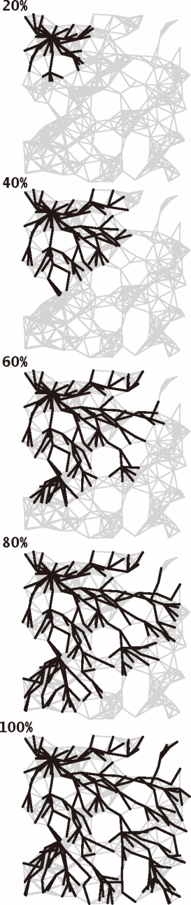

- 图 4.1.20　使用广度优先搜索查找最短路径（250 个顶点）

### 4.1.6　连通分量

深度优先搜索的下一个直接应用就是找出一幅图的所有连通分量。回忆 1.5 节中“与……连通”是一种等价关系，它能够将所有顶点切分为等价类（连通分量）。对于这个常见的任务，我们定义如下 API（请见表 4.1.6）。

表 4.1.6　连通分量的 API

```java
public class  <b>CC</b>
              CC(Graph G)
```

- 预处理构造函数

```
     boolean  connected(int v, int w)
v 和 w 连通吗
         int  count()
```

- 连通分量数

```
         int  id(int v)
v 所在的连通分量的标识符（0～count
用例可以用 id() 方法将连通分量用数组保存，如框注中的用例所示。它能够从标准输入中读
```

取一幅图并打印其中的连通分量数，其后是每个子图中的所有顶点，每行一个子图。为了实现

```
这些，它使用了一个 Bag 对象数组，然后用每个顶点所在的子图的标识符作为数组的索引，
以将所有顶点加入相应的 Bag 对象中。当我们希望独立处理每个连通分量时这个用例就是一
```

个模型。

### 4.1.6.1　实现

```
CC 的实现（请见算法 4.3）使用了 marked[] 数组来寻找一个顶点作为每个连通分量中深度
优先搜索的起点。递归的深度优先搜索第一次调用的参数是顶点 0——它会标记所有与 0 连
通的顶点。然后构造函数中的 for 循环会查找每个没有被标记的顶点并递归调用 dfs() 来标
记和它相邻的所有顶点。另外，它还使用了一个以顶点作为索引的数组 id[]，将同一个连通
分量中的顶点和连通分量的标识符关联起来（int 值）。这个数组使得 connected() 方法的
实现变得十分简单，和 1.5 节中的 connected() 方法完全相同（只需检查标识符是否相
同）。这里，标识符 0 会被赋予第一个连通分量中的所有顶点，1 会被赋予第二个连通分量中
的所有顶点，依此类推。这样所有的标识符都会如 API 中指定的那样在 0 到 count()-1 之
```

间。这个约定使得以子图作为索引的数组成为可能，如右侧框注用例所示。

```java
public static void main(String[] args)
{
  Graph G = new Graph(new In(args[0]));
  CC cc = new CC(G);
  int M = cc.count();
  StdOut.println(M + " components");
  Bag<Integer>[] components;
  components = (Bag<Integer>[]) new Bag[M];
  for (int i = 0; i < M; i++)
     components[i] = new Bag<Integer>();
  for (int v = 0; v < G.V(); v++)
     components[cc.id(v)].add(v);
  for (int i = 0; i < M; i++)
  {
     for (int v: components[i])
        StdOut.print(v + " ");
     StdOut.println();
  }
}
```

查找连通分量 API 的测试用例

- 算法 4.3　使用深度优先搜索找出图中的所有连通分量

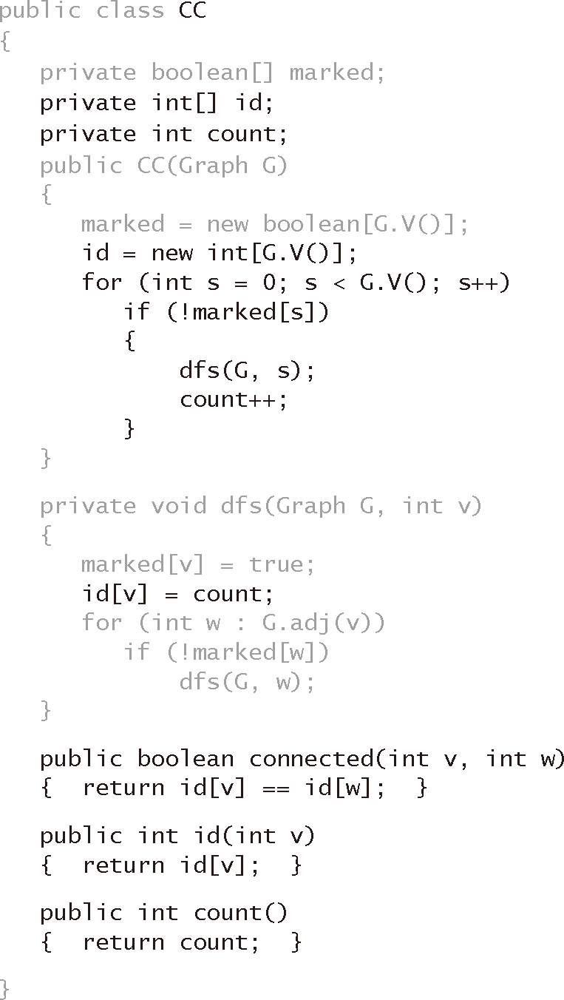

```
% java Graph tinyG.txt
1
13 vertices, 13 edges
2
0: 6 2 1 5
3
1: 0
4
2: 0
5
3: 5 4
6
4: 5 6 3
7
5: 3 4 0
8
6: 0 4
9
7: 8
10
8: 7
11
9: 11 10 12
12
10: 9
13
11: 9 12
14
12: 11 9
15
16
% java CC tinyG.txt
17
3 components
18
6 5 4 3 2 1 0
19
8 7
20
12 11 10 9
21
这段 Graph 的用例使得它的用例可以独立处理一幅图中的每个连通分量。来自
DepthfirstSearch（请见 4.1.3.2 节）的代码均为灰色。这里的实现是基于一个由顶点
索引的数组 id[]。如果 v 属于第 i 个连通分量，则 id[v] 的值为 i。构造函数会找出
```

- 一个未被标记的顶点并调用递归函数 dfs() 来标记并区分出所有和它连通的顶点，如此重复

```
直到所有的顶点都被标记并区分。connected()、count() 和 id() 方法的实现非常简
```

- 单（另见图 4.1.21）。

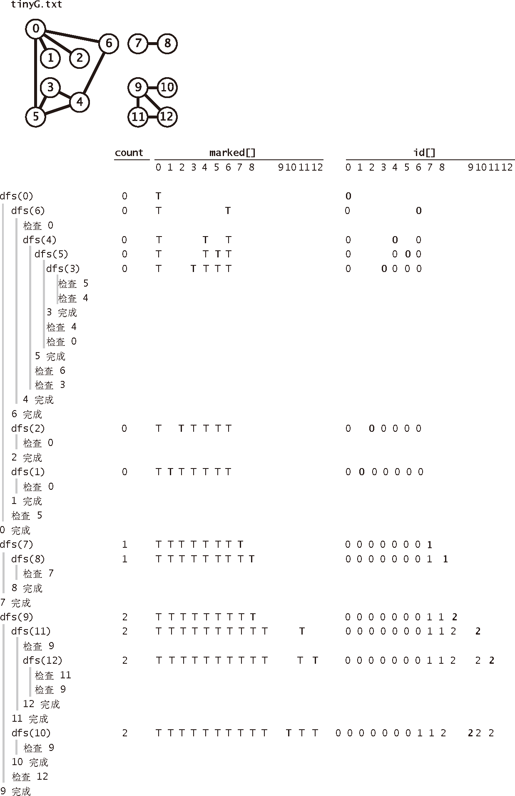

- 图 4.1.21　使用深度优先搜索寻找所有连通分量的轨迹

- 命题 C。深度优先搜索的预处理使用的时间和空间与成正比且可以在常数时间内处

- 理关于图的连通性查询。个元素（每条边两证明。由代码可以知道每个邻接表的元素都只会被检查一次，共有

- 个）。实例方法会检查或者返回一个或两个变量。

### 4.1.6.2　union-find 算法

```
CC 中基于深度优先搜索来解决图连通性问题的方法与第 1 章中的 union-find 算法相比孰优孰
```

劣？理论上，深度优先搜索比 union-find 算法快，因为它能保证所需的时间是常数而 union-find 算法不行；但在实际应用中，这点差异微不足道。union-find 算法其实更快，因为它不需要完整地构造并表示一幅图。更重要的是，union-find 算法是一种动态算法（我们在任何时候都能用接近常数的时间检查两个顶点是否连通，甚至是在添加一条边的时候），但深度优先搜索则必须要对图进行预处理。因此，我们在完成只需要判断连通性或是需要完成有大量连通性查询和插入操作混合等类似的任务时，更倾向使用 union-find 算法，而深度优先搜索则更适合实现图的抽象数据类型，因为它能更有效地利用已有的数据结构。

我们已经用深度优先搜索解决了几个非常基础的问题。这种方法很简单，递归实现使我们能够进行复杂的运算并为一些图的处理问题给出简洁的解决方法。在表 4.1.7 中，我们为下面两个问题作出了解答。

检测环。给定的图是无环图吗？

双色问题。能够用两种颜色将图的所有顶点着色，使得任意一条边的两个端点的颜色都不相同吗？这个问题也等价于：这是一幅二分图吗？

深度优先搜索和已学习过的其他算法一样，它简洁的代码下隐藏着复杂的计算。因此，研究这些例子、在样图中跟踪算法的轨迹并加以扩展、用算法来解决环和着色的问题都是非常值得的（留作练习）。

表 4.1.7　使用深度优先搜索处理图的其他示例

任务

- 实现

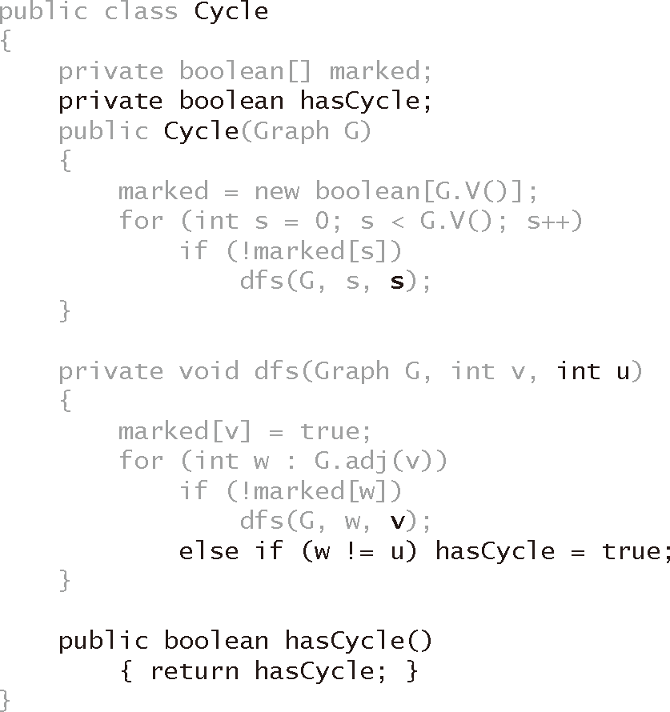

G 是无环图吗？（假设不存在自环或平行边）

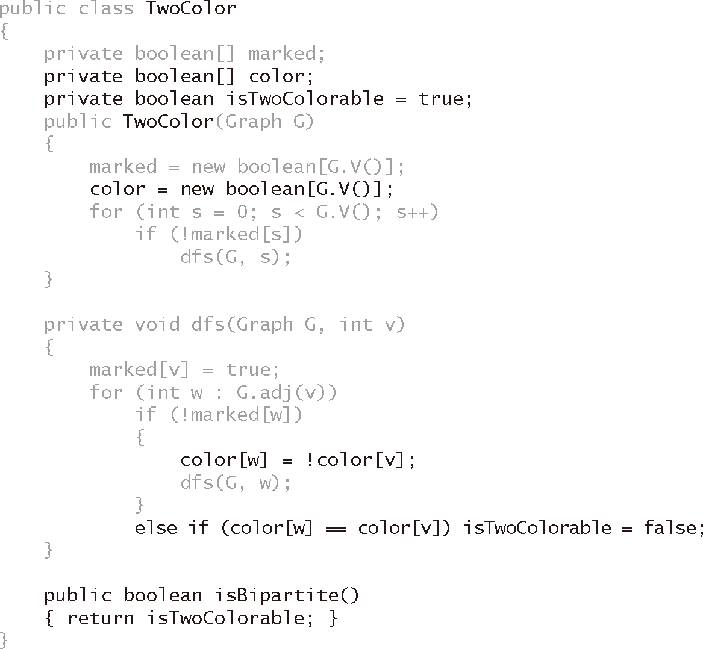

G 是二分图吗？（双色问题）

### 4.1.7　符号图

在典型应用中，图都是通过文件或者网页定义的，使用的是字符串而非整数来表示和指代顶点。为了适应这样的应用，我们定义了拥有以下性质的输入格式：

- 顶点名为字符串；

- 用指定的分隔符来隔开顶点名（允许顶点名中含有空格）；

- 每一行都表示一组边的集合，每一条边都连接着这一行的第一个名称表示的顶点和其他名称所表示的顶点；

- 顶点总数 和边的总数 都是隐式定义的。

图 4.1.22 是一个简单的示例。routes.txt 文件表示的是一个小型运输系统的模型，其中表示每个顶点的是美国机场的代码，连接它们的边则表示顶点之间的航线。文件只是一组边的列表。图 4.1.23 所示的是一个更庞大的例子，取自 movies.txt，即 3.5 节中介绍的互联网电影数据库。还记得吗？这个文件的每一行都列出了一个电影名以及出演该部电影的一系列演员。从图的角度来说，我们可以将它看作一幅图的定义，电影和演员都是顶点，而邻接表中的每一条边都将电影和它的表演者联系起来。注意，这是一幅二分图——电影顶点之间或者演员结点之间都没有边相连。

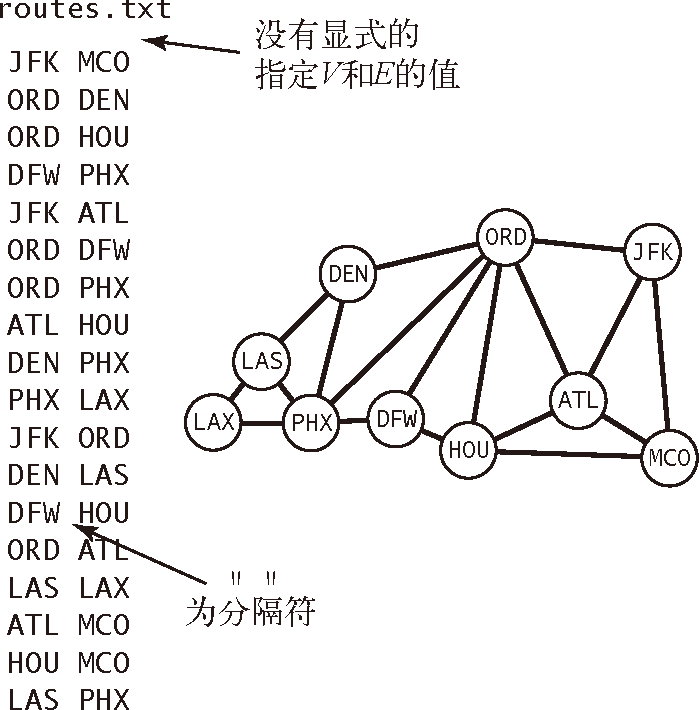

- 图 4.1.22　符号图示例（边的列表）

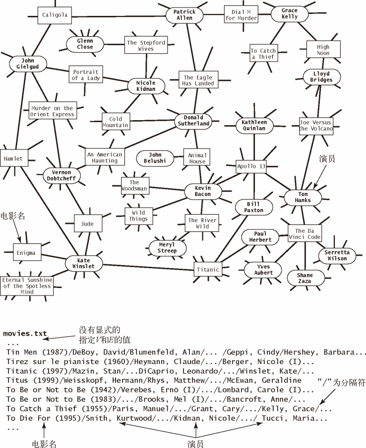

- 图 4.1.23　符号图示例（邻接表）

### 4.1.7.1　API

```
表 4.1.8 中，API 定义的 Graph 用例可以直接使用已有的图算法来处理这种文件定义的图。
```

表 4.1.8　用符号作为顶点名的图的 API

```java
public class <b>SymbolGraph</b>
             SymbolGraph(String
根据 filename 指定的文件构造图，
filename, String delim)
```

- 分隔顶点名

```
    boolean  contains(String key)
key 是一个顶点吗
        int  index(String key)
Key 的索引
     String  name(int v)
索引 v 的顶点名
      Graph  G()
隐藏的 Graph 对象
这份 API 定义了一个构造函数来读取并构造图，用 name() 方法和 index() 方法将输入流
```

中的顶点名和图算法使用的顶点索引对应起来。

### 4.1.7.2　测试用例

下一页框注所示的是符号图的测试用例，它用第一个命令行参数指定的文件（第二个命令行参数指定了分隔符）来构造一幅图并从标准输入接受查询。用户可以输入一个顶点名并得到该顶点的相邻结点的列表。这个用例提供的正好是 3.5 节中研究过的反向索引的功能。以routes.txt 为例，你可以输入一个机场的代码来查找能从该机场直飞到达的城市，但这些信息并不是直接就能从文件中得到的。对于 movies.txt，你可以输入一个演员的名字来查看数据库中他所出演的影片列表。输入一部电影的名字来得到它的演员列表，这不过是在照搬文件中对应行数据，但输入演员的名字来得到影片的列表则相当于查找反向索引。尽管数据库的构造是为了将电影名连接到演员，二分图模型同时也意味着将演员连接到电影名。二分图的性质自动完成了反向索引。以后我们将会看到，这将成为处理更复杂的和图有关的问题的基础。

```java
public static void main(String[] args)
{
  String filename = args[0];
  String delim = args[1];
  SymbolGraph sg = new SymbolGraph(filename, delim);
  Graph G = sg.G();
  while (StdIn.hasNextLine())
  {
     String source = StdIn.readLine();
     for (int w : G.adj(sg.index(source)))
        StdOut.println("   " + sg.name(w));
  }
}
```

符号图 API 的测试用例

```
% java SymbolGraph routes.txt " "
JFK
  ORD
  ATL
  MCO
LAX
  LAS
  PHX
```

```
% java SymbolGraph movies.txt "/"
Tin Men (1987)
  DeBoy, David
  Blumenfeld, Alan
  ...
  Geppi, Cindy
  Hershey, Barbara
  ...
Bacon, Kevin
  Mystic River (2003)
  Friday the 13th (1980)
  Flatliners (1990)
  Few Good Men, A (1992)
  ...
很显然，这种方法适用于我们遇到过的所有图算法：用例可以用 index() 将顶点名转化为索
引并在图的处理算法中使用，然后将处理结果用 name() 转化为顶点名以方便在实际应用中
```

使用。

### 4.1.7.3　实现

```
SymbolGraph 的完整实现请见下面的框注“符号图的数据类型”。它用到了以下 3 种数据结
```

构，参见图 4.1.24。

```
一个符号表 st，键的类型为 String（顶点名），值的类型为 int（索引）；
一个数组 keys[]，用作反向索引，保存每个顶点索引所对应的顶点名；
一个 Graph 对象 G，它使用索引来引用图中顶点。
SymbolGraph 会遍历两遍数据来构造以上数据结构，这主要是因为构造 Graph 对象需要顶
（见本节开头 Graph 的构造
```

- 和

点总数

- 。在典型的实际应用中，在定义图的文件中指明

```
函数）可能会有些不便，而有了 SymbolGraph，我们就可以方便地在 routes.txt 或者
```

movies.txt 中添加或者删除条目而不用担心需要维护边或顶点的总数。

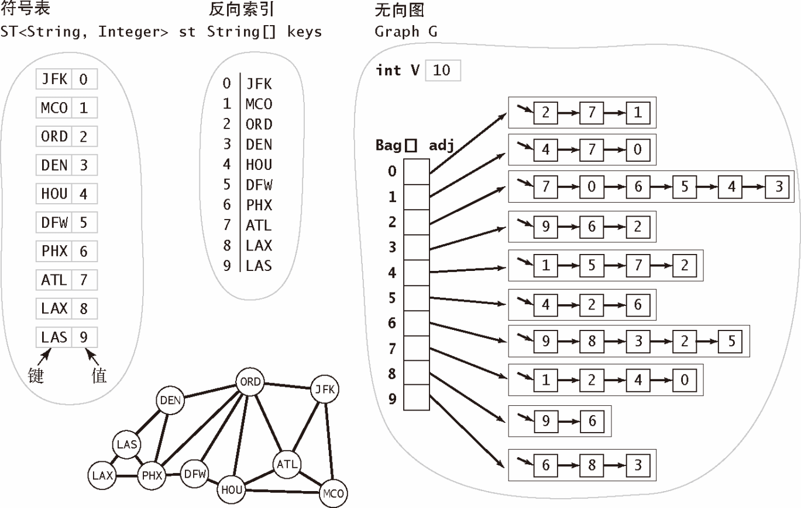

- 图 4.1.24　符号图中用到的数据结构

- 符号图的数据类型

```java
public class SymbolGraph
1
{
2
  private ST<String, Integer> st;              // 符号名 → 索引
3
  private String[] keys;                       // 索引 → 符号名
4
  private Graph G;                             // 图
5
6
  public SymbolGraph(String stream, String sp)
7
  {
8
     st = new ST<String, Integer>();
9
     In in = new In(stream);                   // 第一遍
10
     while (in.hasNextLine())                  // 构造索引
11
     {
12
        String[] a = in.readLine().split(sp);  // 读取字符串
13
14
        for (int i = 0; i < a.length; i++)     // 为每个不同的字符串关联一个索引
15
           if (!st.contains(a[i]))
16
17
              st.put(a[i], st.size());
18
     }
19
     keys = new String[st.size()];             // 用来获得顶点名的反向索引是一个数组
20
21
     for (String name : st.keys())
22
        keys[st.get(name)] = name;
23
24
     G = new Graph(st.size());
25
     in = new In(stream);                      // 第二遍
26
     while (in.hasNextLine())                  // 构造图
27
     {
28
        String[] a = in.readLine().split(sp);  // 将每一行的第一个顶点和该行的其他顶
29
        int v = st.get(a[0]);
30
        for (int i = 1; i < a.length; i++)
31
           G.addEdge(v, st.get(a[i]));
32
     }
33
  }
34
35
  public boolean contains(String s) {  return st.contains(s);  }
36
  public int index(String s)        {  return st.get(s);  }
37
  public String name(int v)         {  return keys[v];  }
38
  public Graph G()                  {  return G;  }
39
}
40
这个 Graph 实现允许用例用字符串代替数字索引来表示图中的顶点。它维护了实例变量
st（符号表用来映射顶点名和索引）、keys（数组用来映射索引和顶点名）和 G（使用索
```

- 引表示顶点的图）。为了构造这些数据结构，代码会将图的定义处理两遍（定义的每一行都

```
包含一个顶点及它的相邻顶点列表，用分隔符 sp 隔开）。
```

### 4.1.7.4　间隔的度数

图处理的一个经典问题就是，找到一个社交网络之中两个人间隔的度数。为了弄清楚概念，我们用一个最近很流行的名为 Kevin Bacon 的游戏来说明这个问题。这个游戏用到了刚才讨论的“电影 - 演员”图。Kevin Bacon 是一个活跃的演员，曾出演过许多电影。我们为图中的每个演员赋一个 Kevin Bacon 数：Bacon 本人为 0，所有和 Kevin Bacon 出演过同一部电影的人的值为 1，所有（除了 Kevin Bacon）和 Kevin Bacon 数为 1 的演员出演过同一部电影的其他演员的值为 2，依次类推。例如，Meryl Streep 的 Kevin Bacon 数为 1，因为她和 Kevin Bacon一同出演过 The River Wild。Nicole Kidman 的值为 2，因为她虽然没有和 Kevin Bacon 同台演出过任何电影，但她和 Tom Cruise 一起演过 Days of Thunder，而 Tom Cruise 和 KevinBacon 一起演过 A Few Good Men。给定一个演员的名字，游戏最简单的玩法就是找出一系列的电影和演员来回溯到 Kevin Bacon。例如，有些影迷可能知道 Tom Hanks 和 Lloyd Bridges一起演过 Joe Versus the Volcano，而 Bridges 和 Grace Kelly 一起演过 High Noon，Kelly 又和 Patrick Allen 一起演过 Dial M for Murder，Allen 和 Donald Sutherland 一起演过 TheEagle has Landed，Sutherland 和 Kevin Bacon 一起出演了 Animal House。但知道这些也并不足以确定 Tom Hanks 的 Kevin Bacon 数。（他的值实际上应该是 1，因为他和 Kevin Bacon在 Apollo 13 中合作过）。你可以看到 Kevin Bacon 数必须定义为最短电影链的长度，因此如果不用计算机，人们很难知道游戏中到底谁赢了。当然，如后面框注“间隔的度数”中

```
SymbolGraph 的用例 DegreesOfSeparation 所示，BreadthFirstPaths 才是我们所
```

要的程序，它通过最短路径来找出 movies.txt 中任意演员的 Kevin Bacon 数。这个程序从命令行得到一个起点，从标准输入中接受查询并打印出一条从起点到被查询顶点的最短路径。因为 movies.txt 所构造的是一幅二分图，每条路径上都会交替出现电影和演员的顶点。打出的结果可以证明这样的路径是存在的（但并不能证明它是最短的——你需要向你的朋友证明命题 B

```
才行）。DegreesOfSeparation 也能够在非二分图中找到最短路径。例如，在 routes.txt
```

中，它能够用最少的边找到一种从一个机场到达另一个机场的方法。

```
% java DegreesOfSeparation movies.txt "/" "Bacon, Kevin"
Kidman, Nicole
  Bacon, Kevin
  Woodsman,The(2004)
  Grier,David Alan
  Bewitched(2005)
  Kidman, Nicole
Grant, Cary
Bacon, Kevin
  Planes,Trains Automobiles(1987)
  Martin,Steve(I)
  Dead Men Don't Wear Plaid(1982)
  Grant, Cary
你可能会发现用 DegreesOfSeparation 来回答一些关于电影行业的问题很有趣。例如，你
```

不但可以找到演员和演员之间的间隔，还可以找到电影和电影之间的间隔。更重要的是，间隔的概念在其他许多领域也被广泛研究。例如，数学家也会玩这个游戏，但他们的图是用一些论文的作者到 P.Erdös（20 世纪的一位多产的数学家）的距离来定义的。类似地，似乎新泽西州的每个人的 Bruce Springsteen 数都为 2，因为每个人都声称自己认识某个认识 Bruce 的人。要玩 Erdös 的游戏，你需要一个包含所有数学论文的数据库；要玩 Sprintsteen 的游戏还要困难一些。从更严肃的角度来说，间隔度数的理论在计算机网络的设计以及理解各个科学领域中的自然网络中都能起到重要的作用。

```
% java DegreesOfSeparation movies.txt "/" "Animal House (1978)"
Titanic (1997)
  Animal House (1978)
  Allen, Karen (I)
  Raiders of the Lost Ark (1981)
  Taylor, Rocky (I)
  Titanic (1997)
To Catch a Thief (1955)
  Animal House (1978)
  Vernon, John (I)
  Topaz (1969)
  Hitchcock, Alfred (I)
  To Catch a Thief (1955)
```

- 间隔的度数

```java
public class DegreesOfSeparation
1
{
2
  public static void main(String[] args)
3
  {
4
     SymbolGraph sg = new SymbolGraph(args[0], args[1]);
5
6
     Graph G = sg.G();
7
8
     String source = args[2];
9
     if (!sg.contains(source))
10
     {  StdOut.println(source + "not in database."); return;  }
11
12
     int s = sg.index(source);
13
     BreadthFirstPaths bfs = new BreadthFirstPaths(G, s);
14
15
     while (!StdIn.isEmpty())
16
     {
17
        String sink = StdIn.readLine();
18
        if (sg.contains(sink))
19
        {
20
           int t = sg.index(sink);
21
           if (bfs.hasPathTo(t))
22
              for (int v : bfs.pathTo(t))
23
                 StdOut.println("   " + sg.name(v));
24
           else StdOut.println("Not connected");
25
        }
26
        else StdOut.println("Not in database.");
27
     }
28
  }
29
}
30
% java DegreesOfSeparation routes.txt " " JFK
1
LAS
2
  JFK
3
  ORD
4
  PHX
5
  LAS
6
DFW
7
  JFK
8
  ORD
9
  DFW
10
这段代码使用了 SymbolGraph 和 BreadthFirstPaths 来查找图中的最短路径。对于
```

- movies.txt，可以用它来玩 Kevin Bacon 游戏。

### 4.1.8　总结

在本节中，我们介绍了几个基本的概念，本章的其余部分会继续扩展并研究：

- 图的术语；

- 一种图的表示方法，能够处理大型而稀疏的图；

- 和图处理相关的类的设计模式，其实现算法通过在相关的类的构造函数中对图进行预处理、构造所需的数据结构来高效支持用例对图的查询；

- 深度优先搜索和广度优先搜索；

- 支持使用符号作为图的顶点名的类。

表 4.1.9 总结了我们已经学习过的所有图算法的实现。这些算法非常适合作为图处理的入门学习。随后学习更加复杂类型的图以及处理更加困难的问题时，我们还会用到这些代码的变种。在考虑了边的方向以及权重之后，同样的问题会变得困难得多，但同样的算法仍然奏效并将成为解决更加复杂问题的起点。

表 4.1.9　本节中得到解决的无向图处理问题

问题

- 解决方法参阅

```
DepthFirstSearch
```

- 4.1.3.2 节

单点连通性

```
DepthFirstPaths
```

- 算法 4.1

单点路径

```
BreadthFirstPaths
```

- 算法 4.2

单点最短路径

```
CC
```

- 算法 4.3

连通性

```
Cycle
```

- 表 4.1.7

检测环

```
TwoColor
```

- 表 4.1.7

双色问题（图的二分性）

### 答疑

问　为什么不把所有的算法都实现在 Graph.java 中？

```
答　可以这么做，可以向基本的 Graph 抽象数据类型的定义中添加查询方法（以及它们需要
```

的私有变量和方法等）。尽管这种方式可以用到一些我们所使用的数据结构的优点，它还是有一些严重的缺陷，因为图处理的成本比 1.3 节中遇到那些基本数据结构要高得多。这些缺点主要有：

- 在图处理中，需要实现的操作还有很多，我们无法在一份 API 中全部精确地定义它们；

- 简单任务的 API 和复杂任务所使用的 API 是相同的；

- 一个方法将可以访问另外一个方法专用的变量，这有悖我们需要遵守的封装原则。

这种情况并不罕见：这种 API 被称为宽接口（请见 1.2.5.2 节）。本章包含如此众多的图算法，将导致这种 API 变得非常宽。

```
问　SymbolGraph 真需要将图的定义遍历两遍吗？
```

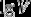

```
 倍并直接用 ST 而非 Bag 来实现 adj()。我们的另
```

答　不，你也可以将用时变为原来的一本书 An Introduction to Programming in Java: An Interdisciplinary Approach 中含有使用这种方法的一个实现。

### 练习

4.1.1　一幅含有

- 个顶点且不含有平行边的图中至多含有多少条边？一幅含有个顶点的连

通图中至少含有多少条边？

```
4.1.2　按照正文中示意图的样式（请见图 4.1.9）画出 Graph 的构造函数在处理图 4.1.25 的
```

tinyGex2.txt 时构造的邻接表。

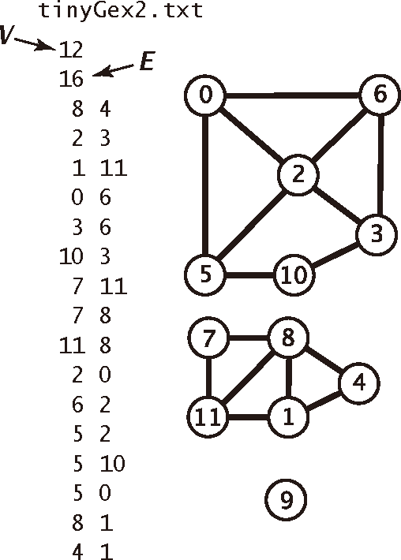

图　4.1.25

```
4.1.3　为 Graph 添加一个复制构造函数，它接受一幅图 G 然后创建并初始化这幅图的一个副
本。G 的用例对它作出的任何改动都不应该影响到它的副本。
4.1.4　为 Graph 添加一个方法 hasEdge()，它接受两个整型参数 v 和 w。如果图含有边
v-w，方法返回 true，否则返回 false。
4.1.5　修改 Graph，不允许存在平行边和自环。
4.1.6　有一张含有四个顶点的图，其中的边为 0-1、1-2、2-3 和 3-0。给出一种邻接表数
组，无论以任何顺序调用 addEdge() 来添加这些边都无法创建它。
4.1.7　为 Graph 编写一个测试用例，用命令行参数指定名字的输入流中接受一幅图，然后用
toString() 方法将其打印出来。
```

4.1.8　按照正文中的要求，用 union-find 算法实现 4.1.2.3 中搜索的 API。

```
4.1.9　使用 dfs(0) 处理由 Graph 的构造函数从 tinyGex2.txt（请见练习 4.1.2）得到的图
并按照 4.1.3.5 节的图 4.1.14 的样式给出详细的轨迹。同时，画出 edgeTo[] 所表示的树。
```

4.1.10　证明在任意一幅连通图中都存在一个顶点，删去它（以及和它相连的所有边）不会影响到图的连通性，编写一个深度优先搜索的方法找出这样一个顶点。提示：留心那些相邻顶点全部都被标记过的顶点。

```
4.1.11　使用算法 4.2 中的 bfs(G,0) 处理由 Graph 的构造函数从 tinyGex2.txt（请见练习
4.1.2）得到的图并画出 edgeTo[] 所表示的树。
4.1.12　如果 v 和 w 都不是根结点，能够由广度优先搜索得到的树中计算它们之间的距离
```

吗？

```
4.1.13　为 BreadthFirstPaths 的 API 添加并实现一个方法 distTo()，返回从起点到给
```

定的顶点的最短路径的长度，它所需的时间应该为常数。

4.1.14　如果用栈代替队列来实现广度优先搜索，我们还能得到最短路径吗？

```
4.1.15　修改 Graph 的输入流构造函数，允许从标准输入读入图的邻接表（方法类似于
SymbolGraph），如图 4.1.26 的 tinyGadj.txt 所示。在顶点和边的总数之后，每一行由一个顶
```

点和它的所有相邻顶点组成。

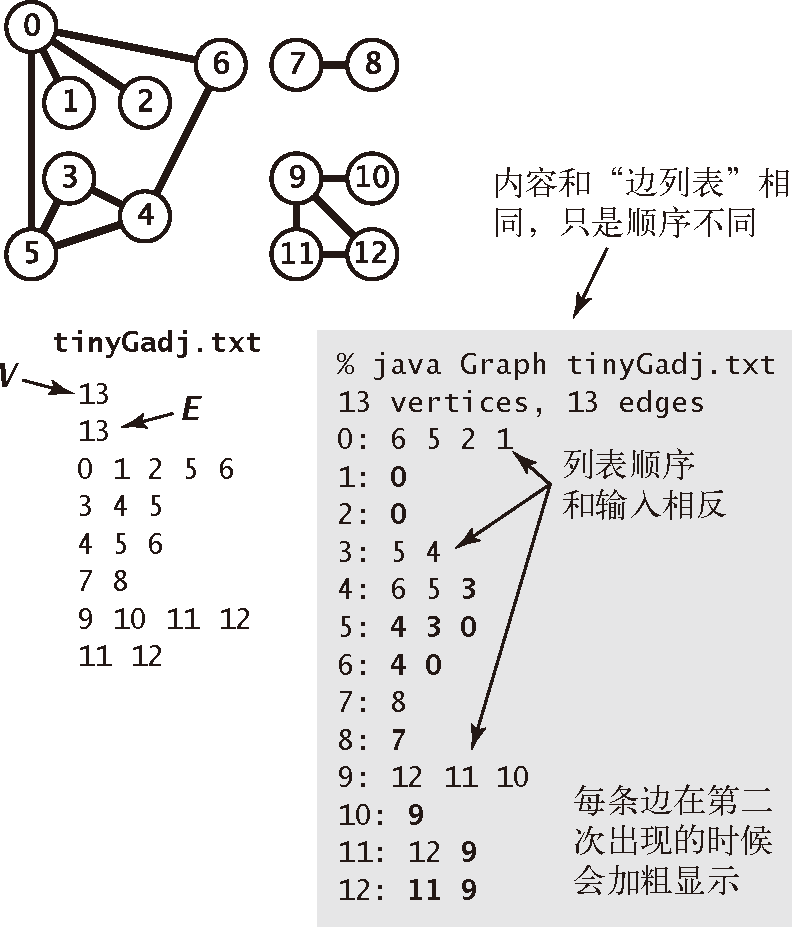

图　4.1.26

```
4.1.16　顶点 v 的离心率是它和离它最远的顶点的最短距离。图的直径即所有顶点的最大离心
```

率，半径为所有顶点的最小离心率，中点为离心率和半径相等的顶点。实现以下 API，如表4.1.10 所示。

表 4.1.10

```java
public class  <b>GraphProperties</b>
              GraphProperties(Graph G)
构造函数（如果 G 不是连通的，抛出异
         int  eccentricity(int v)
v 的离心率
         int  diameter()
G 的直径
         int  radius()
G 的半径
         int  center()
G 的某个中点
```

4.1.17　图的周长为图中最短环的长度。如果是无环图，则它的周长为无穷大。为

```
GraphProperties 添加一个方法 girth()，返回图的周长。提示：在每个顶点都进行广度
优先搜索。含有 s 的最小环为 s 到某个顶点 v 的最短路径加上从 v 返回到 s 的边。
4.1.18　使用 CC 找出由 Graph 的输入流构造函数从 tinyGex2.txt（请见练习 4.1.2）得到的
```

图中的所有连通分量并按照图 4.1.21 的样式给出详细的轨迹。

```
4.1.19　使用 Cycle 在由 Graph 的输入流构造函数从 tinyGex2.txt（请见练习 4.1.2）得到
的图中找到的一个环并按照本节示意图的样式给出详细的轨迹。在最坏情况下，Cycle 构造
```

函数的运行时间的增长数量级是多少？

```
4.1.20　使用 TwoColor 给出由 Graph 的构造函数从 tinyGex2.txt（请见练习 4.1.2）得到的
图的一个着色方案并按照本节示意图的样式给出详细的轨迹。在最坏情况下，TwoColor 构
```

造函数的运行时间的增长数量级是多少？

```
4.1.21　用 SymbolGraph 和 movie.txt 找到今年获得奥斯卡奖提名的演员的 Kevin Bacon
```

数。

```
4.1.22　编写一段程序 BaconHistogram，打印一幅 Kevin Bacon 数的柱状图，显示
```

movies.txt 中 Kevin Bacon 数为 0、1、2、3……的演员分别有多少。将值为无穷大的人（不与 Kevin Bacon 连通）归为一类。

4.1.23　计算由 movies.txt 得到的图的连通分量的数量和包含的顶点数小于 10 的连通分量的数量。计算最大的连通分量的离心率、直径、半径和中点。Kevin Bacon 在最大的连通分量之中吗？

```
4.1.24　修改 DegreesOfSeparation，从命令行接受一个整型参数 y，忽略上映年数超过
y 的电影。
% java DegreesOfSeparationDFS movies.txt
Source: Bacon, Kevin
Query:  Kidman, Nicole
  Bacon, Kevin
  Mystic River (2003)
  O’Hara, Jenny
  Matchstick Men (2003)
  Grant, Beth
 ... [123 movies ] (!)
  Law, Jude
  Sky Captain... (2004)
  Jolie, Angelina
  Playing by Heart (1998)
  Anderson, Gillian (I)
  Cock and Bull Story, A (2005)
  Henderson, Shirley (I)
  24 Hour Party People (2002)
  Eccleston, Christopher
  Gone in Sixty Seconds (2000)
  Balahoutis, Alexandra
  Days of Thunder (1990)
  Kidman, Nicole
4.1.25　编写一个类似于 DegreesOfSeparation 的 SymbolGraph 用例，使用深度优先搜
```

索代替广度优先搜索来查找两个演员之间的路径，输出类似右侧框注所示的数据。

```
4.1.26　使用 1.4 节中的内存使用模型评估用 Graph 表示一幅含有
```

- 个顶点和条边的图所

需的内存。

4.1.27　如果重命名一幅图中的顶点就能够使之变得和另一幅图完全相同，这两幅图就是同构的。画出含有 2、3、4、5 个顶点的所有非同构的图。

```
4.1.28　修改 Cycle，允许图含有自环和平行边。
```

### 提高题

4.1.29　欧拉环和汉密尔顿环。考虑以下 4 组边定义的图：

```
0-1 0-2 0-3 1-3 1-4 2-5 2-9 3-6 4-7 4-8 5-8 5-9 6-7 6-9 7-8
0-1 0-2 0-3 1-3 0-3 2-5 5-6 3-6 4-7 4-8 5-8 5-9 6-7 6-9 8-8
0-1 1-2 1-3 0-3 0-4 2-5 2-9 3-6 4-7 4-8 5-8 5-9 6-7 6-9 7-8
4-1 7-9 6-2 7-3 5-0 0-2 0-8 1-6 3-9 6-3 2-8 1-5 9-8 4-5 4-7
```

哪几幅图含有欧拉环（恰好包含了所有的边且没有重复的环）？哪几幅图含有汉密尔顿环（恰好包含了所有的顶点且没有重复的环）？

4.1.30　图的枚举。含有

- 个顶点和条边（不含平行边）的不同的无向图共有多少种？

4.1.31　检测平行边。设计一个线性时间的算法来统计图中的平行边的总数。

4.1.32　奇环。证明一幅图能够用两种颜色着色（二分图）当且仅当它不含有长度为奇数的环。

```
4.1.33　符号图。实现一个 SymbolGraph（不一定必须使用 Graph），只需要遍历一遍图的
```

- 倍。

定义数据。由于需要查找符号表，实现中图的各种操作时耗可能会变为原来的

4.1.34　双向连通性。如果任意一对顶点都能由两条不同（没有重叠的边或顶点）的路径连通则图就是双向连通的。在一幅连通图中，如果一个顶点（以及和它相连的边）被删掉后图不再连通，该顶点就被称为关节点。证明没有关节点的图是双向连通的。提示：给定任意一对顶点

```
s 和 t 和一条连接两点的路径，由于路径上没有任何顶点为关节点，构造另一条不同的路径
连接 s 和 t。
```

4.1.35　边的连通性。在一幅连通图中，如果一条边被删除后图会被分为两个独立的连通分量，这条边就被称为桥。没有桥的图称为边连通图。开发一种基于深度优先搜索算法的数据类型，判断一个图是否是边连通图。

```
4.1.36　欧几里得图。为平面上的图设计并实现一份叫做 EuclideanGraph 的 API，其中图
所有顶点均有坐标。实现一个 show() 方法，用 StdDraw 将图绘出。
```

4.1.37　图像处理。在一幅图像中将所有相邻的、颜色相同的点相连就可以得到一幅图，为这种隐式定义的图实现填充（flood fill）操作。

### 实验题

```
4.1.38　随机图。编写一个程序 ErdosRenyiGraph，从命令行接受整数
```

- 和，随机生成

- 对 0 到之间的整数来构造一幅图。注意：生成器可能会产生自环和平行边。

```
4.1.39　随机简单图。编写一个程序 RandomSimpleGraph，从命令行接受整数
```

- 和，用

- 个顶点和条边的所有可能的简单图。

均等的几率生成含有

```
4.1.40　随机稀疏图。编写一个程序 RandomSparseGraph，根据精心选择的一组
```

- 和的

值生成随机的稀疏图，以便用它对由 Erdös-Renyi 模型得到的图进行有意义的经验性测试。

```
4.1.41　随机欧几里得图。编写一个 EuclideanGraph 的用例（请见练习 4.1.36）
RandomEuclideanGraph，用随机在平面上生成
```

- 个点的方式生成随机图，然后将每个点


- 的圆内的其他点相连。注意：如果大于阈值

和在以该点为中心半径为

- ，

那么得到的图几乎必然是连通的，否则得到的图几乎必然是不连通的。

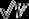

```
4.1.42　随机网格图。编写一个 EuclideanGraph 的用例 RandomGridGraph，将
```

- 乘

- 的网格中的所有顶点和它们的相邻顶点相连（参考练习 1.5.18）。修改代码为图额外添加

- 条随机的边。对于较大的个左右。添加一个选项，使得，缩小网格使得总边数保持在

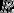

```
出现一条从顶点 s 到顶点 v 的边的概率与 s 到 t 的欧几里得距离成反比。
```

4.1.43　真实世界中的图。从网上找出一幅巨型加权图——可以是一张标记了距离的地图，或

```
者是标明了费用的电话连接，或是航班价目表。编写一段程序 RandomRealGraph，从这幅
```

- 个顶点，然后再从这些顶点构成的子图中随机选取条边来构造一幅图。

图中随机迭取

4.1.44　随机区间图。考虑数轴上的

- 个区间的集合。这样的一个集合定义了一幅区间图，图

中的每个顶点都对应一个区间，而边则对应两个区间的交集（大小不限）。编写一段程序，随

- 的个区间，然后构造相应的区间图。提示：使用二分查找树。

机生成大小均为

4.1.45　随机运输图。定义运输系统的一种方法是定义一个顶点链的集合，每条顶点链都表示

```
一条连接了多个顶点的路径。例如，链 0-9-3-2 定义了边 0-9、9-3 和 3-2。编写一个
EuclideanGraph 的用例 RandomTransportation，从一个输入文件中构造一幅图，文
```

件的每行均为一条链，使用符号名。编辑一份合适的输入使得程序能够从中构造一幅和巴黎地铁系统相对应的图。

- 测试所有的算法并研究所有图模型的所有参数是不现实的。请为下面的每一道题都编写一段程序来处理从输入得到的任意图。这段程序可以调用上面的任意生成器并对相应的图模型进行实验。可以根据上次实验的结果自己作出判断来选择不同实验。陈述结果以及由此得出的任何结论。

4.1.46　深度优先搜索中的路径长度。对于各种图的模型，运行实验并根据经验判断

```
DepthFirstPaths 在两个随机选定的顶点之间找到一条路径的概率并计算找到的路径的平
```

均长度。

4.1.47　广度优先搜索中的路径长度。对于各种图的模型，运行实验并根据经验判断

```
BreadthFirstPaths 在两个随机选定的顶点之间找到一条路径的概率并计算找到的路径的
```

平均长度。

4.1.48　连通分量。运行实验随机生成大量的图并画出柱状图，根据经验判断各种类型的随机图中连通分量的数量的分布情况。

4.1.49　双色问题。大多数的图都无法用两种颜色着色，深度优先搜索能够很快发现这一点。

```
对于各种图模型，使用经验性的测试来研究 TwoColor 检查的边的数量。
```
