# 4.2有向图

在有向图中，边是单向的：每条边所连接的两个顶点都是一个有序对，它们的邻接性是单向的（表 4.2.1）。许多应用（比如表示网络、任务调度条件或是电话的图）都是天然的有向图。为实现添加这种单向性的限制很容易也很自然，看起来没什么坏处。但实际上这种组合性的结构对算法有深刻的影响，使得有向图和无向图的处理大有不同。本节中，我们会学习搜索和处理有向图的一些经典算法。

表 4.2.1　实际生活中的典型有向图

应用

- 顶点边

食物链

- 物种捕食关系

互联网连接

- 网页超链接

程序

- 模块外部引用

手机

- 电话呼叫

学术研究

- 论文引用

金融

- 股票交易

网络

- 计算机网络连接

### 4.2.1　术语

虽然我们为有向图的定义和无向图几乎相同（将使用的部分算法和代码也是），但仍然需要在这里重复一遍。为了说明边的方向性而产生的细小文字差异所代表的结构特性正是本节的重点。

- 定义。一幅有方向性的图（或有向图）是由一组顶点和一组有方向的边组成的，每条有方向的边都连接着有序的一对顶点。

我们称一条有向边由第一个顶点指出并指向第二个顶点。在一幅有向图中，一个顶点的出度为由该顶点指出的边的总数；一个顶点的入度为指向该顶点的边的总数（请见图 4.2.1）。当上下文的意义明确时，我们在提到有向图中的边时会省略有向二字。一条有向边的第一个顶点称为

```
它的头，第二个顶点则被称为它的尾。将有向边画为由头指向尾的一个箭头。用 v → w 来表
示有向图中一条由 v 指向 w 的边。和无向图一样，本节的代码也能处理自环和平行边，但它
```

们不会出现在例子中，在正文中一般也不会提到它们。除了特殊的图，一幅有向图中的两个顶

```
点的关系可能有 4 种：没有边相连；存在从 v 到 w 的边 v → w；存在从 w 到 v 的边 w →
v；既存在 v → w 也存在 w → v，即双向的连接。
```

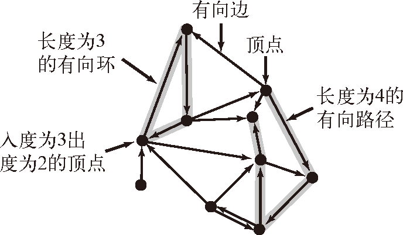

- 图 4.2.1　有向图详解

- 定义。在一幅有向图中，有向路径由一系列顶点组成，对于其中的每个顶点都存在一条有向边从它指向序列中的下一个顶点。有向环为一条至少含有一条边且起点和终点相同的有向路径。简单有向环是一条（除了起点和终点必须相同之外）不含有重复的顶点和边的环。路径或者环的长度即为其中所包含的边数。

和无向图一样，我们假设有向路径都是简单的，除非我们明确指出了某个重复了的顶点（像有

```
向环的定义中那样）或是指明是一般性的有向路径。当存在从 v 到 w 的有向路径时，称顶点
w 能够由顶点 v 达到。我们约定，每个顶点都能够达到它自己。除了这种情况之外，在有向
图中由 v 能够到达 w 并不意味着由 w 也能到达 v。这个不同虽然很明显但非常重要，后面将
```

会看到这一点。

要理解本节中的算法，你就必须要理解有向图中的可达性和无向图中的连通性的区别。理解这种区别可能比你想象得更困难。例如，尽管你可能一眼就能看出一小幅无向图中的两个顶点之间是否连通，但是在一小幅有向图中快速找出一条有向路径就不那么容易了，比如图 4.2.2 所示的例子。处理有向图就如同在一座只有单行道的城市中穿梭，而且这些单行道的方向是杂乱无章的。在这种情况下，想从一处到达另一处会是一件很麻烦的事。但与直觉相反，我们用来表示有向图的标准数据结构甚至比无向图的表示更加简单！

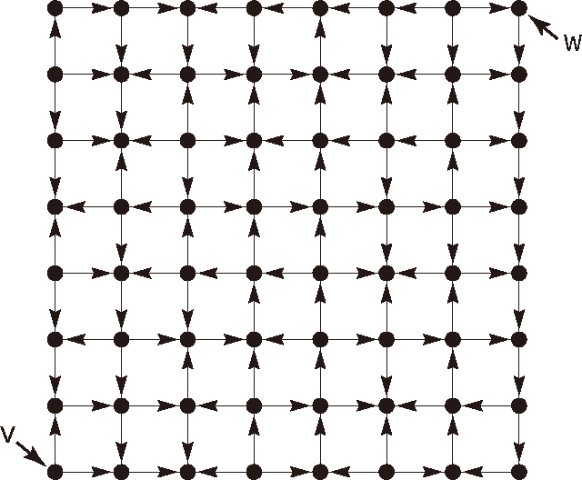

```
图 4.2.2　在这幅有向图中，从 v 能够到达 w 吗
```

### 4.2.2　有向图的数据类型

```
以下这份 API 以及下一页中的 Digraph 类和 Graph 类本质上是相同的（请见 4.1.2.2 节框
注“Graph 数据类型”）。
```

表 4.2.2　有向图的 API

```java
     public class  <b>Digraph</b>
                   Digraph(int V)
```

- 个顶点但没有边的有创建一幅含有


```
                   Digraph(In in)
从输入流 in 中读取一幅有向图
              int  V()
```

- 顶点总数

```
              int  E()
```

- 边的总数

```
             void  addEdge(int v, int
向有向图中添加一条边 v → w
w)
Iterable<Integer>  adj(int v)
由 v 指出的边所连接的所有顶点
          Digraph  reverse()
```

- 该图的反向图

```
           String  toString()
```

- 对象的字符串表示

### 4.2.2.1　有向图的表示

```
我们使用邻接表来表示有向图，其中边 v → w 表示为顶点 v 所对应的邻接链表中包含一个 w
```

顶点。这种表示方法和无向图几乎相同而且更明晰，因为每条边都只会出现一次，如后面框注“有向图（diagraph）的数据类型”所示。

### 4.2.2.2　输入格式

```
由输入流读取有向图的构造函数的代码与 Graph 类中相应构造函数的代码完全相同——因为
两者的输入格式是一样的，但所有的边都是有向边。在边列表的格式中，一对顶点 v 和 w 表
示边 v → w。
```

### 4.2.2.3　有向图取反

```
Digraph 的 API 中还添加了一个方法 reverse()。它返回该有向图的一个副本，但将其中
```

所有边的方向反转。在处理有向图时这个方法有时很有用，因为这样用例就可以找出“指向”每

```
个顶点的所有边，而 adj() 给出的是由每个顶点指出的边所连接的所有顶点。
```

### 4.2.2.4　顶点的符号名

```
在有向图中，允许用例使用符号作为顶点名也更加简单。要实现与 SymbolGraph 类似的
SymbolDigraph 类，只需要将其中的 Graph 字样都替换成 Digraph 即可。
花一点时间对比一下后面框注中的代码和示意图与 4.1.2.1 节及 4.1.2.2 节的框注“Graph 数据
类型”中无向图的代码是非常有价值的。在用邻接表表示无向图时，如果 v 在 w 的链表中，那
么 w 必然也在 v 的链表中。但在有向图中这种对称性是不存在的。这个区别在有向图的处理
```

中影响深远。

- Digraph 数据类型

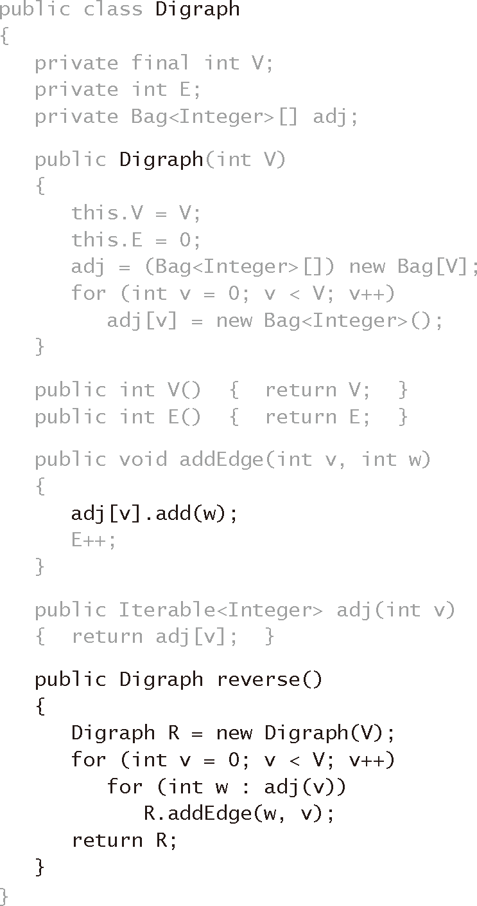

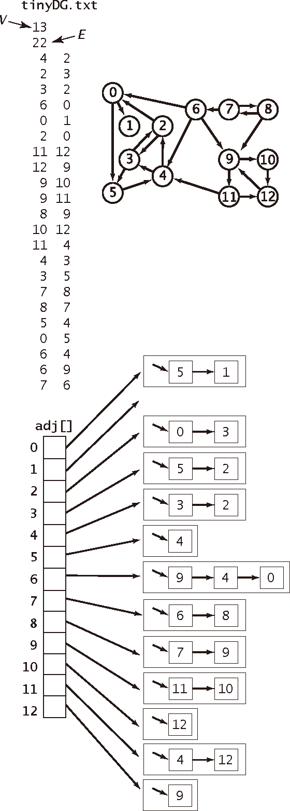

- 有向图的输入格式和邻接表的表示

```
Digraph 数据类型与 Graph 数据类型（请见 4.1.2.2 框注“Graph 数据类型”）基本相同，
区别是 addEdge() 只调用了一次 add()，而且它还有一个 reverse() 方法来返回图的
反向图。因为两者的代码非常相似，所以省略了 toString() 方法（请见表 4.1.2）和从
```

- 输入流中读取图的构造函数。

### 4.2.3　有向图中的可达性

```
在无向图中介绍的第一个算法就是 4.1.3.2 节中的 DepthFirstSearch，它解决了单点连通
```

性的问题，使得用例可以判定其他顶点和给定的起点是否连通。使用完全相同的代码，将其中

```
的 Graph 替换为 Digraph，也可以解决一个有向图中的类似问题。
```

```
单点可达性。给定一幅有向图和一个起点 s，回答“是否存在一条从 s 到达给定顶点 v 的有向
```

路径？”等类似问题。

```
算法 4.4 中的 DirectedDFS 类将 DepthFirstSearch 稍加润色并实现了以下 API。
```

表 4.2.3　有向图的可达性 API

```java
public class  <b>DirectedDFS</b>
              DirectedDFS(Digraph G,
在 G 中找到从 s 可达的所有顶点
int s)
              DirectedDFS(Digraph G,
在 G 中找到从 sources 中的所有顶
Iterable<Integer> sources)
```

- 点

```
     boolean  marked(int v)
v 是可达的吗
```

在添加了一个接受多个顶点的构造函数之后，这份 API 使得用例能够解决一个更加一般的问题。

多点可达性。给定一幅有向图和顶点的集合，回答“是否存在一条从集合中的任意顶点到达给定顶点 v 的有向路径？”等类似问题。

我们在 5.4 节中解决经典的字符串处理问题时会再次遇到这个问题。

```
DirectedDFS 使用了解决图处理的标准范例和标准的深度优先搜索来解决这些问题。它对每
个起点调用递归方法 dfs()，以标记遇到的任意顶点。
```

- 命题 D。在有向图中，深度优先搜索标记由一个集合的顶点可达的所有顶点所需的时间与被标记的所有顶点的出度之和成正比。证明。同 4.1.3.2 节的命题 A。

图 4.2.3 显示了这个算法在处理示例有向图时的操作轨迹。这份轨迹比相应的无向图算法的轨迹稍稍简单些，因为深度优先搜索本质上是一种适用于处理有向图的算法，每条边都只会被表示一次。研究这些轨迹有助于巩固你对有向图中深度优先搜索的理解。

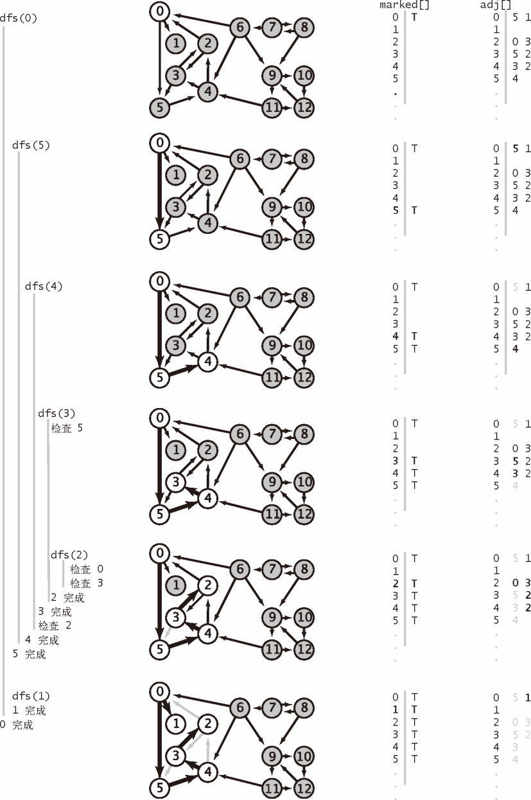

```
图 4.2.3　使用深度优先搜索在一幅有向图中寻找能够从顶点 0 到达的所有顶点的轨迹
```

- 算法 4.4　有向图的可达性

```java
public class DirectedDFS
1
{
2
  private boolean[] marked;
3
4
  public DirectedDFS(Digraph G, int s)
5
  {
6
     marked = new boolean[G.V()];
7
     dfs(G, s);
8
  }
9
10
  public DirectedDFS(Digraph G, Iterable<Integer> sources)
11
  {
12
     marked = new boolean[G.V()];
13
     for (int s : sources)
14
        if (!marked[s]) dfs(G, s);
15
16
17
  }
18
  private void dfs(Digraph G, int v)
19
  {
20
     marked[v] = true;
21
     for (int w : G.adj(v))
22
        if (!marked[w]) dfs(G, w);
23
  }
24
25
  public boolean marked(int v)
26
  {  return marked[v];  }
27
28
  public static void main(String[] args)
29
  {
30
     Digraph G = new Digraph(new In(args[0]));
31
32
     Bag<Integer> sources = new Bag<Integer>();
33
     for (int i = 1; i < args.length; i++)
34
        sources.add(Integer.parseInt(args[i]));
35
36
     DirectedDFS reachable = new DirectedDFS(G, sources);
37
38
     for (int v = 0; v < G.V(); v++)
39
        if (reachable.marked(v)) StdOut.print(v + " ");
40
     StdOut.println();
41
  }
42
}
43
% java DirectedDFS tinyDG.txt 1
1
1
2
3
% java DirectedDFS tinyDG.txt 2
4
0 1 2 3 4 5
5
6
% java DirectedDFS tinyDG.txt 1 2 6
7
0 1 2 3 4 5 6 9 10 11 12
8
```

- 这份深度优先搜索的实现使得用例能够判断从给定的一个或者一组顶点能到达哪些其他顶点。

### 4.2.3.1　标记 - 清除的垃圾收集

多点可达性的一个重要的实际应用是在典型的内存管理系统中，包括许多 Java 的实现。在一幅有向图中，一个顶点表示一个对象，一条边则表示一个对象对另一个对象的引用。这个模型很好地表现了运行中的 Java 程序的内存使用状况。在程序执行的任何时候都有某些对象是可以被直接访问的，而不能通过这些对象访问到的所有对象都应该被回收以便释放内存（请见图4.2.4）。标记 - 清除的垃圾回收策略会为每个对象保留一个位做垃圾收集之用。它会周期性地

```
运行一个类似于 DirectedDFS 的有向图可达性算法来标记所有可以被访问到的对象，然后
```

清理所有对象，回收没有被标记的对象，以腾出内存供新的对象使用。

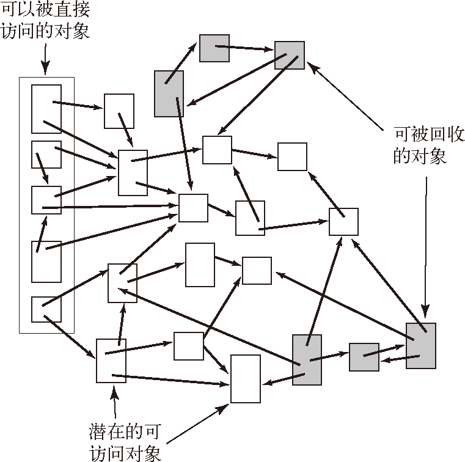

- 图 4.2.4　垃圾回收示意图

### 4.2.3.2　有向图的寻路

```
DepthFirstPaths（4.1.4.1 节算法 4.1）和 BreadthFirstPaths（4.1.5 节算法 4.2）也
都是有向图处理中的重要算法。和刚才一样，同样的 API 和代码（仅将 Graph 替换为
Digraph）也能够高效地解决以下问题。
```

```
单点有向路径。给定一幅有向图和一个起点 s，回答“从 s 到给定目的顶点 v 是否存在一条有
```

向路径？如果有，找出这条路径。”等类似问题。

```
单点最短有向路径。给定一幅有向图和一个起点 s，回答“从 s 到给定目的顶点 v 是否存在一
```

条有向路径？如果有，找出其中最短的那条（所含边数最少）。”等类似问题。

在本书的网站上以及本节最后的练习中，我们将以上问题的答案分别命名为

```
DepthFirstDirectedPaths 和 BreadthFirstDirectedPaths。
```

### 4.2.4　环和有向无环图

在和有向图相关的实际应用中，有向环特别的重要。没有计算机的帮助，在一幅普通的有向图中找出有向环可能会很困难。从原则上来说，一幅有向图可能含有大量的环；在实际应用中，我们一般只会重点关注其中一小部分，或者只想知道它们是否存在（请见图 4.2.5）。

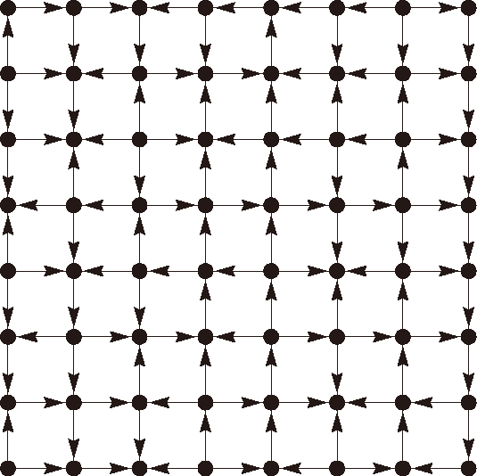

- 图 4.2.5　这幅有向图含有有向环吗

为了在有向图处理中研究有向环的作用更加有趣，我们来看看下面这个有向图模型的原型应用。

### 4.2.4.1　调度问题

一种应用广泛的模型是给定一组任务并安排它们的执行顺序，限制条件是这些任务的执行方法和起始时间。限制条件还可能包括任务的时耗以及消耗的其他资源。最重要的一种限制条件叫做优先级限制，它指明了哪些任务必须在哪些任务之前完成。不同类型的限制条件会产生不同类型不同难度的调度问题。研究者已经解决了上千种不同的此类问题，而且还在为其中许多寻找更好的算法。以一个正在安排课程的大学生为例，有些课程是其他课程的先导课程，如图4.2.6 所示。

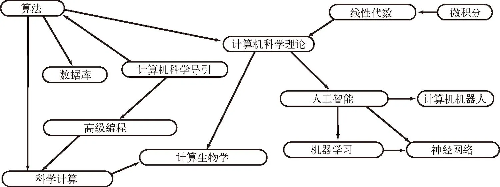

- 图 4.2.6　有优先级限制的调度问题

如果再假设该学生一次只能修一门课，实际上就遇到了下面这个问题。

优先级限制下的调度问题。给定一组需要完成的任务，以及一组关于任务完成的先后次序的优先级限制。在满足限制条件的前提下应该如何安排并完成所有任务？

对于任意一个这样的问题，我们都可以马上画出一张有向图，其中顶点对应任务，有向边对应优先级顺序。为了简化问题，我们以使用整数为顶点编号的标准模型来表示这个示例，如图4.2.7 所示。在有向图中，优先级限制下的调度问题等价于下面这个基本的问题。

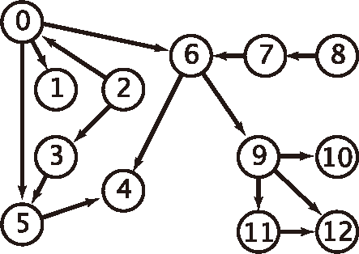

- 图 4.2.7　标准有向图模型

拓扑排序。给定一幅有向图，将所有的顶点排序，使得所有的有向边均从排在前面的元素指向排在后面的元素（或者说明无法做到这一点）。

图 4.2.8 为示例的拓扑排序。所有的边都是向下的，所以它清晰地表示了这幅有向图模型所代表的有优先级限制的调度问题的一个解决方法：按照这个顺序，该同学可以在满足先导课程限制的条件下修完所有课程。这个应用是很典型的——表 4.2.4 列举了其他一些有代表性的应用。

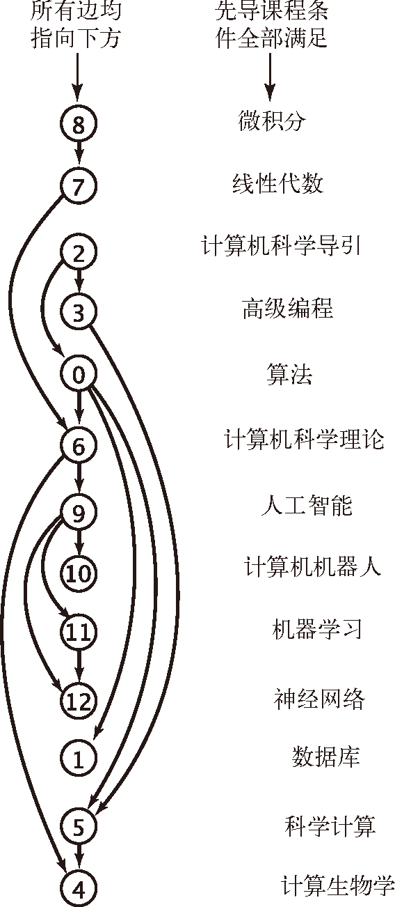

- 图 4.2.8　拓扑排序

表 4.2.4　拓扑排序的典型应用

应用

- 顶点边

任务调度

- 任务优先级限制

课程安排

- 课程先导课程限制

```
extends关系
```

- Java 类

继承

- 单元格（cell）

电子表格

- 公式

符号链接

- 文件名链接

### 4.2.4.2　有向图中的环

如果任务 x 必须在任务 y 之前完成，而任务 y 必须在任务 z 之前完成，但任务 z 又必须在任务 x 之前完成，那肯定是有人搞错了，因为这三个限制条件是不可能被同时满足的。一般来说，如果一个有优先级限制的问题中存在有向环，那么这个问题肯定是无解的。要检查这种错误，需要解决下面这个问题。

有向环检测。给定的有向图中包含有向环吗？如果有，按照路径的方向从某个顶点并返回自己来找到环上的所有顶点。

一幅有向图中含有的环的数量可能是图的大小的指数级别（请见练习 4.2.11），因此我们只需要找出一个环即可，而不是所有环。在任务调度和其他许多实际问题中不允许出现有向环，因此不含有环的有向图就变得很特殊。

- 定义。有向无环图（DAG）就是一幅不含有向环的有向图。

因此，解决有向环检测的问题可以回答下面这个问题：一幅有向图是有向无环图吗？基于深度优先搜索来解决这个问题并不困难，因为由系统维护的递归调用的栈表示的正是“当前”正在遍历的有向路径（就好像用 Tremaux 方法探索迷宫时的那条绳子一样）。一旦我们找到了一条有

```
向边 v → w 且 w 已经存在于栈中，就找到了一个环，因为栈表示的是一条由 w 到 v 的有向
路径，而 v → w 正好补全了这个环。同时，如果没有找到这样的边，那就意味着这幅有向图
是无环的，见图 4.2.9。请见后面框注“寻找有向环”，该框注中的 DirectedCycle 基于这个
```

思想实现了表 4.2.5 中的 API。

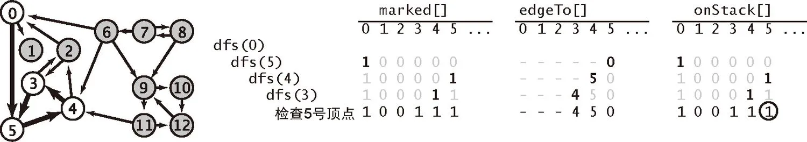

- 图 4.2.9　在一幅有向图中寻找环

表 4.2.5　有向环的 API

```java
     public class  <b>DirectedCycle</b>
```

- 寻找有向环的构造函数

```
DirectedCycle(Digraph G)
          boolean  hasCycle()
G 是否含有有向环
Iterable<Integer>  cycle()
```

- 有向环中的所有顶点（如果存在的话）

- 寻找有向环

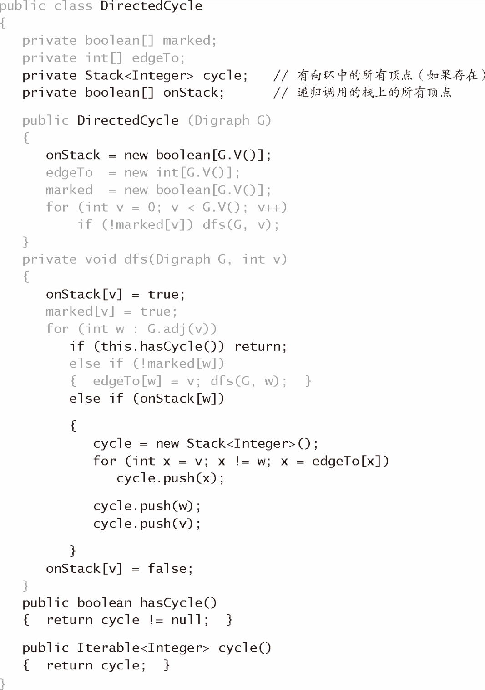

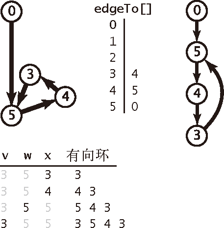

- 有向环检测的轨迹

```
该类为标准的递归 dfs() 方法添加了一个布尔类型的数组 onStack[] 来保存递归调用期
间栈上的所有顶点。当它找到一条边 v → w 且 w 在栈中时，它就找到了一个有向环。环上
的所有顶点可以通过 edgeTo[] 中的链接得到。
在执行 dfs(G,v) 时，查找的是一条由起点到 v 的有向路径。要保存这条路径，
DirectedCycle 维护了一个由顶点索引的数组 onStack[]，以标记递归调用的栈上的所有
顶点（在调用 dfs(G,v) 时将 onStack[v] 设为 true，在调用结束时将其设为 false）。
DirectedCycle 同时也使用了一个 edgeTo[] 数组，在找到有向环时返回环中的所有顶
点，方法和 DepthFirstPaths（请见算法 4.1）以及 BreadthFirstPaths（请见算法
```

4.2）相同。

### 4.2.4.3　顶点的深度优先次序与拓扑排序

优先级限制下的调度问题等价于计算有向无环图中的所有顶点的拓扑顺序，因此有表 4.2.6 所示的 API。

表 4.2.6　拓扑排序的 API

```java
     public class  <b>Topological</b>
                   Topological(Digraph G)
```

- 拓扑排序的构造函数

```
          boolean  isDAG()
G 是有向无环图吗
Iterable<Integer>  order()
```

- 拓扑有序的所有顶点

- 命题 E。当且仅当一幅有向图是无环图时它才能进行拓扑排序。证明。如果一幅有向图含有一个环，它就不可能是拓扑有序的。与此相反，我们将要学习的算法能够计算任意有向无环图的拓扑顺序。

值得注意的是，实际上我们已经见过一种拓扑排序的算法：只要添加一行代码，标准深度优先搜索程序就能完成这项任务！要做到这一点，我们先来看看后面框注“有向图中基于深度优先

```
搜索的顶点排序”的 DepthFirstOrder 类。它的基本思想是深度优先搜索正好只会访问每个
顶点一次。如果将 dfs() 的参数顶点保存在一个数据结构中，遍历这个数据结构实际上就能
```

访问图中的所有顶点，遍历的顺序取决于这个数据结构的性质以及是在递归调用之前还是之后进行保存。在典型的应用中，人们感兴趣的是顶点的以下 3 种排列顺序。

- 前序：在递归调用之前将顶点加入队列。

- 后序：在递归调用之后将顶点加入队列。

- 逆后序：在递归调用之后将顶点压入栈。

```
图 4.2.10 所示的是用 DepthFirstOrder 处理示例有向无环图所产生的轨迹。它的实现简
单，支持在图的高级处理算法中十分有用的 pre()、post() 和 reversePost() 方法。例
如，Topological 类中的 order() 方法就调用了 reversePost() 方法。
```

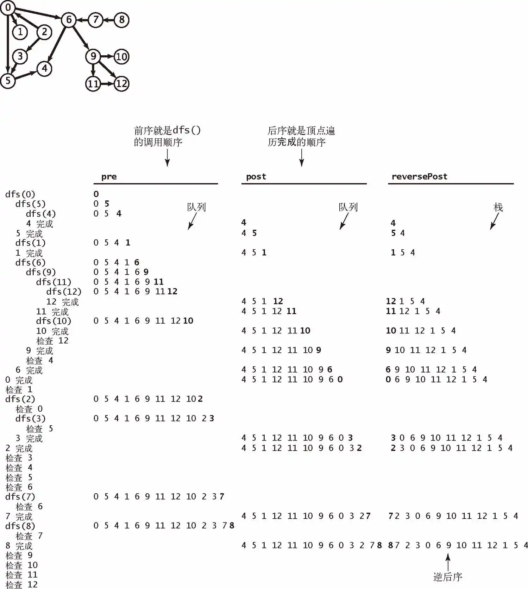

- 图 4.2.10　计算有向图中顶点的深度优先次序（前序、后序和逆后序）

- 有向图中基于深度优先搜索的顶点排序

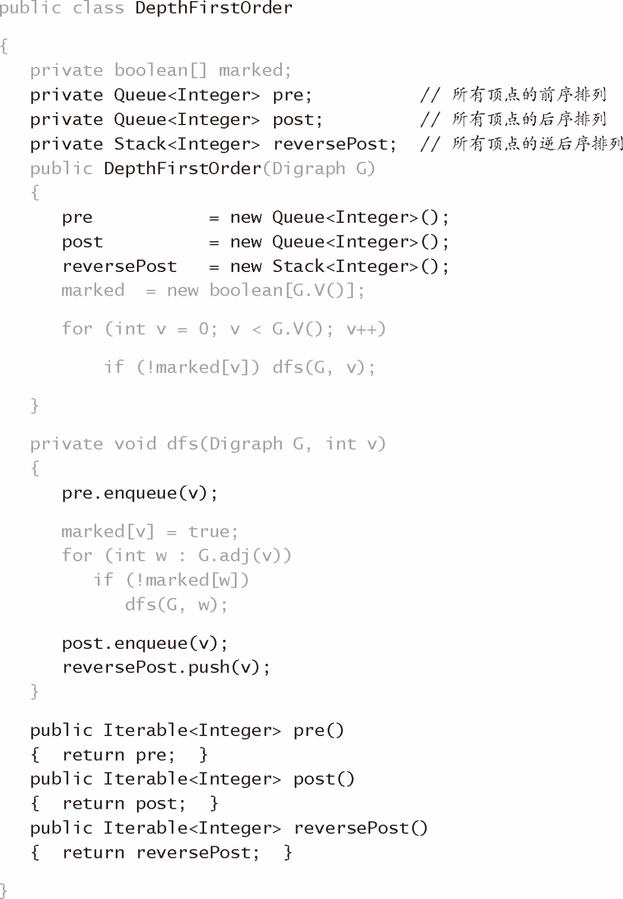

- 该类允许用例用各种顺序遍历深度优先搜索经过的所有顶点。这在高级的有向图处理算法中非常有用，因为搜索的递归性使得我们能够证明这段计算的许多性质（例如命题 F）。

- 算法 4.5　拓扑排序

```java
public class Topological
1
{
2
  private Iterable<Integer> order;       // 顶点的拓扑顺序
3
4
  public Topological(Digraph G)
5
  {
6
     DirectedCycle cyclefinder = new DirectedCycle(G);
7
     if (!cyclefinder.hasCycle())
8
9
     {
10
        DepthFirstOrder dfs = new DepthFirstOrder(G);
11
12
        order = dfs.reversePost();
13
     }
14
  }
15
16
  public Iterable<Integer> order()
17
  {  return order;  }
18
  public boolean isDAG()
19
  {  return order != null;  }
20
21
  public static void main(String[] args)
22
23
  {
24
     String filename = args[0];
25
     String separator = args[1];
26
     SymbolDigraph sg = new SymbolDigraph(filename, separator);
27
28
     Topological top = new Topological(sg.G());
29
30
     for (int v : top.order())
31
        StdOut.println(sg.name(v));
32
  }
33
34
}
35
这段代码使用了 DepthFirstOrder 类和 DirectedCycle 类来返回一幅有向无环图的
拓扑排序。其中的测试代码解决了一幅 SymbolDigraph 中有优先级限制的调度问题。在
给定的有向图包含环时，order() 方法会返回 null，否则会返回一个能够给出拓扑有序
的所有顶点的迭代器。这里省略了关于 SymbolDigraph 的代码，因为它和
SymbolGraph（请见第 356 页）的代码几乎完全相同，只需把所有的 Graph 替换为
Digraph 即可。
```

- 命题 F。一幅有向无环图的拓扑顺序即为所有顶点的逆后序排列。

```
证明。对于任意边 v → w，在调用 dfs(v) 时，下面三种情况必有其一成立（请见图
```

- 4.2.11）。

```
dfs(w) 已经被调用过且已经返回了（w 已经被标记）。
dfs(w) 还没有被调用（w 还未被标记），因此 v → w 会直接或间接调用并返回
dfs(w)，且 dfs(w) 会在 dfs(v) 返回前返回。
dfs(w) 已经被调用但还未返回。证明的关键在于，在有向无环图中这种情况是不可能
出现的，这是由于递归调用链意味着存在从 w 到 v 的路径，但存在 v → w 则表示存在
```

- 一个环。

```
在两种可能的情况中，dfs(w) 都会在 dfs(v) 之前完成，因此在后序排列中 w 排在 v 之
前而在逆后序中 w 排在 v 之后。因此任意一条边 v → w 都如我们所愿地从排名较前顶点
```

- 指向排名较后的顶点。

```
% more jobs.txt
Algorithms/Theoretical CS/Databases/Scientific Computing
Introduction to CS/Advanced Programming/Algorithms
Advanced Programming/Scientific Computing
Scientific Computing/Computational Biology
Theoretical CS/Computational Biology/Artificial Intelligence
Linear Algebra/Theoretical CS
Calculus/Linear Algebra
Artificial Intelligence/Neural Networks/Robotics/Machine Learning
Machine Learning/Neural Networks
% java Topological jobs.txt "/"
Calculus
Linear Algebra
Introduction to CS
Advanced Programming
Algorithms
Theoretical CS
Artificial Intelligence
Robotics
Machine Learning
Neural Networks
Databases
Scientific Computing
Computational Biology
Topological 类（请见算法 4.5）的实现使用了深度优先搜索来对有向无环图进行拓扑排
```

序。图 4.2.11 为排序的轨迹。

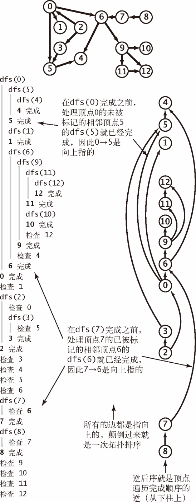

- 图 4.2.11　有向无环图的逆后序是拓扑排序

- 命题 G。使用深度优先搜索对有向无环图进行拓扑排序所需的时间和成正比。

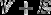

- 证明。由代码可知，第一遍深度优先搜索保证了不存在有向环，第二遍深度优先搜索产生了顶点的逆后序排列。两次搜索都访问了所有的顶点和所有的边，因此它所需的时间和成正比。

尽管算法很简单，但是它被忽略了很多年，比它更流行的是一种使用队列储存顶点的更加直观的算法。（请见练习 4.2.30）

在实际应用中，拓扑排序和有向环的检测总会一起出现，因为有向环的检测是排序的前提。例如，在一个任务调度应用中，无论计划如何安排，其背后的有向图中包含的环意味着存在一个必须被纠正的严重错误。因此，解决任务调度类应用通常需要以下 3 步：

- 指明任务和优先级条件；

- 不断检测并去除有向图中的所有环，以确保存在可行方案的；

- 使用拓扑排序解决调度问题。

```
类似地，调度方案的任何变动之后都需要再次检查是否存在环（使用 DirectedCycle 类），
然后再计算新的调度安排（使用 Topological 类）。
```

### 4.2.5　有向图中的强连通性

在前文中，我们仔细区别了有向图中的可达性和无向图中的连通性。在一幅无向图中，如果有

```
一条路径连接顶点 v 和 w，则它们就是连通的——既可以由这条路径从 w 到达 v，也可以从
v 到达 w。相反，在一幅有向图中，如果从顶点 v 有一条有向路径到达 w，则顶点 w 是从顶
点 v 可达的，但从 w 到达 v 的路径可能存在也可能不存在。在对有向图的研究中，我们也会
```

考虑与无向图中的连通性类似的一个问题。

```
定义。如果两个顶点 v 和 w 是互相可达的，则称它们为强连通的。也就是说，既存在一条
从 v 到 w 的有向路径，也存在一条从 w 到 v 的有向路径。如果一幅有向图中的任意两个
```

- 顶点都是强连通的，则称这幅有向图也是强连通的。

图 4.2.12 给出了几个强连通图的例子。从这些例子中你可以看到，环在强连通性的理解上起着重要的作用。事实上，回忆一下一条普通的有向环可能含有重复的顶点就很容易知道，两个

```
顶点是强连通的当且仅当它们都在一个普通的有向环中（证明：画出从 v 到 w 和从 w 到 v 的
```

路径即可）。

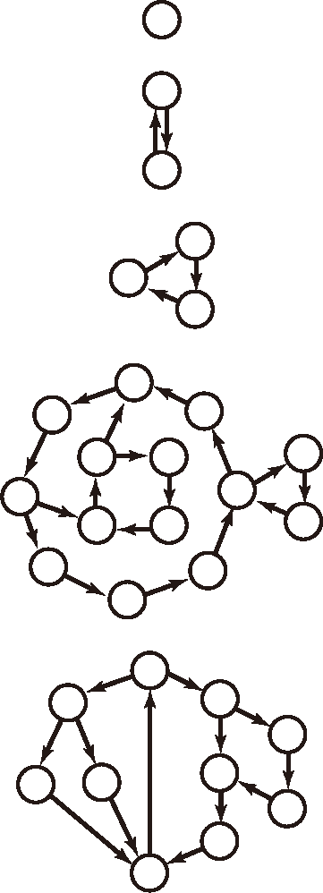

- 图 4.2.12　强连通的有向图

### 4.2.5.1　强连通分量

和无向图中的连通性一样，有向图中的强连通性也是一种顶点之间等价关系，因为它有着以下性质。

```
自反性：任意顶点 v 和自己都是强连通的。
对称性：如果 v 和 w 是强连通的，那么 w 和 v 也是强连通的。
传递性：如果 v 和 w 是强连通的且 w 和 x 也是强连通的，那么 v 和 x 也是强连通的。
```

作为一种等价关系，强连通性将所有顶点分为了一些等价类，每个等价类都是由相互均为强连通的顶点的最大子集组成的。我们将这些子集称为强连通分量，请见图 4.2.13。样图tinyDG.txt 含有 5 个强连通分量。一个含有

- 个顶点的有向图含有个强连通分量——


- 个强连通分量。需要注

一个强连通图只含有一个强连通分量，而一个有向无环图中则含有

意的是强连通分量的定义是基于顶点的，而非边。有些边连接的两个顶点都在同一个强连通分量中，而有些边连接的两个顶点则在不同的强连通分量中。后者不会出现在任何有向环之中。与识别连通分量在无向图中的重要性一样，在有向图的处理中识别强连通分量也是非常重要的。

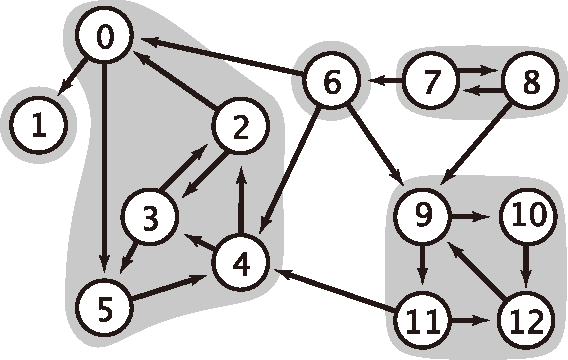

- 图 4.2.13　一幅有向图和它的强连通分量

### 4.2.5.2　应用举例

在理解有向图的结构时，强连通性是一种非常重要的抽象，它突出了相互关联的几组顶点（强连通分量）。例如，强连通分量能够帮助教科书的作者决定哪些话题应该被归为一类，或帮助程序员组织程序的模块（请见表 4.2.7）。图 4.2.14 是一个生态学的例子。这幅有向图描绘的是各种生物之间的食物链模型，其中顶点表示物种，而从一个顶点指向另一个顶点的一条边则表示指向顶点的物种对指出顶点的物种的捕食关系。这些有向图（其中物种和捕食关系都是经过仔细选择和研究的）的科学研究有效地帮助了生态学家解决生态系统中的一些基本问题。这种有向图中的强连通分量能够帮助生态学家理解食物链中能量的流动。图 4.2.17 所示的是一张表示网络内容的有向图，其中顶点表示网页，而边表示从一个页面指向另一个页面的超链接。在这样一幅有向图中，强连通分量能够帮助网络工程师将网络中数量庞大的网页分为多个大小可以接受的部分分别进行处理。练习和本书的网站会涉及这些应用和其他例子的更多性质。

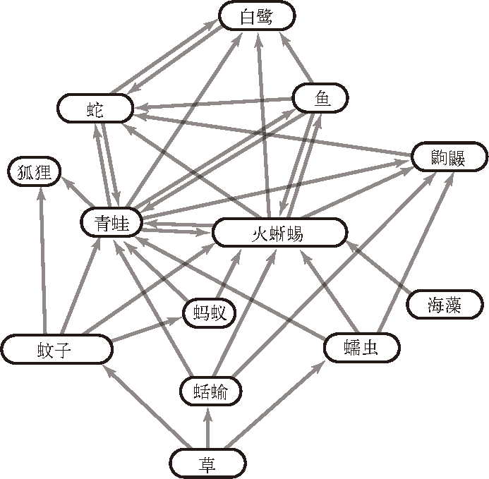

- 图 4.2.14 一幅表示食物链的有向图的一小部分

- 表 4.2.7　强连通分量的典型应用

应用

- 顶点边

```
因此，在有向图中我们也需要表 4.2.8 所列的这份和 CC（请见表 4.1.6）类似的 API。
```

表 4.2.8　强连通分量的 API

```java
public class  <b>SCC</b>
              SCC(Digraph G)
```

- 预处理构造函数

```
     boolean  stronglyConnected(int v,
v 和 w 是强连通的吗
int w)
         int  count()
```

- 图中的强连通分量的总数

```
v 所在的强连通分量的标识符（ 在 0
         int  id(int v)
```

- 之间）

设计一种平方级别的算法来计算强连通分量（请见练习 4.2.23）并不困难，但（和以前一样）对于处理在实际应用中经常遇到的像刚才示例所示的大型有向图来说，平方级别的时间和空间需求是不可接受的。

### 4.2.5.3　Kosaraju 算法

```
我们在 CC（请见算法 4.3）中看到过，计算无向图中的连通分量只是深度优先搜索的一个简
```

单应用。那么在有向图中应该如何高效地计算强连通分量呢？令人惊讶的是，算法 4.6 中的

```
KosarajuCC 的实现只为 CC 添加了几行代码就做到了这一点，它将会完成以下任务（请见
```

图 4.2.15）。


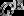

```
在给定的一幅有向图 中，使用 DepthFirstOrder 来计算它的反向图 的逆后序排列。
```

- 在 中进行标准的深度优先搜索，但是要按照刚才计算得到的顺序而非标准的顺序来访问所有未被标记的顶点。

```
在构造函数中，所有在同一个递归 dfs() 调用中被访问到的顶点都在同一个强连通分量
中，将它们按照和 CC 相同的方式识别出来。
```

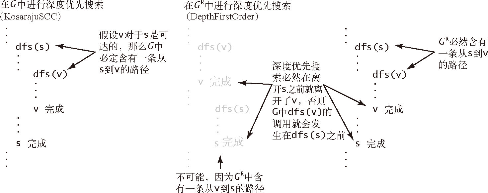

- 图 4.2.15　Kosaraju 算法的正确性证明

- 算法 4.6　计算强连通分量的 Kosaraju 算法

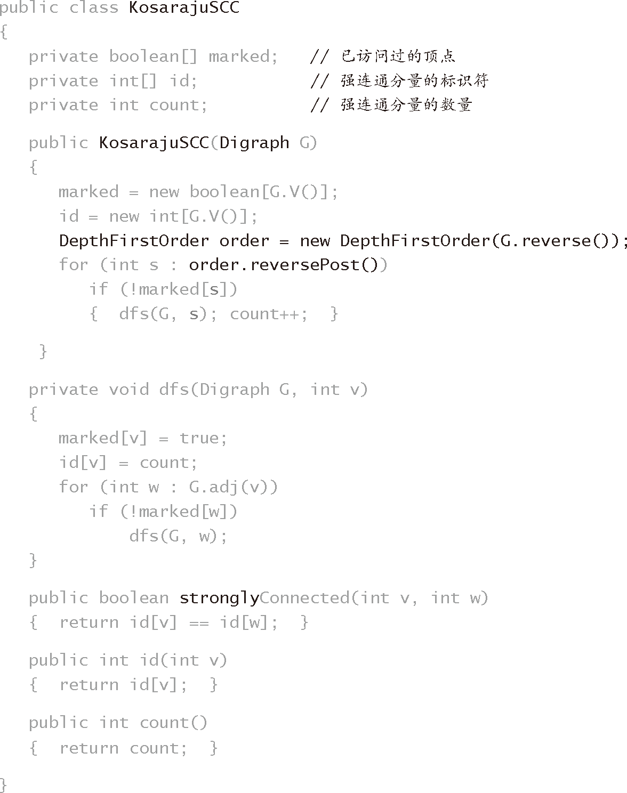

```
% java KosarajuSCC tinyDG.txt
1
5 components
2
1
3
5 4 3 2 0
4
12 11 10 9
5
6
6
8 7
7
突出显示的代码是这份实现和 CC（请见算法 4.3）仅有的不同之处（还需要将 4.1.6.1 节中
用到的 main() 函数中的 Graph 替换为 Digraph，CC 替换为 KosarajuSCC）。为了找
```

- 到所有强连通分量，它会在反向图中进行深度优先搜索来将顶点排序（搜索顺序的逆后序），在给定有向图中用这个顺序再进行一次深度优先搜索。

Kosaraju 算法是一个典型示例，这个方法容易实现但难以理解。尽管它有些神秘，但如果你能一步一步地理解下面这个命题的证明并参考图 4.2.15，那你一定可以理解这个算法的正确性。

- 命题 H。使用深度优先搜索查找给定有向图的反向图，根据由此得到的所有顶点的逆

- （Kosaraju 算法），其构造函数中的每一次递归调用后序再次用深度优先搜索处理有向图

- 所标记的顶点都在同一个强连通分量之中。证明。首先要用反证法证明“每个和 s 强连通的顶点 v 都会在构造函数调用的 dfs(G,s)

```
中被访问到”。假设有一个和 s 强连通的顶点 v 不会在构造函数调用的 dfs(G,s) 中被访
问到。因为存在从 s 到 v 的路径，所以 v 肯定在之前就已经被标记过了。但是，因为也存
在从 v 到 s 的路径，在 dfs(G,v) 调用中 s 肯定会被标记，因此构造函数应该是不会调
用 dfs(G,s) 的。矛盾。
```

- 其次，要证明“构造函数调用的 dfs(G,s) 所到达的任意顶点 v 都必然是和 s 强连通的”。

```
设 v 为 dfs(G,s) 到达的某个顶点。那么，
 中必然存在一条从 s 到 v 的路径，因此只
```

```
 中还存在一条从 v 到 s 的路径即可。这也等价于
 中存在一条从 s 到 v 的
```

- 需要证明

```
 中存在一条从 s 到 v 的路径即可。
```

- 路径，因此只需要证明在

- 中进行的深度优先搜索证明的核心在于，按照逆后序进行的深度优先搜索意味着，在

```
中，dfs(G,v) 必然在 dfs(G,s) 之前就已经结束了，这样 dfs(G,v) 的调用就只会出
```

- 现两种情况：

```
调用在 dfs(G,s) 的调用之前（并且也在 dfs(G,s) 的调用之前结束）；
调用在 dfs(G,s) 的调用之后（并且也在 dfs(G,s) 的结束之前结束）。
 中存在一条从 v 到 s 的路径；而第二种情况则说
```

- 第一种情况是不可能出现的，因为在

```
 中存在一条从 s 到 v 的路径。证毕。
```

- 明

```
图 4.2.16 所示为 Kosaraju 算法处理 tinyDG.txt 时的轨迹。在每次 dfs() 调用轨迹的右侧都
```

是有向图的一种画法，顶点按照搜索结束的顺序排列。因此，从下往上来看左侧这幅有向图的反向图得到的就是所有顶点的逆后序，也就是在原始的有向图中进行深度优先搜索时所有未被标记的顶点被检查的顺序。你可以从图中看到，在第二遍深度优先搜索中，首先调用的是

```
dfs(1)（标记顶点 1），然后调用的是 dfs(0)（标记顶点 0、5、4、3 和 2），然后检查了
顶点 2、4、5 和 3，再调用 dfs(11)（标记顶点 11、12、9 和 10），在检查了 9、12 和
10 之后调用 dfs(6)（标记顶点 6），最后调用 dfs(7) 标记了顶点 7 和 8。
```

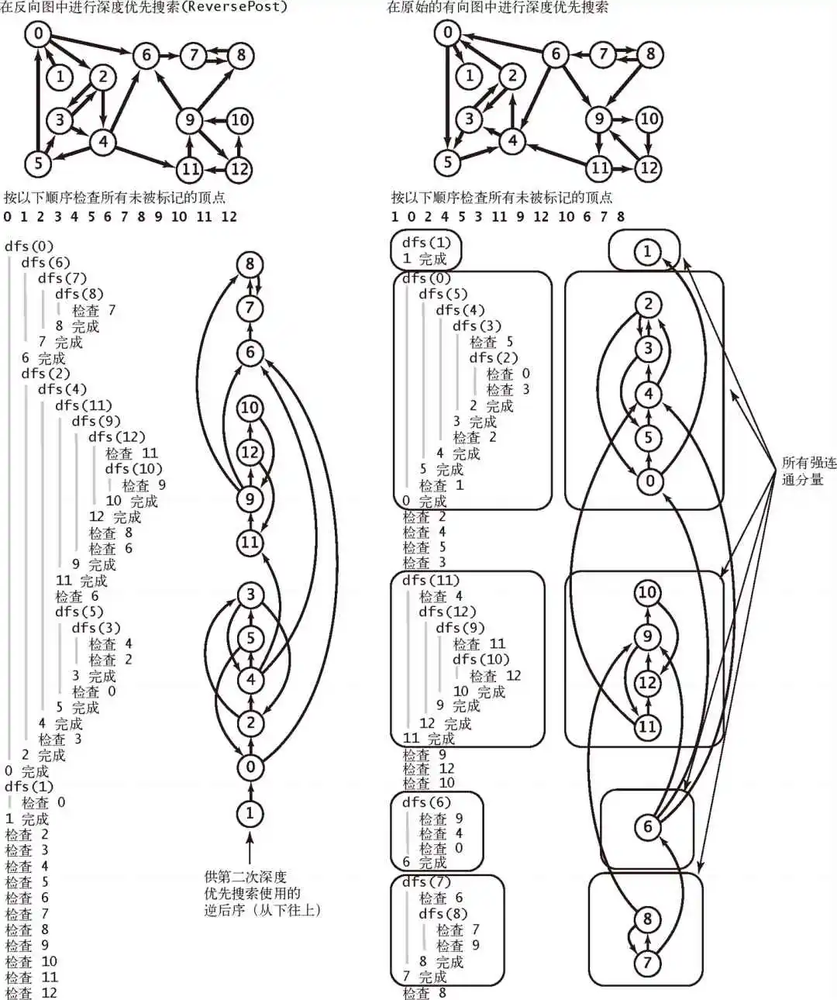

- 图 4.2.16　在有向图中寻找强连通分量的 Kosaraju 算法

图 4.2.17 中所示的是一个更大的示例，也是 Web 的有向图模型的一个非常小的部分。

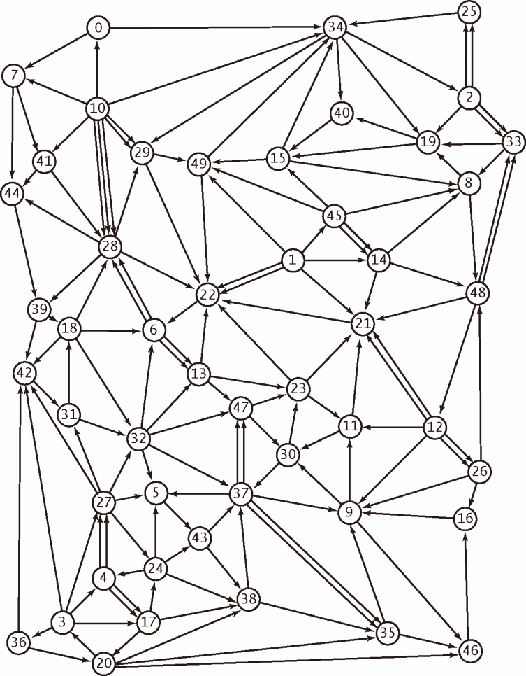

- 图 4.2.17　这幅有向图中含有多少个强连通分量

我们在第 1 章已经介绍过 Kosaraju 算法并在 4.1 节中再次使用该算法解决了无向图的连通性问题。Kosaraju 算法也解决了有向图中的类似问题。

强连通性。给定一幅有向图，回答“给定的两个顶点是强连通的吗？这幅有向图中含有多少个强连通分量？”等类似问题。

我们能否用和无向图相同的效率解决有向图的连通性问题？这个问题已经被研究了很长时间了（R.E.Tarjan 在 20 世纪 70 年代末解决了这个问题）。这样一个简单的解决方法实在令人惊讶。

- 命题 I。Kosaraju 算法的预处理所需的时间和空间与成正比且支持常数时间的有向

- 图强连通性的查询。证明。该算法会处理有向图的反向图并进行两次深度优先搜索。这 3 步所需的时间都与成正比。反向复制一幅有向图所需的空间与成正比。

### 4.2.5.4　再谈可达性

```
根据 CC 类我们可以知道，在无向图中如果两个顶点 v 和 w 是连通的，那么就既存在一条从
v 到 w 的路径也存在一条从 w 到 v 的路径。根据 KosarajuSCC 类可知，在有向图中如果两
个顶点 v 和 w 是强连通的，那么也既存在一条从 v 到 w 的路径也存在（另）一条从 w 到 v
的路径。但对于一对非强连通的顶点呢？也许存在一条从 v 到 w 的路径，也许存在一条从 w
到 v 的路径，也许两条都不存在，但不可能两条都存在。
```

顶点对的可达性。给定一幅有向图，回答“是否存在一条从一个给定的顶点 v 到另一个给定的顶点 w 的路径？”等类似问题。

对于无向图，这个问题等价于连通性问题；对于有向图，它和强连通性的问题有很大区别。

```
CC 实现需要线性级别的预处理时间才能支持常数时间的查询操作。我们能够在有向图的相应
```

实现中达到这样的性能吗？这个看似简单的问题困扰了专家数十年。为了更好地理解这个问题，我们来看看图 4.2.18。它展示了下面这个基本的概念。

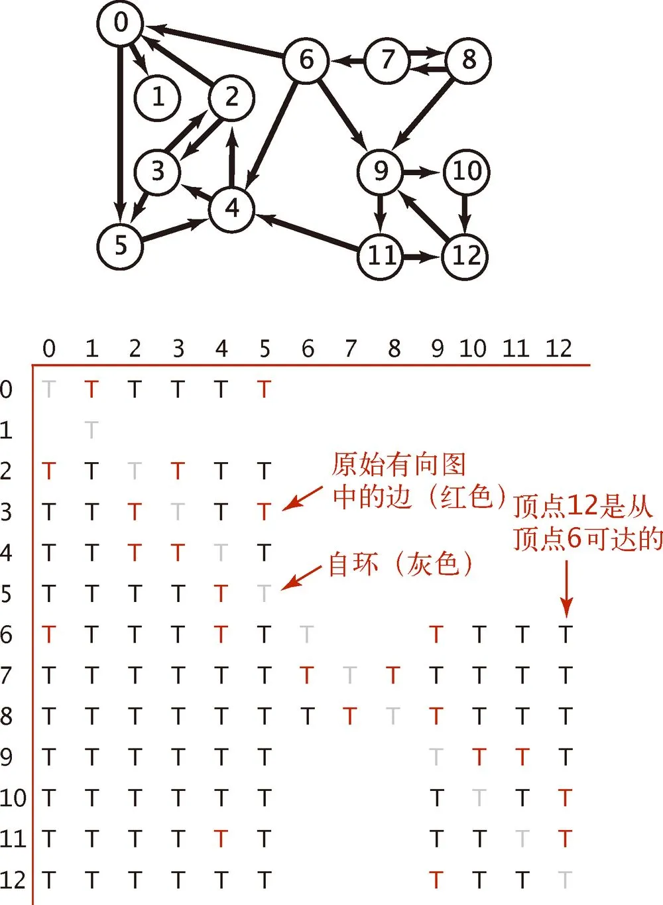

- 图 4.2.18　传递闭包

- 的传递闭包是由相同的一组顶点组成的另一幅有向图，在传递闭包中存在定义。有向图

```
一条从 v 指向 w 的边当且仅当在
 中 w 是从 v 可达的。
```

- 个自环。示例有向图只有

根据约定，每个顶点对于自己都是可达的，因此传递闭包会含有

22 条有向边，但它的传递闭包含有可能的 169 条有向边中的 102 条。一般来说，一幅有向图的传递闭包中所含的边都比原图中多得多，一幅稀疏图的传递闭包却是一幅稠密图也是很常见

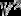

- 个顶点和条边的有向环的传递闭包是一幅含有条边的有向完全图。

的。例如，含有

```
因为传递闭包一般都很稠密，我们通常都将它们表示为一个布尔值矩阵，其中 v 行 w 列的值
为 true 当且仅当 w 是从 v 可达的。与其明确计算一幅有向图的传递闭包，不如使用深度优
```

先搜索来实现表 4.2.9 中的 API。

表 4.2.9　顶点对可达性的 API

```java
public class  <b>TransitiveClosure</b>
              TransitiveClosure(Digraph G)
```

- 预处理的构造函数

```
     boolean  reachable(int v, int w)
w 是从 v 可达的吗
下页框注中的代码使用 DirectedDFS（请见算法 4.4）简单明了地实现了它。无论对于稀疏
```

还是稠密的图，它都是理想解决方案，但它不适用于在实际应用中可能遇到的大型有向图，因

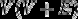

- 成正比，所需的时间和成正比：共有个

为构造函数所需的空间和

```
DirectedDFS 对象，每个所需的空间都与
 的 marked[] 数
```

- 成正比（它们都含有大小为

```
 条边来计算标记）。本质上，TransitiveClosure 通过计算
```

- 的传递闭包来

组并会检查


```
 行就是 TransitiveClosure 类中的
```

支持常数时间的查询——传递闭包矩阵中的第

```
DirectedDFS[] 数组的第 v 个元素的 marked[] 数组。我们能够大幅度减少预处理所需的
```

时间和空间同时又保证常数时间的查询吗？用远小于平方级别的空间支持常数级别的查询的一般解决方案仍然是一个有待解决的研究问题，并且有重要的实际意义：例如，除非这个问题得到解决，对于像代表互联网这样的巨型有向图，否则无法有效解决其中的顶点对可达性问题。

```java
public class TransitiveClosure
{
  private DirectedDFS[] all;
  TransitiveClosure(Digraph G)
  {
     all = new DirectedDFS[G.V()];
     for (int v = 0; v < G.V(); v++)
        all[v] = new DirectedDFS(G, v);
  }
  boolean reachable(int v, int w)
  {  return all[v].marked(w);  }
}
```

顶点对的可达性

### 4.2.6　总结

在本节中，我们介绍了有向边和有向图并强调了有向图处理算法和无向图处理中相应算法的关系，涵盖了以下几个方面：

- 有向图的术语；

- 有向图的表示和算法在本质上和无向图是相同的，但部分有向图问题更加复杂；

- 有向环、有向无环图、拓扑排序和优先级限制下的调度问题；

- 有向图的可达性、路径和强连通性。

表 4.2.10 总结了我们已经学过的各种有向图算法的实现（只有一个算法不基于深度优先搜索）。这些问题的描述都很简单，但它们的解决方法有的仅仅简单改造了无向图中的相应问题的处理算法，有的却非常巧妙。这些算法是 4.4 节更加复杂的算法的基础，在 4.4 节我们将学习加权有向图。

表 4.2.10　本节中得到解决的有向图处理问题

问题

- 解决方法参阅

```
DirectedDFS
```

- 算法 4.4

单点和多点的可达性

```
DepthFirstDirectedPaths
```

- 4.2.3.2

单点有向路径

```
BreadthFirstDirectedPaths
```

- 4.2.3.2

单点最短有向路径

```
DirectedCycle
```

- 4.2.4.2 框注“寻找有向环”

有向环检测

```
DepthFirstOrder
```

- 4.2.4.2 框注“有向图中基于深

深度优先的顶点排序

```
Topological
```

- 算法 4.5

优先级限制下的调度问题

```
Topological
```

- 算法 4.5

拓扑排序

```
KosarajuSCC
```

- 算法 4.6

强连通性

### 答疑

问　自环是一个环吗？

答　是的，但没有自环的顶点对于自己也是可达的。

### 练习

4.2.1　一幅含有

- 个顶点且没有平行边的有向图中最多可能含有多少条边？一幅含有个顶

点且没有孤立顶点的有向图中最少需要多少条边？

```
4.2.2　按照正文中示意图的样式（请见图 4.1.9）画出 Digraph 的构造函数在处理图 4.2.19
```

的 tinyDGex2.txt 时构造的邻接表。

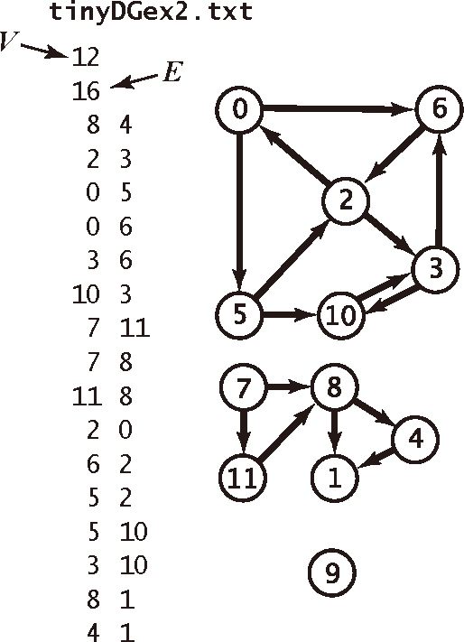

图　4.2.19

```
4.2.3　为 Digraph 添加一个构造函数，它接受一幅有向图 G 然后创建并初始化这幅图的一
个副本。G 的用例的对它作出的任何改动都不应该影响到它的副本。
4.2.4　为 Digraph 添加一个方法 hasEdge()，它接受两个整型参数 v 和 w。如果图含有边
v → w，方法返回 true，否则返回 false。
4.2.5　修改 Digraph，不允许存在平行边和自环。
4.2.6　为 Digraph 编写一个测试用例。
```

4.2.7　顶点的入度为指向该顶点的边的总数。顶点的出度为由该顶点指出的边的总数。从出度为 0 的顶点是不可能达到任何顶点的，这种顶点叫做终点；入度为 0 的顶点是不可能从任何顶点到达的，所以叫做起点。一幅允许出现自环且每个顶点的出度均为 1 的有向图叫做映射（从 0 到

- 之间的整数到它们自身的函数）。编写一段程序 Degrees.java，实现下面的

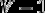

API，如表 4.2.11 所示。

表　4.2.11

```java
     public class  <b>Degrees</b>
                   Degrees(Digraph G)
```

- 构造函数

```
              int  indegree(int v)
v 的入度
              int  outdegree(int v)
v 的出度
Iterable<Integer>  sources()
```

- 所有起点的集合

```
Iterable<Integer>  sinks()
```

- 所有终点的集合

```
          boolean  isMap()
G 是一幅映射吗
4.2.8　画出所有含有 2、3、4 和 5 个顶点的非同构有向无环图。（参考练习 4.1.28）
```

4.2.9　编写一个方法，检查一幅有向无环图的顶点的给定排列是否就是该图顶点的拓扑排序。

4.2.10　给定一幅有向无环图，是否存在一种无法用基于深度优先搜索算法得到的顶点的拓扑排序？顶点的相邻关系不限。证明你的结论。

4.2.11　描述一组稀疏有向图，其含有的有向环的个数随着顶点增加而呈指数级增长。

4.2.12　一幅含有

- 个顶点和条边且为一条简单路径的有向图的传递闭包中含有多少

条边？

4.2.13　给出这幅含有 10 个顶点和以下边的有向图的传递闭包：

```
3 → 7 1 → 4 7 → 8 0 → 5 5 → 2 3 → 8 2 → 9 0 → 6 4 → 9 2 → 6 6 → 4
```

4.2.14　证明

- 和中的强连通分量是相同的。

4.2.15　一幅有向无环图的强连通分量是哪些？

4.2.16　用 Kosaraju 算法处理一幅有向无环图的结果是什么？

4.2.17　真假判断：一幅有向图的反向图的顶点的逆后序排列和该有向图的顶点的后序排列相同。

```
 条边的 Digraph 的内存使用
```

4.2.18　使用 1.4 节中的内存使用模型评估含有

- 个顶点和

情况。

### 提高题

4.2.19　拓扑排序与广度优先搜索。解释为何如下算法无法得到一组拓扑排序：运行广度优先搜索并按照所有顶点和起点的距离标记它们。

```
4.2.20　有向欧拉环。欧拉环是一条每条边恰好出现一次的有向环。编写一个程序 Euler 来
```

- 是连通的且每个顶点的

找出有向图中的欧拉环或者说明它不存在。提示：当且仅当有向图

- 含有一条有向欧拉环。

出度和入度相同时

```
4.2.21　有向无环图中的 LCA。给定一幅有向无环图和两个顶点 v 和 w，找出 v 和 w 的 LCA
```

（Lowest Common Ancestor，最近共同祖先）。LCA 的计算在实现编程语言的多重继承、分析家谱数据（找出家族中近亲繁衍的程度）和其他一些应用中很有用。提示：将有向无环图中

```
的顶点 v 的高度定义为从根结点到 v 的最长路径。在所有 v 和 w 的共同祖先中，高度最大者
就是 v 和 w 的最近共同祖先。
4.2.22　最短先导路径。给定一幅有向无环图和两个顶点 v 和 w，找出 v 和 w 之间的最短先
导路径。设 v 和 w 的一个共同的祖先顶点为 x，先导路径为 v 到 x 的最短路径和 w 到 x 的
最短路径。v 和 w 之间的最短先导路径是所有先导路径中的最短者。热身：构造一幅有向无
环图，使得最短先导路径到达的祖先顶点 x 不是 v 和 w 的最近共同祖先。提示：进行两次广
度优先搜索，一次从 v 开始，一次从 w 开始。
4.2.23　强连通分量。设计一种线性时间的算法来计算给定顶点 v 所在的强连通分量。在这个
```

算法的基础上设计一种平方时间的算法来计算有向图的所有强连通分量。

4.2.24　有向无环图中的汉密尔顿路径。设计一种线性时间的算法来判定给定的有向无环图中是否存在一条能够正好只访问每个顶点一次的有向路径。

答案：计算给定图的拓扑排序并顺序检查拓扑排序中每一对相邻的顶点之间是否存在一条边。

4.2.25　唯一的拓扑排序。设计一个算法来判定一幅有向图的拓扑排序是否是唯一的。提示：当且仅当拓扑排序中每一对相邻的顶点之间都存在一条有向边（即有向图含有一条汉密尔顿路径）时它的拓扑排序才是唯一的。如果一幅有向图的拓扑排序不唯一，另一种拓扑排序可以由交换拓扑排序中的某一对相邻的顶点得到。

4.2.26　2- 可满足性。给定一个由

- 个子句和个变量的组成的以合取范式形式给出的布尔


逻辑命题，每个子句都正好含有两个变量，找到一组使布尔表达式为真的变量赋值（如果存

- 个顶点的蕴涵有向图（implication graph）（每个变量和它的反

在）。提示：构造一幅含有

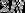

```
都各有一个顶点）。对于每个子句 x+y，添加一条从 y' 到 x 的边和一条从 x' 到 y 的边。要
满足子句 x+y，必有 (i) 如果 y 是假那么 x 为真，或者 (ii) 如果 x 是假那么 y 为真。说
明：当且仅当没有任何顶点 x 和它的反 x' 存在于同一个强连通分量中时这个表达式才能被满
```

足。另外，核心有向无环图（每个强连通分量都是一个顶点）的拓扑排序也能够产生一组可以满足该表达式的变量赋值。

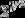

4.2.27　有向图的枚举。证明所有不同的含有

- 个顶点且不含平行边的有向图的总数为

- 个顶点和条边的不同有向图有多少个？）假设宇宙中每个电子在一纳秒内能够

个。（含有


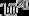

- 个，宇宙的寿命小于年。对于所有含有

检查一幅有向图，宇宙中的电子总数不超过20 个顶点的不同有向图，计算机最多能够检查它们的百分之几？

4.2.28　有向无环图的枚举。给出一个公式，计算含有

- 个顶点和条边的所有有向无环图

的数量。

4.2.29　算术表达式。编写一个类来计算由有向无环图表示的算术表达式。使用一个由顶点索引的数组来保存每个顶点所对应的值。假设叶子结点中的值是常数。描述一组算术表达式，使得它所对应的表达式树（expression tree）的大小是相应的有向无环图的大小的指数级别。（因此程序处理有向无环图所需的时间将和处理表达式树所需的时间的对数成正比。）

4.2.30　基于队列的拓扑排序。实现一种拓扑排序，使用由顶点索引的数组来保存每个顶点的

```
入度。遍历一遍所有边并使用练习 4.2.7 给出的 Degrees 类来初始化数组以及一条含有所有
```

起点的队列。然后，重复以下操作直到起点队列为空：

- 从队列中删去一个起点并将其标记；

- 遍历由被删除顶点指出的所有边，将所有被指向的顶点的入度减一；

- 如果顶点的入度变为 0，将它插入起点队列。

4.2.31　有向欧几里得图。修改你为 4.1.36 给出的解答，为平面图设计一份 API 名为

```
EuclideanDigraph，这样你就能够处理用图形表示的图了。
```

### 实验题

```
4.2.32　随机有向图。编写一个程序 ErdosRenyiDigraph，从命令行接受整数
```

- 和，随

机生成 E 对 0 到

- 之间的整数来构造一幅有向图。注意：生成器可能会产生自环和平行

边。

```
4.2.33　随机简单有向图。编写一个程序 RandomSimpleDigraph，从命令行接受整数
```

- 和

- 个顶点和条边的所有可能的简单有向图。，用均等的几率生成含有

```
4.2.34　随机稀疏有向图。将你为练习 4.1.40 给出的解答修改为 RandomSparseDigraph，
```

- 和的值生成随机的稀疏有向图，使得我们可以用它进行有意义的经

根据精心选择的一组

验性测试。

```
4.2.35　随机欧几里得图。将你为练习 4.1.41 给出的解答修改为 EuclideanDigraph 的用
例 RandomEuclideanDigraph，随机指定每条边的方向。
4.2.36　随机网格图。将你为练习 4.1.42 给出的解答修改为 EuclideanDigraph 的用例
RandomGridDigraph，随机指定每条边的方向。
```

4.2.37　真实世界中的有向图。从互联网上找出一幅巨型有向图——可以是某个在线商业系统

```
的交易图，或是由网页和链接得到的有向图。编写一段程序 RandomRealDigraph，从这些
```

- 个顶点，然后再从这些顶点构成的子图中随机选取条有向边

顶点构成的子图中随机选取

来构造一幅图。

4.2.38　真实世界中的有向无环图。从互联网上找出一幅巨型有向无环图——可以是大型软件

```
系统中的类依赖关系，或是大型文件系统中的目录结构。编写一段程序 RandomRealDAG，
```

- 个顶点，然后再从这些顶点构成的子图中随机选取条有向

从这幅有向无环图中随机选取

边来构造一幅图。

- 测试所有的算法并研究所有图模型的所有参数是不现实的。请为下面的每一道题都编写一段程序来处理从输入得到的任意图。这段程序可以调用上面的任意生成器并对相应的图模型进行实验。你可以根据上次实验的结果自己作出判断来选择不同实验。陈述结果以及由此得出的任何结论。

4.2.39　可达性。对于各种有向图的模型，运行实验并根据经验判断从一个随机选定的顶点可以到达的顶点数量的平均值。

4.2.40　深度优先搜索中的路径长度。对于各种有向图的模型，运行实验并根据经验判断

```
DepthFirstDirectedPaths 在两个随机选定的顶点之间找到一条路径的概率并计算找到
```

的路径的平均长度。

4.2.41　广度优先搜索中的路径长度。对于各种有向图的模型，运行实验并根据经验判断

```
BreadthFirstDirectedPaths 在两个随机选定的顶点之间找到一条路径的概率并计算找
```

到的路径的平均长度。

4.2.42　强连通分量。运行实验随机生成大量有向图并画出柱状图，根据经验判断各种类型的随机有向图中强连通分量的数量的分布情况。
