# 4.3最小生成树

加权图是一种为每条边关联一个权值或是成本的图模型。这种图能够自然地表示许多应用。在一幅航空图中，边表示航线，权值则可以表示距离或是费用。在一幅电路图中，边表示导线，权值则可能表示导线的长度即成本，或是信号通过这条线路所需的时间。在这些情形中，最令人感兴趣的自然是将成本最小化。在本节中，我们将学习加权无向图模型并用算法回答下面这个问题。

最小生成树。给定一幅加权无向图，找到它的一棵最小生成树。

- 定义。图的生成树是它的一棵含有其所有顶点的无环连通子图。一幅加权图的最小生成树（MST）是它的一棵权值（树中所有边的权值之和）最小的生成树。（请见图 4.3.1）。

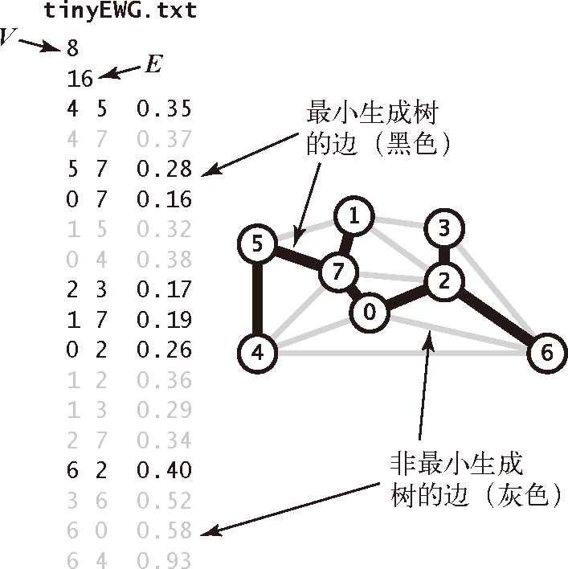

- 图 4.3.1　一幅加权无向图和它的最小生成树

在本节中，我们会学习计算最小生成树的两种经典算法：Prim 算法和 Kruskal 算法。这些算法理解容易，实现简单。它们是本书中最古老和最知名的算法之一，但它们也根据现代数据结构得到了改进。因为最小生成树的重要应用领域太多，对解决这个问题的算法的研究至少从20 世纪 20 年代在设计电力分配网络时就开始了。现在，最小生成树算法在设计各种类型的网络（通信、电子、水利、计算机、公路、铁路、航空等）以及自然界中的生物、化学和物理网络等各个领域的研究中都起到了重要的作用，请见表 4.3.1。

表 4.3.1　最小生成树的典型应用

应用领域

- 顶点边

电路

- 元器件导线

航空

- 机场航线

电力分配

- 电站输电线

图像分析

- 面部容貌相似关系

一些约定

在计算最小生成树的过程中可能会出现各种特殊情况。虽然它们大多数都很容易处理，但为了行文的流畅，我们约定如下。


- 只考虑连通图。我们对生成树的定义意味着最小生成树只可能存在于连通图中，请见图4.3.2a。从另一个角度来说，请回想 4.1 节所述的树的基本性质，我们要找的就是一个由条边组成的集合，它们既连通了图中的所有顶点而权值之和又最小。如果一幅图是非连通的，我们只能使用这个算法来计算它的所有连通分量的最小生成树，合并在一起称其为最小生成森林（请见练习 4.3.22）。

- 边的权重不一定表示距离。有时你对几何学的直觉能够帮助你理解算法，因此在示例中，顶点都表示是平面上的点，而权重都表示是两点之间的距离，比如图 4.3.1。但需要注意的是，权重也可能表示时间、费用或是其他完全不同的变量，而且也完全不一定会和距离成正比，请见图 4.3.2b。

- 边的权重可能是 0 或者负数。如果边的权重都是正的，将最小生成树定义为连接所有顶点且总权重最小的子图就足够了，这样的一幅子图必然是一棵生成树。定义中的生成树条件说明图也可以含有权重为 0 或是负数的边，请见图 4.3.2c。

- 所有边的权重都各不相同。如果不同边的权重可以相同，最小生成树就不一定唯一了（请见练习 4.3.2）。存在多棵最小生成树的可能性会使部分算法的证明变得更加复杂，因此我们在表示中排除了这种可能性。事实上这个假设并没有限制算法的适用范围，因为不做修改它们也能处理存在等值权重的情况，请见图 4.3.2d。

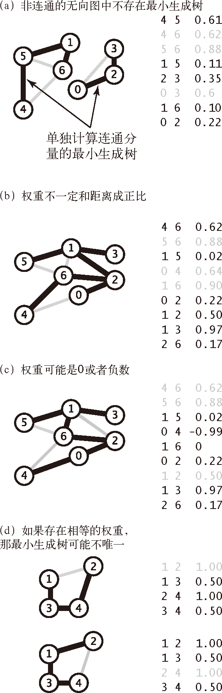

- 图 4.3.2　计算最小生成树时可能遇到的各种特殊情况

总之，在学习最小生成树相关算法的过程中我们假设任务的目标是在一幅加权（但权值各不相同的）连通无向图中找到它的最小生成树。

### 4.3.1　原理

首先，我们回顾一下 4.1 节中给出的树的两个最重要的性质，另见图 4.3.3：

- 用一条边连接树中的任意两个顶点都会产生一个新的环；

- 从树中删去一条边将会得到两棵独立的树。

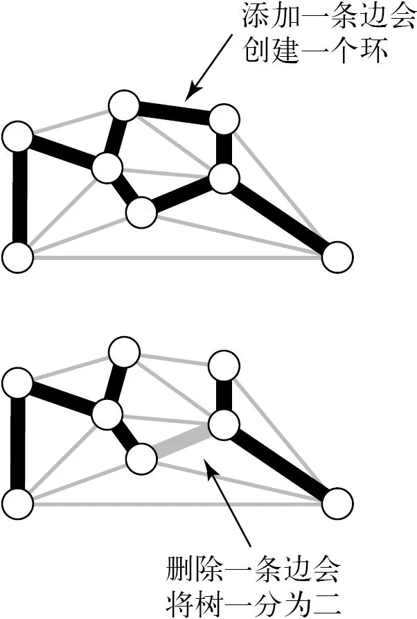

- 图 4.3.3　树的基本性质

这两条性质是证明最小生成树的另一条基本性质的基础，而由这条基本性质就能够得到本节中的最小生成树算法。

### 4.3.1.1　切分定理

我们称之为切分定理的这条性质将会把加权图中的所有顶点分为两个集合、检查横跨两个集合的所有边并识别哪条边应属于图的最小生成树。

- 定义。图的一种切分是将图的所有顶点分为两个非空且不重叠的两个集合。横切边是一条连接两个属于不同集合的顶点的边。

通常，我们通过指定一个顶点集并隐式地认为它的补集为另一个顶点集来指定一个切分。这样，一条横切边就是连接该集合的一个顶点和不在该集合中的另一个顶点的一条边。如图4.3.4 所示，我们将切分中一个集合的顶点都画为了灰色，另一个集合的顶点则为白色。

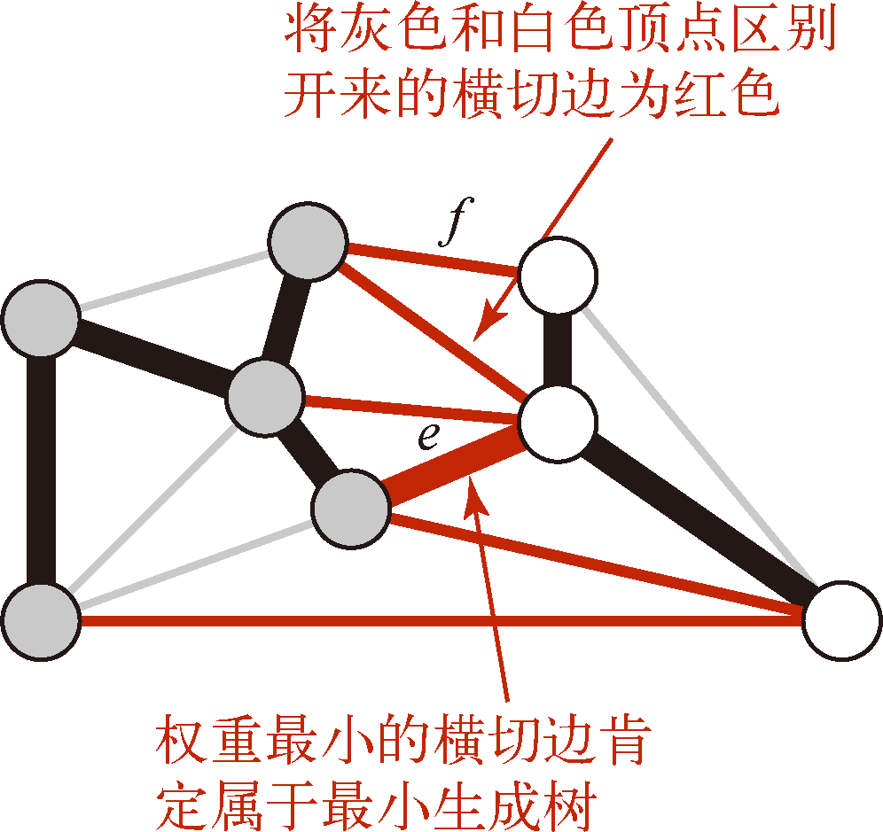

- 图 4.3.4　切分定理

- 命题 J（切分定理）。在一幅加权图中，给定任意的切分，它的横切边中的权重最小者必然属于图的最小生成树。为权重最小的横切边，为图的最小生成树。我们采用反证法：假设不包含证明。令


- 加入的环，且这个环至少含有另一条横。那么如果将，得到的图必然含有一条经过

- 切边——设为的权重必然大于的权重是最小的且图中所有边的权重均不，（因为而保留就可以得到一棵权重更小的生成树。这和我们的假设矛同）。那么我们删掉

- 盾。

在假设所有的边的权重均不相同的前提下，每幅连通图都只有一棵唯一的最小生成树（请见练习 4.3.3），切分定理也表明了对于每一种切分，权重最小的横切边必然属于最小生成树。

图 4.3.4 是切分定理的示意图。注意，权重最小的横切边并不一定是所有横切边中唯一属于图的最小生成树的边。实际上，许多切分都会产生若干条属于最小生成树的横切边，如图 4.3.5所示。

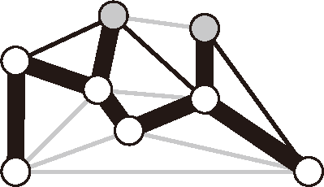

- 图 4.3.5　产生了两条属于最小生成树的横切边的一种切分

### 4.3.1.2　贪心算法

切分定理是解决最小生成树问题的所有算法的基础。更确切的说，这些算法都是一种贪心算法的特殊情况：使用切分定理找到最小生成树的一条边，不断重复直到找到最小生成树的所有边。这些算法相互之间的不同之处在于保存切分和判定权重最小的横切边的方式，但它们都是以下性质的特殊情况。

- 命题 K（最小生成树的贪心算法）。下面这种方法会将含有个顶点的任意加权连通图中属


- 于最小生成树的边标记为黑色：初始状态下所有边均为灰色，找到一种切分，它产生的横切条黑色边为止。边均不为黑色。将它权重最小的横切边标记为黑色。反复，直到标记了


- 证明。为了简单，我们假设所有边的权重均不相同，尽管没有这个假设该命题同样成立（请见练习 4.3.5）。根据切分定理，所有被标记为黑色的边均属于最小生成树。如果黑色边的数量小于，必然还存在不会产生黑色横切边的切分（因为我们假设图是连通的）。只要

- 条黑色的边，这些边所组成的就是一棵最小生成树。找到了

图 4.3.6 所示的是这个贪心算法运行的典型轨迹。每一幅图表现的都是一次切分，其中算法识别了一条权重最小的横切边（红色加粗）并将它加入最小生成树之中。

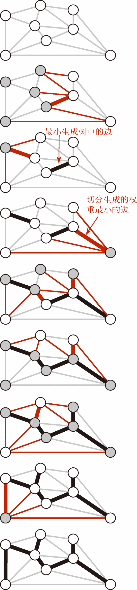

- 图 4.3.6　贪心最小生成树算法

### 4.3.2　加权无向图的数据类型

加权无向图应该如何表示？也许最简单的方法就是扩展 4.1 节中对无向图的表示方法：在邻接矩阵的表示中，可以用边的权重代替布尔值来作为矩阵的元素；在邻接表的表示中，可以在链表的结点中增加一个权重域。（和以前一样，我们把重点放在稀疏图上，将邻接矩阵的表示方法留作练习。）这种经典的方法很有吸引力，但我们会使用另外一种并不太复杂的表示方式。

```
它需要一个更加通用的 API 来处理 Edge 对象，能够使程序适用于更加常见的场景，请见表
```

4.3.2。

表 4.3.2　加权边的 API

```java
public class <b>Edge</b> implements Comparable<Edge>
             Edge(int v, int w, double
```

- 用于初始化的构造函数

```
weight)
      double weight()
```

- 边的权重

```
         int either()
```

- 边两端的顶点之一

```
访问边的端点的 either() 和 other() 方法乍一看会有些奇怪——在看到调用它们的代码
时就会清楚了为什么会有这样的需要了。Edge 的实现请见框注“带权重的边的数据类型”，它
是 EdgeWeightedGraph 的 API 的基础。加权无向图的实现很自然地使用了 Edge 对象，请
```

见表 4.3.3。

表 4.3.3　加权无向图的 API

```java
  public class <b>EdgeWeightedGraph</b>
               EdgeWeightedGraph(int V)
创建一幅含有 V 个顶点的空图
               EdgeWeightedGraph(In in)
```

- 从输入流中读取图

```
           int V()
```

- 图的顶点数

```
           int E()
```

- 图的边数

```
          void addEdge(Edge e)
向图中添加一条边 e
Iterable<Edge> adj(int v)
和 v 相关联的所有边
Iterable<Edge> edges()
```

- 图的所有边

```
        String toString()
```

- 对象的字符串表示

```
这份 API 和 Graph 的 API（请见表 4.1.1）非常相似。两者的两个重要的不同之处在于本节
API 的基础是 Edge 且添加了一个 edges() 方法（请见框注“返回加权无向图中的所有边”）
来遍历图的所有边（忽略自环）。后面框注“加权无向图的数据类型”中 EdgeWeightedGraph
的实现的其他部分与 4.1 节的无向图的实现基本相同，只是在邻接表中用 Edge 对象替代了
Graph 中的整数来作为链表的结点。
public Iterable<Edge> edges()
{
  Bag<Edge> b = new Bag<Edge>();
  for (int v = 0; v < V; v++)
     for (Edge e : adj[v])
        if (e.other(v) > v) b.add(e);
  return b;
}
```

返回加权无向图中的所有边

```
图 4.3.7 显示的是在处理样例文件 tinyEWG.txt 时用 EdgeWeightedGraph 对象表示的加权
无向图。它按照 1.3 节中的标准实现显示了链表中每个 Bag 对象的内容。为了整洁，用一对
int 值和一个 double 值表示每个 Edge 对象。实际的数据结构是一个链表，其中每个元素
都是一个指向含有这些值的对象的指针。需要特别注意的是，虽然每个 Edge 对象都有两个引
用（每个顶点的链表中都有一个），但图中的每条边所对应的 Edge 对象只有一个。在示意图
```

中，边在链表中的出现顺序和处理它们的顺序是相反的，这是由于标准链表实现和栈的相似性

```
所导致的。和 Graph 一样，使用 Bag 对象可以保证用例的代码和链表中对象的顺序是无关
```

的。

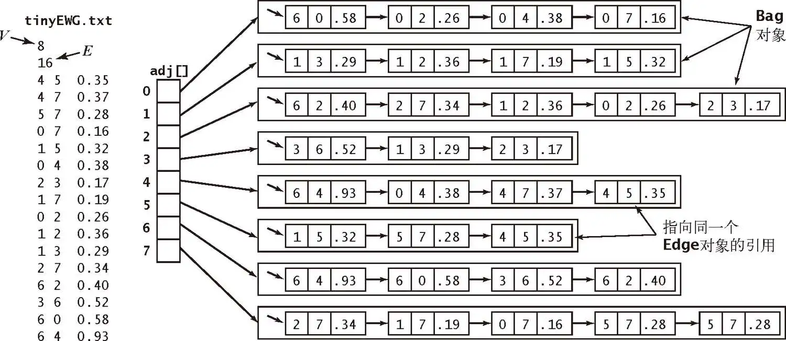

- 图 4.3.7　加权无向图的表示

- 带权重的边的数据类型

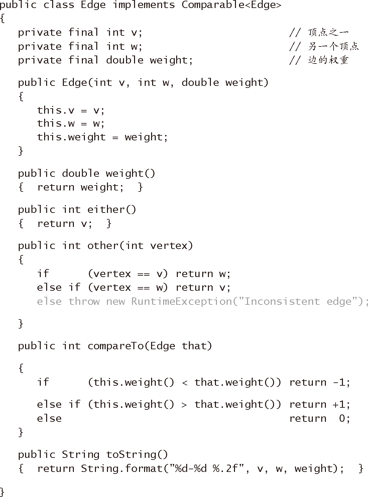

```
该数据结构提供了 either() 和 other() 两个方法。在已知一个顶点 v 时，用例可以使
用 other(v) 来得到边的另一个顶点。当两个顶点都是未知的时候，用例可以使用惯用代
码 v=e.either(), w=e. other(v); 来访问一个 Edge 对象 e 的两个顶点。
```

- 加权无向图的数据类型

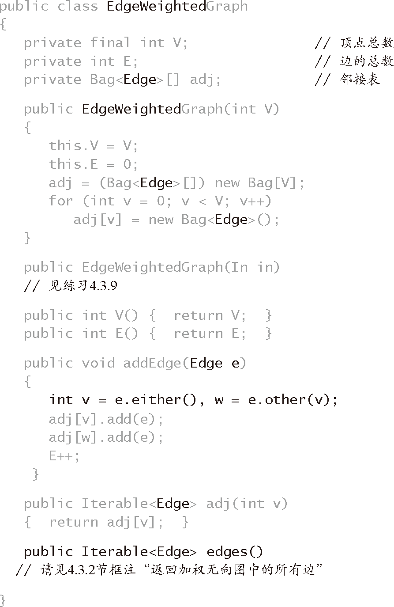

```
该实现使用了一个由顶点索引的邻接表。与 Graph（请见 4.1.2.2 节框注“Graph 数据类
型”）一样，每条边都会出现两次：如果一条边连接了顶点 v 和 w，那么它既会出现在 v 的
链表中也会出现在 w 的链表中。edges() 方法将所有边放在一个 Bag 对象中（请见 4.3.2
节框注“返回加权无向图中的所有边”）。toString() 方法的实现留作练习。
```

### 4.3.2.1　用权重来比较边

```
API 说明 Edge 类必须实现 Comparable 接口并包含一个 compareTo() 方法。一幅加权无
向图中的边的自然次序就是按权重排序，相应的 compareTo() 方法的实现也就很简单了。
```

### 4.3.2.2　平行边

和无环图的实现一样，这里也允许存在平行边。我们也可以用更复杂的方式实现

```
EdgeWeightedGraph 类来消除平行边，比如只保留平行的边中的权重最小者。
```

### 4.3.2.3　自环

允许存在自环。尽管自环可能的确存在于输入或是数据结构之中，但是

```
EdgeWeightedGraph 中 edges() 的实现并没有统计它们。这对最小生成树算法没有影
```

响，因为最小生成树肯定不会含有自环。如果在应用中自环很重要，那你或许需要根据应用场景修改代码。

```
你会看到，有了 Edge 对象之后用例的代码就可以变得更加干净整洁。这也有个小小的代价：
每个邻接表的结点都是一个指向 Edge 对象的引用，它们含有一些冗余的信息（v 的邻接链表
中的每个结点都会用一个变量保存 v）。使用对象也会带来一些开销。虽然每条边的 Edge 对
象都只有一个，但邻接表中还是会含有两个指向同一 Edge 对象的引用。另一种广泛使用的方
案是与 Graph 一样，用两个结点对象来表示一条边，每个结点对象都会保存顶点的信息和边
```

的权重。这种方法也是有代价的——需要两个结点，每条边的权重都会被保存两遍。

### 4.3.3　最小生成树的 API 和测试用例

按照惯例，在 API 中会定义一个接受加权无向图为参数的构造函数并且支持能够为用例返回图

- 的最小生成

的最小生成树和其权重的方法。那么我们应该如何表示最小生成树呢？由于图


- 的一幅子图并且同时也是一棵树，因此我们有很多选择，最主要的几种表示方法为：

树是

- 一组边的列表；

- 一幅加权无向图；

- 一个以顶点为索引且含有父结点链接的数组。

在为各种应用选择这些表示方法时，我们希望尽量给予最小生成树的实现以最大的灵活性，因此我们采用了表 4.3.4 所示的 API。

表 4.3.4　最小生成树的 API

```java
  public class <b>MST</b>
               MST(EdgeWeightedGraph G)
```

- 构造函数

```
Iterable<Edge> edges()
```

- 最小生成树的所有边

```
        double weight()
```

- 最小生成树的权重

### 4.3.3.1　测试用例

和以前一样，我们会创建样图并开发一个测试用例来测试最小生成树的实现。右侧框注就是一个示例。它从输入流中读取图的所有边并构造一幅加权无向图，然后计算该图的最小生成树并打印树的所有边和权重之和。

```java
public static void main(String[] args)
{
  In in = new In(args[0]);
  EdgeWeightedGraph G;
  G = new EdgeWeightedGraph(in);
  MST mst = new MST(G);
  for (Edge e : mst.edges())
     StdOut.println(e);
  StdOut.println(mst.weight());
}
```

最小生成树的测试用例

### 4.3.3.2　测试数据

你可以在本书的网站上找到 tinyEWG.txt 文件，它定义了我们用来展示最小生成树算法的轨迹样图（请见图 4.3.1）。在网站上你还能找到 mediumEWG.txt，它定义了一幅含有 250 个顶点的加权无向图，如图 4.3.8 所示。它也是一幅欧几里得图的示例，它的顶点都是平面上的点，边为连接它们的线段且权重为两点之间的欧几里得距离。这样的图有助于我们理解最小生成树算法的行为，同时也是我们提到过的许多典型实际问题的模型，例如公路地图和电路图。在本书的网站上你还能找到一幅较大的样图 largeEWG.txt，它是一幅含有一百万个顶点的欧几里得图。我们的目标就是在合理的时间范围内通过计算得到这种规模的图的最小生成树。

```
% more tinyEWG.txt
8 16
4 5 .35
4 7 .37
5 7 .28
0 7 .16
1 5 .32
0 4 .38
2 3 .17
1 7 .19
0 2 .26
1 2 .36
1 3 .29
2 7 .34
6 2 .40
3 6 .52
6 0 .58
6 4 .93
% java MST tinyEWG.txt
0-7 0.16
1-7 0.19
0-2 0.26
2-3 0.17
5-7 0.28
4-5 0.35
6-2 0.40
1.81
% more mediumEWG.txt
250 1273
244 246 0.11712
239 240 0.10616
238 245 0.06142
235 238 0.07048
233 240 0.07634
232 248 0.10223
231 248 0.10699
229 249 0.10098
228 241 0.01473
226 231 0.07638
... [还有1263条边]
% java MST mediumEWG.txt
 0 225 0.02383
49 225 0.03314
44  49 0.02107
44 204 0.01774
49  97 0.03121
202 204 0.04207
176 202 0.04299
176 191 0.02089
68 176 0.04396
58  68 0.04795
... [还有239条边]
10.46351
```


- 图 4.3.8　一幅含有 250 个顶点的无向加权欧几里得图（共含有 1273 条边）和它的最小生成树

### 4.3.4　Prim 算法

我们要学习的第一种计算最小生成树的方法叫做 Prim 算法，它的每一步都会为一棵生长中的

- 条边，每次总是将下一条

树添加一条边。一开始这棵树只有一个顶点，然后会向它添加

连接树中的顶点与不在树中的顶点且权重最小的边（黑色表示）加入树中（即由树中的顶点所定义的切分中的一条横切边），如图 4.3.9 所示。

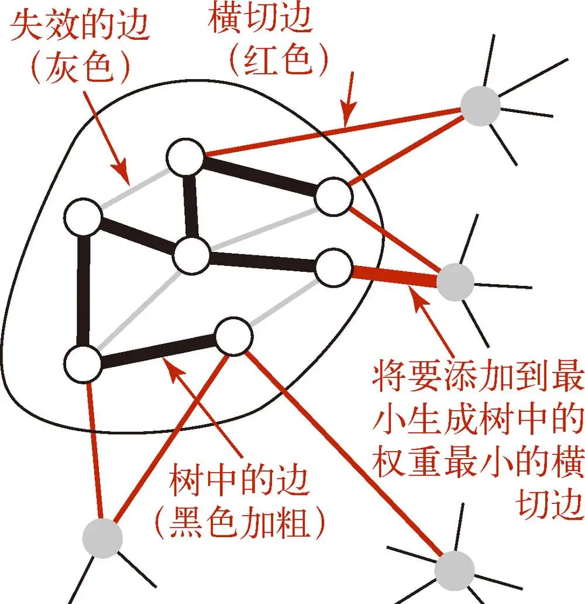

- 图 4.3.9　最小生成树的 Prim 算法

- 命题 L。Prim 算法能够得到任意加权连通图的最小生成树。证明。由命题 K 可知，这棵不断生长的树定义了一个切分且不存在黑色的横切边。该算法会选取权重最小的横切边并根据贪心算法不断将它们标记为黑色。

以上我们对 Prim 算法的简单描述没有回答一个关键的问题：如何才能（有效地）找到最小权重的横切边呢？人们提出了很多方法——在用一种特别简单的方法解决这个问题之后我们会讨论其中的一部分方法。

### 4.3.4.1　数据结构

实现 Prim 算法需要用到一些简单常见的数据结构。具体来说，我们会用以下方法表示树中的顶点、边和横切边。

```
顶点。使用一个由顶点索引的布尔数组 marked[]，如果顶点 v 在树中，那么
marked[v] 的值为 true。
边。选择以下两种数据结构之一：一条队列 mst 来保存最小生成树中的边，或者一个由顶
点索引的 Edge 对象的数组 edgeTo[]，其中 edgeTo[v] 为将 v 连接到树中的 Edge 对
```

- 象。

```
横切边：使用一条优先队列 MinPQ<Edge> 来根据权重比较所有边（请见 4.3.2 节框注“带
```

- 权重的边的数据类型”）。

有了这些数据结构我们就可以回答“哪条边的权重最小？”这个基本的问题了。

### 4.3.4.2　维护横切边的集合

每当我们向树中添加了一条边之后，也向树中添加了一个顶点。要维护一个包含所有横切边的

```
集合，就要将连接这个顶点和其他所有不在树中的顶点的边加入优先队列（用 marked[] 来
```

识别这样的边）。但还有一点：连接新加入树中的顶点与其他已经在树中顶点的所有边都失效了。（这样的边都已经不是横切边了，因为它的两个顶点都在树中。）Prim 算法的即时实现可以将这样的边从优先队列中删掉，但我们先来学习这个算法的一种延时实现，将这些边先留在优先队列中，等到要删除它们的时候再检查边的有效性。

图 4.3.10 是处理样图 tinyEWG.txt 的轨迹。每一张图片都是算法访问过一个顶点之后（被添加到树中，邻接链表中的边也已经被处理完成）图和优先队列的状态。优先队列的内容被按照顺序显示在一侧，新加入的边的旁边标有星号。算法构造最小生成树的过程如下所述。

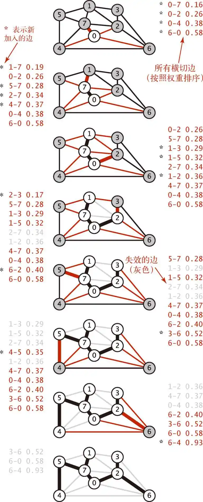

- 图 4.3.10　Prim 算法的轨迹（延时实现）

```
将顶点 0 添加到最小生成树之中，将它的邻接链表中的所有边添加到优先队列之中。
将顶点 7 和边 0-7 添加到最小生成树之中，将顶点的邻接链表中的所有边添加到优先队列
```

- 之中。

```
将顶点 1 和边 1-7 添加到最小生成树之中，将顶点的邻接链表中的所有边添加到优先队列
```

- 之中。

```
将顶点 2 和边 0-2 添加到最小生成树之中，将边 2-3 和 6-2 添加到优先队列之中。边
2-7 和 1-2 失效。
将顶点 3 和边 2-3 添加到最小生成树之中，将边 3-6 添加到优先队列之中。边 1-3 失
```

- 效。

```
将顶点 5 和边 5-7 添加到最小生成树之中，将边 4-5 添加到优先队列之中。边 1-5 失
```

- 效。

```
从优先队列中删除失效的边 1-3、1-5 和 2-7。
将顶点 4 和边 4-5 添加到最小生成树之中，将边 6-4 添加到优先队列之中。边 4-7 和
0-4 失效。
从优先队列中删除失效的边 1-2、4-7 和 0-4。
将顶点 6 和边 6-2 添加到最小生成树之中，和顶点 6 相关联的其他边均失效。
```

- 个顶点（以及条边）之后，最小生成树就完成了。优先队列中的余下的边

在添加了

都是无效的，不需要再去检查它们。

### 4.3.4.3　实现

有了这些预备知识，Prim 算法的实现就很简单了，请见后面框注“最小生成树的 Prim 算法的

```
延时实现”中的 LazyPrimMST 类。和前两节实现深度优先搜索和广度优先搜索一样，实现会
```

在构造函数中计算图的最小生成树，这样用例方法就可以用查询类方法获得最小生成树的各种

```
属性。我们使用了一个私有方法 visit() 来为树添加一个顶点、将它标记为“已访问”并将与
```

它关联的所有未失效的边加入优先队列，以保证队列含有所有连接树顶点和非树顶点的边（也可能含有一些已经失效的边）。代码的内循环是算法的具体实现：我们从优先队列中取出一条边并将它添加到树中（如果它还没有失效的话），再把这条边的另一个顶点也添加到树中，然

```
后用新顶点作为参数调用 visit() 方法来更新横切边的集合。weight() 方法可以遍历树的
```

所有边并得到它们的权重之和（延时实现）或是用一个运行时的变量统计总权重（即时实现），这一点留作练习 4.3.31。

### 4.3.4.4　运行时间

Prim 算法有多快？我们已经知道优先队列的性质，所以要回答这个问题并不困难。

- 命题 M。Prim 算法的延时实现计算一幅含有个顶点和条边的连通加权无向图的最小


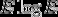

- 成正比，所需的时间与成正比（最坏情况）。生成树所需的空间与

```sql
证明。算法的瓶颈在于优先队列的 insert() 和 delMin() 方法中比较边的权重的次数。
```

- 条边，这就是空间需求的上限。在最坏情况下，一次插入的成本优先队列中最多可能有

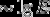

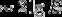

- （请见第 2 章的命题 Q）。因为最多只能插入为，删除最小元素的成本为

- 次最小元素，时间上限显而易见。条边，删除

在实际中，估计的运行时间上限是比较保守的，因为一般情况下优先队列中的边都远小于

- 。

这么困难的任务，解决方法却如此的简单、高效而实用，实在令人佩服。下面，我们会简要讨论一些改进算法的方法。和以前一样，在性能优先的应用场景中仔细评估这些改进的工作应该留给专家。

- 最小生成树的 Prim 算法的延时实现

```java
public class LazyPrimMST
1
{
2
  private boolean[] marked;          // 最小生成树的顶点
3
  private Queue<Edge> mst;           // 最小生成树的边
4
  private MinPQ<Edge> pq;            // 横切边（包括失效的边）
5
6
  public LazyPrimMST(EdgeWeightedGraph G)
7
  {
8
     pq = new MinPQ<Edge>();
9
     marked = new boolean[G.V()];
10
     mst = new Queue<Edge>();
11
12
     visit(G, 0);   // 假设G是连通的（请见练习4.3.22）
13
     while (!pq.isEmpty())
14
15
     {
16
        Edge e = pq.delMin();                  // 从pq中得到权重最小的边
17
18
        int v = e.either(), w = e.other(v);
19
        if (marked[v] && marked[w]) continue;  // 跳过失效的边
20
        mst.enqueue(e);                        // 将边添加到树中
21
        if (!marked[v]) visit(G, v);           // 将顶点（v或w）添加到树中
22
        if (!marked[w]) visit(G, w);
23
     }
24
  }
25
26
  private void visit(EdgeWeightedGraph G, int v)
27
  {  // 标记顶点v并将所有连接v和未被标记顶点的边加入pq
28
     marked[v] = true;
29
     for (Edge e : G.adj(v))
30
        if (!marked[e.other(v)]) pq.insert(e);
31
  }
32
33
  public Iterable<Edge> edges()
34
  {  return mst;  }
35
36
  public double weight()   // 请见练习4.3.31
37
38
}
39
```

- Prim 算法的这种实现使用了一条优先队列来保存所有的横切边、一个由顶点索引的数组来标记树的顶点以及一条队列来保存最小生成树的边。这种延时实现会在优先队列中保留失效的边。

### 4.3.5　Prim 算法的即时实现

```
要改进 LazyPrimMST，可以尝试从优先队列中删除失效的边，这样优先队列就只含有树顶点
```

和非树顶点之间的横切边，但其实还可以删除更多的边。关键在于，我们感兴趣的只是连接树

```
顶点和非树顶点中权重最小的边。当我们将顶点 v 添加到树中时，对于每个非树顶点 w 产生
的变化只可能使得 w 到最小生成树的距离更近了，如图 4.3.11 所示。简而言之，我们不需要
在优先队列中保存所有从 w 到树顶点的边——而只需要保存其中权重最小的那条，在将 v 添
加到树中后检查是否需要更新这条权重最小的边（因为 v-w 的权重可能更小）。我们只需遍历
v 的邻接链表就可以完成这个任务。换句话说，我们只会在优先队列中保存每个非树顶点 w
的一条边：将它与树中的顶点连接起来的权重最小的那条边。将 w 和树的顶点连接起来的其
```

他权重较大的边迟早都会失效，所以没必要在优先队列中保存它们。

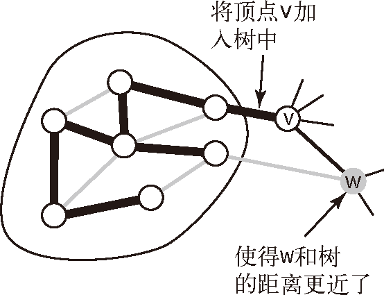

- 图 4.3.11　Prim 算法的即时实现

```
PrimMST 类（请见算法 4.7）使用了 2.4 节中介绍的索引优先队列实现的 Prim 算法。它将
LazyPrimMST 中的 marked[] 和 mst[] 替换为两个顶点索引的数组 edgeTo[] 和
distTo[]，它们具有如下性质。
如果顶点 v 不在树中但至少含有一条边和树相连，那么 edgeTo[v] 是将 v 和树连接的最
短边，distTo[v] 为这条边的权重。
所有这类顶点 v 都保存在一条索引优先队列中，索引 v 关联的值是 edgeTo[v] 的边的权
```

- 重。

这些性质的关键在于优先队列中的最小键即是权重最小的横切边的权重，而和它相关联的顶点

```
v 就是下一个将被添加到树中的顶点。marked[] 数组已经没有必要了，因为判断条件
!marked[w] 等价于 distTo[w] 是无穷的（且 edgeTo[w] 为 null）。要维护这些数据结
构，PrimMST 会从优先队列中取出一个顶点 v 并检查它的邻接链表中的每条边 v-w。如果 w
已经被标记过，那么这条边就已经失效了；如果 w 不在优先队列中或者 v-w 的权重小于目前
已知的最小值 edgeTo[w]，代码会更新数组，将 v-w 作为将 w 和树连接的最佳选择。
图 4.3.12 所示的是 PrimMST 在处理样图 tinyEWG.txt 过程中的轨迹。将每个顶点加入最小生
成树之后，edgeTo[] 和 distTo[] 的内容显示在右侧，不同的颜色显示了最小生成树中的
```

顶点（索引为黑色）、非最小生成树的顶点（索引为灰色）、最小生成树的边（黑色）和优先队列中的索引值对（红色）。在示意图中，将每个非最小生成树顶点连接到树的最短边为红色。该算法向最小生成树中添加的边的顺序和延时版本相同，不同之处在于优先队列的操作。它构造最小生成树的过程如下所述。

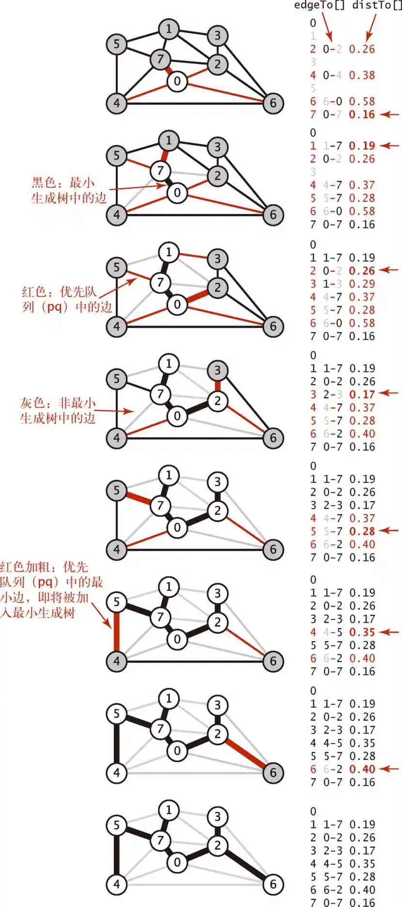

- 图 4.3.12　Prim 算法的轨迹图（即时版本）

```
将顶点 0 添加到最小生成树之中，将它的邻接链表中的所有边添加到优先队列之中，因为
```

- 这些边都是目前（唯一）已知的连接非树顶点和树顶点的最短边。

```
将顶点 7 和边 0-7 添加到最小生成树之中，将边 1-7 和 5-7 添加到优先队列之中。将连
接顶点 4 与树的最小边由 0-4 替换为 4-7，2-7 不会影响到优先队列，因为它们的权重不
```

- 大于 0-2 的权重。

```
将顶点 1 和边 1-7 添加到最小生成树之中，将边 1-3 添加到优先队列之中。
将顶点 2 和边 0-2 添加到最小生成树之中，将连接顶点 6 与树的最小边由 0-6 替换为
6-2，将连接顶点 3 与树的最小边由 1-3 替换为 2-3。
将顶点 3 和边 2-3 添加到最小生成树之中。
```

```
将顶点 5 和边 5-7 添加到最小生成树之中，将连接顶点 4 与树的最小边由 4-7 替换为
4-5。
将顶点 4 和边 4-5 添加到最小生成树之中。
将顶点 6 和边 6-2 添加到最小生成树之中。
```

- 条边之后，最小生成树完成且优先队列为空。

添加了

- 算法 4.7　最小生成树的 Prim 算法（即时版本）

```java
public class PrimMST
1
{
2
  private Edge[] edgeTo;          // 距离树最近的边
3
  private double[] distTo;        // distTo[w]=edgeTo[w].weight()
4
  private boolean[] marked;       // 如果v在树中则为true
5
  private IndexMinPQ<Double> pq;  // 有效的横切边
6
7
  public PrimMST(EdgeWeightedGraph G)
8
  {
9
     edgeTo = new Edge[G.V()];
10
     distTo = new double[G.V()];
11
     marked = new boolean[G.V()];
12
     for (int v = 0; v < G.V(); v++)
13
        distTo[v] = Double.POSITIVE_INFINITY;
14
     pq = new IndexMinPQ<Double>(G.V());
15
16
     distTo[0] = 0.0;
17
     pq.insert(0, 0.0);              // 用顶点0和权重0初始化pq
18
     while (!pq.isEmpty())
19
        visit(G, pq.delMin());       // 将最近的顶点添加到树中
20
  }
21
22
  private void visit(EdgeWeightedGraph G, int v)
23
  {  // 将顶点v添加到树中，更新数据
24
     marked[v] = true;
25
     for (Edge e : G.adj(v))
26
27
     {
28
        int w = e.other(v);
29
30
        if (marked[w]) continue;     // v-w失效
31
        if (e.weight() < distTo[w])
32
33
        {  // 连接w和树的最佳边Edge变为e
34
           edgeTo[w] = e;
35
36
           distTo[w] = e.weight();
37
           if (pq.contains(w)) pq.change(w, distTo[w]);
38
           else                pq.insert(w, distTo[w]);
39
        }
40
     }
41
  }
42
43
  public Iterable<Edge> edges()    // 请见练习4.3.21
44
  public double weight()           // 请见练习4.3.31
45
}
46
```

- 这份 Prim 算法的实现将所有有效的横切边保存在了一条索引优先队列中。

该算法的证明与命题 M 的证明本质上相同，Prim 算法的即时版本可以找到一幅连通的加权无

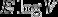

- 成正比，空间和成正比（请见命题 N）。对于实际

向图的最小生成树，所需时间和

应用中经常出现的巨型稀疏图，两者在时间上限上没有什么区别（因为对于稀疏图来说是

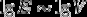

- ），但空间上限变为了原来的一个常数因子（但很显著）。在性能优先的应用场景

```
中，更加深入的分析和实验最好还是留给专家吧，因为相关的因素有很多，例如 MinPQ 和
IndexMinPQ 的实现、图的表示方法、应用场景所使用的图模型等。按照惯例，我们需要仔
```

细研究这些改进，因为只有当这种常数因子的性能改进非常必要时，它所带来的代码复杂性才是值得的。在复杂的现代系统中有时这样做甚至会得不偿失。

- 命题 N。Prim 算法的即时实现计算一幅含有个顶点和条边的连通加权无向图的最小

- 成正比，所需的时间和成正比（最坏情况）。生成树所需的空间和

- 证明。因为优先队列中的顶点数最多为，且使用了三条由顶点索引的数组，所以所需空

- 间的上限和 V 成正比。算法会进行次插入操作，次删除最小元素的操作和（在最坏情

- 次改变优先级的操作。已知在基于堆实现的索引优先队列中所有这些操作的增长况下）

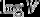

- [ 请见第 2 章命题 Q（续）]，所以将所有这些加起来可知算法所需时间和数量级为

- 成正比。

图 4.3.13 展示了 Prim 算法是如何处理含有 250 个顶点的欧几里得图 mediumEWG.txt 的。这是一个很有意思的动态过程（请见练习 4.3.27）。大多数情况下，树的生长都是通过连接一个和新加入的顶点相邻的顶点。当新加入的顶点周围没有非树顶点时，树的生长又会从另一部分开始。

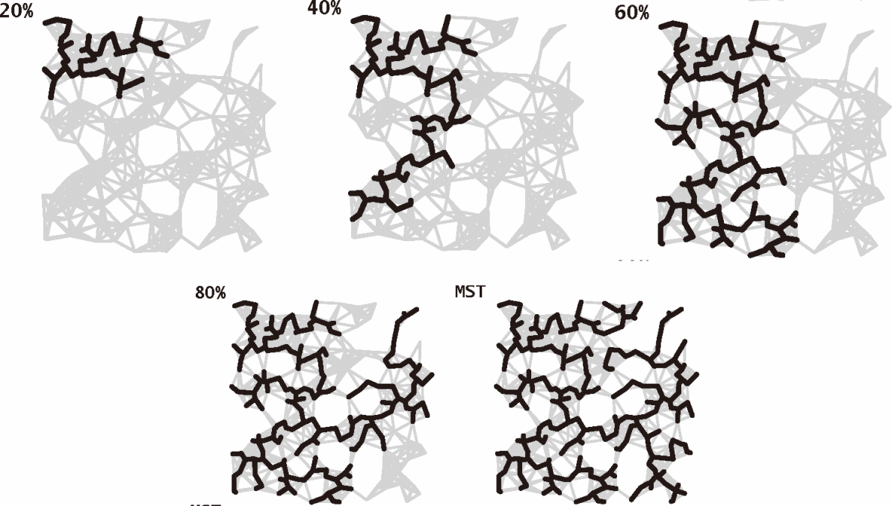

- 图 4.3.13　Prim 算法（250 个顶点）

### 4.3.6　Kruskal 算法

我们要仔细学习的第二种最小生成树算法的主要思想是按照边的权重顺序（从小到大）处理它们，将边加入最小生成树中（图中的黑色边），加入的边不会与已经加入的边构成环，直到树

- 条边为止。这些黑色的边逐渐由一片森林合并为一棵树，也就是图的最小生成

中含有

树。这种计算方法被称为 Kruskal 算法。

- 命题 O。Kruskal 算法能够计算任意加权连通图的最小生成树。

- 证明。由命题 K 可知，如果下一条将被加入最小生成树中的边不会和已有的黑色边构成环，那么它就跨越了由所有和树顶点相邻的顶点组成的集合以及它们的补集所构成的一个切分。因为加入的这条边不会形成环、它是目前已知的唯一一条横切边且是按照权重顺序选择的边，所以它必然是权重最小的横切边。因此，该算法能够连续选择权重最小的横切边，和贪心算法一致。

Prim 算法是一条边一条边地来构造最小生成树，每一步都为一棵树添加一条边。Kruskal 算法构造最小生成树的时候也是一条边一条边地构造，但不同的是它寻找的边会连接一片森林中的

- 棵单顶点的树构成的森林开始并不断将两棵树合并（用可以找到的

两棵树。我们从一片由

最短边）直到只剩下一棵树，它就是最小生成树。

图 4.3.14 显示的是 Kruskal 算法处理 tinyEWG.txt 时的每一个步骤。首先，权重最小的条边都

```
被加入到了最小生成树中，之后算法判断出 1-3、1-5 和 2-7 已经失效并将 4-5 加入最小
生成树。最后 1-2、4-7 和 0-4 失效，6-2 被加入最小生成树。
```

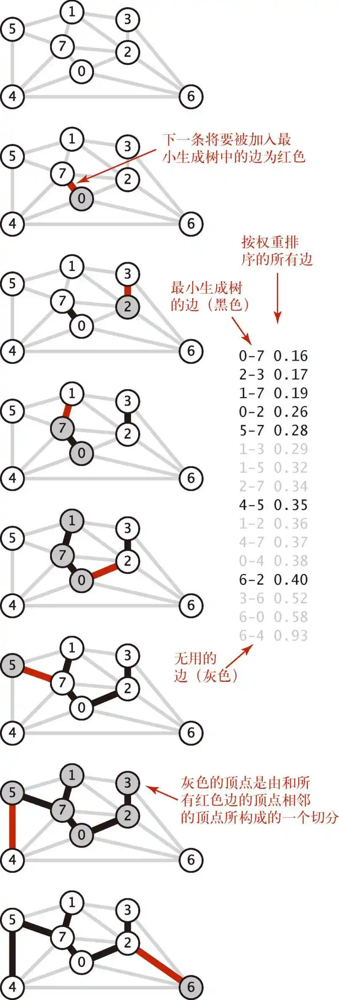

- 图 4.3.14　Kruskal 算法的轨迹

有了本书中我们已经学习过的许多工具，Kruskal 算法的实现并不困难：我们将会使用一条优先队列（请见 2.4 节）来将边按照权重排序，用一个 union-find 数据结构（请见 1.5 节）来识别会形成环的边，以及一条队列（请见 1.3 节）来保存最小生成树的所有边。算法 4.8 实现了以上设想。注意，使用队列来保存最小生成树的所有边意味着用例在遍历时将会按照权重的升

```
序得到这些边。weight() 方法需要遍历所有边来取得权重之和（或是使用一个变量动态统
```

计权重之和），它的实现留作练习（请见练习 4.3.31）。

分析 Kruskal 算法所需的运行时间很简单，因为我们已经知道它的操作所需的时间。

- 命题 N（续）。Kruskal 算法的计算一幅含有个顶点和条边的连通加权无向图的最小生

- 成正比，所需的时间和成正比（最坏情况）。成树所需的空间和

- 次比较（请见证明。算法的实现在构造函数中使用所有边初始化优先队列，成本最多为

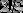

- 2.4 节）。优先队列构造完成后，其余的部分和 Prim 算法完全相同。优先队列中最多可能含

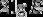

- 条边，即所需空间的上限。每次操作的成本最多为次比较，这就是时间上限的有

- 由来。Kruskal 算法最多还会进行次 connected() 和次 union() 操作，但这些成本相比

- 的总时间的增长数量级可以忽略不计（请见 1.5 节）。

与 Prim 算法一样，这个估计是比较保守的，因为算法在找到

- 条边之后就会终止。实际

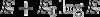

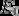

- 成正比，其中是权重小于最小生成树中权重最大的边的所有边

的成本应该与的总数。尽管拥有这个优势，Kruskal 算法一般还是比 Prim 算法要慢，因为在处理每条边时

```
除了两种算法都要完成的优先队列操作之外，它还需要进行一次 connect() 操作（请见练习
```

4.3.39）。

图 4.3.15 所示为 Kruskal 算法在处理较大的样图 mediumEWG.txt 时的动态情况。很显然，边是按照权重顺序被添加到森林中的。

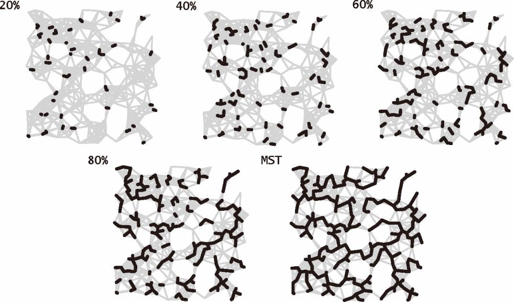

- 图 4.3.15　Kruskal 算法（250 个顶点）

- 算法 4.8　最小生成树的 Kruskal 算法

```java
public class KruskalMST
1
{
2
  private Queue<Edge> mst;
3
4
  public KruskalMST(EdgeWeightedGraph G)
5
  {
6
     mst = new Queue<Edge>();
7
     MinPQ<Edge> pq = new MinPQ<Edge>();
8
     for(Edge e:G.edges())pq.insert(e);
9
     UF uf = new UF(G.V());
10
11
     while (!pq.isEmpty() && mst.size() < G.V()-1)
12
     {
13
        Edge e = pq.delMin();               // 从pq得到权重最小的边和它的顶点
14
        int v = e.either(), w = e.other(v);
15
        if (uf.connected(v, w)) continue;   // 忽略失效的边
16
        uf.union(v, w);                     // 合并分量
17
        mst.enqueue(e);                     // 将边添加到最小生成树中
18
     }
19
  }
20
21
  public Iterable<Edge> edges()
22
  {  return mst;  }
23
24
  public double weight()          // 请见练习4.3.31
25
26
}
27
```

- 这份 Kruskal 算法的实现使用了一条队列来保存最小生成树中的所有边、一条优先队列来保存还未被检查的边和一个 union-find 的数据结构来判断无效的边。最小生成树的所有边会按

```
照权重的升序返回给用例。weight() 方法的实现留作练习。
% java KruskalMST tinyEWG.txt
1
0-7 0.16
2
2-3 0.17
3
1-7 0.19
4
0-2 0.26
5
5-7 0.28
6
4-5 0.35
7
6-2 0.40
8
1.81
9
```

### 4.3.7　展望

最小生成树问题是本书中的被研究的最多的几个问题之一。解决这个问题的基本方法在现代数据结构和算法性能分析手段的发明之前就已经问世了。在当时，计算一幅含有上千条边的图的最小生成树还是一项令人望而生畏的任务。我们学习的最小生成树算法和这些老式方法的不同之处主要在于运用了现代的数据结构来完成一些基本的操作，这（再加上现代的计算能力）使得我们可以计算含有上百万甚至数十亿条边的图的最小生成树。

### 4.3.7.1　历史资料

计算稠密图的最小生成树算法（请见练习 4.3.29）最早是由 R.Prim 在 1961 年发明的，随后E.W.Dijkstra 也独自发明了它。尽管 Dijkstra 的描述更为通用，但这个算法通常被称为 Prim算法。其实算法的基本思想是 V.Jarnik 在 1939 年发明的，所以一些人也将这种方法称为Jarnik 算法并认为 Prim 的（或是 Dijkstra）的贡献在于为稠密图找到了高效的实现算法。在20 世纪 70 年代优先队列发明之后，它直接被应用在了寻找稀疏图中的最小生成树上。计算稀

- 成正比很快广为人知且并没有将此归功于任何一位

疏图中的最小生成树所需的时间和研究者。在 1984 年，M.L.Fredman 和 R.E.Tarjan 发明了数据结构斐波纳契堆，将 Prim 算法

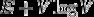

- 。J.Kruskal 在 1956 年就发表了他的算法，但

所需的运行时间在理论上改进到了同样，相关的抽象数据结构在很多年中都没有被仔细研究。有趣的是，Kruskal 的论文中提到了 Prim 算法的一个变种，而 O.Boruvka 在 1926 年（！）的论文中就已经提到了这两种不同的方法。Boruvka 的论文要解决的是一个电力分配的问题并介绍了另外一种用现代数据结构可以轻易实现的方法（请见练习 4.3.43 和练习 4.3.44）。M.Sollin 在 1961 年重新发现了这个方法。该方法随后引起了其他人的注意并成为实现较好的渐进性能的最小生成树算法和并行最小生成树算法的基础。各种最小生成树算法的特点请见表 4.3.5。

表 4.3.5　各种最小生成树算法的性能特点

- V 个顶点 E 条边，最坏情况下的增长数量级

算法

- 空间时间

```
E
```

延时的 Prim 算法

```
V
```

即时的 Prim 算法

```
E
```

Kruskal

```
V
```

Fredman-Tarjan

```
V
```

Chazelle

- 非常接近但还没有达到

```
V
```

理想情况

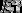

### 4.3.7.2　线性的最小生成树算法？

一方面，目前还没有理论能够证明，不存在能在线性时间内得到任意图的最小生成树的算法。另一方面，发明能够在线性时间内计算稀疏图的最小生成树的算法仍然没有进展。自从 20 世纪 70 年代将 union-find 数据结构应用于 Kruskal 算法以及将优先队列应用于 Prim 算法之后，更好的实现这些抽象数据结构就成了许多研究者的主要目标。许多研究者都将寻找高效的优先队列的实现作为找到稀疏图的高效的最小生成树算法的关键，而其他一些人则研究了 Boruvka算法的一些变种并将它们作为近似于线性级别的稀疏图的最小生成树算法的基础。这些研究仍然有希望最终为我们带来一个实用的线性最小生成树算法，它们甚至已经显示了一个线性时间的随机化算法的存在性。研究者距离线性时间的目标已经很近了：B.Chazelle 在 1997 年发表了一个算法，它在实际应用中和线性时间的算法的差距已经小到了无法区别的程度（尽管可以证明它并不是线性的），但它非常复杂以至于无法实用。尽管此类研究得到的算法大都十分复杂，其中一些的简化版也许可以进入实际应用。同时，在大多数应用场景中，我们都可以使用已经学过的基本方法在线性时间内得到图的最小生成树，只是对于一些稀疏图所需的时间要乘

以

- 。

总的来说，我们可以认为在实际应用中最小生成树问题已经被“解决”了。对于大多数的图来说，找到它的最小生成树的成本只比遍历图的所有边稍高一点。除了极为稀疏的图，这一点都能成立，但即使是在这种情况下，使用最好的算法所能得到的性能提升也不过是一个很小的常数因子，可能最多 10 倍。人们已经在许多图的模型中证明了这些结论，而很多实践者则已经使用 Prim 算法和 Kruskal 算法计算大型图中的最小生成树数十年之久了。

### 答疑

问　Prim 和 Kruskal 算法能够处理有向图吗？

答　不行，不可能。那是一个更加困难的有向图处理问题，叫做最小树形图问题。

### 练习

4.3.1　证明可以将图中的所有边的权重都加上一个正常数或是都乘以一个正常数，图的最小生成树不会受到影响。

4.3.2　画出图 4.3.16 中的所有最小生成树（所有边的权重均相等）。

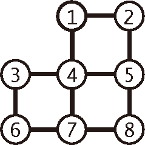

图　4.3.16

4.3.3　证明当图中所有边的权重均不相同时图的最小生成树是唯一的。

4.3.4　证明或给出反例：仅当加权无向图中所有边的权重均不相同时图的最小生成树是唯一的。

4.3.5　证明即使存在权重相同的边贪心算法仍然有效。

4.3.6　从 tinyEWG.txt 中（请见图 4.3.1）删去顶点 7 并给出加权图的最小生成树。

4.3.7　如何得到一幅加权图的最大生成树？

4.3.8　证明环的性质：任取一幅加权图中的一个环（边的权重各不相同），环中权重最大的边必然不属于图的最小生成树。

```
4.3.9　根据 Graph 中的构造函数（请见 4.1.2.2 框注“Graph 数据类型”）为
EdgeWeightedGraph 实现一个相应构造函数，从输入流中读取一幅图。
4.3.10　为稠密图实现 EdgeWeightedGraph，使用邻接矩阵（存储权重的二维数组），不允
```

许存在平行边。

```
4.3.11　使用 1.4 节中的内存使用模型评估用 EdgeWeightedGraph 表示一幅含有
```

- 个顶点

- 条边的图所需的内存。

和

4.3.12　假设加权图中的所有边的权重都不相同，其中权重最小的边一定属于图的最小生成树吗？权重最大的边可能属于图的最小生成树吗？任意环中的权重最小边都属于图的最小生成树吗？证明你的每个回答或者给出相应的反例。

4.3.13　给出一个反例证明以下策略不一定能够找到图的最小生成树：首先以任意顶点作为图

- 条边，每次总是添加依附于最近加入最小生成树的顶点

的最小生成树，然后向树中添加

的所有边中的权重最小者。

4.3.14　给定一幅加权图

- 以及它的最小生成树。从中删去一条边且仍然是连通的，如

- 成正比的时间内找到新图的最小生成树。

何在与

4.3.15　给定一幅加权图

- 以及它的最小生成树。向中添加一条边成正比，如何在与

的时间内找到新图的最小生成树。

4.3.16　给定一幅加权图

- 以及它的最小生成树。向中添加一条边，编写一段程序找到

的权重在什么范围之内才会被加入最小生成树。

```
4.3.17　为 EdgeWeightedGraph 类实现 toString() 方法。
```

4.3.18　给出使用延时 Prim 算法、即时 Prim 算法和 Kruskal 算法在计算练习 4.3.6 中的图的最小生成树过程中的轨迹。

4.3.19　假设你使用的优先队列的实现会维护一条有序链表。在最坏情况下，用 Prim 算法和Kruskal 算法处理一幅含有

- 个顶点和条边的加权图的时间增长数量级是多少？这种方法

适用于什么情况？证明你的结论。

4.3.20　真假判断：在 Kruskal 算法的执行过程中，最小生成树中的每个顶点到它的子树中的某个顶点的距离比到非子树中的任意顶点都近。证明你的结论。

```
4.3.21　为 PrimMST 类（请见算法 4.7）实现 edges() 方法。
```

解答：

```
public Iterable<Edge> edges()
{
  Bag<Edge> mst = new Bag<Edge>();
  for (int v = 1; v < edgeTo.length; v++)
     mst.add(edgeTo[v]);
  return mst;
}
```

### 提高题

4.3.22　最小生成森林。开发新版本的 Prim 算法和 Kruskal 算法来计算一幅加权图的最小生成森林，图不一定是连通的。使用 4.1 节中连通分量的 API 并找到每个连通分量的最小生成树。

4.3.23　Vyssotsky 算法。开发一种不断使用环的性质（请见练习 4.3.8）来计算最小生成树的算法：每次将一条边添加到假设的最小生成树中，如果形成了一个环则删去环中权重最大的边。注意：这个算法不如我们学过的几种方法引人注意，因为很难找到一种数据结构能够有效支持“删除环中权重最大的边”的操作。

4.3.24　逆向删除算法。实现以下计算最小生成树的算法：开始时图含有原图的所有边，然后按照权重大小的降序排列遍历所有的边。对于每条边，如果删除它图仍然是连通的，那就删掉它。证明这种方法可以得到图的最小生成树。实现中加权边的比较次数增长的数量级是多少？

4.3.25　最坏情况生成器。开发一个加权图生成器，图中含有

- 个顶点和条边，使得延时

的 Prim 算法所需的运行时间是非线性的。对于即时的 Prim 算法回答相同的问题。

4.3.26　关键边。关键边指的是图的最小生成树中的某一条边，如果删除它，新图的最小生成

- 时间内找出图的关键边的算法。

树的总权重将会大于原最小生成树的总权重。找到在注意：这个问题中边的权重并不一定各不相同（否则最小生成树中的所有边都是关键边）。

4.3.27　动画。编写一段程序将最小生成树算法用动画表现出来。用程序处理mediumEWG.txt 来产生类似于图 4.3.12 和图 4.3.14 的示意图。

```
4.3.28　空间最优的数据结构。实现另一个版本的延时 Prim 算法，在 EdgeWeightedGraph
和 MinPQ 中使用低级数据结构代替 Bag 和 Edge 来节省空间。根据 1.4 节中的内存使用模型
```

- 和的函数评估节省的内存总量（参考练习 4.3.11）。

用一个


4.3.29　稠密图。实现另一个版本的 Prim 算法，即时（但不使用优先队列）且能够在

- 次加

权边比较之内得到最小生成树。

4.3.30　欧几里得加权图。修改你为练习 4.1.36 给出的解答，为平面图创建一份 API——

```
EuclideanEdgeWeightedGraph，这样你就能够处理用图形表示的图了。
4.3.31　最小生成树的权重。为 LazyPrimMST、PrimMST 和 KruskalMST 实现
weight() 方法，使用延时策略，只在被调用时才遍历最小生成树的所有边来计算总权重。
```

然后用即时策略再次实现这个方法，在计算最小生成树的过程中维护一个动态的总权重。

4.3.32　指定的集合。给定一幅连通的加权图

- 和一个边的集合（不含环），给出一种算法


- 中的所有边的最小加权生成树。

得到含有

```
4.3.33　验证。编写一个使用最小生成树算法以及 EdgeWeightedGraph 类的方法
check()，使用以下根据命题 J 得到的最优切分条件来验证给定的一组边就是一棵最小生成
```

树：如果给定的一组边是一棵生成树，且删除树中的任意边得到的切分中权重最小的横切边正是被删除的那条边，则这组边就是图的最小生成树。你的方法的运行时间的增长数量级是多少？

### 实验题

4.3.34　随机稀疏加权图。基于你为练习 4.1.40 给出的解答编写一个随机稀疏加权图生成器。在赋予边的权重时，定义一个随机加权图的抽象数据结构并给出两种实现：一种按均匀分布生成权重，另一种按高斯分布生成权重。编写用例程序，用两种权重分布和一组精心挑选过的

- 的值生成随机的稀疏加权图，使得我们可以用它对权重的各种分布进行有意义的经验性

和

测试。

4.3.35　随机欧几里得加权图。修改你为练习 4.1.41 给出的解答，将每条边的权重设为顶点之间的距离。

4.3.36　随机网格加权图。修改你为练习 4.1.42 给出的解答，将每条边的权重设为 0 到 1 之间的随机值。

4.3.37　真实世界中的加权图。从网上找出一幅巨型加权无向图——可以是标注了距离的地图，或是标明了资费的电话黄页，或是航线的价目表。编写一段程序

```
RandomRealEdgeWeightedGraph，从这幅巨型加权无向图中随机选取
```

- 个顶点，然后再

- 条边来构造一幅图。

从这些顶点构成的子图中随机选取

- 测试所有的算法并研究所有图的模型的所有参数是不现实的。请为下面的每一道题都编写一段程序来处理从输入得到的任意图。这段程序可以调用上面的任意生成器并对相应的图模型进行实验。你可以根据上次实验的结果自己作出判断来选择不同实验。陈述结果以及由此得出的任何结论。

4.3.38　延时的代价。对于各种图的模型，运行实验并根据经验比较 Prim 算法的延时版本和即时版本的性能差异。

4.3.39　对比 Prim 算法与 Kruskal 算法。运行实验并根据经验比较 Prim 算法的延时版本和即时版本与 Kruskal 算法的性能差异。

```
4.3.40　减少开销。运行实验并根据经验判断练习 4.3.28 中在 EdgeWeightedGraph 类中使
用原始数据类型代替 Edge 所带来的效果。
```

4.3.41　最小生成树中的最长边。运行实验并根据经验分析最小生成树中最长边的长度以及图中不长于该边的边的总数。

4.3.42　切分。根据快速排序的切分思想（而非使用优先队列）实现一种新方法，检查Kruskal 算法中的当前边是否属于最小生成树。

4.3.43　Boruvka 算法。实现 Boruvka 算法：和 Kruskal 算法类似，只是分阶段地向一组森林中逐渐添加边来构造一棵最小生成树。在每个阶段中，找出所有连接两棵不同的树的权重最小的边，并将它们全部加入最小生成树。为了避免出现环，假设所有边的权重均不相同。提示：维护一个由顶点索引的数组来辨别连接每棵树和它最近的邻居的边。记得用上 union-find 数据结构。

4.3.44　改进的 Boruvka 算法。给出 Boruvka 算法的另一种实现，用双向环形链表表示最小

- 成正比（这样就不需

生成树的子树，使得子树可以被合并或改名，每个阶段所需的时间与

要 union-find 数据结构了）。

4.3.45　外部最小生成树。如果一幅图非常大，内存最多只能存储

- 条边，如何计算它的最小

生成树？

4.3.46　Johnson 算法。使用一个

- 向堆实现优先队列（请见练习 2.4.41）。对于各种图的模的最优值。

型，找到
