# 4.4最短路径

也许最直观的图处理问题就是你常常需要使用某种地图软件或者导航系统来获取从一个地方到达另一个地方的路径。我们立即可以得到与之对应的图模型：顶点对应交叉路口，边对应公路，边的权重对应经过该路段的成本，可以是时间或者距离。如果有单行线，那就意味着还需要考虑加权有向图。在这个模型中，问题很容易就可以被归纳为：

- 找到从一个顶点到达另一个顶点的成本最小的路径。

除了这类问题的直接应用，最短路径模型还适用于一系列其他问题（请见表 4.4.1），其中有一些看起来似乎和图的处理毫无关系。举个例子，我们会在本节的最后考虑金融学领域的套汇问题。

表 4.4.1　最短路径的典型应用

应用

- 顶点边

地图

- 交叉路口公路

网络

- 路由器网络连接

任务调度

- 任务优先级限制

套汇

- 货币汇率

我们采用了一个一般性的模型，即加权有向图（它是 4.2 节和 4.3 节的模型的结合）。在 4.2节中我们希望知道从一个顶点是否可以到达另一个顶点。在本节中，我们会把权重考虑进来，就像在 4.3 节中研究的加权无向图那样。在加权有向图中，每条有向路径都有一个与之关联的路径权重，它是路径中的所有边的权重之和。这种重要的度量方式使得我们能够将这个问题归纳为“找到从一个顶点到达另一个顶点的权重最小的有向路径”，也就是本节的主题。图 4.4.1就是一个示例。

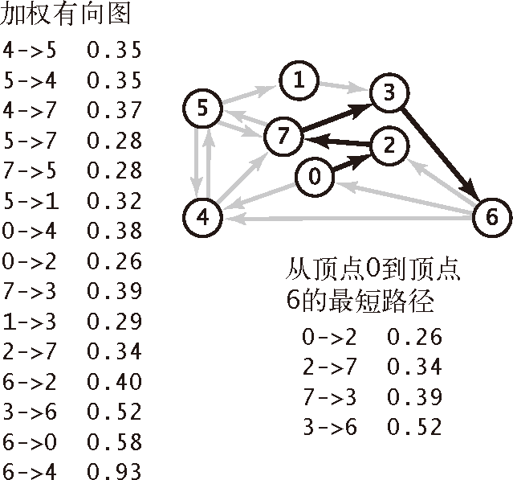

- 图 4.4.1　一幅加权有向图和其中的一条最短路径

```
定义。在一幅加权有向图中，从顶点 s 到顶点 t 的最短路径是所有从 s 到 t 的路径中的
```

- 权重最小者。

本节中，我们将会学习解决下面这个问题的经典算法。

```
单点最短路径。给定一幅加权有向图和一个起点 s，回答“从 s 到给定的目的顶点 v 是否存在
```

一条有向路径？如果有，找出最短（总权重最小）的那条路径。”等类似问题。

我们计划在本节中讨论下列问题：

- 加权有向图的 API 和实现以及单点最短路径的 API；

- 解决边的权重非负的最短路径问题的经典 Dijkstra 算法；

- 在无环加权有向图中解决该问题的一种快速算法，边的权重甚至可以是负值；

- 适用于一般情况的经典 Bellman-Ford 算法，其中图可以含有环，边的权重也可以是负值。我们还需要算法来找出负权重的环，以及不含有这种环的加权有向图中的最短路径。

在学习了这些算法之后，我们还会考虑它们的应用。

### 4.4.1　最短路径的性质

最短路径问题的基本定义是很简单的，但这种简洁也隐藏了一些在学习相关的算法和数据结构之前需要解决的问题。

- 路径是有向的。最短路径需要考虑到各条边的方向。

- 权重不一定等价于距离。几何上的直觉可以帮助你理解算法，因此示例中的顶点都在平面上且权重为顶点之间的欧几里得距离，例如图 4.4.1 所示的那幅有向图。但权重也可以表示时间、花费或是某种完全无关的东西，也不一定会和距离的远近成正比。我们使用了双关性的术语来强调这一点，指的是权重或是成本最短的路径。

```
并不是所有顶点都是可达的。如果 t 并不是从 s 可达的，那么就不存在任何路径，也就不
存在 s 到 t 的最短路径。为了简化问题，我们的样图都是强连通的（每个顶点从另外任意
```

- 一个顶点都是可达的）。

- 负权重会使问题更复杂。我们暂时假设边的权重都是正的（或零）。负权重所带来的意外效应是本节最后部分的重点。

- 最短路径一般都是简单的。我们的算法会忽略构成环的零权重边，因此找到的最短路径都不会含有环。

- 最短路径不一定是唯一的。从一个顶点到达另一个顶点的权重最小的路径可能有多条，我们只要找到其中一条即可。

- 可能存在平行边和自环：平行边中的权重最小者才会被选中，最短路径也不可能包含自环（除非自环的权重为零，但我们会忽略它）。在正文中，为了避免歧义我们隐式地假设平行

```
边不存在，用 v → w 来表示从 v 到 w 的边，本节的代码处理它们并没有困难。
```

最短路径树

```
我们的重点是单点最短路径问题，其中给出了起点 s，计算的结果是一棵最短路径树 (SPT)，
它包含了顶点 s 到所有可达的顶点的最短路径。如图 4.4.2 所示。
```

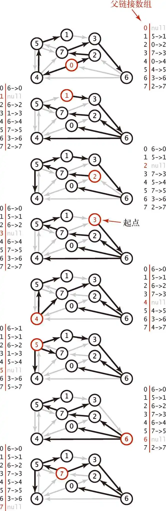

- 图 4.4.2　最短路径树

```
定义。给定一幅加权有向图和一个顶点 s，以 s 为起点的一棵最短路径树是图的一幅子
图，它包含 s 和从 s 可达的所有顶点。这棵有向树的根结点为 s，树的每条路径都是有向
```

- 图中的一条最短路径。

```
这样一棵树是一定存在的：一般来说，从 s 到一个顶点有可能存在两条长度相等的路径。如
```

果出现这种情况，可以删除其中一条路径的最后一条边。如此这般，直到从起点到每个顶点都只有一条路径相连（即一棵树，请见图 4.4.3）。通过构造这棵最短路径树，可以为用例提供从

```
s 到图中任何顶点的最短路径，表示方法为一组指向父结点的链接，和 4.1 节中表示路径的方
```

法完全一样。

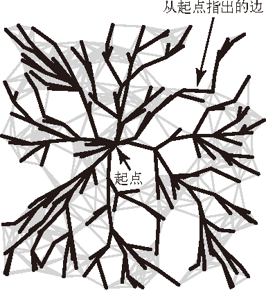

- 图 4.4.3　一棵含有 250 个顶点的最短路径树

### 4.4.2　加权有向图的数据结构

```
有向边的数据结构比无向边更加简单，因为有向边只有一个方向。与 Edge 类中的
either() 和 other() 方法不同，这里定义了 from() 和 to() 方法，请见表 4.4.2。
```

表 4.4.2　加权有向边的 API

```java
public class  <b>DirectedEdge</b>
              DirectedEdge(int v, int w, double
weight)
      double  weight()
```

- 边的权重

```
         int  from()
```

- 指出这条边的顶点

```
         int  to()
```

- 这条边指向的顶点

```
      String  toString()
```

- 对象的字符串表示

```
从 4.1 节到 4.3 节，从 Graph 类过渡到了 EdgeWeightedGraph 类。与以前一样，我们在
这里添加了 edges() 方法并使用 DirectedEdge 类代替了整型变量，请见表 4.4.3。
```

表 4.4.3　加权有向图的 API

```java
          public class  <b>EdgeWeightedDigraph</b>
含有 V 个顶点的空有向图
EdgeWeightedDigraph(int V)
```

- 从输入流中读取图的构造函数

```
EdgeWeightedDigraph(In in)
```

这两份 API 的实现请见后面的框注“加权有向边的数据类型”和“加权有向图的数据类型”。它们

```
很自然地扩展了 4.2 节和 4.3 节中相应的类的实现。Digraph 类中的邻接表使用的是整数，
在 EdgeWeightedDigraph 的邻接表中使用的是 DirectedEdge 对象。与从 4.1 节到 4.2
节中 Graph 类到 Digraph 类的转换一样，从 4.3 节的 EdgeWeightedGraph 类到本节中
的 EdgeWeightedDigraph 类的转换代码也变得简单了，因为在数据结构中每条边只会出现
```

一次。

- 加权有向边的数据类型

```java
public class DirectedEdge
1
{
2
  private final int v;                       // 边的起点
3
  private final int w;                       // 边的终点
4
  private final double weight;               // 边的权重
5
6
  public DirectedEdge(int v, int w, double weight)
7
  {
8
     this.v = v;
9
     this.w = w;
10
     this.weight = weight;
11
  }
12
13
  public double weight()
14
  {  return weight;  }
15
16
  public int from()
17
18
  {  return v;  }
19
20
  public int to()
21
  {  return w;  }
22
23
  public String toString()
24
  {  return String.format("%d->%d %.2f", v, w, weight);  }
25
}
26
DirectedEdge 类的实现比 4.3 节中无向边的数据类型 Edge 类（请见 4.3.2 节框注“带权
重的边的数据类型”）更简单，因为边的两个端点是有区别的。用例可以使用惯用代码 int
v=e.from(), w=e.to(); 来访问 DirectedEdge 的两个端点。
```

- 加权有向图的数据类型

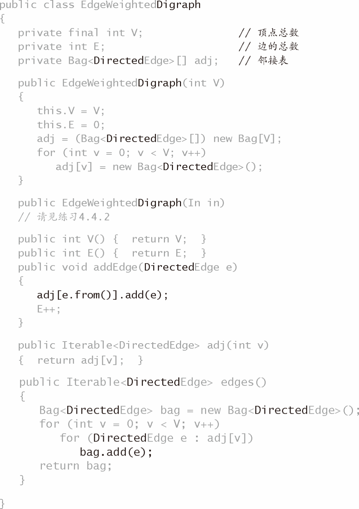

```
EdgeWeightedDigraph 类的实现混合了 EdgeWeightedGraph 类和 Digraph 类。它
维护了一个由顶点索引的 Bag 对象的数组，Bag 对象的内容为 DirectedEdge 对象。与
Digraph 类一样，每条边在邻接表中只会出现一次：如果一条边从 v 指向 w，那么它只会
出现在 v 的邻接链表中。这个类可以处理自环和平行边。toString() 方法的实现留作练
```

- 习 4.4.2。

```
图 4.4.4 所示的是用 EdgeWeightedDigraph 表示左侧的加权有向图时所构造的数据结构，
```

在构造的过程中边被按照顺序一条一条地加入图中。与以前一样，我们使用了 Bag 类来表示邻接表并在图中按照标准方式将它们表示为链表。与 4.2 节中普通的有向图一样，每条边在数据结构中都只出现了一次。

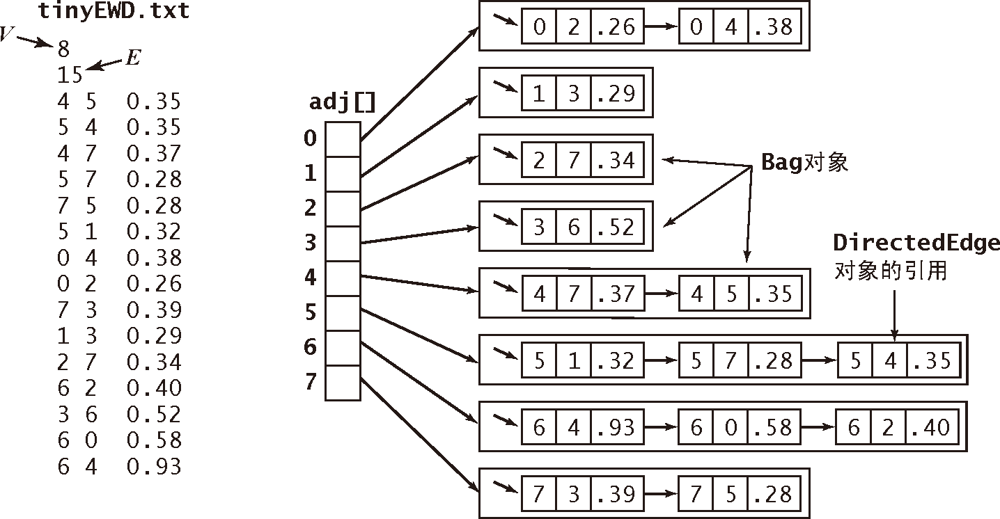

- 图 4.4.4　加权有向图的表示

### 4.4.2.1　最短路径的 API

```
对于最短路径的 API，我们的设计思路与 4.1 节中的 DepthFirstPaths 和
BreadthFirstPaths 的 API 是一样的。算法将会实现表 4.4.4 所示的 API 来为用例提供图
```

中的最短路径和其长度。

表 4.4.4　最短路径的 API

```java
          public class <b>SP</b>
```

- 构造函数

```
SP(EdgeWeightedDigraph G, int s)
                double distTo(int v)
从顶点 s 到 v 的距离，如果不存在则
               boolean hasPathTo(int v)
是否存在从顶点 s 到 v 的路径
Iterable<DirectedEdge> pathTo(int v)
从顶点 s 到 v 的路径，如果不存在则
```

构造函数会创建最短路径树并计算最短路径的长度，其他查询方法则会使用这些数据结构为用

```
例提供路径的长度以及路径的 Iterable 对象。
```

### 4.4.2.2　测试用例

右侧框注是一个简单测试用例。它接受一个输入流和一个起点作为命令行参数，从输入流中读取加权有向图，根据起点来计算有向图的最短路径树并打印从起点到其他所有顶点的最短路径。我们约定，所有的最短路径实现都使用该测试用例进行测试。图 4.4.4 中的 tinyEWD.txt文件定义了一幅较小的示例有向图中所有的边和权重，会用来显示最短路径算法的详细轨迹。

- 和边的总数

它的文件格式与最小生成树算法中使用的样图相同：首先是顶点总数

- ，随后


- 行数据，每一行为两个顶点的索引和一个权重。在本书的网站上，你可以找到一些定义

是

了更大的加权有向图的文件，包括 mediumEWG.txt。它定义了一幅含有 250 个顶点的加权有向图，如图 4.4.3 所示。在这幅图的图像中，每一行数据都表示方向相反的两条边，因此这个文件所含有的边数是在学习最小生成树时所使用的 mediumEWG.txt 的 2 倍。在最短路径树的图像中，每一行都表示一条从顶点指出的有向边。

```java
 public static void main(String[] args)
 {
    EdgeWeightedDigraph G;
    G = new EdgeWeightedDigraph(new In(args[0]));
    int s = Integer.parseInt(args[1]);
    SP sp = new SP(G, s);
    for (int t = 0; t < G.V(); t++)
    {
       StdOut.print(s + " to " + t);
       StdOut.printf(" (%4.2f): ", sp.distTo(t));
       if (sp.hasPathTo(t))
          for (DirectedEdge e : sp.pathTo(t))
             StdOut.print(e + "   ");
       StdOut.println();
    }
 }
% java SP tinyEWD.txt 0
0 to 0 (0.00):
0 to 1 (1.05): 0->4 0.38  4->5 0.35  5->1 0.32
0 to 2 (0.26): 0->2 0.26
0 to 3 (0.99): 0->2 0.26  2->7 0.34  7->3 0.39
0 to 4 (0.38): 0->4 0.38
0 to 5 (0.73): 0->4 0.38  4->5 0.35
0 to 6 (1.51): 0->2 0.26  2->7 0.34  7->3 0.39  3->6  0.52
0 to 7 (0.60): 0->2 0.26  2->7 0.34
```

最短路径的测试用例

### 4.4.2.3　最短路径的数据结构

表示最短路径所需的数据结构很简单，如图 4.4.5 所示。

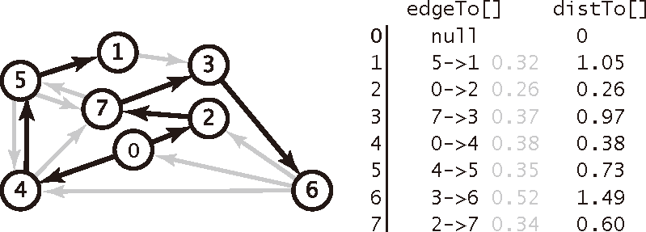

- 图 4.4.5　最短路径的数据结构

- 最短路径树中的边。和深度优先搜索、广度优先搜索和 Prim 算法一样，使用一个由顶点索

```
引的 DirectedEdge 对象的父链接数组 edgeTo[]，其中 edgeTo[v] 的值为树中连接
v 和它的父结点的边（也是从 s 到 v 的最短路径上的最后一条边）。
到达起点的距离。我们需要一个由顶点索引的数组 distTo[]，其中 distTo[v] 为从 s
到 v 的已知最短路径的长度。
我们约定，edgeTo[s] 的值为 null，distTo[s] 的值为 0。同时还约定，从起点到不可
达的顶点的距离均为 Double.POSITIVE_INFINITY。和以前一样，我们会实现使用这些数
```

据结构的数据类型并支持用例调用方法来查询最短路径和它们的长度。

### 4.4.2.4　边的松弛

我们的最短路径 API 的实现都基于一个被称为松弛（relaxation）的简单操作。一开始我们只

```
知道图的边和它们的权重，distTo[] 中只有起点所对应的元素的值为 0，其余元素的值均
被初始化为 Double.POSITIVE_INFINITY。随着算法的执行，它将起点到其他顶点的最短
路径信息存入了 edgeTo[] 和 distTo[] 数组中。在遇到新的边时，通过更新这些信息就可
以得到新的最短路径。特别是，我们在其中会用到边的松弛技术，定义如下：放松边 v → w
意味着检查从 s 到 w 的最短路径是否是先从 s 到 v，然后再由 v 到 w。如果是，则根据这个
情况更新数据结构的内容。上边框注中的代码实现了这个操作。由 v 到达 w 的最短路径是
distTo[v] 与 e.weight() 之和——如果这个值不小于 distTo[w]，称这条边失效了并
```

将它忽略；如果这个值更小，就更新数据。

```java
private void relax(DirectedEdge e)
{
  int v = e.from(), w = e.to();
  if (distTo[w] > distTo[v] + e.weight())
  {
      distTo[w] = distTo[v] + e.weight();
      edgeTo[w] = e;
  }
}
```

图 4.4.6 显示的是边的放松操作之后可能出现的两种情况。一种情况是边失效（左边的例

```
子），不更新任何数据；另一种情况是 v → w 就是到达 w 的最短路径（右边的例子），这将会
更新 edgeTo[w] 和 distTo[w]（这可能会使另一些边失效，但也可能产生一些新的有效
```

边）。松弛这个术语来自于用一根橡皮筋沿着连接两个顶点的路径紧紧展开的比喻：放松一条

```
边就类似于将橡皮筋转移到一条更短的路径上，从而缓解了橡皮筋的压力。如果 relax() 改
变了和边 e 相关的顶点的 distTo[e.to()] 和 edgeTo[e.to()] 的值，就称 e 的放松是
```

成功的。

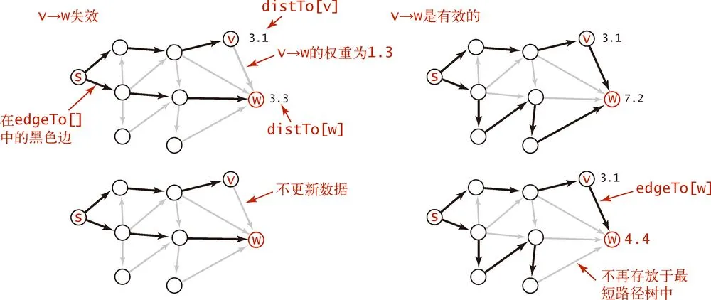

- 图 4.4.6　边的松弛的两种情况

### 4.4.2.5　顶点的松弛

```
实际上，实现会放松从一个给定顶点指出的所有边，如下页框注中（被重载的）relax() 的
实现所示。注意，从任意 distTo[v] 为有限值的顶点 v 指向任意 distT[] 为无穷的顶点
的边都是有效的。如果 v 被放松，那么这些有效边都会被添加到 edgeTo[] 中。某条从起点
指出的边将会是第一条被加入 edgeTo[] 中的边。算法会谨慎选择顶点，使得每次顶点松弛
```

操作都能得出到达某个顶点的更短的路径，最后逐渐找出到达每个顶点的最短路径。如图4.4.7 所示。

```java
private void relax(EdgeWeightedDigraph G, int v)
{
  for (DirectedEdge e : G.adj(v))
  {
     int w = e.to();
     if (distTo[w] > distTo[v] + e.weight())
     {
        distTo[w] = distTo[v] + e.weight();
        edgeTo[w] = e;
    }
  }
}
```

顶点的松弛

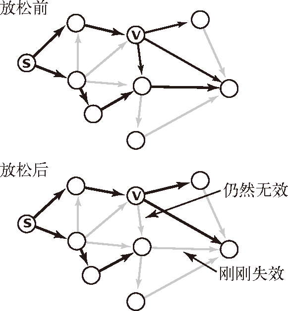

- 图 4.4.7　顶点的松弛

### 4.4.2.6　为用例准备的查询方法

```
与 4.1 节（以及练习 4.1.13）中实现路径查找的 API 相似，edgeTo[] 和 distTo[] 数组直
接支持 pathTo()、hasPathTo() 和 distTo() 查询方法，如下方框注所示。默认所有最
短路径的实现都包含这段代码。前面已经提到过，只有在 v 是从 s 可达的情况下，
distTo[v] 才是有意义的，还已经约定，对于从 s 不可达的顶点，distTo() 方法都应该
返回无穷大。在实现这个约定时，将 distTo[] 中的所有元素都初始化为
Double.POSITIVE_INFINITY，distTo[s] 则为 0。最短路径算法会将从起点可达的顶
点 v 的 distTo[v] 设为一个有限值，这样就不必再用 marked[] 数组来在图的搜索中标记
可达的顶点，而是通过检测 distTo[v] 是否为 Double.POSITIVE_INFINITY 来实现
hasPathTo(v)。对于 pathTo() 方法，我们约定如果 v 不是从起点可达的则返回 null，
如果 v 等于起点则返回一条不含任何边的路径。对于可达的顶点，我们会遍历最短路径树并
返回栈上的所有边，这和 DepthFirstPaths 以及 BreadthFirstPaths 的做法完全一
样。图 4.4.8 显示了在示例中路径 0 → 2 → 7 → 3 → 6 是如何被找到的。
public double distTo(int v)
{   return distTo[v];   }
public boolean hasPathTo(int v)
{   return distTo[v] < Double.POSITIVE_INFINITY;  }
public Iterable<DirectedEdge> pathTo(int v)
{
  if (!hasPathTo(v)) return null;
  Stack<DirectedEdge> path = new Stack<DirectedEdge>();
  for (DirectedEdge e = edgeTo[v]; e != null; e = edgeTo[e.from()])
     path.push(e);
  return path;
}
```

最短路径 API 中的查询方法

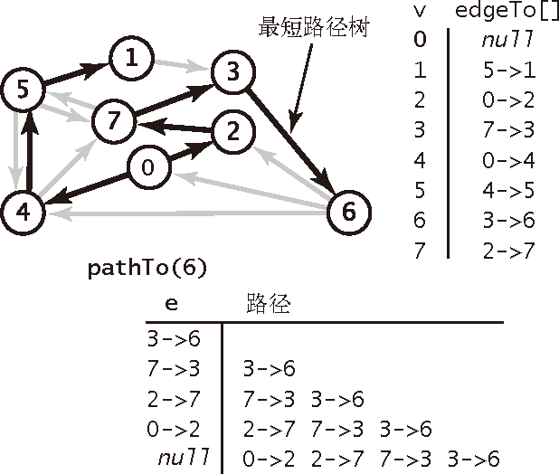

```
图 4.4.8　pathTo() 方法的计算轨迹
```

### 4.4.3　最短路径算法的理论基础

边的放松操作是一项非常容易实现的重要操作，它是实现最短路径算法的基础。同时，它也是理解这个算法的理论基础并使我们能够完整地证明算法的正确性。

### 4.4.3.1　最优性条件

以下命题证明了判断路径是否为最短路径的全局条件与在放松一条边时所检测的局部条件是等价的。

```
 为一幅加权有向图，顶点 s 是
```

- 命题 P（最短路径的最优性条件）。令中的起点，


```
distTo[] 是一个由顶点索引的数组，保存的是
 中路径的长度。对于从 s 可达的所有顶
```

```
点 v，distTo[v] 的值是从 s 到 v 的某条路径的长度，对于从 s 不可达的所有顶点 v，
该值为无穷大。当且仅当对于从 v 到 w 的任意一条边 e，这些值都满足 distTo[w]
<=distTo[v]+e.weight() 时（换句话说，不存在有效边时），它们是最短路径的长
```

- 度。

```xml
证明。假设 distTo[w] 是从 s 到 w 的最短路径。如果对于某条从 v 到 w 的边 e 有
distTo[w]>distTo[v]+e.weight()，那么从 s 到 w（经过 v）且经过 e 的路径的长
度必然小于 distTo[w]，矛盾。因此最优性条件是必要的。
要证明最优性条件是充分的，假设 w 是从 s 可达的且 s=v<sub>0</sub> →
v<sub>1</sub> → v<sub>2</sub>... → v<i><sub>k</sub></i>=w 是从 s 到 w
的最短路径，其权重为 OPT<sub>sw</sub>。对于 1 到 k 之间的 i，令 e<sub>
<i>i</i></sub> 表示 v<sub><i>i</i>-1</sub> 到 v<sub><i>i</i></sub> 的
```

- 边。根据最优性条件，可以得到以下不等式：

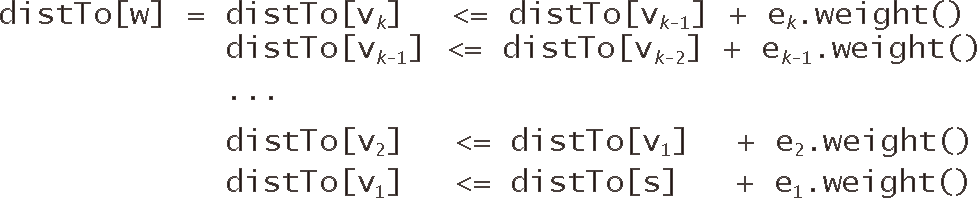

```
综合这些不等式并去掉 distTo[s]=0.0，得到：
distTo[w] <= e<sub>1</sub>.weight() + ... + e<sub><i>k</i>
</sub>.weight() = OPT<sub>SW</sub>.
现在，distTo[w] 为从 s 到 w 的某条边的长度，因此它不可能比最短路径更短。所以我
```

- 们有以下不等式：

```
OPT<sub>SW</sub> <= distTo[w] <= OPT<sub>SW</sub>
```

- 且等号必然成立。

### 4.4.3.2　验证

```
命题 P 的一个重要的实际应用是最短路径的验证。无论一种算法会如何计算 distTo[]，都
```

只需要遍历图中的所有边一遍并检查最优性条件是否满足就能够知道该数组中的值是否是最短路径的长度。最短路径的算法可能会很复杂，因此能够快速验证计算的结果就变得很重要。为

```
此，我们在本书的网站上的实现中包含了一个 check() 方法。该方法还会检查 edgeTo[]
指明的路径并验证它与 distTo[] 是否一致。
```

### 4.4.3.3　通用算法

由最优性条件马上可以得到一个能够涵盖已经学习过的所有最短路径算法的通用算法。现在，我们暂时只研究非负权重的情况。

```
命题 Q（通用最短路径算法）。将 distTo[s] 初始化为 0，其他 distTo[] 元素初始化为
```

- 无穷大，继续如下操作：放松 G 中的任意边，直到不存在有效边为止。

```
对于任意从 s 可达的顶点 w，在进行这些操作之后，distTo[w] 的值即为从 s 到 w 的最
短路径的长度（且 edgeTo[w] 的值即为该路径上的最后一条边）。
证明。放松边 v → w 必然会将 distTo[w] 的值设为从 s 到 w 的某条路径的长度（且将
edgeTo[w] 设为该路径上的最后一条边）。对于从 s 可达的任意顶点 w，只要
distTo[w] 仍然是无穷大，到达 w 的最短路径上的某条边肯定仍然是有效的，因此算法
的操作会不断继续，直到由 s 可达的每个顶点的 distTo[] 值均变为到达该顶点的某条路
径的长度。对于已经找到最短路径的任意顶点 v，在算法的计算过程中 distTo[v] 的值
都是从 s 到 v 的某条（简单）路径的长度且必然是单调递减的。因此，它递减的次数必然
是有限的（每切换一条 s 到 v 简单路径就递减一次）。当不存在有效边的时候，命题 P 就
```

- 成立了。

将最优性条件和通用算法放在一起学习的关键原因是，通用算法并没有指定边的放松顺序。因此，要证明这些算法都能通过计算得到最短路径，只需证明它们都会放松所有的边直到所有边都失效即可。

### 4.4.4　Dijkstra 算法

在 4.3 节中，我们讨论了寻找加权无向图中的最小生成树的 Prim 算法：构造最小生成树的每一步都向这棵树中添加一条新的边。Dijkstra 算法采用了类似的方法来计算最短路径树。首先

```
将 distTo[s] 初始化为 0，distTo[] 中的其他元素初始化为正无穷。然后将 distTo[]
```

最小的非树顶点放松并加入树中，如此这般，直到所有的顶点都在树中或者所有的非树顶点的distTo[] 值均为无穷大。

- 命题 R。Dijkstra 算法能够解决边权重非负的加权有向图的单起点最短路径问题。

```
证明。如果 v 是从起点可达的，那么所有 v → w 的边都只会被放松一次。当 v 被放松
时，必有 distTo[w]<=distTo[v]+e.weight()。该不等式在算法结束前都会成立，因
此 distTo[w] 只会变小（放松操作只会减小 distTo[] 的值）而 distTo[v] 则不会改
变（因为边的权重非负且在每一步中算法都会选择 distTo[] 最小的顶点，之后的放松操
作不可能使任何 distTo[] 的值小于 distTo[v]）。因此，在所有从 s 可达的顶点均被
```

- 添加到树中之后，最短路径的最优性条件成立，即命题 P 成立。

### 4.4.4.1　数据结构

```
要实现 Dijkstra 算法，除了 distTo[] 和 edgeTo[] 数组之外还需要一条索引优先队列
pq，以保存需要被放松的顶点并确认下一个被放松的顶点。我们知道 IndexMinPQ 可以将索
引和键（优先级）关联起来并且可以删除并返回优先级最低的索引。在这里，只要将顶点 v
和 distTo[v] 关联起来就立即可以得到 Dijkstra 算法的实现。另外，稍加推导也可以知道，
edgeTo[] 中的元素所对应的可达顶点构成了一棵最短路径树。
```

### 4.4.4.2　换一个角度看问题

根据算法的证明，我们可以从另一个角度来理解它，如图 4.4.9 所示，已知树结点所对应的

```
distTo[] 值均为最短路径的长度。对于优先队列中的任意顶点 w，distTo[w] 是从 s 到
w 的最短路径的长度，该路径上的中间顶点在树中且路径结束于横切边 edgeTo[w]。优先级
最小的顶点的 distTo[] 值就是最短路径的权重，它不会小于已经被放松过的任意顶点的最
```

短路径的权重，也不会大于还未被放松过的任意顶点的最短路径的权重。这个顶点就是下一个

```
要被放松的顶点。所有从 s 可达的顶点都会按照最短路径的权重顺序被放松。
```

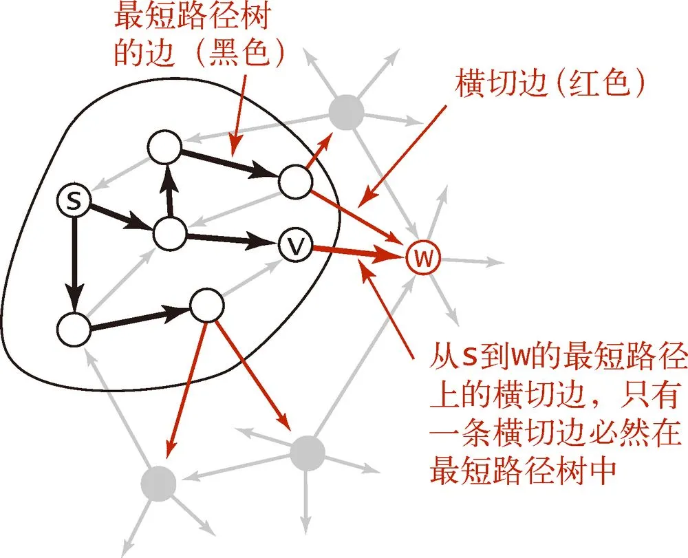

- 图 4.4.9　Dijkstra 的最短路径算法

图 4.4.10 是算法处理样图 tinyEWD.txt 时的轨迹。在这个例子中，算法构造最短路径树的过程如下所述。

```
将顶点 0 添加到树中，将顶点 2 和 4 加入优先队列。
从优先队列中删除顶点 2，将 0 → 2 添加到树中，将顶点 7 加入优先队列。
从优先队列中删除顶点 4，将 0 → 4 添加到树中，将顶点 5 加入优先队列，边 4 → 7 失
```

- 效。

```
从优先队列中删除顶点 7，将 2 → 7 添加到树中，将顶点 3 加入优先队列，边 7 → 5 失
```

- 效。

```
从优先队列中删除顶点 5，将 4 → 5 添加到树中，将顶点 1 加入优先队列，边 5 → 7 失
```

- 效。

```
从优先队列中删除顶点 3，将 7 → 3 添加到树中，将顶点 6 加入优先队列。
从优先队列中删除顶点 1，将 5 → 1 添加到树中，边 1 → 3 失效。
从优先队列中删除顶点 6，将 3 → 6 添加到树中。
```

算法按照顶点到起点的最短路径的长度的增序将它们添加到最短路径树中，如图 4.4.10 右侧的红色箭头所示。

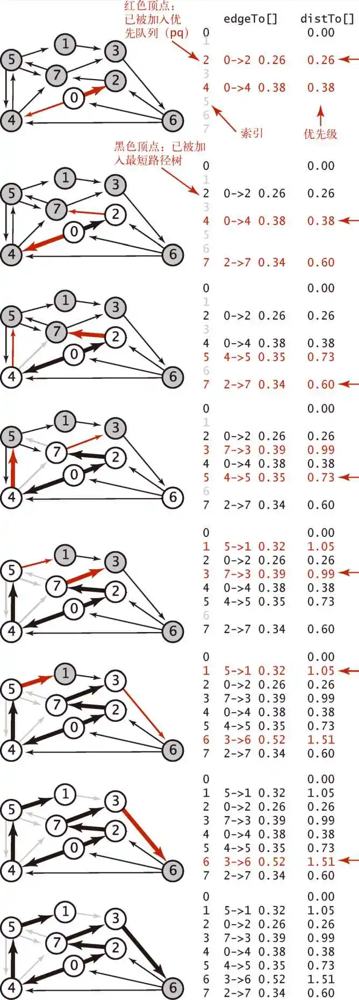

- 图 4.4.10　Dijkstra 算法的轨迹

```sql
Dijkstra 算法的实现 DijkstraSP（算法 4.9）只是用代码复述了算法的描述，还在
relax() 方法中添加了一行语句来处理以下两种情况：要么边的 to() 得到的顶点还不在优
先队列中，此时需要使用 insert() 方法将它加入到优先队列中；要么它已经在优先队列中
且优先级需要被降低，此时可以用 change() 方法实现。
```

- 命题 R（续）。在一幅含有个顶点和条边的加权有向图中，使用 Dijkstra 算法计算根

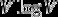

- 成正比，时间与成正比（最坏情况结点为给定起点的最短路径树所需的空间与

- 下）。证明。同 Prim 算法的证明（请见命题 N）

如前所述，思考 Dijkstra 算法的另一种方式就是将它和 4.3 节的 Prim 算法（算法 4.7）相比较。两种算法都会用添加边的方式构造一棵树：Prim 算法每次添加的都是离树最近的非树顶

```
点，Dijkstra 算法每次添加的都是离起点最近的非树顶点。它们都不需要 marked[] 数组，因
为条件 !marked[w] 等价于条件 distTo[w] 为无穷大。换句话说，将算法 4.9 中的有向图
换成无向图并忽略 relax() 方法中 distTo[v] 部分的代码，就会得到算法 4.7，也就是
```

Prim 算法的即时版本（！）。同样，根据 LazyPrimMST（4.3.4 节框注“最小生成树的 Prim 算法的延时实现”）实现 Dijkstra 算法的延时版本也并不困难。

### 4.4.4.3　变种

我们只需对 Dijkstra 算法的实现稍作适当的修改就能够解决这个问题的其他版本，例如，加权

```
无向图中的单点最短路径。给定一幅加权无向图和一个起点 s，回答“是否存在一条从 s 到给
```

定的顶点 v 的路径？如果有，找出最短（总权重最小）的那条路径。”等类似问题。

如果将无向图看作有向图，这个问题的答案就很简单了。也就是说，对于给定的加权无向图，创建一幅由相同顶点构成的加权有向图，且对于无向图中的每条边，相应地创建两条（方向不同）有向边。有向图中的路径和无向图中的路径存在着一一对应的关系，路径的权重也是相同的——最短路径的问题是等价的。

- 算法 4.9　最短路径的 Dijkstra 算法

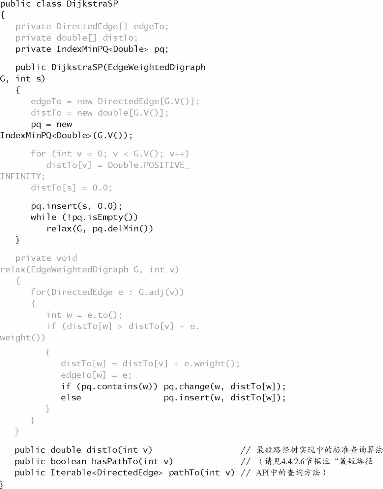

- Dijkstra 算法的实现每次都会为最短路径树添加一条边，该边由一个树中的顶点指向一个非

```
树顶点 w 且它是到 s 最近的顶点。
给定两点的最短路径。给定一幅加权有向图以及一个起点 s 和一个终点 t，找到从 s 到 t 的
```

最短路径。

```
要解决这个问题，你可以使用 Dijkstra 算法并在从优先队列中取到 t 之后终止搜索。
```

任意顶点对之间的最短路径。给定一幅加权有向图，回答“给定一个起点 s 和一个终点 t，是否存在一条从 s 到 t 的路径？如果有，找出最短（总权重最小）的那条路径。”等类似问题。


右边框注中短小精悍的代码解决了任意顶点对之间的最短路径问题，所需的时间与

```
成正比。它构造了 DijkstraSP 对象的数组，每个元素都将相应的顶点作
```


成正比，空间与为起点。在用例进行查询时，代码会访问起点所对应的单点最短路径对象并将目的顶点作为参数进行查询。

```java
public class DijkstraAllPairsSP
{
  private DijkstraSP[] all;
  DijkstraAllPairsSP(EdgeWeightedDigraph G)
  {
     all = new DijkstraSP[G.V()]
     for (int v = 0; v < G.V(); v++)
        all[v] = new DijkstraSP(G, v);
  }
  Iterable<DirectedEdge> path(int s, int t)
  {  return all[s].pathTo(t);  }
  double dist(int s, int t)
  {  return all[s].distTo(t);  }
}
```

任意顶点对之间的最短路径

欧几里得图中的最短路径。在顶点为平面上的点且边的权重与顶点欧几里得间距成正比的图中，解决单点、给定两点和任意顶点对之间的最短路径问题。

在这种情况下，有一个小小的改动可以大幅提高 Dijkstra 算法的运行速度（请见练习4.4.27）。

图 4.4.11 显示的是 Dijkstra 算法在处理测试文件 mediumEWD.txt（请见 4.4.2.2 节）所定义的欧几里得图时用若干不同的起点产生最短路径树的过程。和之前一样，这幅图中的线段都表示双向的有向边。这些图片展示了一段引人入胜的动态过程。

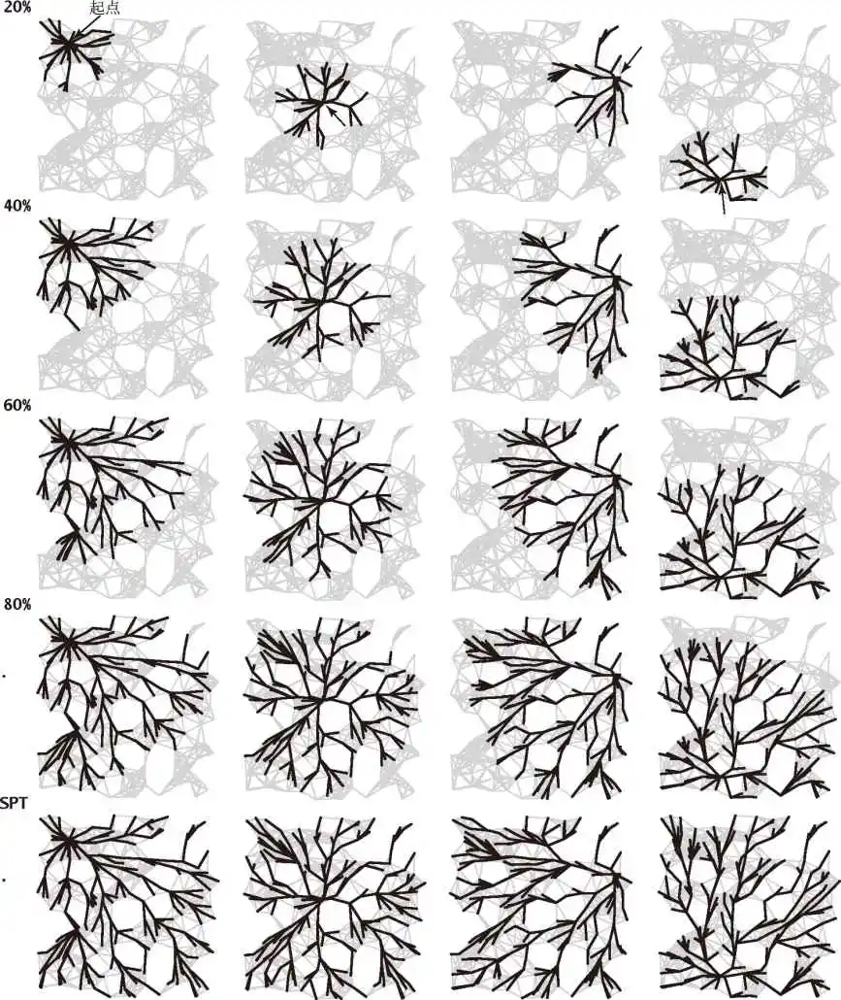

- 图 4.4.11　Dijkstra 算法（250 个顶点，不同的起点）

下面，我们将会考虑加权无环图中的最短路径算法并且将在线性时间内解决该问题（比Dijkstra 算法要快）。然后是负权重的加权有向图中的最短路径问题，Dijkstra 算法不适用于这种情况。

### 4.4.5　无环加权有向图中的最短路径算法

许多应用中的加权有向图都是不含有有向环的。我们现在来学习一种比 Dijkstra 算法更快、更简单的在无环加权有向图中找出最短路径的算法，如图 4.4.12 所示。它的特点是：

- 能够在线性时间内解决单点最短路径问题；

- 能够处理负权重的边；

- 能够解决相关的问题，例如找出最长的路径。

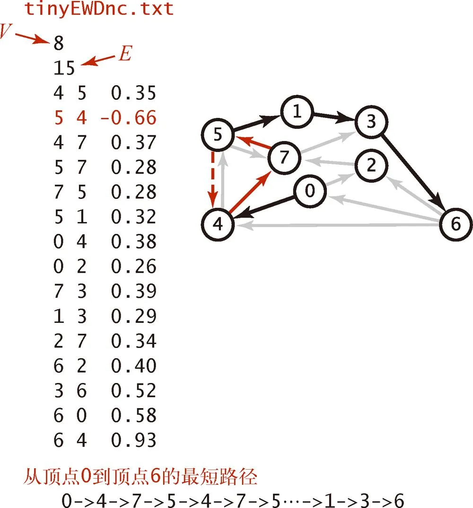

- 图 4.4.12　一幅无环加权有向图和它的一棵最短路径树

这些算法都是在 4.2 节中学过的无环有向图的拓扑排序算法的简单扩展。

特别的是，只要将顶点的放松和拓扑排序结合起来，马上就能够得到一种解决无环加权有向图

```
中的最短路径问题的算法。首先，将 distTo[s] 初始化为 0，其他 distTo[] 元素初始化
```

为无穷大，然后一个一个地按照拓扑顺序放松所有顶点。我们可以用与 Dijkstra 算法的证明（命题 R）类似的方法证明这个方法的正确性。

- 命题 S。按照拓扑顺序放松顶点，就能在和成正比的时间内解决无环加权有向图的

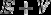

- 单点最短路径问题。

```
证明。每条边 v → w 都只会被放松一次。当 v 被放松时，得到：distTo[w]<=
distTo[v]+e.weight()。在算法结束前该不等式都成立，因为 distTo[v] 是不会变
化的（因为是按照拓扑顺序放松顶点，在 v 被放松之后算法不会再处理任何指向 v 的边）
而 distTo[w] 只会变小（任何放松操作都只会减小 distTo[] 中的元素的值）。因此，
在所有从 s 可达的顶点都被加入到树中后，最短路径的最优性条件成立，命题 Q 也就成立
```

- 了。时间上限很容易得到：命题 G 告诉我们拓扑排序所需的时间与成正比，而在第

- 成正比。

- 二次遍历中每条边都只会被放松一次，因此算法总耗时与

图 4.4.13 是算法处理无环加权有向样图 tinyEWDAG.txt 的轨迹。在这个例子中，算法由顶点

```
5 开始按照以下步骤构建了一棵最短路径树：
用深度优先搜索得到图的顶点的拓扑排序 5 1 3 6 4 7 0 2；
将顶点 5 和从它指出的所有边添加到树中；
将顶点 1 和边 1 → 3 添加到树中；
将顶点 3 和边 3 → 6 添加到树中，边 3 → 7 已经失效；
将顶点 6 和边 6 → 2、6 → 0 添加到树中，边 6 → 4 已经失效；
将顶点 4 和边 4 → 0 添加到树中，边 4 → 7 和 6 → 0 已经失效；
将顶点 7 和边 7 → 2 添加到树中，边 6 → 2 已经失效；
将顶点 0 添加到树中，边 0 → 2 已经失效；
将顶点 2 添加到树中。
图中没有画出将 2 添加到树中的一步，拓扑序列中的最后一个顶点没有指出的边。
```

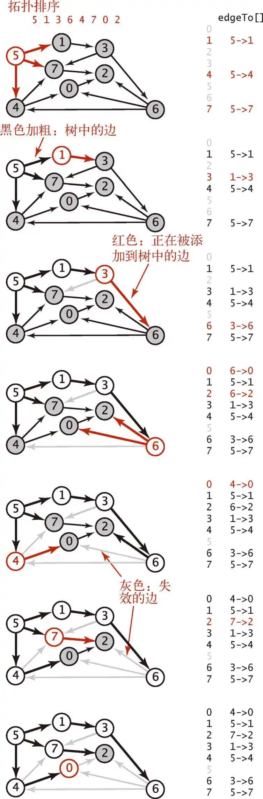

- 图 4.4.13　寻找无环加权有向图中的最短路径的算法轨迹

```
算法 4.10 在实现中直接使用了已学习过的许多代码。它假设 Topological 类使用本节中介
绍的 EdgeWeightedDigraph 类和 DirectedEdge 类的 API（请见练习 4.4.12）重载了拓
扑排序的方法。注意，该实现中不需要布尔数组 marked[]：因为是按照拓扑顺序处理无环
```

有向图中的顶点，所以不可能再次遇到已经被放松过的顶点。算法 4.10 的效率几乎已经没有提高的空间了：在拓扑排序后，构造函数会扫描整幅图并将每条边放松一次。在已知加权图是无环的情况下，它是找出最短路径的最好方法。

- 算法 4.10　无环加权有向图的最短路径算法

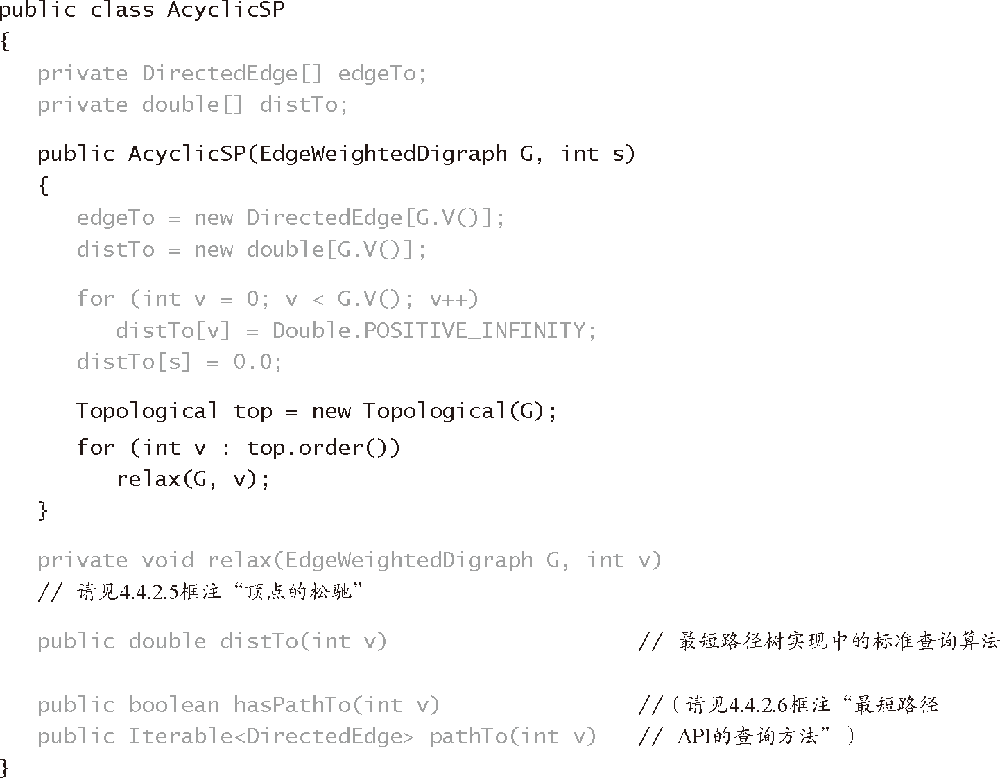

- 无环加权有向图的最短路径算法使用了拓扑排序（算法 4.5，重载了

```
EdgeWeightedDigraph 类和 DirectedEdge 类）来按照拓扑顺序放松所有顶点，这对
```

- 于计算出图中的最短路径已经足够了。

```
% java AcyclicSP tinyEWDAG.txt 5
1
5 to 0 (0.73): 5->4 0.35  4->0 0.38
2
5 to 1 (0.32): 5->1 0.32
3
5 to 2 (0.62): 5->7 0.28  7->2 0.34
4
5 to 3 (0.61): 5->1 0.32  1->3 0.29
5
5 to 4 (0.35): 5->4 0.35
6
5 to 5 (0.00):
7
5 to 6 (1.13): 5->1 0.32  1->3 0.29  3->6 0.52
8
5 to 7 (0.28): 5->7 0.28
9
```

命题 S 很重要，因为它的“无环”能够极大地简化问题的论断。对于最短路径问题，基于拓扑排序的方法比 Dijkstra 算法快的倍数与 Dijkstra 算法中所有优先队列操作的总成本成正比。另外，命题 S 的证明和边的权重是否非负无关，因此无环加权有向图不会受到任何限制。下面用这个特点解决边的负权重问题。我们会考虑使用这个最短路径模型来解决另外两个问题，其中之一乍一看甚至和图的处理似乎没有任何关系。

### 4.4.5.1　最长路径

考虑在无环加权有向图中寻找最长路径的问题，边的权重可正可负。

无环加权有向图中的单点最长路径。给定一幅无环加权有向图（边的权重可能为负）和一个起

```
点 s，回答“是否存在一条从 s 到给定的顶点 v 的路径？如果有，找出最长（总权重最大）的
```

那条路径。”等类似问题。

我们刚刚学习过的算法能够快速地解决这个问题。

- 命题 T。解决无环加权有向图中的最长路径问题所需的时间与成正比。

- 证明。给定一个最长路径问题，复制原始无环加权有向图得到一个副本并将副本中的所有边的权重取相反数。这样，副本中的最短路径即为原图中的最长路径。要将最短路径问题的答案转换为最长路径问题的答案，只需将方案中的权重变为正值即可。根据命题 S 立即可以得到算法所需的时间。

```
根据这种转换实现 AcyclicLP 类来寻找一幅无环加权有向图中的最长路径就十分简单了。实
现该类的一个更简单的方法是修改 AcyclicSP，将 distTo[] 的初始值变为
Double.NEGATIVE_INFINITY 并改变 relax() 方法中的不等式的方向。无论使用哪种方
```

法，都能得到无环加权有向图中的最长路径问题的一种高效的解决方案。和它形成鲜明对比的是，在一般的加权有向图（边的权重可能为负）中寻找最长简单路径的已知最好算法在最坏情况下所需的时间是指数级别的（请见第 6 章）！出现环的可能性似乎使这个问题的难度以指数级别增长。

图 4.4.14 是算法在无环加权有向样图 tinyEWDAG.txt 中寻找最长路径的轨迹，你可以将它与

```
图 4.4.13 相比较。在这个例子中，算法由顶点 5 按照以下步骤构建了一棵最长路径树：
用深度优先搜索得到图的顶点的拓扑排序 5 1 3 6 4 7 0 2；
将顶点 5 和从它指出的所有边添加到树中；
将顶点 1 和边 1 → 3 添加到树中 ;
将顶点 3 和边 3 → 6、3 → 7 添加到树中，边 5 → 7 已经失效；
将顶点 6 和边 6 → 2、6 → 4 和 6 → 0 添加到树中，边 5 → 4 已经失效；
将顶点 4 和边 4 → 0、4 → 7 添加到树中，边 6 → 0 和 3 → 7 已经失效；
将顶点 7 和边 7 → 2 添加到树中，边 6 → 2 已经失效；
将顶点 0 添加到树中，边 0 → 2 已经失效；
将顶点 2 添加到树中（未画出）。
```

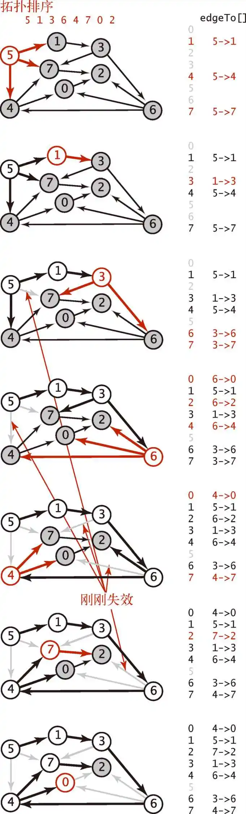

- 图 4.4.14　无环图中的最长路径算法

最长路径算法处理顶点的顺序和最短路径算法一样，但产生的结果却完全不同。

### 4.4.5.2　并行任务调度

作为算法应用的示例，我们再次考虑在 4.2 节中出现过的任务调度类的问题。这次需要解决以下调度问题（楷体部分为与 4.2.4.1 节的问题描述的不同之处）。

优先级限制下的并行任务调度。给定一组需要完成的任务和每个任务所需的时间，以及一组关于任务完成的先后次序的优先级限制。在满足限制条件的前提下应该如何在若干相同的处理器上（数量不限）安排任务并在最短的时间内完成所有任务？

4.2 节的模型默认只有单个处理器：将任务按照拓扑顺序排序，完成任务的总耗时就是所有任务所需要的总时间。现在假设有足够多的处理器并能够同时处理任意多的任务，受到的只有优先级的限制。和以前一样，需要处理的任务可能上百万甚至上亿，因此需要一个高效的算法。令人兴奋的是，正好存在一种线性时间的算法——一种叫做“关键路径“的方法能够证明这个问题与无环加权有向图中的最长路径问题是等价的。这个方法已成功应用于无数的工业软件之中。

假设任意可用的处理器都能在任务所需的时间内完成它，那么我们的重点就是尽早安排每一个任务。例如，表 4.4.5 给出了一个任务调度问题，图 4.4.15 给出的解决方案显示了这个问题所需的最短时间为 173.0。这份调度方案满足了所有限制条件，没有其他调度方案能比它耗时更

```
少，因为任务必须按照 0 → 9 → 6 → 8 → 2 的顺序完成。这个顺序就是这个问题的关键路
```

径。由优先级限制指定的每一列任务都代表了调度方案的一种可能的时间下限。如果将一系列任务的长度定义为完成所有任务的最早可能时间，那么最长的任务序列就是问题的关键路径，因为在这份任务序列中任何任务的启动延迟都会影响到整个项目的完成时间。

表 4.4.5　一个任务调度问题

任务

- 时耗必须在以下任务之前完成

```
41.0
1　7　9
51.0
2
50.0
36.0
38.0
45.0
21.0
3　8
32.0
3　8
32.0
2
29.0
4　6
```

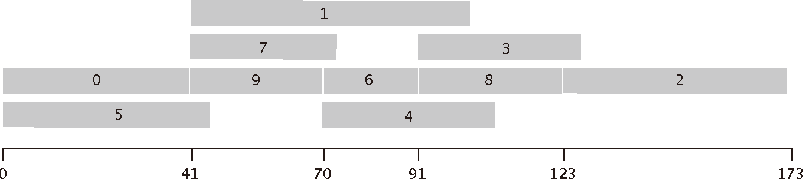

- 图 4.4.15　并行任务调度问题的解决方案

- 定义。解决并行任务调度问题的关键路径方法的步骤如下：创建一幅无环加权有向图，其中

```
包含一个起点 s 和一个终点 t 且每个任务都对应着两个顶点（一个起始顶点和一个结束顶
```

- 点）。对于每个任务都有一条从它的起始顶点指向结束顶点的边，边的权重为任务所需的时

```
间。对于每条优先级限制 v → w，添加一条从 v 的结束顶点指向 w 的起始顶点的权重为零
```

- 的边。我们还需要为每个任务添加一条从起点指向该任务的起始顶点的权重为零的边以及一条从该任务的结束顶点到终点的权重为零的边。这样，每个任务预计的开始时间即为从起点到它的起始顶点的最长距离。

图 4.4.16 显示的是示例任务所对应的图，图 4.4.17 则显示的是最长路径的答案。如定义所述，在图中每个任务都对应着三条边（从起点到起始顶点、从结束顶点到终点的权重为零的边，以及一条从起始顶点到结束顶点的边），每个优先级限制条件都对应着一条边。后面框注

```
“优先级限制下的并行任务调度问题的关键路径方法”中的 CPM 类简洁明了地实现了关键路径方
```

法。它能够将任意任务调度问题转化为无环加权有向图中的一个最长路径问题，用

```
AcyclicLP 解决它并打印出每个任务的开始时间以及调度方案的结束时间。
```

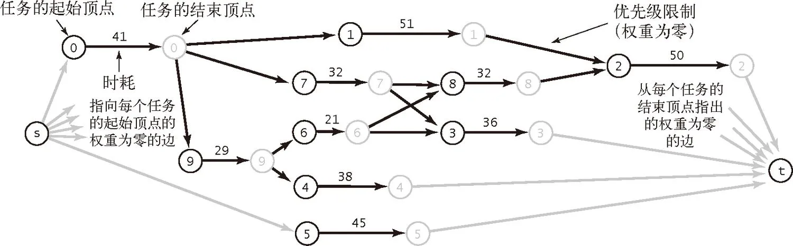

- 图 4.4.16　任务调度问题的无环加权有向图表示

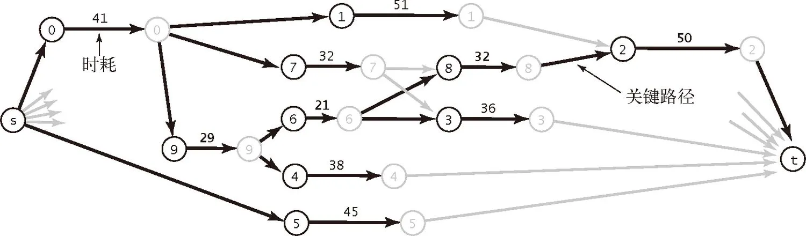

- 图 4.4.17　任务调度示例问题的最长路径解决方案

- 优先级限制下的并行任务调度问题的关键路径方法

```java
public class CPM
1
{
2
  public static void main(String[] args)
3
  {
4
     int N = StdIn.readInt(); StdIn.readLine();
5
     EdgeWeightedDigraph G;
6
     G = new EdgeWeightedDigraph(2*N+2);
7
     int s = 2*N, t = 2*N+1;
8
     for (int i = 0; i < N; i++)
9
     {
10
        String[] a = StdIn.readLine().split("\\s+");
11
        double duration = Double.parseDouble(a[0]);
12
        G.addEdge(new DirectedEdge(i, i+N, duration));
13
        G.addEdge(new DirectedEdge(s, i, 0.0));
14
        G.addEdge(new DirectedEdge(i+N, t, 0.0));
15
        for (int j = 1; j < a.length; j++)
16
        {
17
           int successor = Integer.parseInt(a[j]);
18
           G.addEdge(new DirectedEdge(i+N, successor, 0.0));
19
        }
20
     }
21
     AcyclicLP lp = new AcyclicLP(G, s);
22
23
     StdOut.println("Start times:");
24
     for (int i = 0; i < N; i++)
25
        StdOut.printf("%4d: %5.1f\n", i, lp.distTo(i));
26
     StdOut.printf("Finish time: %5.1f\n", lp.distTo(t));
27
 }
28
29
}
30
% more jobsPC.txt
1
10
2
41.0  1 7 9
3
51.0  2
4
50.0
5
36.0
6
38.0
7
45.0
8
21.0  3 8
9
32.0  3 8
10
32.0  2
11
29.0  4 6
12
% java CPM < jobsPC.txt
1
Start times:
2
  0:   0.0
3
  1:  41.0
4
  2: 123.0
5
  3:  91.0
6
  4:  70.0
7
  5:   0.0
8
  6:  70.0
9
  7:  41.0
10
  8:  91.0
11
  9:  41.0
12
Finish time: 173.0
13
```

- 这里实现的任务调度问题的关键路径方法将问题归约为寻找无环加权有向图的最长路径问题。它会根据任务调度问题的描述用关键路径的方法构造一幅加权有向图（且必然是无环

```
的），然后使用 AcyclicLP（请见命题 T）找到图中的最长路径树，最后打印出各条最长
```

- 路径的长度，也就正好是每个任务的开始时间。

- 命题 U。解决优先级限制下的并行任务调度问题的关键路径法所需的时间为线性级别。

```
证明。为什么 CPM 类能够解决问题？算法的正确性依赖于两个因素。首先，在相应的有向
```

- 无环图中，每条路径都是由任务的起始顶点和结束顶点组成的并由权重为零的优先级限制条

```
件的边分隔——从起点 s 到任意顶点 v 的任意路径的长度都是任务 v 的开始 / 结束时间的
```

- 下限，因为这已经是在同一台处理器上顺序完成这些任务的最优的排列顺序了。因此，从起

```
点 s 到终点 t 的最长路径就是所有任务的完成时间的下限。第二，由最长路径得到的所有
```

- 开始和结束时间都是可行的——每个任务都只能在优先级限制指定的先导任务完成之后开

```
始，因为它的开始时间就是顶点到它的起始顶点的最长路径的长度。因此，从起点 s 到终
点 t 的最长路径长度就是所有任务完成时间的上限。由命题 T 很容易得到算法所需的时间
```

- 是线性的。

### 4.4.5.3　相对最后期限限制下的并行任务调度

一般的最后期限（deadline）都是相对于第一个任务的开始时间而言的。假设在任务调度问题中加入一种新类型的限制，需要某个任务必须在指定的时间点之前开始，即指定和另一个任务的开始时间的相对时间。这种类型的限制条件在争分夺秒的生产线上以及许多其他应用中都很常见，但它也会使得任务调度问题更难解决。例如，如表 4.4.6 所示，假设要在前面的示例中加入一个限制条件，使 2 号任务必须在 4 号任务启动后的 12 个时间单位之内开始。实际上，在这里最后期限限制的是 4 号任务的开始时间：它的开始时间不能早于 2 号任务开始 12 个时间单位。在示例中，调度表中有足够的空档来满足这个最后期限限制：我们可以令 4 号任务开始于 111 时间，即 2 号任务计划开始时间前的 12 个时间单位处。需要注意的是，如果 4 号任务耗时很长，这个修改可能会延长整个调度计划的完成时间。同理，如果再添加一个最后期限的限制条件，令 2 号任务必须在 7 号任务启动后的 70 个时间单位内开始，还可以将 7 号任务的开始时间调整到 53，这样就不用修改 3 号任务和 8 号任务的计划开始时间。但是如果继续限制 4 号任务必须在零号任务启动后的 80 个时间单位内开始，那么就不存在可行的调度计划了：限制条件 4 号任务必须在 0 号任务启动后的 80 个时间单位内开始以及 2 号任务必须在 4号任务启动后的 12 个时间单位之内开始，意味着 2 号任务必须在 0 号任务启动后的 93 个时间单位之内开始，但因为存在任务链 0（41 个时间单位）→ 9（29 个时间单位）→ 6（21 个时间单位）→ 8（32 个时间单位）→ 2，2 号任务最早也只能在 0 号任务启动后的 123 个时间单位之内开始。前面添加的限制如表 4.4.7 所示。最后期限的限制越多，调度的可能性也就越多，简单的问题也会变得越困难。

表 4.4.6　相对最后期限限制下的任务调度

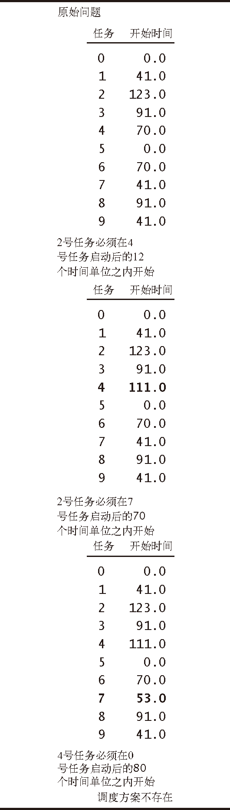

表 4.4.7　向任务调度问题中添加的最后期限限制

任务

- 相对最后期限相对于任务

```
12.0
4
70.0
7
```

- 命题 V。相对最后期限限制下的并行任务调度问题是一个加权有向图中的最短路径问题（可能存在环和负权重边）。证明。与命题 U 一样根据任务调度的描述构造相同的加权有向图，为每条最后期限限制添

```
加一条边：如果任务 v 必须在任务 w 启动后的 d 个时间单位内开始，则添加一条从 v 指
向 w 的负权重为 d 的边。将所有边的权重取反即可将该问题转化为一个最短路径问题。如
```

- 果存在可行的调度方案，证明也就完成了。你将会看到，判断一个调度方案是否可行也是计算的一部分。

这个示例说明了负权重的边在实际应用的模型中也能起到重要的作用。它说明，如果能够有效解决负权重边的最短路径问题，那就能够找到相对最后期限限制下的并行任务调度问题的解决方案。我们已经学习过的算法都无法完成这个任务： Dijkstra 算法只适用于正（或零）权重的边，算法 4.10 要求有向图是无环的。下面我们来看看如何解决含有负权重且不一定是无环的有向图中的最短路径问题（请见图 4.4.18）。

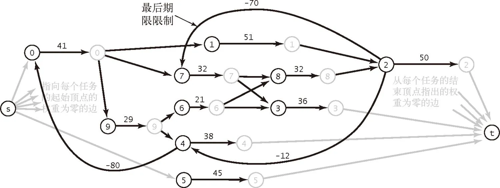

- 图 4.4.18　相对最后期限限制和优先级限制下的并行任务调度问题的加权有向图表示

### 4.4.6　一般加权有向图中的最短路径问题

刚才讨论过的最后期限限制下的任务调度问题告诉我们负权重的边并不仅仅是一个数学问题。相反，它能够极大地扩展解决最短路径问题的模型的应用范围。接下来，考虑既可能含有环也可能含有负权重的边的加权有向图中的最短路径算法。在开始之前，先来学习一下这种有向图的基本性质以更新我们对最短路径的认识。图 4.4.19 是一个小小的示例，展示的是负权重的边对有向图中的最短路径的影响。也许最明显的改变就是当存在负权重的边时，权重较小的路径含有的边可能会比权重较大的路径更多。在只存在正权重的边时，我们的重点在于寻找近路；但当存在负权重的边时，我们可能会为了经过负权重的边而绕弯。这种效应使得我们要将查找“最短”路径的感觉转变为对算法本质的理解。因此需要抛弃直觉并在一个简单、抽象的层面上考虑这个问题。

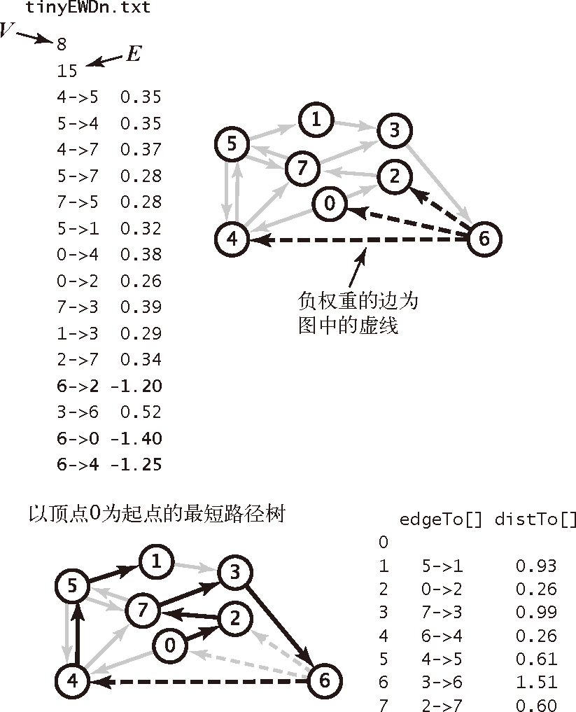

- 图 4.4.19　含有负权重的边的加权有向图

### 4.4.6.1　尝试Ⅰ

第一个想法是先找到权重最小（最小的负值）的边，然后将所有边的权重加上这个负值的绝对值，这样原有向图就转变称为了一幅不含有负权重边的有向图。这种天真的做法不会解决任何问题，因为新图中的最短路径和原图中的最短路径毫无关系。路径中的边越多，这种变换产生的危害越大（请见练习 4.4.14）。

### 4.4.6.2　尝试Ⅱ

第二个想法是尝试改造 Dijkstra 算法。这种方法最根本的缺陷在于原算法的基础在于根据距离起点的远近依次检查路径。命题 R 对算法正确性的证明是基于添加一条边会使的路径变得更长的假设。但添加任意负权重的边只会使得路径更短，因此这个假设是不成立的（请见练习4.4.14）。

### 4.4.6.3　负权重的环

当我们在研究含有负权重边的有向图时，如果该图中含有一个权重为负的环，那么最短路径的

```
概念就失去意义了。例如图 4.4.20，除了边 5 → 4 的权重为 -0.66 外，它和第一个示例完全
相同。这里，环 4 → 7 → 5 → 4 的权重为：
0.37+0.28-0.66=-0.01
```

我们只要围着这个环兜圈子就能得到权重任意短的路径！注意，有向环的所有边的权重并不一定都必须是负的，只要权重之和是负的即可。

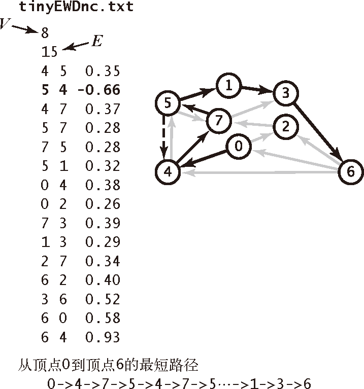

- 图 4.4.20　含有负权重环的加权有向图

- 定义。加权有向图中的负权重环是一个总权重（环上的所有边的权重之和）为负的有向环。

```
现在，假设从 s 到可达的某个顶点 v 的路径上的某个顶点在一个负权重环上。在这种情况
下，从 s 到 v 的最短路径是不可能存在的，因为可以用这个负权重环构造权重任意小的路
```

径。换句话说，在负权重环存在的情况下，最短路径问题是没有意义的，如图 4.4.21 所示。

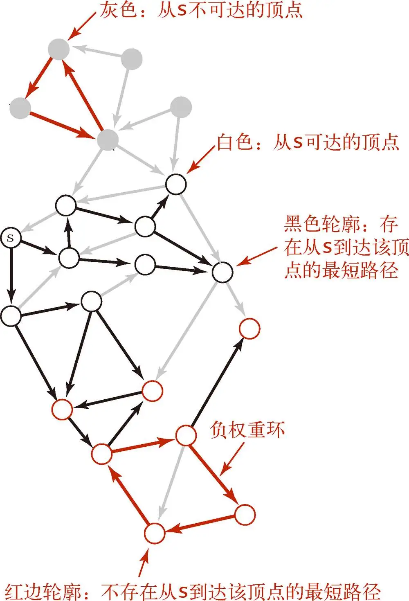

- 图 4.4.21　最短路径问题的各种可能性

```
命题 W。当且仅当加权有向图中至少存在一条从 s 到 v 的有向路径且所有从 s 到 v 的有
向路径上的任意顶点都不存在于任何负权重环中时，s 到 v 的最短路径才是存在的。
```

- 证明。请见以上讨论以及练习 4.4.29。

注意，要求最短路径上的任意顶点都不存在于负权重环中意味着最短路径是简单的，而且与正权重边的图一样都能够得到此类顶点的最短路径树。

### 4.4.6.4　尝试Ⅲ

```
无论是否存在负权重环，从 s 到可达的其他顶点的一条最短的简单路径都是存在的。为什么
```

不定义最短路径以方便寻找呢？不幸的是，已知解决这个问题的最好算法在最坏情况下所需的时间是指数级别的（请见第 6 章）。一般来说，我们认为这种问题“太难了”，只会研究它的简单版本。

因此，一个定义明确且可以解决加权有向图最短路径问题的算法要能够：

- 对于从起点不可达的顶点，最短路径为正无穷（+∞）；

- 对于从起点可达但路径上的某个顶点属于一个负权重环的顶点，最短路径为负无穷（-∞）；

- 对于其他所有顶点，计算最短路径的权重（以及最短路径树）。

从本节的开始到现在，我们为最短路径问题加上各种限制，使得我们能够找到解决相应问题的办法。首先，我们不允许负权重边的存在；其次不接受有向环。现在我们放宽所有这些条件并重点解决一般有向图中的以下问题。

负权重环的检测。给定的加权有向图中含有负权重环吗？如果有，找到它。

```
负权重环不可达时的单点最短路径。给定一幅加权有向图和一个起点 s 且从 s 无法到达任何
```

负权重环，回答“是否存在一条从 s 到给定的顶点 v 的有向路径？如果有，找出最短（总权重最小）的那条路径。”等类似问题。

总结。尽管在含有环的有向图中最短路径是一个没有意义的问题，而且也无法有效解决在这种有向图中高效找出最短简单路径的问题，在实际应用中仍然需要能够识别其中的负权重环。例如，在最后期限限制下的任务调度问题中，负权重环的出现可能相对较少：限制条件和最后期限都是从现实世界中的实际限制得来的，因此负权重环大多可能来自于问题陈述中的错误。找出负权重环，改正相应的错误，找到没有负权重环问题的调度方案才是解决问题的正确方式。在其他情况下，找到负权重环就是计算的目标。下面这个由 R.Bellman 和 L.Ford 在 20 世纪50 年代末期发明的算法能够简明、有效地解决这些问题并且同样适用于正权重边的有向图。

```
 个顶点的加权有向图中给定起点 s，从 s 无
```

- 命题 X（Bellman-Ford 算法）。在任意含有

```
法到达任何负权重环，以下算法能够解决其中的单点最短路径问题：将 distTo[s] 初始
化为 0，其他 distTo[] 元素初始化为无穷大。以任意顺序放松有向图的所有边，重复
```

- 轮。

```
证明。对于从 s 可达的任意顶点 t，考虑从 s 到 t 的一条最短路径：v<sub>0</sub>
→ v<sub>1</sub>→ ... → v<sub><i>k</i></sub>，其中 v<sub>0</sub> 等于
s，v<sub><i>k</i></sub> 等于 t。因为负权重环是不可达的，这样的路径是存在的
且 v<i>k</i> 不会大于
。我们会通过归纳法证明算法在第 <i>i</i> 轮之后能够
```


```xml
得到 s 到 v<sub><i>i</i></sub> 的最短路径。最简单的情况（<i>i</i>=0）很容
易。假设对于 <i>i</i> 命题成立，那么 s 到 v<sub><i>i</i></sub> 的最短路径即
为 v<sub>0</sub> → v<sub>1</sub>→ ... → v<sub><i>i</i></sub>，
distTo[v<sub><i>i</i></sub>] 就是这条路径的长度。现在，我们在第 <i>i</i>
轮中放松所有的顶点，包括 v<sub><i>i</i></sub>，因此 distTo[v<sub>
<i>i</i>+1</sub>] 不会大于 distTo[v<sub><i>i</i></sub>] 与边 v<sub>
<i>i</i></sub> → v<sub><i>i</i>+1</sub> 的权重之和。在第 <i>i</i> 轮放
松之后，distTo[v<sub><i>i</i>+1</sub>] 必然等于 distTo[v<sub><i>i</i>
</sub>] 与边 v<sub><i>i</i></sub> → v<sub><i>i</i>+1</sub> 的权重之
和。它不可能更大，因为在第 <i>i</i> 轮中放松了所有顶点，包括 v<sub><i>i</i>
</sub>；它也不可能更小，因为它就是路径 v<sub>0</sub> → v<sub>1</sub>→ ...
→ v<sub><i>i</i>+1</sub> 的长度，也就是最短路径了。因此，在 <i>i</i>+1 轮
之后算法能够得到从 s 到 v<sub><i>i</i>+1</sub> 的最短路径。
```

- 命题 W（续）。Bellman-Ford 算法所需的时间和成正比，空间和成正比。

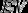

- 条边，共重复轮。证明。在每一轮中算法都会放松

这个方法非常通用，因为它没有指定边的放松顺序。下面将注意力集中在一个通用性稍逊的方法上，其中只放松从任意顶点指出的所有边（顺序任意），以下代码说明了这种方法的简洁性：

```
for (int pass = 0; pass < G.V(); pass++)
  for (v = 0; v < G.V(); v++)
     for (DirectedEdge e : G.adj(v))
        relax(e);
```

- 条边且只需稍作修改即可使算法在一般

我们不会仔细研究这个版本，因为它总是会放松

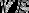

的应用场景中更加高效。

### 4.4.6.5　基于队列的 Bellman-Ford 算法

其实，根据经验我们很容易知道在任意一轮中许多边的放松都不会成功：只有上一轮中的

```
distTo[] 值发生变化的顶点指出的边才能够改变其他 distTo[] 元素的值。为了记录这样
```

的顶点，我们使用了一条 FIFO 队列。算法在处理正权重标准样图中进行的操作如图 4.4.22 所示。在示意图 4.4.22 左侧是每一轮中队列中的有效顶点（红色），紧接着是下一轮中的有效顶点（黑色）。首先将起点加入队列，然后按照以下步骤计算最短路径树。

```
放松边 1 → 3 并将顶点 3 加入队列。
放松边 3 → 6 并将顶点 6 加入队列。
放松边 6 → 4、6 → 0 和 6 → 2 并将顶点 4、0 和 2 加入队列。
放松边 4 → 7、4 → 5 并将顶点 7 和 5 加入队列。放松已经失效的边 0 → 4 和 0 → 2。
然后再放松边 2 → 7（并重新为 4 → 7 着色）。
放松边 7 → 5（并重新为 4 → 5 着色）但不将顶点 5 加入队列（它已经在队列之中了）。
放松已经失效的边 7 → 3。然后放松已经失效的边 5 → 1、5 → 4 和 5 → 7。此时队列
```

- 为空。

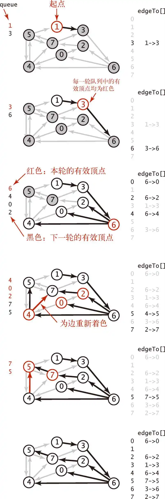

- 图 4.4.22　Bellman-Ford 算法的轨迹

### 4.4.6.6　实现

根据这些描述实现 Bellman-Ford 算法所需的代码非常少，如算法 4.11 所示。它基于以下两种其他的数据结构：

```
一条用来保存即将被放松的顶点的队列 queue；
一个由顶点索引的 boolean 数组 onQ[]，用来指示顶点是否已经存在于队列中，以防止
```

- 将顶点重复插入队列。

```
首先，将起点 s 加入队列中，然后进入一个循环，其中每次都从队列中取出一个顶点并将其
放松。要将一个顶点插入队列，需要修改 4.4.2.5 节框注“边的松驰”中 relax() 方法的实现，
```

以便将被成功放松的边所指向的顶点加入队列中，如右边框注“Bellman-Ford 算法中的放松操作”所示。这些数据结构能够保证：

- 队列中不出现重复的顶点；

```
在某一轮中，改变了 edgeTo[] 和 distTo[] 的值的所有顶点都会在下一轮中处理。
```

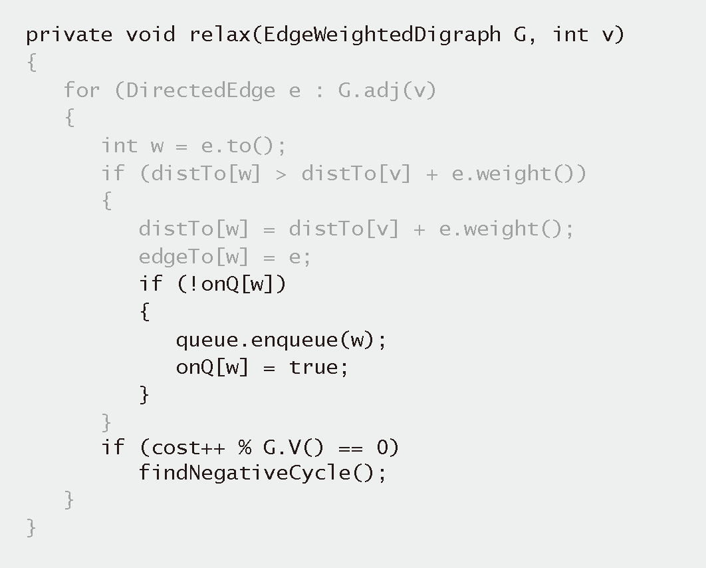

Bellman-Ford 算法中的放松操作

- 轮后算法能够终止。实现它的一种方法是显式记

要完整地实现该算法，我们就需要保证在

```
录放松的轮数。我们的实现 BellmanFordSP（算法 4.11）使用了另一种方法，将会在
4.4.6.8 节详述：它会在有向图的 edgeTo[] 中检测是否存在负权重环，如果找到则结束运
```

行。

```
 个顶点的加权有向图和给定的起点 s，在最坏情况下基于队列的
```

- 命题 Y。对于任意含有

```
Bellman-Ford 算法解决最短路径问题（或者找到从 s 可达的负权重环）所需的时间与
```

- 成正比。成正比，空间和

```
证明。如果不存在从 s 可达的负权重环，算法会根据命题 X 在进行
```

- 轮放松操作后结

```
）。如果的确存在一个从 s 可达的负权重
```

- 束（因为所有最短路径含有的边数都不大于

```
 轮放松之后，edgeTo[] 数组必然会
```

- 环，那么队列永远不可能为空。根据命题 X，在第

```
包含一条含有一个环的路径（从某个顶点 w 回到它自己）且该环的权重必然是负的。因为
w 会在路径上出现两次且 s 到 w 的第二次出现处的路径长度小于 s 到 w 的第一次出现的
```

- 条边全部放松路径长度。在最坏情况下，该算法的行为和通用算法相似并会将所有的

- 轮。

- 算法 4.11　基于队列的 Bellman-Ford 算法

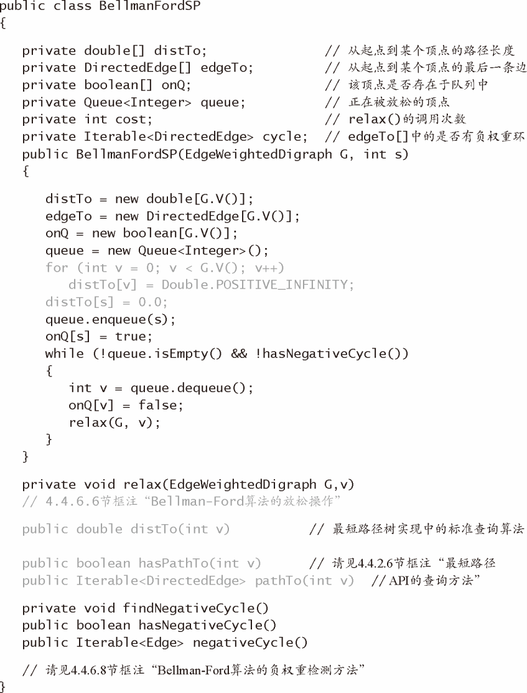

```
Bellman-Ford 算法的实现修改了 relax() 方法，将被成功放松的边指向的所有顶点加入
到一条 FIFO 队列中（队列中不出现重复的顶点）并周期性地检查 edgeTo[] 表示的子图
```

- 中是否存在负权重环（请见正文）。

基于队列的 Bellman-Ford 算法能够准确有效地解决最短路径问题并且在实际中被广泛应用，甚至包括正权重的情况。例如，如图 4.4.23 所示，在含有 250 个顶点的样图中，算法进行了14 轮操作且对于相同的问题比较路径长度的次数少于 Dijkstra 算法。

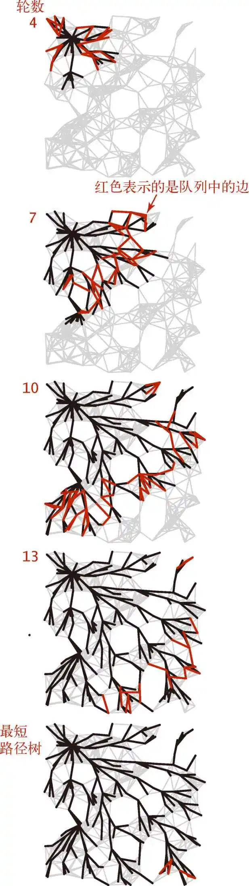

- 图 4.4.23　Bellman-Ford 算法（250 个顶点）

### 4.4.6.7　负权重的边

图 4.4.24 显示了 Bellman-Ford 算法在处理含有负权重边的有向图的轨迹。首先将起点加入队

```
列 queue，然后按照以下步骤计算最短路径树。
放松边 0 → 2 和 0 → 4 并将顶点 2、4 加入队列。
放松边 2 → 7并将顶点 7 加入队列。放松边 4 → 5 并将顶点 5 加入队列。然后放松失效
的边 4 → 7。
放松失效的边 7 → 5、5 → 4 和 5 → 7。
放松边 7 → 3 和 5 → 1 并将顶点 3 和 1 加入队列。放松失效的边 5 → 4 和 5 → 7。
放松边 3 → 6 并将顶点 6 加入队列。放松失效的边 1 → 3。
放松失效的边 6 → 0 和 6 → 2。
放松边 6 → 4 并将顶点 4 加入队列。这条负权重边使得到顶点 4 的路径变短，因此它的
边需要被再次放松（它们在第二轮中已经被放松过）。从起点到顶点 5 和 1 的距离已经失
```

- 效并会在下一轮中修正。

```
放松边 4 → 5 并将顶点 5 加入队列。放松失效的边 4 → 7。
放松边 5 → 1 并将顶点 1 加入队列。放松失效的边 5 → 4 和 5 → 7。
放松失效的边 1 → 3。队列为空。
```

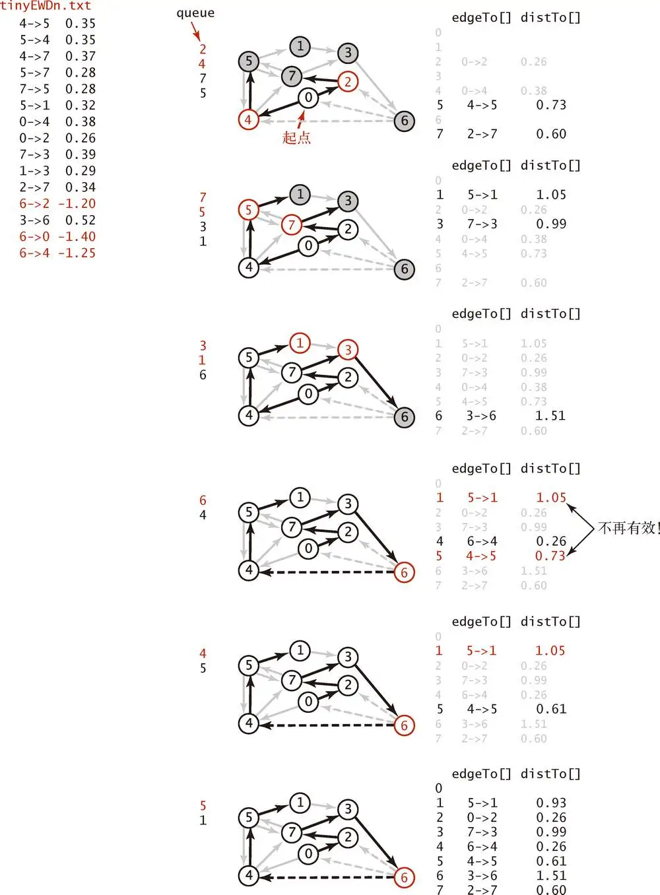

- 图 4.4.24　Bellman-Ford 算法的轨迹（图中含有负权重边）

```
在这个例子中，最短路径树就是一条从顶点 0 到顶点 1 的路径。从顶点 4、5 和 1 指出的所
```

有边都被放松了两次。对照这个例子重读命题 X 的证明能够帮助你更好的理解这个算法。

### 4.4.6.8　负权重环的检测

```
实现 BellmanFordSP 会检测负权重环来避免陷入无限的循环中。我们也可以将这段检测代
```

码独立出来使得用例可以检查并得到负权重环。因此我们为表 4.4.4 中的 API 添加以下方法请见表 4.4.8。

表 4.4.8　为处理负权重环扩展最短路径的 API

```
                 boolean
```

- 是否含有负权重环

```
hasNegativeCycle()
Iterable<DirectedEdge> negativeCycle()
得到负权重环（如果没有则返回 nul
实现这些方法并不困难，如 442 页的代码所示。在 BellmanFordSP 的构造函数运行之后，
```

命题 Y 说明在将所有边放松

- 轮之后当且仅当队列非空时有向图中才存在从起点可达的负权

```
重环。如果是这样，edgeTo[] 数组所表示的子图中必然含有这个负权重环。因此，要实现
negativeCycle()，会根据 edgeTo[] 中的边构造一幅加权有向图并在该图中检测环。我
们会使用并修改 4.2 节中的 DirectedCycle 类来在加权有向图中寻找环（请见练习
```

4.4.12）。这种检查的成本分为以下几个部分。

```
添加一个变量 cycle 和一个私有函数 findNegativeCycle()。如果找到负权重环，该
方法会将 cycle 的值设为含有环中所有边的一个迭代器（如果没有找到则设为 null）。
```

```
每调用 次 relax() 方法后即调用 findNegativeCycle() 方法。
```

这种方法能够保证构造函数中的循环必然会终止。另外，用例可以调用

```
hasNegativeCycle() 来判断是否存在从起点可达的负权重环（并用 negativeCycle()
```

来获取这个环）。要在任意有向图中检测负权重环的存在只需稍作扩展即可（请见练习4.4.43）。

图 4.4.25 是 Bellman-Ford 算法在一幅含有负权重环的有向图中的运行轨迹。头两轮放松操作

```
与处理 tinyEWDn. txt 时是一样的。在第三轮中，算法在放松了边 7 → 3 和 5 → 1 并将顶点
3 和 1 加入队列后开始放松负权重边 5 → 4。在这次放松操作中算法发现了一个负权重环 4
→ 5 → 4。它将 5 → 4 加入最短路径树中并在 edgeTo[] 中将环和起点隔离开来。从这时
```

开始，算法沿着环继续运行并会减少到达所遇到的所有顶点的距离，直至检测到环的存在，此

```java
时队列非空。环被保存在 edgeTo[] 中，findNegativeCycle() 会在其中找到它。
private void findNegativeCycle()
{
  int V = edgeTo.length;
  EdgeWeightedDigraph spt;
  spt = new EdgeWeightedDigraph(V);
  for (int v = 0; v < V; v++)
     if (edgeTo[v] != null)
        spt.addEdge(edgeTo[v]);
  EdgeWeightedCycleFinder cf;
  cf = new EdgeWeightedDirectedCycle(spt);
  cycle = cf.cycle();
}
public boolean hasNegativeCycle()
{  return cycle != null;  }
public Iterable<DirectedEdge> negativeCycle()
{  return cycle;  }
```

Bellman-Ford 算法的负权重环检测方法

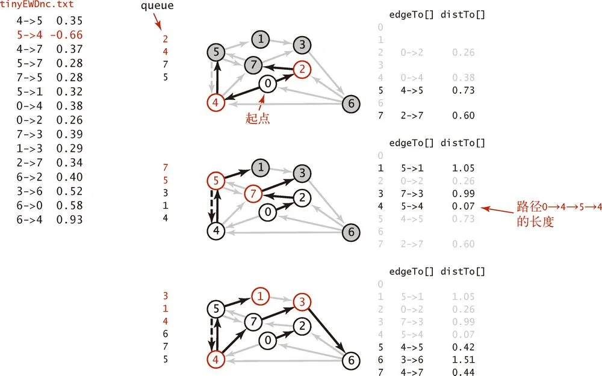

- 图 4.4.25　Bellman-Ford 算法的轨迹（含有负权重环的图）

### 4.4.6.9　套汇

假设有一个基于商品贸易的金融交易市场。以下框注显示的是示例文件 rates.txt 的内容，你可以在任意货币兑换比例的表格中找到类似的内容。文件的第一行是货币的种类数

- ，接下来的

每一行都对应一种货币，开头是该货币的名称，紧接着是它和其他货币兑换的汇率。简单起见，这个例子中只包含了能够在现代市场中进行交易的数百种货币中的五种：美元（USD）、

```
欧元（EUR）、英镑（GBP）、瑞士法郎（CHF）和加元（CAD）。第 s 行的第 t 个数字表示
一个汇率，即购买一个单位的第 s 行的货币需要多少个单位的第 t 行的货币。例如，这张表
```

告诉我们，1000 美元能够购买 741 欧元。这张表格等价于一幅完全的加权有向图，顶点对应

```
着货币，边则对应着汇率。权重为 x 的边 s → t 表示从货币 s 到货币 t 的汇率为 x。这张
图中的路径则表示多次兑换。例如，将权重为 y 的边 t → u 和刚才的边结合起来就得到了一
条路径 s → t → u，即一个单位的货币 s 可以兑换为 xy 个单位的货币 u。比如，欧元可以
```

兑换得到 1012.206=741*1.366 加元。注意，这比直接用美元兑换的汇率更高。你可能会以为

```
xy 总是应该等于边 s → u 的权重，但这张表格所表示的金融系统非常复杂，并不总是能够保
证这种一致性。因此，找到所有从 s 到 u 的路径中所有边的权重之积最大者就是我们最感兴
```

趣的问题。一种更有趣的情况是，所有边的权重之积小于从终点指向起点的边的权重。在这个

```
示例中，假设边 u → s 的权重为 z 且 xyz>1。那么环 s → t → u → s 就能够用一个单位
的货币 s 得到多于一个单位 (xyz) 的货币 s。换句话说，将货币 s 兑换为 t、u 并最后再
兑换为 s 就可以得到 100(xyz-1) 的利润。例如，如果将 1012.206 加元重新兑换为美元，
```

可以得到 1012.206*0.995=1007.14497 美元，也就是得到了 7.14497 美元的利润。这看起来似乎不多，但一个外汇交易商可能会用一百万美元并在每分钟都进行一遍这样的交易，也就是说他每分钟的利润将超过 7000 美元，或者说每小时的利润超过 420 000 美元！这就是套汇交易的一个例子，请见图 4.4.26。如果没有外力的限制，比如手续费或是交易金额上限，交易商可以从其中获取无限的利润。即使是在现实世界中的这些限制下，套汇的利润仍然是非常高的。这个问题和最短路径问题有什么关系呢？要回答这个问题非常简单。

```
% more rates.txt
5
USD  1      0.741  0.657  1.061  1.005
EUR  1.349  1      0.888  1.433  1.366
GBP  1.521  1.126  1      1.614  1.538
CHF  0.942  0.698  0.619  1      0.953
CAD  0.995  0.732  0.650  1.049  1
```

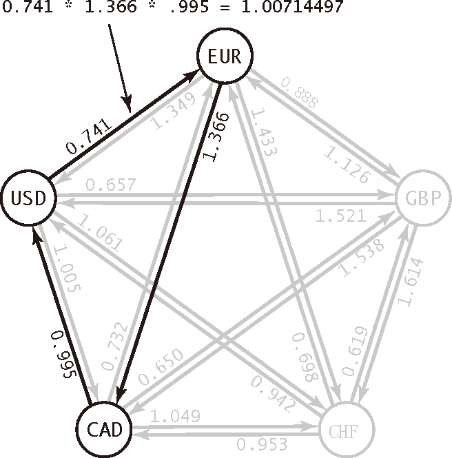

- 图 4.4.26　一次套汇机会

- 命题 Z。套汇问题等价于加权有向图中的负权重环的检测问题。证明。取每条边权重的自然对数并取反，这样在原始问题中所有边的权重之积的计算就转化即对应为了新图中所有边的权重之和的计算。任意权重之积

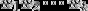


```
 之和。转换后边的权重可能为正也可能为负。一条从 v
到 w 的路径表示将货币 v 兑换为货币 w，图中的任意负权重环都是一次套汇的好机会（请
```

- 见图 4.4.27）。

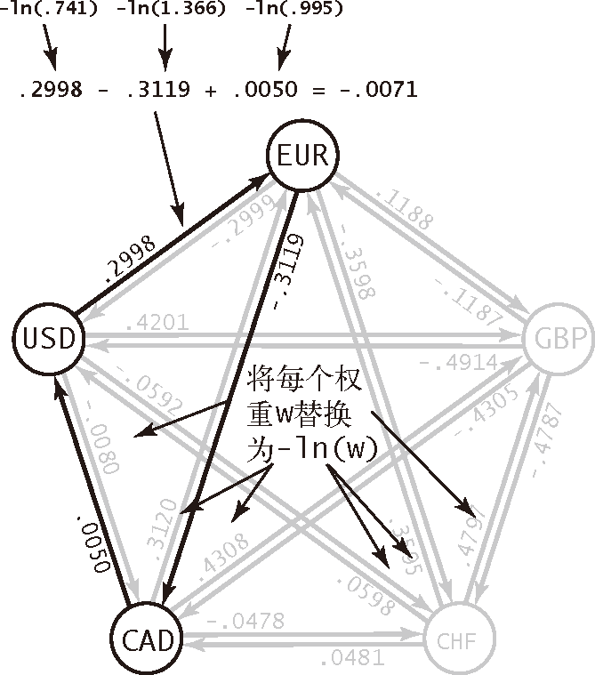

- 图 4.4.27　一个负权重环就表示了一次套汇的机会

在这个示例中，货币可以任意兑换，因此有向图是完全的，任意负权重环都是从任意顶点可达的。在一般的商品交易中，有些边可能并不存在，因此需要练习 4.4.43 所述的只有一个参数的构造函数。目前没有已知的寻找最佳套汇机会（图中负权重最小的环）的高效算法（图的规模不需要很大就能使所需的计算量超过计算机的承受能力），但找出任意套汇机会的最快算法仍然是很重要的——在第二快的算法找到任何套汇机会之前，使用这种算法的商人很可能已经可以系统地排除许多不佳的套汇机会了。

- 货币兑换中的套汇

```java
public class Arbitrage
1
{
2
  public static void main(String[] args)
3
  {
4
     int V = StdIn.readInt();
5
     String[] name = new String[V];
6
     EdgeWeightedDigraph G = new EdgeWeightedDigraph(V);
7
     for (int v = 0; v < V; v++)
8
     {
9
        name[v] = StdIn.readString();
10
        for (int w = 0; w < V; w++)
11
        {
12
           double rate = StdIn.readDouble();
13
           DirectedEdge e = new DirectedEdge(v, w, -Math.log(rate));
14
           G.addEdge(e);
15
        }
16
     }
17
18
     BellmanFordSP spt = new BellmanFordSP(G, 0);
19
     if (spt.hasNegativeCycle())
20
     {
21
        double stake = 1000.0;
22
        for (DirectedEdge e : spt.negativeCycle())
23
        {
24
           StdOut.printf("%10.5f %s", stake, name[e.from()]);
25
26
           stake *= Math.exp(-e.weight());
27
           StdOut.printf("= %10.5f %s\n", stake, name[e.to()]);
28
        }
29
     }
30
     else StdOut.println("No arbitrage opportunity");
31
  }
32
}
33
这段代码调用了 BellmanFordSP 类来寻找汇率表中的套汇机会。它首先使用完全有向图
```

- 表示汇率表，然后用 Bellman-Ford 算法来寻找图中的负权重环。

```
% java Arbitrage < rates.txt
12
1000.00000 USD =  741.00000 EUR
3
741.00000 EUR = 1012.20600 CAD
4
1012.20600 CAD = 1007.14497 USD
```

命题 Z 的证明即使在没有套汇机会的情况下仍然有用，因为它将货币兑换问题转化为了一个最短路径问题。因为对数函数是单调的（且会对计算的结果取反），当边的权重之和最小时汇率

```
之积正好最大。尽管边的权重可正可负，从 v 到 w 的最短路径仍然是将货币 v 兑换为货币 w
```

的最好方法。

### 4.4.7　展望

表 4.4.9 总结了本节中我们所学习到的各种最短路径算法的重要性质。在这些算法中进行选择的第一个条件是问题所涉及的有向图的基本性质。它含有负权重的边吗？它含有环吗？它含有负权重的环吗？除了这些基本性质之外，加权有向图的特性多种多样，因此在有多个合适的选择时就需要通过实验找出最佳的算法。

表 4.4.9　最短路径算法的性能特点

- 路径长度的比较次数（增长的数

算法

- 局限一般情况最坏情况

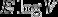

Dijkstra 算法（即时版本）

- 边的权重必须为正

拓扑排序

- 只适用于无环加权有向图

Bellman-Ford 算法（基于队列）

- 不能存在负权重环

历史资料

自 20 世纪 50 年代以来，最短路径算法就已经被深入地研究并被广泛应用了。计算最短路径的 Dijkstra 算法的历史和计算最小生成树的 Prim 算法的历史背景相似（并且也相关）。Dijkstra 算法既指的是按照顶点距离起点的远近顺序构造最短路径树的算法，也指的是该算法的实现，（它也是最适合用邻接矩阵表示的算法。），因为 Dijkstra 在 1959 年的一篇论文中发表了上述观点（并且证明了这种方法同样也可以用来计算最小生成树）。稀疏图算法的性能改进来自于之后对优先队列实现的改进，不仅仅针对最短路径问题。这其中最重要的是 Dijkstra 算

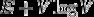

法性能的改进。（例如，使用斐波那契堆后最坏情况下的复杂度可以减少到

- ）。实

践证明 Bellman-Ford 算法十分有效并且应用领域广泛，特别是处理一般性的加权有向图。Bellman-Ford 算法计算普通应用的运行时间常常是线性的，在最坏情况下它的运行时间是

- 。最坏情况下的运行时间为线性级别的稀疏图的最短路径算法是一个仍在研究之中的问

题。Bellman-Ford 算法最早由 L.Ford 和 R.Bellman 发表于 20 世纪 50 年代。尽管我们已经看到许多其他的图算法性能得到了大幅改进，但是处理含有负权重边（但不含负权重环）的且在最坏情况下性能更好的有向图算法还没有出现。

### 答疑

问　为什么要分别为无向图、有向图、加权无向图、加权有向图定义不同的数据类型？

答　这么做是为了使用例代码更清晰，同时也是为了更加简洁和高效地实现没有权重的图。在需要处理各种图的应用或系统中，软件工程中的标准做法就是先定义一种抽象数据结构并根据

```
它衍生出其他抽象数据结构，也就是 4.1 节中学习的无向图 Graph，4.2 节中学习的有向图
Digraph，4.3 节中学习的加权无向图 EdgeWeightedGraph，或是在本节中学习的加权有
向图 EdgeWeightedDigraph。
```

问　如何在（加权）无向图中找到最短路径？

答　对于边的权重均为正的图，Dijkstra 算法可以解决这个问题。只需根据给定的

```
EdgeWeightedGraph 构造一幅 EdgeWeightedDigraph（无向图中的每条边都对应着有
```

向图中的两条方向不同的边）并执行 Dijkstra 算法即可。如果边的权重可能为负，高效的算法也是存在的，但它们比 Bellman-Ford 算法更复杂。

### 练习

4.4.1　真假判断：将每条边的权重都加上一个常数不会改变单点最短路径问题的答案。

```
4.4.2　为 EdgeWeightedDigraph 类实现 toString() 方法。
```

4.4.3　为稠密图实现一种使用邻接矩阵表示法（用二维数组保存边的权重，请参考练习

```
4.3.10）的 EdgeWeightedDigraph 类。忽略平行边。
4.4.4　在 tinyEWD.txt 中（请见图 4.4.4）删去顶点 7。画出加权有向图中以顶点 0 为起点的
```

最短路径树，并使用父链接数组表示这棵树。将图中所有边的方向反转并回答相同的问题。

```
4.4.5　在 tinyEWD.txt 中（请见图 4.4.4）改变边 0 → 2 的方向。画出该加权有向图中以顶点
```

2 为起点的两棵不同的最短路径树。

4.4.6　给出用即时版本的 Dijkstra 算法计算练习 4.4.5 所定义的图的最短路径树的轨迹。

```
4.4.7　实现 DijkstraSP 的另一个版本，支持一个方法来返回一幅加权有向图中从 s 到 t
的另一条最短路径。（如果从 s 到 t 的最短路径只有一条则返回 null。）
```

4.4.8　一幅有向图的直径指的是连接任意两个顶点的所有最短路径中的最大长度。编写一个

```
DijkstraSP 的用例，找出边的权重非负的给定 EdgeWeightedDigraph 图的直径。
```

4.4.9　表 4.4.10 来自于一张很早以前出版的公路地图，它显示的是城市之间的最短路径的长度。这张表中有一个错误。改正这个错误并新建一张表来说明最短路径是哪条。

4.4.10　将练习 4.4.4 中定义的有向图中的边看作无向边，即每条边对应加权有向图中的两条方向不同但权重相同的边。为对应的加权有向图回答练习 4.4.6 中的问题。

```
4.4.11　使用 1.4 节中的内存使用模型评估用 EdgeWeightedDigraph 表示一幅含有
```

- 个顶

- 条边的图所需的内存。

点和

```
4.4.12　修改 4.2 节中的 DirectedCycle 类和 Topological 类，使之使用本节中的
EdgeWeightedDigraph 类和DirectedEdge 类的 API 并实现
EdgeWeightedCycleFinder 类和EdgeWeightedTopological 类。
4.4.13　从 tinyEWD.txt 中（请见图 4.4.4）删去边 5 → 7，用 Dijkstra 算法计算所得的有向
```

图的最短路径树并按照正文中的样式给出算法的轨迹。

表　4.4.10

- 普罗维登斯威斯特里新伦敦诺威治

- —535448

普罗维登斯

- 53—18101

威斯特里

- 5418—12

新伦敦

- 4810112—

诺威治

4.4.14　给出使用 4.4.6.1 节和 4.4.6.2 节的两种尝试处理图 4.4.19 的 tinyEWDn.txt 所得到的路径。

```
4.4.15　如果从顶点 s 到 v 的路径上存在一个负权重环，调用 Bellman-Ford 算法的
pathTo(v) 方法会发生什么？
4.4.16　假设用 EdgeWeightedGraph 中的每条边 Edge 都替换为两条（两个方向各一条）
DirectedEdge 的方式将 EdgeWeightedGraph 类转化为 EdgeWeightedDigraph 类
```

（如答疑中关于 Dijkstra 算法的部分所述）然后再使用 Bellman-Ford 算法处理它。说明为什么这种方法大错特错。

4.4.17　在 Bellman-Ford 算法中如果一个顶点在同一轮中被两次加入队列会发生什么？

解答：算法所需的运行时间将会达到指数级。例如，描述一幅边的权重全部为 -1 的加权有向完全图中 Bellman-Ford 算法的执行情况。

4.4.18　编写一个 CPM 的用例来打印出所有的关键路径。

4.4.19　找出正文中的例子里权重最低的环（即最佳套汇机会）。

4.4.20　从网上或者报纸上找到一张汇率表并用它构造一张套汇表。注意：不要使用根据若干数据计算得出的汇率表，它们的精度有限。附加题：从汇率市场上赚点外快！

4.4.21　用 Bellman-Ford 算法计算练习 4.4.5 中的加权有向图的最短路径树并按照正文中的样式给出算法的轨迹。

### 提高题

4.4.22　顶点的权重。证明，要得到顶点也有非负权重的加权有向图中的最短路径（路径的权重为路径上的顶点权重之和），可以通过构造一幅只有边含有权重的加权有向图解决。

4.4.23　给定两点的最短路径。设计并实现一份 API，使用 Dijkstra 算法的改进版本解决加权有向图中给定两点的最短路径问题。

4.4.24　多起点最短路径。设计并实现一份 API，使用 Dijkstra 算法解决加权有向图中的多起点最短路径问题，其中边的权重均为正：给定一组起点，找到相应的最短路径森林并实现一个方法为用例返回从任意起点到达每个顶点的最短路径。提示：添加一个伪顶点和从该顶点指向每个起点的一条权重为零的边，或者在初始化时将所有起点加入优先队列并将它们在

```
distTo[] 中对应的值均设为 0。
```

4.4.25　两个顶点集合之间的最短路径。给定一幅边的权重均为正的有向图和两个没有交集的

- 和中的任意顶点到达中的任意顶点的最短路径。你的算法在最坏情

顶点集

- ，找到从


- 成正比。

况下所需的时间应该与

4.4.26　稠密图中的单点最短路径。实现另一个版本的 Dijkstra 算法，使之能够在与

- 成正

比的时间内在一幅稠密的加权有向图中计算出给定顶点的最短路径树。请使用邻接矩阵法表示稠密图（请参考练习 4.4.3 和练习 4.3.29）。

4.4.27　欧几里得图中的最短路径。已知图中的顶点均在平面上，修改 API 以提高 Dijkstra 算法的性能。

```
4.4.28　有向无环图中的最长路径。重新实现 AcyclicLP 类，根据命题 T 解决加权有向无环
```

图中的最长路径问题。

```
4.4.29　一般最优性。完成命题 W 的证明，说明如果存在从 s 到 v 的有向路径且从 s 到 v
的任意路径上的所有顶点都不在任意负权重环上，那么必然存在一条从 s 到 v 的最短路径
```

（提示：参考命题 P）。

4.4.30　含有负权重环的图中的任意顶点对之间的最短路径。参考 4.4.4.3 节框注“任意顶点对之间的最短路径”所实现的不含负权重环的图中任意顶点对之间的最短路径问题并设计一份

```
API。使用 Bellman-Ford 算法的一个变种来确定权重数组 pi[]，使得对于任意边 v → w，
边的权重加上 pi[v] 和 pi[w] 之差的和非负。然后更新所有边的权重，使得 Dijkstra 算法
```

可以在新图中找出所有的最短路径。

4.4.31　线图中任意顶点对之间的最短路径。给定一幅加权线图（无向连通图，除了两个端点度数为 1 之外所有顶点的度数为 2），给出一个算法在线性时间内对图进行预处理并在常数时间内返回任意两个顶点之间的最短路径。

```
4.4.32　启发式的父结点检查。修改 Bellman-Ford 算法，仅当顶点 v 在最短路径树中的父结
点 edgeTo[v] 目前不在队列中时才访问 v。Cherkassky、Goldberg 和 Radzik 在实践中发
```

现这种启发式的做法十分有帮助。证明这种方法能够正确的计算出最短路径且在最坏情况下的

- 成正比。

运行时间和

```
 的正整数矩阵，找到从 (0,0) 到
```

4.4.33　网格图中的最短路径。给定一个

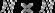

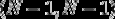

- 的最短路径，路径的长度即为路径中所有正整数之和。在只能向右和向下移

动的限制下重新解答这个问题。

```
4.4.34　单调最短路径。给定一幅加权有向图，找出从 s 到其他每个顶点的单调最短路径。如
```

果一条路径上的所有边的权重是严格单调递增或递减的，那么这条路径就是单调的。这样的路径应该是简单的（不包含重复顶点）。提示：按照权重的升序放松所有边并找到一条最佳路径；然后按照权重的降序放松所有边再找到另一条最佳路径。

```
4.4.35　双调最短路径。给定一幅有向图，找到从 s 到其他每个顶点的双调最短路径（如果存
在）。如果从 s 到 t 的路径上存在一个中间顶点 v 使得从 s 到 v 中的所有边的权重均严格单
调递增且从 v 到 t 中的所有边的权重均严格单调递减，那么这就是一条双调路径。这样的路
```

径应该是简单的（不包含重复顶点）。

```
4.4.36　邻居顶点。编写一个 SP 的用例，找出一幅给定加权有向图中和一个给定顶点的距离
```

- 之内的所有顶点。你的算法所需的运行时间应该与由这些顶点和依附于它们的边组成的子

在图的大小以及

- （用于初始化数据结构）中的较大者成正比。

4.4.37　关键边。给出一个算法来找到给定的加权有向图中的一条边，删去这条边使得给定的两个顶点之间的最短距离的增加值最大。

```
4.4.38　敏感度。给定一幅加权有向图和一对顶点 s 和 t，编写一个 SP 的用例对该图中的所
 的布尔矩阵，对于任意的 v 和 w，当 v → w 为加权
```

有边进行敏感度分析：计算一个


```
有向图中的一条边且增加 v → w 的权重不会增加从 s 到 t 的最短路径的权重时，v 行 w 列
的值为 true，否则为 false。
```

4.4.39　延时 Dijkstra 算法的实现。根据正文实现 Dijkstra 算法的延时版本。

4.4.40　瓶颈最短路径树。请证明一幅无向图中的一棵最小生成树等价于该图中的一棵瓶颈最

```
短路径树：对于任意一对顶点 v 和 w，该树都含有一条连接它们的路径且其中的最长边是所
```

有连接两点的路径中最短的。

4.4.41　双向搜索。基于算法 4.9 的代码为给定两点的最短路径问题实现一个类，但在初始化时将起点和终点都加入优先队列。这么做会使最短路径树从两个顶点同时开始生长，你的主要任务是决定两棵树相遇时应该怎么办。

4.4.42　最坏情况（Dijkstra 算法）。找出含有

- 个顶点和条边的一组图，使得 Dijkstra 算

法处理它们所需的运行时间为最坏情况。

4.4.43　负权重环的检测。假设为算法 4.11 加入了一个构造函数，它和已有的构造函数的区

```
别仅在于不需要第二个参数并将 distTo[] 中的所有元素初始化为 0。证明，如果用例调用
的是这个构造函数，那么当且仅当图中含有一个负权重环时，hasNegativeCycle() 才会
返回 true。（negativeCycle() 会返回那个负权重环。）
```

解答：向原图添加一个新的起点以及从该起点指向所有其他顶点的权重为 0 的边。在一轮放

```
松之后，distTo[] 中的所有元素的值均会变为 0，从新起点开始寻找一个负权重环和在原图
```

中寻找负权重环是等价的。

4.4.44　最坏情况（Bellman-Ford 算法）。找出一组图，使得算法 4.11 的运行时间与

- 成

正比。

4.4.45　快速 Bellman-Ford 算法。对于边的权重为整数且绝对值不大于某个常数的特殊情况，给出一个解决一般的加权有向图中的单点最短路径问题的算法，其所需的运行时间低于线性对数级别。

4.4.46　动画。编写一段程序将 Dijkstra 算法用动画表现出来。

### 实验题

4.4.47　随机加权有向稀疏图。修改你为练习 4.3.34 给出的解答，随机指定每条边的方向。

4.4.48　随机加权有向欧几里得图。修改你为练习 4.3.35 给出的解答，随机指定每条边的方向。

4.4.49　随机加权有向网格图。修改你为练习 4.3.36 给出的解答，随机指定每条边的方向。

4.4.50　负权重边 I。修改你的随机加权有向图生成器，通过调整比例将边的权重控制在在

- 之间（和都在 -1 和 1 之间）。

和

4.4.51　负权重边 II。修改你的随机加权有向图生成器，将固定比例（此值由用例指定）的边的权重取反来生成负权重的边。

4.4.52　负权重边 III。编写一段程序，调用你的加权有向图生成器，尽可能为大范围的

- 和

- 值生成多幅加权有向图，保证图中大部分边的权重为负且只有若干个负权重环。

- 测试所有的算法并研究所有图的模型的所有参数是不现实的。请为下面的每一道题都编写一段程序来处理从输入得到的任意图。这段程序可以调用上面的任意生成器并对相应的图模型进行实验。你可以根据上次实验的结果自己作出判断来选择不同实验。陈述结果以及由此得出的任何结论。

4.4.53　预测。请估计你的计算机和程序系统使用 Dijkstra 算法在 10 秒钟之内能够计算出图

- ，误差在 10 倍以内。

中所有的最短路径的图的最大规模，其中

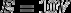

4.4.54　延时的代价。对于各种图的模型，运行实验并根据经验比较 Dijkstra 算法的延时版本和即时版本的性能差异。

```
4.4.55　Johnson 算法。使用一个 d 向堆实现优先队列。对于各种加权有向图的模型，找到
d 的最优值。
```

4.4.56　套汇模型。实现一个模型来生成随机的套汇问题。目标是尽量生成与练习 4.4.20 中相似表格。

4.4.57　最后期限限制下的并行任务调度模型。实现一个模型来生成随机的最后期限限制下的并行任务调度问题。目标是尽量生成复杂但可以解决的问题。

## 第 5 章　字符串

我们通过交流成串的字符进行沟通，所以无数的重要而熟悉的应用软件都是基于字符串处理的。本章中，我们会考察一些经典算法，解决以下应用领域背后的计算问题。

信息处理。当你根据一个给定的关键字搜索网页时，就是在使用一个字符串处理应用程序。在现代世界中，可以说所有的信息都是用一系列字符串表示的，而对它们进行处理的都是非常重要的字符串处理应用程序。

```
基因组学。计算生物学家的一项工作就是根据密码子将 DNA 转换为由 4 个碱基（A、C、T 和
G）组成的（非常长的）字符串。近些年来人类构建起来的庞大的基因数据库已经能够描述各
```

种活体器官，因此字符串处理已经成为了现在计算生物学研究的基石。

通信系统。无论你是在发送短信、电子邮件或是下载电子书，都是在将字符串从一个地方传送到另一个地方。以此为目标的字符串处理应用程序是字符串处理算法开发的源动力。

编程系统。程序是由字符串组成的。编译器、解释器等其他能够将程序转换为机器指令的软件都是使用复杂的字符串处理技术的重要应用软件。事实上，所有的书面语言都是由字符串表达的。另外，开发字符串处理算法的另一个动力来源在于形式语言理论，它研究的是对不同类型的字符串集合的描述。

这几个非常有意义的示例说明了字符串处理算法的重要性和应用领域的多样性。

本章的结构如下：在介绍了字符串的基本性质以后，我们会在 5.1 节和 5.2 节中再次遇到第 2章和第 3 章学过的排序和查找 API。当使用字符串作为键时，能够利用键的特殊性质的算法将比之前学习过的算法更快更灵活。在 5.3 节中，我们会学习子字符串查找算法，包括由Knuth、Morris 和 Pratt 发明的一个著名的算法。在 5.4 节中会介绍正则表达式，它是模式匹配问题的基础，是一个一般化了的子字符串查找问题，也是搜索工具 grep 的核心。这些经典的算法的基础是两个基本概念，分别叫做形式语言和确定有限状态自动机。5.5 节主要介绍了一个重要应用：数据压缩，即尝试将一个字符串的长度缩短到最小程度。
