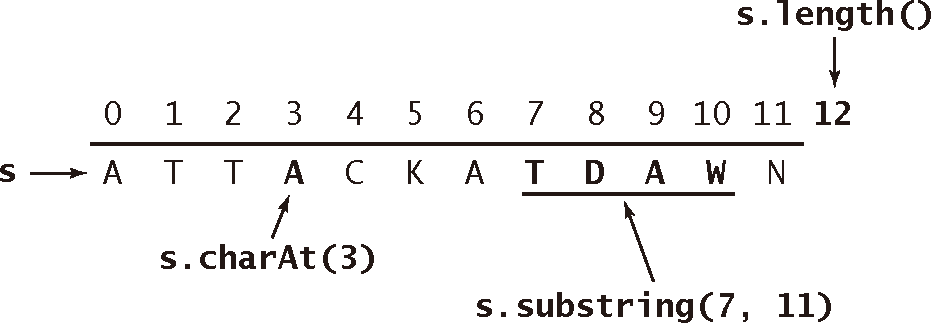

# 5.0.1游戏规则

```
为了简洁高效，我们将使用 Java 的 String 类来表示字符串，但我们将有意识地尽量少使用
```

该类的方法以使算法能够适用于其他字符串数据类型以及其他编程语言。我们已经在 1.2 节中详细介绍过各种字符串，这里简要回顾一下它们最主要的性质。

```
字符。String 是由一系列字符组成的。字符的类型是 char，可能有
```


- 个值。数十年以

来，程序员的注意力都局限于 7 位 ASCII 码（请见表 5.5.4）或是 8 位扩展 ASCII 码表示的字符，但许多现代的应用程序都已经需要使用 16 位 Unicode 编码了。

```
不可变性。String 对象是不可变的，因此可以将它们用于赋值语句、作为函数的参数或是返
```

回值，而不用担心它们的值会发生变化。

```
索引。我们最常完成的操作就是从某个字符串中提取一个特定的字符，即 Java 的 String 类
的 charAt() 方法。我们希望 charAt() 方法能够在常数时间内完成，就好像字符串是保存
在一个 char[] 数组中一样。根据第 1 章中的讨论，这种期望是非常合理的。
长度。在 Java 中，String 类型的 length() 方法实现了获取字符串的长度的操作。同样，
我们也希望 length() 方法能够在常数时间内完成，这也是合情合理的，尽管在某些编程环
```

境中实现这一点并不容易。



```
图 5.0.1　String 类型的基本常数时间操作
子字符串。Java 的 substring() 方法实现了提取特定的子字符串的操作。同样，我们也希
```

望这个方法能够在常数时间内完成，Java 的标准实现也做到了这一点。如果你还不熟悉substring() 方法和为什么它只需要常数时间，请务必重新阅读 1.2 节中讨论的 Java 字符串的标准实现（请见表 1.2.7 和图 1.4.10）。

字符串的连接。在 Java 中通过将一个字符串追加到另一个字符串的末尾创建一个新字符串的操作是一个内置的操作（使用“+”运算符），所需的时间与结果字符串的长度成正比。例如，我们会避免将字符一个一个地追加到字符串中，因为在 Java 里这个过程所需的时间将会是平方

```
级别的（为此 Java 提供了一个 StringBuilder 类）。
字符数组。Java 的 String 类显然并不是一个原始数据类型。Java 的标准实现提供了刚才提
```

到的几个操作以供客户端程序调用。但与之相反，我们将要学习的许多算法都能够处理字符串

```
的低级表示，比如 char 类型的数组，而且许多字符串的用例程序也更愿意使用这种表示，因
```

为它消耗的空间更小，访问所需的时间更少。在我们将要学习的几个算法中，将字符串从一种表示转换成另一种表示的代价甚至比算法的运行成本更高。如表 5.0.1 所示，处理这两种表示

```
所用的代码的差别是很小的（substring() 方法比较复杂，此处省略），所以无论使用哪种
```

表示方式都不会影响读者对算法的理解。

表 5.0.1- 在 Java 中表示字符串的两种方法

- Java 字符串

操作

- 字符数组

```
char[] a
String s
```

声明

```
a[i]
s.charAt(i)
```

根据索引访问字符

```
a length
s length()
```

获取字符串长度

理解这些操作的运行效率是理解许多字符串处理算法效率的关键部分。并不是所有编程语言实

```
现的 String 类都能有这样的性能。例如，提取子字符串和获取字符串长度的操作在 C 语言
```

中所需的时间就与字符串中的字符数量成正比。修改我们的算法并使之适用于这样的编程语言

```
是完全可以的（实现一个类似 Java 的 String 类的抽象数据类型），但这也意味着不同的挑
```

战和机遇。

```
在正文中，我们主要会使用 String 数据类型。我们会经常调用通过索引访问字符串中的字
```

符操作和获取字符串长度的操作，有时会使用提取子字符串或是连接字符串的操作。我们还会

```
在本书的网站上提供相应的使用 char 数组的代码。在性能优先的应用场景中，用例在这两种
表示方法之间权衡的常常是访问字符的成本（在一般的 Java 实现中，a[i] 很可能比
s.charAt(i) 要快很多）。
```
