# 5.2单词查找树

和排序一样，我们也可以利用字符串的性质开发比第 3 章中介绍的通用算法更有效的查找算法，以便用于以字符串作为被查找的键的一般应用程序。

具体来说，本节中所讨论的算法在一般应用场景中（甚至对于巨型的符号表）都能够取得以下性能：

- 查找命中所需的时间与被查找的键的长度成正比；

- 查找未命中只需检查若干个字符。

仔细思考过后你会发现，这样的性能是相当惊人的。它们是算法研究的最高成就之一，也是建成现今能够便捷、快速地访问海量信息所依赖的基础设施的重要因素。更重要的是，我们可以扩展符号表的 API，添加基于字符的用于处理字符串类型的键的操作（但不必为所有

```
Comparable 类型的键都添加类似操作）。它们在实际应用中非常强大并实用，如表 5.2.1 所
```

示。

表 5.2.1　以字符串为键的符号表的 API

```java
    public class <b>StringST<Value></b>
                 StringST()
```

- 创建一个符号表

```sql
            void put(String key, Value
向表中插入键值对（如果值为 null
val)
           Value get(String key)
键 key 所对应的值（如果键不存在则
            void delete(String key)
删除键 key（和它的值）
         boolean contains(String key)
表中是否保存着 key 的值
         boolean isEmpty()
```

- 符号表是否为空

```
          String longestPrefixOf(String
```

- 的前缀中最长的键

这份 API 与第 3 章中所介绍的符号表 API 有以下不同：

```
将泛型的 Key 的类型换成了具体的类型 String；
添加了 3 个方法：longestPrefixOf()、keysWithPrefix() 和
keysThatMatch()。
```

本节仍然遵守第 3 章中实现符号表时的几个基本约定（不接受重复键或空键，值不能为空）。

从对字符串的排序算法中可以看到，指定字符串的字母表常常是十分重要的。对小型字母表的简单而高效的实现不适用于大型字母表，这是因为后者消耗的空间太多。在这种情况下，应该添加一个构造函数，允许用例指定所使用的字母表。我们会在本节稍后讨论这个构造函数的实现，但目前暂时没有在 API 中列出它，因为要将精力集中在字符串类型的键上。

```
下面我们用 she sells sea shells by the shore 这几个键作为示例描述以下 3 个新
```

方法。

```
longestPrefixOf() 接受一个字符串参数并返回符号表中该字符串的前缀中最长的键。
对于以上所有键，longestPrefixOf("shell") 的结果是 she，
longestPrefixOf("shellsort") 的结果是 shells。
keysWithPrefix() 接受一个字符串参数并返回符号表中所有以该字符串作为前缀的键。
对于以上所有键，keysWithPrefix("she") 的结果是she 和 shells，
keysWithPrefix ("se") 的结果是 sells 和 sea。
keysThatMatch() 接受一个字符串参数并返回符号表中所有和该字符串匹配的键，其中
参数字符串中的点（“.”）可以匹配任何字符。对于以上所有键，
keysThatMatch(".he") 的结果是 she 和 the，keysThatMatch("s..") 的结果是
she 和 sea。
```

在见过这些基本的符号表方法后，我们将详细讨论这些操作的实现和应用。这些特别的操作是字符串类型的键所可能进行的操作中的代表操作，我们将会在练习中讨论其他可能的操作。

```sql
为了突出中心思想，本节的重点是 put()、get() 和新增的几个方法；（和第 3 章一样）使
用了 contains() 和 isEmpty() 的默认实现，并将 size() 和 delete() 的实现留作练
习。因为字符串都是 Comparable 的，所以可以在 API 中包含第 3 章有序符号表 API 中的各
```

种有序性操作（非常值得这样做）。我们将它们的实现（大多都很简单）留作练习并放在了本书的网站上。

### 5.2.1　单词查找树

本节中，我们要学习一种叫做单词查找树的数据结构。它由字符串键中的所有字符构造而成，允许使用被查找键中的字符进行查找。它的英文单词 trie 来自于 E.Fredkin 在 1960 年玩的一个文字游戏，因为这个数据结构的作用是取出（retrieval）数据，但发音为 try 是为了避免与tree 相混淆。我们首先会描述单词查找树的基本性质，包括查找和插入算法，然后详细学习它的数据表示方法和 Java 实现。

### 5.2.1.1　基本性质

和各种查找树一样，单词查找树也是由链接的结点所组成的数据结构，这些链接可能为空，也可能指向其他结点。每个结点都只可能有一个指向它的结点，称为它的父结点（只有一个结点

- 条链接，其中为字母表的

除外，即根结点，没有任何结点指向根结点）。每个结点都含有


大小。单词查找树一般都含有大量的空链接，因此在绘制一棵单词查找树时一般会忽略空链接。尽管链接指向的是结点，但是也可以看作链接指向的是另一棵单词查找树，它的根结点就是被指向的结点。每条链接都对应着一个字符——因为每条链接都只能指向一个结点，所以可以用链接所对应的字符标记被指向的结点（根结点除外，因为没有链接指向它）。每个结点也含有一个相应的值，可以是空也可以是符号表中的某个键所关联的值。具体来说，我们将每个键所关联的值保存在该键的最后一个字母所对应的结点中。我们应该记住非常重要的一点：值为空的结点在符号表中没有对应的键，它们的存在是为了简化单词查找树中的查找操作。一棵单词查找树的例子如图 5.2.1 所示。

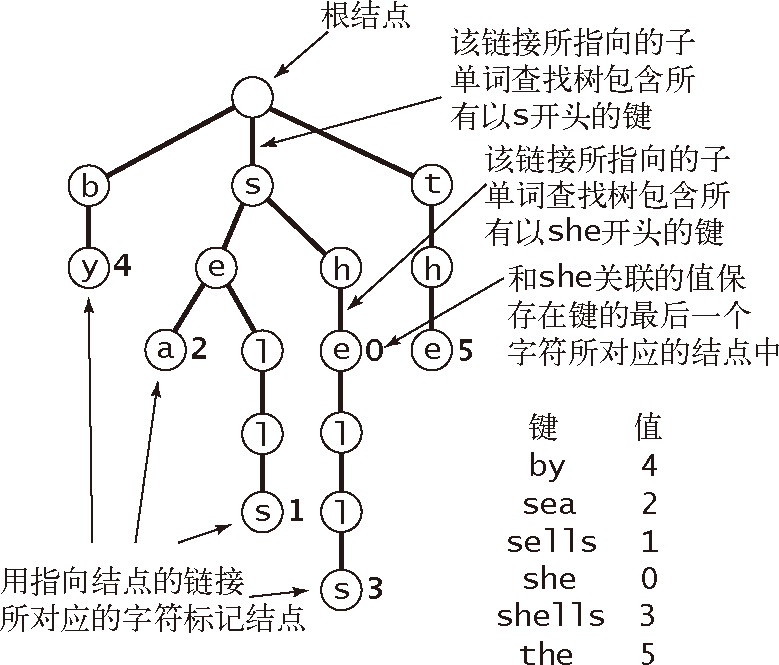

- 图 5.2.1　单词查找树详解

### 5.2.1.2　单词查找树中的查找操作

在单词查找树中查找给定字符串键所对应的值是一个很简单的过程，它是以被查找的键中的字符为导向的。单词查找树中的每个结点都包含了下一个可能出现的所有字符的链接。从根结点开始，首先经过的是键的首字母所对应的链接；在下一个结点中沿着第二个字符所对应的链接继续前进；在第二个结点中沿着第三个字符所对应的链接向前，如此这般直到到达键的最后一个字母所指向的结点或是遇到了一条空链接。这时可能会出现以下 3 种情况（示例请见图5.2.2）。

```
键的尾字符所对应的结点中的值非空（如图 5.2.2 中查找 shells 和 she 的示例）。这是
```

- 一次命中的查找——键所对应的值就是键的尾字符所对应的结点中保存的值。

```
键的尾字符所对应的结点中的值为空（如图 5.2.2 中查找 shell 的示例）。这是一次未命中
```

- 的查找——符号表中不存在被查找的键。

```
查找结束于一条空链接（如图 5.2.2 中查找 shore 的示例）。这也是一次未命中的查找。
```

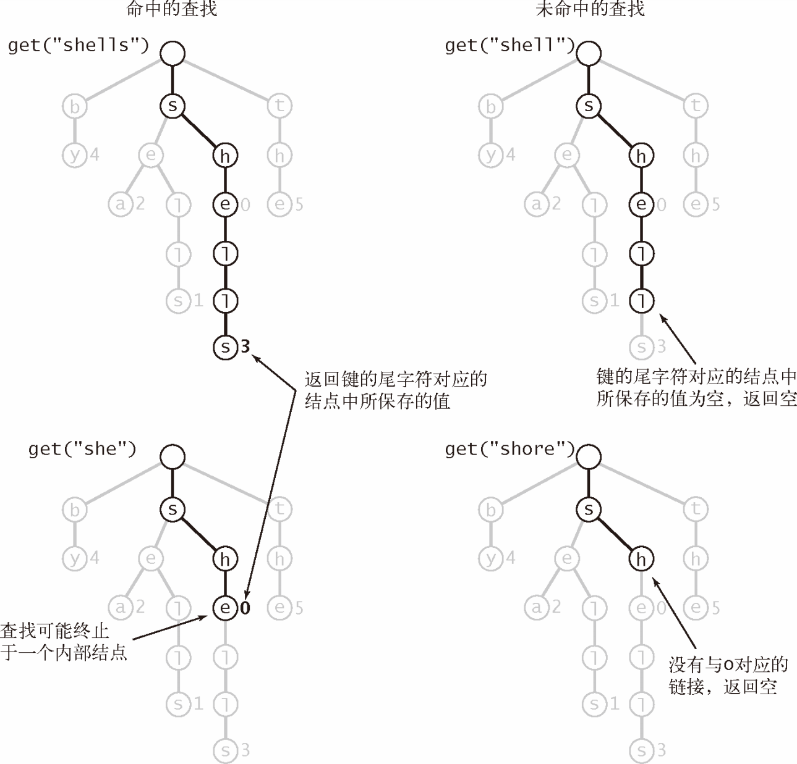

- 图 5.2.2　单词查找树的查找示例

在所有的情况中，执行查找的方式就是在单词查找树中从根结点开始检查某条路径上的所有结点。

### 5.2.1.3　单词查找树中的插入操作

和二叉查找树一样，在插入之前要进行一次查找：在单词查找树中意味着沿着被查找的键的所有字符到达树中表示尾字符的结点或者一个空链接。此时可能会出现以下两种情况。

- 在到达键的尾字符之前就遇到了一个空链接。在这种情况下，单词查找树中不存在与键的尾字符对应的结点，因此需要为键中还未被检查的每个字符创建一个对应的结点并将键的值保存到最后一个字符的结点中。

- 在遇到空链接之前就到达了键的尾字符。在这种情况下，和关联数组一样，将该结点的值设为键所对应的值（无论该值是否为空）。

在所有情况下，对于键中的每个字符，我们或者进行检查，或者在树中创建一个对应的结点。

```
在使用第 3 章中的标准索引用例处理输入 she sells sea shells by the sea shore
```

时所构造的单词查找树如图 5.2.3 所示。

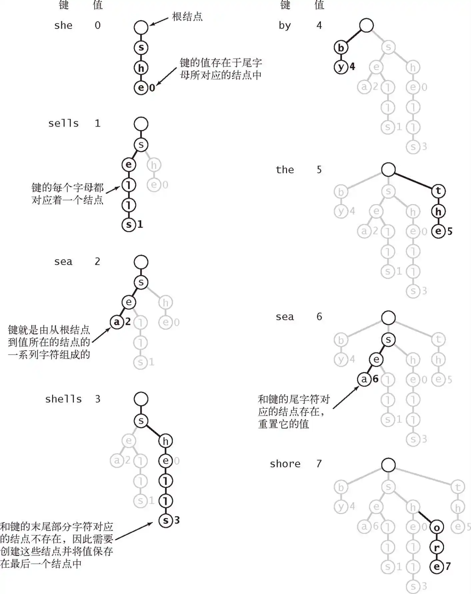

- 图 5.2.3　标准索引用例中单词查找树的构造轨迹

### 5.2.1.4　结点的表示

在本节开头提到过，我们为单词查找树所绘出的图像和在程序中构造的数据结构并不完全一致，因为我们没有画出空链接。将空链接考虑进来将会突出单词查找树的以下重要性质：

- 每个结点都含有 个链接，对应着每个可能出现的字符；

- 字符和键均隐式地保存在数据结构中。

例如，在图 5.2.4 中的单词查找树中，所有的键均由小写字母组成，每个结点都含有一个值和

```
26 个链接。第一条链接指向的子单词查找树中的所有键的首字母都是 a，第二条链接指向的
子单词查找树中的所有键的首字母都是 b，等等。
```

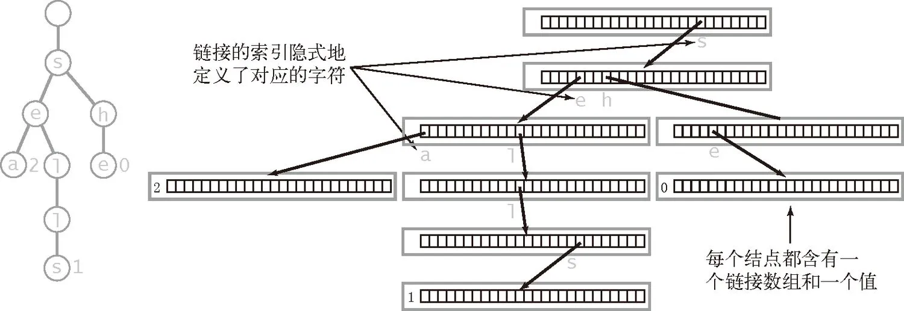


- 图 5.2.4　单词查找树的表示（）

在单词查找树中，键是由从根结点到含有非空值的结点的路径所隐式表示的。例如，在单词查

```
找树中，字符串 sea 所关联的值是 2，因为根结点中的第 19 条链接（指向由所有以 s 开头
的键组成的子单词查找树）非空，下一个结点中的第 5 条链接（指向由所有以 se 开头的键组
成的子单词查找树）非空，第三个结点中的第 1 条链接（指向由所有以 sea 开头的键组成的
子单词查找树）的值为 2。数据结构既没有保存字符串 sea 也没有保存字符 s、e 和 a。事
```

- 的作用的

实上，数据结构不会存储任何字符串或字符，它保存了链接数组和值。因为参数

- 个字符的字母表的单词查找树称为向单词查找树。

重要性，所以将基于含有

```sql
有了这些预备知识之后，算法 5.4 实现的符号表 TrieST 就很容易理解了。它也使用了类似
于第 3 章介绍的查找树使用的递归方法。它的私有 Node 类用实例变量 val 保存键相关联的
值并用数组 next[] 保存所有指向其他 Node 对象的引用。这些递归方法的实现非常简洁，
值得仔细研究。下面，我们将讨论接受一个 Alphabet 对象作为参数的构造函数和
size()、keys()、longestPrefixOf()、keysWithPrefix()、keysThatMatch()
和 delete() 方法的实现。理解这些递归方法也并不困难，只是每个方法都会比前一个稍加
```

复杂。

```
public int size()
{  return size(root);  }
private int size(Node x)
{
  if (x == null) return 0;
  int cnt = 0;
  if (x.val != null) cnt++;
  for (char c = 0; c < R; c++)
     cnt += size(x.next[c]);
  return cnt;
}
单词查找树的延时递归方法 size()
```

### 5.2.1.5　大小

```
和第 3 章中的二叉查找树一样，size() 方法的实现有以下 3 种显而易见的选择。
```


- 即时实现：用一个实例变量 保存键的数量。

```sql
更加即时的实现：用结点的实例变量保存子单词查找树中键的数量，在递归的 put() 和
delete() 方法调用之后更新它们。
延时递归实现：如上页框注“单词查找树的延时递归方法 size()”所示。它会遍历单词查找
```

- 树中的所有结点并记录非空值结点的总数。

和二叉查找树一样，延时实现很有指导意义但是应该尽量避免，因为它会给用例造成性能上的问题。我们会在练习中讨论它的即时实现。

- 算法 5.4　基于单词查找树的符号表

```java
public class TrieST<Value>
1
{
2
  private static int R = 256; // 基数
3
  private Node root;          // 单词查找树的根结点
4
5
  private static class Node
6
  {
7
     private Object val;
8
     private Node[] next = new Node[R];
9
  }
10
11
  public Value get(String key)
12
  {
13
     Node x = get(root, key, 0);
14
     if (x == null) return null;
15
     return (Value) x.val;
16
  }
17
18
  private Node get(Node x, String key, int d)
19
  {  // 返回以x作为根结点的子单词查找树中与key相关联的值
20
     if (x == null) return null;
21
     if (d == key.length()) return x;
22
     char c = key.charAt(d); // 找到第d个字符所对应的子单词查找树
23
     return get(x.next[c], key, d+1);
24
  }
25
26
  public void put(String key, Value val)
27
  {  root = put(root, key, val, 0);  }
28
29
  private Node put(Node x, String key, Value val, int d)
30
  {  // 如果key存在于以x为根结点的子单词查找树中则更新与它相关联的值
31
     if (x == null) x = new Node();
32
     if (d == key.length()) {  x.val = val; return x; }
33
     char c = key.charAt(d); // 找到第d个字符所对应的子单词查找树
34
     x.next[c] = put(x.next[c], key, val, d+1);
35
     return x;
36
  }
37
}
38
```

- 向单词查找树实现了符号表。我们会在下面的几页中讨论表 5.2.1 中字符这份代码使用

- 串符号表 API 中新增的方法。我们很容易通过修改这段代码来处理特殊字母表中的键（请

```
见 5.2.1.10 节）。因为 Java 不支持泛型数组，所以 Node 中的值的类型必须是 Object，
可以在 get() 中将值的类型转换为 Value。
```

### 5.2.1.6　查找所有键

因为字符和键是被隐式地表示在单词查找树中，所以使用例能够遍历符号表的所有键就变得有些困难。在二叉查找树中，我们将所有字符串键保存在一个队列（Queue）里。但对于单词查找树，不仅要能够在数据结构中找到这些键，还需要显式地表示它们。我们用一个类似于

```
size() 的私有递归方法 collect() 来完成这个任务，它维护了一个字符串用来保存从根结
点出发的路径上的一系列字符。每当我们在 collect() 调用中访问一个结点时，方法的第一
```

个参数就是该结点，第二个参数则是和该结点相关联的字符串（从根结点到该结点的路径上的所有字符）。在访问一个结点时，如果它的值非空，我们就将和它相关联的字符串加入队列之中，然后（递归地）访问它的链接数组所指向的所有可能的字符结点。在每次调用之前，都将

```
链接对应的字符附加到当前键的末尾作为调用的参数键。用这个 collect() 方法为 API 中
的 keys() 和 keysWithPrefix() 方法收集符号表中所有的键。要实现 keys() 方法，可
以以空字符串作为参数调用 keysWithPrefix() 方法。要实现 keysWithPrefix() 方
法，可以先调用 get() 找出给定前缀所对应的单词查找树（如果不存在则返回 null），再使
用 collect() 方法完成任务。图 5.2.5 显示了 collect() 方法（或者说
keysWithPrefix("") 调用）在一棵单词查找树中的轨迹，它给出了每次调用 collect()
方法时第二个参数的值和队列的内容。图 5.2.6 显示了 keysWithPrefix("sh") 的运行过
```

程。

```java
public Iterable<String> keys()
{  return keysWithPrefix("");  }
public Iterable<String> keysWithPrefix(String pre)
{
  Queue<String> q = new Queue<String>();
  collect(get(root, pre, 0), pre, q);
  return q;
}
private void collect(Node x, String pre,
                        Queue<String> q)
{
  if (x == null) return;
  if (x.val != null) q.enqueue(pre);
  for (char c = 0; c < R; c++)
     collect(x.next[c], pre + c, q);
}
```

收集一棵单词查找树中的所有键

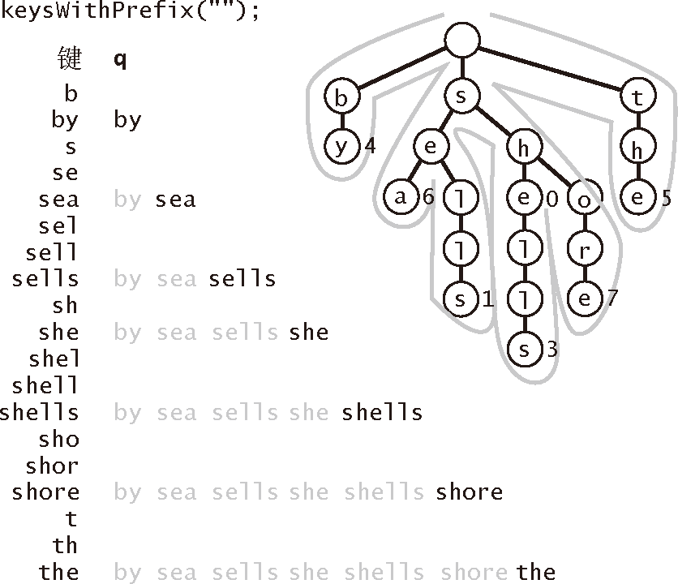

- 图 5.2.5　收集一棵单词查找树中的所有键的轨迹

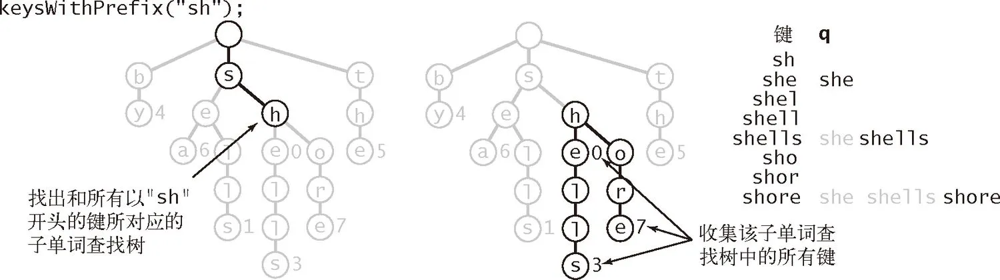

- 图 5.2.6　单词查找树中的前缀匹配

### 5.2.1.7　通配符匹配

```
我们可以用一个类似的过程实现 keysThatMatch()，但需要为 collect() 方法添加一个
```

参数来指定匹配的模式。如果模式中含有通配符，就需要用递归调用处理所有的链接，否则就只需要处理模式中指定字符的链接即可，如下方的框注所示。你还可以注意到，这里不需要考虑长度超过模式字符串的键。

```java
public Iterable<String> keysThatMatch(String pat)
{
  Queue<String> q = new Queue<String>();
  collect(root, "", pat, q);
  return q;
}
private void collect(Node x, String pre, String pat, Queue<String> q)
{
  int d = pre.length();
  if (x == null) return;
  if (d == pat.length() && x.val != null) q.enqueue(pre);
  if (d == pat.length()) return;
  char next = pat.charAt(d);
  for (char c = 0; c < R; c++)
     if (next == '.' || next == c)
        collect(x.next[c], pre + c, pat, q);
}
```

单词查找树中的通配符匹配

### 5.2.1.8　最长前缀

```
为了找到给定字符串的最长键前缀，就需要使用一个类似于 get() 的递归方法。它会记录查
```

找路径上所找到的最长键的长度（将它作为递归方法的参数在遇到值非空的结点时更新它）。查找会在被查找的字符串结束或是遇到空链接时终止，请见图 5.2.7。

```
public String longestPrefixOf(String s)
{
  int length = search(root, s, 0, 0);
  return s.substring(0, length);
}
private int search(Node x, String s, int d, int length)
{
  if (x == null) return length;
  if (x.val != null) length = d;
  if (d == s.length()) return length;
  char c = s.charAt(d);
  return search(x.next[c], s, d+1, length);
}
```

对给定字符串的最长前缀进行匹配

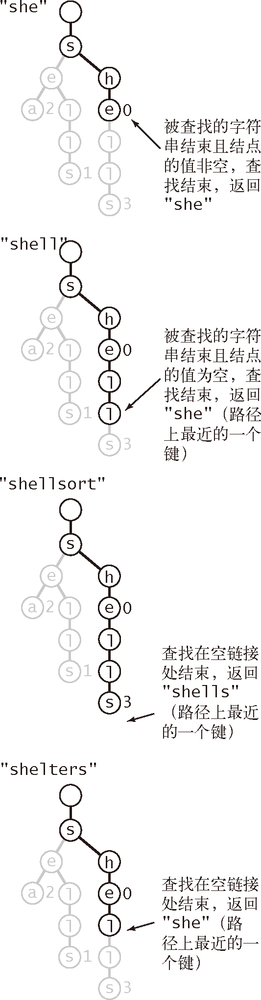

```
图 5.2.7　longestPrefixOf() 方法的各种可能情况
```

### 5.2.1.9　删除操作

从一棵单词查找树中删去一个键值对的第一步是，找到键所对应的结点并将它的值设为空

```
（null）。如果该结点含有一个非空的链接指向某个子结点，那么就不需要再进行其他操作
```

了。如果它的所有链接均为空，那就需要从数据结构中删去这个结点。如果删去它使得它的父结点的所有链接也均为空，就需要继续删除它的父结点，依此类推。如下面框注中的实现所

```java
示，根据标准递归流程，这项操作所需的代码极少：在递归删除了某个结点 x 之后，如果该
结点的值和所有的链接均为空则返回 null，否则返回 x，请见图 5.2.8。
public void delete(String key)
{  root = delete(root, key, 0);  }
private Node delete(Node x, String key, int d)
{
  if (x == null) return null;
  if (d == key.length())
     x.val = null;
  else
  {
     char c = key.charAt(d);
     x.next[c] = delete(x.next[c], key, d+1);
  }
  if (x.val != null) return x;
  for (char c = 0; c < R; c++)
     if (x.next[c] != null) return x;
  return null;
}
```

从单词查找树中删除一个键（和它相关联的值）

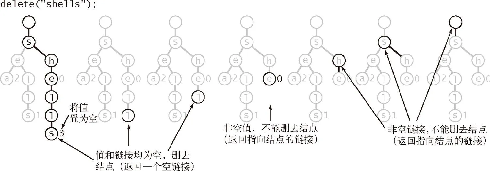

- 图 5.2.8　从单词查找树中删除一个键（和它相关联的值）

### 5.2.1.10　字母表

```
和以前一样，算法 5.4 处理的是 Java 的 String 类型的键，但将它修改为处理由任意字母表
```

得到的键也很容易。

```
实现一个构造函数，接受一个 Alphabet 对象作为参数，将一个 Alphabet 类型的实例变
量设为该参数的值并将实例变量 R 的值设为字母表中字母的个数。
```


```
在 get() 和 put() 中使用 Alphabet 类的 toIndex() 方法，将字符串中的字符转化为
```

- 0 到 之间的索引值。

```
使用 Alphabet 类的 toChar() 方法，将 0 到 之间的索引值转化为字符型（char）的
值。get() 和 put() 方法不需要进行此操作，但它在 keys()、keysWithPrefix()
和 keysThatMatch() 方法的实现中很重要。
```

经过这些修改，如果已知所有键仅来自于一个小型的字母表，那可以节省相当大的空间（在每

- 条链接），代价是字母和索引相互转化所需要的时间。

个结点中仅使用

我们已经考虑过的代码就是字符串符号表 API 的一个简洁而完整的实现，它适用于各种实际应用场景。本节的练习讨论了它的几种变化和扩展。下面我们要讨论单词查找树的基本性质和限制条件。

### 5.2.2　单词查找树的性质

和以前一样，我们希望知道在一般的应用程序中使用单词查找树所需要的时间和空间。单词查找树已经被分析和研究得很透彻了，它的基本性质也比较容易理解和应用。

- 命题 F。单词查找树的链表结构（形状）和键的插入或删除顺序无关：对于任意给定的一组键，其单词查找树都是唯一的。证明。由数学归纳法很容易通过子单词查找树证明这个结论。

这个基本的结论是单词查找树的一个特殊性质：我们目前已经学过的所有其他结构的查找树的构造都不仅和键的集合有关，而且还取决于这些键的插入顺序。

### 5.2.2.1　最坏情况下查找和插入操作的时间界限

在单词查找树中找到给定键的值要花多长时间？对于二叉查找树、散列表和第 3 章中所介绍的其他算法，都需要使用数学分析来回答这个问题。但是对于单词查找树，这个问题很简单。

- 命题 G。在单词查找树中查找一个键或是插入一个键时，访问数组的次数最多为键的长度加 1。

```
证明。由代码可知，put() 和 get() 方法的递归实现都带有一个参数 d。它的初始值为
```

- 0，每次调用时都会加 1，当长度等于键的长度时递归调用停止。

从理论角度来说，命题 G 意味着单词查找树对于命中的查找是最理想的——我们不能奢望查找所需的时间比与被查找的键的长度成正比更好。无论使用的是什么算法和数据结构，在检查完要查找的键中的所有字符之前都是无法判断是否已找到该键。从实际角度来说，这个保证也很重要，因为它和符号表中键的数量无关：当我们在处理类似于车牌号码的 7 个字符的键时，可以知道查找或插入操作最多只需要检查 8 个结点；当我们在处理 20 个字符的数字账号时，最多只需要检查 21 个结点就可以完成查找或插入操作。

### 5.2.2.2　查找未命中的预期时间界限

假设我们正在单词查找树中查找一个键，发现根结点中与被查找键的第一个字符所对应的链接为空。此时只检查了一个结点就知道了该键不存在于表中。这种情况是很常见的：单词查找树的最重要的性质之一就是未命中的查找一般都只需要检查很少的几个结点。如果假设键都来自

- 个不同字符出现的几率均相同），可以证明以下结论。

于随机字符串模型（字母表中

- 命题 H。字母表的大小为，在一棵由 N 个随机键构造的单词查找树中，未命中查找平均


- 所需检查的结点数量为。个键都与一个随机的查找键的前个字符简略证明（写给熟悉概率分析的读者）。所有的


- 。用 1 减去它即可得到单词查找树中至少有一中至少有一个字符不同的概率为


- 个字符都相匹配的概率。也就是说，的查找操作至个键和被查找键的前


- 个字符的概率。在概率分析中，对于少需要比较，一个整数随机变量大于的概率之和就是该随机变量的平均值。因此，查找的平均成本为：


- 根据基本的近似公式，查找的平均成本的近似函数为：


- 远小于时，相对应的约项的值非常接近于 1；当远大于时，所对应当


- 的所有的项的值均极为接近于 0；当时，所对应的项不多且它们的值均在 0 和 1


- 之间。因此，它的总和约为。

从实际角度来说，该命题说明的最重要的一点就是，查找未命中的成本与键的长度无关。例如，它说明在一棵由 100 万个随机键构造出的单词查找树中，未命中的查找也只需要检查3~4 个结点，无论这些键是含有 7 个数字的车辆牌照还是 20 个数字的账号。虽然在实际应用中真正的随机键是不可能出现的，但该模型能够描述一般应用场景中单词查找树算法对键的处理方式，上述猜想是合理的。事实上，这种行为方式在实际应用中十分常见而且也是单词查找树得到广泛应用的一个重要原因。

### 5.2.2.3　空间

一棵单词查找树需要多少空间？回答这个问题（了解可用的空间有多少）是有效使用单词查找树的关键。

- 命题 I。一棵单词查找树中的链接总数在到之间，其中为键的平均长度。


- 证明。在单词查找树中，每个键都有一个对应的结点保存着它关联的值，同时每个结点也含条链接，因此链接总数至少有条。如果所有的键的首字母均不相同，那么每个键有

- 乘以所有键中的字符总数，中的每个字母都有一个对应的结点，因此链接总数应该等于

- 即。

表 5.2.2 说明了我们所讨论的一些典型的应用场景所需的空间成本。它说明了单词查找树中的一些经验性的规律。

- 当所有键均较短时，链接的总数接近于；

- 当所有键均较长时，链接的总数接近于；

- 因此，缩小 能够节省大量的空间。

这张表传递出的另一条更加微妙的信息是，在实际应用中采用单词查找树之前了解将要被插入的所有键的性质是非常重要的。

表 5.2.2　典型的单词查找树的空间需求

- 平均长度 w字母表大小 R100 万个键

应用

- 典型的键

- 4PGC93872562 亿 5 千 6

加利福尼亚州的车牌号

### 5.2.2.4　单向分支

长键在单词查找树中占用了大量空间的主要原因是，树中的长键通常都有一条长长的“尾巴”，

- 条空链接）。这种情况

其中每个结点都只含有一条指向下一个结点的链接（因此都含有

并不难纠正（请见练习 5.2.11 和图 5.2.9）。单词查找树的内部也可能存在单向的分支。例如，两个长键可能只有最后一个字符不同。解决这种情况要更加困难一些（请见练习5.2.12）。这些修改能够使得单词查找树的空间消耗比已经讨论过的简单实现缩小许多，但它们对于实际应用场景基本不起作用。下面我们将学习降低单词查找树的空间消耗的另一种方式。

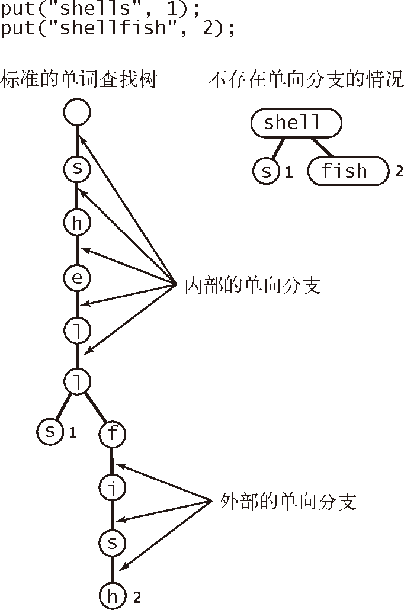

- 图 5.2.9　消除单词查找树中的单向分支

我们的底线是：不要使用算法 5.4 处理来自于大型字母表的大量长键。它所构造的单词查找树

- 和所有键的字符总数之积成正比。但是，如果你能够负担得起这么庞大的

所需要的空间与

空间，单词查找树的性能是无可匹敌的。

### 5.2.3　三向单词查找树

- 向单词查找树过度的空间消耗，我们现在来学习另一种数据的表示方法：三向单

为了避免

词查找树（TST）。在三向单词查找树中，每个结点都含有一个字符、三条链接和一个值。这三条链接分别对应着当前字母小于、等于和大于结点字母的所有键。在算法 5.4 的

- 向单词

- 条链接，每个非空链接的索引隐式地表示了它所对应的字符。在

查找树中，树的结点含有

等价的三向单词查找树中，字符是显式地保存在结点中的——只有在沿着中间链接前进时才会根据字符找到表中的键，请见图 5.2.10。

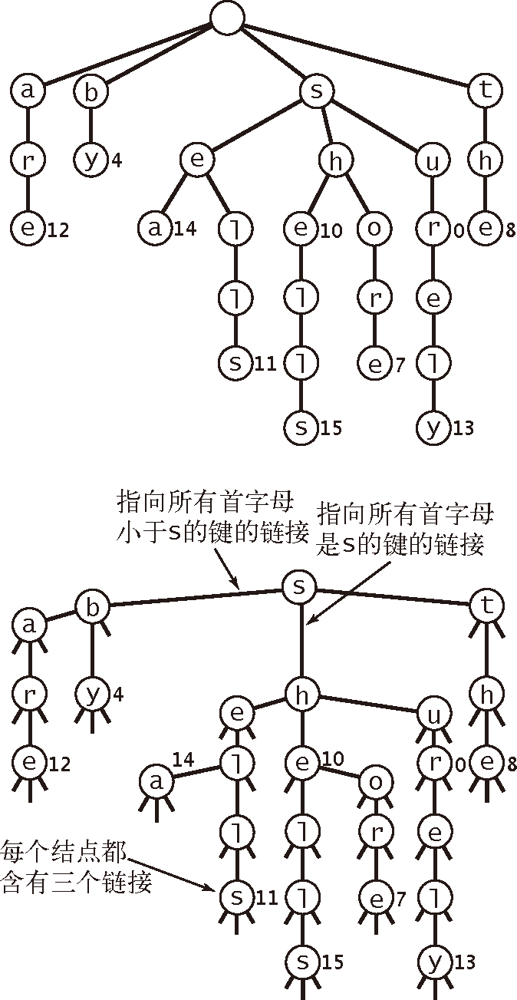

- 图 5.2.10　一棵单词查找树所对应的三向单词查找树

查找与插入操作

用三向单词查找树实现符号表 API 中的查找和插入操作很简单。在查找时，我们首先比较键的首字母和根结点的字母。如果键的首字母较小，就选择左链接；如果较大，就选择右链接；如果相等，则选择中链接。然后，递归地使用相同的算法。如果遇到了一个空链接或者当键结束时结点的值为空，那么查找未命中；如果键结束时结点的值非空则查找命中。在插入一个新键时，首先进行查找，然后和在单词查找树一样，在树中补全键末尾的所有结点。算法 5.5 给出了这些方法的实现细节。

- 向单词查找树中的每个结点实现为以非空链接所对应的字符作为键

这种实现方式等价于将

的二叉查找树。不同的是，算法 5.4 使用的是由键索引的数组。图 5.2.10 显示了一棵单词查找树和与它相对应的三向单词查找树。按照第 3 章中所述的二叉查找树和其他排序算法之间的对应关系来看，我们可以发现三向单词查找树与三向字符串快速排序之间的对应关系与二叉查找树与快速排序以及单词查找树与高位优先的排序之间的对应关系是一样的。图 5.1.12 和图5.1.17 分别显示了高位优先的字符串排序和三向字符串快速排序的递归调用结构，它们与图5.2.10 中由同一组键所构造的单词查找树和三向单词查找树正好完全对应。单词查找树中的链接所占用的空间即为高位优先的字符串排序中的计数器所占用的空间。三向分支为两者都提供了一个非常有效的解决方案，请见图 5.2.11 和图 5.2.12。

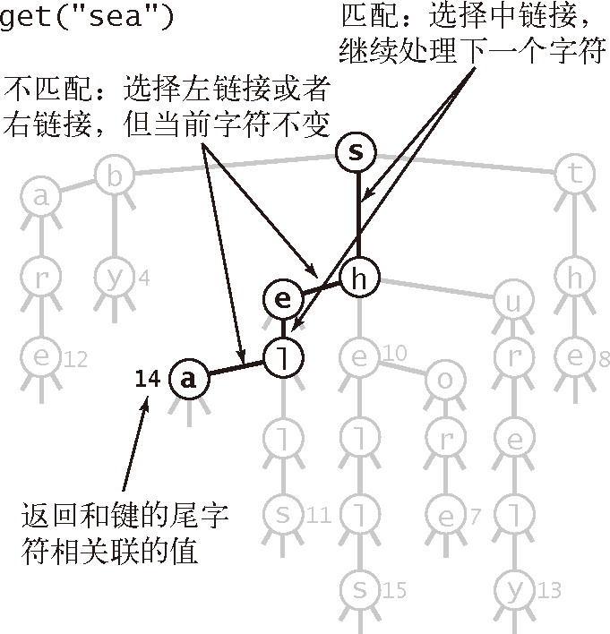

- 图 5.2.11　三向单词查找树中的查找示例

- 算法 5.5　基于三向单词查找树的符号表

```java
public class TST<Value>
1
{
2
  private Node root;        // 树的根结点
3
  private class Node
4
  {
5
     char c;                    // 字符
6
     Node left, mid, right;     // 左中右子三向单词查找树
7
     Value val;                 // 和字符串相关联的值
8
  }
9
10
  public Value get(String key)  // 和单词查找树相同（请见算法5.4）
11
12
  private Node get(Node x, String key, int d)
13
  {
14
     if (x == null) return null;
15
     char c = key.charAt(d);
16
     if      (c < x.c) return get(x.left,  key, d);
17
     else if (c > x.c) return get(x.right, key, d);
18
     else if (d < key.length() - 1)
19
                       return get(x.mid,   key, d+1);
20
     else return x;
21
  }
22
23
  public void put(String key, Value val)
24
  {  root = put(root, key, val, 0);  }
25
26
  private Node put(Node x, String key, Value val, int d)
27
  {
28
     char c = key.charAt(d);
29
     if (x == null) { x = new Node(); x.c = c; }
30
     if      (c < x.c) x.left  = put(x.left,  key, val, d);
31
     else if (c > x.c) x.right = put(x.right, key, val, d);
32
     else if (d < key.length() - 1)
33
                       x.mid   = put(x.mid,   key, val, d+1);
34
     else x.val = val;
35
     return x;
36
  }
37
38
}
39
这段实现使用含有一个 char 类型的值 c 和三条链接的结点构建了三向单词查找树，其中
子树的键的首字母分别小于（左子树）、等于（中子树）和大于（右子树）c。
```

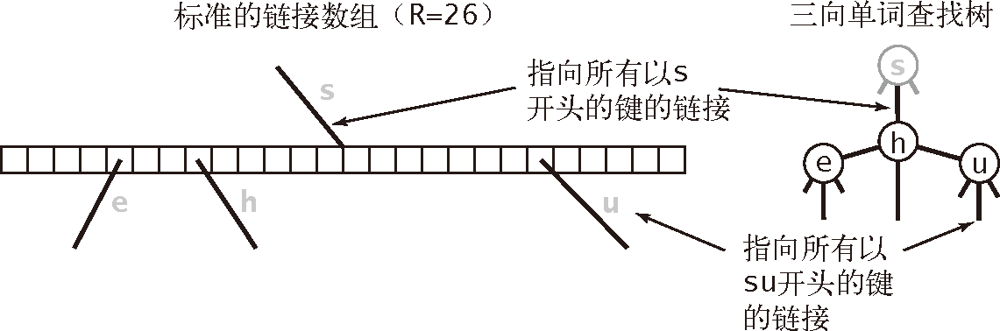

- 图 5.2.12　单词查找树结点示例

### 5.2.4　三向单词查找树的性质

- 向单词查找树的紧凑表示，但两种数据结构的性质截然不同。这其中最

三向单词查找树是

重要的不同可能在于命题 A 对于三向单词查找树不再成立：和其他所有二叉查找树一样，每个单词查找树结点的二叉查找树表示也取决于键的插入顺序。

### 5.2.4.1　空间

三向单词查找树最重要的性质就是每个结点只含有三个链接，因此三向单词查找树所需要空间远小于对应的单词查找树。

- 命题 J。由个平均长度为的字符串构造的三向单词查找树中的链接总数在到


- 之间。


- 证明。同命题 I。

三向单词查找树实际使用的内存空间一般都低于由每个字符三个链接得到的上界，因为有相同前缀的键会共享树中的高层结点。

### 5.2.4.2　查找成本

要计算三向单词查找树中查找（和插入）操作的成本，需要将它所对应的单词查找树中的查找成本乘以遍历每个结点的二叉查找树所需的成本。

- 命题 K。在一棵由个随机字符串构造的三向单词查找树中，查找未命中平均需要比较字

- 次。除次外，一次插入或命中的查找会比较一次被查找的键中的每个字符


- 符。证明。由代码我们马上可以得到插入和查找命中的成本。查找未命中的成本的证明和命题 H的简略证明相同。假设在查找路径上除了常数个结点（高层的几个）之外的其他所有结点均个字符值随机构造的二叉查找树，且树的平均路径长度为为由，因此将时间成本


- 乘以。

- 向结点，不平衡且像一条链表一样展开，因

在最坏情况下，一个结点可能变成一个完全的

- 个不同的值

此需要乘以一个系数

- 。一般的情况下，在第一层（因为根结点类似于一棵由

组成的随机二叉查找树）甚至是其下的几层（如果键存在公共的前缀且前缀之后的字符最多可

- 种不同的取值）那么进行字符比较的次数将是或者更少，之后对于大多数字符也

能有

只需进行几次比较（因为指向大多数单词查找树结点的非空链接的分布十分稀疏）。未命中的查找一般都需要若干次字符比较并结束于单词查找树高层的某个空链接。在命中的查找中，被查找的键中的每个字符都需要并且只需要一次比较，因为它们大多数都是单词查找树底部的单向分支上的结点。

### 5.2.4.3　字母表

使用三向单词查找树的最大好处是它能够很好地适应实际应用中可能出现的被查找键的不规则性。需要特别注意到的是，不应该按照用例提供的字母表构造字符串，这对于单词查找树很关键。这主要会产生两点影响。首先，实际应用中的键都来自于大型字母表，而且字符集中的各个字符的使用是非常不均衡的。有了三向单词查找树，我们可以使用 256 个字符的 ASCII 编码或者 65 536 个字符的 Unicode 编码，而不必担心 256 向分支或者 65 536 向分支带来的巨大开销，也不必判断哪些才是相关的字符集。非罗马字母表的 Unicode 字符串中可能含有上

```
千种字符——三向单词查找树特别适合于可能含有此类字符的 Java 标准 String 类型的键。
```

其次，实际应用程序中的键常常有着类似的结构，这在不同的应用之中可能不同。键的一部分可能只会使用字母，而另一部分可能只会使用数字。在加利福尼亚州的车牌号的例子中，第二、三、四个字符都是大写字母（

- ），而其他字符都是数字（）。在这种键构造


的三向单词查找树中，一部分结点会被表示为 10 结点的二叉查找树（键的数字部分），另一部分结点会被表示为 26 结点的二叉查找树（键的字母部分）。这种结构的生成是自动的，无需对键进行特别分析。

### 5.2.4.4　前缀匹配、查找所有键和通配符匹配

```
因为三向单词查找树也是单词查找树，前文中单词查找树的 longestPrefixOf()、
keys()、keysWithPrefix() 和 keysThatMatch() 方法的实现可以很容易移植过来。
```

这个练习能够加深你对单词查找树和三向单词查找树的理解（请见练习 5.2.9）。和查找操作一样，这里也存在空间和时间的交换（使用线性级别的内存空间，但每个字符的比较次数需要乘以

- ）。

### 5.2.4.5　删除操作

```sql
三向单词查找树中的 delete() 方法要更复杂一些。从本质上来说，每个将被删除的字符都
```

属于一棵二叉查找树。在单词查找树中，只需将链接数组中和该字符对应的元素置为空即可删去它的链接。在三向单词查找树中，需要用在二叉查找树中删除结点的方法来删去与该字符对应的结点。

### 5.2.4.6　混合三向单词查找树

简单改进一下基于三向单词查找树的查找方式：使用一个大型显式的多向根结点。实现它最简

- 棵三向单词查找树的表：每一棵都对应着键的首字母的一种可

单的办法就是维护一张含有


- 不大，那可以使用键的头两个字母（表的大小变为

能的值。如果

- ）。这种方法有效的前

提是键的首字母的分布必须均匀。这样得到的混合查找算法和人们在电话黄页中查找姓名的行为很相似。查找的第一步是进行多向判断（“让我们来看看，它的首字母是‘A’”），接下来可能是某种双向判断（“它在‘Andrews’之前，但在‘Aitken’之后”），然后就是一系列字符匹配（“‘Algonquin’，……没有，‘Algorithms’不在列表之中，因为没有以‘Algor’开头的单词！”）。这些程序可能是查找字符串类型的键的最快算法。

### 5.2.4.7　单向分支

和单词查找树一样，我们也可以通过将键的尾字母变为叶子结点并在内部结点中消除单向分支来提高三向单词查找树的空间利用率。

- 命题 L。由个随机字符串构造的根结点进行了向分支且不含有外部单向分支的三向单

- 次字符比较。词查找树中，一次插入或查找操作平均需要进行约


- 证明。这些粗略的估计也可以由命题 K 的证明得到。假设在查找路径上除了常数个结点个字符值组成的二叉查找树，因此需要将时（高层的几个）之外的其他所有结点均为由

- 间成本乘以。

尽管将算法调优至最佳性能是一个非常大的诱惑，我们不应该忘记三向单词查找树最吸引人的特点，那就是不必担心对特定应用场景的依赖，即使是在没有调优的情况下也能提供不错的性能。

### 5.2.5　应该使用字符串符号表的哪种实现

和字符串排序一样，我们自然也想对比一下已经学习过的字符串查找方法和第 3 章中学习的通用方法。表 5.2.3 总结了已讨论过的各种算法的重要性质（二叉查找树、红黑树和散列表的条目来自第 3 章，作为比较之用）。对于特定的应用场景，这些条目有指导意义，但并非绝对的结论，因为在研究符号表实现的过程中发现许多因素（例如键的性质和混合操作的顺序）都会产生影响。

- 向单词查找树的速度是最快的，能够在常数次字符比较内完成查找。对于

如果空间足够，

- 向单词查找树所需的空间可能无法满足时，三向单词查找树是最佳的选择，

大型字母表，

因为它对“字符”比较次数是对数级别的比较，而二叉查找树中键的比较次数是对数级别的。散列表也是很有竞争力的，但如前文所述，它不支持有序性的符号表操作，也不支持扩展的字符类 API 操作，例如前缀或通配符匹配。

表 5.2.3　各种字符串查找算法的性能特点

- 处理由大小为 R 的字母表构造的 N 个字符串（平均长度为w）的增长数量级

算法（数据结构）

- 未命中查找检查的字符数量内存使用

### 答疑

```
问　Java 的系统排序方法使用了本节介绍的方法来查找 String 类型的键吗？
```

答　没有。

### 练习

```
 向空单词查找树之中并画出结果（忽略空链接）：no is
```

5.2.1　将以下键按照顺序插入一棵

```
th ti fo al go pe to co to th ai of th pa。
5.2.2　将以下键按照顺序插入一棵空三向单词查找树之中并画出结果（忽略空链接）：no is
th ti fo al go pe to co to th ai of th pa。
 向空单词查找树之中并画出结果（忽略空链接）：now
```

5.2.3　将以下键按照顺序插入一棵

```
is the time for all good people to come to the aid of。
5.2.4　将以下键按照顺序插入一棵空三向单词查找树之中并画出结果（忽略空链接）：now
is the time for all good people to come to the aid of。
5.2.5　给出非递归版本的 TrieST 和 TST。
5.2.6　对于 StringSET 数据类型，实现以下 API，如表 5.2.4 所示。
```

表 5.2.4　字符串集合的数据类型的 API

```java
public class <b>StringSET</b>
             StringSET()
```

- 创建一个字符串的集合

```sql
        void add(String key)
将 key 添加到集合中
        void delete(String key)
从集合中删除 key
     boolean contains(String key)
key 是否存在于集合中
     boolean isEmpty()
```

- 集合是否为空

```
int size()
```

- 集合中的键的数量

### 提高题

5.2.7　三向单词查找树中的空字符串。三向单词查找树（TST）的代码未能正确处理空字符串。说明原因并给出修正方案。

```sql
5.2.8　单词查找树的有序性操作。为 TrieST 实现 floor()、ceiling()、rank() 和
select() 方法（来自第 3 章标准有序性符号表的 API）。
5.2.9　三向单词查找树的扩展操作。为三向单词查找树实现 keys() 和本节所介绍的几种扩
展操作：longestPrefixOf()、keysWithPrefix() 和 keysThatMatch()。
5.2.10　size() 方法。为 TrieST 和 TST 实现最为即时的 size() 方法（在每个结点中保存
```

子树中的键的总数）。

```
5.2.11　外部单项分支。为 TrieST 和 TST 添加消除外部单向分支的代码。
5.2.12　内部单项分支。为 TrieST 和 TST 添加消除内部单向分支的代码。
```

5.2.13

- 向分支的根结点的三向单词查找树。如正文所述，为 TST 添加代码，在前两层结

点中实现多向分支。

5.2.14　长度为

- 的不同子字符串。编写一个 TST 的用例，从标准输入读取文本并计算其中


```
 的不同子字符串的数量。例如，如果输入为 cgcgggcgcg，那么长度为 3 的不同子
```

长度为

```
字符串就有 5 个： cgc、cgg、gcg、ggc 和 ggg。提示：使用字符串方法
substring(i,i+L) 来提取第 i 个子字符串并将它插入到一张符号表中。
```

5.2.15　不同子字符串。编写一个 TST 的用例，从标准输入读取文本并计算其中任意长度的不同子字符串的数量。后缀树能够高效完成这个任务——请见第 6 章。

```
5.2.16　文档的相似性。编写一个 TST 的静态方法用例，接受一个 int 值 L 和两个文件名作
```

为命令行参数并计算两份文档的“L- 相似性”：各个频率向量之间的欧几里得距离，其中频率向

```
量为各个长度为 3 的子字符串（trigram）的出现次数除以所有长度为 3 的子字符串的总
数。给出一个静态方法 main()，接受一个 int 值 L 作为命令行参数，从标准输入中获取一
```

系列文件名并打印出一个矩阵，以显示所有文档之间的 L- 相似性。

```
5.2.17　拼写检查。编写一个 TST 的用例 SpellChecker，从命令行接受一个英语字典文件
```

作为参数，然后从标准输入读取一个字符串并打印所有不在字典中的单词。请使用字符串集合数据类型。

5.2.18　白名单。编写一个 TST 的用例，解决 1.1 节和 3.5 节中介绍并讨论过的（请见3.5.2.2 节）白名单问题。

```
5.2.19　随机电话号码。编写一个 TrieST 的用例（R=10），从命令行接受一个 int 值 N 并
打印出 N 个形如 (xxx) xxx-xxxx 的随机电话号码。使用符号表避免出现重复的号码。使
```

用本书网站上的 AreaCodes.txt 来避免打印出不存在的区号。

```
5.2.20　是否含有前缀。为 StringSET 类（请见练习 5.2.6）添加一个方法
containsPrefix()，接受一个字符串 s 作为输入，如果集合中存在某个以 s 作为前缀的
字符串时返回 true。
```

5.2.21　子字符串匹配。给定一列（短）字符串，你的任务是找到所有含有用户所寻找的字符

```
串 s 的字符串。为此任务设计一份 API 并给出一个 TST 用例来实现这个 API。提示：将每个
单词的所有后缀（例如：string, tring, ring, ing, ng, g）插入到 TST 中。
```

5.2.22　打字的猴子。假设有一只会打字的猴子，它打出每个字母的概率为

- ，结束一个单词


- 。编写一个程序，计算产生各种长度的单词的概率分布。其中如果 "abc" 出

的概率为现了多次，只计算一次。

### 实验题

```
5.2.23　重复元素（再续）。使用 StringSET（请见练习 5.2.6）代替 HashSET 重新完成练
习 3.5.30，比较两种方法的运行时间。然后使用 dedup 为
```


- 和运行实验，、

```
用随机 long 型字符串重复实验并讨论结果。
5.2.24　拼写检查器。使用本书网站上的 dictionary.txt 文件和 3.5.2.2 节中的 BlackFilter
```

用例重新完成练习 3.5.31 并打印出一个文本文件中所有拼错的单词。用该用例处理

```
WarAndPeace.txt 文件，比较 TrieST 和 TST 的性能并讨论结果。
```

5.2.25　字典。重新完成练习 3.5.32：在一个需要高性能的场景中研究一个类似于

```
LookupCSV 的用例的性能（使用 TrieST 和 TST）。确切地说，设计一个查询生成器来取代
```

从标准输入接受命令，对大量输入和大量查询进行性能测试。

5.2.26　索引。重新完成练习 3.5.33：在一个需要高性能的场景中研究一个类似于

```
LookupIndex 的用例的性能（使用 TrieST 和 TST）。确切地说，设计一个查询生成器来取
```

代从标准输入接受命令，对大量输入和大量查询进行性能测试。
