# 5.3子字符串查找

- 的文本和一个长度为的模式

字符串的一种基本操作就是子字符串查找：给定一段长度为

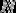


（pattern）字符串，在文本中找到一个和该模式相符的子字符串，请见图 5.3.1。解决该问题的大部分算法都可以很容易地扩展为找出文本中所有和该模式相符的子字符串、统计该模式在文本中的出现次数、或者找出上下文（和该模式相符的子字符串周围的文字）的算法。

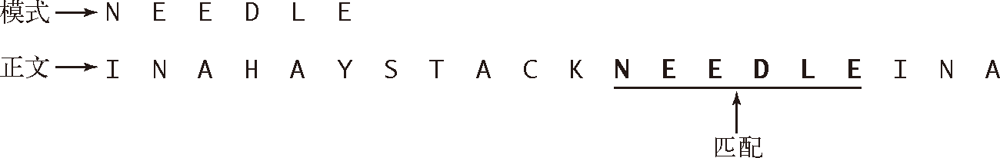

- 图 5.3.1　子字符串的查找

当你在文本编辑器或是浏览器中查找某个单词时，就是在查找子字符串。事实上，该问题的原始动机就是为了支持这种查找操作。字符串查找的另一个经典应用是在截获的通信内容中寻找某种重要的模式。一位军队将领感兴趣的可能是在截获的文本中寻找和“拂晓进攻”类似的字句。一名黑客感兴趣的可能是在内存中查找与“Password:”相关的内容。在今天的世界中，我们经常在互联网的海量信息中查找字符串。

- 可能等于 100 或者 1000），而文

为了更好地理解算法，请记住模式相对于文本是很短的（

- 可能等于 100 万或者 10 亿）。在字符串查找中，一般会对模式进

本相对于模式是很长的（

行预处理来支持在文本中的快速查找。

字符串查找是一个很有趣而且也很经典的问题：人们发明了几个截然不同（且令人惊讶的）算法，它们不仅产生了一系列能够实际应用的查找方法，而且也展示了许多重要的算法设计技巧。

### 5.3.1　历史简介

我们将要学习的几种算法有一段有趣的历史。我们在这里进行总结并帮助大家对它们的地位有一个正确的认识。

- 成

子字符串查找有一个简单而使用广泛的暴力算法。虽然它在最坏情况下的运行时间与

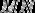

正比，但是在处理许多应用程序中的字符串时（除了一些变态的情况之外），它的实际运行时

- 成正比。另外，它很好地利用了大多数计算机系统中标准的结构特性，因此

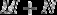

间一般与即使是更加巧妙的算法也很难超越它经过优化后的版本的性能。

在 1970 年，S.Cook 在理论上证明了一个关于某种特定类型的抽象计算机的结论。这个结论

- 成正比的解决子字符串查找问题的算法。

暗示了一种在最坏情况下用时也只是与D.E.Knuth 和 V.R.Pratt 改进了 Cook 用来证明定理的框架（并非为实际应用所设计）并将它提炼为一个相对简单而实用的算法。这看起来是一个鲜有但令人满意的将理论结果（意外的）立刻转化为实际应用的例子。但实际上，J.H.Morris 在实现一个文本编辑器时，为了解决某个棘手的问题（他希望能够在文本中避免“回退”）也发明了几乎相同的算法。殊途同归的两种方式得到了同一种算法，这说明它是这个问题的一种基础的解决方案。

Knuth、Morris 和 Pratt 直到 1976 年才发表了他们的算法。在这段时间里，R.S.Boyer 和J.S.Moore（以及 R.W.Gosper 独立地）发明了一种在许多应用程序中都非常快的算法，该算法一般只会检查文本字符串中的一部分字符。许多文本编辑器都使用了这个算法，以显著降低字符串查找的响应时间。

Knuth-Morris-Pratt 算法和 Boyer-Moore 算法都需要对模式字符串进行复杂的预处理，这个过程十分晦涩而且也限制了它们的应用范围。（事实上，有位系统程序员觉得 Morris 算法实在是太难懂了，就干脆用暴力算法代替了。）

在 1980 年，M.O.Rabin 和 R.M.Karp 使用散列开发出了一种与暴力算法几乎一样简单但运行

- 成正比的概率极高的算法。另外，它们的算法还可以扩展到二维的模式和文本

时间与中，这使得它比其他算法更适用于图像处理。

这段历史说明人们在不断地研究更好的算法。事实上大家都认为，这个经典问题还将会有很大的发展。

### 5.3.2　暴力子字符串查找算法

子字符串查找的一个最显而易见的方法就是在文本中模式可能出现匹配的任何地方检查匹配是

```
否存在。如左侧框注所示的 search() 方法就是在文本字符串 txt 中查找模式字符串 pat
第一次出现的位置。这段程序使用了一个指针 i 跟踪文本，一个指针 j 跟踪模式。对于每个
i，代码首先将 j 重置为 0 并不断将它增大，直至找到了一个不匹配的字符或是模式结束
（j==M）为止，请见图 5.3.2。如果在模式字符串结束之前文本字符串就已经结束了(i==N-
M+1)，那么就没有找到匹配：模式字符串在文本中不存在。我们约定在不匹配时返回 N 的
```

值。

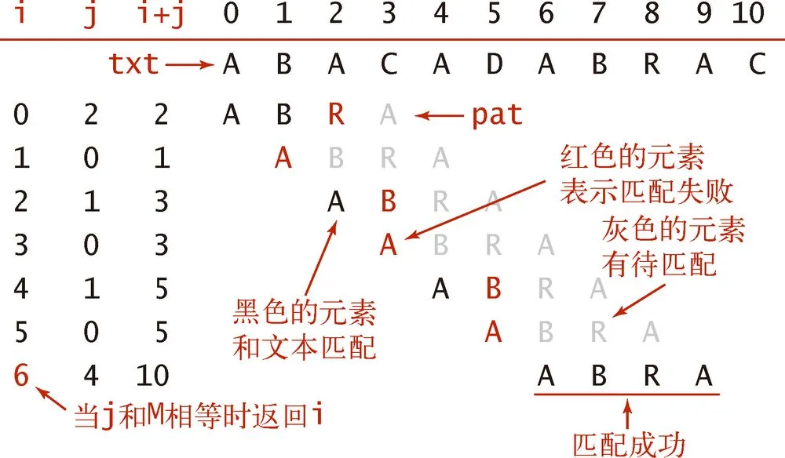

- 图 5.3.2　暴力子字符串查找

```java
public static int search(String pat, String txt)
{
  int M = pat.length();
  int N = txt.length();
  for (int i = 0; i <= N - M; i++)
  {
     int j;
     for (j = 0; j < M; j++)
        if (txt.charAt(i+j) != pat.charAt(j))
           break;
     if (j == M) return i;  // 找到匹配
  }
  return N;                 // 未找到匹配
}
```

暴力子字符串查找

```
在典型的字符串处理应用程序中，索引 j 增长的机会很少，因此该算法的运行时间与 N 成正
```

比。绝大多数比较在比较第一个字符时就会产生不匹配。例如，假设你在这一段文字之中查找pattern 这个模式字符串。在找到模式字符串的第一次匹配之前共有 191 个单词，其中只有 7个的首字母是 p（且没有以 pa 开头的单词）。因此字符比较的总次数为 191+7，也就是说文本中每个字符平均需要比较 1.036 次。从另一个方面来说，没人能够保证算法总是如此高效。例如，模式字符串可能以一连串的 A 开头。如果是这样且文本也包含含有一大串 A 的字符串，那么字符串的查找就可能会很慢。

- 命题 M。在最坏情况下，暴力子字符串查找算法在长度为的文本中查找长度为的模

- 次字符比较，请见图 5.3.3。式需要


- 证明。一种最坏的情况是文本和模式都是一连串的 A 接一个 B。那么，对于个

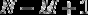


- 可能的匹配位置，模式中的所有字符都需要和文本比对，总成本为。一般远小于。来说，因此总成本为

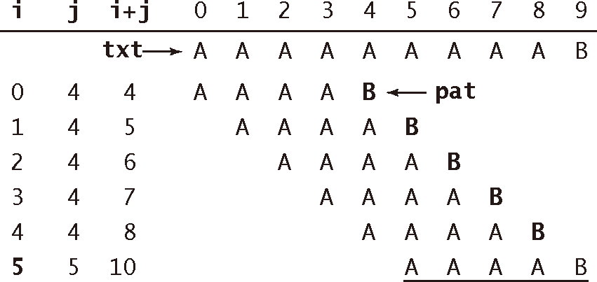

- 图 5.3.3　暴力子字符串查找（最坏情况）

这种奇怪的字符串不太可能出现在英文文本之中，但在其他应用场景中是完全可能的（例如二进制文本），因此我们需要更好的算法。

```
下方框注所示的该算法的另一种实现是有指导意义的。和以前一样，程序使用了一个指针 i
跟踪文本，一个指针 j 跟踪模式。在 i 和 j 指向的字符相匹配时，代码进行的字符比较和上
一个实现相同。请注意，这段代码中的 i 值相当于上一段代码中的 i+j：它指向的是文本中
已经匹配过的字符序列的末端（i 以前指向的是这个序列的开头）。如果 i 和 j 指向的字符不
匹配了，那么需要回退这两个指针的值：将 j 重新指向模式的开头，将 i 指向本次匹配的开
```

始位置的下一个字符。

```java
public static int search(String pat, String txt)
{
  int j, M = pat.length();
  int i, N = txt.length();
  for (i = 0, j = 0; i < N && j < M; i++)
  {
     if (txt.charAt(i) == pat.charAt(j)) j++;
     else { i -= j; j = 0;  }
  }
  if (j == M) return i - M;  // 找到匹配
  else            return N;  // 未找到匹配
}
```

暴力子字符匹配算法的另一种实现（显式回退）

### 5.3.3　Knuth-Morris-Pratt 子字符串查找算法

Knuth、Morris 和 Pratt 发明的算法的基本思想是当出现不匹配时，就能知晓一部分文本的内容（因为在匹配失败之前它们已经和模式相匹配）。我们可以利用这些信息避免将指针回退到所有这些已知的字符之前。

```
举一个具体的例子。假设字母表中只有两个字符，查找的模式字符串为 B A A A A A A A
A A 。现在，假设已经匹配了模式中的 5 个字符，第 6 个字符匹配失败。当发现不匹配的字
符时，可以知道文本中的前 6 个字符肯定是 B A A A A B（前 5 个匹配，第 6 个失败），文
本指针现在指向的是末尾的字符 B。你可以观察到，这里不需要回退文本指针 i，因为正文中
的前 4 个字符都是 A，均与模式的第一个字符不匹配。另外，i 当前指向的字符 B 和模式的
第一个字符相匹配，所以可以直接将 i 加 1，以比较文本中的下一个字符和模式中的第二个字
符。这说明，对于这个模式，可以将暴力子字符串查找算法实现中的 else 语句替换为 j=1
（且并不将 i 加 1）。因为循环中 i 的值并未变化，这种方法最多只会进行 N 次字符比较。这
```

次特殊变化的实际影响仅限于这种特殊情况，但这种想法是值得思考的——Knuth-Morris-Pratt

```
算法正是这种情况的一般化。令人惊讶的是，在匹配失败时总是能够将 j 设为某个值以使 i
```

不回退，请见图 5.3.4。

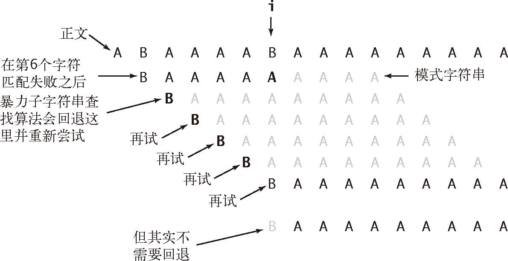

- 图 5.3.4　文本字符串的指针在子字符串查找中的回退

在匹配失败时，如果模式字符串中的某处可以和匹配失败处的正文相匹配，那么就不应该完全

```
跳过所有已经匹配的所有字符。例如，当在文本 A A <b>B</b> A A B A A A A 中查找
模式 A A B A A A 时，我们首先会在模式的第 5 个字符处发现匹配失败，但是应该在第 3
```

个字符处继续查找，否则就会错过已经匹配的部分。KMP 算法的主要思想是提前判断如何重新开始查找，而这种判断只取决于模式本身。

### 5.3.3.1　模式指针的回退

```
在 KMP 子字符串查找算法中，不会回退文本指针 i，而是使用一个数组 dfa[][] 来记录匹
配失败时模式指针 j 应该回退多远。对于每个字符 c，在比较了 c 和 pat.charAt(j) 之
后，dfa[c] [j] 表示的是应该和下个文本字符比较的模式字符的位置。在查找中，
dfa[txt.charAt(i)][j] 是在比较了 txt.charAt(i) 和 pat.charAt(j) 之后应该和
txt.charAt(i+1) 比较的模式字符位置。在匹配时会继续比较下一个字符，因此
dfa[pat.charAt(j)][j] 总是 j+1。在不匹配时，不仅可以知道 txt.charAt(i) 的字
符，也可以知道正文中的前 j-1 个字符，它们就是模式中从索引 1 开始的前 j-1 个字符。对
于每个字符 c，你可以将这个过程想象为首先将模式字符串的一个副本覆盖在这 j 个字符之
上（模式中的前 j-1 个字符以及字符 c——需要判断的是当这些字符就是 txt.charAt(i-
j+1..i) 时应该怎么办），然后从左向右滑动这个副本直到所有重叠的字符都相互匹配（或者
```

没有相匹配的字符）时才停下来。这将指明模式字符串中可能产生匹配的下一个位置。和

```
txt.charAt(i+1)(dfa[txt.charAt(i)][j]) 比较的模式字符的索引正是重叠字符的数
```

量，请见图 5.3.5。

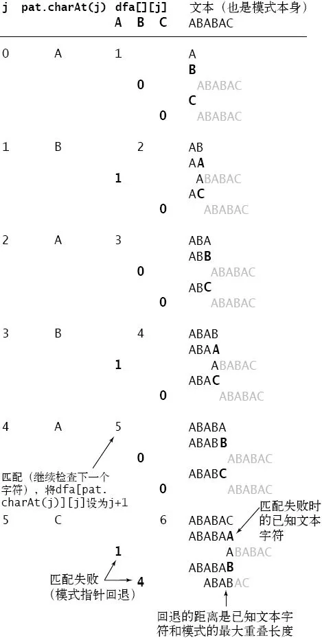

```
图 5.3.5　KMP 子字符串查找算法在处理 A B A B A C 时模式指针的回退
public int search(String txt)
{  // 模拟DFA处理文本txt时的操作
  int i, j, N = txt.length(), M ＝ pat.length();
  for  (i = 0, j = 0; i < N && j < M; i++)
     j = dfa[txt.charAt(i)][j];
  if (j == M) return i - M; // 找到匹配
  else        return N;     // 未找到匹配
}
```

KMP 子字符串查找算法（DFA 模拟）

### 5.3.3.2　KMP 查找算法

```
只要计算出了 dfa[][] 数组，就得到了后面框注所示的子字符串查找算法：当 i 和 j 所指
向的字符匹配失败时（从文本的 i-j+1 处开始检查模式的匹配情况），模式可能匹配的下一个
位置应该从 i-dfa[txt.charAt(i)][j] 处开始。按照算法，从该位置开始的
dfa[txt.charAt(i)][j] 个字符和模式的前 dfa[txt.charAt(i)][j] 个字符应该相
同，因此无需回退指针 i，只需要将 j 设为 dfa[txt.charAt(i)][j] 并将 i 加 1 即可，
这正是当 i 和 j 所指向的字符匹配时的行为。
```

### 5.3.3.3　DFA 模拟

说明这个过程的一种较好的方法是使用确定有限状态自动机（DFA）。事实上，由它的名字你

```
也可以看出，dfa[][] 数组定义的正是一个确定有限状态自动机。图 5.3.6 显示确定有限状
```

态自动机是由状态（数字标记的圆圈）和转换（带标签的箭头）组成的。模式中的每个字符都对应着一个状态，每个此类状态能够转换为字母表中的任意字符。对于子字符串查找问题，在

```
我们所考虑的 DFA 中，这些转换中只有一条是匹配转换（从 j 到 j+1，标签为
pat.charAt(j)），其他的都是非匹配转换（指向左侧）。所有状态都和字符的比较相对应，
每个状态都表示一个模式字符串的索引值。当我们在标记为 j 的状态中检查文本中的第 i 个
字符时，自动机的行为是这样的：“沿着转换 dfa[txt.charAt(i)][j] 前进并继续检查下
一个字符（将 i 加 1）。”对于一个匹配的转换，就向右移动一位，因为
dfa[pat.charAt(j)] [j] 的值总是 j+1；对于一个非匹配转换，就在向左移动。自动机
```

每次从左向右从文本中读取一个字符并移动到一个新的状态。我们还包含了一个不会进行任何

```
转换的停止状态 M。自动机从状态 0 开始：如果自动机到达了状态 M，那么就在文本中找到
```

了和模式相匹配的一段子字符串（我们称这种情况为确定有限状态自动机识别了该模式）；如

```
果自动机在文本结束时都未能到达状态 M，那么就可以知道文本中不存在匹配该模式的子字符
串。每个模式字符串都对应着一个自动机（由保存了所有转换的 dfa[][] 数组表示）。KMP
的字符串查找方法 search() 只是一段模拟自动机运行的 Java 程序。
```

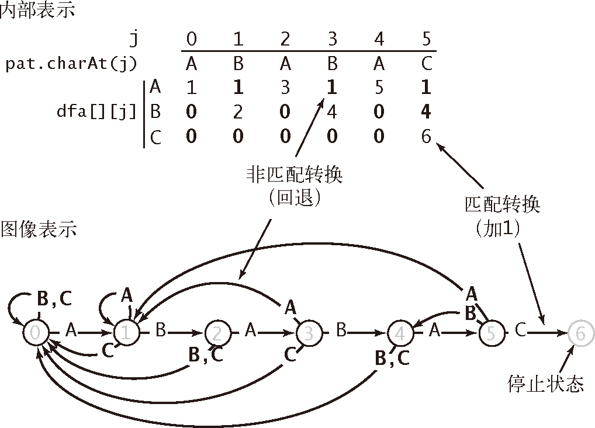

```
图 5.3.6　和模式字符串 A B A B A C 对应的确定有限状态自动机
```

要体验在 DFA 中的子字符串查找操作，你可以先想象一下它所完成的两件最简单的任务。在查找过程的开始，从文本的开头进行查找，起始状态为 0。它停留在 0 状态并扫描文本，直到找到一个和模式的首字母相同的字符。这时它移动到下一个状态并开始运行。在这个过程的最后，当它找到一个匹配时，它会不断地匹配模式中的字符与文本，自动机的状态会不断前进直

```
到状态 M。图 5.3.7 所示的轨迹给出了 DFA 运行的一个典型例子。每次匹配都会将 DFA 带向
下一个状态（等价于增大模式字符串的指针 j）；每次匹配失败都会使 DFA 回到较早前的状态
（等价于将模式字符串的指针 j 变为一个较小的值）。正文指针 i 是从左向右前进的，一次一
个字符，但索引 j 会在 DFA 的指导下在模式字符串中左右移动。
```

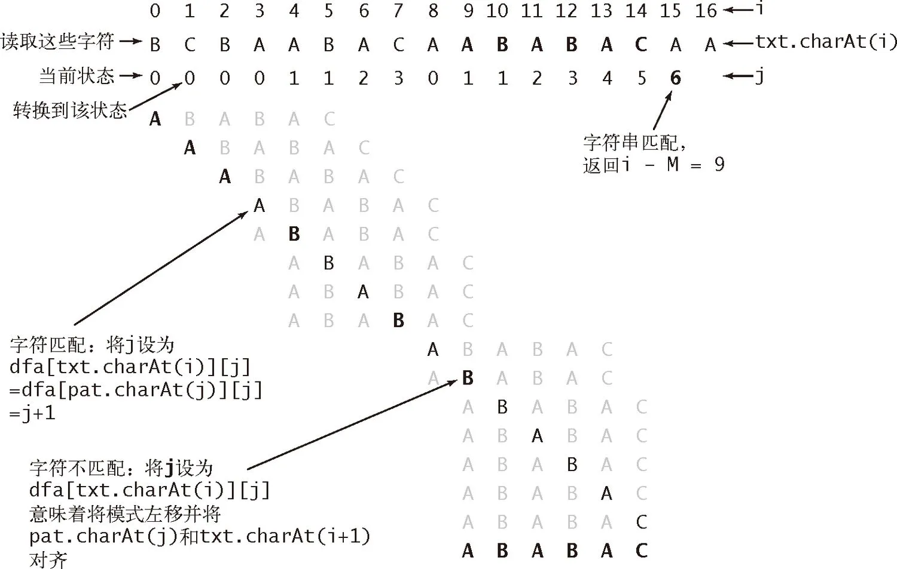

```
图 5.3.7　KMP 子字符串查找算法处理 A B A B A C 时的轨迹（DFA 模拟）
```

### 5.3.3.4　构造 DFA

现在你应该已经明白了 DFA 的原理，接下来解决 KMP 算法的关键问题：如何计算给定模式相

```
对应的 dfa[][] 数组？意外的是，这个问题的答案仍然是 DFA 本身！Knuth、Morris 和
Pratt 发明了这种巧妙（但也相当复杂）的构造方式。当在 pat.charAt(j) 处匹配失败时，
```

希望了解的是，如果回退了文本指针并在右移一位之后重新扫描已知的文本字符，DFA 的状态会是什么？我们其实并不想回退，只是想将 DFA 重置到适当的状态，就好像已经回退过文本指针一样。

```
这里的关键在于需要重新扫描的文本字符正是 pat.charAt(1) 到 pat.charAt(j-1) 之
```

间，忽略了首字母是因为 0 模式需要右移一位，忽略了最后一个字符是因为匹配失败。这些模式中的字符都是已知的，因此对于每个可能匹配失败的位置都可以预先找到重启 DFA 的正确状态。图 5.3.8 显示了示例中的各种可能性。请务必理解这个概念。

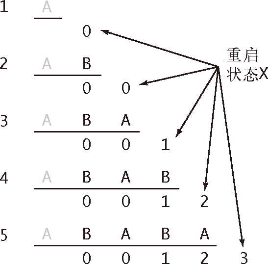

```
图 5.3.8　计算模式 A B A B A C 的重启状态的 DFA 模拟
DFA 应该如何处理下一个字符？和回退时的处理方式相同，除非在 pat.charAt(j) 处匹配
成功，这时 DFA 应该前进到状态 j+1。例如，对于 A B A B A C，要判断在 j=5 时匹配失败
```

后 DFA 应该怎么做。通过 DFA 可以知道完全回退之后算法会扫描 B A B A 并达到状态 3，因

```
此可以将 dfa[][3] 复制到 dfa[][5] 并将 C 所对应的元素的值设为 6，因为
pat.charAt(5) 是 C（匹配）。因为在计算 DFA 的第 j 个状态时只需要知道 DFA 是如何处
理前 j-1 个字符的，所以总能从尚不完整的 DFA 中得到所需的信息。
计算中最后一个关键细节是，你可以观察到在处理 dfa[][] 的第 j 列时维护重启位置 X 很
容易。因为 X<j，所以可以由已经构造的 DFA 部分来完成这个任务——X 的下一个值是
dfa[pat.charAt(j)][X]。继续上一段中的例子，将 X 的值更新为 dfa['C'][3]=0
```

（但我们不会使用这个值，因为 DFA 的构造已经完成了）。

```
由以上的讨论可以得到右侧框注这段短小精悍的代码来构造给定模式的 DFA。对于每个 j，
```

它将会：

```
将 dfa[][X] 复制到 dfa[][j]（对于匹配失败的情况）；
将 dfa[pat.charAt(j)][j] 设为 j+1（对于匹配成功的情况）；
更新 X。
dfa[pat.charAt(0)][0] = 1;
for (int X = 0, j = 1; j < M; j++)
{  // 计算dfa[][j]
  for (int c = 0; c < R; c++)
     dfa[c][j] = dfa[c][X];
  dfa[pat.charAt(j)][j] = j+1;
  X = dfa[pat.charAt(j)][X];
}
```

KMP 子字符串查找算法中 DFA 的构造

图 5.3.9 显示了这段代码处理样例输入的轨迹。为了确保你能完全理解它，请完成练习 5.3.2和练习 5.3.3。

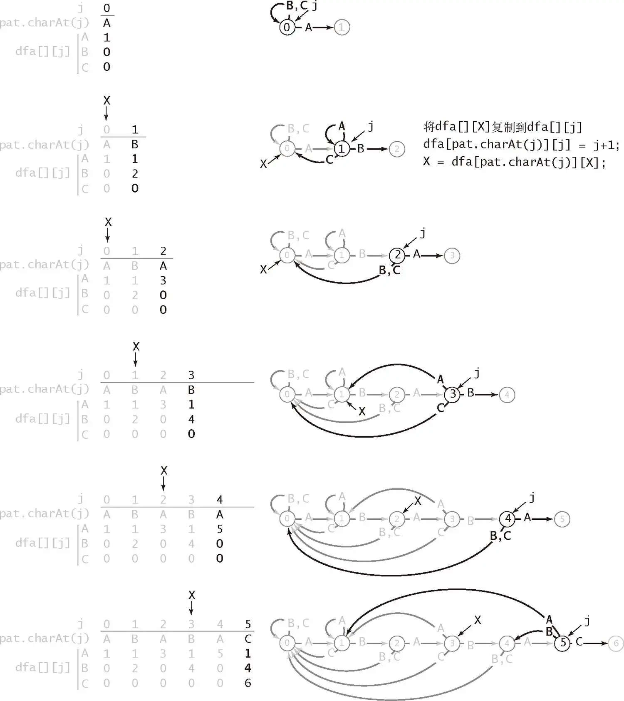

- 图 5.3.9　KMP 子字符串查找算法中模式 A B A B A C 的 DFA 的构造

- 算法 5.6　Knuth-Morris-Pratt 字符串查找算法

```java
public class KMP
1
{
2
  private String pat;
3
  private int[][] dfa;
4
  public KMP(String pat)
5
  {  // 由模式字符串构造DFA
6
     this.pat = pat;
7
     int M = pat.length();
8
     int R = 256;
9
     dfa = new int[R][M];
10
     dfa[pat.charAt(0)][0] = 1;
11
     for (int X = 0, j = 1; j < M; j++)
12
     {  // 计算dfa[][j]
13
        for (int c = 0; c < R; c++)
14
           dfa[c][j] = dfa[c][X];            // 复制匹配失败情况下的值
15
        dfa[pat.charAt(j)][j] = j+1;         // 设置匹配成功情况下的值
16
        X = dfa[pat.charAt(j)][X];           // 更新重启状态
17
     }
18
  }
19
  public int search(String txt)
20
  {  // 在txt上模拟DFA的运行
21
     int i, j, N = txt.length(), M = pat.length();
22
     for (i = 0, j = 0; i < N && j < M; i++)
23
        j = dfa[txt.charAt(i)][j];
24
     if (j == M) return i - M;  // 找到匹配（到达模式字符串的结尾）
25
     else        return N;      // 未找到匹配（到达文本字符串的结尾）
26
  }
27
  public static void main(String[] args)
28
  // 请见下一页的“KMP子字符串查找算法的测试用例”
29
}
30
```

- 该 Knuth-Morris-Pratt 子字符串查找算法的实现的构造函数根据模式字符串构造了一个确定

```
有限状态自动机，使用 search() 方法在给定文本字符串中查找模式字符串。它和暴力子
```

- 字符串查找算法的功能相同，但带适合查找自我重复性的模式字符串。

```
% java KMP AACAA AABRAACADABRAACAADABRA
1
text:    AABRAACADABRAACAADABRA
2
pattern:             AACAA
3
```

算法 5.6 实现了表 5.3.1 所示的 API。

表 5.3.1　子字符串查找的 API

```java
public class <b>KMP</b>
             KMP(String pat)
根据模式字符串 pat 创建一个 DFA
int search(String txt)
在txt 中找到pat 的出现位置
```

你可以在下页框注中看到 KMP 的一个典型的测试用例。KMP 的构造函数会根据模式字符串创

```
建一个 DFA 并用 search() 方法中在给定的文本中查找该模式字符串。
```

- 命题 N。对于长度为的模式字符串和长度为的文本，Knuth-Morris-Pratt 字符串查找

- 个。

- 算法访问的字符不会超过

```
证明。由代码可以马上得到，在计算 dfa[][] 时, 算法会访问模式字符串中的每个字符一
次，在 search() 方法中会访问文本中的每个字符（最坏情况下）一次。
```

- ，所以构造 DFA 所需的总时间（和空间）将

我们还需要引入另一个参数，即字母表的大小

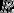

- 成正比。如果在构造 DFA 时为每个状态设置一个匹配转换和一个非匹配转换（而非指

与

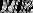

向每个可能出现的字符的多个转换），那么也可以去掉参数

- ，但构造过程会更加复杂一些。

KMP 算法为最坏情况提供的线性级别运行时间保证是一个重要的理论成果。在实际应用中，它比暴力算法的速度优势并不十分明显，因为极少有应用程序需要在重复性很高的文本中查找重复性很高的模式。但该方法的一个优点是不需要在输入中回退。这使得 KMP 子字符串查找算法更适合在长度不确定的输入流（例如标准输入）中进行查找，需要回退的算法在这种情况下则需要复杂的缓冲机制。但其实当回退很容易时，还可以比 KMP 快得多。下面，我们来学习一种利用回退来获取巨大性能收益的算法。

```java
public static void main(String[] args)
{
  String pat = args[0];
  String txt = args[1];
  KMP kmp = new KMP(pat);
  StdOut.println("text:    " + txt);
  int offset = kmp.search(txt);
  StdOut.print("pattern: ");
  for (int i = 0; i < offset; i++)
     StdOut.print(" ");
  StdOut.println(pat);
}
```

KMP 子字符串查找算法的测试用例

### 5.3.4　Boyer-Moore 字符串查找算法

当可以在文本字符串中回退时，如果可以从右向左扫描模式字符串并将它和文本匹配，那么就

```
能得到一种非常快的字符串查找算法。例如，在查找子字符串 B A A B B A A 时，如果匹
```

配了第七个和第六个字符，但在第 5 个字符处匹配失败，那马上就可以将模式向右移动 7 个

```
位置并继续检查文本中的第 14 个字符。这是因为部分匹配找到了 X A A 而 X 不是 B，而这
```

3 个连续的字符在模式中是唯一的。一般来说，模式的结尾部分也可能出现在文本的其他位置，因此和 Knuth-Morris- Pratt 算法一样，也需要一个记录重启位置的数组。本节不会再次详细介绍它的构造方法，因为它和 Knuth-Morris-Pratt 算法中的实现很相似。这里将讨论 Boyer和 Moore 给出的另一种从右向左扫描模式字符串的更有效的方法。

和 KMP 子字符串查找算法的实现一样，我们会根据匹配失败时文本和模式中的字符来决定下一步的行动。而预处理步骤的目的在于判断对于文本中可能出现的每一个字符，在匹配失败时算法应该怎么办。将这个想法变为现实就可以得到一种高效实用的子字符串查找算法。

### 5.3.4.1　启发式的处理不匹配的字符

```
请看图 5.3.10，它显示了在文本 F I N D I N A H A Y S T A C K N E E D L E 中
查找模式 N E E D L E 的过程。因为是从右向左与模式进行匹配，所以首先会比较模式字
符串中的 E 和文本中的 N（位置为 5 的字符）。因为 N 也出现在了模式字符串中，所以将模式
字符串向右移动 5 个位置，将文本中的字符 N 和模式字符串中（最左侧）的 N 对齐。然后比
较模式字符串最右侧的 E 和文本中的 S（位置在第 10 个字符），匹配失败。但因为 S 不包含
在模式字符串中，所以可以将模式字符串向右移动 6 个位置。此时模式字符串最右侧的 E 和
文本中位置为 16 的 E 相匹配，但我们发现文本的下一个（位置为 15 的）字符为 N，匹配再
```

次失败。于是和第一次一样，将模式字符串再次向右移动 4 个位置。最后，从位置 20 处开始从右向左扫描，发现文本中含有与模式匹配的子字符串。这种方法找到匹配位置仅用了 4 次字符比较（以及 6 次比较来验证匹配）！

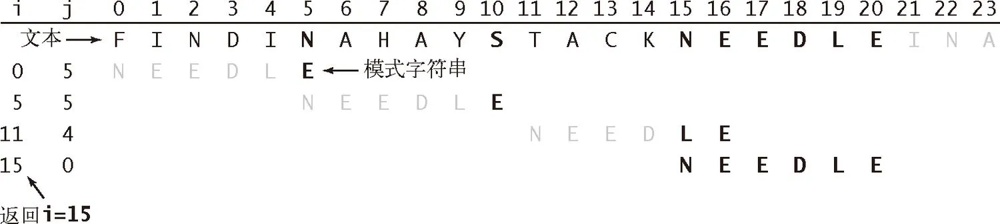

- 图 5.3.10　从右向左的（Boyer-Moore）子字符串查找中的启发式地处理不匹配的字符

### 5.3.4.2　起点

```
要实现启发式的处理不匹配的字符，我们使用数组 right[] 记录字母表中的每个字符在模式
```

中出现的最靠右的地方（如果字符在模式中不存在则表示为 -1）。这个值揭示了如果该字符出

```
现在文本中且在查找时造成了一次匹配失败，应该向右跳跃多远。要将 right[] 数组初始
化，首先将所有元素的值设为 -1，然后对于 0 到 M-1 的 j，将 right[pat.charAt(j)]
设为 j，如图 5.3.11 对模式 N E E D L E 的处理所示。
```

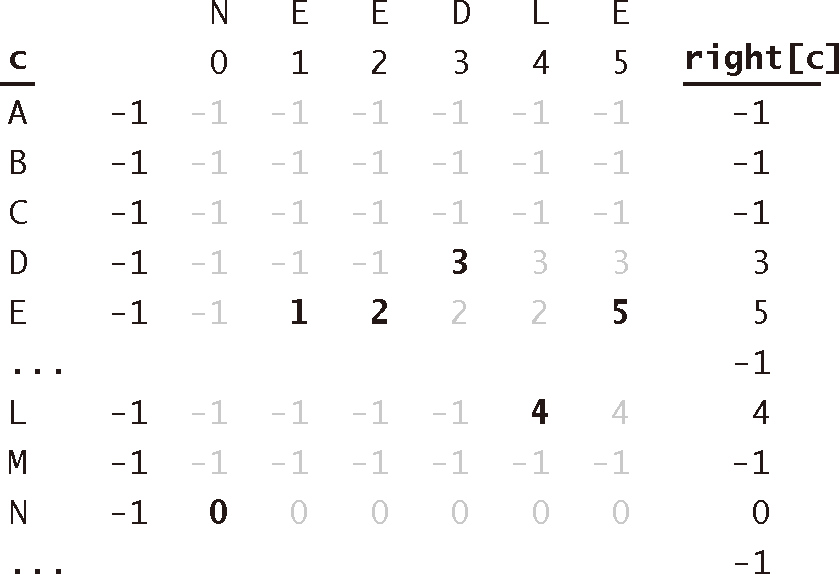

- 图 5.3.11　Boyer-Moore 算法中的跳跃表的计算

### 5.3.4.3　子字符串的查找

```
在计算完 right[] 数组之后，算法 5.7 的实现就很简单了。我们用一个索引 i 在文本中从左
向右移动，用另一个索引 j 在模式中从右向左移动。内循环会检查正文和模式字符串在位置
i 是否一致。如果从 M-1 到 0 的所有 j，txt.charAt(i+j) 都和pat.charAt(j) 相
```

等，那么就找到了一个匹配。否则匹配失败，就会遇到以下三种情况。

```
如果造成匹配失败的字符不包含在模式字符串中，将模式字符串向右移动 j+1 个位置（即
将 i 增加 j+1）。小于这个偏移量只可能使该字符与模式中的某个字符重叠。事实上，这次
```

- 移动也会将模式字符串前面一部分已知的字符和模式结尾的一部分已知字符对齐。通过预先

```
计算一张类似于 KMP 算法的表格，还可以将 i 值变得更大（请见图 5.3.12）。
```

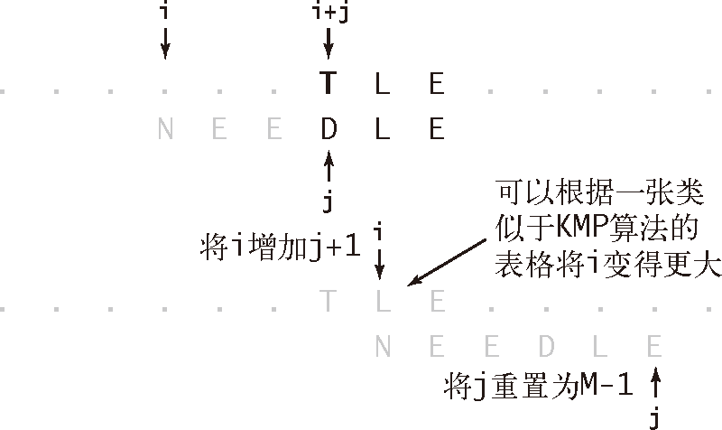

- 图 5.3.12　启发式的处理不匹配的字符（不匹配的字符不包含在模式字符串中）

```
如果造成匹配失败的字符包含在模式字符串中，那就可以使用 right[] 数组来将模式字符
```

- 串和文本对齐，使得该字符和它在模式字符串中出现的最右位置相匹配。和刚才一样，小于这个偏移量只可能使该字符和模式中的与它无法匹配的字符（比它出现的最右位置更靠右的

```
字符）重叠。我们可以用一张类似于 KMP 算法的表格将 i 变得更大，如图 5.3.13 所示。
```

```
如果这种方式无法增大 i，那就直接将 i 加 1 来保证模式字符串至少向右移动了一个位
```

- 置。图 5.3.13 下方的例子说明了这种情况。

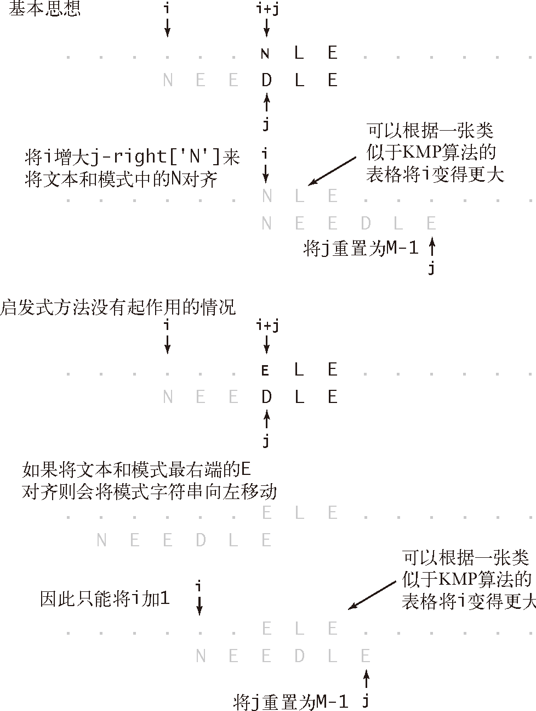

- 图 5.3.13　启发式的处理不匹配的字符（不匹配的字符包含在模式字符串中）

```
算法 5.7 简明地实现了这个过程。请注意，使用 -1 表示 right[] 数组中相应字符不包含在
模式字符串中，这个约定能够将前两种情况合并（将 i 增大 j-
right[txt.charAt(i+j)]）。
```

完整的 Boyer-Moore 算法预计算了模式字符串与自身的不匹配情况（和 KMP 算法的方式类似2

- ）并为最坏情况提供了线性级别的运行时间保证（而算法 5.7 在最坏情况下的运行时间与成正比——请见练习 5.3.19）。我们在这里省略了算法的计算，因为在一般的应用程序中

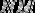

对不匹配字符的启发式处理已经可以控制算法的性能。

- 命题 O。在一般情况下，对于长度为的文本和长度为的模式字符串，使用了 Boyer-


- Moore 的子字符串查找算法通过启发式处理不匹配的字符需要次字符比较。

- 讨论。我们可以用各种随机字符串模型证明该结论，但这些模型一般都不太可能在实际情况中出现，因此这里省略了证明的细节。在许多实际应用场景中，模式字符串中仅含有字母表个字符，这样就得到了中的若干字符是很常见的，因此几乎所有的比较都会使算法跳过

- 以上结论。

- 算法 5.7　Boyer-Moore 字符串匹配算法（启发式地处理不匹配的字符）

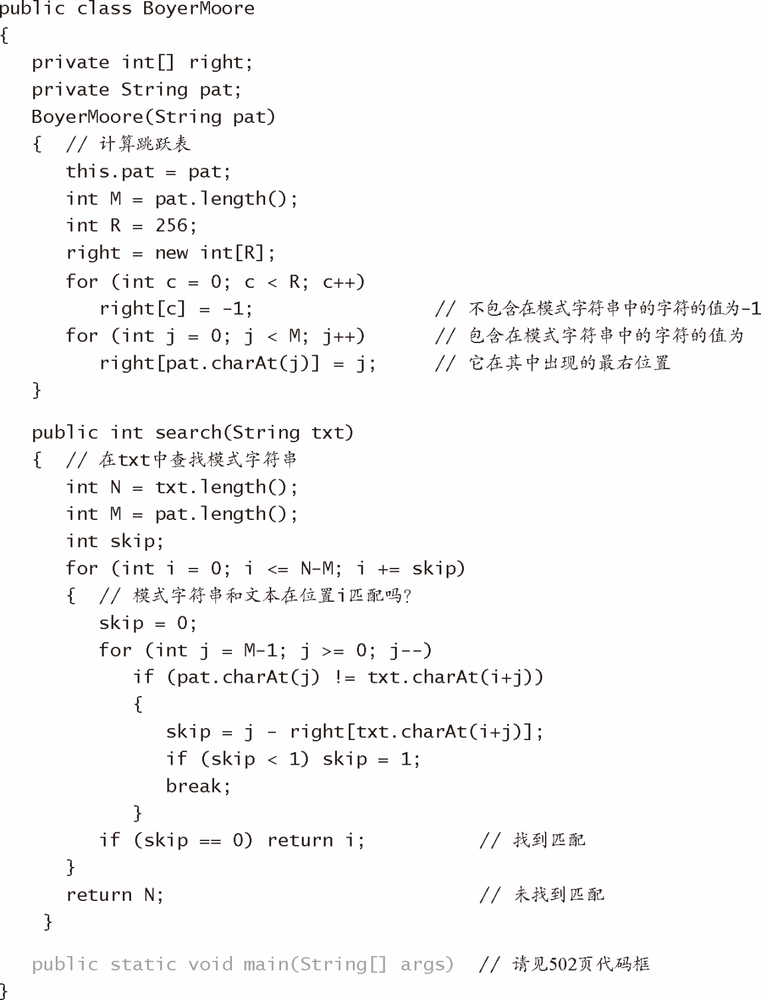

- 这段子字符串查找算法的实现的构造函数根据模式字符串构造了一张每个字符在模式中出现的最右位置的表格。查找算法会从右向左扫描模式字符串，并在匹配失败时通过跳跃将文本中的字符和它在模式字符串中出现的最右位置对齐。

### 5.3.5　Rabin-Karp 指纹字符串查找算法

M.O.Rabin 和 R.A.Karp 发明了一种完全不同的基于散列的字符串查找算法。我们需要计算模

- 个字符的子字符串散

式字符串的散列函数，然后用相同的散列函数计算文本中所有可能的

列值并寻找匹配。如果找到了一个散列值和模式字符串相同的子字符串，那么再继续验证两者是否匹配。这个过程等价于将模式保存在一张散列表中，然后在文本的所有子字符串中进行查找。但不需要为散列表预留任何空间，因为它只会含有一个元素。根据这段描述直接实现的算法将会比暴力子字符串查找算法慢很多（因为计算散列值将会涉及字符串中的每个字符，成本比直接比较这些字符要高得多）。Rabin 和 Karp 发明了一种能够在常数时间内算出

- 个字符

的子字符串散列值的方法（需要预处理），这样就得到了在实际应用中的运行时间为线性级别的字符串查找算法。

### 5.3.5.1　基本思想

```
长度为 M 的字符串对应着一个 R 进制的 M 位数。为了用一张大小为 Q 的散列表来保存这种类
型的键，需要一个能够将 R 进制的 M 位数转化为一个 0 到 Q-1 之间的 int 值散列函数。除
留余数法（请见 3.4 节）是一个很好的选择：将该数除以 Q 并取余。在实际应用中会使用一
```

个随机的素数 Q，在不溢出的情况下选择一个尽可能大的值。（因为我们并不会真的需要一张

```
散列表。）理解这个方法最简单的办法就是取一个较小的 Q 和 R=10 的情况，如下所示。要在
文本 3 1 4 1 5 9 2 6 5 3 5 8 9 7 9 3 中找到模式 2 6 5 3 5，首先要选择散列表
的大小 Q（在这个例子中是 997），则散列值为 26535 % 997 = 613，然后计算文本中所
有长度为 5 个数字的子字符串的散列值并寻找匹配。在这个例子中，在找到 613 的匹配之
```

前，得到的散列值分别为 508、201、715、971、442 和 929，请见图 5.3.14。

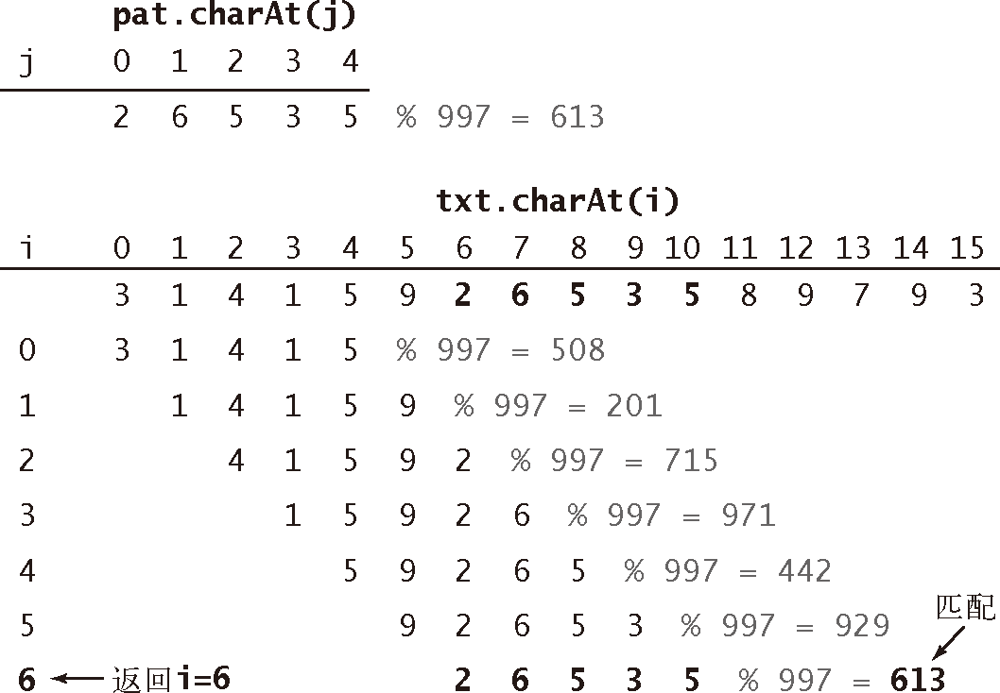

- 图 5.3.14　Rabin-Karp 字符串查找算法的基本思想

### 5.3.5.2　计算散列函数

```
private long hash(String key, int M)
{  // 计算key[0..M-1]的散列值
  long h = 0;
  for (int j = 0; j < M; j++)
     h = (R * h + key.charAt(j)) % Q;
  return h;
}
```

Horner 方法，用于除留余数法计算散列值

```
对于 5 位的数值，只需使用 int 值即可完成所有所需的计算。但如果 M 是 100 或者 1000
```

怎么办？这里使用的是 Horner 方法，它和 3.4 节中见过的用于字符串和其他多值类型的键的

```
计算方法非常相似，代码如下面框注所示。这段代码计算了用 char 值数组表示的 R 进制的
M 位数的散列函数，所需时间与 M 成正比。（将 M 作为参数传递给该方法，这样就可以将它同
时用于模式字符串和正文。）对于这个数中的每一位数字，将散列值乘以 R，加上这个数字，
除以 Q 并取其余数。例如，这样计算示例模式字符串散列值的过程如图 5.3.15 所示。我们也
```

可以用同样的方法计算文本中的子字符串散列值，但这样一来字符串查找算法的成本就将是对

- 次操

文本中的每个字符进行乘法、加法和取余计算的成本之和。在最坏情况下这需要

作，相对于暴力子字符串查找算法来说并没有任何改进。

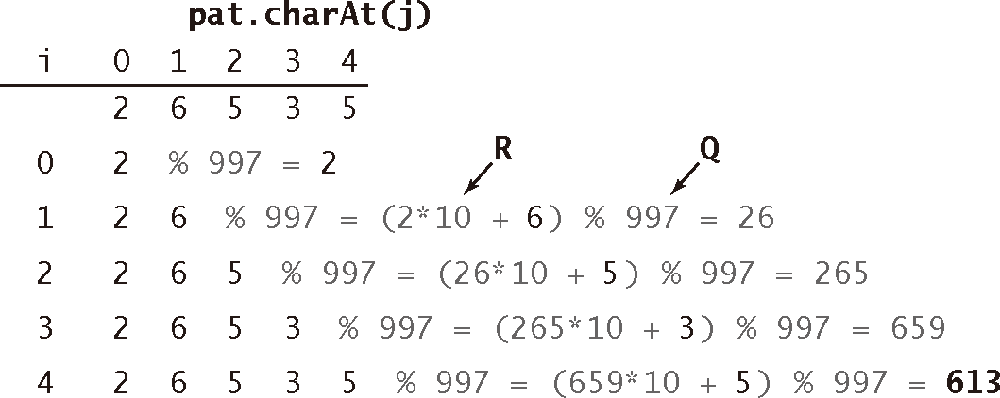

- 图 5.3.15　使用 Horner 方法计算模式字符串的散列值

### 5.3.5.3　关键思想

```
Rabin-Karp 算法的基础是对于所有位置 i，高效计算文本中 i+1 位置的子字符串散列值。这
 表示 txt.charAt(i)，那么文本 txt 中起始于
```

可以由一个简单的数学公式得到。我们用

```
位置 i 的含有
```

- 个字符的子字符串所对应的数即为：


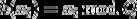

- 替换为：

假设已知

- 。将模式字符串右移一位即等价于将


即将它减去第一个数字的值，乘以

- ，再加上最后一个数字的值。现在，关键的一点在于不需

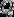

- 之后的余数。取余操作的一个基本性质是如果

要保存这些数的值，而只需要保存它们除以

- 并取余，这等价于在完成了所有算术操作之后再将最后

在每次算术操作之后都将结果除以

- 并取余。曾经在用 Horner 方法（请见 3.4.1.4 节）实现除留余数法时利用过这

的结果除以

- 是 5、100 还是 1000，都可以在常数时间内高效地不断向

个性质。这么做的结果就是无论

右一格一格地移动。

### 5.3.5.4　实现

根据以上讨论可以立即得到算法 5.8 中对该子字符串查找算法的实现。构造函数为模式字符串

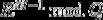

```
计算了散列值 patHash 并在变量 RM 中保存了
 的值。search() 方法开头计
```

- 个字母的散列值并将它和模式字符串的散列值进行比较。如果未能匹配，它

算了文本的前

```
将会在文本中继续前进，用以上讨论的方法计算由位置 i 开始的
```

- 个字符的散列值，将它保

```
存在 txtHash 变量中并将每个新的散列值和 patHash 进行比较，请见图 5.3.16 和图
```

```
5.3.17。（在 txtHash 的计算中，额外加上了一个
```

- 来保证所有的数均为正，这样取余操作

才能够得到预期的结果。）

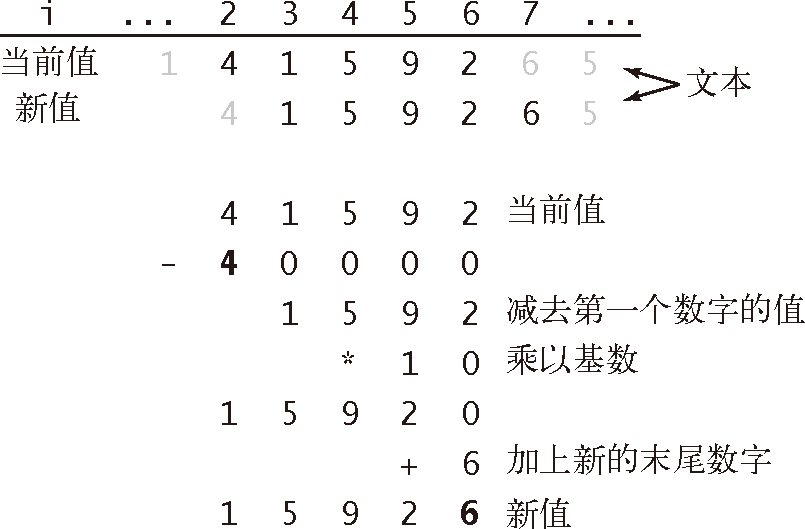

- 图 5.3.16　Rabin-Karp 字符串查找算法中的关键计算（在文本中右移一位）

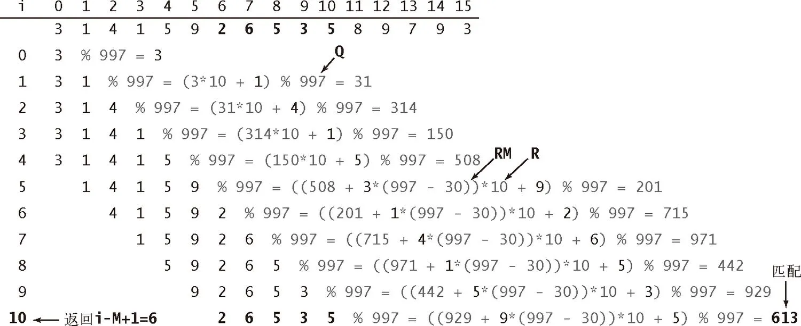

- 图 5.3.17　Rabin-Karp 子字符串查找算法举例

### 5.3.5.5　小技巧：用蒙特卡洛法验证正确性

```
在文本 txt 中找到散列值与模式字符串相匹配的一个
```

- 个字符的子字符串之后，你可能会逐

个比较它们的字符以确保得到了一个匹配而非相同的散列值。我们不会这么做，因为这需要回

退文本指针。作为替代，这里将散列表的“规模”

- 设为任意大的一个值，因为我们并不会真构

```
 的 long
```


造一张散列表而只是希望用模式字符串验证是否会产生冲突。我们会取一个大于


型值，使得一个随机键的散列值与模式字符串冲突的概率小于

- 。这是一个极小的值。如


- 。这是蒙特卡洛

果它还不够小，你可以将这种方法运行两遍，这样失败的几率将会小于算法一种著名早期应用，它既能够保证运行时间，失败的概率又非常小。检查匹配的其他方法可能很慢（性能有很小的概率相当于暴力算法）但能够确保正确性。这种算法被称为拉斯维加斯算法。

- 算法 5.8　Rabin-Karp 指纹字符串查找算法

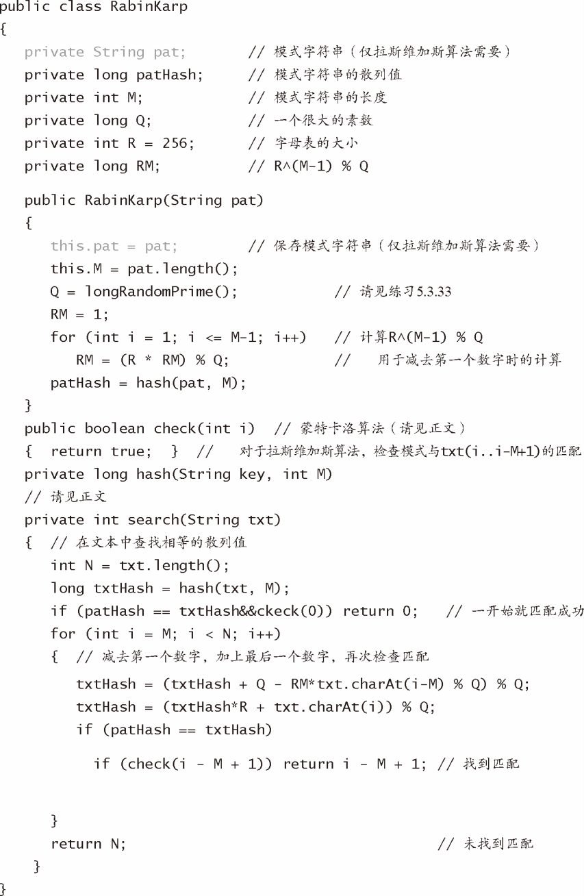

- 该字符串查找算法的基础是散列。它在构造函数中计算了模式字符串的散列值并在文本中查找该散列值的匹配。

- 命题 P。使用蒙特卡洛算法的 Rabin-Karp 子字符串查找算法的运行时间是线性级别的且出错的概率极小。使用拉斯维加斯算法的 Rabin-Karp 子字符串查找算法能够保证正确性且性能极其接近线性级别。

```
讨论。因为我们不需要实际创建一张散列表，使用非常大的 Q 几乎不可能发生散列值冲
突。Rabin 和 Karp 证明了只要选择了适当的 Q 值，随机字符串产生散列碰撞的概率为
1/Q。这意味着对于这些变量实际可能出现的值，字符串不匹配时散列值也不会匹配，散列
```

- 值匹配时字符串才会匹配。理论上来说，文本中的某个子字符串可能会在与模式不匹配的情况下产生散列冲突，但在实际应用中使用该算法寻找匹配是可靠的。

如果你对概率论（或者我们使用的随机字符串模型以及生成随机数字的代码）并不是很有信

```
心，那么可以在 check() 方法中添加检查文本子字符串和模式是否匹配的代码。这将把算法
```

5.8 变成拉斯维加斯版本（请见练习 5.3.12）。如果你再添加一个方法来检查这段代码是否真正被执行过，随着时间的推移你就会逐渐相信概率论的证明了。

Rabin-Karp 字符串查找算法也称为指纹字符串查找算法，因为它只用了极少量信息就表示了（可能非常大的）模式字符串并在文本中寻找它的指纹（散列值）。算法的高效性来自于对指纹的高效计算和比较。

### 5.3.6　总结

表 5.3.2 总结了我们已经讨论过的各种子字符串查找算法。尽管常常出现多个算法都能完成相同的任务的情况，但它们都各有特点：暴力查找算法的实现非常简单且在一般的情况下都工作

```
良好；（Java 的 String 类型的 indexOf() 方法使用的就是暴力子字符串查找算法。）
```

Knuth-Morris-Pratt 算法能够保证线性级别的性能且不需要在正文中回退；Boyer-Moore 算法

- 倍）；Rabin-Karp 算法是线性级

的性能在一般情况下都是亚线性级别（可能是线性级别的

- 成正比；Knuth-Morris-Pratt

别。每种算法也各有缺点：暴力查找算法所需的时间可能和

算法和 Boyer-Moore 算法都需要额外的内存空间；Rabin-Karp 算法的内循环很长（若干次算术运算，而其他算法都只需要比较字符）。这些特点都总结在了表 5.3.2 中。

表 5.3.2　各种字符串查找算法的实现的成本总结

- 操作次数

算法

- 版本在文本中回退最坏情况一般情况

- —

暴力算法

- 是


- 完整的 DFA否


- （算法 5.6）

Knuth-Morris-Pratt 算法

- 仅构造不匹配的状态转换否

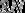

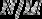

- 完整版本是

- 启发式的查找不匹配的字符

Boyer-Moore 算法

- 是

- （算法 5.7）

- 蒙特卡洛算法否

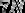

- （算法 5.8）*

Rabin-Karp 算法

- *拉斯维加斯算法是

* 概率保证，需要使用均匀和独立的散列函数。

### 答疑

问　子字符串查找问题看起来并没有什么实际用处，我们真的需要理解这些复杂的算法吗？

答　这个……Boyer-Moore 算法能够将速度提高

- 倍，在实际应用当中还是相当强大的。另

外，能够处理流输入（无需回退）的性质也给 KMP 算法和 Rabin-Karp 算法带来了许多应用。除了这些直接的实际应用之外，这些算法也为我们介绍了抽象自动机和随机性在算法设计领域的应用。

问　为什么不能通过将所有字符都转换为二进制数并处理二进制的文本来简化问题呢？

答　这种方法并没有什么效果，因为字符的边界处可能产生错误的匹配。

### 练习

```
5.3.1　使用算法 5.6 相同的 API，开发一个暴力子字符串查找算法的实现 Brute。
5.3.2　在 Knuth-Morris-Pratt 算法中，给出模式 A A A A A A A A A 的 dfa[][] 数组，
```

按照正文中的样式画出 DFA。

```
5.3.3　在 Knuth-Morris-Pratt 算法中，给出模式 A B R A C A D A B R A 的 dfa[][] 数
```

组，按照正文中的样式画出 DFA。

```
5.3.4　编写一个方法，接受一个字符串 txt 和一个整数 M 作为参数，返回字符串中 M 个连
续的空格第一次出现的位置，如果不存在则返回 txt.length。估计你的方法在一般的文本
```

中和在最坏情况下所需的字符比较次数。

```
5.3.5　开发一个暴力子字符串查找算法的实现 BruteForceRL，从右向左匹配模式字符串
```

（算法 5.7 的简化版本）。

```
5.3.6　给出算法 5.7 的构造函数计算模式 A B R A C A D A B R A 所得到的 right[]
```

数组。

```
5.3.7　为暴力子字符串查找算法的实现添加一个 count() 方法，统计模式字符串在文本中的
出现次数，再添加一个 searchAll() 方法来打印出所有出现的位置。
5.3.8　为 KMP 类添加一个 count() 方法来统计模式字符串的在文本中的出现次数，再添加
一个 searchAll() 方法来打印出所有出现的位置。
5.3.9　为 BoyerMoore 类添加一个 count() 方法来统计模式字符串的在文本中的出现次数，
再添加一个 searchAll() 方法来打印出所有出现的位置。
```

```
5.3.10　为 RabinKarp 类添加一个 count() 方法来统计模式字符串的在文本中的出现次
数，再添加一个 searchAll() 方法来打印出所有出现的位置。
```

5.3.11　为算法 5.7 实现的 Boyer-Moore 算法构造一个最坏情况下的输入（说明它的运行时间不是线性级别的）。

```
5.3.12　为 RabinKarp 类（算法 5.8）的 check() 方法中添加代码，将它变为使用拉斯维
```

加斯算法的版本（检查给定位置的文本和模式字符串是否匹配）。

```
5.3.13　在算法 5.7 实现的 Boyer-Moore 算法中，证明当 c 为模式字符串中的最后一个字符
时，能够将 right[c] 设为 c 在模式字符串中的倒数第二次出现的位置。
5.3.14　使用 char[] 代替 String 来表示文本和模式字符串，给出本节中的各种子字符串查找
```

算法的实现。

5.3.15　设计一个从右向左扫描模式字符串的暴力子字符串查找算法。

5.3.16　按照正文中轨迹的样式显示暴力子字符串查找算法在处理以下模式和文本时的轨迹。

```
　a. 模式：AAAAAAAB 文本：AAAAAAAAAAAAAAAAAAAAAAAAB
　b. 模式：ABABABAB 文本：ABABABABAABABABABAAAAAAAA
```

5.3.17　为以下模式字符串画出 KMP 算法的 DFA。

a. AAAAAAB

b. AACAAAB

c. ABABABAB

d. ABAABAAABAAABe. ABAABCABAABCB

5.3.18　假设模式字符串和文本都是由大小为

- （不小于 2）的字母表随机生成的字符串。证

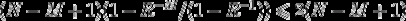

明暴力算法预期的字符比较次数为

- 。

5.3.19　构造一个使 Boyer-Moore 算法（仅使用对不匹配字符的启发式查找）性能低下的样例输入。

5.3.20　如何修改 Rabin-Karp 算法才能够判定

- 个模式（假设它们的长度全部相同）中的任

意子集出现在文本之中？

```
 个模式字符串的散列值并将散列值保存在一个 StringSET（请见练习
```

解答：计算所有5.2.6）对象中。

5.3.21　如何修改 Rabin-Karp 算法来查找中间字符为“通配符”（能够匹配任意字符的符号）的模式字符串？

5.3.22　如何修改 Rabin-Karp 算法来在

- 的文本中查找一个的模式？

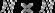

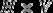

5.3.23　编写一个程序，一次读入字符串中的一个字符并立即判断当前字符串是否为回文。提示：使用 Rabin-Karp 的散列思想。

### 提高题

```
5.3.24　找出所有子字符串。为我们学习过的 4 种字符串查找算法添加一个 findAll() 方
法，返回一个 Iterable<Integer> 对象使得用例能够遍历文本中模式字符串出现的所有位
```

置。

```
5.3.25　流输入。为 KMP 类添加一个 search() 方法，接受一个 In 类型的变量作为参数，
在不使用其他任何实例变量的条件下在指定的输入流中查找模式字符串。为 RabinKarp 类也
```

添加一个类似的方法。

5.3.26　回环变位。编写一个程序，对于给定的两个字符串，检查它们是否互为对方的回环变

```
位。例如 example 和 ampleex。
5.3.27　串联重复查找。在字符串 s 中，基础字符串 b 的串联重复就是连续将 b 至少重复两
```

遍（无重叠）的一个子字符串。开发并实现一个线性时间的子字符串查找算法，接受给定的字

```
符串 b 和 s，返回 s 中 b 的最长串联重复的起始位置。例如，当 b 为“abcd”而 s
```

为“abcabcababcababcababcab”时，你的程序应该返回 3。

5.3.28　暴力子字符串查找算法中的缓冲区。向你为练习 5.3.1 给出的解答中添加一个

```
search() 方法，接受一个（In 类型的）输入流作为参数并在给定的输入流查找模式字符
串。注意：你需要维护一个至少能够保存输入流的前 M 个字符的缓冲区。面临的挑战是要编
```

写高效的代码为任意输入流初始化、更新和清理缓冲区。

```
5.3.29　Boyer-Moore 算法中的缓冲区。为算法 5.7 添加一个 search() 方法，接受一个
（In 类型的）输入流作为参数并在给定的输入流中查找模式字符串。
```

5.3.30　二维查找。实现另一个版本的 Rabin-Karp 算法，在二维文本中查找模式，假设模式和文本都是由字符组成的矩形。

5.3.31　随机模式。在一段给定的文本中查找一个长度为 100 的随机模式字符串需要多少次字符比较？

答：一次也不用。以下方法就可以有效的完成这个任务：

```
public boolean search(char[] txt)
{  return false; }
```

因为一个长度为 100 的随机模式字符串出现在任何文本中的概率之低足以让我们认为它是0。

5.3.32　不同的子字符串。使用 Rabin-Karp 算法的思想完成练习 5.2.14。

```
5.3.33　随机素数。为 RabinKarp 类（算法 5.8）实现 longRandomPrime() 方法。提
```

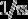

- 成正比。

示：随机的

- 位数字是素数的概率与

- 3

```
 Java 的虚拟机（以及计算机上的汇编语言）支持一种 goto 指令，
```

5.3.34　直线型代码。它使我们能够将查找“嵌入”到机器代码中，如下方的程序所示（这段程序等价于在 KMP 算法

```
中用 KMPdfa 数组模拟模式的 DFA 的运行，但效率要高的多）。为了避免在每次增大 i 时检
查是否已经到达文本的结尾，假设文本的最后 M 个字符就是模式字符串本身。在这段代码中
goto 的标签与 dfa[] 数组完全一一对应。编写一个静态方法，接受一个模式作为参数，产
```

生一段类似的直线型代码来查找给定的模式。

```
   int i = -1;
sm: i++;
s0: if (txt[i]) != 'A' goto sm;
s1: if (txt[i]) != 'A' goto s0;
s2: if (txt[i]) != 'B' goto s0;
s3: if (txt[i]) != 'A' goto s2;
s4: if (txt[i]) != 'A' goto s0;
s5: if (txt[i]) != 'A' goto s3;
   return i-8;
处理模式字符串 A A B A A A 的直线型代码
```

5.3.35　二进制字符串中的 Boyer-Moore 算法。启发式处理不匹配的字符对于二进制字符串并没有什么作用，因为匹配失败的可能字符只有两种（而且它们都非常可能出现在模式字符串中）。编写一个适用于二进制字符串的子字符串查找类，它应该能够将多个位组合成可以被算

```
 个元素的 right[]
```

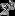

法 5.7 处理的“字符”。注意：如果你每次都取

- 位，那么需要一个含有

```
的值不能太大，以保证 right[] 数组不会太大；也不能太小，以使文本中大多数
```

数组。位字符不太可能出现在模式中——模式中含有

- 种不同的位字符（从第 1 到第


- 位的每个位置上各有一个），因此远小于

- 。例如，如果你选择的使

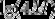

```
，那么 right[] 数组中超过四分之三的元素的值都将是 -1。但不要让
```

得

- 约等于

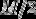

小于

- ，否则当模式字符串横跨两个位字符时你完全可能会漏掉它。

### 实验题

```
5.3.36　随机文本。编写一个程序，接受整型参数 M 和 N，生成一个长度为 N 的随机二进制
文本字符串，计算该字符串的最后 M 位在整个字符串中的出现次数。注意：不同的 M 值适用
```

的方法可能不同。

```
5.3.37　随机文本的 KMP 算法。编写一个用例，接受整型参数 M、N 和 T 并运行以下实验 T
遍：随机生成一个长度为 M 的模式字符串和一段长度为 N 的文本，记录使用 KMP 算法在文本
中查找该模式时比较字符的次数。修改 KMP 类的实现来记录比较次数并打印出重复 T 次之后
```

的平均比较次数。

5.3.38　随机文本的 Boyer-Moore 算法。对于 Boyer-Moore 算法完成上一道练习。

5.3.39　运行时间。编写一段程序，用本节学习的 4 种算法在《双城记》（tale.txt）中查找以下字符串并记录时间：

```
it is a far far better thing that i do than i have ever done
```

讨论你的结果在何种程度上验证了正文对这几种算法的性能猜想。

[1]：即跳跃表。——译者注[2]：译法参考《代码大全》，第二版第14章。——译者注
