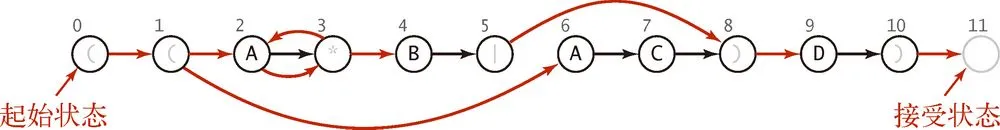
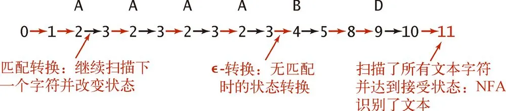
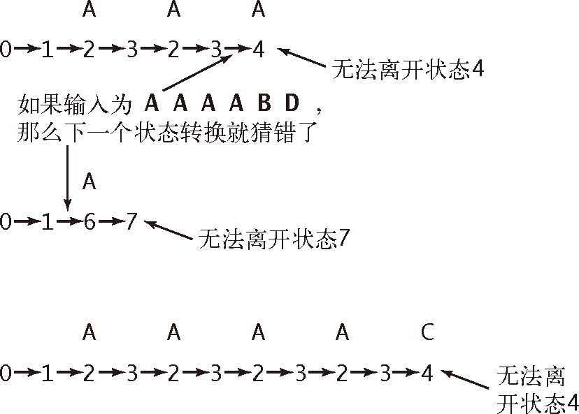
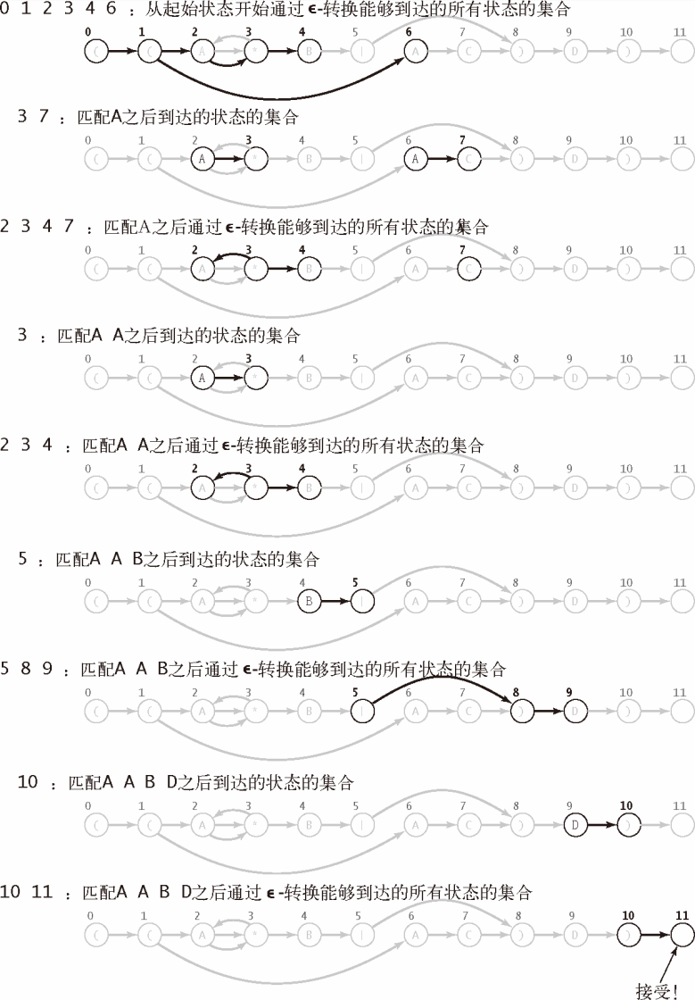
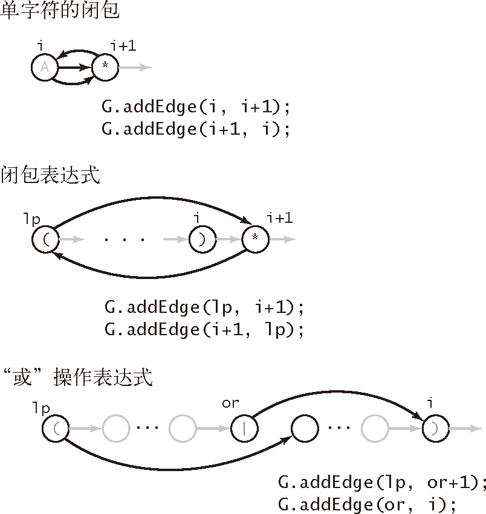
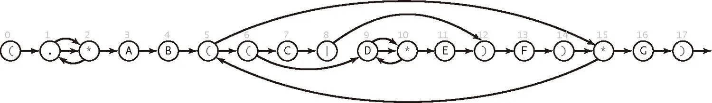
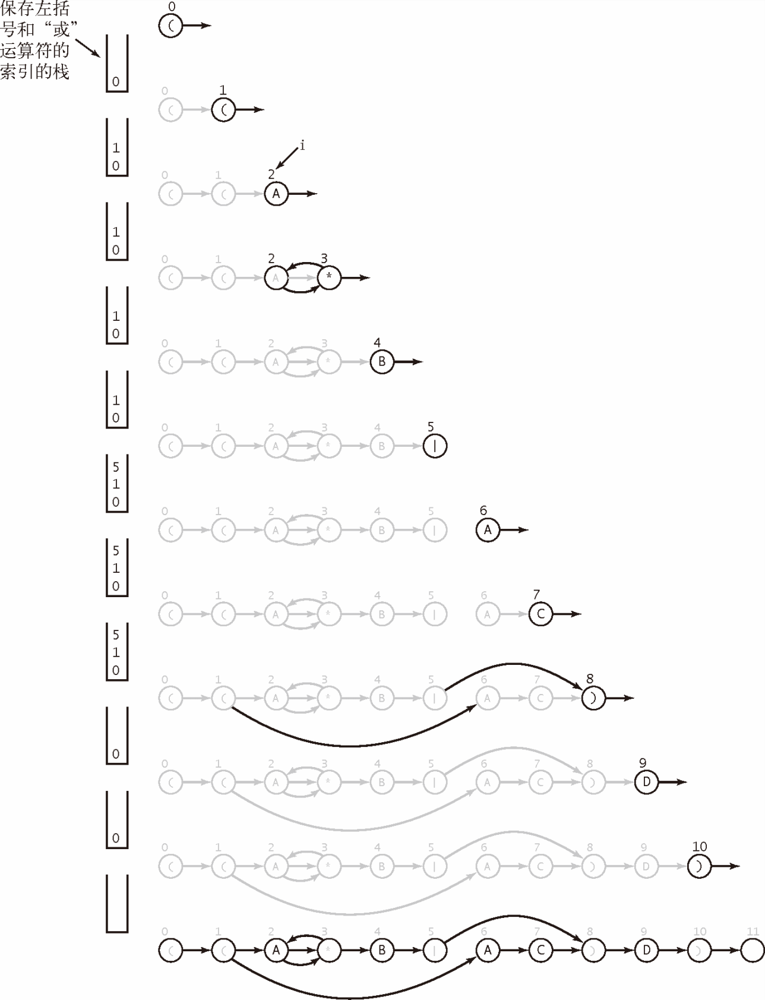
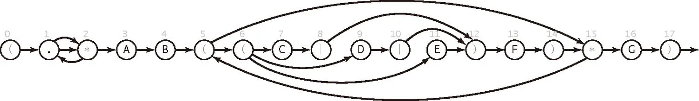

# 5.4正则表达式

在许多应用程序中，我们在查找子字符串时并没有被查找模式的完整信息。文本编辑器的用户可能希望仅指定模式的一部分，或是指定某种能够匹配若干个不同单词的模式，或是指定几种可以任意匹配的不同模式。例如，生物学家可能希望在基因组序列中寻找满足特定条件的基因。本节中，我们将会学习如何高效地完成这种类型的模式匹配。

5.3 节中的算法完全依赖指定完整的模式字符串，因此需要寻找不同的方法。本节将会学习的

- 的文本中匹配长

一些基本工具能够构造一个非常强大的字符串查找程序，它能够在长度为


- 的复杂模式。在最坏情况下，它所需的时间和成正比，而在一般的应用程序中

度为


还会快得多。

首先，我们需要一种描述模式的方法，即一种严谨的说明上述“部分子字符串的查找问题”的方

```
式。这份说明必须含有一些比 5.3 节中使用的“检查文本字符串的第 i 个字符和模式字符串的
第 j 个字符是否匹配”更加强大的原始操作。为此，我们使用正则表达式。它能够用自然、简
```

单而强大的 3 种操作组合来描述模式。

程序员使用正则表达式的历史已经有数十年了。随着网络搜索的爆炸性增长，它们的使用变得更加广泛。本节开始会讨论几个应用程序。这不仅是为了让你感受它的用途和功能，也是为了让你对它的基本性质更加熟悉。

和 5.3 节中的 KMP 算法一样，本节也将使用一种能够在文本中查找模式的抽象自动机来描述这 3 种基本的操作。模式匹配算法同样会构造一个这样的自动机并模拟它的运行。当然，这种模式匹配自动机比 KMP 算法的 DFA 更加复杂，但不会超出你的想象。

你将会看到，我们为模式匹配问题给出的解答和计算机科学中最基础的问题有着紧密的联系。例如，我们在程序中用于完成给定模式下的字符串查找任务的算法和 Java 系统中用来将 Java程序转化为计算机上的机器语言的算法很相似。我们还会遇到非确定性这个概念。它在人们对高效算法的追求中起到了关键的作用（请见第 6 章）。

### 5.4.1　使用正则表达式描述模式

我们的重点是模式的描述，它由 3 种基本操作和作为操作数的字符组成。这里，我们用语言指代一个字符串的集合（可能是无限的），用模式指代一种语言的详细说明。我们将要学习的规则和大家都很熟悉的算术表达式中的规则十分类似。

### 5.4.1.1　连接操作

```
第一种基本操作就是 5.3 节中使用过的连接操作。当我们写出 AB 时，就指定了一种语言 。
它含有一个由两个字符组成的字符串，由 A 和 B 连接而成。
```

### 5.4.1.2　或操作

第二种基本操作可以在模式中指定多种可能的匹配。如果我们在两种选择之间指定了一个或运

```
算符，那么它们都将属于同一种语言。我们用竖线符号“|”表示这个操作。例如，A|B 指定的
语言是 ，A|E|I|O|U 指定的语言是 。连接操作的优先级高于或操作，因此 AB|BCD 指定的
```

语言是 。

### 5.4.1.3　闭包操作

第三种基本操作可以将模式的部分重复任意的次数。模式的闭包是由将模式和自身连接任意多次（包括零次）而得到的所有字符串所组成的语言。我们将“*”标记在需要被重复的模式之后，

```
以表示闭包。闭包操作的优先级高于连接操作，因此 AB* 指定的语言由一个 A 和 0 个或多个
B 的字符串组成，而 A*B 指定的语言由 0 个或多个 A 和一个 B 的字符串组成。空字符串的
记号是 Є，它存在于所有文本字符串之中（包括 A*）。
```

### 5.4.1.4　括号

```
我们使用括号来改变默认的优先级顺序。例如，C(AC|B)D 指定的语言是 ，(A|C)
((B|C)D) 指定的语言是 ，(AB)* 指定的语言是由将 AB 连接任意多次得到的所有字符串和
```

空字符串组成的 

这些简单的例子已经可以写出虽然复杂但却清晰而完整的描述某种语言的正则表达式了（示例请见表 5.4.1）。某些语言可能可以用其他方式简单表述，但找到这些简单的方法可能会比较困

```
难。例如，表格的最后一行中的正则表达式指定的就是 (A|B)* 的一个只含有偶数个 B 的子
```

集。

表 5.4.1　正则表达式举例

正则表达式

- 匹配的字符串不匹配的字符串

```
(A|B)(C|D)
AC AD BC BD
```

- 其他所有字符串

```
A(B|C)*D
AD ABD ACD ABCCBD
BCD ADD ABCBC
A*|(A*BA*BA*)*
AAA BBAABB BABAAA
ABA BBB BABBAAA
```

正则表达式都是非常简单的形式语言对象，甚至比你在小学里学到的算术表达式更简单。我们将会利用它的简洁性开发小巧而高效的算法来处理它们。首先给出如下正式定义。

- 定义。一个正则表达式可以是：

```
空字符串 Є；
```

- 单个字符；

- 包含在括号中的另一个正则表达式；

- 两个或多个连接起来的正则表达式；

- 由或运算符分隔的两个或多个正则表达式；

- 由闭包运算符标记的一个正则表达式。

这段定义描述了正则表达式的语法，说明了怎样才是一个合法的正则表达式。在本节中对给定正则表达式的非形式化的描述是它的语义。作为复习，我们要继续在形式定义中对它们进行总结。

- 定义（续）。每个正则表达式表示的都是一个字符串的集合，它们的定义如下所述。空正则表达式表示的字符串的集合为空，含有 0 个元素。

- 一个字符表示的字符串的集合含有一个元素，即该字符本身。

- 一个由括号和包含在其中的正则表达式组成的正则表达式表示的字符串的集合与括号内的正则表达式相同。

- 由两个正则表达式连接起来的正则表达式表示的字符串的集合为这两个正则表达式分别表示的字符串集合的叉乘。（按照正则表达式中指定的顺序，由一个字符串集合中的元素和另一个字符串集合中的元素相连接所能够组合而成的所有字符串。）

- 由或运算符连接的两个正则表达式所表示的字符串的集合为两个正则表达式所分别表示的字符串集合的并集。

```
由一个正则表达式的闭包所表示的字符串的集合由 Є（空字符串）或将被修饰的正则表
```

- 达式所表示的字符串集合重复任意次所得到的所有字符串所组成。

一般来说，给定正则表达式所描述的语言可能非常庞大，甚至是无限的。描述一种语言可以有许多中不同的方法，我们必须尝试给出最简洁的模式，就像在不断地尝试写出简洁的程序和实现高效的算法一样。

### 5.4.2　缩略写法

一般的应用程序都在基本规则的基础上增加了各种额外的规则，以力求简洁地描述实际应用中所需要的语言。从理论角度来看，它们都只是涉及多个操作数的一系列操作的缩略写法；从实际角度来看，它们是对基本操作的实用扩展，以便能够写出小巧的模式。

### 5.4.2.1　字符集描述符

只用一个或几个字符来直接表示一个字符集时常能够带来方便。点“.”是一个能够表示任意字符的通配符。包含在方括号中的一系列字符表示这些字符中的任意一个。这一系列字符可以由一个范围来表示。如果开头字符为“^”，这个方括号表示的就是任意非该括号内的字符。这些记法都是一系列或操作的简写，请见表 5.4.2。

表 5.4.2　字符集描述符

名称

- 记法举例

- .A.B

通配符

- 包含在 [] 中的字符[AEIOU]*

指定的集合

### 5.4.2.2　闭包的简写

闭包运算符表示将它的操作数复制任意多次。在实际应用中，我们希望能够灵活指定重复的次数，或者是次数的范围。我们用“+”（加号）表示至少复制一次，“?”（问号）表示重复 0 次或1 次，用写在“{}”（花括号）内的数或者范围来指定重复的次数。和刚才一样，这些记法也是一系列基本的连接、或和闭包操作的简写，请见表 5.4.3。

表 5.4.3　闭包的简写（指定操作数的重复次数）

选项

- 记法举例原始写法语

```
(AB)+
(AB)(AB)*
A
```

至少重复 1 次

- +

```
(AB)?
Є|AB
Є
```

重复 0 或 1 次

- ?

```
(AB)
(AB)(AB)(AB)
A
```

- 由 {} 指定次数

重复指定次数

```
( AB){ 1 - 2}
( A B ) | ( A B ) (AB)
A
```

- 由 {} 指定范围

重复指定范围的次数

### 5.4.2.3　转义序列

某些字符，例如“\”、“.”、“|”、“*”、“(”和“)”，都是用来构造正则表达式的元字符。我们使用以反斜杠开头的转义序列来将元字符和字母表中的字符区别开来。一个转义序列可以是一个“\”加上单个元字符（这就表示这个字符本身）。例如，“\”表示的就是“\”。其他转义序列表示了特殊字符和空白字符。例如，“\t”表示一个制表符，“\n”表示一个换行符，“\s”表示任意空白字符。

### 5.4.3　正则表达式的实际应用

实际应用已经证明了正则表达式善于描述与语言有关的内容。因此，正则表达式使用广泛，这方面的研究也比较深入。为了让你能在熟悉正则表达式的同时向你展示一些它的用途，在讨论正则表达式的模式匹配算法之前先给出一些实际应用的例子。正则表达式在计算机科学理论中也起到了重要的作用。在本书中完整说明它的应用范围不切实际，但会在适当的地方提到相关的理论成果。

### 5.4.3.1　子字符串查找

我们的总体目标是开发一种算法，能够判定给定子字符串是否包含在给定正则表达式所描述的字符串集合之中。如果文本包含在模式所描述的语言之中，就称文本和模式相匹配。正则表达

```
式的模式匹配一般化了 5.3 节中的子字符串查找问题。准确地说，要在一段文本 txt 中查找
一个子字符串 pat，就是检查 txt 是否存在于模式“.*pat.*”所描述的语言之中。
```

### 5.4.3.2　合法性检查

在使用互联网时，你常常会遇到正则表达式。当你在某个商业网站上输入一个日期或是账号时，输入处理程序会检查输入的格式是否正确。进行这类检查的一种方式是用代码检查所有可能出现的情况：如果你应该输入一个金额（美元），代码就会检查第一个字符是否是“

## ”，而且“

- ”之后的字符是否是一组数字，等等。更好的办法是定义一个正则表达式来描述所有

合法的输入。之后，检查用户的输入是否合法就完全是模式匹配问题了：输入是否包含在正则表达式所描述的语言之中吗？随着这种检查的广泛应用，使用正则表达式进行常见检查的库在互联网上已经随处可见，请见表 5.4.4。一般来说，相比一个能够检查所有情况的程序，正则表达式是对所有有效字符串的集合更加准确和精炼的表达。

表 5.4.4　正则表达式的典型应用（简化版本）

应用场景

- 正则表达式匹配

```
.*NEEDLE.*
A HAYSTACK NEEDLE IN
```

字符串查找

```
\([0-9]\)\ [0-9]-[0-9]
(800) 867-5309
```

电话号码

```
[$_A-Za-z][$_A-Za-z0-9]*
Pattern_Matcher
```

Java 标识符

```
gcg(cgg|agg)*ctg
gcgaggaggcggcggctg
```

基因组

```
[a-z]+@([a-z]+\.)+(edu|com)
rs@cs.princeton.edu
```

电子邮件地址

### 5.4.3.3　程序员的工具箱

```
正则表达式模式匹配的起源是 Unix 的命令 grep，它会打印出和给定正则表达式匹配的所有
```

输入行。这个工具是数代程序员的无价之宝，而正则表达式也已经被内置于许多现代编程系统

```
之中，从 awk 和 emacs，到 Perl、Python 和 Javascript。例如，某个目录中含有许多 .java
文件，而你希望知道哪些文件使用了 StdIn。这条命令可以很快给出答案：
% grep StdIn *.java
它会打印出每个文件中与“.*StdIn.*”匹配的每一行代码。
```

### 5.4.3.4　基因组

生物学家也会使用正则表达式来研究重要的科学问题。例如，人类的基因序列的某个区域可以

```
用正则表达式 gcg(cgg)*ctg 描述，其中模式 cgg 的重复次数在不同的个体之间有很大区
```

别。人们已知某种能够造成智力障碍和其他一些症状的基因疾病和该模式的高重复次数有关。

### 5.4.3.5　搜索

互联网搜索引擎都支持正则表达式，但可能不是非常完整。一般来说，如果你希望通过“|”指定其他的匹配模式或者通过“*”产生重复，它都能做到。

### 5.4.3.6　正则表达式的可能性

理论计算机科学的第一堂入门课程就是找出正则表达式所能够指定的语言集合。例如，你可能

```
会感到意外的是，正则表达式能够实现取余操作：例如 (0 | 1(01*0)*1)* 描述的所有由
0 和 1 组成的字符串都是 3 的倍数的二进制表示！也就是说，11、110、1001 和 1100 都
在这个语言之中，而 10、1011 和 10000 都不在。
```

### 5.4.3.7　局限

并不是所有的语言都可以用正则表达式定义。一个令人深思的示例就是不存在能够描述所有合法正则表达式字符串的集合的正则表达式。这个示例的简单版本包括无法使用正则表达式检查

```
括号是否匹配完整以及检查字符串中的 A 和 B 的数量是否一样多。
```

这些例子都只是冰山一角。正则表达式是计算性基础设施中非常实用的一部分，对于帮助我们理解计算的本质起到了重要的作用。和 KMP 算法一样，下面将要描述的算法也是在探索这个理论过程中的副产品。

### 5.4.4　非确定有限状态自动机

我们可以将 Knuth-Morris-Pratt 算法看作一台由模式字符串构造的能够扫描文本的有限状态自动机。对于正则表达式，我们要将这个思想推而广之。

KMP 的有限状态自动机会根据文本中的字符改变自身的状态。当且仅当自动机达到停止状态时它才找到了一个匹配。算法本身就是模拟这种自动机，这种自动机的运行很容易模拟的原因是因为它是确定性的：每种状态的转换都完全由文本中的字符所决定。

要处理正则表达式，就需要一种更加强大的抽象自动机。因为或操作的存在，自动机无法仅根据一个字符就判断出模式是否出现；事实上，因为闭包的存在，自动机甚至无法知道需要检查多少字符才会出现匹配失败。为了克服这些困难，我们需要非确定性的自动机：当面对匹配模式的多种可能时，自动机能够“猜出”正确的转换！你也许会认为这种能力是不可能的，但你会看到，编写一个程序来构造非确定有限状态自动机（NFA）并有效模拟它的运行是很简单的。正则表达式模式匹配程序的总体结构和 KMP 算法的总体结构几乎相同：

- 构造和给定正则表达式相对应的非确定有限状态自动机；

- 模拟 NFA 在给定文本上的运行轨迹。

Kleene 定理是理论计算机科学中的一个重要结论，它证明了对于任意正则表达式都存在一个与之对应的非确定有限状态自动机（反之亦然）。我们会学习该定理的证明并演示如何将任意正则表达式转变为一台非确定有限状态自动机，然后模拟 NFA 的运行轨迹来完成模式匹配任务。

在学习如何构造模式匹配的 NFA 之前，先来看一个示例，它说明了 NFA 的性质和操作。请看

```
图 5.4.1，它所显示的 NFA 是用来判断一段文本是否包含在正则表达式 ((A*B|AC)D) 所描
```

述的语言之中。如这个示例所示，我们所定义的 NFA 有着以下特点。

- 长度为 的正则表达式中的每个字符在所对应的 NFA 中都有且只有一个对应的状态。NFA 的起始状态为 0 并含有一个（虚拟的）接受状态。

- 字母表中的字符所对应的状态都有一条从它指出的边，这条边指向模式中的下一个字符所对应的状态（图中的黑色的边）。

- 元字符“(”、“)”、“|”和“*”所对应的状态至少含有一条指出的边（图中的红色的边），这些边可能指向其他的任意状态。

- 有些状态有多条指出的边，但一个状态只能有一条指出的黑色边。



```
图 5.4.1　模式 ((A*B|AC)D) 所对应的 NFA
```

我们约定将所有的模式都包含在括号中，因此 NFA 中的第一个状态对应的是左括号，而最后一个状态对应的是右括号（并能够转换为接受状态）。

和 5.3 节中的 DFA 一样，在 NFA 中也是从状态 0 开始读取文本中的第一个字符。NFA 在状态的转换中有时会从文本中读取字符，从左向右一次一个。但它和 DFA 有着一些基本的不同：

- 在图中，字符对应的是结点而不是边；

- NFA 只有在读取了文本中的所有字符之后才能识别它，而 DFA 并不一定需要读取文本中的全部内容就能够识别一个模式。

这些不同并不是关键——我们选择的是最适合研究的算法的自动机版本。

现在的重点是检查文本和模式是否匹配——为了达到这个目标，自动机需要读取所有文本并到达它的接受状态。在 NFA 中从一个状态转移到另一个状态的规则也与 DFA 不同——在 NFA中状态的转换有以下两种方式，请见图 5.4.2。

- 如果当前状态和字母表中的一个字符相对应且文本中的当前字符和该字符相匹配，自动机可以扫过文本中的该字符并（由黑色的边）转换到下一个状态。我们将这种转换称为匹配转换。

- 自动机可以通过红色的边转换到另一个状态而不扫描文本中的任何字符。我们将这种转换称为 Є-转换，也就是说它所对应的“匹配”是一个空字符串 Є。



```
图 5.4.2　找到与 ((A*B | AC)D) NFA 相匹配的模式
例如，假设输入为 A A A A B D 并启动正则表达式 ((A*B|AC)D) 所对应的自动机（起始
状态为 0）。图 5.4.2 显示的一系列状态转换最终到达了接受状态。这一系列的转换说明输入
```

文本是属于正则表达式所描述的字符串的集合之中的——即文本和模式相匹配。按照 NFA 方式，我们称该 NFA 识别了这段文本。

```
图 5.4.3 的例子说明了即使对于类似于 A A A A B D 这种 NFA 本应该能够识别的输入文
```

本，也可以找到一个使 NFA 停滞的状态转换序列。例如，如果 NFA 选择在扫描完所有 A 之前

```
就转换到状态 4，它就无法再继续前进了，因为离开状态 4 的唯一办法是匹配 B。这两个例
子说明了这种自动机的不确定性。在扫描了一个 A 并到达状态 3 之后，NFA 面临着两个选
择：它可以转换到状态 4，或者回到状态 2。这次选择或者会使它最终达到接受状态（如第一
```

个例子所示）或者进入停滞（如第二个例子所示）。NFA 在状态 1 时也需要进行选择（是否由Є- 转换到达状态 2 或者状态 6）。



```
图 5.4.3　使得 ((A*B|AC)D) 的 NFA 进入停滞的状态转换序列
```

这个例子说明了 NFA 和 DFA 之间的关键区别：因为在 NFA 中离开一个状态的转换可能有多种，因此从这种状态可能进行的转换是不确定的——即使不扫描任何字符，它在不同的时间所进行的状态转换也可能是不同的。要使这种自动机的运行有意义，所设想的 NFA 必须能够猜测对于给定的文本进行哪种转换（如果有的话）才能最终到达接受状态。换句话说，当且仅当一个 NFA 从状态 0 开始从头读取了一段文本中的所有字符，进行了一系列状态转换并最终到达了接受状态时，则称该 NFA 识别了一个文本字符串。相反，当且仅当对于一个 NFA 没有任何匹配转换和 Є- 转换的序列能够扫描所有文本字符并到达接受状态时，则称该 NFA 无法识别这段文本字符串。

和 DFA 一样，这里列出所有状态的转换即可跟踪 NFA 处理文本字符串的轨迹。任意类似的结束于最终状态的转换序列都能证明某个自动机识别了某个字符串（也可能有其他的证明）。但对于一段给定的文本，应该如何找到这样一个序列呢？对于另一段给定的文本我们应该如何证明不存在这样一个序列呢？这些问题的答案比你想象的要简单，即系统地尝试所有的可能性！

### 5.4.5　模拟 NFA 的运行

存在能够猜测到达接受状态所需的状态转换自动机的设想就好像能够写出解决任意问题的程序一样：这看起来很荒谬。经过仔细思考，你会发现这个任务从概念上来说并不困难：我们可以检查所有可能的状态转换序列，只要存在能够到达接受状态的序列，我们就会找到它。

### 5.4.5.1　自动机的表示

```
首先，需要能够表示 NFA。选择很简单：正则表达式本身已经给出了所有状态名（0 到 M 之
间的整数，其中 M 为正则表达式的长度）。用 char 数组 re[] 保存正则表达式本身，这个数
组也表示了匹配的转换（如果 re[i] 存在于字母表中，那么就存在一个从 i 到 i+1 的匹配
转换）。Є- 转换最自然的表示方法当然是有向图——它们都是连接 0 到 M 之间的各个顶点的
```

有向边（图 5.4.4 中的红色边）。因此，我们用有向图 G 表示所有 Є- 转换。在讨论模拟的过程之后将讨论由给定正则表达式构建有向图的任务。对于上面的例子，它的有向图含有以下 9条边：

0 → 1 1 → 2 1 → 6 2 → 3 3 → 2 3 → 4 5 → 8 8 → 9 10 → 11



```
图 5.4.4　对 ((A*B|AC)D) 的 NFA 处理输入 A A B D 的模拟
```

### 5.4.5.2　NFA 的模拟与可达性

为了模拟 NFA 的运行轨迹，我们会记录自动机在检查当前输入字符时可能遇到的所有状态的集合。这里，关键的计算是我们已经熟悉并在算法 4.4 中解决的多点可达性问题。我们会查找所有从状态 0 通过 Є- 转换可达的状态来初始化这个集合。对于集合中的每个状态，检查它是否可能与第一个输入字符相匹配。检查并匹配之后就得到了 NFA 在匹配第一个字符之后可能到达的状态的集合。这里还需要向该集合中加入所有从该集合中的任意状态通过 Є- 转换可以到达的其他状态。有了这个匹配了第一个字符之后可能到达的所有状态的集合，Є- 转换有向图中的多点可达性问题的答案就是可能匹配第二个输入字符的状态集合。例如，在示例 NFA

```
中初始状态集合为 ，如果第一个输入字符为 A，那么 NFA 通过匹配转换可能到达的状态是
，然后它可能进行 3 到 2 或 3 到 4 的 Є- 转换，因此可能与第二个字符匹配的状态集合为
```

。重复这个过程直到文本结束可能得到两种结果：

- 可能到达的状态集合中含有接受状态；

- 可能到达的状态集合中不含有接受状态。

第一种结果说明存在某种转换序列使 NFA 到达接受状态。第二种结果说明对于该输入 NFA 总是会停滞，导致匹配失败。使用我们已经实现了的 SET 数据类型和用于在有向图中解决多点

```
可达性问题的 DirectedDFS 类，下面的 NFA 模拟代码只是翻译了刚才的描述。你可以用图
```

5.4.4 检查你对这段代码的理解，它显示了样例输入的完整轨迹。

- 命题 Q。判定一个长度为的正则表达式所对应的 NFA 能否识别一段长度为的文本所

- 成正比。需的时间在最坏情况下和

- 的文本中的每个字符，我们都会遍历一个大小不超过的状态集合证明。对于长度为

- 并在 Є- 转换的有向图中进行深度优先搜索。下面即将学习的自动机的构造可以证明该有向条，因此每次深度优先搜索在最坏情况下的运行时间与成正图中的边数不会超过


- 比。

请仔细思考一下这个不同寻常的结果。它在最坏情况下的成本为文本和模式的长度之积，这个成本和 5.3 节开始时学习的最坏情况下寻找固定子字符串的初级算法的成本竟然是相同的！

```
public boolean recognizes(String txt)
{  // NFA是否能够识别文本txt？
  Bag<Integer> pc = new Bag<Integer>();
  DirectedDFS dfs = new DirectedDFS(G, 0);
  for (int v = 0; v < G.V(); v++)
     if (dfs.marked(v)) pc.add(v);
  for (int i = 0; i < txt.length(); i++)
  {  // 计算txt[i+1]可能到达的所有NFA状态
     Bag<Integer> match = new Bag<Integer>();
     for (int v : pc)
        if (v < M)
           if (re[v] == txt.charAt(i) || re[v] == '.')
               match.add(v+1);
     pc = new Bag<Integer>();
     dfs = new DirectedDFS(G, match);
     for (int v = 0; v < G.V(); v++)
        if (dfs.marked(v)) pc.add(v);
  }
  for (int v : pc) if (v == M)
  return true; return false;
}
```

使用 NFA 模拟的模式匹配

### 5.4.6　构造与正则表达式对应的 NFA

根据正则表达式和大家所熟悉的算术表达式的相似性，你肯定不会惊讶于将正则表达式转化为NFA 的过程在某种程度上类似于 1.3 节中使用 Dijkstra 的双栈算法对表达式求值的过程。这两个过程的不同之处在于：

- 正则表达式中的连接操作并没有运算符；

- 正则表达式的闭包（*）是一个一元运算符；

- 正则表达式只有一个二元运算符，即或（|）。

我们不会在两者的不同和相似之处深究，而是会学习一种为正则表达式量身定做的实现。例如，这里只需要一个栈，而不是两个。

```
根据上一小节开头讨论的 NFA 表示，这里只需要构造一个由所有 Є- 转换组成的有向图 G。正
```

则表达式本身和本节开头学习过的形式定义足以提供所需的所有信息。根据 Dijkstra 的算法，我们会使用一个栈来记录所有左括号和或运算符的位置。

### 5.4.6.1　连接操作

对于 NFA，连接操作是最容易实现的了。状态的匹配转换和字母表中的字符的对应关系就是连接操作的实现。

### 5.4.6.2　括号

我们要将正则表达式字符串中所有左括号的索引压入栈中。每当我们遇到一个右括号，我们最终都会用后文所述的方式将左括号从栈中弹出。和 Dijkstra 算法一样，栈可以很自然地处理嵌套的括号。

### 5.4.6.3　闭包操作

闭包运算符（*）只可能出现在 (i) 单个字符之后（此时将在该字符和“*”之间添加相互指向的两条 Є- 转换），或者是 (ii) 右括号之后，此时将在对应的左括号（即栈顶元素）和“*”之间添加相互指向的两条 Є- 转换。

### 5.4.6.4　“或”表达式

```
在形如 (A|B) 的正则表达式中，A 和 B 也都是正则表达式。我们的处理方式是添加两条 Є-
转换：一条从左括号所对应的状态指向 B 中的第一个字符所对应的状态，另一条从“|”字符所
```

对应的状态指向右括号所对应的状态。将正则表达式字符串中“|”运算符的索引（以及如上文所述的左括号的索引）压入栈中，这样在到达右括号时这些所需信息都会在栈的顶部。这些 Є-转换使得 NFA 能够在这两者之间进行选择。此时并没有像平常一样添加一条从“|”运算符所对应的状态到下一个字符所对应的状态的 Є- 转换——NFA 离开“或”运算符的唯一方式就是通过某种状态转换到达右括号所对应的状态。

这些简单的规则足以构造任意复杂的正则表达式所对应的 NFA。算法 5.9 实现了这些规则。它的构造函数创建了给定正则表达式所对应的 Є- 转换有向图。该算法处理样例的轨迹如图 5.4.7所示。图 5.4.5、图 5.4.6 和练习中给出了一些其他的例子，我们也希望你自己通过更多的示例加深对这个过程的理解。为了实现的简洁和清晰，我们将一些实现细节（处理元字符、字符集描述符、闭包的缩略写法和多向“或”运算等）留做了练习（请见练习 5.4.16 到练习5.4.21）。在没有这些扩展的情况，NFA 构造过程所需的代码非常少，是我们所见过的最巧妙的算法之一。



- 图 5.4.5　NFA 的构造规则



```
图 5.4.6　模式 (.*AB((C|D*E)F)*G) 所对应的 NFA
```



```
图 5.4.7　构造正则表达式 ((A*B|AC)D) 所对应的 NFA
```

- 算法 5.9　正则表达式的模式匹配（grep）

```java
public class NFA
1
{
2
  private char[] re;           // 匹配转换
3
  private Digraph G;           // epsilon转换
4
  private int M;               // 状态数量
5
6
  public NFA(String regexp)
7
  {  // 根据给定的正则表达式构造NFA
8
     Stack<Integer> ops = new Stack<Integer>();
9
     re = regexp.toCharArray();
10
     M = re.length;
11
     G = new Digraph(M+1);
12
13
     for (int i = 0; i < M; i++)
14
     {
15
        int lp = i;
16
        if (re[i] == '(' || re[i] == '|')
17
           ops.push(i);
18
        else if (re[i] == ')')
19
        {
20
           int or = ops.pop();
21
           if (re[or] == '|')
22
           {
23
              lp = ops.pop();
24
              G.addEdge(lp, or+1);
25
              G.addEdge(or, i);
26
           }
27
           else lp = or;
28
        }
29
        if (i < M-1 && re[i+1] == '*')  // 查看下一个字符
30
        {
31
           G.addEdge(lp, i+1);
32
           G.addEdge(i+1, lp);
33
        }
34
        if (re[i] == '(' || re[i] == '*' || re[i] == ')')
35
           G.addEdge(i, i+1);
36
     }
37
  }
38
  public boolean recognizes(String txt)
39
  // NFA是否能够识别文本txt？（请见5.4.5.2节框注“使用NFA模拟的模式匹配”）
40
}
41
```

- 该构造函数根据给定的正则表达式构造了对应的 NFA 的 Є- 转换有向图。

- 命题 R。构造和长度为的正则表达式相对应的 NFA 所需的时间和空间在最坏情况下与

- 成正比。

- 的正则表达式中的每个字符，最多会添加三条 Є- 转换并可能执行一证明。对于长度为

- 到两次栈操作。

模式匹配的经典用例 GREP 的代码如后面框注所示。它接受一个正则表达式为参数并能够打印出标准输入中含有属于正则表达式所描述的语言的子字符串的所有行。这个程序是 Unix 早期实现中的一项特性并已经成为数代程序员不可缺少的工具。

```java
public class GREP
{
  public static void main(String[] args)
  {
     String regexp = "(.*" + args[0] + ".*)";
     NFA nfa = new NFA(regexp);
     while (StdIn.hasNextLine())
     {
        String txt = StdIn.read Line();
        if (nfa.recognizes(txt))
           StdOut.println(txt);
     }
  }
}
经典的一般正则表达式模式匹配（GREP）NFA 的用例
% more tinyL.txt
AC
AD
AAA
ABD
ADD
BCD
ABCCBD
BABAAA
BABBAAA
% java GREP "(A*B|AC)D" < tinyL.txt
ABD
ABCCBD
% java GREP StdIn < GREP.java
    while (StdIn.hasNextLine())
       String txt = StdIn.
read Line();
```

### 答疑

```
问　空（null）和 Є 有什么区别？
```

答　前者表示一个空集，后者表示一个空字符串。你可以构造一个只有一个元素 Є 的集合，

```
而显然这个集合不是空集（null）。
```

### 练习

5.4.1　给出能够描述含有以下字符的所有字符串的正则表达式：

```
4 个连续的 A
最多 4 个的连续的 A
1 到 4 个连续的 A
```

5.4.2　用自然语言简略的描述以下正则表达式：

```
　a. .*
　b. A.*A | A
　c. .*ABBABBA.*
　d. .* A.*A.*A.*A.*
```

5.4.3　一个使用

- 个或运算符且不使用闭包的正则表达式最多能够描述多少个不同的字符

串？（可以使用连接操作和括号。）

```
5.4.4　画出模式 (((A|B)*|CD*|EFG)*)* 所对应的 NFA。
```

5.4.5　画出练习 5.4.4 的 NFA 的 Є- 转换有向图。

```
5.4.6　对于输入 A B B A C E F G E F G C A A B，给出练习 5.4.4 的 NFA 中每次匹
```

配转换和 Є- 转换之后可达的状态集合。

```
5.4.7　将 5.4.6.4 节框注“经典的一般正则表达式模式匹配（GREP）NFA 的用例”中的 GREP
修改为 GREPmatch，将模式用括号包裹起来但不在模式两端加上“.*”。这样程序就只会打出
```

属于给定正则表达式所描述的语言的输入行字符串。给出以下命令的结果。

```
　a. % java GREPmatch "(A|B)(C|D)" < tinyL.txt
　b. % java GREPmatch "A(B|C)*D" < tinyL.txt
　c. % java GREPmatch "(A*B|AC)D" < tinyL.txt
```

5.4.8　用正则表达式描述以下二进制字符串的集合。

a. 含有至少 3 个连续的 1

b. 含有子字符串 110

c. 含有子字符串 1101100

d. 不含有子字符串 110

5.4.9　用一个正则表达式描述至少含有两个 0 但不含有任何连续的 0 的二进制字符串。

5.4.10　用正则表达式描述以下二进制字符串的集合。

a. 至少含有 3 个字符，且第三个字符为 0

b. 字符串中的 0 的个数为 3 的倍数

c. 起止字符相同

d. 长度为奇数

e. 首字母为 0 且长度为奇数，或者首字母为 1 且长度为偶数

f. 长度在 1 到 3 之间

5.4.11　对于以下正则表达式，计算有多少个长度正好为 1000 的二进制字符串和它们匹配。

```
　a. 0(0 | 1)*1
　b. 0*101*
　c. (1 | 01)*
```

5.4.12　为以下应用写出 Java 的正则表达式。

a. 电话号码，例如 (609) 555-1234

b. 社会保险号，例如 123-45-6789

c. 日期，例如 December 31, 1999

d. 形如 a.b.c.d 的 IP 地址，其中每个字符都表示着一个可能是 1 位、2 位或者 3 位的数字，例如 196.26.155.241e. 车牌号，前 4 个字符为数字，最后 2 个字符为大写字母

### 提高题

5.4.13　有难度的正则表达式。使用二值字母表的正则表达式描述以下字符串的集合。

a. 除了 11 和 111 的所有字符串

b. 奇数位数字为 1 的所有字符串

c. 至少含有两个 0 和至多含有一个 1 的所有字符串

d. 不存在连续两个 1 的所有字符串

5.4.14　二进制数的可整除性。使用正则表达式描述以下二进制字符串使得其对应的整数能够满足以下条件。

a. 被 2 整除

b. 被 3 整除

c. 被 123 整除

5.4.15　单层正则表达式。构造一个 Java 的正则表达式来描述所有二值字母表的合法正则表

```
达式字符串的集合，字符串不含有嵌套的括号。例如，(0.*1)* 和 (1.*0)* 都是这个语言
中的字符串，但 (1(0 或者 1)1)* 不是。
5.4.16　多向“或”运算。为 NFA 实现多向“或”运算。代码为模式 (.*AB((C|D|E)F)*G) 生
```

成的自动机应该如图 5.4.8 所示。



```
图 5.4.8　模式 (.*AB((C|D|E)F)*G) 所对应的 NFA
```

5.4.17　通配符。为 NFA 添加处理通配符的能力。

5.4.18　至少重复一次。为 NFA 添加处理闭包的“+”运算符的能力。

5.4.19　指定重复次数。为 NFA 添加处理指定重复次数的能力。

5.4.20　范围描述符。为 NFA 添加处理指定重复范围的能力。

5.4.21　补集。为 NFA 添加处理补集描述符的能力。

5.4.22　证明。开发一个新版本的 NFA，使它能够打印一份证明，指出给定字符串包含在 NFA能够识别的语言之中（即终止于接受状态的一系列状态转换）。
