# 5.5数据压缩

这个世界充满了数据，而能够有效表达数据的算法在现代计算机基础架构中有着重要的地位。压缩数据的原因主要有两点：节省保存信息所需的空间和节省传输信息所需的时间。尽管科技在发展，但是这两点的重要性并没有发生变化，如今任何需要更大存储空间或是长时间等待下载任务完成的人都会意识到数据压缩的重要性。

当你在处理数字图像、声音、电影和其他各种数据时，就已经在与数据压缩打交道了。我们将会学习的算法之所以能够节省空间，是因为大多数数据文件都有很大的冗余：例如，文本文件中有些字符序列的出现频率远高于其他字符串；用来将图片编码的位图文件中可能有大片的同质区域；保存数字图像、电影、声音等其他类似信号的文件都含有大量重复的模式。

我们将会讨论广泛应用的一种初级的算法和两种高级的算法。这些算法的压缩效果可能有所不同，取决于输入的特征。文本数据一般都能节省 20% ～ 50% 的空间，某些情况下能够达到50% ～ 90%。你将会看到，任何数据压缩算法的效果都十分依赖于输入的特征。注意：本书中，我们在提到性能的时候一般指的都是时间；而对于数据压缩，性能指代的是算法的压缩率，当然也会考虑压缩的用时。

从另一方面来说，现在的数据压缩技术并没有以前那么重要了，因为计算机的存储设备的成本已经大幅度降低，普通用户拥有的存储空间比以前要多得多。但是，现在数据压缩技术也比任何时候都更重要，因为现在存储的数据更多了，因此数据压缩能够节省的空间也就更大了。事实上，随着互联网的出现，数据压缩得到了更加广泛的应用，因为它是减少传输大量数据所需时间的最经济的办法。

数据压缩有着丰富的历史积淀（我们只会作简要的介绍），而它在未来世界中扮演的角色将会更加重要。所有人都能从数据压缩算法的学习中得到益处，因为这些算法都非常经典、优雅、有趣而高效。

### 5.5.1　游戏规则

现代计算机系统中处理的所有类型的数据都有一个共同点：它们最终都是用二进制表示的。我们可以将它们都看成一串比特（或者字节）的序列。简单起见，本节中使用比特流这个术语表示比特的序列，用字节流这个术语表示可以看作固定大小的字节序列的比特序列。比特流或字节流可以是保存在计算机中的文件，也可以是互联网上传输的一条消息。

基础模型

数据压缩的基础模型非常简单（请见图 5.5.1）。它由两个主要的部分组成，两者都是一个能够读写比特流的黑盒子：

- 压缩盒，能够将一个比特流 B 转化为压缩后的版本 C(B)；

- 展开盒，能够将 C(B) 转化回 B。

如果使用|B|表示比特流中比特的数量的话，我们感兴趣的是将|C(B)|/|B|最小化，这个值被称为压缩率。

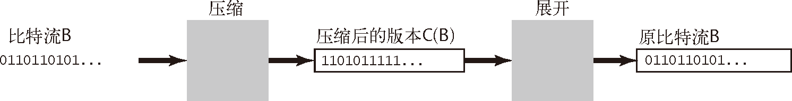

- 图 5.5.1　数据压缩的基础模型

这种模型叫做无损压缩模型——保证不丢失任何信息，即压缩和展开之后的比特流必须和原始的比特流完全相同。许多种类型的文件都会用到无损压缩，例如数值数据或者可执行的代码。对于某些类型的文件（例如图像、视频和音乐），有损的压缩方法也是可以接受的，此时解码器所产生的输出只是与原输入文件近似。有损压缩算法的评价标准不仅是压缩率，还包括主观的质量感受。在本书中不会讨论有损压缩算法。

### 5.5.2　读写二进制数据

完整描述计算机上信息的编码方式取决于系统，这超出了本书的讨论范围。但我们可以通过几

```
个基本的假设和两个简单的 API 来将实现与这些细节隔离开来。BinaryStdIn 和
BinaryStdOut 这两份 API 来自于我们一直在使用的 StdIn 和 StdOut，但它们的作用是
读取和写入比特，而 StdIn 和 StdOut 面向的是由 Unicode 编码的字符流。StdOut 上的一
个 int 值是一串字符（它的十进制表示）； BinaryStdOut 上的一个 int 值是一串比特
```

（它的二进制表示）。

### 5.5.2.1　二进制的输入输出

今天，大多数系统的输入输出系统，包括 Java，都是基于 8 位的字节流，因此我们的 API 也

```
许应该读写字节流，以和原始数据类型内部表示的输入输出格式相匹配，将 8 位的 char 编
码为 1 个字节，16 位的 short 编码为 2 个字节，32 位的 int 编码为 4 个字节，等等。因
```

为比特流是数据压缩的主要抽象层次，这就需要更进一步，允许用例读写单个的比特以及原始类型的数据。我们的目标是尽量减少用例需要进行的类型转换并按照操作系统的要求表示数据。表 5.5.1 中的 API 从标准输入中读取比特流。

表 5.5.1　从标准输入读取比特流的静态方法的 API

```java
   public class  <b>BinaryStdIn</b>
        boolean  readBoolean()
读取 1 位数据并返回一个 boolean 值
           char  readChar()
读取 8 位数据并返回一个 char 值
           char  readChar(int r)
读取 r（1~16）位数据并返回一个 char 值
[ 适用于 byte（8 位）、short（16 位）、int（32 位）以及 long 和 double（64 位）
```

的类似方法 ]

```
        boolean  isEmpty()
```

- 比特流是否为空

```
           void  close()
```

- 关闭比特流

```
和 StdIn 明显不同的是，这份抽象 API 的一个关键特性在于标准输入中的数据并不一定是与
```

字节边界对齐的。如果输入流只含有一个字节，用例可以一个比特一个比特地调用 8 次

```
readBoolean() 方法读取它。虽然 close() 方法并不十分重要，但为了能够终止输入，用
例应该使用 close() 方法表示不会再读取任何数据。和 StdIn 与 StdOut 一样，使用表
```

5.5.2 中的补充 API 来向标准输出写入比特流。

表 5.5.2　向标准输出中写入比特流的静态方法的 API

```java
   public class  <b>BinaryStdOut</b>
           void  write(boolean b)
```

- 写入指定的比特

```
           void  write(char c)
```

- 写入指定的 8 位字符

```
           void  write(char c, int r)
写入指定字符的低 r（1~16）位
[ 适用于 byte（8 位）、short（16 位）、int（32 位）以及 long 和 double（64 位）
```

的类似方法 ]

```
           void  close()
```

- 关闭比特流

```
对于输出，close() 方法就很重要了：用例必须使用 close() 方法保证之前调用 write()
方法处理的所有数据都写入比特流，比特流的最后一个字节必须用 0 补齐以保证和文件系统
的兼容性。StdIn 与 StdOut 有 In 与 Out 这两份 API 与之关联，这里也通过 BinaryIn
和 BinaryOut 直接使用二进制编码的文件。
```

### 5.5.2.2　举例

```
以下是一个简单的示例，假设你用一个数据结构将日期表示为 3 个 int 值（月、日、年）。
使用 StdOut 将这些值以 12/31/1999 的格式输出需要 10 个字符，也就是 80 位。如果用
BinaryStdOut 直接输出这些值则需要 96 位（每个 int 值 32 位）；如果用 byte 值来表
示月和日，用 short 值表示年，输出将只有 32 位。如果使用 BinaryStdOut，可以只用 4
位、5 位和 12 位的 3 个域，输出总共 21 位，请见图 5.5.2（实际上是 24 位，因为文件必
须是完整的 8 位字节，因此 close() 方法会在末尾添加三个 0 位。）注意：这是最粗糙的数
```

据压缩方式。

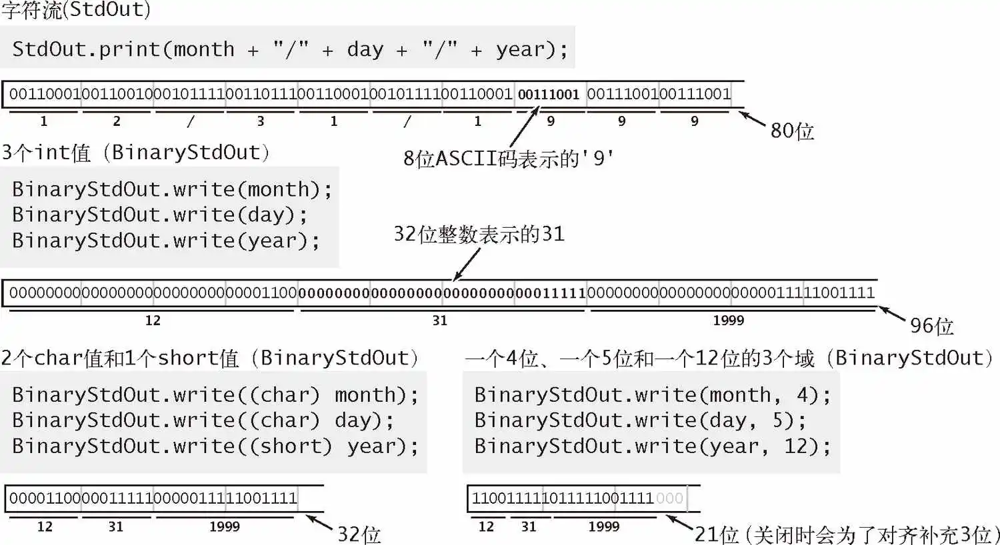

- 图 5.5.2　向标准输出中写入一个日期的 4 种方法

### 5.5.2.3　二进制转储

在调试的时候，我们应该如何检查比特流或者字节流的内容呢？早期的程序员面临着这个问题，因为当时寻找 bug 的唯一方式就是检查内存中的每个比特。转储（dump）这个词从计算机的早期一直沿用下来，表示的是比特流的一种可供人类阅读的形式。如果你试图用一个编辑器来打开一个二进制文件，或者用文本方式察看一个二进制文件的内容（或者运行一个使用

```
BinaryStdOut 的程序），那会看到一团乱码，内容取决于使用的系统。BinaryStdIn 可以
```

避开对系统的依赖性，允许我们编写自己的程序来将比特流转化为标准工具能够处理的内容。

```
例如，下页框注所示的程序 BinaryDump 调用了 BinaryStdIn，将标准输入中的比特按照
```

0 和 1 的形式打印出来。在处理小规模输入时这个程序是一个很有用的调试工具。类似的工具

```
HexDump 可以将数据组织成 8 位的字节并将它打印为各表示 4 位的两个十六进制数。用例
PictureDump 可以用 Picture 对象表示比特，其中白色像素表示 0，黑色像素表示 1。你
可以从本书的网站上下载 BinaryDump、HexDump 和 PictureDump，请见图 5.3.3。我们
```

一般会用管道和重定向等方式在命令行处理二进制文件，将编码器的输出通过管道传递给

```java
BinaryDump、HexDump 或者 PictureDump，或者将它重定向到一个文件之中。
public class BinaryDump
{
  public static void main(String[] args)
  {
     int width = Integer.parseInt(args[0]);
     int cnt;
     for (cnt = 0; !BinaryStdIn.isEmpty(); cnt++)
     {
        if (width == 0) { BinaryStdIn.readBoolean(); continue; }
        if (cnt != 0 && cnt % width == 0)
           StdOut.println();
        if (BinaryStdIn.readBoolean())
             StdOut.print("1");
        else StdOut.print("0");
     }
     StdOut.println();
     StdOut.println(cnt + " bits");
  }
}
```

将比特流打印在标准输出上（字符形式）

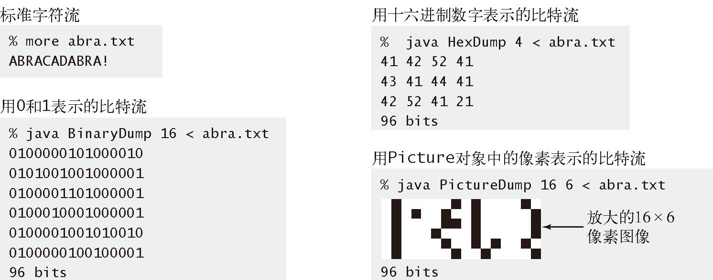

图 5.5.3　查看比特流的 4 种方法

### 5.5.2.4　ASCII 编码

```
当你使用 HexDump 查看一个含有 ASCII 编码的字符的比特流的内容时，最好参考图 5.5.4。
```

对于给定的两个十六进制数字，用第一个数字表示行、第二个数字表示列即可找到它所表示的字符。例如，31 表示“1”，4A 表示“J”，等等。这张表适用于 7 位 ASCII 码，因此第一个十六进制数字必须是小于等于 7 的。以 0 或者 1 开头的数（以及 20 和 7F）对应的都是无法打印出来的控制字符。许多控制字符都是为了控制打字机时代的物理设备而遗留下来的产物。我们

```
在这张表中突出了一些你可能在转储中已经见过的字符。例如，SP 是空格符，NUL 是空字
符，LF 是换行符，CR 是回车。
```

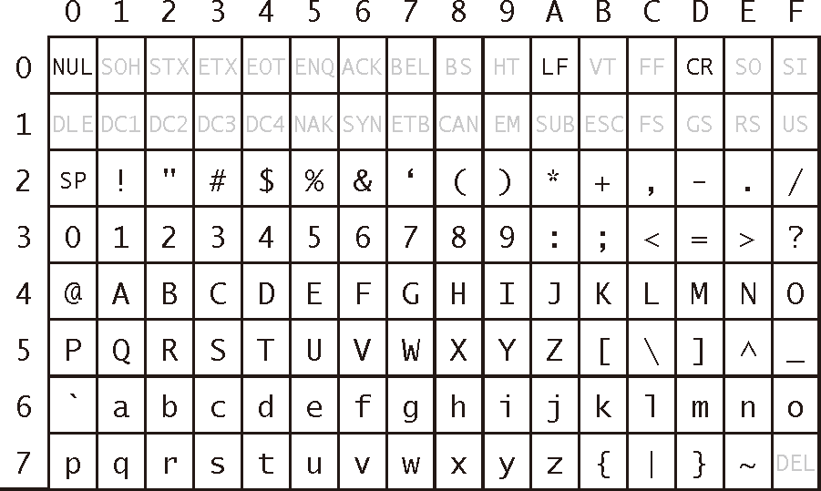

- 图 5.5.4　十六进制编码和 ASCII 字符的转换表

总之，在处理数据压缩问题时，除了标准输入输出之外还要能够处理二进制编码的数据。

```
BinaryStdIn 和 BinaryStdOut 提供了我们所需要的方法。它们能够在用例中区分为文件
```

存储和数据传输而输出的信息（供其他程序使用）和为打印而输出的信息（供人类阅读）。

### 5.5.3　局限

为了更好地理解数据压缩算法，你需要了解它们的一些局限性。研究人员已经为此打下了完整而重要的理论基础，本节的最后会简要讨论，但现在我们先来探讨几个方便入门的结论。

### 5.5.3.1　通用数据压缩

在已经学习了许多重要问题的算法之后，你可能会认为我们的目标是通用性的数据压缩算法，即一个能够缩小任意比特流的算法。但与之相反，我们定下的目标更加朴素，因为通用性的数据压缩是不可能存在的，请见图 5.5.5。

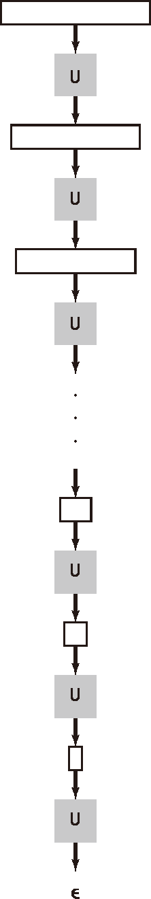

- 图 5.5.5　是否存在通用数据压缩

- 命题 S。不存在能够压缩任意比特流的算法。证明。我们来看两种有见地的证明。第一种采用的是反证法：假设存在一个能够压缩任意比特流的算法，那么也就可以用它压缩它自己的输出以得到一段更短的比特流，循环往复直到比特流的长度为 0！能够将任意比特流的长度压缩为 0 显然是荒谬的，因此存在能够压缩任意比特流的算法的假设也是错误的。第二种证明方法基于统计：假设有一种算法能够对所有长度为 1000 位的比特流进行无损压缩，那么每一种能够被压缩的比特流都对应着一段较短且不同的比特流。但长度小于 1000


- 种，而长度为 1000 位的比位的比特流一共只有特流一共有 21000 种，因此该算法不可能压缩所有长度为 1000 的比特流。如果我们声明更多的条件，那么这段证明会更有说服力。例如，继续假设算法的目标是取得大于 50% 的


- 压缩率，那么显然所有长度为 1000 位的比特流中的压缩成功率将只有！

换句话说，对于任意数据压缩算法，将长度为 1000 位的随机比特流压缩为一半的概率最多为

- 。当遇到一种新的无损压缩算法时，我们可以肯定它是无法大幅度压缩随机比特流的。

抛弃对压缩随机比特流的幻想是理解数据压缩的起点。虽然我们会经常处理数百万至数十亿比特长度的字符串，但处理过的数据总量只是这种字符串总数的九牛一毛，所以不必为这个理论结果而沮丧。事实上，经常被处理的比特字符串都是非常有规律的，在压缩时可以利用这一点。

### 5.5.3.2　不可判定性

请见图 5.5.6，它是一条上百万位的字符串。这个字符串看起来很随机，所以你不太可能为它找到一个无损压缩算法。但有一种方法只用几千个比特就可以表示这个字符串，因为它是通过右下框注中的程序生成的。（这个程序是伪随机数生成器的一个示例，和

```
Java.Math.random() 方法一样。）通过用 ASCII 文本编写生成程序来进行压缩、通过读取
```

并运行该程序来展开被压缩字符串的压缩算法能够取得 0.3% 的压缩率，这是非常难以超越的。（我们还能够降低这个比例，只要该程序再输出更多比特即可。）压缩这个文件最好的方法就是找出创造这些数据的程序。这个例子并不像它看起来那么深奥：当你在压缩一段视频或是一本通过扫描而数字化的旧书或是互联网上的无数其他类型的文件时，你都在寻找创造这个文件的程序。在意识到我们处理的大部分数据都是由某种程序产生的之后，我们才能发现计算理论中的一些深刻的问题并理解数据压缩所面临的挑战。例如，可以证明最优数据压缩（找到能够产生给定字符串的最短程序）是一个不可判定的问题：我们不但不可能找到能够压缩任意比特流的算法，也不可能找到最佳的压缩算法！

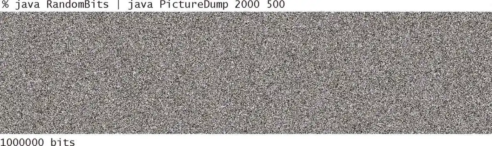

- 图 5.5.6　一个难以压缩的文件：100 万（伪）随机比特

这些局限性所带来的实际影响要求无损压缩算法必须尽量利用被压缩的数据流中的已知结构。我们将会依次讨论 4 种方法来处理具备以下结构特点的数据：

- 小规模的字母表；

- 较长的连续相同的位或字符；

- 频繁使用的字符；

- 较长的连续重复的位或字符。

如果你已知给定的比特流中具有以上一种或多种特点，那么就能够通过将要学习的 4 种方法将它压缩；如果不知道给定比特流具有的特点，也可以用它们碰碰运气，因为你的数据结构也许并不是那么明显，而这些方法的适用性很广。你将会看到，每种方法都有多个参数和变种，并且可以为特定的比特流调优以达到最佳的压缩率。第一个和最后一个示例是为了帮助你了解数据的结构，接下来我们会学习一个方法来压缩示例数据。

```java
public class RandomBits
{
  public static void main(String[] args)
  {
     int x = 11111;
     for (int i = 0; i < 1000000; i++)
     {
        x = x * 314159 + 218281;
        BinaryStdOut.write(x > 0);
     }
     BinaryStdOut.close();
  }
}
```

“被压缩后的”一段上百万比特的数据流

### 5.5.4　热身运动：基因组

在讨论更加复杂的数据压缩问题之前，我们先来处理一个初级的（但也十分重要的）数据压缩任务。我们在这个例子中会介绍一些约定，它们将适用于本节中的所有实现。

### 5.5.4.1　基因数据

作为数据压缩的第一个示例，请看下面这个字符串：

```
ATAGATGCATAGCGCATAGCTAGATGTGCTAGCAT
```

如果使用标准的 ASCII 编码（每个字符 1 个字节，8 位），这个字符串的比特流长度为8×35=280 位。这种字符串在现代生物学中非常重要，因为生物学家用字母 A、C、T 和 G 来表示生物体的 DNA 中的四种碱基。基因就是一条碱基的序列。科学家认识到理解基因的性质是理解它们在活体器官中如何作用的关键，包括生命、死亡和疾病。许多生物的基因现在都是已知的，而一些科学家正在编写程序来分析这些序列的结构。

### 5.5.4.2 双位编码压缩

基因的一个简单性质是，它由 4 种不同的字符组成。这些字符可以用两个比特编码，如右侧的

```
compress() 方法所示。尽管我们知道输入流是由字符组成的，但是仍然可以使用
BinaryStdIn 来读取这些输入以和标准的数据压缩模型保持一致（从比特流到比特流）。我
```

们在压缩后的文件中记录了被编码的字符数量，这样即使最后一位并没有和字节对齐，解码也能够顺利进行。因为它能够将一个 8 位的字符转换为一个双位编码，且附加 32 位用于记录总长度，上方程序的压缩率会随着压缩字符的增多越来越接近 25%。

```java
public static void compress()
{
  Alphabet DNA = new Alphabet("ACTG");
  String s = BinaryStdIn.readString();
  int N = s.length();
  BinaryStdOut.write(N);
  for (int i = 0; i < N; i++)
  {  // 将字符用双位编码代码表示
     int d = DNA.toIndex(s.charAt(i));
     BinaryStdOut.write(d, DNA.lgR());
  }
  BinaryStdOut.close();
}
```

基因数据的压缩方法

### 5.5.4.3　双位编码展开

```
右边框注中的 expand() 方法能够将这个 compress() 方法产生的比特流展开。和压缩时一
```

样，该方法会按照数据压缩的基础模型读取一个比特流并输出一个比特流。它输出的比特流和原始输入相同。

```java
public static void expand()
{
  Alphabet DNA = new Alphabet("ACTG");
  int w = DNA.lgR();
  int N = BinaryStdIn.readInt();
  for (int i = 0; i < N; i++)
  {   // 读取2比特，写入一个字符
      char c = BinaryStdIn.readChar(w);
      BinaryStdOut.write(DNA.toChar(c));
  }
  BinaryStdOut.close();
}
```

基因数据的展开方法

相同的方法也适用于其他字母表大小固定的字符串，但我们将它的推广留作（简单的）习题（请见练习 5.5.25）。

这些方法和数据压缩的基础模型并不完全一致，因为编码后的比特流中并没有包含将其解码所需的所有信息。由 A、C、T、G 4 个字母组成的字母表只是两个方法之间的约定。这种约定在基因组这种应用中是合理的，因为这些编码会被大量复用。但在其他的场景中，字母表也可能需要包含在被编码的信息中（请见练习 5.5.25）。在比较数据压缩的方法时我们通常都要计入这些成本。

在基因组学的早期，分析一段染色体序列是一个漫长而艰苦的任务，因此已知的序列都相对较短，科学家可以用标准的 ASCII 编码来存储和交换它们。现在，这个实验流程的效率已经大大


- 比特）。用这些

提高了，已知的基因组的数量非常多而且都很长（人类的基因组长度超过简单的方法就能节省 75% 的空间已经非常可观了。还有继续压缩的余地吗？这是一个非常有趣的问题，因为这是一个科学问题：继续压缩的潜力意味着这些数据中还存在着某种结构，而现代基因组学的重点就是希望从基因数据中发现更多的结构。我们将会学习的一些标准数据压缩方法对于（经过双位编码压缩后的）基因数据并没有什么效果，和处理随机数据类似。

```
我们将 compress() 和 expand() 作为静态方法和一个简单的用例打包在一个相同的类中，
```

如框注代码所示。为了测试你对游戏规则的理解和我们用于数据压缩的基本工具，请研究图

```
5.5.7 中的各种命令。它们调用了 Genome.compress() 和 Genome.expand() 来处理样本
```

数据（以及输出）。

```java
public class Genome
{
  public static void compress()
  // 请见正文
  public static void expand()
  // 请见正文
  public static void main(String[] args)
  {
      if (args[0].equals("-")) compress();
      if (args[0].equals("+")) expand();
  }
}
```

数据压缩方法的打包方式

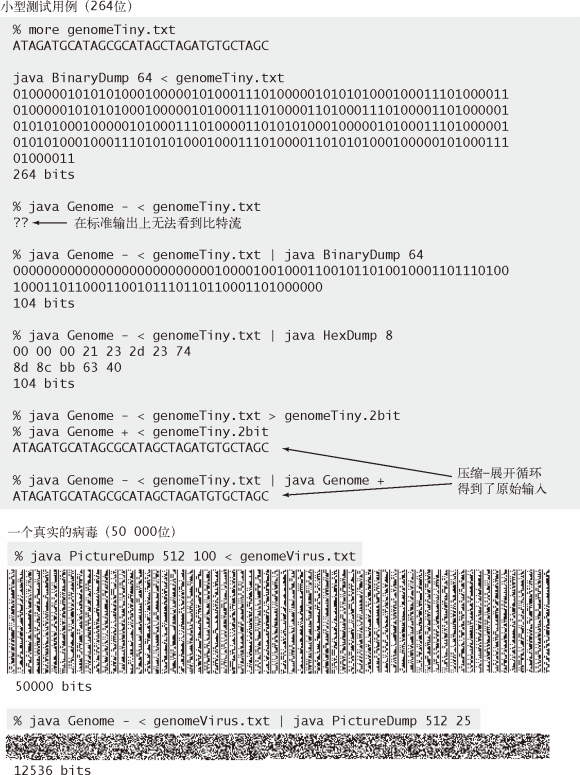

- 图 5.5.7　使用双位编码压缩和展开基因组序列

### 5.5.5　游程编码

比特流中最简单的冗余形式就是一长串重复的比特。下面我们学习一种经典的游程编码（Run-Length Encoding）来利用这种冗余压缩数据。例如，请看下面这条 40 位长的字符串：

```
0000000000000001111111000000011111111111
```

该字符串含有 15 个 0，然后是 7 个 1，然后是 7 个 0，然后是 11 个 1，因此我们可以将该比特字符串编码为 15，7，7，11。所有的比特字符串都是由交替出现的 0 和 1 组成的，因此我们只需要将游程的长度编码即可。在这个例子中，如果用 4 位表示长度并以连续的 0 作为开头，那么就可以得到一个 16 位长的字符串（15=1111，7=0111，7=0111，11=1011）：

```
1111011101111011
```

压缩率为 16/40=40%。为了将这里的描述转化成一种有效的数据压缩方法，我们需要解决以下几个问题。

- 应该使用多少比特来记录游程的长度？

- 当某个游程的长度超过了能够记录的最大长度时怎么办？

- 当游程的长度所需的比特数小于记录长度的比特数时怎么办？

我们感兴趣的主要是含有的短游程相对较少的长比特流，因此这些问题的回答是：

- 游程长度应该在 0 到 255 之间，使用 8 位编码；

- 在需要的情况下使用长度为 0 的游程来保证所有游程的长度均小于 256；

- 我们也会将较短的游程编码，虽然这样做有可能使输出变得更长。

这些决定非常容易实现而且对于实际应用中经常出现的几种比特流十分有效。它们不适用于含有大量短游程的输入——只有在游程的长度大于将它们用二进制表示所需的长度时才能节省空间。

### 5.5.5.1　位图

作为游程编码效果的一个示例，这里探讨位图。它被广泛用于保存图像和扫描文档。简单起

```
见，我们将二进制位图数据组织为将像素按行排列的比特流。我们可以用 PictureDump 查
```

看位图的内容。用程序将为“截屏”或是“扫描文档”所定义的多种常见的无损图像格式转化为位图十分简单（请见练习 5.5.x）。这里用来展示游程编码的效果的示例来自本书的图像：一个字符“q”（各种分辨率）。我们的重点是一幅 32×48 像素的截图的二进制转储，如图 5.5.8 所示，每行的右侧为该行的游程编码。因为每行的开始和结束都是 0，所以每行的游程数量都是奇数。因为一行的结束之后就是另一行的开始，所以比特流中相对应的游程的长度就是每一行的最后一个游程的长度和下一行的第一个游程的长度之和（全部为 0 的行则应该继续相加）。

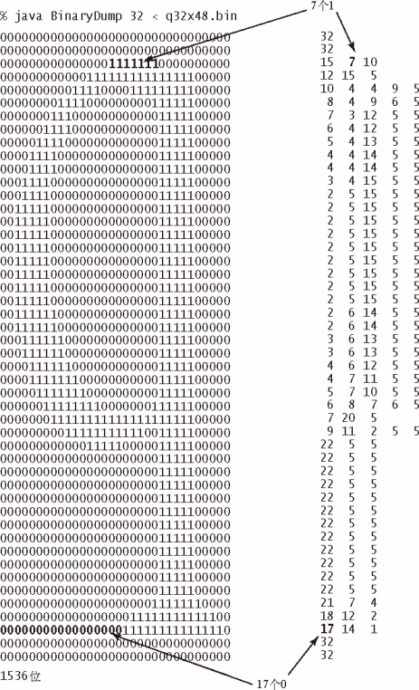

- 图 5.5.8　一幅典型的位图，每行的游程编码如右所示

### 5.5.5.2　实现

```
由刚才给出的非正式描述可以立即得到右边框注中的 compress() 和 expand() 方法。和以
前一样，expand() 的实现相对简单：读取一个游程的长度，将当前比特按照长度复制并打
印，转换当前比特然后继续，直到输入结束。compress() 方法也很简单。对于输入，它进
```

行了以下操作：

- 读取一个比特；

- 如果它和上一个比特不同，写入当前的计数值并将计数器归零；

- 如果它和上一个比特相同且计数器已经到达最大值，则写入计数值，再写入一个 0 计数值，然后将计数器归零；

- 增加计数器的值。

当输入流结束时，写入计数值（最后一个游程的长度）并结束。

### 5.5.5.3　提高位图的分辨率

游程编码广泛用于位图的主要原因是，随着分辨率的提高它的效果也会大大的提高。证明这一点很简单。假设将上一个例子中的分辨率提高一倍，则很容易得到：

- 总比特数变为了原来的 4 倍；

- 游程的数量变为约原来的 2 倍；

- 游程的长度变为约原来的 2 倍；

- 压缩后的比特数量变为约原来的 2 倍；

- 因此，压缩率变成了原来的一半！

```java
public static void expand()
{
  boolean b = false;
  while (!BinaryStdIn.isEmpty())
  {
     char cnt = BinaryStdIn.readChar();
     for (int i = 0; i < cnt; i++)
        BinaryStdOut.write(b);
     b = !b;
  }
  BinaryStdOut.close();
}
public static void compress()
{
  char cnt = 0;
  boolean b, old = false;
  while (!BinaryStdIn.isEmpty())
  {
     b = BinaryStdIn.readBoolean();
     if (b != old)
     {
        BinaryStdOut.write(cnt);
        cnt = 0;
        old = !old;
     }
     else
     {
        if (cnt == 255)
        {
           BinaryStdOut.write(cnt);
           cnt = 0;
           BinaryStdOut.write(cnt);
        }
     }
     cnt++;
  }
  BinaryStdOut.write(cnt);
  BinaryStdOut.close();
}
```

游程编码的压缩和展开方法

未使用游程编码时，当分辨率提高一倍时图像所需空间变为原来的 4 倍；使用了游程编码后，当分辨率提高一倍时压缩后的比特流的长度仅变为了原来的 2 倍。也就是说，随着所需空间的增大，压缩比和分辨率成反比。例如，我们的字母“q”（在低分辨率时）的压缩率为 74%；如

```
果将分辨率提高到 64×96，压缩比就下降为 37%。我们从图 5.5.9 中 PictureDump 的输出
```

中可以明显看出这个变化。高分辨率的字符图像所需的空间是低分辨率字符图像的 4 倍（两个维度上的长度均加倍），但压缩后的版本所需的空间仅为原来的 2 倍（只在一个维度上增倍）。如果继续将分辨率提高到 128×192（接近于打印所需的分辨率），压缩比则会下降到 18%（请见练习 5.5.5）。

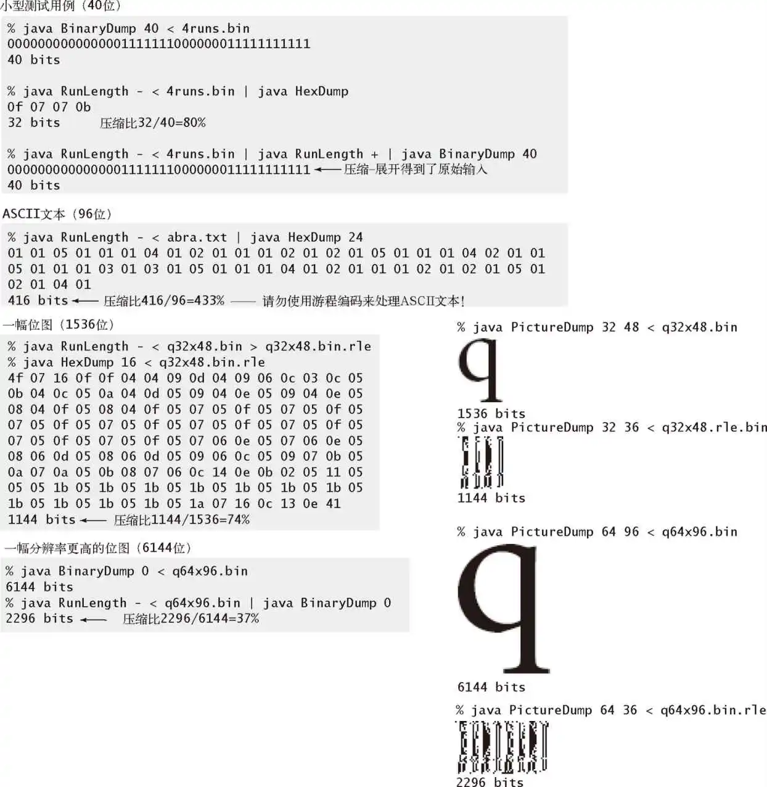

- 图 5.5.9　使用游程编码压缩和展开比特流

游程编码在许多场景中非常有效，但在许多情况下我们希望压缩的比特流并不含有较长的游程（例如典型的英文文档）。下面我们来学习两种适用于多种类型的文件压缩算法。它们的应用非常广泛，在从网络上下载文件时很可能就用到了它们。

### 5.5.6　霍夫曼压缩

我们现在来学习一种能够大幅压缩自然语言文件空间（以及许多其他类型文件）的数据压缩技术。它的主要思想是放弃文本文件的普通保存方式：不再使用 7 位或 8 位二进制数表示每一个字符，而是用较少的比特表示出现频率高的字符，用较多的比特表示出现频率低的字符。

```
为了说明这个概念，先来看一个简单的示例。假设需要将字符串 A B R A C A D A B R A
! 编码。由 7 位 ASCII 字符编码我们可以得到比特字符串：
100000110000101010010100000110000111000001-
100010010000011000010101001010000010100001.
```

要将这段比特字符串解码，只需每次读取 7 位并根据图 5.5.4 的 ASCII 编码表将它转换为字

```
符。在这种标准的编码下，只出现了一次的 D 和出现了 5 次的 A 所需的比特数是一样的。霍
```

夫曼压缩的思想是通过用较少的比特表示出现频繁的字符而用较多的比特表示偶尔出现的字符来节省空间，这样字符串所使用的总比特数就会降低。

### 5.5.6.1　变长前缀码

和每个字符所相关联的编码都是一个比特字符串，就好像有一个以字符为键、比特字符串为值的符号表一样。我们可以试着将最短的比特字符串赋予最常用的字符，将 A 编码为 0、B 编码为 1、R 为 00、C 为 01、D 为 10、！为 11。这样 A B R A C A D A B R A ! 的编码就是 0 100 0 01 0 10 0 1 00 0 11。这种表示方法只用了 17 位，而 7 位的 ASCII 编码则用了 84 位。但这种表示方法并不完整，因为它需要空格来区分字符。如果没有空格，比特字符串就会变成这个样子：

```
01000010100100011
```

它也可以被解码为 C R R D D C R C B 或是其他字符串。但 17 位加上 11 个分隔符也比标准的编码要紧凑的多了，没有用于编码的比特字符不会在这条消息中出现。如果所有字符编码都不会成为其他字符编码的前缀，那么就不需要分隔符了。下一步我们就要做到这一点。含有这种性质的编码规则叫做前缀码。刚才我们给出的编码并不是前缀码，因为 A 的编码 0 就是 R的编码 00 的前缀。例如，如果我们将 A 编码为 0、B 为 1111、C 为 110、D 为 100、R 为1110、! 为 101，那么将以下长为 30 的比特字符串解码的方式就只有 A B R A C A D A B R A !一种了：

```
011111110011001000111111100101
```

所有的前缀码的解码方式都和它一样，是唯一的（不需要任何分隔符），因此前缀码被广泛应用于实际生产之中。注意，像 7 位 ASCII 编码这样的定长编码也是前缀码。

### 5.5.6.2　前缀码的单词查找树

表示前缀码的一种简便方法就是使用单词查找树（请见 5.2 节）。事实上，任意含有

- 个空链


- 个字符定义了一种前缀码方法：我们将空链接替换为指向叶子结点

接的单词查找树都为

（含有两个空链接的结点）的链接，每个叶子结点都含有一个需要编码的字符。这样，每个字符的编码就是从根结点到该结点的路径表示的比特字符串，其中左链接表示 0，右链接表示1。例如，图 5.5.10 显示了字符串 A B R A C A D A B R A ! 中的字符的两种前缀码方式。上方的例子就是我们刚才提到的编码方式，下方的编码得到的比特字符串为：

```
11000111101011100110001111101
```

该字符串只有 29 位，比上一种少 1 位。是否存在能够压缩得更多的单词查找树呢？我们如何才能找到压缩率最高的前缀码？实际上，这些问题都有一个优雅的解。有一种算法能够为任意字符串构造一棵能够将比特流最小化的单词查找树。为了公平比较各种编码，还需要计算编码本身所需的空间，因为没有它就无法将字符串解码。你会看到，编码的方式是和字符串相关的。寻找最优前缀码的通用方法是 D.Huffman 在 1952 年发现的（当时他还是个学生！），因此被称为霍夫曼编码。

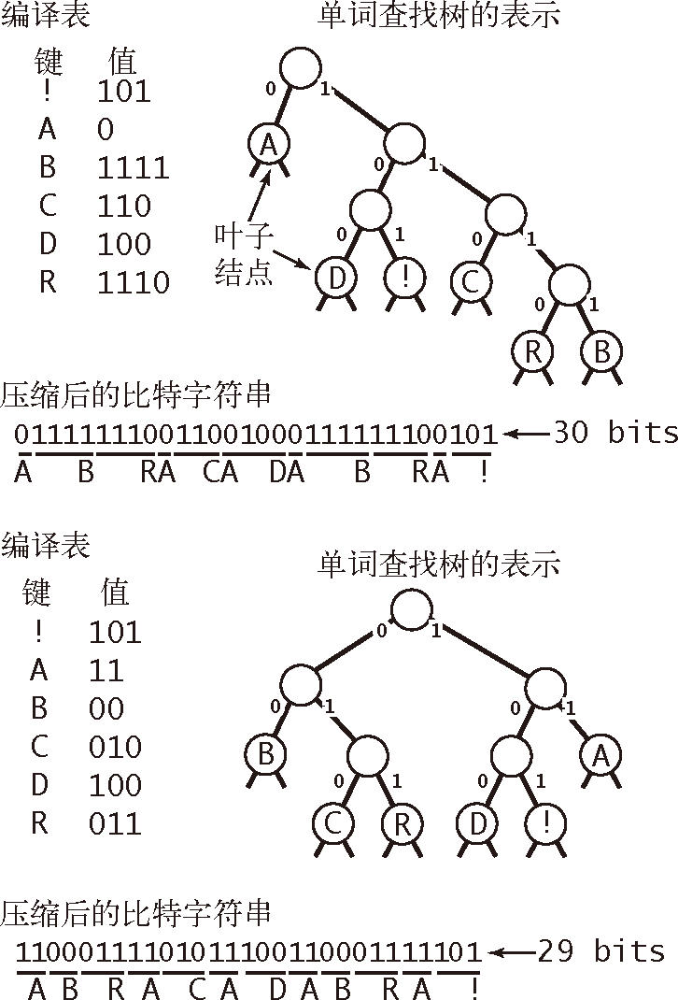

- 图 5.5.10　两种不同的前缀码

### 5.5.6.3　概述

使用前缀码进行数据压缩需要经过 5 个主要步骤。我们将待编码的比特流看作一个字节流并按照以下方式使用前缀码：

- 构造一棵编码单词查找树；

- 将该树以字节流的形式写入输出以供展开时使用；

- 使用该树将字节流编码为比特流。

在展开时需要：

- 读取单词查找树（保存在比特流的开头）；

- 使用该树将比特流解码。

为了帮助你更好地理解和领会这个过程，我们将按照难度逐个考察这些步骤。

### 5.5.6.4　单词查找树的结点

```java
我们首先遇到的是如后面框注所示的 Node 类。它和我们曾经用来构造二叉树和单词查找树的
嵌套类相似：每个 Node 对象都含有指向其他 Node 对象的 left 和 right 引用，这定义了
单词查找树的结构。每个 Node 对象还包含一个实例变量 freq，构造函数会用到它。另一个
实例变量 ch 用于表示叶子结点中需要被编码的字符。
private static class Node implements Comparable<Node>
{  // 霍夫曼单词查找树中的结点
  private char ch;   // 内部结点不会使用该变量
  private int freq;  // 展开过程不会使用该变量
  private final Node left, right;
  Node(char ch, int freq, Node left, Node right)
  {
     this.ch    = ch;
     this.freq  = freq;
     this.left  = left;
     this.right = right;
  }
  public boolean isLeaf()
  {  return left == null && right == null;  }
  public int compareTo(Node that)
  {  return this.freq - that.freq;  }
}
```

单词查找树的结点表示

### 5.5.6.5　使用前缀码展开

```
有了定义前缀码的单词查找树，扩展被编码的比特流就简单了。左边框注中的 expand() 方
法实现了这个过程。在从标准输入中使用后文所述的 readTrie() 方法读取了单词查找树之
```

后，用它将比特流的其余部分展开：根据比特流的输入从根结点开始向下移动（读取一个比特，如果为 0 则移动到左子结点，如果为 1 则移动到右子结点）。当遇到叶子结点后，输出该结点的字符并重新回到根结点。如果你仔细研究这个方法在图 5.5.11 中的小型前缀码示例中的表现，就能够理解这个过程。例如，在解码比特流 011111001011... 时，从根结点开始，因为第一个比特是 0，所以移动到左子结点，输出 A；回到根结点，向右子结点移动 3 次，然后输出 B；回到根结点，向右子结点移动两次，左子结点移动 1 次，输出 R；如此往复。展开的简单性也是前缀码，特别是霍夫曼压缩算法流行的原因之一。

```java
public static void expand()
{
  Node root = readTrie();
  int N = BinaryStdIn.readInt();
  for (int i = 0; i < N; i++)
  {  // 展开第i个编码所对应的字母
     Node x = root;
     while (!x.isLeaf())
        if (BinaryStdIn.readBoolean())
             x = x.right;
        else x = x.left;
     BinaryStdOut.write(x.ch);
  }
  BinaryStdOut.close();
}
```

前缀码的展开（解码）

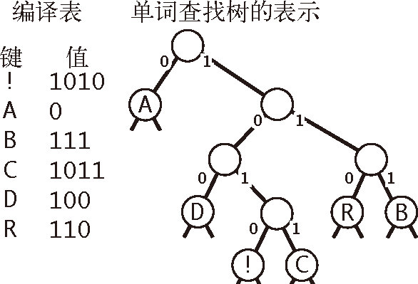

- 图 5.5.11　一种霍夫曼编码

### 5.5.6.6　使用前缀码压缩

```
在压缩时，我们使用单词查找树定义的编码来构造编译表，如后面框注中的 buildCode()
```

方法所示。该方法短小而优雅，其巧妙之处值得仔细研究。对于任意单词查找树，它都能产生

```
一张将树中的字符和比特字符串（用由 0 和 1 组成的 String 字符串表示）相对应的编译
```

表。编译表就是一张将每个字符和它的比特字符串相关联的符号表：为了提升效率，我们使用

```
了一个由字符索引的数组 st[] 而非普通的符号表，因为字符的数量并不多。在构造该符号表
时，buildCode() 递归遍历整棵树并为每个结点维护了一条从根结点到它的路径所对应的二
```

进制字符串（0 表示左链接，1 表示右链接）。每当到达一个叶子结点时，算法就将结点的编码设为该二进制字符串。编译表建立之后，压缩就很简单了，只需在其中查找输入字符所对应的编码即可。使用后面框注中的编码压缩 A B R A C A D A B R A !，首先写入 0（A 的编码），然后是 111（B 的编码），然后是 110（R 的编码），等等。框注中的这一段代码完成的任务是查

```
找输入的每个字符所对应的编码 String 对象，将 char 数组中字符转化为 0 和 1 的值并写
```

入输出的比特字符串中。

```java
private static String[] buildCode(Node root)
{  // 使用单词查找树构造编译表
  String[] st = new String[R];
  buildCode(st, root, "");
  return st;
}
private static void buildCode(String[] st, Node x, String s)
{  // 使用单词查找树构造编译表（递归）
  if (x.isLeaf())
  {  st[x.ch] = s; return; }
  buildCode(st, x.left,  s + '0');
  buildCode(st, x.right, s + '1');
}
```

通过前缀码字典查找树构建编译表

```
for (int i = 0; i < input.length; i++)
{
  String code = st[input[i]];
  for (int j = 0; j < code.length(); j++)
     if (code.charAt(j) == '1')
          BinaryStdOut.write(true);
     else BinaryStdOut.write(false);
}
```

使用编译表的压缩

### 5.5.6.7　单词查找树的构造

作为描述过程的参考，图 5.5.12 展示了为以下输入构造一棵霍夫曼单词查找树的过程：

```
it was the best of times it was the worst of times
我们将需要被编码的字符放在叶子结点中并在每个结点中维护了一个名为 freq 的实例变量来
```

表示以它为根结点的子树中的所有字符出现的频率。构造的第一步是创建一片由许多只有一个结点（即叶子结点）的树所组成的森林。每棵树都表示输入流中的一个字符，每个结点中的

```
freq 变量的值都表示了它在输入流中的出现频率。在我们的例子中，输入含有 8 个 t，5 个
```

e，11 个空格等（特别提示：为了得到这些频率，需要读取整个输入流——霍夫曼编码是一个两轮算法，因为需要再次读取输入流才能压缩它）。接下来自底向上根据频率构造这棵编码的单词查找树。在构造时将它看作一棵结点中含有频率信息的二叉树；在构造后，我们才将它看作一棵用于编码的单词查找树。构造过程如下：首先找到两个频率最小的结点，然后创建一个以二者为子结点的新结点（新结点的频率值为它的两个子结点的频率值之和）。这个操作会将森林中树的数量减一。然后不断重复这个过程，找到森林中的两棵频率最小的树并用相同的方

```
式创建一个新的结点。用优先队列能够轻易实现这个过程，如右下框注的 buildTrie 方法所
```

示。（为了说明这个过程，图 5.5.12 中的所有单词查找树是有序的。）随着这个过程的继续，我们构造的单词查找树将越来越大，而森林中的树会越来越少（每一步都会删除两棵树，添加一棵新树）。最终，所有的结点会被合并为一棵单独的单词查找树。这棵树中的叶子结点为所有待编码的字符和它们在输入中出现的频率，每个非叶子结点中的频率值为它的两个子结点之和。频率较低的结点会被安排在树的底层，而高频率的结点则会被安排在根结点附近的地方。根结点的频率值等于输入中的字符数量。因为这是一棵二叉树且字符仅存在于叶子结点中，所

```
以就定义了这些字符的前缀码。使用 buildCode() 方法为这个示例构造的编译表（如图
```

5.5.13 的右侧所示），得到了以下输出：

```
10111110100101101110001111110010000110101100-
01001110100111100001111101111010000100011011-
11101001011011100011111100100001001000111010-
01001110100111100001111101111010000100101010.
```

这个比特字符串长 176 位，相比用标准的 8 位 ASCII 编码得到的 51 个字符的 408 位编码节省了 57%（没有计算构造编码的开销，下面马上讨论）。另外，因为它是一个霍夫曼编码，所以不存在其他能够用更少的比特将输入编码的前缀码了。

```java
private static Node buildTrie(int[] freq)
{
  // 使用多棵单结点树初始化优先队列
  MinPQ<Node> pq = new MinPQ<Node>();
  for (char c = 0; c < R; c++)
     if (freq[c] > 0)
        pq.insert(new Node(c, freq[c], null, null));
  while (pq.size() > 1)
  {  // 合并两棵频率最小的树
     Node x = pq.delMin();
     Node y = pq.delMin();
     Node parent = new Node('\0', x.freq + y.freq, x, y);
     pq.insert(parent);
  }
  return pq.delMin();
}
```

构造一棵霍夫曼编码单词查找树

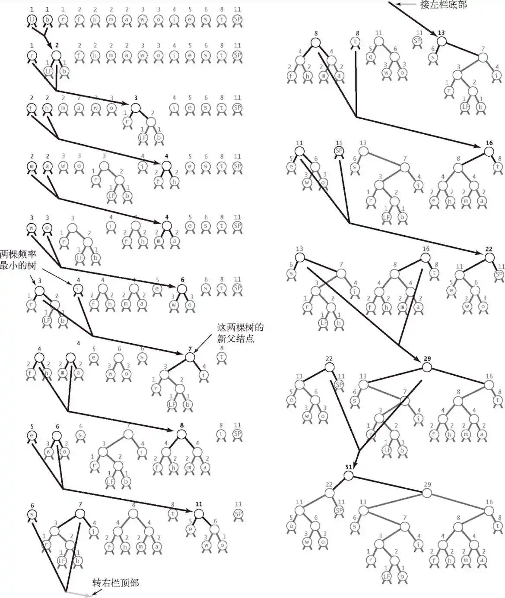

- 图 5.5.12　构造一棵霍夫曼编码单词查找树

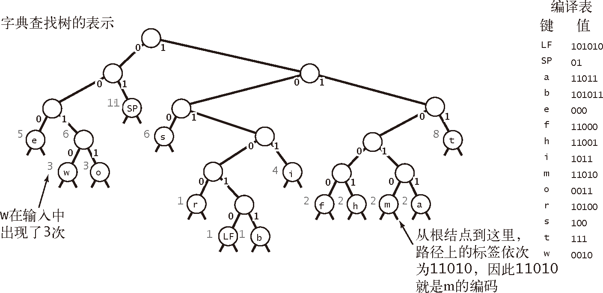

- 图 5.5.13　字符串“it was the best of times it was the worst of times LF”的霍夫曼编码

### 5.5.6.8　最优性

我们已经看到，在树中高频率的字符比低频率的字符离根结点更近，因此编码所需的比特更少，所以这种编码的方式更好。但为什么这是一种最优的前缀码呢？要回答这个问题，首先要定义树的加权外部路径长度这个概念，它是所有叶子结点的权重（频率）和深度（请见1.5.2.5 节）之积的和。

- 命题 T。对于任意前缀码，编码后的比特字符串的长度等于相应单词查找树的加权外部路径长度。证明。每个叶子结点的深度就是将该叶子结点的字符编码所需的比特数。因此，加权外部路径长度就是编码后的比特字符串的长度：它等于所有字符的出现次数和字符的编码长度之积的和。

```
在示例中，有一个叶子结点的距离为 2（SP，出现频率为 11），三个距离为 3（e、s 和 t，
总频率为 19），三个距离为 4（w、o 和 i，总频率为 10），五个距离为 5（r、f、h、m 和
a，总频率为 9），两个距离为 6（LF 和 b，总频率为 2），因此综合为
```

2×11+3×19+4×10+5×9+6×2=176。这与输出的比特字符串的长度预期相等。

- 命题 U。给定一个含有个符号的集合和它们的频率，霍夫曼算法所构造的前缀码是最优的。


- 的符号集合都是最优的。设是证明。数学归纳法。假设霍夫曼编码对于任意规模小于


- 所得到的输出，并用用霍夫曼算法计算并编码符号集和相应的频率


- 表示输出的总长度（单词查找树的加权外部路径长度）。假设和是


- 和被替代后的最先被选中的两个符号，那么算法接下来将计算


- 个符号的集合的编码以输出表示深度为的某个叶子结点中的新符号。，其中


- 可以注意到：


- 有一棵最优的高度为的单词查找树和现在，假设。注意，


- 的深度必然都是的结点交换就可以得到一棵加权外部路（否则将它们和深度为

- 和的兄弟结点交换可以假设径长度更小的单词查找树）。另外，通过将

- 和是兄弟结点。现在，考虑将它们的父结点替换为所得到的树


- 。注意（用同样的方法可以得到）。


- 是最优的，即根据归纳法，。因此有：


- 是最优的，等号必然成立，因此也是最优的。因为

每当一个结点被选中时，也可能有若干个结点和它的权重相同。霍夫曼算法并没有说明如何区别它们，也没有说明应该如何确定子结点的左右位置。不同的选择会得到不同的霍夫曼编码，但用它们将信息编码所得到的比特字符串在所有前缀码中都是最优的。

### 5.5.6.9　写入和读取单词查找树

我们已经强调过，前面讨论过的空间节约并不准确，因为没有单词查找树被压缩的比特流是无法被解码的。所以，我们必须将输出比特字符串中的单词查找树的成本考虑进来。对于较长的输入，这个成本相对较小。但为了保证数据压缩流程的完整，必须在压缩时将树写入比特流并在展开时读取它。怎样才能将一棵单词查找树编码为比特流并展开它呢？其实，只要基于单词查找树的前序遍历，这两个任务都只需要很简单的递归即可完成。下面框注中的

```
writeTrie() 方法会按照前序遍历单词查找树：当它访问的是一个内部结点时，它会写入一
```

个比特 0；当它访问的是一个叶子结点时，它会写入一个比特 1，紧接着是该叶子结点中字符

```
的 8 位 ASCII 编码。A B R A C A D A B R A! 的霍夫曼树的比特字符串编码如图 5.5.14
```

所示。第一位是 0，对应着根结点；下一个遇到是含有 A 的叶子结点，因此下一位为 1，紧接着是 01000001，即“A”的 8 位 ASCII 编码。下两位均为 0，因为遇到的都是两个内部结点，等

```
等。相应的 readTrie() 如框注所示。它从比特字符串中重新构造了单词查找树：首先读取
```

一个比特以得到当前结点的类型，如果是叶子结点（比特为 1）那么就读取字符的编码并创建一个叶子结点；如果是内部结点（比特为 0）那么就创建一个内部结点并（递归地）继续构造它的左右子树。请一定要理解这些方法：它们的简洁性有时是有欺骗性的。

```java
private static void
writeTrie(Node x)
{  // 输出单词查找树的比特字符串
  if (x.isLeaf())
  {
     BinaryStdOut.write(true);
     BinaryStdOut.write(x.ch);
     return;
  }
  BinaryStdOut.write(false);
  writeTrie(x.left);
  writeTrie(x.right);
}
```

将单词查找树写为比特字符串

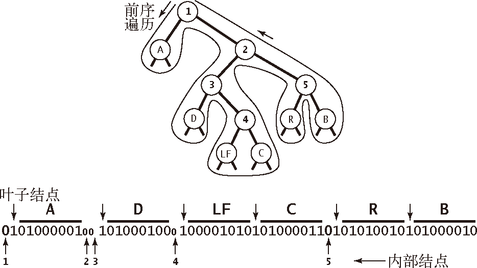

- 图 5.5.14　使用前序遍历将一棵单词查找树编码为比特流

```java
private static Node readTrie()
{
  if (BinaryStdIn.readBoolean())
     return new Node(BinaryStdIn.readChar(), 0, null, null);
  return new Node('\0', 0, readTrie(), readTrie());
}
```

从比特流的前序表示中重建单词查找树

### 5.5.6.10　霍夫曼压缩的实现

```
算法 5.10 加上之前讨论过的 buildCode()、buildTrie()、readTrie() 和
writeTrie()（以及一开始展示的 expand() 方法），就是霍夫曼压缩算法的完整实现。为
了展开前文对算法的概述，我们将需要压缩的比特流看作 8 位编码的 Char 值流并将它按照
```

如下方法压缩：

- 读取输入；

```
将输入中的每个 char 值的出现频率制成表格；
```

- 根据频率构造相应的霍夫曼编码树；

```
构造编译表，将输入中的每个 char 值和一个比特字符串相关联；
```

- 将单词查找树编码为比特字符串并写入输出流；

- 将单词总数编码为比特字符串并写入输出流；

- 使用编译表翻译每个输入字符。

要展开一条编码过的比特流，步骤如下：

- 读取单词查找树（编码在比特流的开头）；

- 读取需要解码的字符数量；

- 使用单词查找树将比特流解码。

霍夫曼压缩算法含有 4 个递归方法处理单词查找树，整个压缩过程需要 7 步，是我们学习的较为复杂的算法之一，请见图 5.5.15。但因为效率高，它也是应用最广泛的算法之一。

- 算法 5.10　霍夫曼压缩

```java
public class Huffman
1
{
2
  private static int R = 256;   // ASCII字母表
3
  // Node内部类请见5.5.6.4节框注“单词查找树的结点表示”
4
  // 其他辅助方法和expand()方法请见正文
5
6
  public static void compress()
7
  {
8
     // 读取输入
9
     String s = BinaryStdIn.readString();
10
     char[] input = s.toCharArray();
11
     // 统计频率
12
     int[] freq = new int[R];
13
     for (int i = 0; i < input.length; i++)
14
        freq[input[i]]++;
15
     // 构造霍夫曼编码树
16
     Node root = buildTrie(freq);
17
     // （递归地）构造编译表
18
     String[] st = new String[R];
19
     buildCode(st, root, "");
20
21
     // （递归地）打印解码用的单词查找树
22
     writeTrie(root);
23
24
     // 打印字符总数
25
     BinaryStdOut.write(input.length);
26
27
     // 使用霍夫曼编码处理输入
28
     for (int i = 0; i < input.length; i++)
29
     {
30
        String code = st[input[i]];
31
        for (int j = 0; j < code.length(); j++)
32
        if (code.charAt(j) == "1")
33
             BinaryStdOut.write(true);
34
        else BinaryStdOut.write(false);
35
     }
36
     BinaryStdOut.close();
37
  }
38
}
39
```

- 这段霍夫曼编码算法的实现构造了一棵清晰的编码单词查找树并使用了前文所述的各种辅助方法。

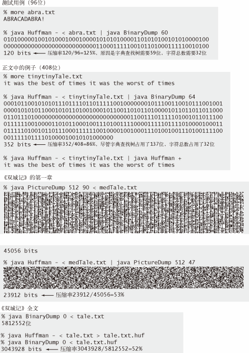

- 图 5.5.15　使用霍夫曼编码压缩和展开字节流

霍夫曼压缩算法流行的一个原因是，不仅对于自然语言文本，它对各种类型的文件都有效果。我们在编写方法的代码时十分小心，以保证它能够正确处理 8 位字符可能表示的任意 8 位值。换句话说，我们可以将它应用于任何字节流。对于我们在本节中讨论过的其他几种类型的文件，图 5.5.16 显示了这些例子，说明了霍夫曼压缩与定长编码以及游程编码相比仍然十分具有竞争力，尽管这些算法是为某些类型的文件专门设计的。理解霍夫曼编码在这些领域的优越性能是十分有帮助的。对于基因组数据，霍夫曼压缩实际上发现了双位编码。因为 4 种字符的出现频率基本相同，因此霍夫曼编码树是平衡的，每个字符分配到的都是一个两位的编码。

在游程编码的示例中，0 0 0 0 0 0 0 0 和 1 1 1 1 1 1 1 1 都可能是出现最频繁的字符，因此它们的编码可能只有 2 ～ 3 位，这样就能够大幅度地压缩输入数据。

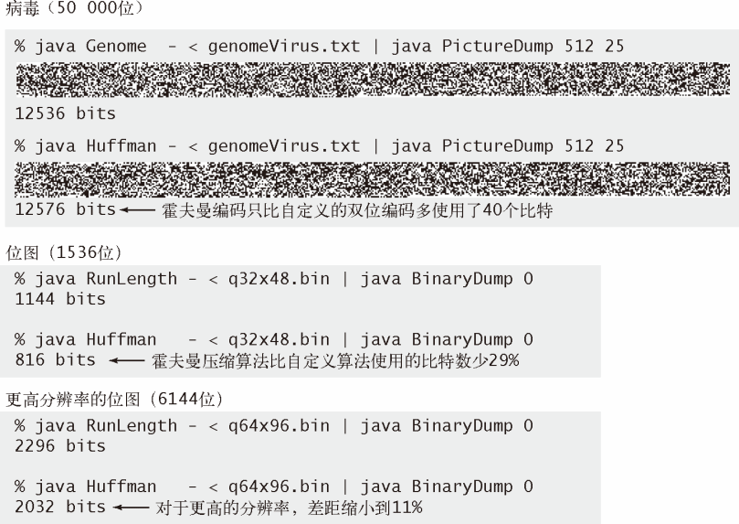

- 图 5.5.16　用霍夫曼编码压缩和展开基因组和位图数据

除了霍夫曼压缩算法，另一种值得一提的选择是 20 世纪 70 年代末至 80 年代初由A.Lempel、J.Ziv 和 T.Welch 发明的一种算法。它的应用也非常广泛，因为它的实现简单，而且也适用于多种类型的文件。

这种算法的基本思想和霍夫曼编码的基本思想相反。霍夫曼算法是为输入中的定长模式产生一张变长的编码编译表，但这种方法是为输入中的变长模式生成一张定长的编码编译表。这种方法的另一种令人惊讶的特性在于，和霍夫曼编码不同，输出中不需要附上这张编译表。

### 5.5.6.11　LZW 压缩算法

为了说明这种算法的基本思想，先来看一个数据压缩的示例。假设需要读取一列由 7 位 ASCII编码的字符组成的输入流并将它们写为一条 8 位字节的输出流。（在实际应用中使用的参数值一般都会更大——实现中使用的是 8 位的输入和 12 位的输出。）我们将输入字节称为字符，输入的字节序列称为字符串，输出字节称为编码，尽管这些术语在其他情况下的意义有所不同。LZW 压缩算法的基础是维护一张字符串键和（定长）编码的编译表。在符号表中将 128个单字符键的值初始化为 8 位编码，即在每个字符的 7 位值前添加一个 0。为了简单明了，用十六进制数字来表示编码的值，这样 ASCII 的 A 的编码即为 41，R 的编码为 52，等等。我们将 80 保留为文件结束的标志并将其余的编码值（81 ～ FF）分配给在输入中遇到的各种子字符串，即从 81 开始不断为新键赋予更大的编码值。为了压缩数据，只要输入还未结束，就会不断进行以下操作：

```
找出未处理的输入在符号表中最长的前缀字符串 s；
输出 s 的 8 位值（编码）；
继续扫描 s 之后的一个字符 c；
在符号表中将 s+c（连接 s 和 c）的值设为下一个编码值。
```

在后面的几步中，我们需要继续查看输入中的下一个字符才能构造字典中的下一个条目，因此

```
将这个字符 c 称为前瞻（lookahead）字符。现在，当用尽了编码值（将 FF 赋予了某个字符
```

串）之后暂时只能停止向符号表中添加新的条目——我们会在稍后讨论其他策略。

### 5.5.6.12　LZW 压缩举例

```
下表所示的是 LZW 算法压缩样例输入 A B R A C A D A B R A B R A B R A 的详细过
```

程。对于前 7 个字符，匹配的最长前缀仅为 1 个字符，因此输出这些字符所对应的编码，并

```
将编码 81 到 87 和产生的 7 个两个字符的字符串相关联。然后我们发现 AB 匹配了输入的前
缀（于是输出 81 并将 ABR 添加到符号表中），然后是 RA（输出 83 并添加 RAB），BR（输出
82 并添加 BRA）和 ABR（输出 88 并添加 ABRA），最后只剩下 A（输出 41，请见图
```

5.5.17）。

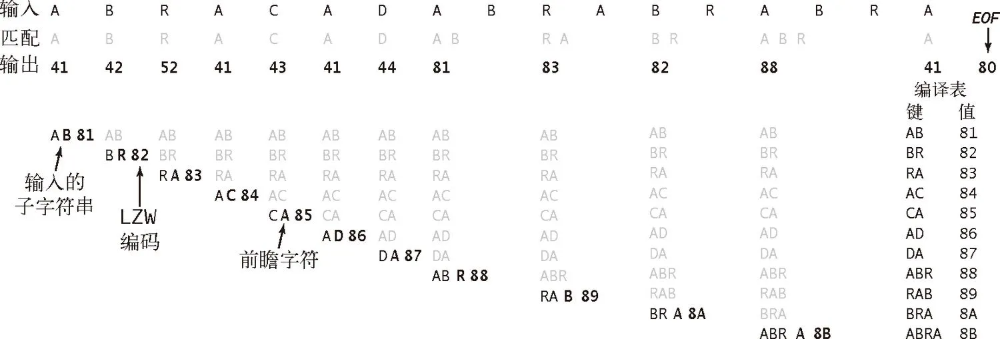

```
图 5.5.17　LZW 算法压缩 A B R A C A D A B R A B R A B R A
```

输入为 17 个 7 位的 ASCII 字符，总共 119 位；输出为 13 个 8 位的编码，总共 104 位——压缩比为 87%，即使这只是个很小的例子。

### 5.5.6.13　LZW 的单词查找树

LZW 压缩算法含有两种符号表操作：

- 找到输入和符号表的所有键的最长前缀匹配；

- 将匹配的键和前瞻字符相连得到一个新键，将新键和下一个编码关联并添加到符号表中。

5.2 节中介绍的单词查找树数据结构完全是为这些操作量身定做的。对于上一个示例，它的单词查找树表示如图 5.5.18 所示。要查找最长前缀匹配，从根结点开始遍历树，按照结点的标签和输入字符匹配；在添加一个新编码时，先创建一个用新编码和前瞻字符标记的结点并将它和查找结束的结点相关联。在实践中，为了节省空间我们使用的是 5.2 节中介绍的三向单词查找树。值得一提的是这里对单词查找树的使用与霍夫曼编码的不同：对于霍夫曼编码，使用单词查找树是因为任意编码都不会是其他编码的前缀；但对于 LZW 算法，使用单词查找树是因为每个由输入字符串得到的键的前缀也都是符号表中的一个键。

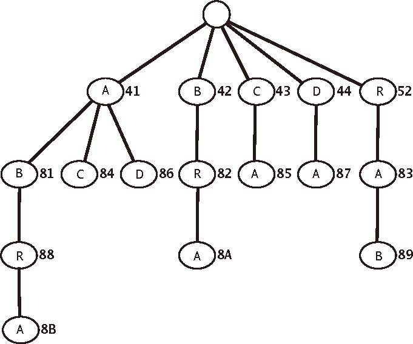

- 图 5.5.18　LZW 算法的编译表的单词查找树表示

### 5.5.6.14　LZW 压缩的展开

如示例所示，LZW 压缩的展开所需的输入是一系列 8 位编码，而输出则是一个 7 位 ASCII 字符组成的字符串。在展开时，我们会维护一张关联字符串和编码值的符号表（这张表的逆表是压缩时所用的符号表）。在这张表中加入 00 到 7F 和所有单个 ASCII 字符的字符串的关联条目，将第一个未关联的编码值设为 81（80 保留为文件结尾的标记），将保存了当前字符串的

```
变量 val 设为含有第一个字符的字符串，在遇到编码 80（文件结束）之前不断进行以下操
```

作：

```
输出当前字符串 val；
从输入中读取一个编码 x；
在符号表中将 s 设为和 x 相关联的值；
在符号表中将下一个未分配的编码值设为 val+c，其中 c 为 s 的首字母；
将当前字符串 val 设为 s。
```

这个过程比压缩更加复杂，原因来自于前瞻字符：需要读取下一个编码来得到和它相关联的字符串的首字母，这使得整个过程不同步。对于前 7 个编码，只需要在符号表中查找并输出相应的字符，然后多读取一个字符并在符号表中添加一个两个字符的字符串的条目。这和之前是相

```
同的。然后读到 81（输出 AB 并向符号表中添加 ABR），然后是 83（输出 RA 并添加 RAB），
82（输出 BR 并添加 BRA），88（输出 ABR 并添加 ABRA），然后只剩下 41。最终会遇到文件
```

结束的标记 80（因此输出 A）。这个过程结束后，就已经如期写出了原始的输入，并且构造了一张和压缩时相同的符号表（只是键和值的位置对调了，请见图 5.5.19）。注意，我们也可以使用一个简单的字符串数组来表示符号表，索引为编码。

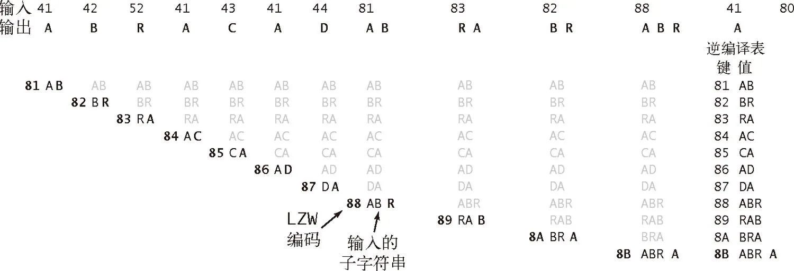

```
图 5.5.19　LZW 算法对 41 42 52 41 43 41 44 81 83 82 88 41 80 的展开
```

- 算法 5.11　LZW 算法的压缩

```java
public class LZW
1
{
2
  private static final int R = 256;        // 输入字符数
3
  private static final int L = 4096;       // 编码总数=2^12
4
  private static final int W = 12;         // 编码宽度
5
6
  public static void compress()
7
  {
8
     String input = BinaryStdIn.readString();
9
     TST<Integer> st = new TST<Integer>();
10
11
     for (int i = 0; i < R; i++)
12
         st.put("" + (char) i, i);
13
     int code = R+1;  // R为文件结束(EOF)的编码
14
15
     while (input.length() > 0)
16
     {
17
        String s = st.longestPrefixOf(input); // 找到匹配的最长前缀
18
        BinaryStdOut.write(st.get(s), W);     // 打印出s的编码
19
20
        int t = s.length();
21
        if (t < input.length() && code < L)   // 将s加入符号表
22
23
            st.put(input.substring(0, t + 1), code++);
24
        input = input.substring(t);           // 从输入中读取s
25
     }
26
27
    BinaryStdOut.write(R, W);                 // 写入文件结束标记
28
    BinaryStdOut.close();
29
  }
30
31
  public static void expand()
32
  // 请见算法5.11（续）
33
}
34
Lempel-Ziv-Welch 数据压缩算法的这份实现的输入为 8 位的字节流，输出为 12 位编码，
```

- 适用于任意大小的文件。对于较小的样例输入，它所产生的编码和在正文中所讨论的类似：

```
单字符的编码的开头为 0，其他编码从 100 开始。
% more abraLZW.txt
1
ABRACADABRABRABRA%
2
3
java LZW - < abraLZW.txt | java HexDump 20
4
04 10 42 05 20 41 04 30 41 04 41 01 10 31 02 10 80 41 10 00
5
160 bits
6
```

### 5.5.6.15　特殊情况

在刚才描述的过程中，存在这一个小小的问题。常常只有基于以上描述实现了这个过程的同学（以及有经验的程序员！）才能发现它。这个问题就是前瞻过程所得到的字符可能和当前子字符串的开头字符相同，如图 5.5.20 所示。在这个例子中，输入字符串：

```
ABABABA
```

如图 5.5.20 上方所示，被压缩得到的输出编码为：

```
41 42 81 83 80
```

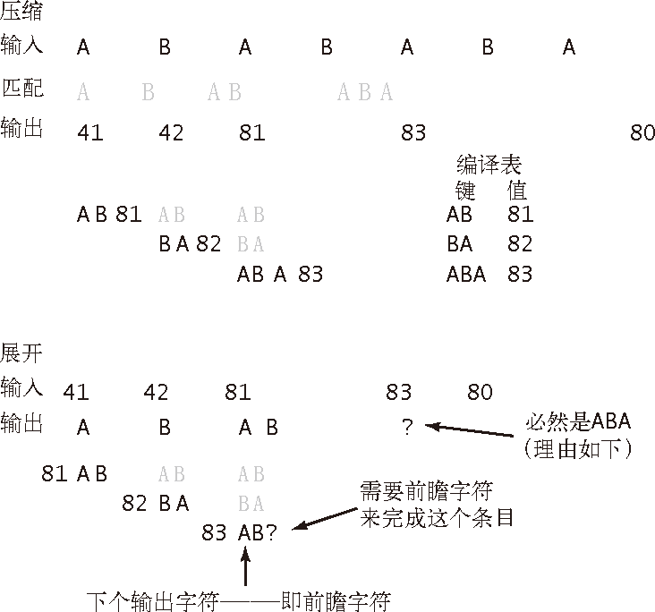

- 图 5.5.20　LZW 算法的展开：特殊情况

```
在展开时，首先会得到编码 41 并输出 A，然后读取 42 得到前瞻字符并将 AB 和 81 插入符号
表；输出 42 所对应的 B，读取 81 得到前瞻字符并将 BA 和 82 插入符号表；输出 81 所对应
的 AB。到目前为止事情进展得不错。但当我们接下来取得了编码 83 并希望得到前瞻字符
```

时，就被卡住了，因为读取编码所要补全的符号表条目正是 83 ！幸运的是，检查（只有在读取的编码和需要完成的编码条目相同时才会出现）并修正（此时，前瞻字符必然是当前字符串的首字母，因为它就是下个将被输出的字符）这种情况并不困难。在这个例子中，前瞻字符必

```
然是 A（ABA 的首字母）。因此，下一个被输出的字符串和符号表中 83 的值都是 ABA。
```

### 5.5.6.16　实现

```
经过这些描述之后，实现 LZW 编码就很简单了，如算法 5.11 所示（expand() 方法的实现
```

请见算法 5.11（续））。这段实现接受 8 位字节流作为输入（因此能压缩任意文件，而不仅仅是字符串），并产生 12 位编码的输出流（因此字典会非常大，压缩率也会更好）。这些值指定

```
在（final 修饰的）实例变量 R、L 和 W 中。在 compress() 方法中使用了一棵三向单词
查找树（请见 5.2 节）来表示编译表（利用单词查找树来支持高效的 longestPrefixOf()
操作），在 expand() 方法中使用了一个字符串数组来表示逆向编译表。这样，compress()
和 expand() 方法的代码就不完全与正文中的描述一一对应了。这些方法非常高效。对于某
```

些文件，我们还可以通过在编译表满时将其清空并重用全部编码来改进它们。这些改进以及评估它们的性能所需的实验都留作本节最后的练习。

- 算法 5.11（续）　LZW 算法的展开

```java
public static void expand()
1
{
2
  String[] st = new String[L];
3
4
  int i; // 下一个待补全的编码值
5
6
  for (i = 0; i < R; i++)            // 用字符初始化编译表
7
     st[i] = "" + (char) i;
8
  st[i++] = " ";  // （未使用）文件结束标记(EOF)的前瞻字符
9
10
  int codeword = BinaryStdIn.readInt(W);
11
  String val = st[codeword];
12
  while (true)
13
  {
14
     BinaryStdOut.write(val);        // 输出当前子字符串
15
     codeword = BinaryStdIn.readInt(W);
16
     if (codeword == R) break;
17
     String s = st[codeword];        // 获取下一个编码
18
     if (i == codeword)              // 如果前瞻字符不可用
19
        s = val + val.charAt(0);     // 根据上一个字符串的首字母得到编码的字符串
20
     if (i < L)
21
        st[i++] = val + s.charAt(0); // 为编译表添加新的条目
22
     val = s;                        // 更新当前编码
23
  }
24
25
  BinaryStdOut.close();
26
27
}
28
```

- 这段代码实现了 Lempel-Ziv-Welch 算法的展开。展开比压缩更加复杂，因为需要从下一个编码中获取前瞻字符，并且存在前瞻字符可能不可用的复杂情况（请见正文）。

```
% java LZW - < abraLZW.txt | java LZW +
1
ABRACADABRABRABRA
2
3
% more ababLZW.txt
4
ABABABA
5
6
% java LZW - < ababLZW.txt | java LZW +
7
ABABABA
8
```

和以前一样，请花一点时间仔细研究程序和图 5.5.21 给出的 LZW 算法压缩的实例。十几年以来，它已经被证明为是一个多用途高效率的压缩算法。

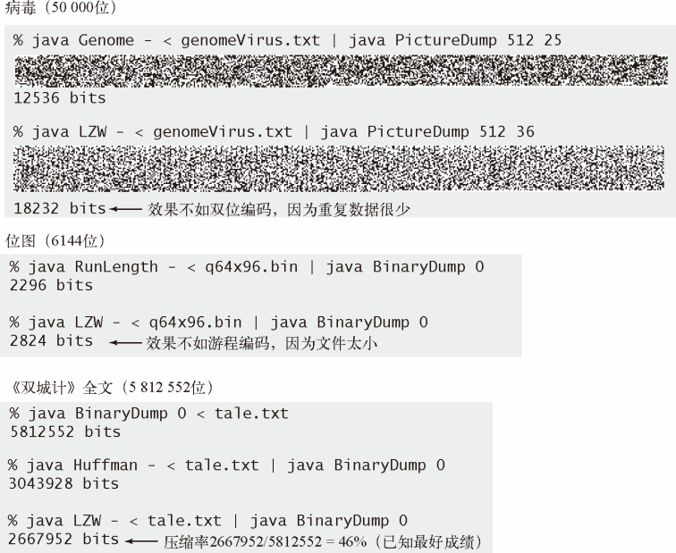

- 图 5.5.21　采用 12 位编码的 LZW 算法对各种文件的压缩和展开

### 答疑

```
问　为什么需要 BinaryStdIn 和 BinaryStdOut ？
答　这是在便利性和效率之间作出的一个平衡。StdIn 每次能够处理 8 位数据，而
BinaryStdIn 必须处理每一位数据。大多数应用程序处理的都是字节流，但数据压缩是个例
```

外。

```
问　为什么需要 close() 方法？
```

```
答　有这个要求的是因为标准输出流是一个字节流，因此 BinaryStdOut 需要知道何时将最
```

后一个字节对齐并输出。

```
问　能够将 StdIn 和 BinaryStdIn 混用吗？
```

答　最好不要这样。因为它们都和系统以及具体的实现有关，谁也不知道会出现什么情况。我

```
们的实现会抛出一个异常。但从另一方面来说，混用 StdOut 和 BinaryStdOut 没有问题
```

（我们的代码就这么使用的）。

```
问　为什么在 Huffman 类中 Node 类是静态的？
```

答　我们将所有数据压缩算法都组织成了静态方法的集合，而没有实现任何数据结构。

问　我能保证数据压缩算法至少不会将比特流变长吗？

答　你可以直接把输入复制到输出，但仍然需要某种标记来说明不需要使用任何标准的数据压缩方法就可以使用它。某些商业数据压缩程序有时会作出这种保证，但实际上这种保证很脆弱并且远远不具备通用性。事实上，大多数数据压缩算法甚至都做不到我们对命题 S 的第一种证明方法的第二步：极少有算法能够进一步压缩其自身产生的比特字符串。

### 练习

5.5.1　请看下表所示的 4 种变长编码。哪些编码是无前缀的？哪些编码的解码方式是唯一的？对于解码方式唯一的编码，请给出 1000000000000 的解码结果。

- 编码 1编码 2编码 3编码 4

符号

A

- 0011

B

- 10010101

C

- 1000001001

D

- 11110001000

5.5.2　给出一个非前缀码但解码方式又是唯一的编码。

答：任意无后缀的编码都是解码方式唯一的编码。

5.5.3　给出一个即非前缀码又非后缀码且解码方式唯一的编码。

答：

5.5.4　 和 的解码方式是唯一的吗？如果不是，找出一条可以用两种方式解码的字符串。

```
5.5.5　使用 RunLength 处理本书网站上的文件 q128x192.bin。被压缩后的文件含有多少比
```

特？

```
 个符号 a 编码需要多少比特（作为
 个序列 abc 呢？
```

5.5.6　将

- 的函数）？


```
5.5.7　给出用游程编码、霍夫曼编码、LZW 编码压缩字符串 a,aa,aaa,aaaa,...（含有
 个 a 的字符串）的结果，以
```

- 的函数表示压缩比。

5.5.8　给出用游程编码、霍夫曼编码、LZW 编码压缩字符串

```
ab,abab,ababab,abababab,...（将 ab 重复
```

- 次得到的字符串）的结果，以的函数

表示压缩比。

5.5.9　估计游程编码、霍夫曼编码和 LZW 编码处理长度为

- 的随机 ASCII 字符串（任意位

置都有独立均等的几率出现任意字符）的压缩比。

```
5.5.10　按照正文中的示意图的样式显示使用 Huffman 处理字符串 it was the age of
foolishness 时霍夫曼编码树的构造过程。压缩后的比特流需要多少比特？
```

5.5.11　如果所有字符均来自一个只有两个字符的字母表，该字符串的霍夫曼编码将会是什

- 的字符串，使得霍夫曼编码得到的结果最长。

么？给出这样的一个长度为

5.5.12　假设所有符号出现的概率均为 2 的负若干次方，描述相应的霍夫曼编码。

5.5.13　假设所有符号出现的概率均相等，描述相应的霍夫曼编码。

5.5.14　假设需要编码的所有字符的出现频率均不相同。此时的霍夫曼编码树是唯一的吗？

- 4

5.5.15　只需扩展霍夫曼算法即可有效地将双位字符编码（使用四向树

- ）。这么做的主要优

点和缺点是什么？

5.5.16　以下输入经过 LZW 编码后的结果是什么？

a. T O B E O R N O T T O B E

b. Y A B B A D A B B A D A B B A D O O

c. A A A A A A A A A A A A A A A A A A A A A

5.5.17　总结 LZW 编码中需要特别注意的情况。

```
　解答：每当遇到形如 cScSc 的字符串时都会出现这种情况，其中 c 是一个符号而 S 是一
个字符串，字典中已经含有 cS 但没有 cSc。
```


5.5.18　设

- 是第个斐波那契数。假设有一个符号序列，其中第个符号的频率为。注


- 。给出相应的霍夫曼编码。提示：最长编码的长度为

意，

- 。


5.5.19　证明，对于给定的

- 个符号的集合，至少存在种不同的霍夫曼编码。

5.5.20　给出一种霍夫曼编码，使得输出中的 0 的出现频率比 1 要高得多。

```
　答：如果字符 A 出现了 100 万次而 B 只出现了一次，那么将 A 的编码设为 0，B 的编码设
```

为 1 即可。

5.5.21　请证明在任意霍夫曼编码中，最长的两个编码的长度必然是相等的。

```
5.5.22　请证明霍夫曼编码的以下性质：如果符号 i 的出现频率大于符号 j，那么符号 i 的
编码长度将会小于等于符号 j 的编码长度。
```

5.5.23　如果将用霍夫曼编码得到的字符串看作由 5 位字符组成的字符流并继续用霍夫曼编码处理它，结果将会是什么？

5.5.24　按照正文中示意图的样式显示使用 LZW 编码处理以下字符串时所构造的编码树以及整个压缩和展开的过程。

```
　it was the best of times it was the worst of times
```

### 提高题

```
5.5.25　定长定宽的编码。实现一个使用定长编码的 RLE 类来压缩不同字符较少的 ASCII 字
节流，将编码输出为比特流的一部分。在 compress() 方法用一个 alpha 字符串保存输入
中所有不同的字母，用它得到一个 Alphabet 对象以供 compress() 方法使用。将 alpha
字符串（8 位编码再加上它的长度）添加到压缩后的比特流的开头。修改 expand() 方法，
```

在展开之前先读取它的字母表。

5.5.26　重建 LZW 字典。修改 LZW 算法，当字典饱和时将其清空。这种方式适合某些应用程序，因为它能更好地适应输入中的字符变化。

5.5.27　较长的重复。估计游程编码、霍夫曼编码和 LZW 编码处理长度为

- 的一条字符串


- 的一条随机 ASCII 字符串（请见练习 5.5.9）重复而成。

的压缩率，该字符串由长度为

## 第 6 章　背景

在现代社会中，计算机设备无处不在。在过去的几十年中，我们世界中的电子设备还是一片空白，但现在它们已经成为数十亿人日常必备的工具。今天的手机甚至都比 30 年前只有少数人才有权使用的超级计算机强大若干个数量级。这些设备高效工作的背后都离不开算法，而其中的一些算法本书中也有所讨论。这是为什么呢？因为适者生存。可扩展的（线性的和线性对数级别的）算法是这个过程的核心并证明了高效算法的重要性。20 世纪 60 年代和 70 年代的一些研究者用这些算法为我们的今天打下了基础。他们知道，可扩展的算法是未来的关键，而过去几十年的发展也证明了这一点。现在，基础设施已经完备，人们已经开始利用它们达到各种目的。正如 B.Chazelle 所说，20 世纪是方程的世纪，但 21 世纪是算法的世纪。

本书中讨论的基础算法只是一个开始。当算法能够成为大学中的一门独立学科时，这一天就快要到来了（也许已经来了）。在商业应用、科学计算、工程、运筹学和其他无数有待人们探索的领域中，高效的算法都能使原来不可能解决的问题得到解决。本书的重点是学习重要而实用的算法。在本章中，我们会沿着这条路继续讨论几个示例，它们能够说明已经学过的一些算法在高级实践情景中的作用。（还包括一些学习算法的方法。）为了说明算法的影响范围，我们首先列出算法的几个重要的应用领域，然后详细讨论几个有代表性的示例并介绍算法的相关理论来说明应用的深度。不过对于这本大厚书来说，在最后涉及的这两个主题都是介绍性的，并不全面，实际生活中还有许多同样广泛的领域、同样重要的应用场景、同样有影响力的具体问题。

商业应用

互联网的出现加强了算法在商业应用软件中的核心地位。人们经常使用的所有应用都得益于我们已经学过的许多经典算法：

- 基础设施（操作系统、数据库、通信）；

- 应用程序（电子邮件、文档处理、数码照片）；

- 出版（书籍、杂志、网络内容）；

- 网络（无线网络、社交网络、互联网）；

- 交易处理（金融、零售、网络搜索）。

本章中将会讨论一个有代表性的示例，即 B- 树。它是为 20 世纪 60 年代的大型机发明的一种复杂的数据结构，但今天它仍然是现代数据库系统的基础结构。此外，还将讨论用于文本索引的后缀数组。

科学计算

自从冯·诺依曼在 1950 年发明了归并排序之后，算法在科学计算领域逐渐起到了重要的作用。今天的科学家需要处理大量的实验数据。他们在同时使用数学模型和计算模型来理解自然世界，包括：

- 数学计算（多项式、矩阵、微分方程）；

- 数据处理（实验结果和观测资料，特别是基因组学）；

- 计算模型和模拟。

这些任务都可能需要大量复杂的海量数据计算。在科学计算领域，本章中会详细讨论的一个经典示例就是事件驱动模拟问题。它的思想是维护一个复杂的真实世界的模型并根据时间控制模型中发生的变化。这种基础方法有着非常多的应用。此外还将讨论一个基因计算领域的基础数据处理问题。

工程学

现代工程学的基础是技术，而现代技术的基础是计算机。因此，算法能够发挥重要作用的方面包括：

- 数学计算和数据处理；

- 计算机辅助设计和生产；

- 基于算法的工程设计（网络、控制系统）；

- 图像和其他医学系统。

工程师和科学家使用的许多工具和方法都是相同的。例如，科学家用计算模型和模拟来理解自然世界；而工程师用计算模型和模拟来设计、建造并控制他们所制造的各种产品。

运筹学

运筹学领域的研究者和实践者开发了各种数学模型并用它们解决了许多问题，包括：

- 任务调度；

- 决策；

- 资源分配。

4.4 节中的最短路径问题就是一个经典的运筹学问题。本章会再次讨论它并介绍最大流量问题。我们会展示规约的重要性并讨论它对于问题解决（problem-solving）的通用模型的影响，特别是对运筹学中核心的线性规划模型的影响。

算法在计算机科学的各个子领域中都有着重要的地位，它的应用领域包括，但绝对不局限于：

- 计算几何；

- 密码学；

- 数据库；

- 编程语言与系统；

- 人工智能。

在所有领域中，说明问题并找到有效算法和数据结构来解决问题都是非常重要的。我们已经学过的部分算法是可以直接使用的。更重要的是，本书的核心内容，也就是设计、实现和分析算法的一般方法在所有这些领域中都已经被成功地验证过。这种效应已经从计算机科学扩散到了许多其他领域，包括体育、音乐、语言学、金融、神经科学，等等。

我们现在已经学习了许多重要且实用的算法，那么理解它们之间的相互关系就变得很必要了。在本章的（也是本书的！）结尾我们会简要介绍计算理论，重点是不可解性（intractability）和 P=NP? 这个问题。它们仍然是理解实践中遇到的各种问题的关键。

[1]：每个结点都含有4条链接。——译者注
