# 6.0.1事件驱动模拟

我们的第一个示例是一个基础的科学应用：按照弹性碰撞的原理模拟粒子系统的运动。科学家通过这个系统可以理解和预测物理系统的性质。这个模型可以模拟气体中分子的运动、化学反应的动态过程、原子扩散、最密堆积问题（sphere packing）、行星的环的稳定性、某些元素的相变、一维自引力体系前向阵面传播技术等许多问题。它可应用的范围从分子运动中的微小亚原子粒子到天体物理学中巨大的星体对象。

讨论这个问题需要一些高中物理知识、一些软件工程的知识和一些算法知识。我们把大部分和物理有关的内容留作练习，而主要关注使用基础的算法工具（基于堆的优先队列），以处理它的一个实际应用，将不可能的计算变为可能。

### 6.0.1.1　刚性球体模型

首先介绍一个理想模型，它描述的是原子和分子在含有以下性质的容器中的运动：

- 运动的粒子与墙以及互相之间的碰撞是弹性的；

- 每个粒子都是一个已知位置、速度、质量和直径的球体；

- 不存在其他外力。

这个简单的模型在统计力学这个既与宏观现象（例如温度和压力）有关又与微观现象（例如单个原子和分子的运动）有关的学科中十分重要。麦克斯韦和玻尔兹曼使用这个模型得到了由温度的函数表示的相互碰撞的分子的速度分布，爱因斯坦用这个模型解释了花粉颗粒在水中的布朗运动。不存在其他外力的假设意味着粒子在碰撞之前是在做匀速直线运动。我们也可以通过添加其他作用力来扩展这个模型。例如，如果加上摩擦力和自旋，那就可以更加准确地描述一些熟悉的物理运动，例如台球桌上的台球。

### 6.0.1.2　时间驱动模拟

我们的主要目标是维持这个模型，即希望能够记录所有粒子在任意时间内的位置和速度。为

- 时的所有粒子的位置和速度后，再给出时间之后，即未来

此，需要计算：在给定了时刻

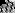

- 时它们的位置和速度。如果所有粒子互相之间以及和墙的距离都很远，那么计

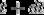

的时间点算就很简单了：因为粒子的轨迹是一条直线，所以只需要用粒子的速度就可以更新它的位置。这个问题的挑战在于要考虑碰撞情况。一种解决方法叫做时间驱动模拟（请见图 6.0.1），它基于使用固定长度的

- 。在每次更新时，我们都需要检查所有粒子对，判定它们是否可能相遇，

然后还原它们的第一次碰撞。此时，我们将会更新两个粒子的速度以反映出碰撞的结果（计算

- 是以秒计（一般为

方法会稍后讨论）。在粒子数量很多时，这种方式的计算量非常大：如果

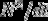

- 个粒子的系统一秒钟的运动所需的时间与成正比。这

一秒的若干分之一），它模拟


种成本太昂贵了（比平方级别的算法更高）——在一般的应用中，

- 都会非常大而会非常

- 的问题在于如果它太小，计算量就太高，但如果它太大，那就可能错过许多次碰撞，

小。

请见图 6.0.2。

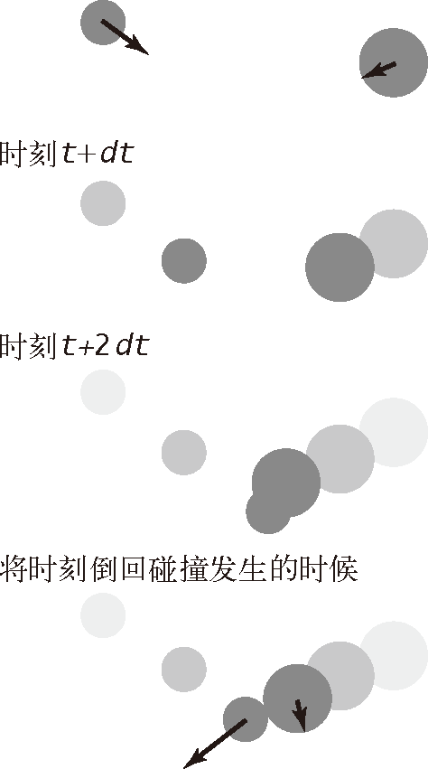

- 图 6.0.1　以时间作为驱动的模拟

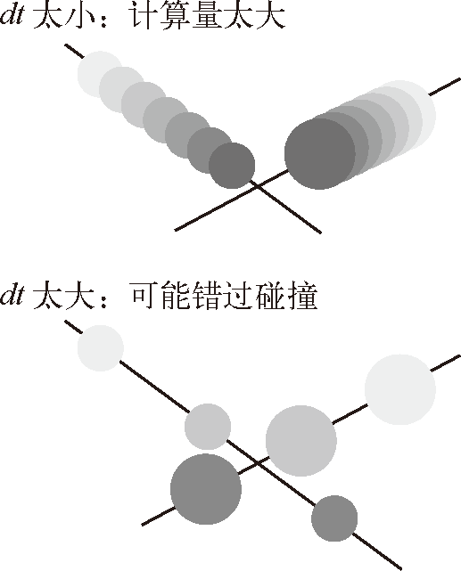

- 图 6.0.2　驱动模拟的主要问题

### 6.0.1.3　事件驱动模拟

另一种方法是仅关注碰撞发生的时间点，重点关注下一次碰撞（因为在此之前由速度计算得到的所有粒子的位置都是有效的）。因此，我们可以使用一个优先队列来记录所有事件。事件是未来的某个时间的一次潜在的碰撞，可能发生在两个粒子之间，也可能发生在粒子和墙之间。和每个事件相关联的优先级就是它发生的时间，因此当从优先队列中删去优先级最低的元素时，就会得到下一次潜在的碰撞。

### 6.0.1.4　碰撞预测

我们如何才能识别潜在的碰撞呢？粒子的速度正好提供了这个必要的信息。例如，假设在单位

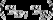

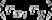

- 有一个半径为速度为的粒子位于处，

空间中，在时刻

- 。假设墙位于

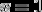

- 在 0 到 1 之间。我们感兴趣的是运动的横向分量，因此注意力集中在位置的分量

高度


- 分量上。如果是负数，那么粒子的轨迹不会与墙体相交，但如果是正

和速度的

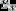

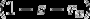

- 除以速度的分量

数，那就存在一个粒子和墙的潜在碰撞。将例子和墙的间距

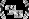

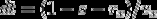

- 个时间单位之后，此时粒子的，就可以得到粒子和墙的碰撞时间为

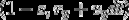

- ，除非它在之前又撞上了其他某个粒子或者墙，请见图 6.0.3。因

位置将为

- 的条目（以及一些描述该示例和墙的碰

此，我们就可以向优先队列中插入一个优先级为撞事件的信息）。墙体的碰撞预测计算都是类似的（请见练习 6.1）。两个粒子之间的碰撞也是类似的，但更加复杂一些。不过你会注意到这种计算得到的预测结果通常是不会碰撞（比如粒子正在向墙体的反方向移动，或者两个粒子的运动方向相反）——这种情况下就不需要向优先队列中插入任何东西。为了处理另一种典型情况，也就是预测到的碰撞距现在的时间太远时，

```
就需要一个 limit 参数来指定有效的时间段，这样就可以忽略时间晚于 limit 发生的所有事件
```

了。

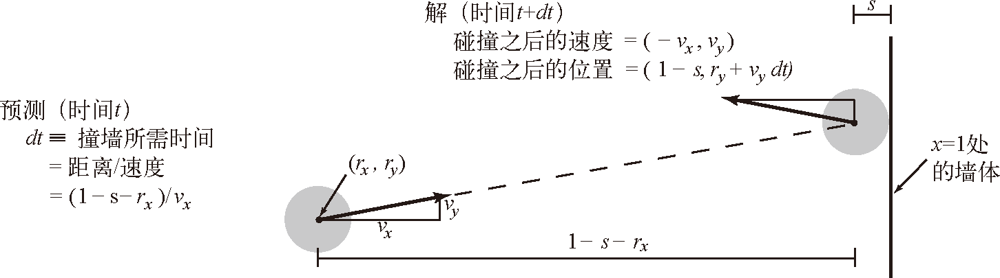

- 图 6.0.3　预测并解决粒子和墙体的一次碰撞

### 6.0.1.5　碰撞计算

当发生碰撞时，我们需要使用物理公式来进行计算，以描述一个粒子在和另一个粒子或者墙体发生弹性碰撞时的行为。在示例中，墙体遇到了一面竖墙。如果发生碰撞，粒子的速度将会从

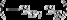

- 变为，请见图 6.0.3。其他墙体的碰撞和它类似。两个粒子的碰撞也是类似

的，但要更加复杂一些（请见练习 6.1）。

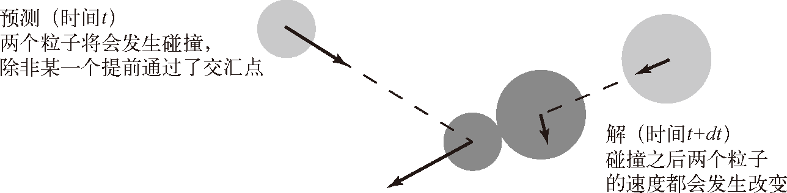

- 图 6.0.4　预测并计算粒子之间的一次碰撞

### 6.0.1.6　排除无效事件。

预测的许多碰撞实际上都不会发生，因为它们被其他的碰撞打断了，请见图 6.0.7。为了处理这种情况，我们为每个粒子维护一个实例变量来记录和它有关的碰撞数量。当从优先队列中取出一个事件来处理时，我们会检查该事件所涉及粒子的碰撞计数器在事件被创建后是否已经更新。这是排除无效碰撞的延时方法：当某个粒子参与了一次碰撞时，我们不会删除优先队列中和该粒子有关的其他碰撞（尽管这些碰撞事件现在都已经无效了），而是会在之后遇到它们时直接将其忽略，请见图 6.0.6。另一种即时的方式是立刻从优先队列中删除所有与参与当前事件的粒子相关的其他事件，然后再计算这些粒子的新潜在碰撞事件。这种方式需要的优先队列更加复杂（需要实现删除操作）。

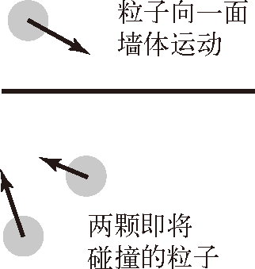

- 图 6.0.5　可预测的事件

以上讨论了一些预备知识，这些都是对按照物理定律进行弹性碰撞的运动粒子执行事件驱动模

```
拟所必备的。相应的软件架构会将实现封装在 3 个类中：一个 Particle 数据类型，封装了
所有和粒子有关的计算；一个 Event 数据类型来预测事件；一个它们的用例
CollisionSystem 类用来完成模拟。模拟的核心是一个含有所有事件的 MinPQ 优先队列，
按照时间排序。下面看一下 Particle、Event 和 CollisionSystem 的实现。
```

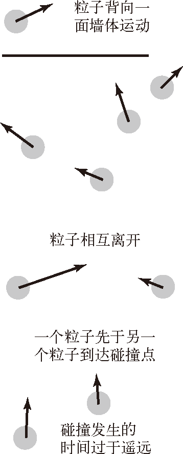

- 图 6.0.6　可预测的不可能发生的事件

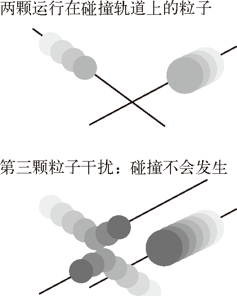

- 图 6.0.7　一次失效的事件

### 6.0.1.7　粒子

练习 6.1 基于牛顿的运动学定律给出了粒子数据类型的实现要点。模拟用例应该能够移动粒子、画出粒子并进行若干和碰撞相关的计算，如表 6.0.1 中的 API 所示。

表 6.0.1　运动的粒子对象的 API

```java
public class <b>Particle</b>
             Particle()
```

- 在单位空间中创造一个新的随机粒子

```
             Particle(
               double rx, double ry,
               double vx, double vy,
```

- 用给定的位置、速度、半径和质量创建

```
               double s,
               double mass)
        void draw()
```

- 画出粒子

```
        void move(double dt)
根据时间的流逝 dt 改变粒子的位置
         int count()
```

- 该粒子所参与的碰撞总数

```
      double timeToHit(Particle b)
距离该粒子和粒子 b 碰撞所需的时间
      double timeToHitHorizontalWall()
```

- 距离该粒子和水平的墙体碰撞所需的时

```
      double timeToHitVerticalWall()
```

- 距离该粒子和垂直的墙体碰撞所需的时

```
d
bl
b
Off(P
ti l
b)
```

- 碰撞后该粒子的速度

```
当粒子不在碰撞轨道上时（这是很常见的），3 个 timeToHit*() 的方法都会返回
Double.POSITIVE_INFINITY。这些方法可以帮助预测给定粒子在未来的所有碰撞，将在
limit 时间内发生的碰撞事件插入优先队列。在处理两颗粒子相撞的事件时，使用
bounceOff() 方法计算两颗粒子在碰撞之后的速度。bounceOff*() 方法用于处理粒子和
```

墙体之间的碰撞事件。

### 6.0.1.8　事件

```java
private class Event implements Comparable<Event>
{
  private final double time;
  private final Particle a, b;
  private final int countA, countB;
  public Event(double t, Particle a, Particle b)
  {  // 创造一个发生在时间t且与a和b相关的新事件
     this.time = t;
     this.a    = a;
     this.b    = b;
     if (a != null) countA = a.count(); else countA = -1;
     if (b != null) countB = b.count(); else countB = -1;
  }
  public int compareTo(Event that)
  {
     if      (this.time < that.time) return -1;
     else if (this.time > that.time) return +1;
     else return 0;
  }
  public boolean isValid()
  {
     if (a != null && a.count() != countA) return false;
     if (b != null && b.count() != countB) return false;
     return true;
  }
}
```

粒子模拟的事件类

我们将应该放入优先队列中的所有对象信息封装在一个私有类之中（各种事件）。实例变量

```
time 记录的是事件的预计发生时间，实例变量 a 和 b 保存的是和该事件相关的粒子。这里
```

有 3 种不同类型的事件：粒子和垂直墙体碰撞、粒子和水平墙体碰撞、粒子和粒子碰撞。为了平滑动态地显示运动中的粒子，我们添加了第 4 种类型的事件，即重绘事件。它的作用是将所

```
有粒子在它们的当前位置画出。为了使 Event 的实现能够表示这 4 种类型的事件，允许粒子
的值为空（null）：
a 和 b 均不为空：粒子与粒子碰撞；
a 非空而 b 为空：粒子 a 和垂直墙体的碰撞；
a 为空而 b 非空：粒子 b 和水平墙体的碰撞；
a 和 b 均为空：重绘事件（画出所有粒子）。
```

尽管没有完全遵循面向对象编程的原则，但这些约定能够得到简洁的用例代码。它的实现如上一页右下角的框注所示。

```
Event 类型实现中的第二个技巧是，它维护了两个实例变量 countA 和 countB，以记录事
```

件创建时每个粒子所参与的碰撞事件数量。如果在将事件从优先队列中取出时该值没有发生变化，那么就可以继续模拟这个事件的发生。但如果在这个事件进入优先队列和离开优先队列的

```
这段时间内任何计数器发生了变化，这个事件就失效了，那就可以忽略它。方法 isValid()
```

支持用例代码检查这种情况。

### 6.0.1.9　模拟器代码

```
有了封装在 Particle 类和 Event 类中的运算，实际模拟所需的代码非常少，如
CollisionSystem 的实现所示（请见框注“基于事件模拟互相碰撞的粒子（框架）”和框注“基
```

于事件模拟互相碰撞的粒子（主循环）”）。大多数运算都封装在右侧框注所示的

```
predictCollision() 方法中。这个方法会计算与粒子 a 有关的所有潜在碰撞（可能是和
```

另一个粒子，也可能是和一面墙）并将相应的事件加入优先队列中。

```java
private void predictCollisions(Particle a, double limit)
{
  if (a == null) return;
  for (int i = 0; i < particles.length; i++)
  {  // 将与particles[i]发生碰撞的事件插入pq中
     double dt = a.timeToHit(particles[i]);
     if (t + dt <= limit)
        pq.insert(new Event(t + dt, a, particles[i]));
  }
  double dtX = a.timeToHitVerticalWall();
  if (t + dtX <= limit)
     pq.insert(new Event(t + dtX, a, null));
  double dtY = a.timeToHitHorizontalWall();
  if (t + dtY <= limit)
     pq.insert(new Event(t + dtY, null, a));
}
```

预测其他粒子的碰撞事件

```
模拟的核心是框注“基于事件模拟互相碰撞的粒子（主循环）”中的 simulate() 方法。我们会
调用 predictCollision() 方法来初始化每个粒子，将所有粒子和墙体以及粒子和粒子之
```

间的潜在碰撞加入优先队列中，然后进入事件驱动模拟的主循环，它的任务包括：

- 取出即将发生的事件（时间为 t 的优先级最小的事件）；

- 如果事件无效，将它忽略；

- 按照直线运动轨迹使所有粒子运动到时间 t；

- 更新所有参与碰撞的粒子速度；

```
使用 predictCollision() 方法来预测参与碰撞的粒子在未来可能发生的碰撞，并向优
```

- 先队列中插入相应的事件。

这个模拟过程可以作为计算系统中的各种有趣性质的基础，如练习所示。例如，我们所感兴趣的一种基本性质是所有粒子向墙体所施加的压力。计算这种压力的一种方法是记录墙体和粒子碰撞的次数和动量（根据粒子的质量和速度计算这个值很简单），这样就很容易得到它们的总量。温度性质的计算也是类似的。

- 基于事件模拟互相碰撞的粒子（框架）

```java
public class CollisionSystem
1
{
2
  private class Event implements Comparable<Event>
3
  {  /* 请见正文 */  }
4
5
  private MinPQ<Event> pq;        // 优先队列
6
  private double t  = 0.0;        // 模拟时钟
7
  private Particle[] particles;   // 粒子数组
8
9
  public CollisionSystem(Particle[] particles)
10
  {  this.particles  = particles;  }
11
12
  private void predictCollisions(Particle a, double limit)
13
  {  /* 请见正文 */  }
14
15
  public void redraw(double limit, double Hz)
16
  { // 重绘事件：重新画出所有粒子
17
    StdDraw.clear();
18
    for(int i = 0; i < particles.length; i++) particles[i].draw();
19
    StdDraw.show(20);
20
    if (t < limit)
21
       pq.insert(new Event(t + 1.0 / Hz, null, null));
22
  }
23
24
  public void simulate(double limit, double Hz)
25
  {  /* 请见后面的主循环代码*/  }
26
27
  public static void main(String[] args)
28
  {
29
     StdDraw.show(0);
30
     int N = Integer.parseInt(args[0]);
31
     Particle[] particles = new Particle[N];
32
33
     for (int i = 0; i < N; i++)
34
        particles[i] = new Particle();
35
     CollisionSystem system = new CollisionSystem(particles);
36
     system.simulate(10000, 0.5);
37
  }
38
}
39
该类使用了优先队列来模拟粒子系统随着时间的运动。测试用例 main() 接受命令行参数
N，创造了 N 个随机粒子并创建了含有所有粒子的 CollisionSystem，然后调用
simulate() 方法模拟系统的演化。其中的实例变量分别保存了模拟所需的优先队列、当
```

- 前时间和所有粒子。

- 基于事件模拟互相碰撞的粒子（主循环）

```java
public void simulate(double limit, double Hz)
1
{
2
  pq = new MinPQ<Event>();
3
  for (int i = 0; i < particles.length; i++)
4
     predictCollisions(particles[i], limit);
5
  pq.insert(new Event(0, null, null));  // 添加重绘事件
6
  while (!pq.isEmpty())
7
  {  // 处理一个事件
8
     Event event = pq.delMin();
9
     if (!event.isValid()) continue;
10
     for (int i = 0; i < particles.length; i++)
11
        particles[i].move(event.time - t); // 更新粒子的位置
12
     t = event.time;                       // 和时间
13
     Particle a = event.a, b = event.b;
14
     if      (a != null && b != null) a.bounceOff(b);
15
     else if (a != null && b == null) a.bounceOffVerticalWall();
16
     else if (a == null && b != null) b.bounceOffHorizontalWall();
17
     else if (a == null && b == null) redraw(limit, Hz);
18
     predictCollisions(a, limit);
19
     predictCollisions(b, limit);
20
  }
21
}
22
```

- 该方法是事件驱动模拟的主要部分。首先，我们用所有粒子预测的所有未来碰撞初始化优先队列。然后，主循环从队列中取出一个事件，更新时间和粒子的位置，并在处理碰撞后向队列中加入由此产生的所有新的潜在碰撞。

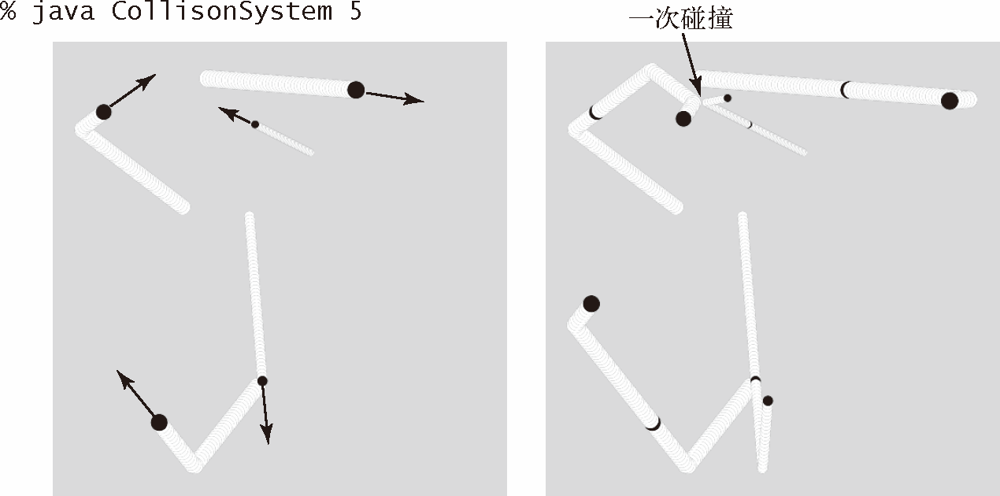

### 6.0.1.10　性能

如本小节的开头所述，我们对于事件驱动模拟的主要兴趣在于避免时间驱动模拟的内循环所必须的大量计算。


- 命题 A。对个能够相互碰撞的粒子系统，基于事件的模拟在初始化时最多需要次优

- 次优先队列操作（且对于每个无效的事件都需要一次额先队列操作，在碰撞时最多需要

- 外的操作）。证明。请见代码。证明。请见代码。

如果使用 2.4 节中优先队列的标准实现，我们能够保证优先队列的每次操作都是对数级别的，因此每次碰撞所需的时间是线性对数级别的。这样，才有可能模拟大量的粒子。

事件驱动模拟已经被应用于无数需要对运动中的物理对象建模的其他领域，例如分子学、天体物理学和机器人技术。这些应用可能会用其他实体，或是三维空间，或是其他作用力等许多种方法扩展这个模型。每种扩展都会为计算带来新的挑战。这种事件驱动的方式得到的模拟比其他方法更加健壮、准确和高效，而基于堆的优先队列的效率使不可能完成的计算成为了可能。

模拟在科学和工程的各个领域都是帮助研究者理解自然世界中各种性质的重要工具。它的应用从制造业、生物学、金融领域到复杂的工程结构，数不胜数。对于它们其中的一大部分应用，基于堆的优先队列数据类型或是高效的排序算法能够使模拟的质量和范围大有改观。
