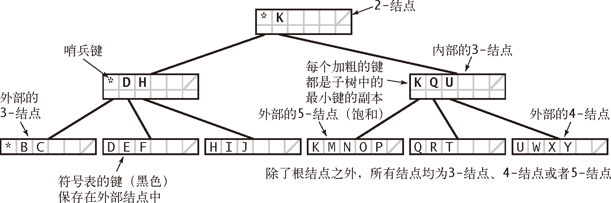
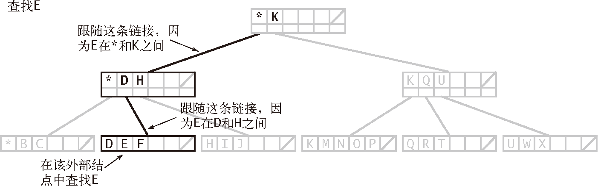
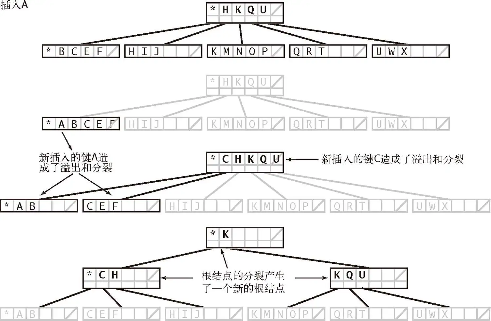
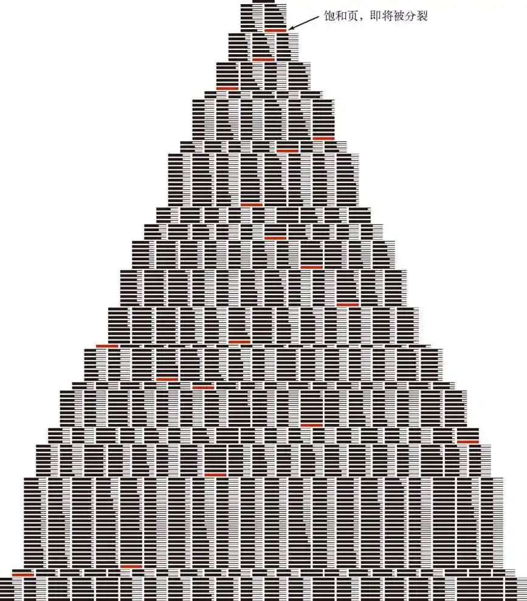

# 6.0.2B-树

在第 3 章中我们已经看到，能够快速访问大量数据中的特定元素的算法对于实际应用有着重要意义。例如在巨型数据集中，查找是一项非常重要的操作，该操作在许多计算场景中会消耗掉大部分资源。随着互联网的进步，某项任务访问到的信息可能非常庞大——我们的挑战在于在其中进行有效地查找。在本小节中，我们将介绍一种 3.3 节的平衡树算法的扩展。它支持对保存在磁盘或者网络上的符号表进行外部查找，这些文件可能比我们以前考虑的输入要大的多（以前的输入能够保存在内存中）。现代软件系统正在淡化本地文件和网页之间的区别，这些内容也可能保存在一台远程计算机上，因此我们可以找到的信息实际上近似于无限。令人惊讶的是，我们将要学习的算法只需使用 4 ～ 5 个指向一小块数据的引用即可有效支持在含有数百亿或者更多元素的符号表中进行查找和插入操作。

### 6.0.2.1　成本模型

数据存储的机制多种多样且在不断发展，因此我们将使用一个能够抓住本质的简单模型。这里用页表示一块连续的数据，用探查表示访问一个页。假设访问一页需要将它的内容读入本地内存，因此之后的访问就可以相对高效。一个页可能是本地计算机上的一个文件，也可能是远程计算机上的一张网页，也可能是服务器上的某个文件的一部分，等等。我们的目标是实现能够仅用极少次数的探查即可找到任意给定键的查找算法。我们不想假设页的具体大小或者一次探查（对于远程设备显然需要通信）所需时间与随后访问块中内容（显然这发生在本地处理器上）所需时间的比例。在一般情况下，这些值的数量级可能是 100、1000 或者 10 000。我们不需要更精确的值，因为在我们感兴趣的范围内，算法对这些值的不同并不非常敏感。

- B- 树的成本模型。我们使用页的访问次数（无论读写）作为外部查找算法的成本模型。

### 6.0.2.2　B- 树

它是对 3.3 节所述的 2-3 树数据结构的扩展。关键的不同在于：我们不会将数据保存在树中，而是会构造一棵由键的副本组成的树，每个副本都关联着一条链接。这种方式能够更加方便地将索引和符号表本身分开，就像一本实体书中的索引一样。和 2-3 树一样，我们限制了每个结点中能够含有的“键—链接”对的上下数量界限：选择一个参数 M（一般都是一个偶数）并构造一棵多向树，每个结点最多含有 M-1 对键和链接（假设 M 足够小，使得每个 M 向结点都能够存放在一个页中），最少含有 M/2 对键和链接（以提供足够多的分支来保证查找路径较短）。根结点是个例外，它可以含有少于 M/2 对键和链接，但也不能少于 2 对。这种树被 Bayer 和McCreight 在 1970 年命名为 B- 树。他们是最早使用多向平衡树进行外部查找的研究者。有些人也用 B- 树这个术语来描述 Bayer 和 McCreight 发明的算法所构造的数据结构。本节用它泛指所有基于固定页大小的多向平衡查找树的数据结构。我们用 M 阶的 B- 树来指定 M 的值。在一棵 4 阶 B- 树中，每个结点都含有至少 2 对至多 3 对键 - 链接；在一棵 6 阶 B- 树中（请见图 6.0.8），每个结点都至少含有 3 对至多 5 对键 - 链接（根结点除外，它可以只含有 2 对键与链接），等等。对于较大的 M 根结点是个例外的原因，在学习构造算法的细节时你就会明白了。




- 图 6.0.8　详解用一棵 B- 树表示的键集

### 6.0.2.3　约定

```
为了说明基本的流程，我们先讨论（有序）（集合）SET 的一个实现（只有键没有值）。将它
```

扩展得到一个能够将键和值相关联的符号表实现是一个很好的练习（请见练习 6.16）。我们的

```
目标是为一个巨大的键集实现 add() 和 contains() 方法。使用有序集的原因是我们希望
```

将查找树推广，而这依赖于键的有序性。扩展实现来支持其他有序性操作也是十分有益的练习。外部查找的应用常常会将索引和数据隔离。对于 B- 树，我们通过使用以下两种不同类型的结点做到这一点。

- 内部结点：含有与页相关联的键的副本。

- 外部结点：含有指向实际数据的引用。

内部结点中的每个键都与一个结点相关联，以此结点为根的子树中，所有的键都大于等于与此结点关联的键，但小于原内部结点中更大的键（如果存在的话）。为了方便这里使用了一个特殊的哨兵键，它小于其他所有键。一开始 B- 树只含有一个根节点，而根结点在初始化时仅含有该哨兵键。符号表不含有重复键，但我们会（在内部结点中）使用键的多个副本来引导查找。（在示例中，所有键都是单个字母并使用小于所有字母的“*”作为哨兵键。）这些约定能够一定程度上简化代码，并且说明了另一种在内部结点中将所有数据和链接混合的便利（而且是广泛使用的）方式，就像其他查找树一样。

### 6.0.2.4　查找和插入

B- 树中查找的基础是在可能含有被查找键的唯一子树中进行递归搜索。当且仅当被查找的键包含在集合中时，每次查找便会结束于一个外部结点。在内部结点中遇到被查找的键的副本时就判断查找命中并结束，但总会找到相应的外部结点，因为这么做可以简化将 B- 树扩展为有序符号表的实现（当 M 很大时这种情况很少出现）。举一个具体的例子：假设有一棵 6 阶 B-树，该树由多个含有 3 对键 - 链接的 3- 结点、含有 4 对键 - 链接的 4- 结点和含有 5 对键 - 链接的 5- 结点以及一个 2- 根结点组成，请见图 6.0.9。在查找时，从根结点开始，根据被查找的键选择当前结点中的适当区间并根据适当的链接从一个结点移动到下一个结点。最终，查找过程会到达树底的一个含有键的页。如果被查找的键在该页中，查找命中并结束；如果不在，则查找未命中。和 2-3 树一样，要在树的底部插入一个新键，可以使用递归代码。如果空间不足，那么可以允许被插入的结点暂时“溢出”（变成一个 6- 结点），并在递归调用后向上不断分裂 6- 结点。如果根结点也变成了 6- 结点，则可以将它分裂成连接了两个 3- 结点的 2- 结点；


对于树的其他位置，我们将 6- 结点的父

- 结点变为连接着两个 3- 结点的结点。将


上文中的 3 替换成

- ，6 替换成阶 B- 树中的查找和插入操作的方法，请，即可得到


见图 6.0.10。定义如下所示。

- 阶 B- 树（为正偶数）或者仅是一个外部结点（含有个键和相关信定义。一棵

- 结点（每个结点都含有个键和条链接，链接指向的子树息的树），或者由若干内部

- 表示了键之间的间隔区域）组成。它的结构性质如下：从根结点到每个外部结点的路径长度

- 在 2 到之间，对于其他结点在到均相同（完美平衡）；对于根结点，


- 之间。



- 图 6.0.9　在由 B- 树表示的键集中进行查找



- 图 6.0.10　向由 B- 树表示的键集中插入一个新键

### 6.0.2.5　数据表示

按照刚才的讨论，我们在选择 B- 树结点的表示方法上有很大的自由度。我们将这些选择封装

```
在一个 Page API 中（请见表 6.0.2）。它可以关联键与指向 Page 对象的链接，支持检测页是
否溢出、分裂页并区分内部页和外部页的操作。你可以将 Page 看作一张符号表，但是是保存
```

在外部介质上的（本地或是网络上的文件）。API 中的术语“打开”（open）和“关闭”（close）

指的是将外部页读入内存和将内存内容写回外部页（如果需要的话）的过程。内部页的

```
add() 方法是一个符号表操作，会将给定页和以该页为根结点的子树中的最小键关联起来。
外部页的 add() 和 contains() 方法和 SET 中相应的方法类似。在所有实现中，最重要的
方法都是 split()。在分裂一张饱和页时，split() 方法会将排序后位置正好大于（或等
```

```
 的键移动到一个新的 Page 对象中，并返回该对象的引用。练习 6.15 讨论了使用
```

于）

```
BinarySearchST 对 Page 的一种实现。这种方法将 B—树实现在了内存中，和其他查找树
```

的实现一样。在某些系统中，这种外部查找的实现可能已经足够了，因为虚拟内存系统会处理磁盘访问。更加贴近实际的实现可能包含与硬件相关的代码来读取和写入页的内容。练习

```
6.19 会鼓励你实现 Page 用于网页。这里不会讨论这些细节，而强调的重点是 B—树的概念
```

能够广泛用于各种场景之中。

表 6.0.2　B- 树的页的 API

```java
 public class <b>Page<Key></b>
              Page(boolean bottom)
```

- 创建并打开一个页

```
         void close()
```

- 关闭页

```
         void add(Key key)
```

- 将键插入（外部的）页中

```
打开 p，向这个（内部）页中插入一个条目并
         void add(Page p)
p 中的最小键相关联
      boolean isExternal()
```

- 这是一个外部页吗

```
      boolean contains(Key key)
键 key 在页中吗
         Page next(Key key)
可能含有键 key 的子树
      boolean isFull()
```

- 页是否已经溢出

```
         Page split()
```

- 将较大的中间键移动到一个新页中

```
Iterable<Key> keys()
```

- 页中所有键的迭代器

```
在这些准备之后，后面框注“B- 树集合的实现”的 BTreeSET 就很简单了。它用递归实现了
contains() 方法，接受一个 Page 对象作为参数并处理了以下 3 种情况。
如果当前页是外部页且键在该页中，返回 true。
如果当前页是外部页且键不在该页中，返回 false。
```

- 否则，递归地在可能含有该键的子树中查找。

```
我们用相同的递归结构实现了 add() 方法，只是在没有找到该键的时候将它插入到了树底部
```

的页中，然后分裂回溯过程中所遇到的所有饱和结点，请见图 6.0.11。

### 6.0.2.6　性能

B- 树最重要的性质就是，在实际应用中对于适当的参数

- ，查找的成本是常数级别的。


- 命题 B。含有个元素的阶 B- 树中的一次查找或插入操作需要次


- 探查——在实际情况下这基本是一个常数。证明。因为树中的所有内部结点（非根结点也非外部结点的所有结点）的形成都是由含有个键的饱和结点分裂得到的且大小只可能增长（当它的子结点分裂时），所以其中的链

- 到之间。在最好的情况下，这些结点能够形成一棵向的完接数总是在

- 全树，由此马上就可以得到命题中所述的上下界。在最坏情况下，根结点只含有两个链接并

- 向的完全树。将对数的底设为可以得到一个非常小的数——例如，分别指向两棵

- 为 1000 且小于 625 亿时，树的高度小于 4。当

在一般情况下，我们可以将根结点保存在内存中，这样可以将探查次数减 1。在磁盘和网络中进行查找时，应该在开始大量查找前显示地完成这一步。在带有缓存的虚拟内存中，应该将根结点放在最快的缓存中，因为它是访问最频繁的结点。

### 6.0.2.7　空间需求

在实际应用中，我们对 B- 树使用的空间也很感兴趣。由页的构造可知，它们至少都是半满的。在最坏的情况下，B- 树所需的空间是所有键占用的实际空间的两倍再加上链接所需的空间。对于随机键，A.Yao 在 1979 年（使用超出了本书范围的数学方法）证明了结点中平均含

- 个键，因此浪费的空间约占 44%。和其他查找算法一样，这个随机模型也很好地预

有


测了在实际应用中所观察到的键的分布。

- 算法 6.1　B- 树集合的实现

```java
public class BTreeSET<Key extends Comparable<Key>>
1
{
2
  private Page root = new Page(true);
3
4
  public BTreeSET(Key sentinel)
5
  {  add(sentinel);  }
6
7
  public boolean contains(Key key)
8
  {  return contains(root, key);  }
9
10
  private boolean contains(Page h, Key key)
11
  {
12
     if (h.isExternal()) return h.contains(key);
13
     return contains(h.next(key), key);
14
  }
15
16
  public void add(Key key)
17
  {
18
     add (root, key);
19
     if (root.isFull())
20
     {
21
        Page lefthalf = root;
22
        Page righthalf = root.split();
23
        root = new Page(false);
24
        root.add(lefthalf);
25
        root.add(righthalf);
26
     }
27
  }
28
29
  public void add(Page h, Key key)
30
  {
31
     if (h.isExternal()) {  h.add(key); return;  }
32
33
     Page next = h.next(key);
34
     add(next, key);
35
     if (next.isFull())
36
        h.add(next.split());
37
     next.close();
38
  }
39
}
40
如正文所述，这段代码实现了多向平衡查找树（B- 树）。它在查找时使用了 Page 数据类型
```

- 来将键和可能含有该键的子树相关联，并通过检测键的溢出和分裂结点的方法完成了插入操

- 作，请见图 6.0.11。



- 图 6.0.11　构造一棵庞大的 B- 树

命题 B 的影响之巨大，值得我们思考。你会猜到某种查找算法只需 4 ～ 5 次访问即可搜索你能够想象的最大文件吗？B- 树的应用十分广泛，就是因为它能够实现这一点。在实践中，主要的挑战是在实现时尽量保证 B- 树中结点所需的空间，但随着大部分设备上的存储空间的增长，这已经不算什么问题了。

基本 B- 树抽象的许多变种都很容易理解。一类变化是尽可能在内部结点中保存更多的页引用以节省时间，这样可以使分支增多并将树更加扁平化。另一类变化是在分裂前将兄弟结点合并以提高存储的使用效率。对算法的变种以及参数的选择应该适应于具体的设备和应用。尽管提高的效率也仅限于常数因子的范围之内，但对于巨型符号表或是大量事物处理需求来说，这样的改进也有着重要的意义，这也是为什么 B- 树如此高效的原因。
