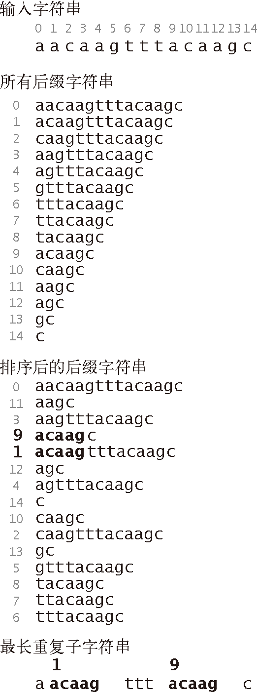
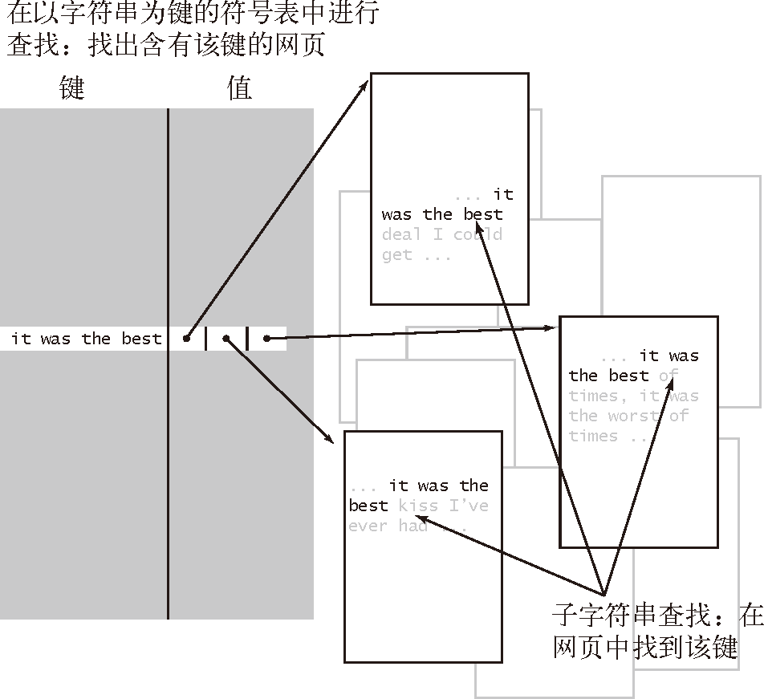
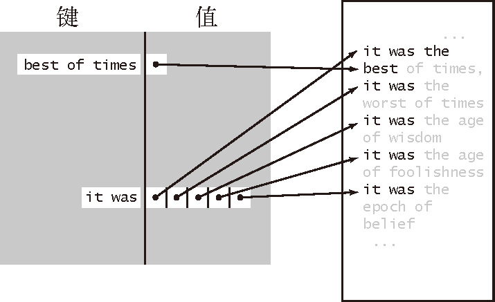
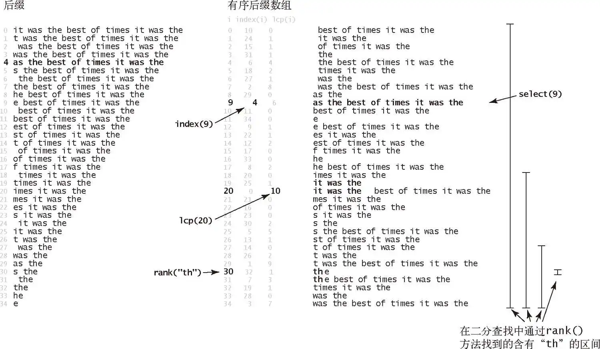
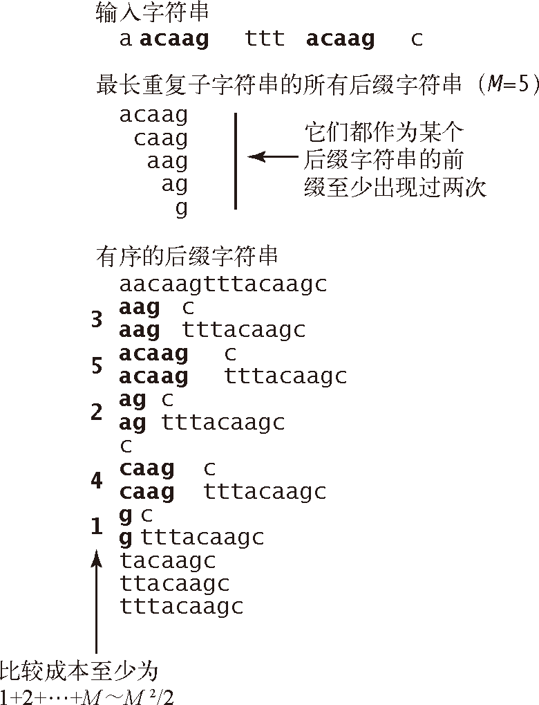

# 6.0.3后缀数组

字符串处理的高效算法在科学计算和商业应用中都有着重要的地位。从搜索互联网文本信息到科学家为了揭开生命的秘密而努力研究的庞大基因数据库，21 世纪中基于字符串的计算机应用在大规模增长。和以前一样，许多经典的算法都十分有效，但人们也发明了一些很好的新算法。下面，我们将介绍能够支持这些算法的一种数据结构和一份 API。首先，我们来看一个典型的（而且是经典的）字符串处理问题。

### 6.0.3.1　最长重复子字符串

```
在给定的字符串中，至少出现了两次的最长子字符串是什么？例如，在字符串 "to be or
not to be" 中，最长重复子字符串就是 "to be"。你觉得应该怎样解决这个问题呢？你能
```

在长度为数百万个字符的字符串中找出它的最长重复子字符串吗？这个问题的说明很简单，应用也很多，包括数据压缩、密码学和计算机辅助音乐分析等。例如，开发大型软件系统中的一种常见技术叫做代码重构。程序员经常会通过复制粘贴代码从原有的程序生成新的程序。对于开发了很长时间的一大段程序，将不断重复出现的代码转化为函数调用能够使程序更加容易理解和维护。我们可以通过在程序中寻找最长重复子字符串做到这一点。这个问题的另一个应用是计算生物学。在给定的基因中存在大量相同的片段吗？同样，这个问题背后的本质也是找出字符串中的最长重复子字符串。科学家一般更关心细节（事实上，重复子字符串的意义正是科学家所希望理解的），但这个问题显然比寻找简单的最长重复子字符串更难以回答。

### 6.0.3.2　暴力解法

```java
private static int lcp(String s, String t)
{
  int N = Math.min(s.length(), t.length());
  for (int i = 0; i < N; i++)
     if (s.charAt(i) != t.charAt(i)) return i;
  return N;
}
```

两个字符串的最长公共前缀

作为热身，考虑以下这个简单的任务：给定两个字符串，找到它们的最长公共前缀（两者的前

```
缀字符串中的相同且最长者）。例如，acctgttaac 和 accgttaa 的最长公共前缀是 acc。
```

右边框注中的代码是我们解决更加复杂问题的起点：它所需的时间和相匹配的子字符串长度成

```
正比。现在，我们应该如何在给定的字符串中找到最长重复子字符串呢？根据 lcp()，马上
可以得到下面这种暴力解法：将字符串中每个起始位置为 i 的子字符串与另一个起始位置为
j 的子字符串相比较，记录匹配的最长子字符串。这段代码不适合处理长字符串，因为它的运
```


```
行时间至少是字符串长度的平方级别：不同的子字符串对 i 和 j 的数量为
```

- ，因


```
此这种方式调用 lcp() 的次数将会是
```

- 。用这种方法处理含有上百万个字符的碱基对

```
序列将会调用几百亿次 lcp()，显然这是不可行的。
```

### 6.0.3.3　后缀排序

下面这种巧妙的方法用一种出人意料的方式利用排序算法高效地找出了字符串中的最长重复子

```
字符串：用 Java 的 substring() 方法创建一个由字符串 s 的所有后缀字符串（由字符串
```

的所有位置开始得到的后缀字符串）组成的数组，然后将该数组排序，请见图 6.0.12。算法的关键在于原字符串的每个子字符串都是数组中的某个后缀字符串的前缀。在排序之后，最长重复子字符串会出现在数组中的相邻位置。因此，只需要遍历排序后的数组一遍即可在相邻元素中找到最长的公共前缀。这种方法比暴力方法有效得多。但在实现和分析它之前，我们先介绍后缀排序的另一种应用。



- 图 6.0.12　使用后缀排序计算最长重复子字符串

### 6.0.3.4　定位字符串

当需要在大量文本中寻找某个特定的子字符串时（例如，当你在使用文本编辑器或是在浏览网页时），你就是在进行一次子字符串查找，即 5.3 节中讨论过的问题。对于这个问题，我们假设文本比要查找的字符串庞大得多，并将注意力集中在查找字符串的预处理上，以保证能够在任意给定的文本中高效的找到该子字符串。当在浏览器中输入要查找的关键字时，就是在进行一次字符串键查找，即 5.2 节的主题。搜索引擎必然已经预先计算得到了一张索引表，因为它不可能即时地根据输入的关键字扫描互联网中的所有页面。根据 3.5 节的讨论（请见 3.5.4 节

```
框注“文件索引”的 FileIndex），理想情况下最好有一张反向索引符号表将每个被查找的字符
```

串和所有含有它的网页关联起来——在符号表的每个条目中，键即为被查找的字符串，而值则为一组指针，请见图 6.0.13（每个指针都含有能够定位该键在互联网上具体位置所需的信息——这可以是一个网页的 URL 加上键的出现位置的偏移量。）在实际应用中，这样的符号表会非常非常大，因此搜索引擎会使用各种复杂的算法来缩小它的体积。一种方法是将网页按照重

```
要程度排序（可以使用 3.5.5 节讨论的 PageRank 算法）并只选择排序等级较高的网页而非
```

全部网页。另一种减小符号表大小的方法是将多个关键词（以空格分隔）作为预处理得到的索引表的键并和 URL 关联。那么，当你查找一个关键词时，搜索引擎可以通过索引找到含有被查找的键（即关键词）的（相对重要的）网页，并在该页面中使用字符串查找来定位关键词。

```
使用这种方法时，如果文本含有的是“everything”而你要找的是“thing”，那可能会找不到。
```

对于某些应用，构造一个能够帮助我们找出文本中的任意子字符串的索引是值得的。这么做可能是为了对一本非常重要的文学作品进行语言学研究，或是为了找出可能成为许多科学家研究对象的某段碱基对序列，或者找出访问量很大的网页。同样，在理想情况下，索引表应该将文本字符串的所有子字符串分别和它们的出现位置关联起来，如图 6.0.14 所示。这种方法的问题显然是子字符串的总数太大，在符号表中为每个子字符串创建一个条目不现实。（一段含有


- 个字符的文本含有个子字符串。）图 6.0.14 中的符号表需要含有 b、be、


bes、best、best o、best of、e、es、est、est o、est of、s、st、st o、st of、t、t o、t of、o、of 和许许多多其他子字符串的条目。这次我们也可以用后缀排序的方法解决这个问题，就像 3.1 节中用二分查找对符号表的第一次实现一样。我们可以将

- 个后缀作为键，以这些键

（后缀）创建一个有序的数组并使用二分查找法搜索数组，比较被查找的键和所有后缀，请见图 6.0.15。



- 图 6.0.13　理想化的一次典型的网络搜索



- 图 6.0.14　理想化的一张文本字符串索引表



- 图 6.0.15　后缀数组中的二分查找

### 6.0.3.5　API 及其用例

```sql
为了解决这两个问题，我们给出了以下 API。它含有构造函数、length() 方法，select()
和 index() 方法分别给出了有序后缀数组中给定位置的后缀和它的索引值，lcp() 方法会
返回每个后缀和它在数组中的前一个后缀的最长公共前缀，rank() 方法能够给出小于给定键
```

的后缀数量。（自从第 1 章中第一次学习二分查找后就一直在使用它。）我们用后缀数组表示有序后缀字符串列表的这种抽象数据结构，但实际使用的并不一定是字符串数组，如表 6.0.3 所示。

表 6.0.3　后缀数组的 API

```java
public class <b>SuffixArray</b>
             SuffixArray(String text)
为文本 text 构造后缀数组
         int length()
文本 text 的长度
      String select(int i)
后缀数组中的第 i 个元素（i 在 0 到
```


```sql
         int index(int i)
select(i) 的索引（i 在 0 到
```

- 之

```sql
select(i) 和 select(i-1) 的最长公
         int lcp(int i)
度（i 在 1 到
```

- 之间）

```sql
         int rank(String key)
小于键 key 的后缀数量
在图 6.0.15 所示的例子中，select(9) 的结果是“as the best of times...”、
index(9) 的值是 4、lcp(20) 的值是 10（因为“it was the best of
times...”和“it was the”的公共前缀“it was the”的长度为 10）、rank("th") 的值是
30。注意，select(rank(key)) 是有序后缀数组中第一个以 key 为前缀的后缀字符串，
键 key 在正文中出现的其他位置都在后缀数组中紧跟着该条目（请见图 6.0.15）。使用这份
API 可以立即写出框注中的代码。LRS 类（见本页框注）会为标准输入得到的文本构造后缀数
组，并根据扫描数组所得的最大 lcp() 值找出文本中的最长重复子字符串。KWIC 类（见下
```

页框注）会为命令行参数指定的文本构造后缀数组，从标准输入接受查询并打印出被查询的子

```
字符串在文本中的上下文（该字符串的前后若干个字符）。KWIC 这个名字表示的是上下文中
```

的关键词（keyword-in-context）查找，最早出现在 20 世纪 60 年代。这些典型的字符串处理应用代码的简洁和高效令人赞叹。这也说明了精心设计 API 的重要性（以及简单而巧妙的思想的影响力）。

```java
public class LRS
{
  public static void main(String[] args)
  {
     String text = StdIn.readAll();
     int N = text.length();
     SuffixArray sa = new SuffixArray(text);
     String lrs = "";
     for (int i = 1; i < N; i++)
     {
        int length = sa.lcp(i);
        if (length > lrs.length())
           lrs = sa.select(i).substring(0, length);
     }
     StdOut.println(lrs);
  }
}
```

最长重复子字符串算法的用例

```java
% more tinyTale.txt
it was the best of times it was the worst of times
it was the age of wisdom it was the age of foolishness
it was the epoch of belief it was the epoch of incredulity
it was the season of light it was the season of darkness
it was the spring of hope it was the winter of despair
% java LRS < tinyTale.txt
st of times it was the
public class KWIC
{
  public static void main(String[] args)
  {
     In in = new In(args[0]);
     int context = Integer.parseInt(args[1]);
     String text = in.readAll().replaceAll("\\s+", " ");;
     int N = text.length();
     SuffixArray sa = new SuffixArray(text);
     while (StdIn.hasNextLine())
     {
        String q = StdIn.readLine();
        for (int i = sa.rank(q); i < N && sa.select(i).startsWith(q); i++)
        {
           int from = Math.max(0, sa.index(i) - context);
           int to   = Math.min(N-1, from + q.length() + 2*context);
           StdOut.println(text.substring(from, to));
        }
        StdOut.println();
     }
  }
}
```

上下文中的关键词的索引用例

```
% java KWIC tale.txt 15
search
o st giless to search for contraband
her unavailing search for your fathe
le and gone in search of her husband
t provinces in search of impoverishe
dispersing in search of other carri
n that bed and search the straw hold
better thing
t is a far far better thing that i do than
some sense of better things else forgotte
was capable of better things mr carton ent
```

### 6.0.3.6　实现

```
算法 6.2 中的代码简洁明了地实现了 SuffixArry 的 API。它的实例变量包括一个字符串数
```

组和（为了节省代码）一个表示数组长度的的变量

- （既是字符串的长度也是它的后缀字符串

```sql
数量）。类的构造函数会构造后缀数组并将它排序，因此 select(i) 只需返回
suffixes[i] 即可。index() 的实现也只要一行代码，但稍微复杂一点，因为后缀字符串
的长度就说明了它的起始位置。长度为 <i>N</i> 的后缀字符串的起始位置为 0，长度为
```

- 的后缀字符串的起始位置为 1，长度为的后缀字符串的起始位置为 2，依此类


```
推。因此 index(i) 的返回值即为
suffixes[i].length()。由 6.0.3.2 节中的静态
```


```
lcp() 方法可以很容易得到这里的 lcp() 方法的实现，rank() 方法与 3.1.5 节“算法 3.2
```

（续 1）”中基于二分查找的符号表的实现也基本相同。同样，实现的简洁与优雅并不能掩盖这是一种复杂的算法，它解决了如最长重复子字符串这种其他方法无法解决的重要问题。

### 6.0.3.7　性能

后缀排序算法的效率取决于 Java 的子字符串提取操作使用的内存空间，它是一个常数——每个子字符串都是由标准对象、指向原字符串的指针和它的长度组成的。因此，索引的大小和字

符串的长度是线性关系。这让人有些意外，因为所有子字符串中的字符总数为

- ，即字

符串长度的平方级别。另外，这种平方级别的性能也会大大影响子字符串数组的排序成本。我们要记住的重要一点是，这种方法对长字符串有效的原因在于 Java 的字符串表示方法：当交换两个字符串时，实际交换的仅仅是对它们的引用，而非字符串本身。虽然当两个字符串有很长的公共前缀时比较它们的成本与它们的长度成正比，但在一般的应用场景下，大多数比较都只需要检查几个字符。如果是这样的话，后缀数组的排序时间就是线性对数的。例如，在许多应用中，随机字符串模型都是合理的。

- 命题 C。使用三向字符串快速排序，构造长度为的随机字符串的后缀数组，平均所需的

- 成正比，字符比较次数与成正比。空间与


- 讨论。后缀数组的空间需求很明显，但它所需的时间来自于 P.Jaquet 和 W.Szpankowski 的个随机字符串一份艰深而复杂的研究成果。他们证明了将所有后缀排序的成本渐进于将

- 排序的成本（请见 5.1.4.4 节中的命题 E）。

- 算法 6.2　后缀数组（初级实现）

```java
public class SuffixArray
1
{
2
  private final String[] suffixes;  // 后缀数组
3
  private final int N;              // 字符串（和数组）的长度
4
5
  public SuffixArray(String s)
6
  {
7
     N = s.length();
8
     suffixes = new String[N];
9
     for (int i = 0; i < N; i++)
10
        suffixes[i] = s.substring(i);
11
     Quick3way.sort(suffixes);
12
  }
13
14
  public int length()         { return N; }
15
  public String select(int i) { return suffixes[i]; }
16
  public int index(int i)     { return N - suffixes[i].length(); }
17
  private static int lcp(string s,string t)
18
19
  // 请见6.0.3.2节框注“两个字符串的最长公共前缀”
20
  public int lcp(int i)
21
  {  return lcp(suffixes[i], suffixes[i-1]); }
22
  public int rank(String key)
23
  {  // 二分查找
24
     int lo = 0, hi = N - 1;
25
     while (lo <= hi)
26
     {
27
        int mid = lo + (hi - lo) / 2;
28
        int cmp = key.compareTo(suffixes[mid]);
29
        if      (cmp < 0) hi = mid - 1;
30
        else if (cmp > 0) lo = mid + 1;
31
        else return mid;
32
     }
33
     return lo;
34
  }
35
36
}
37
SuffixArray API 的实现效率取决于 Java 的 String 类的不可改变性，这种性质使得
```

- 子字符串实际上都是引用，提取子字符串只需常数时间（请见正文）。

### 6.0.3.8　改进的实现

```
SuffixArray 的初级实现在最坏情况下的性能很糟。例如，如果所有的字符都相同，后缀数
```

组的排序会检查每个后缀字符串中的每个字符，所需的时间为平方级别。对于我们用作示例的碱基对序列字符串或是自然语言的文本字符串，这可能不是问题，但算法对于含有一大串相同字符的文本可能会很慢。此外，查找最长重复子字符串所需的时间可能会是子字符串长度的平方级别，因为重复的子字符串的所有前缀都会被检查（请见图 6.0.16）。对于《双城记》来说这不是问题，因为其中最长的重复子字符串为：

```
"s dropped because it would have been a bad thing for me in a worldly point of vi
```

只有 84 个字符。然而，对于经常含有很长的重复部分的碱基对序列来说，这就是一个严重的问题了。如何避免查找重复子字符串时出现的这种平方级别运算呢？幸运的是，P.Weiner 在1973 年的研究显示我们可以保证在线性时间内解决最长重复子字符串问题。Weiner 算法的基础是构造一棵后缀字符串树（即一棵由所有后缀字符串组成的字典查找树）。如果在每个字符处使用多个链接，后缀树在解决许多实际问题时会消耗非常大的空间，这又推动了后缀数组的发展。在 20 世纪 90 年代，U.Manber 和 E.Myers 演示了一种构造后缀数组的线性对数级别

```
的算法，以及一个同时完成预处理和对后缀数组排序以支持常数时间的 lcp() 方法。之后人
```

们又发明了若干线性时间的后缀排序算法。经过一些改造，Manber-Myers 算法的实现也能够

```
支持两个参数的 lcp() 方法，以在常数时间内找出给定的但不一定是相邻的两个后缀之间的
```

最长公共前缀。这也是对初级实现的一项重大改进。这些结果非常令人惊讶，因为它们所达到的效率远远超出了人们的预期。



- 图 6.0.16　查找最长重复子字符串的成本是重复子字符串长度的平方级别

- 命题 D。使用后缀数组，我们可以在线性时间内解决后缀排序和最长重复子字符串问题。证明。解决这些问题的优美算法已经超出了本书的范畴，但你在本书的网站上可以找到线性

```
时间的 SuffixArray 的构造函数和常数时间的 lcp() 方法的实现。
基于这些思想的 SuffixArray 实现足以高效解决许多字符串处理问题，而且用例代码非常
简单，如我们的 LRS 和 KWIC 例子所示。
后缀数组是自 20 世纪 60 年代解决 KWIC 索引的单词查找树以来数十年研究积累的成果。我
```

们讨论的很多种算法都是许多研究者在几十年的实践中发明的，这些问题包括将《牛津英语大词典》搬上互联网、第一代搜索引擎以及人类基因组测序，等等。这完全说明了算法的设计和分析的重要性。
