# 6.0.4网络流算法

下面我们将讨论一种图的模型，它的成功之处不仅在于为我们提供了能够轻松描述解决实际问题的模型，而且使用这些模型我们能得到许多高效的算法来解决问题。我们将要讨论的解决方案说明了两种特定需求之间的矛盾，即具有广泛适用性的需求与能够解决特殊问题的需求。网络流算法研究的迷人之处在于它紧凑优雅的实现几乎能够同时达到这两个目标。你将会看到，我们的实现非常易懂而且能够保证运行时间与网络大小成正比。

网络流问题的经典解决方案和第 4 章中介绍的那些图算法紧密相关。基于已有的工具，我们可以编写非常精炼的程序来解决它们。我们已经在许多问题中看到，良好的算法和数据结构能够大幅减少解决问题所需的时间。人们还在积极研究该领域中更好的算法和数据结构并不断地发明新的方法。

### 6.0.4.1　物理模型

首先用一个理想化的物理模型来介绍几个直观的概念。请想象一组相互连接大小不一的输油管道，在连接处装有能够控制原油流向的开关，如图 6.0.17 所示。

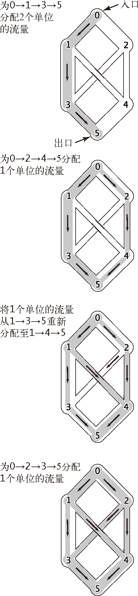

- 图 6.0.17　为输油网络分配流量

我们还假设这个输油网只有一个入口（比如一处油田）和一个出口（比如一个大型的炼油厂），所有的输油管最终都会和它们相连。在每个结点处，原油流入量和流出量都会达到的平衡。我们用相同的单位衡量流量和管道的输送能力（例如，加仑每秒）。如果在每个开关处都有流入管道的总流量和流出管道的总流量相等，那么问题就不存在了：只需要将所有输油管充满即可。否则，虽然并不是所有管道都是饱和的，但原油仍然会根据各个关节处的开关设置在网络中流动，并将在关节处满足一个局部平衡条件：流入结点的流量等于流出结点的流量，请见图 6.0.18。

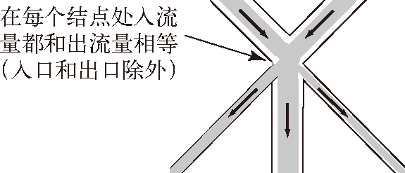

- 图 6.0.18　流量网络中的局部平衡

例如，如图 6.0.17 所示，一开始操作员可能会将原油的路径设为 0 → 1 → 3 → 5，这条路线能够输送 2 个单位的流量，然后再打开 0 → 2 → 4 → 5 这条路径上的开关，又可以输送 1 个单位的流量。因为 0 → 1、2 → 4 和 3 → 5 都已经饱和，已经无法直接将更多的原油从 0 输送到 5。但如果调整 1 处的开关将 1 → 4 充满，那么就又可以在 3 → 5 空出足够的空间使得0 → 2 → 3 → 5 可以再增加 1 个单位的流量。即使是这样一个简单的网络，找到能够使得流量最大化的开关配置也并不容易；而对于更加复杂的网络，我们感兴趣的显然是下面这个问题：怎样配置所有开关才能使从入口到出口的流量最大化？我们可以直接用只含有一个起点和一个终点的加权有向图构造出这个问题的模型。图中的边对应的是输油管道，顶点对应的是配有能够控制原油走向和流量的开关结点，边的权重对应的是管道的容量，请见图 6.0.19。我们假设边是有向的，即原油在每个管道中都只能朝着一个方向流动。每条管道中都流动着一定量的原油，流量小于等于管道的容量，而每个顶点都需要满足流入量和流出量相等。这种抽象的流量网络是一个能够解决问题的实用模型，它能够直接应用于许多场景，而间接适用的则更多。我们有时会用原油流过管道的方式直观地说明一些基本的概念，但这里的讨论同样适用于物流分配的通道等情况。鉴于我们在各种最短路径算法中对“距离”概念的用法，在必要的时候会抛弃图的所有物理意义，因为我们讨论的所有定义、性质和算法所基于的抽象模型并不一定遵守物理定律。事实上，人们对网络流问题的主要兴趣在于许多其他问题都能转化为这个模型，下一个小节中将会详述。

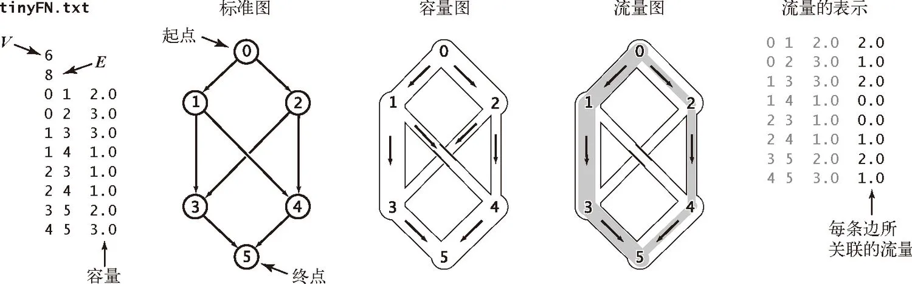

- 图 6.0.19　网络流问题详解

### 6.0.4.2　定义

因为它广泛的应用性，我们需要用精确的语言说明刚才介绍的通俗的概念和术语。

- 流量定义。一个流量网络是一张边的权重（这里称为容量）为正的加权有向图。一个


```
网络有两个已知的顶点，即起点 s 和终点 t。
```

有时我们会认为某些边的容量是无限的，或者说是没有容量限制的。这表示不会将其中的流量和它的容量进行比较，或者它的容量必然比所有流量都大。我们将流向一个顶点的总流量（所有指向该顶点的边中的流量之和）称为该顶点的流入量，流出一个顶点的总流量（由该顶点指出的所有边中的流量之和）称为该顶点的流出量，而两者之差（流入量减去流出量）则为称为

```
该顶点的净流量。为了简化讨论，我们假设没有从 t 指出的边或是指向 s 的边。
```

- 流量网络中的流量配置是由一组和每条边相关联的值组成的集合，这个值定义。

- 被称为边的流量。如果所有边的流量均小于边的容量且满足每个顶点的局部平衡（即净流量

```
均为零，s 和 t 除外），那么就称这种流量配置方案是可行的。
```

- 流量的值。命题 E 将会证明这个值和起点的流出量是相等的。

我们将终点的流入量称为

有了这些定义，就能够正式地描述这个基本问题了。

```
 流量配置，使得从 s 到 t 的流量最大
```

- 流量。给定一个流量网络，找到一种

最大

化。

为了简洁，我们将这样的流量配置称为最大流量，那么在网络中寻找这种配置的问题就是一个最大流量问题。在某些应用中，只需要知道最大流量的值即可，但一般情况下人们还是希望知道达到该值的具体流量配置（各条边的流量值）。

```
private boolean localEq(FlowNetwork G, int v)
{  // 检查顶点v的局部平衡
  double EPSILON = 1E-11;
  double netflow = 0.0;
  for (FlowEdge e : G.adj(v))
     if (v == e.from()) netflow -= e.flow();
     else               netflow += e.flow();
  return Math.abs(netflow) < EPSILON;
}
private boolean isFeasible(FlowNetwork G, int s, int t)
{
  // 确认每条边的流量非负且不大于边的容量
  for (int v = 0; v < G.V(); v++)
     for (FlowEdge e : G.adj(v))
        if (e.flow() < 0 || e.flow() > e.capacity())
           return false;
  // 检查每个顶点的局部平衡
  for (int v = 0; v < G.V(); v++)
     if (v !=s && v != t && !localEq(G, v))
        return false;
  return true;
}
```

检查流量网络中的一种流量配置是否可行

### 6.0.4.3　API

```
表 6.0.4 和表 6.0.5 所示的 FlowEdge 和 FlowNetwork 简单扩展了第 3 章中相应 API。我
们将会在 6.0.4.6 节学习 FlowEdge 的一种实现，它的基础是 4.3.2 节中的 Edge 类并添加了
一个实例变量来保存边的流量。流量是有方向的，但 FlowEdge 并不是基于
DirectedEdge，因为它还需要解决下面将要描述的一个更加抽象的剩余网络问题。我们需
```

要使每条边都出现在它的两个顶点的邻接表中才能实现剩余网络。剩余网络能够增减流量并检测一条边是否已经饱和（无法再增大流量）或者是否为空（无法再减小流量）。这些抽象是通

```
过 residualCapacity() 和 addResidualFlow() 方法实现的，我们将在之后讨论它
们。FlowNetwork 的实现与 4.3.2 节中 EdgeWeightedGraph 的实现基本相同，因此这里
```

将它省略。为了简化文件格式，我们约定起点的编号为 0，终点的编号为

- ，请见图


6.0.20。有了这些 API 之后最大流量算法的目标就很明确了：构造一个网络，计算所有边中保存流量的实例变量的值并使得网络中的流量最大化。上一页框注所示的是检验一个流量配置方案是否可行的用例代码，一般会将这种检查作为最大流量算法的最后一步。

表 6.0.4　流量网络中的边的 API

```java
public class  <b>FlowEdge</b>
```

表 6.0.5　流量网络的 API

```java
      public class  <b>FlowNetwork</b>
                    FlowNetwork(int V)
创建一个含有 V 个顶点的空网络
                    FlowNetwork(In in)
```

- 从输入流中构造流量网络

```
               int  V()
```

- 顶点总数

```
               int  E()
```

- 边的总数

```
              void  addEdge(FlowEdge e)
向流量网络中添加边 e
          Iterable  adj(int v)
从 v 指出的边
          Iterable  edges()
```

- 流量网络中的所有边

```
            String  toString()
```

- 对象的字符串表示

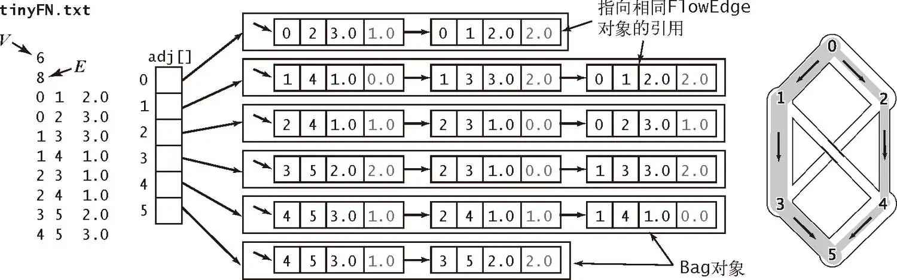

- 图 6.0.20　流量网络的表示

### 6.0.4.4　Ford-Fulkerson 算法

在 1962 年，L.R.Ford 和 D.R.Fulkerson 发明了一种解决最大流量问题的有效方法。它是一种沿着由起点到终点的路径逐步增加流量的通用方法，因此它也是同类算法的基础。在经典文献中它被称为 Ford-Fulkerson 算法，但它也被称为增广路径算法。考虑一个

- 流量网络中的

- 为该路径上的所有边中未使用容量的最小值。那么

任意一条从起点到终点的有向路径。假设

- 即可将网络中的总流量至少增大

只需将所有边的流量增大

- 。反复这个过程，就得到了第一

种计算网络中的流量分配方法：找到另一条路径，增大路径中的流量，如此反复，直到所有从起点到终点的路径上至少有一条边是饱和的。（这样在这条路径上就无法继续增大流量了。）这种方法在某些情况下能够计算出网络中的最大流量，但在有些情况下不行，图 6.0.17 就是这类情况。为了改进算法使之总是能够找到最大流量，就要用另一种更加通用的方式增大网络中的流量，即将依据变为网络所对应的无向图中从起点到终点的路径。在这样的路径中，当沿着路径从起点向终点前进时，经过某条边时的方向可能和流量的方向相同，那这条边即为正向边；也可能和流量的方向相反，那这条边即为逆向边。现在，对于任意非饱和正向边和非空逆向边，我们可以通过增加正向边的流量和降低逆向边的流量来增加网络中的总流量。流量的增量受路径上的所有正向边的未使用容量最小值和所有逆向边的流量的限制。这样的一条路径被称为增广路径，比如图 6.0.21。在新的流量配置中，路径中至少有一条正向边达到了饱和，或是至少有一条逆向边为空。以上所述的过程就是经典的 Ford-Fulkerson 算法（增广路径算法）的基础。我们将它总结如下。

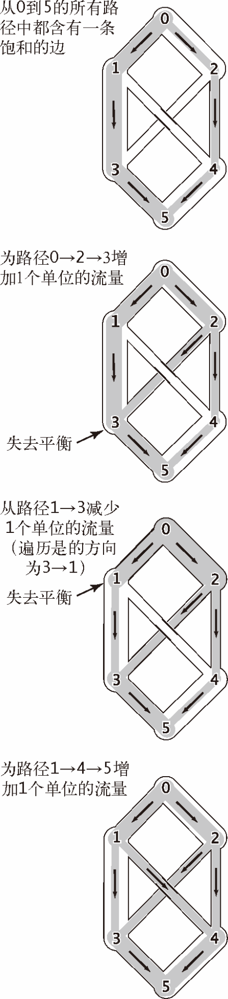

- 图 6.0.21　一条增广路径 (0 → 2 → 3 → 1 → 4 → 5)

- Ford-Fulkerson 最大流量算法。网络中的初始流量为零，沿着任意从起点到终点（且不含有饱和的正向边或是空逆向边）的增广路径增大流量，直到网络中不存在这样的路径为止。

令人惊讶的是（在关于流量性质的一定技术性限制之下），无论我们如何选择路径，该方法总能找出最大流量。如同 4.3 节中讨论的贪心最小生成树算法和 4.4 节中讨论的通用最短路径算法一样，它的意义在于证明了所有同类算法的正确性。我们可以用任何方法选择路径。人们发明了多种算法来计算增广路径的序列，以计算最大流量。这些算法的不同之处在于它们得到的增广路径数量和得到每条路径的成本，但它们实现的都是 Ford-Fulkerson 算法并能够找到网络的最大流量。

- 1

### 6.0.4.5　最大流 - 最小切分

### 定理

为了证明 Ford-Fulkerson 算法的任意实现所计算得到的流量确实是最大流量，需要证明一个叫做最大流 - 最小切分的关键定理。理解这个定理是理解所有网络流算法中最重要的一步。顾名思义，定理的基础是网络中的流量和切分的关系，因此需要先定义和切分有关的名词。回顾4.3 节，图的切分是将所有顶点分为两个不相交的集合，而一条横切边则是连接分别存在于两个集合中的两个顶点的一条边。对于流量网络，我们将它们的定义提炼如下。

- 切分是一个将顶点 s 和顶点 t 分配于不同集合中的切分。定义。

- 切分中，每条横切边要么是一条由含有的集合指向含有的集合的边，要么

在一个

- 边。有时我们将边的集合称为一个切分集。在流量网络中，一个

是一条反方向的


- 边的容量之和，切分的跨切分流量（flow across）是切分的

切分的容量为该切分的

- 边的流量之和与所有边的流量之和的差。在网络中删去切分的所有边

所有

- 到的路径。而重新添加其中的任意一条边都会得到一条从

（即切分集）将会切断所有从

- 的路径。切分能够抽象许多应用。比如我们的原油流量模型，切分提供了将从入口流向出

到口的原油完全切断的方法。如果将切分的容量看作这么做的成本，那么切断流量的最有效方法是解决以下问题。

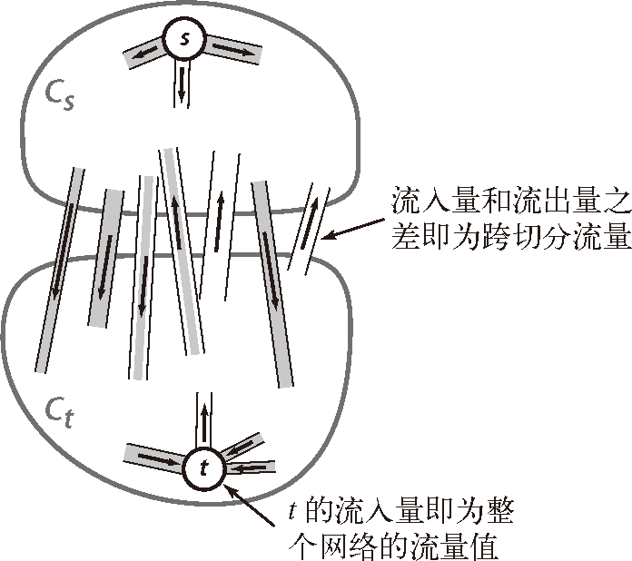

- 切分。给定一个网络，找到容量最小的切分。简单起见，我们将这样的切

最小

分称为最小切分，而将在网络中找到它的问题称为最小切分问题。

最小切分问题的定义中并没有提到流量，而且这些定义似乎和增广路径算法无关。从表面上来看，计算最小切分（得到一组边）似乎比计算最大流量（为所有的边赋权值）更容易。但实际上，最大流量和最小切分问题是紧密相关的。增广路径算法本身就是证明。流量和切分的以下

- 流量网络中的局部平衡即意味着整个网络的全局平衡（推论一），并且

基本关系即可证明

- 流量值的上界（推论二）。

可以得到任意

- 命题 E。对于任意流量网络，每种切分中的跨切分流量都和总流量的值相等。


- 为含有顶点的集合，为含有顶点的集合。对使用归纳法：当仅证明。设

- 时该命题成立，若将一个顶点由移动到含有，则该结点处的局部平衡意味着可以一切分。直保持该性质。因此，通过移动顶点可以得到任意

- 的流出量等于的流入量（即流量网络的值）。推论。


- 为即可。证明。令

- 流量网络的值不可能超过任意切分的容量。推论。

- 命题 F（最大流量—最小切分定理）。令为一个流量网络，以下三种条件是等价的：

- i 存在某个切分，其容量和的流量相等；

- ii达到了最大流量；iii中已经不存在任何增广路径。证明。根据命题 E 的推论，我们可以由条件 i 得到条件 ii。因为增广路径的存在意味着存在的最大性相冲突，因此由条件 ii 也可以得到条件 iii。某个流量更大的网络配置，这与

- 但还需要证明条件 iii 和条件 i 等价。令为由通过所有不含有任何饱和正向边或空逆向

- 为其余的顶点的集合。必然存在于边的无向路径可达的所有顶点组成的集合，令


- 为一个切分。它的切分集完全由饱和正向边和空逆向边组成。该切中，因此

- 分的跨切分流量和它的容量相等（因为所有正向边都是饱和的，而所有逆向边都是空的），即等于网络中的总流量（由命题 E 可得）。

- 推论（完整性）。当所有容量均为整数时，存在一个整数值的最大流量，而 Ford-Fulkerson算法能够找出这个最大值。证明。每条增广路径都会将总流量增大某个正整数值（正向边中未使用容量的最小值和逆向边的容量都是正整数）。

即使所有边的容量均为整数，我们也可以设计出能够达到最大流量的非整数配置，但这里不需要考虑这样的配置。从理论角度来说，下面的意见是很重要的：我们已经演示过并且实际情况也需要允许容量和流量可以为实数，但它会导致一些异常情况。例如，已知 Ford-Fulkerson算法在原则上可能得到无穷多的增广路径以至于无法收敛到某种最大流量的配置。我们讨论的这个版本总是可以收敛的，即使是实数值的容量和流量也不例外。无论我们用什么方法寻找增广路径，无论我们找到了什么样的路径，最后总是能够得到一种不存在任何增广路径的流量配置，即最大流量的配置。

### 6.0.4.6　剩余网络

通用的 Ford-Fulkerson 算法并没有指定寻找增广路径的方法。如何才能找到不含有饱和正向边和空逆向边的路径呢？为此，我们给出如下定义。

- 流量网络和其流量配置，这种配置下的剩余网络中的顶点和原网定义。给定某个

- 络相同。原网络中的每条边都对应着剩余网络中的 1 ～ 2 条边。它的定义如下：对于原网


- 络中的每条从顶点 v 到 w 的边 e，令表示它的流量、表示它的容量。如果为正，


- 将边 w → v 加入剩余网络且容量为小于 ce，将边 v → w 加入剩余网络且容量；如果


- 为。

```
 的边 v → w 与之对
```

- 到的边为空（即为 0），剩余网络中就只有一条容量为

如果从

```
 的边 w → v 与之对应；如
```

应；如果该边饱和（即

- 等于），剩余网络就只有一条容量为

```
果它既不为空，也不饱和，那么剩余网络中将含有相应容量的 v → w 和 w → v。请见图
```

6.0.22。

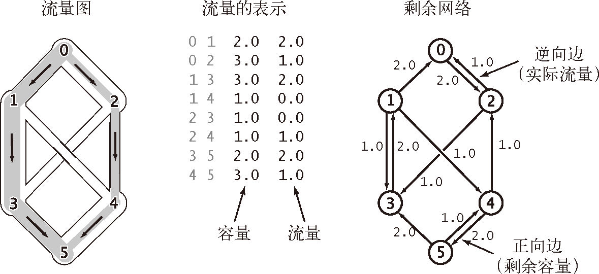

- 图 6.0.22　网络流问题详解

乍一看，剩余网络有些让人困惑，因为与流量对应的边的方向却和流量本身相反。正向边表示的是剩余的容量（即如果选择从这条边通行所能增长的流量）；逆向边表示了实际流量（即如

```
果选择从这条边通行将会减少的流量）。后面框注中的代码给出了在 FlowEdge 类中实现剩余
```

网络这种抽象所需的方法。通过这些实现，虽然该算法处理的是剩余网络，但它实际上是在检查所有剩余的容量并（通过边的引用）修正流量配置。

- 流量网络中的边（剩余网络）

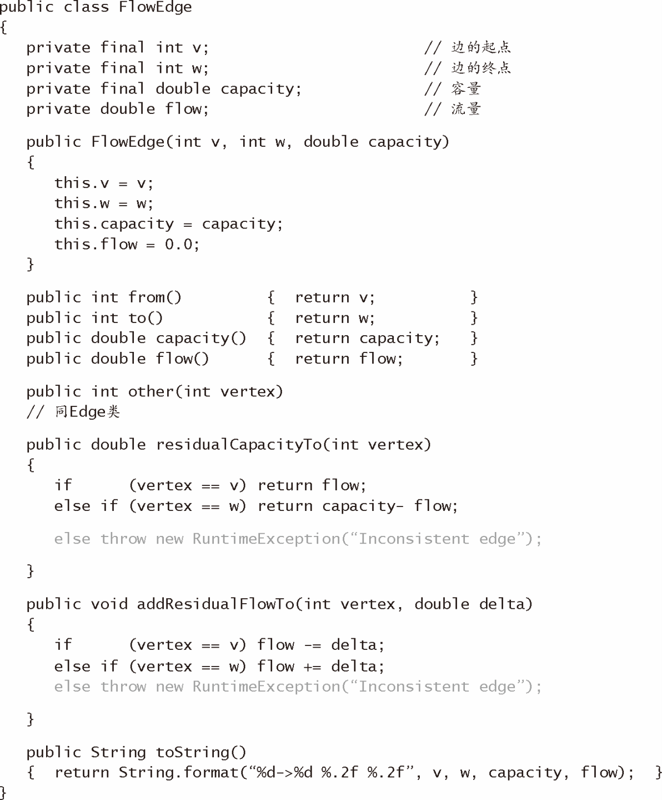

```
这里的 FlowEdge 类的基础是 4.3 节中对加权边的 Edge 类的实现（请见 4.3.2 节框注“带
权重的边的数据类型”），它添加了一个实例变量 flow 和两个方法来实现剩余网络。
```

```
我们可以使用 from() 和 other() 方法处理两个方向的边：e.other(v) 可以返回 e 的两
个顶点中和 v 相对的另一个顶点。residualCapacityTo() 和 addRresidualFlowTo()
```

方法实现了剩余网络。剩余网络使得我们可以通过图中的搜索算法寻找增广路径，这是因为在剩余网络中所有从起点到终点的路径都是原流量网络中的一条增广路径。沿着增广路径增大流量意味着修改剩余网络。例如，至少有一条路径上的边变得饱和或变为空，因此在剩余网络中至少有一条边将会改变方向或者消失。（我们使用的是抽象的剩余网络，因此只会检查正容量，不需要实际插入或删除边。）

```
private boolean hasAugmentingPath(FlowNetwork G, int s, int t)
{
  marked = new boolean[G.V()];  // 标记路径已知的顶点
  edgeTo = new FlowEdge[G.V()]; // 路径上的最后一条边
  Queue<Integer> q = new Queue<Integer>();
  marked[s] = true;             // 标记起点
  q.enqueue(s);                 // 并将它入列
  while (!q.isEmpty())
  {
     int v = q.dequeue();
     for (FlowEdge e : G.adj(v))
     {
        int w = e.other(v);
        if (e.residualCapacityTo(w) > 0 && !marked[w])
        {                      // （在剩余网络中）对于任意一条连接到一个未被标记的顶点的边
           edgeTo[w] = e;      // 保存路径上的最后一条边
           marked[w] = true;   // 标记w，因为路径现在是已知的了
           q.enqueue(w);       // 将它入列
        }
     }
  }
  return marked[t];
}
```

在剩余网络中通过广度优先搜索寻找增广路径

### 6.0.4.7　最短增广路径算法

对 Ford-Fulkerson 算法最简单的实现可能就是最短增广路径算法了（最短指的是路径长度最小，而非流量或是容量）。J.Edmonds 和 R.Karp 在 1972 年发明了这个算法。这里，增广路径的查找等价于剩余网络中的广度优先搜索（BFS），如 4.1 节所述。你也可以将

```
hasAugmentingPath() 的实现与广度优先搜索实现的算法 4.2 比较一下。（剩余网络是有
```

向图，因此这实际上是一个有向图处理算法。）这个方法为完整实现剩余网络的算法 6.3 打下了基础，它非常简洁。为了方便，我们将这个方法称为最短增广路径的最大流量算法。它处理样例数据的详细轨迹如图 6.0.23 所示。

- 算法 6.3　最短增广路径的 Ford-Fulkerson 最大流量算法。

```java
public class FordFulkerson
1
{
2
  private boolean[] marked;    // 在剩余网络中是否存在从s到v的路径？
3
  private FlowEdge[] edgeTo;   // 从s到v的最短路径上的最后一条边
4
  private double value;        // 当前最大流量
5
  public FordFulkerson(FlowNetwork G, int s, int t)
6
  {  // 找出从s到t的流量网络G的最大流量配置
7
     while (hasAugmentingPath(G, s, t))
8
     {  // 利用所有存在的增广路径
9
        // 计算当前的瓶颈容量
10
        double bottle = Double.POSITIVE_INFINITY;
11
        for (int v = t; v != s; v = edgeTo[v].other(v))
12
           bottle = Math.min(bottle, edgeTo[v].residualCapacityTo(v));
13
        // 增大流量
14
        for (int v = t; v != s; v = edgeTo[v].other(v))
15
           edgeTo[v].addResidualFlowTo(v, bottle);
16
17
        value += bottle;
18
     }
19
  }
20
21
  public double value()        {  return value;      }
22
  public boolean inCut(int v)  {  return marked[v];  }
23
24
  public static void main(String[] args)
25
  {
26
     FlowNetwork G = new FlowNetwork(new In(args[0]));
27
     int s = 0, t = G.V() - 1;
28
     FordFulkerson maxflow = new FordFulkerson(G, s, t);
29
30
     StdOut.println(“Max flow from " + s + " to " + t);
31
     for (int v = 0; v < G.V(); v++)
32
        for (FlowEdge e : G.adj(v))
33
           if ((v == e.from()) && e.flow() > 0)
34
              StdOut.println("   " + e);
35
     StdOut.println("Max flow value = " +  maxflow.value());
36
37
  }
38
}
39
```

- 这段 Ford-Fulkerson 算法的实现会在剩余网络中寻找最短增广路径，找出路径上的瓶颈容量并增大该路径上的流量，如此往复直至不再存在从起点到终点的增广路径为止。

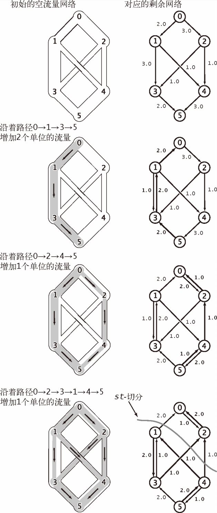

- 图 6.0.23　最短增广路径的 FordFulkerson 算法的轨迹

```
% java FordFulkerson tinyFN.txt
Max flow from 0 to 5
 0->2 3.0 2.0
 0->1 2.0 2.0
 1->4 1.0 1.0
 1->3 3.0 1.0
 2->3 1.0 1.0
 2->4 1.0 1.0
 3->5 2.0 2.0
 4->5 3.0 2.0
Max flow value = 4.0
```

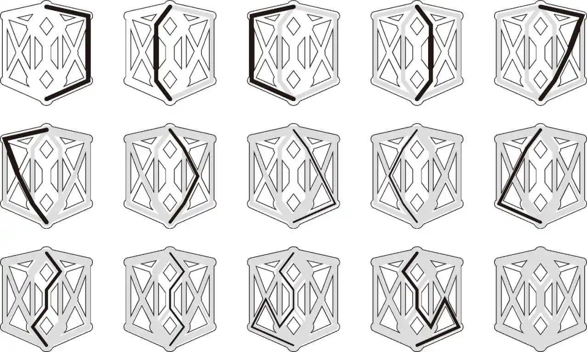

- 图 6.0.24　一个较大的流量网络中的最短增广路径

### 6.0.4.8　性能

图 6.0.24 所示的是一个更大的例子。从图中我们可以清晰地看到，增广路径的长度在慢慢变长。这是分析算法性能的第一个要点。

- 命题 G。最短增广路径的 Ford-Fulkerson 最大流量算法在处理含有 123个顶点和条


- 条。边的流量网络时找到的增广路径最多为简略证明。每条增广路径中都含有一条关键边——这条边在剩余网络中会被删掉，因为它对应的可能是一条将会被充满的正向边或是将会被抽干的逆向边。每当一条边成为关键边时，通过它的增广路径的长度就会加 2（请见练习 6.39）。因为增广路径的最大长度为且每条

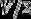

- 条增广路径上，因此增广路径的总数最多为边最多可能出现在。

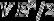

- 推论。Ford-Fulkerson 算法的最短增广路径实现所需的时间在最坏情况下为。条边。证明。广度优先搜索最多会检查

命题 G 所述的上界是非常保守的。例如，图 6.0.24 中含有 11 个顶点和 20 条边，该上界说明算法使用的增广路径最多为 110 条，但实际上它只用了 14 条。

### 6.0.4.9　其他实现

Edmonds 和 Karp 发明的另一种 Ford-Fulkerson 算法的实现是优先处理能够将流量增大最多的增广路径。简单起见，我们将这种方法称为最大容量增广路径的最大流量算法。对于这种（以及其他一些）方法，可以通过稍加修改 Dijkstra 的最短路径算法、由优先队列得到剩余容量最大的正向边或是流量最大的逆向边来实现。或者也可以寻找最长增广路径，或是随机选择增广路径。要完整分析哪种才是最佳的方法是一个复杂的任务，因为它们的运行时间取决于：

- 找到最大流量所需检查的增广路径数量；

- 寻找每条增广路径所需的时间。

这些量的变化可能很大，和流量网络本身以及图的搜索策略有关。人们还发明了解决最大流量问题的其他几种算法，其中一些在实践中和 Ford-Fulkerson 算法不分高下。但是，为最大流量算法进行数学建模来验证这些猜想是一个非常困难的问题。各种最大流量算法的分析仍然是一个有趣而活跃的研究领域。从理论角度来说，我们已经得到了各种最大流量算法在最坏情况下的上界，但这些上界大多远远高于实际应用中所观察到的真实成本，而且也比较小的下界（线性级别）高出许多。最大流量问题的已知成本和潜在成本之间的差距比（目前）本书中讨论过的任何问题都要大。

最大流量算法的实际应用仍然既是一门艺术也是一门科学。它的艺术之处在于为特定的应用场景选择最有效的策略；它的科学之处在于对问题本质的理解。是否存在能够在线性时间内解决最大流量问题的新数据结构和算法呢？或者我们能否证明它们不存在呢？请见表 6.0.6。

表 6.0.6　各种最大流量算法的性能特点

- 在含有 V 个顶点和 E 条边的流量网络中（各边容量最

算法

[1]：也有时译为“最大流-最小割”。——编者注
