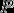
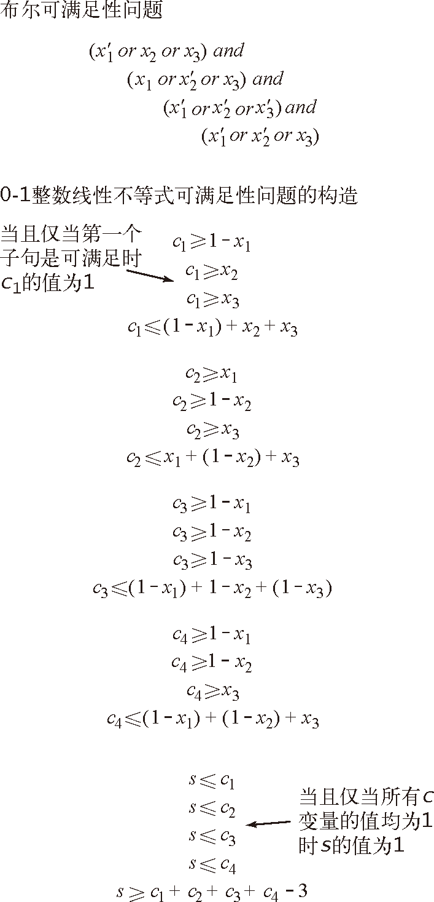
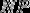
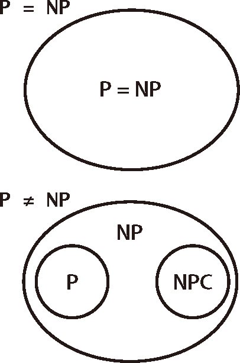
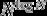

# 6.0.6不可解性

本书中讨论的算法一般都是用来解决实际问题的，因此它们消耗的资源都是有限的。大多数算法的实用性是显而易见的，而且对于许多问题，我们还很幸运地能够在几种不同的算法之间进行选择。但不幸的是，现实生活中还有许多其他问题并没有如此有效的解决方法。更糟糕的是，对于许多类问题，人们甚至不知道是否存在有效解决它们的方法。这种情况让程序员和算法的设计者都极度沮丧，因为他们无法为许多实际问题找到有效的算法。对于理论学者而言，沮丧来自于他们无法证明这些问题到底有多难。在这个领域，人们已经进行了大量的研究，并发展出了一种方法来判断一个新问题从技术的角度来说是否能够归于“难以解决”这个类别。尽管这方面的研究大多数都超出了本书的范畴，但是理解它们的核心思想并不困难。我们将在这里介绍它们，因为当面对一个新问题时，每个程序员都应该了解不存在解决它的高效算法的可能性。

### 6.0.6.1　准备工作

20 世纪最漂亮和有趣的智力发明之一，就是阿兰·图灵在 20 世纪 30 年代发明的“图灵机”。它是一个简单而又非常通用的计算模型，足以描述任意计算机程序和设备。一台图灵机就是一台能够读取输入、变换状态和打印输出的有限状态机。图灵机是理论计算机科学的基础。它来自于下面两个重要的思想。

- 普遍性。图灵机可以模拟所有物理可实现的计算设备。这被称为丘奇 - 图灵论题。这是一个关于自然世界的论断且无法被证明（但可以被证伪）。该论题成立的证据就是数学家和计算机科学家已经发明的无数种计算模型，而它们都已证明和图灵机等价。

- 可计算性。图灵机（或是任意其他计算设备，根据普遍性可以得到）无法解决的问题是存在的。这在数学上是正确的。停机问题（halting problem）（任意程序都无法保证能够判定给定程序是否会结束）就是这类问题中的一个著名的例子。

在这里，我们感兴趣的是第三个思想，它是关于计算设备效率的。

- 扩展的丘奇—图灵论题。在任意计算设备上解决某个问题的某个程序所需的运行时间的增长数量级都是在图灵机上（或是任意其他计算设备上）解决该问题的某个程序的多项式倍数。

同样，这也是一个关于自然世界的论断，因为所有已知的计算设备都能够通过图灵机模拟，只是成本最多需要增加一个多项式的倍数。在最近几年，量子计算的概念使得一些研究者开始怀疑扩展的丘奇 - 图灵论题的正确性。大多数人都认为，从实践的角度来说，这个论题还能支撑一段时间，但许多学者已经在努力证明它是错误的。

### 6.0.6.2　指数级别的运行时间

不可解性理论的目的在于将能够区别多项式时间内解决的问题和在最坏情况下（可能）需要指

- 时所需

数级别时间才能解决的问题。我们可以认为指数级别运行时间的算法在输入规模为


- 成正比，将底数 2 替换为任意的均可。我们一般认为指数时间的

的时间（至少）和


算法无法保证在合理的时间内解决规模超过（例如）100 的问题，因为无论计算机有多快都没


- 步的算法。指数增长级别使得科技进步忽略不计：一台超级计算机可

人能够等待一个需要

- 步才能完成的问题。有时，“简单”问

能比一张算盘快一万亿倍，但两者都不可能解决需要题和“困难”问题之间只有一线之差。例如，4.1 节中学习的那个能够解决以下问题的算法。

```
最短路径长度。在一幅图中从一个给定的顶点 s 到另一个给定的顶点 t 之间的最短路径的长
```

度是多少？

但并没有学习解决下面这个问题的算法，但两者看起来本质上似乎是一样的。

```
最长路径长度。在一幅图中从一个给定的顶点 s 到另一个给定的顶点 t 之间的最长路径的长
```

度是多少？

问题的核心在于，据我们目前所知，从难度上来说这些几乎都是最困难的问题。广度优先搜索能够在线性时间内解决第一个问题，但对于第二个问题所有已知算法在最坏情况下均需要指数级别的时间。后面框注的代码用一个深度优先搜索的变种解决了这个问题。它和深度优先搜索

```java
非常类似，但它检查了图中所有从 s 到 t 的简单路径才找到了最长的那一条。
public class LongestPath
{
  private boolean[] marked;
  private int max;
  public LongestPath(Graph G, int s, int t)
  {
     marked = new boolean[G.V()];
     dfs(G, s, t, 0);
  }
  private void dfs(Graph G, int v, int t, int i)
  {
     if (v == t && i > max) max = i;
     if (v == t) return;
     marked[v] = true;
     for (int w : G.adj(v))
        if (!marked[w]) dfs(G, w, t, i+1);
     marked[v] = false;
  }
  public int maxLength()
  {  return max;  }
}
```

找出图中的两个顶点之间的最长路径的长度

### 6.0.6.3　搜索问题

本书中已经介绍过的“高效”算法能够解决的问题与还需要如大海捞针一般在各种可能性中寻找解法的问题之间存在巨大差异，这就需要能够用一种简单的形式模型来研究这两类问题之间的关系。第一步就是要说明我们所研究的这类问题。

- 定义。如果一个问题有解且验证它的解的正确性所需的时间不会超过输入规模的多项式，则称这种问题为搜索问题。当一个算法给出了一个解或是已证明解不存在时，就称它解决了一个搜索问题。

我们将在后面讨论不可解性问题中 4 个比较有趣的问题。这些问题被为“可满足性”问题。现在，要证明某个问题是一个搜索问题，只需说明你能够快速验证某个完整的解的正确性即可。解决一个搜索问题就好像“在稻草堆里寻找一根针”一样，你唯一的优势只是在看见它的时候能够认得出来。例如，对于后面列出的每个可满足性问题都给定了一组变量赋值，你都能很容易地验证每个等式或不等式都是满足的，但是寻找这样一组变量赋值就完全不同了。我们常用NP 描述所有搜索问题——我们会在 6.0.6.6 节说明这个名字的由来。

- 定义。NP 是所有搜索问题的集合。

NP 准确描述了所有科学家、工程师以及应用程序员渴望的能够保证在合理时间范围内解决的所有问题的集合。

部分搜索问题。


- 线性等式可满足性。给定一组由 个变量表示的 个线性等式，找出一组满足所有等式的变量赋值，或者证明这样的赋值不存在。

- 线性不等式可满足性（线性规划问题的搜索形式）。给定一组由 个变量表示的 个线性不等式，找出一组满足所有不等式的变量赋值，或者证明这样的赋值不存在。

- 0 ～ 1 整数线性不等式可满足性（0 ～ 1 整数线性规划问题的搜索形式）。给定一组由 个整数变量表示的 个线性不等式，找出一组满足所有不等式的变量 0 或 1 赋值，或者证明这样的赋值不存在。

- 布尔可满足性。给定一组由 个布尔变量以及和 / 或运算符表示的 个等式，找出一组满足所有等式的变量赋值，或者证明这样的赋值不存在。

### 6.0.6.4　其他类型的问题

对于构成了不可解性研究的基础的问题集合，搜索问题的概念是多种描述它的方法之一。其他方法包括决定性问题（解是否存在？）以及最优化问题（最优解是什么？）。例如，6.0.6.2 节中的最长路径长度问题就是一个最优化问题而非一个搜索问题。（给定一个解，无法验证它就是最长路径的长度。）这个问题的搜索版本是找到一条能够连接所有顶点的简单路径。（该问题也叫做汉密尔顿路径问题）。这个问题的决定性版本是询问是否存在一条能够连接所有顶点的简单路径。套汇问题、布尔可满足性问题和汉密尔顿路径问题都是搜索问题；询问这些问题是否有解是决定性问题；而最短或最长路径问题、最大流量问题和线性规划问题都是最优化问题。虽然它们在技术上并不等价，但搜索问题、决定性问题和最优化问题一般都能够相互归约（请见练习 6.58 和练习 6.59）且我们的主要结论同时适用于这三种类型的问题。

### 6.0.6.5　简单的搜索问题

NP 的定义并没有提到寻找解的难度，而只是和解的验证有关。构成不可解性研究的基础的第二类问题的集合被称为 P，它和寻找解的难度有关。在这个模型下，算法的效率是将输入编码所需的比特数量的函数。

- 定义。P 是能够在多项式时间内解决的所有搜索问题的集合。

这个定义暗示着多项式时间是一个最坏情况下的时间界限。对于在集合 P 中的一个问题，必然存在一个算法能够保证在多项式时间内解决它。注意，我们完全没有指定这是一个怎样的多项式。线性、线性对数、平方、立方级别都是多项式时间，因此这个定义显然囊括了目前已经学习的所有标准算法。运行一个算法所需的时间取决于所使用的计算机，但扩展的丘奇 - 图灵论题让这一点变得无关紧要——它说明任意计算设备上的多项式时间的解都意味着任意其他计


算设备上也存在多项式时间的解。排序问题属于 P 是因为（例如）插入排序所需的时间与成正比（在这里，线性对数时间的排序算法并无意义），最短路径问题、线性等式可满足性问题以及其他许多问题也是这样。一个能够有效解决某个问题的算法足以证明该问题属于集合P。换句话说，P 准确描述了所有科学家、工程师以及应用程序员能够保证在合理的时间范围内解决的所有问题的集合，请见表 6.0.7 和表 6.0.8。

### 6.0.6.6　非确定性

NP 中的 N 表示的是非确定性（nondeterminism）。它的意思是，扩展计算机能力的一种（理论上的）方法是赋予它不确定性：即断言当一个算法面对若干个选项时，它有能力“猜出”正确的选择。在我们的讨论中，你可以将非确定性的计算机上的一个算法看作是在“猜测”问题的解，然后验证这个解是否成立。在图灵机中，非确定性只是定义为一个给定状态和一个给定输入时的两个不同的后继状态，解则是能够得到期望结果的所有路径。非确定性也许只是一个数学上的幻想，但它也可以是一种很有用的思想。例如，在 5.4 节中，我们将非确定性用作了一种设计算法的工具——正则表达式模式匹配算法的基础就是有效模拟一个非确定性自动状态机。

表 6.0.7　集合 NP 中的问题举例

问题

- 输入描述

- 图 G

汉密尔顿路径

- 找到一条能够访问所有顶点

- 的一个非平凡因子

分解质因数

- 整数找到

0-1 线性不等式可满足性

- 个 0-1 变量组成的个不等式由找出满足所有不等式的变量

- 中的所有问题请见表 6.0.8

集合



表 6.0.8　集合 P 中的问题举例

问题

- 输入描述存在多项式时间算法

- 图


- 路径到的最短路径广度优先搜索 (BFS)

最短

- 找出从


- 顶点、

- 按升序排列

排序

- 数组将归并排序

- 个变量

线性等式可满足性

- 找出满足所有等式的变量赋值高斯消元法个等式

- 个变量

线性不等式可满足性

- 找出满足所有不等式的变量赋值椭球法

### 6.0.6.7　主要问题

非确定性十分强大，严肃认真地考虑它似乎有点荒唐。为什么要花心思用一种想象中的工具将困难的问题变得看起来简单呢？答案是，虽然非确定性看起来十分强大，但没人能够证明它能够帮助我们解决任何问题！换句话说，还没有人能够找到任何一个问题并证明它属于 NP 而不属于 P（甚至证明存在这样一个问题）。这就留下了一个有待解决的问题：

P=NP 成立吗？

这个问题是由 K.Gödel 在 1950 年写给 J. von Neumann 的一封著名的信中第一次提出的，并且完全难倒了所有数学家和计算机科学家。陈述这个问题的其他方式说明了一些它的基本性质。

- 是否存在任何难以解决的搜索问题？

- 如果能构造一种非确定性的计算设备，能够更快地解决某些搜索问题吗？

无法解答这些问题令人们极度懊恼，因为许多重要的实际问题都属于 NP 但却不一定属于 P。（已知的最快确定性算法需要指数级别的时间。）如果能够证明它不属于 P，就可以放弃寻找高效率的算法。既然无法证明，那么就存在发现某种高效算法的可能性。事实上，就我们目前的知识水平而言，NP 中的每个问题都可能存在某种高效的算法，这意味着可能还有许多高效的算法没有被人们发现。但实际上没人相信 P=NP，而且很大一部分人都在努力证明该等式不成立。它仍然是计算机科学领域有待证明的最重要的研究课题。

### 6.0.6.8　多项式时间问题的相互归约

6.0.5 节通过说明用以下三个步骤可以解决问题 A 的任意实例，证明了问题 A 是可以归约为问题 B 的：

- 将 A 的实例归约为 B 的实例；

- 解决 B 的实例；

- 将 B 的实例的解归约为 A 的实例的解。

只要能够有效完成归约（并解决问题 B），我们就能有效的解决问题 A。在这里，为了效率我们采用了能够想象的最弱的定义：为了解决问题 A 最多需要解决多项式个问题 B 的实例，且问题归约最多只需多项式时间。在这种情况下，我们称 A 能够在多项式时间内归约为 B。在前文中，我们使用问题的归约介绍了各种问题解决模型，使得高效算法所能解决的问题范围大大拓展了。现在，我们要从另一个角度使用问题的归约，即用它来证明一个问题是难以解决的。如果一个问题 A 已知是难以解决的，且 A 在多项式时间内能够归约为问题 B，那么问题 B 必然也是难以解决的。否则，问题 B 的一个多项式时间的解必然也能归约为问题 A 的一个多项式时间内的解。

- 命题 L。布尔可满足性问题能够在多项式时间内归约为 0-1 整数线性不等式可满足性问题。证明。对于给定的一个布尔可满足性问题的实例，定义一组不等式，其中每个布尔变量都对应着一个 0-1 变量，每个布尔子句也对应着一个 0-1 变量，如图 6.0.29 所示。若布尔变量

```
的值为真（true）则对应的整数变量的值为 1，值为假（false）时对应的整数变量的值
```

- 为 0。这样，我们就能够将 0-1 整数线性不等式可满足性问题的解归约为布尔可满足性问题的解。



- 图 6.0.29 将布尔可满足性问题归约为 0-1 整数线性不等式可满足性问题的示例

- 推论。如果可满足性问题是难以解决的，那么整数线性规划问题也是难以解决的。

即使我们并没有精确定义难以解决，关于解决这两种问题的难度关系的陈述仍然是有意义的。在这里，“难以解决”的意思是“不包含在集合 P 中”。一般来说，我们用不可解来表示不包含在集合 P 中的问题。以 R.Karp 在 1972 年作出的开创性的工作为起点，一些研究者已经通过这种归约的方式证明了成百上千种各个应用领域的问题都是相关的。此外，这种关系的内涵远比两个单独的问题之间的联系更丰富，下面我们将说明这个概念。

### 6.0.6.9　NP- 完全性

许多问题都属于 NP 但可能并不属于 P。也就是说，我们可以轻易地验证任意给定的解是否有效，但即使投入了许多努力，也未能开发出一个有效的算法来寻找问题的解。令人惊讶的是，所有这些问题都有一个额外的性质，令人信服地说明了 P≠NP：

- 定义。若 NP 中的所有问题都能在多项式时间内归约为搜索问题 A，那么则称问题 A 是NP- 完全的

这个定义使得我们可以将“难以解决”的定义升级为“除非 P=NP 否则无解”。如果任意 NP- 完全

- 中的所有问题都将得到解决

问题能够通过一台有限自动机在多项式时间内解决，那么



（即 P=NP）。也就是说，所有研究者对于寻找这些问题的高效算法的失败从整体上来说是证明 P=NP 的失败。NP- 完全问题的意思是，我们不期望能够找到多项式时间的算法。大多数实际的搜索问题都已知是 P 或 NP- 完全问题。

### 6.0.6.10　Cook-Levin 定理

通过归约，一个问题的 NP- 完全性也意味着另一个问题的 NP- 完全性。但归约在一种情况下是不可用的：如何证明第一个问题是 NP- 完全的？S.Cook 和 L.Levin 在 20 世纪 70 年代早期分别独立地完成了这项工作。

- 命题 M（Cook-Levin 定理）。布尔可满足性问题是 NP- 完全的。极大简化证明。目标是证明如果布尔可满足性问题存在多项式时间的算法，那么 NP 集合中的所有问题都能在多项式时间内解决。非确定型图灵机是可以解决 NP 中的任意问题的，因此证明的第一步是用与布尔可满足性问题中一样的逻辑表达式描述非确定型图灵机的所有特性。这可以将 NP 中的每个问题（它们都可以表示为非确定型图灵机上的一个程序）和可满足性问题的某个实例（该程序的逻辑表达式形式）联系起来。这样，可满足性问题的解本质上等价于模拟图灵机在给定的输入下运行给定的程序，因此它将产生给定问题的某个实例的解。这份证明的其他细节已经远远超出了本书的范畴。幸运的是，我们只需要证明这一个命题即可：使用归约来证明 NP- 完全性要简单的多。

Cook-Levin 定理，再加围绕各种 NP- 完全问题所进行的成千上万次多项式时间内的归约，使我们得到了两种可能性：或者 P=NP，即不存在任何不可解的搜索问题（所有搜索问题都能够在多项式时间内得到解决）；或者 P ≠ NP，即存在不可解的搜索问题（某些搜索问题无法在多项式时间内得到解决），请见图 6.0.30。NP- 完全问题在实际应用中经常出现，因此人们找出解决它们的优秀算法的意愿非常强烈。所有这些问题目前都还未找到有效的算法显然强烈说明了 P ≠ NP，大多数研究者也相信这一点。但从另一方面来说，也没人能够证明这些问题中的任意一个不属于 P，这也同样是反方向的一个有力证据。无论 P=NP 是否成立，目前的实际状态是所有 NP- 完全问题的已知最佳算法在最坏情况下都需要指数级别的时间。



- 图 6.0.30　问题集的两种可能情况

### 6.0.6.11　问题的分类

要证明一个搜索问题存在于集合 P 中，我们需要展示一个解决它的多项式时间算法，这或许可以通过将它归约为一个已知 P 类问题。要证明 NP 中的一个问题是 NP- 完全的，我们需要证明某个已知的 NP- 完全问题能够在多项式时间内归约为它：也就是说，如果一个新问题的多项式时间的算法能够用于解决 NP- 完全问题，那么它也就能解决 NP 中的所有问题。我们已经用这种方法证明了成千上万的问题都是 NP- 完全问题，就像在命题 L 中对整数线性规划问题进行的转换那样。后面列出了一些有代表性的问题，它包含了 Karp 提出的若干问题，但这只是已知的 NP- 完全问题中极小的一部分。将新问题归入容易解决（属于集合 P）或者难以解决（NP- 完全）的类别可能会出现以下几种情况。

- 显而易见。例如，著名的高斯消元法就能够证明线性等式可满足性问题属于集合 P。

- 需要一些技巧但并不困难。例如，给出一份类似于命题 L 的证明需要一些经验和实践，但理解并不困难。

- 非常有挑战性。例如，线性规划问题曾经长期分类不明，但 Khachian 的椭球法证明了线性规划问题属于集合 P。

- 有待解决。例如，图的同构问题（给定两幅图，给出一种能够使得两幅图相同的顶点重命名方案）和分解质因数问题（给定一个整数，找出它的一个非平凡因数）仍然是无解的。

目前这仍然是一块内容丰富、研究活跃的领域，每年都会产生数千篇论文。从后面项目列出的最后几个条目可以看出，它涉及了科学界的各个领域。我们在 NP 的定义中包含了科学家、工程师和应用程序员所渴望解决的所有问题——这些问题显然需要分类！

一些著名的 NP- 完全问题。

- 布尔可满足性。给定一组由 个布尔变量表示的 个等式，找出一组满足所有等式的变量赋值，或者证明这样的赋值不存在。

- 整数线性规划。给定一组由 个整数变量表示的 个线性不等式，找出一组满足所有不等式的变量赋值，或者证明这样的赋值不存在。


- 负载均衡。给定一组任务和完成它们的时间以及一个时间上限，应该如何在两个相同的处理器上分配任务以在时间 之内完成所有任务？


- 顶点覆盖。给定一幅图和一个整数，找出一个含有 个顶点的集合，保证图中的每条边都至少依附于集合中的一个顶点。

- 汉密尔顿路径。给定一幅图，找出一条正好只经过每个顶点一次的简单路径，或者证明这种路径不存在。

- 蛋白质折叠。给定能量级别，找出一种蛋白质的某种三维折叠结构，其含有的潜在能量小于。


- 伊辛模型。给定一个三维晶格伊辛模型和一个能量阈值，是否存在一个自由能小于 的子图？

- 给定收益的风险投资组合。给定一组风险投资渠道与一个总成本以及一个给定收益。每项投资都有一定的风险值，风险的总阈值为。找到一种分配投资的方法使得总风险小于。

### 6.0.6.12　处理 NP- 完全性

在实践中，我们必须为这些各种各样的问题找到某种解决办法，因此人们对解决这些问题非常感兴趣。我们不可能在这一小段文字中说明这个庞大的研究领域，但我们可以简要描述一下人们已经尝试过的各种手段。一种方法是，修改问题并寻找一种“近似”算法来给出接近但并非最佳的解。例如，欧几里得旅行销售员问题（traveling salesman problem），我们很容易找到一个长度小于最优路线的两倍的解。但不幸的是，在寻找更好的近似时，这种方法并不足以绕开NP- 完全性。第二种方法是，给出一种能够有效解决实际应用中所出现的问题的实例算法，但对于最坏情况下的输入，这种算法仍然是无法找到问题的解。这种方法最著名的例子是解决整数线性规划问题的程序，它们是数十年来解决无数工业应用中的大量最优化问题的主力军。尽管它们有可能需要指数级别的时间，但实际应用中的输入数据也显然不是最坏情况下的输入。第三种方法是，使用一种叫做“回溯法”的技术来避免检查所有可能的解，以期找到尽可能“高效”的指数级别算法。最后，计算机科学的理论并没有提到多项式时间和指数时间之间的一个




- 以及成正比的算法吗？

相当大的空档。存在运行时间与

NP- 完全性触及了本书中我们所研究过的所有应用领域：NP- 完全问题会出现在初级的编程问题、排序和查找、图处理、字符串处理、科学计算、系统编程、运筹学以及所有能够想到的需要计算的地方。NP- 完全性理论对实际生产最重要的贡献在于它给出了一种方法来鉴别来自于这些广泛领域的一个新问题是“容易”还是“困难”呢。如果有人找到了一种解决新问题的有效方法，那么它显然就没什么难度了。如果找不到，那么要是能够证明该问题是 NP- 完全的，这就说明找到一个高效算法基本上是不可能的。（因此或许应该尝试另一种思路。）本书中已经研究过的所有高效算法说明我们已经学习了自欧几里得以来的多种高效的计算方法，但 NP- 完全性理论也说明事实上人们还有很长的路要走。
