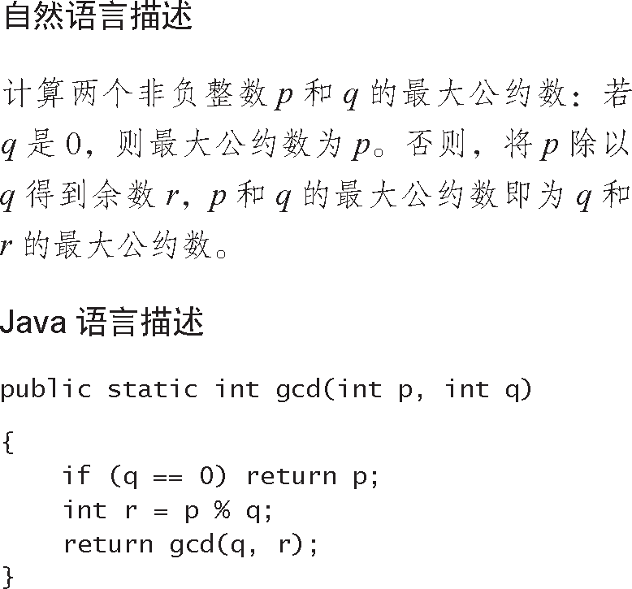

# 算法

编写一段计算机程序一般都是实现一种已有的方法来解决某个问题。这种方法大多和使用的编程语言无关——它适用于各种计算机以及编程语言。是这种方法而非计算机程序本身描述了解决问题的步骤。在计算机科学领域，我们用算法这个词来描述一种有限、确定、有效的并适合用计算机程序来实现的解决问题的方法。算法是计算机科学的基础，是这个领域研究的核心。

要定义一个算法，我们可以用自然语言描述解决某个问题的过程或是编写一段程序来实现这个过程。如发明于 2300 多年前的欧几里得算法所示，其目的是找到两个数的最大公约数：

如果你不熟悉欧几里得算法，那么你应该在学习了 1.1 节之后完成练习 1.1.24 和练习1.1.25。在本书中，我们将用计算机程序来描述算法。这样做的重要原因之一是可以更容易地验证它们是否如所要求的那样有限、确定和有效。但你还应该意识到用某种特定语言写出一段程序只是表达一个算法的一种方法。数十年来本书中许多算法都曾被表达为多种编程语言的程序，这正说明每种算法都是适合于在任何计算机上用任何编程语言实现的方法。

我们关注的大多数算法都需要适当地组织数据，而为了组织数据就产生了数据结构，数据结构也是计算机科学研究的核心对象，它和算法的关系非常密切。在本书中，我们的观点是数据结构是算法的副产品或是结果，因此要理解算法必须学习数据结构。简单的算法也会产生复杂的数据结构，相应地，复杂的算法也许只需要简单的数据结构。本书中我们将会研讨许多数据结构的性质，也许本书就应该叫《算法与数据结构》。

当用计算机解决一个问题时，一般都存在多种不同的方法。对于小型问题，只要管用，方法的不同并没有什么关系。但是对于大型问题（或者是需要解决大量小型问题的应用），我们就需要设计能够有效利用时间和空间的方法了。

学习算法的主要原因是它们能节约非常多的资源，甚至能够让我们完成一些本不可能完成的任务。在某些需要处理上百万个对象的应用程序中，设计优良的算法甚至可以将程序运行的速度提高数百万倍。在本书中我们将在多个场景中看到这样的例子。与此相反，花费金钱和时间去购置新的硬件可能只能将速度提高十倍或是百倍。无论在任何应用领域，精心设计的算法都是解决大型问题最有效的方法。

在编写庞大或者复杂的程序时，理解和定义问题、控制问题的复杂度和将其分解为更容易解决的子问题需要大量的工作。很多时候，分解后的子问题所需的算法实现起来都比较简单。但是在大多数情况下，某些算法的选择是非常关键的，因为大多数系统资源都会消耗在它们身上。本书的焦点就是这类算法。我们所研究的基础算法在许多应用领域都是解决困难问题的有效方法。

计算机程序的共享已经变得越来越广泛，尽管书中涉及了许多算法，我们也只实现了其中的一小部分。例如，Java 库包含了许多重要算法的实现。但是，实现这些基础算法的简化版本有助于我们更好地理解、使用和优化它们在库中的高级版本。更重要的是，我们经常需要重新实现这些基础算法，因为在全新的环境中（无论是硬件的还是软件的），原有的实现无法将新环境的优势完全发挥出来。在本书中，我们的重点是用最简洁的方式实现优秀的算法。我们会仔细地实现算法的关键部分，并尽最大努力揭示如何进行有效的底层优化工作。

为一项任务选择最合适的算法是困难的，这可能会需要复杂的数学分析。计算机科学中研究这种问题的分支叫做算法分析。通过分析，我们将要学习的许多算法都有着优秀的理论性能；而另一些我们则只是根据经验知道它们是可用的。我们的主要目标是学习典型问题的各种有效算法，但也会注意比较不同算法之间的性能差异。不应该使用资源消耗情况未知的算法，因此我们会时刻关注算法的期望性能。
