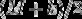

# 练习：B-树

6.14 假设在一棵三层树中，总共可以在内存中保存

- 条链接。每个页中可以保存条指


- 条指向外部结点中的链接。在这样一棵树中最多可以含有多少个

向内部结点的链接和


- 的函数）？

项（作为

- 、、

```sql
6.15 开发一个 Page 的实现，将 B- 树的结点表示为一个 BinarySearchST 类的对象。
6.16 扩展 BTreeSET 来实现能够关联键和值的 BTreeST 类，并完整支持有序符号表 API，
包括 min()、max()、floor()、ceiling()、deleteMin()、deleteMax()、
select()、rank() 方法以及接受两个参数的 size() 和 get() 方法。
```

6.17 编写一个程序，使用 StdDraw 将 B- 树的生长过程可视化，如同正文描述的方式一样。

6.18 在一个有缓存的典型系统中，估计对 B- 树的

- 次随机查找中，每次查找的平均探查次


- 个最近访问的页保存在内存中（因此无需探查）。假设远大于

数。缓存可以将

- 。


```
6.19 网络搜索。开发一个 Page 类的实现，为了索引网页，用 B- 树的结点表示网页中的文
```

本。用一个文件表示搜索的关键字。从标准输入接受被索引的网页。为了控制规模，接受命令

- 并将内部结点的数量限制在内。（在使用较大的前请联系系统管理员。）使用

行参数


```
 为 4 时，结点名可以是 BTreeNode0000、
```

- 位的数字来表示内部结点。例如，当

一个

```
BTreeNode0001、BTreeNode0002 等。在页中保存成对的字符串。向 API 中添加一个
close() 操作来排序并写入数据。为了测试实现，尝试在你的学校的网站上搜索你和朋友的
```

名字。

6.20 B*- 树。在 B- 树中启发式地分裂兄弟结点：当某个结点含有

- 个条目并需要分裂时，将


- 个条目且

它和它的一个兄弟结点合并。如果该兄弟结点只含有

- ，可以重新分配并




- 个条目。否则，我们创建一个新结点并使 3 个结点中都只含有

使得两者都只含有


- 个条目。同时，我们允许根结点保存个条目，并在它饱和时将它分裂并创建一

- 个元素的阶 B*- 树中每次查找或插入所需的

个只含有两个条目的新根结点。找出在含有


探查数的上下界限。将你的结果和 B- 树的相应上下界（请见命题 B）进行比较。实现 B* 树中的插入操作。

6.21 编写一段程序，计算在

- 次随机插入所构造的一棵阶 B- 树中外部页的平均数量。用

- 和值运行你的程序。

合理的

6.22 如果你的系统支持虚拟内存，设计并用实验比较 B- 树和二分查找在一张庞大的符号表中的随机查找性能。

```
6.23 对于你为练习 6.15 给出的保存在内存中的 Page 的实现，用实验确定能够使 B- 树在一
 为 100 的倍数的情况。
```

- 值。特别注意

张庞大的符号表中的使随机查找操作速度最快的

6.24 运行实验比较保存在内存中的 B- 树（使用练习 6.23 中确定的

- 值）、线性探测散列法

和红黑树在一张庞大的符号表中的随机查找用时。
