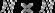
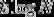

# 练习：后缀数组

```
6.25　按照图 6.0.15 的样式给出由以下字符串的后缀、后缀的排序、index() 和 lcp() 方
```

法的返回值组成的表格。

```
　a. abacadaba
　b. mississippi
　c. abcdefghij
　d. aaaaaaaaaa
```

6.26　下面这段代码用于计算字符串的所有后缀，找出其中的问题。

```
suffix = "";
for (int i = s.length() - 1; i >= 0; i--)
{
   suffix = s.charAt(i) + suffix;
   suffixes[i] = suffix;
}
```

答：它需要平方级别的时间和空间。

```
6.27　有些应用需要对文本进行回环变位，这个操作会涉及文本中的所有字符。对于 0 到
 之间的 i，长度为
 的文本的第 i 次回环变位得到的是它的后
i 个字符和前 i
```


个字符相连所得的字符串。下面这段代码用于计算文本的所有回环变位，找出其中的问题。

```
int N = s.length();
for (int i = 0; i < N; i++)
   rotation[i] = s.substring(i, N) + s.substring(0, i);
```

答：它需要平方级别的时间和空间。

6.28　设计一个线性时间的算法来计算给定文本字符串的所有回环变位。

答：

```
String t = s + s;
int N = s.length();
for (int i = 0; i < N; i++)
   rotation[i] = r.substring(i, i + N);
 的字符串 SuffixArray 对象对内存的使用
```

6.29　按照 1.4 节中的假设，给出一个长度为

情况。

```
6.30　最长公共子字符串。编写一个 SuffixArray 的用例 LCS，接受两个文件名作为命令
```

行参数，读取这两个文本文件并在线性时间内找出同时出现在两个文件中的最长子字符串。

```
（在 1970 年，D.Knuth 猜测这是不可能的。）提示：为字符串 s#t 创建后缀数组，其中 s 和
t 是文本字符串，而 # 是一个两者都不包含的字符）。
```

6.31　Burrow-Wheeler 变换。Burrow-Wheeler 变换（BWT）是一种用于数据压缩算法中的

```
变换，包括 bzip2 和高吞吐量的基因组测序等。编写一个 SuffixArray 的用例用以下方法
 的字符串（以一个文件结束符 $ 结尾，它小于
```

在线性时间内计算 BWT。给定一个长度为

- 的矩阵，其中每一行均为原文的一个不同的回环变位。按

其他任意字符）。使用一个



```
照字典顺序将所有行排序。Burrow-Wheeler 变换就是排序后的矩阵中最右侧的列。例如，
mississippi$ 的 BWT 是 ipssm$pissii。Burrow-Wheeler 逆变换（BWI）是 BWT 的
逆序。例如，ipssm$pissii 的 BWI 是 mississippi$。编写一个用例，在线性时间内，
```

为某个字符串的 BWT 计算它的 BWI。

```
6.32　环形字符串的线性化。编写一个 SuffixArray 的用例，对于给定的字符串，在线性
```

时间内找出它的字典序列最小的回环变位。这个问题来源于化学数据库中的各种环形分子，每一种分子都表示为一个环形的字符串。人们需要一种标准的表示方法（最小的回环变位）使得用字符串的任意回环变位作为键都能找到该分子。（请见练习 6.27 和练习 6.28。）

```
 次的最长子字符串。编写一个 SuffixArray 的用例，对于给定的字符串和一
```

6.33　重复

```
个整数 k，找出其中被至少重复了 k 次的最长子字符串。
6.34　较长的重复字符串。编写一个 SuffixArray 的用例，对于给定的字符串和一个整数
L，找出长度至少为 L 的重复子字符串。
```


6.35

- 频率统计。开发并实现一个抽象数据类型，对字符串进行预处理以支持高效

回答如下形式的问题：“给定的

- 出现了多少次？”每次查询在最坏情况下所需的时间



- 成正比，其中为字符串的长度。

应该与
