# 04-挥手：Nginx日志报connectionresetbypeer是怎么回事？

你好，我是胜辉。今天这节课，我们要通过实际的案例，来学习下 TCP 挥手的知识，在实战中加深对这些知识的理解。

我们在做一些应用排查的时候，时常会在日志里看到跟 TCP 有关的报错。比如在 Nginx 的日志里面，可能就有 connection reset by peer 这种报错。“连接被对端 reset（重置）”，这个字面上的意思是看明白了。但是，心里不免发毛：

- 这个 reset 会影响我们的业务吗，这次事务到底有没有成功呢?

- 这个 reset 发生在具体什么阶段，属于 TCP 的正常断连吗？

- 我们要怎么做才能避免这种 reset 呢？

要回答这类追问，Nginx 日志可能就不够用了。

事实上，网络分层的好处是在于每一层都专心做好自己的事情就行了。而坏处也不是没有，这种情况就是如此：应用层只知道操作系统告诉它，“喂，你的连接被 reset 了”。但是为什么会被 reset 呢？应用层无法知道，只有操作系统知道，但是操作系统只是把事情处理掉，往内部reset 计数器里加 1，但也不记录这次 reset 的前后上下文。

所以，为了搞清楚 connection reset by peer 时具体发生了什么，我们需要突破应用层这口井，跳出来看到更大的网络世界。

## 在应用层和网络层之间搭建桥梁

首先，你需要理解下 connection reset by peer 的含义。熟悉 TCP 的话，你应该会想到这大概是对端（peer）回复了 TCP RST（也就是这里的 reset），终止了一次 TCP 连接。其实，这也是我们做网络排查的第一个要点：把应用层的信息，“翻译”成传输层和网络层的信息。

或者说，我们需要完成一件有时候比较有挑战的事情：把应用层的信息，跟位于它下面的传输层和网络层的信息联系起来。

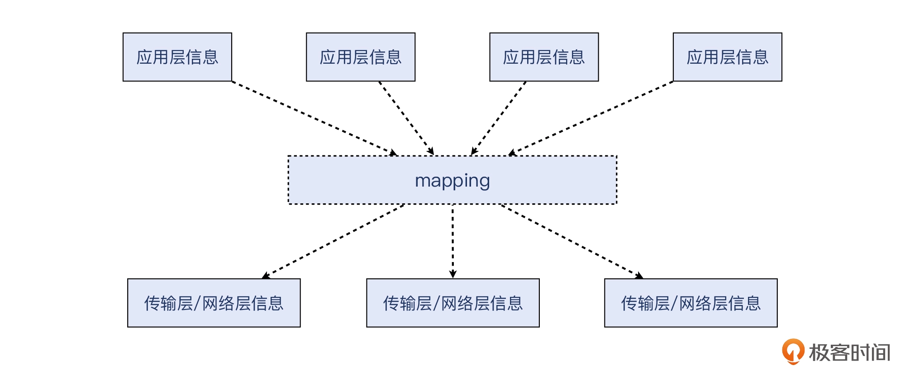

这里我说的“应用层信息”，可能是以下这些：

- 应用层日志，包括成功日志、报错日志，等等；

- 应用层性能数据，比如 RPS（每秒请求数），transaction time（处理时间）等；

- 应用层载荷，比如 HTTP 请求和响应的 header、body 等。

而“传输层 / 网络层信息”，可能是以下种种：

- 传输层：TCP 序列号（Sequence Number）、确认号（Acknowledgement Number）、MSS（Maximum Segment Size）、接收窗口（Receive Window）、拥塞窗口（CongestionWindow）、时延（Latency）、重复确认（DupAck）、选择性确认（Selective Ack）、重传（Retransmission）、丢包（Packet loss）等。

- 网络层：IP 的 TTL、MTU、跳数（hops）、路由表等。

可见，这两大类（应用 vs 网络）信息的视角和度量标准完全不同，所以几乎没办法直接挂钩。而这，也就造成了问题排查方面的两大鸿沟。

- 应用现象跟网络现象之间的鸿沟：你可能看得懂应用层的日志，但是不知道网络上具体发生了什么。

- 工具提示跟协议理解之间的鸿沟：你看得懂 Wireshark、tcpdump 这类工具的输出信息的含义，但就是无法真正地把它们跟你对协议的理解对应起来。

也就是说，你需要具备把两大鸿沟填平的能力，有了这个能力，你也就有了能把两大类信息（应用信息和网络信息）联通起来的“翻译”的能力。这正是网络排查的核心能力。

既然我们是案例实战课程，这些知识从案例里面学，是最高效的方法了。接下来，就让我们一起看两个案例吧。

## 案例 1：connection reset by peer?

前几年我在 UCloud 服务的时候，有个客户也是反馈，他们的 Nginx 服务器上遇到了很多connection reset by peer 的报错。他们担心这个问题对业务产生了影响，希望我们协助查清原因。客户的应用是一个普通的 Web 服务，架设在 Nginx 上，而他们的另外一组机器是作为客户端，去调用这个 Nginx 上面的 Web 服务。

架构简图如下：

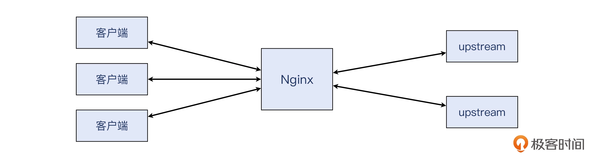

前面我说过，单纯从应用层日志来看的话，几乎难以确定 connection reset by peer 的底层原因。所以，我们就展开了抓包工作。具体做法是：

- 我们需要选择一端做抓包，这次是客户端；

- 检查应用日志，发现没几分钟就出现了 connection reset by peer 的报错；

- 对照报错日志和抓包文件，寻找线索。

我们先看一下，这些报错日志长什么样子：

```
2015/12/01 15:49:48 [info] 20521#0: *55077498 recv() failed (104: Connection rese
2015/12/01 15:49:54 [info] 20523#0: *55077722 recv() failed (104: Connection rese
2015/12/01 15:49:54 [info] 20523#0: *55077710 recv() failed (104: Connection rese
2015/12/01 15:49:58 [info] 20522#0: *55077946 recv() failed (104: Connection rese
2015/12/01 15:49:58 [info] 20522#0: *55077965 recv() failed (104: Connection rese
```

- 补充：因为日志涉及客户数据安全和隐私，我已经做了脱敏处理。

看起来最“显眼”的，应该就是那句 connection reset by peer。另外，我们其实也可以关注一下报错日志里面的其他信息，这也可以帮助我们获取更全面的上下文。

- recv() failed：这里的 recv() 是一个系统调用，也就是 Linux 网络编程接口。它的作用呢，看字面就很容易理解，就是用来接收数据的。我们可以直接 man recv，看到这个系统调用的详细信息，也包括它的各种异常状态码。

- 104：这个数字也是跟系统调用有关的，它就是 recv() 调用出现异常时的一个状态码，这是操作系统给出的。在 Linux 系统里，104 对应的是 ECONNRESET，也正是一个 TCP 连接被 RST 报文异常关闭的情况。

- upstream：在 Nginx 等反向代理软件的术语里，upstream 是指后端的服务器。也就是说，客户端把请求发到 Nginx，Nginx 会把请求转发到 upstream，等后者回复 HTTP 响应后，Nginx 把这个响应回复给客户端。注意，这里的“客户端 <->Nginx”和“Nginx<->upstream”是两条独立的 TCP 连接，也就是下图这样：

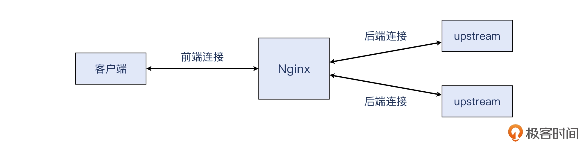

- 补充：你可能觉得奇怪，明明数据是从外面进入到里面的，为什么里面的反而叫upstream？其实是这样的：在网络运维的视角上，我们更关注网络报文的流向，因为HTTP 报文是从外部进来的，那么我们认为其上游（upstream）是客户端；但是在应用的视角上，更关注的是数据的流向，一般来说 HTTP 数据是从内部往外发送的，那么在这种视角下，数据的上游（upstream）就是后端服务器了。同样，在 HTTP 协议规范 RFC 中，upstream 也是指服务端。

- Nginx、Envoy 都属于应用网关，所以在它们的术语里，upstream 指的是后端环节。这里没有对错之分，你只要知道并且遵照这个约定就好了。

到这里，我们既然已经解读清楚报错日志了，接下来就进入到抓包文件的分析里吧。

### 先写过滤器

虽然在上节课，我们也使用 Wireshark 对握手相关的案例做了不少分析，但对它的使用还是相对简单的。那今天这节课开始，我们就要深度使用 Wireshark 了。比如在接下来的内容里，我会用到很多 Wireshark 的过滤器（也可以叫过滤表达式或者过滤条件）。因为步骤稍多，所以我会多花一些时间来讲解，希望能给你讲透。

一般来说，在我们抓到的原始抓包文件里，我们真正关心的报文只占整体的一小部分。那么，如何从中定位跟问题相关的报文，就是个学问了。

就当前这个案例而言，我们既然有应用层日志，也有相关的 IP 地址等明确的信息，这些就为我们做报文过滤创造了条件。我们要写一个过滤器，这个过滤器以 IP 为条件，先从原始文件中过滤出跟这个 IP 相关的报文。

在 Wireshark 中，以 IP 为条件的常用过滤器语法，主要有以下几种：

```
ip.addr eq my_ip：过滤出源IP或者目的IP为my_ip的报文
ip.src eq my_ip：过滤出源IP为my_ip的报文
ip.dst eq my_ip：过滤出目的IP为my_ip的报文
```

不过，这还只是第一个过滤条件，仅通过它过滤的话，出来的报文数量仍然比我们真正关心的报文要多很多。我们还需要第二个过滤条件，也就是要找到 TCP RST 报文。这就要用到另外一类过滤器了，也就是 tcp.flags，而这里的 flags，就是 SYN、ACK、FIN、PSH、RST 等TCP 标志位。

对于 RST 报文，过滤条件就是：

```
tcp.flags.reset eq 1
```

我们可以选中任意一个报文，注意其 TCP 的 Flags 部分：

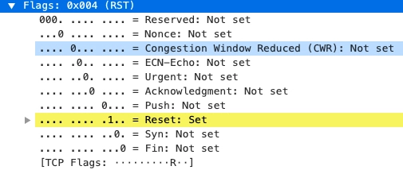

好了，我们打开抓包文件，输入这个过滤条件：

```
ip.addr eq 10.255.252.31 and tcp.flags.reset eq 1
```

我们会发现有很多 RST 报文：

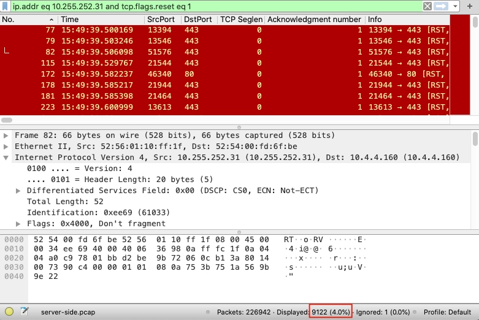

在 Wirershark 窗口的右下角，就有符合过滤条件的报文个数，这里有 9122 个，占所有报文的4%，确实是非常多。由此推测，日志里的很多报错估计应该就是其中一些 RST 引起的。我们选一个先看一下。

我们在第 2 讲的时候，就学习了如何在 Wireshark 中，基于一个报文，找到它所在的整个TCP 流的所有其他报文。这里呢，我们选择 172 号报文，右单击，选中 Follow -> TCPStream，就找到了它所属的整个 TCP 流的报文：

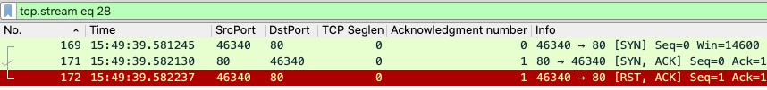

咦，这个 RST 处在握手阶段？由于这个 RST 是握手阶段里的第三个报文，但它又不是期望的ACK，而是 RST+ACK，所以握手失败了。

不过，你也许会问：这种握手阶段的 RST，会不会也跟 Nginx 日志里的 connection resetby peer 有关系呢？

要回答这个问题，我们就要先了解应用程序是怎么跟内核的 TCP 协议栈交互的。一般来说，客户端发起连接，依次调用的是这几个系统调用：

- socket()

- connect()

而服务端监听端口并提供服务，那么要依次调用的就是以下几个系统调用：

- socket()

- bind()

- listen()

- accept()

服务端的用户空间程序要使用 TCP 连接来接收请求，首先要获得上面最后一个接口，也就是accept() 调用的返回。而 accept() 调用能成功返回的前提呢，是正常完成三次握手。

你看，这次客户端在握手中的第三个包不是 ACK，而是 RST（或者 RST+ACK），握手不是失败了吗？那么自然地，这次失败的握手，也不会转化为一次有效的连接了，所以 Nginx 都不知道还存在过这么一次失败的握手。

当然，在客户端日志里，是可以记录到这次握手失败的。这是因为，客户端是 TCP 连接的发起方，它调用 connect()，而 connect() 失败的话，其 ECONNRESET 返回码，还是可以通知给应用程序的。

我们再来看一下这张系统调用跟 TCP 状态关系的示意图：

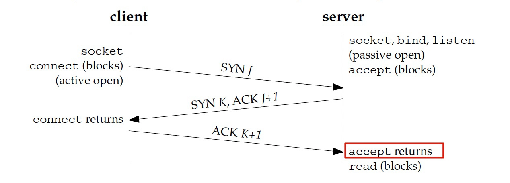

所以，上面这个虽然也是 RST，但并不是我们要找的那种“在连接建立后发生的 RST”。

### 继续打磨过滤器

看来，我们还需要进一步打磨一下过滤条件，把握手阶段的 RST 给排除。要做到这一点，首先要搞清楚：什么是握手阶段的 RST 的特征呢？

我们关注一下上面的截图，其实会发现：这个 RST 的序列号是 1，确认号也是 1。因此，我们可以在原先的过滤条件后面，再加上这个条件：

```
tcp.seq eq 1 and tcp.ack eq 1
```

于是过滤条件变成：

```
ip.addr eq 10.255.252.31 and tcp.flags.reset eq 1 and !(tcp.seq eq 1 and tcp.ack
注意，这里的(tcp.seq eq 1 and tcp.ack eq 1)前面是一个感叹号（用 not 也一样），
```

起到“取反”的作用，也就是排除这类报文。

让我们看下，现在过滤出来的报文是怎样的：

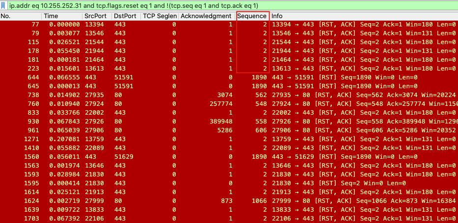

我们又发现了序列号为 2 的很多 RST 报文，这些又是什么呢？我们选包号 115，然后 Follow-> TCP Stream 看一下：

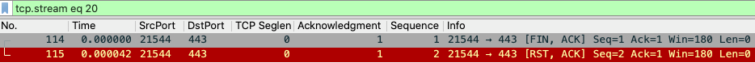

原来这是挥手阶段的 RST，并且没有抓取到数据交互阶段，那跟日志里的报错也没关系，也可以排除。这样的话，我们可以把前面的过滤条件中的 and 改成 or，就可以同时排除握手阶段和挥手阶段的 RST 报文了。我们输入过滤器：

```
ip.addr eq 10.255.252.31 and tcp.flags.reset eq 1 and !(tcp.seq eq 1 or tcp.ack e
```

得到下面这些报文：

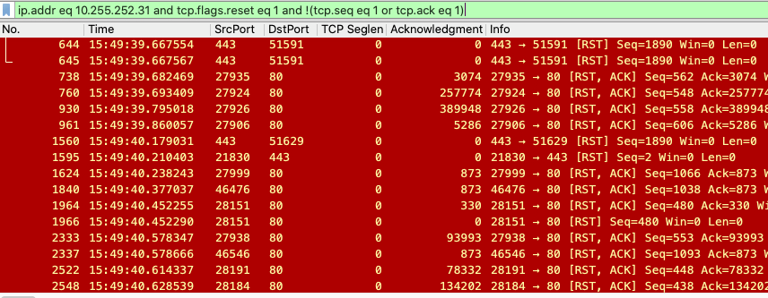

虽然排除了握手阶段的 RST 报文，但是剩下的也还是太多，我们要找的“造成 Nginx 日志报错”的 RST 在哪里呢？

为了找到它们，我们需要再增加一些明确的搜索条件。还记得我提到过的两大鸿沟吗？一个是应用现象跟网络现象之间的鸿沟，一个是工具提示跟协议理解之间的鸿沟。

现在为了跨越第一个鸿沟，我们需要把搜索条件落实具体，针对当前案例来说，就是基于以下条件寻找数据包：

- 既然这些网络报文跟应用层的事务有直接关系，那么报文中应该就包含了请求相关的数据，比如字符串、数值等。当然，这个前提是数据本身没有做过特定的编码，否则的话，报文中的二进制数据，跟应用层解码后看到的数据就会完全不同。

- 补充：编码的最典型的场景就是 TLS。如果我们不做解密，那么直接 tcpdump 或者Wireshark 抓取到的报文就是加密过的，跟应用层（比如 HTTP）的数据完全不同，这也给排查工作带来了不小的困难。关于如何对 TLS 抓包数据进行解密，我在“实战二”的 TLS 排查的课程里会提到，你可以期待一下。

- 这些报文的发送时间，应该跟日志的时间是吻合的。

对于条件 1，我们可以利用 Nginx 日志中的 URL 等信息；对于条件 2，我们就要利用日志的时间。其实，在开头部分展示的 Nginx 日志中，就有明确的时间（2015/12/01 15:49:48），虽然只是精确到秒，但很多时候已经足以帮助我们进一步缩小范围了。

那么，在 Wireshark 中搜索“特定时间段内的报文”，又要如何做到呢？这就是我要介绍给你的又一个搜索技巧：使用 frame.time 过滤器。比如下面这样：

```
frame.time >="dec 01, 2015 15:49:48" and frame.time <="dec 01, 2015 15:49:49"
```

这就可以帮助我们定位到跟上面 Nginx 日志中，第一条日志的时间匹配的报文了。为了方便你理解，我直接把这条日志复制到这里给你参考：

```
2015/12/01 15:49:48 [info] 20521#0: *55077498 recv() failed (104: Connection rese
```

我们再结合前面的搜索条件，就得到了下面这个更加精确的过滤条件：

```
frame.time >="dec 01, 2015 15:49:48" and frame.time <="dec 01, 2015 15:49:49" and
```

好长的一个过滤器！不过没关系，人读着觉得长，Wireshark 就未必这么觉得了，也许还觉得很顺眼呢。就好比机器语言，人读着感觉是天书，机器却觉得好亲近，“这可是我的母语啊！”

好，这次我们终于非常成功地锁定到只有 3 个 RST 报文了：

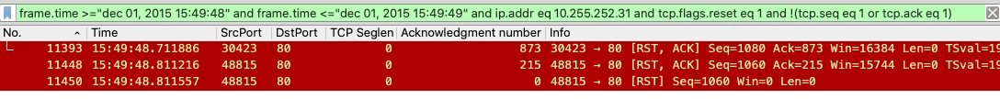

接下来要做的事情就会简单很多：只要把这三个 RST 所在的 TCP 流里的应用层数据（也就是HTTP 请求和返回）跟 Nginx 日志中的请求和返回进行对比，就能找到是哪个 RST 引起了Nginx 报错了。

### 对问题报文的深入分析

我们先来看看，11393 号报文所属的流是什么情况？

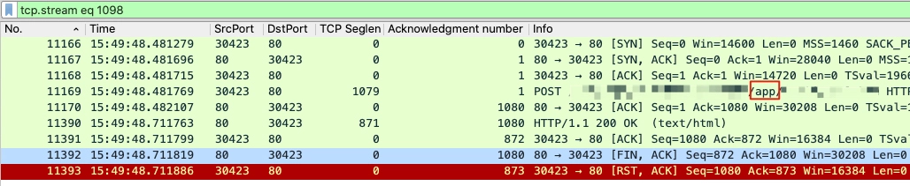

然后我们来看一下 11448 号报文所属的 TCP 流。

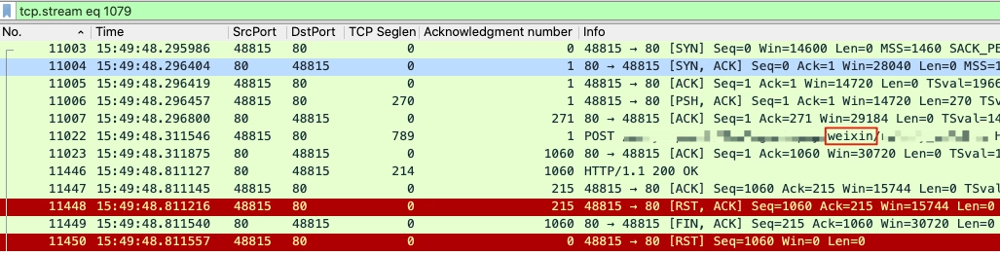

原来，11448 跟 11450 是在同一个流里面的。现在清楚了，3 个 RST，分别属于 2 个 HTTP事务。

你再仔细对比一下两个图中的红框部分，是不是不一样？它们分别是对应了一个 URL 里带“weixin”字符串的请求，和一个 URL 里带“app”字符串的请求。那么，在这个时间点（15:49:48）对应的日志是关于哪一个 URL 的呢？

```
2015/12/01 15:49:48 [info] 20521#0: *55077498 recv() failed (104: Connection rese
```

你只要往右拖动一下鼠标，就能看到 POST URL 里的“weixin”字符串了。而包号 11448 和11450 这两个 RST 所在的 TCP 流的请求，也是带“weixin”字符串的，所以它们就是匹配上面这条日志的 RST！

如果你还没有完全理解，我这里帮你小结一下，为什么我们可以确定这个 TCP 流就是对应这条日志的，主要三点原因：

- 时间吻合；

- RST 行为吻合；

- URL 路径吻合。

通过解读上面的 TCP 流，我们终于跨过了这道“应用现象跟网络报文”之间的鸿沟：

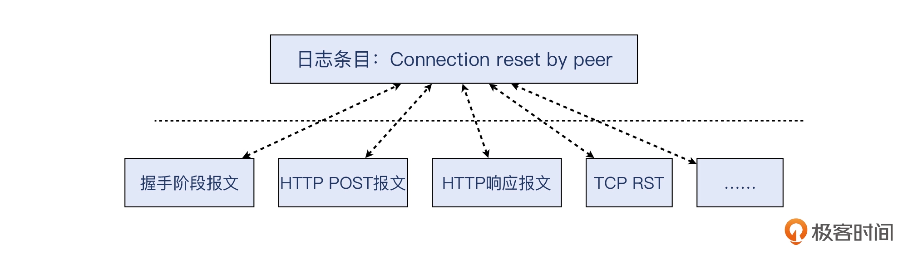

再进一步，我给你画一下这个 HTTP 事务的整体过程，帮你进一步搞清楚为什么这个 RST，会引起 Nginx 记录 connection reset by peer 的报错：

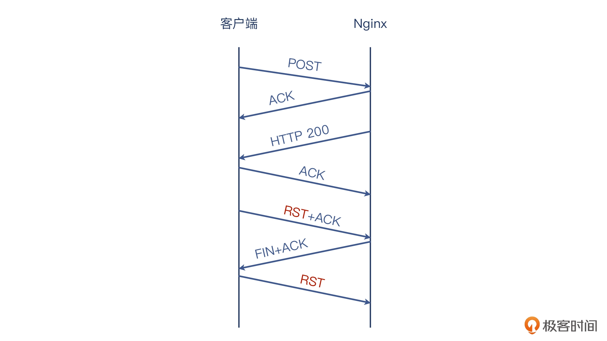

也就是说，握手和 HTTP POST 请求和响应都正常，但是客户端在对 HTTP 200 这个响应做了 ACK 后，随即发送了 RST+ACK，而正是这个行为破坏了正常的 TCP 四次挥手。也正是这个 RST，导致服务端 Nginx 的 recv() 调用收到了 ECONNRESET 报错，从而进入了 Nginx 日志，成为一条 connection reset by peer。

这个对应用产生了什么影响呢？对于服务端来说，表面上至少是记录了一次报错日志。但是有意思的是，这个 POST 还是成功了，已经被正常处理完了，要不然 Nginx 也不会回复 HTTP200。

对于客户端呢？还不好说，因为我们并没有客户端的日志，也不排除客户端认为这次是失败，可能会有重试等等。

我们把这个结论告诉给了客户，他们悬着的心稍稍放下了：至少 POST 的数据都被服务端处理了。当然，他们还需要查找客户端代码的问题，把这个不正常的 RST 行为给修复掉，但是至少已经不用担心数据是否完整、事务是否正常了。

现在，回到我们开头的三连问：

- 这个 reset 会影响我们的业务吗，这次事务到底有没有成功呢?

- 这个 reset 发生在具体什么阶段，属于 TCP 的正常断连吗？

- 我们要怎么做才能避免这种 reset 呢？

我们现在就可以回答了：

- 这个 reset 是否影响业务，还要继续查客户端应用，但服务端事务是成功被处理了。

- 这个 reset 发生在事务处理完成后，但不属于 TCP 正常断连，还需要继续查客户端代码问题。

- 要避免这种 reset，需要客户端代码进行修复。

- 补充：客户端用 RST 来断开连接并不妥当，需要从代码上找原因。比如客户端在 ReceiveBuffer 里还有数据未被读取的情况下，就调用了 close()。对应用的影响究竟如何，就要看具体的应用逻辑了。

网络中的环节很多，包括客户端、服务端、中间路由交换设备、防火墙、LB 或者反向代理等等。如何在这么多环节中定位到具体的问题节点，一直以来是很多工程师的痛点。比如，网络不稳定，或者防火墙来几个 RST，也都有可能导致类似的 connection reset by peer 的问题。

通过抓包分析，我们抽丝剥茧，定位到具体的问题环节不在 Nginx，也不在网络本身，而是在客户端代码这里。也正因为有了这样的分析，写代码的同学就可以专心做代码修复，而不用一直怀疑问题在其他环节了。

好，讨论完 RST，你可能会问了：TCP 挥手一般是用 FIN 的，这个知识点还没讨论呢。别急，这第二个案例就是关于 FIN 的。

## 案例 2：一个 FIN 就完成了 TCP 挥手？

你应该知道，TCP 挥手是“四次”，这几乎也是老生常谈的知识点了。不过这里，我也再带你来看一下常规的四次挥手的过程：

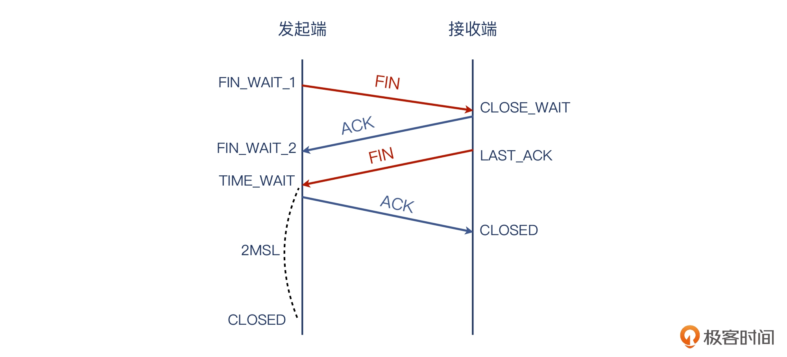

我在图上没有用“客户端”和“服务端”这种名称，而是叫“发起端”和“接收端”。这是因为，TCP 的挥手是任意一端都可以主动发起的。也就是说，挥手的发起权并不固定给客户端或者服务端。这跟 TCP 握手不同：握手是客户端发起的。或者换个说法：发起握手的就是客户端。在握手阶段，角色分工十分明确。

另外，FIN 和 ACK 都各有两次，这也是十分明确的。

可是有一次，一个客户向我报告这么一个奇怪的现象：他们偶然发现，他们的应用在 TCP 关闭阶段，只有一个 FIN，而不是两个 FIN。这好像不符合常理啊。我也觉得有意思，就一起看了他们这个抓包文件：

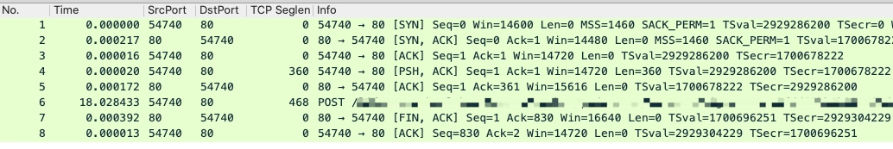

确实奇怪，真的只有一个 FIN。这两端的操作系统竟然能容忍这种事情发生？瞬间感觉“塌房”了：难道一向严谨的 TCP，它的分手也可以这么随意吗？“当初是你要分开，分开就分开，一个 FIN，就足够，眼泪落下来”？

玩笑归玩笑，很快，我就意识到还有一种可能性。在上节课我介绍 TCP 握手的时候提到过，TCP 里一个报文可以搭另一个报文的顺风车（Piggybacking），以提高 TCP 传输的运载效率。所以，TCP 挥手倒不是一定要四个报文，Piggybacking 后，就可能是 3 个报文了。看起来就类似三次挥手：


那这次的案例，我们在 Wireshark 中看到了后两个报文，即接收端回复的 FIN+ACK 和发起端的最后一个 ACK。那么，第一个 FIN 在哪里呢？从 Wireshark 的截图中，确实看不出来。

当然，从 Wireshark 的图里，我们甚至可以认为，这次连接是服务端发起的，它发送了FIN+ACK，而客户端只回复了一个 ACK，这条连接就结束了。这样的解读更加诡异，却也符合 Wireshark 的展示。

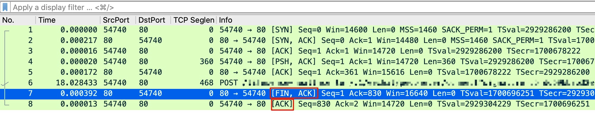

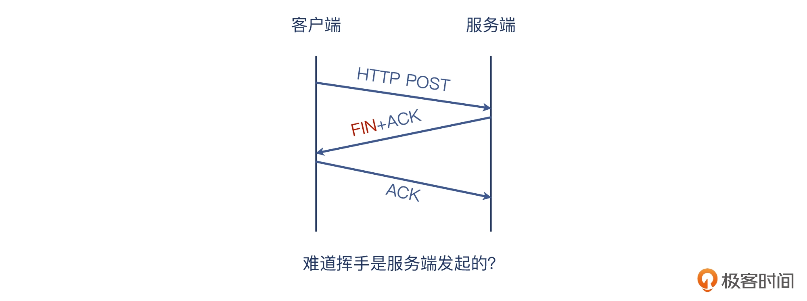

但是，Wireshark 的主界面还有个特点，就是当它的 Information 列展示的是应用层信息时，这个报文的 TCP 层面的控制信息就不显示了。

所以，上面的 POST 请求报文，其 Information 列就是 POST 方法加上具体的 URL。它的TCP 信息，包括序列号、确认号、标志位等，都需要到详情里面去找。

我们先选中这个 POST 报文，然后到界面中间的 TCP 详情部分去看看：

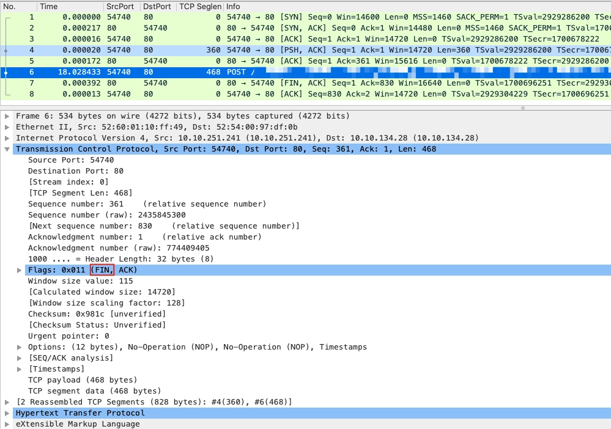

原来，第一个 FIN 控制报文，并没有像常规的那样单独出现，而是合并（Piggybacking）在POST 报文里！所以，整个挥手过程，其实依然十分标准，完全遵循了协议规范。仅仅是因为Wireshark 的显示问题，带来了一场小小的误会。虽然还有一个“为什么没有 HTTP 响应报文”的问题，但是 TCP 挥手方面的问题，已经得到了合理的解释了。

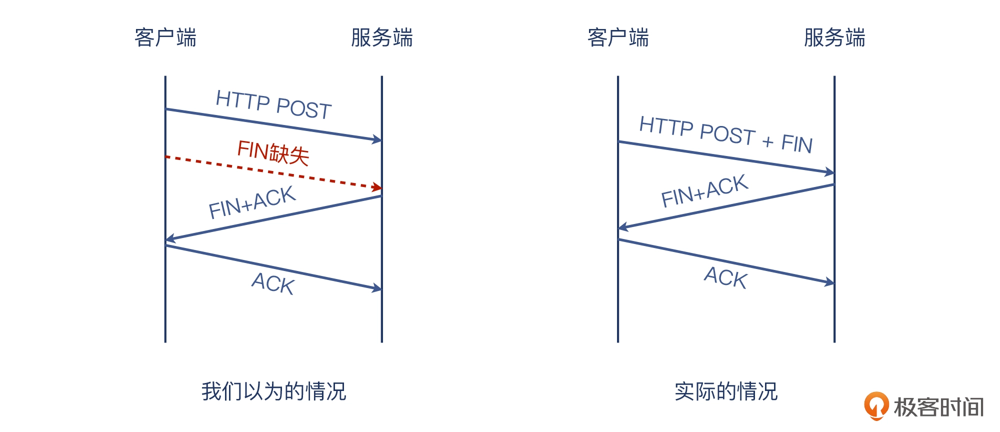

这也提醒我们，理解 TCP 知识点的时候需要真正理解，而不是生搬硬套。这一方面需要对协议的仔细研读，另一方面也离不开实际案例的积累和融会贯通，从量变引起质变。

我们自己也要有个态度：大部分时候，当看到 TCP 有什么好像“不合规的行为”，我们最好先反思自己是不是对 TCP 的掌握还不够深入，而不是先去怀疑 TCP，毕竟它也久经考验，它正确的概率比我们高得多，那我们做“自我检讨”，其实是笔划算的买卖，基本“稳赢”。

## 小结

在这节课里，我们通过回顾案例，把 TCP 挥手的相关技术细节给梳理了一遍。在案例 1 里面，我们用抓包分析的方法，打通了“应用症状跟网络现象”以及“工具提示与协议理解”这两大鸿沟，你可以再重点关注一下这里面用到的推进技巧：

- 首先根据应用层的表象信息，抽取出 IP 和 RST 报文这两个过滤条件，启动了报文过滤的工作。

- 分析第一遍的过滤结果，得到进一步推进的过滤条件（在这个案例里是排除握手阶段的RST）。

- 结合日志时间范围，继续缩小范围到 3 个 RST 报文，这个范围足够小，我们可以展开分析，最终找到报错相关的 TCP 流。这种“迭代式”的过滤可以反复好几轮，直到你定位到问题报文。

- 在这个 TCP 流里，结合对 TCP 协议和 HTTP 的理解，定位到问题所在。

此外，通过这个案例，我也给你介绍了一些 Wireshark 的使用技巧，特别是各种过滤器：

- 通过 ip.addr eq my_ip 或 ip.src eq my_ip，再或者 ip.dst eq my_ip，可以找到跟 my_ip相关的报文。

- 通过 tcp.flags.reset eq 1 可以找到 RST 报文，其他 TCP 标志位，依此类推。

- 通过 tcp.ack eq my_num 可以找到确认号为 my_num 的报文，对序列号的搜索，同理可用 tcp.seq eq my_num。

- 一个过滤表达式之前加上“!”或者 not 起到取反的作用，也就是排除掉这些报文。

- 通过 frame.time >="dec 01, 2015 15:49:48"这种形式的过滤器，我们可以根据时间来过滤报文。

- 多个过滤条件之间可以用 and 或者 or 来形成复合过滤器。

- 通过把应用日志中的信息（比如 URL 路径等）和 Wireshark 里的 TCP 载荷的信息进行对比，可以帮助我们定位到跟这个日志相关的网络报文。

而在案例 2 里面，我们对“四次挥手”又有了新的认识。通过这个真实案例，我希望你能够了解到：

- 实际上 TCP 挥手可能不是表面上的四次报文，因为并包也就是 Piggybacking 的存在，它可能看起来是三次。

- 在某些特殊情况下，在 Wireshark 里看不到第一个 FIN。这个时候你不要真的把后面那个被Wireshark 直接展示的 FIN 当作是第一个 FIN。你需要选中挥手阶段附近的报文，在 TCP详情里面查看是否有报文携带了 FIN 标志位。这确实是个非常容易掉坑的地方，所以我要提醒你一下。

## 思考题

好了，挥手相关的知识点给你复习到这里。给你留几道思考题：

1. 如果要在 Wireshark 中搜索到挥手阶段出现的 RST+ACK 报文，那么这个过滤器该如何写呢？

2. 你有没有通过抓包分析，解决过应用层的奇怪问题呢？你是怎么做的呢？

欢迎在留言区分享你的答案和思考，我们一起交流探讨。如果觉得有收获，也欢迎你把今天的内容分享给更多的朋友。

## 扩展知识：聊一聊挥手的常见误区

我们案例也讲了两个了，相信你也对非正常挥手（RST）和正常挥手（FIN）有了更加深入的认识了。接下来，我再给你介绍几个常见误区，希望给你起到“有则改之，无则加勉”的效果。

### 连接关闭由客户端发起？

其实不对，连接关闭可以是客户端，也可以是服务端发起。造成这个误解的原因，其实也跟这张图有关系：

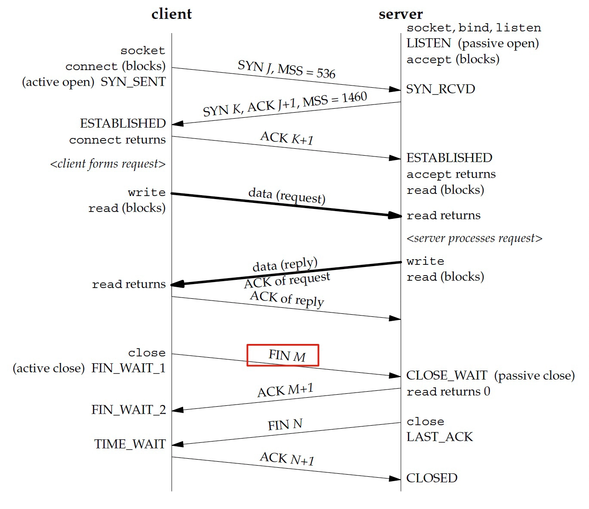

你有没有发现，图中第一个 FIN 是从客户端发起的。但服务端就不会主动发起关闭 / 挥手吗？当然会，只是图中没有标明这种情况。挥手跟握手不同，握手一定是客户端发起的（所以才叫客户端），但挥手是双方都可以。

其实上节课我们也讲到过这张图，它出自 Richard Stevens 的《UNIX 网络编程：套接字联网 API》。那是不是 Stevens 自己就搞错了呢？我觉得，这个可能性比我中彩票的概率还要低好几个数量级。

Stevens 当然清楚双方都可以发起挥手，他只是为了突出重点，就没有把多种情况都画到同一张图里，因为这张图的重点是把 TCP 连接状态的变迁展示清楚，而不是要突出“谁可以发起挥手”这个细节。

### 挥手不能同时发起？

有的同学觉得挥手是客户端发起的，或者是服务端发起，反正就不能是双方同时发起。事实上，如果双方同时都主动发起了关闭，TCP 会怎么处理这种情况呢？我们看下图：

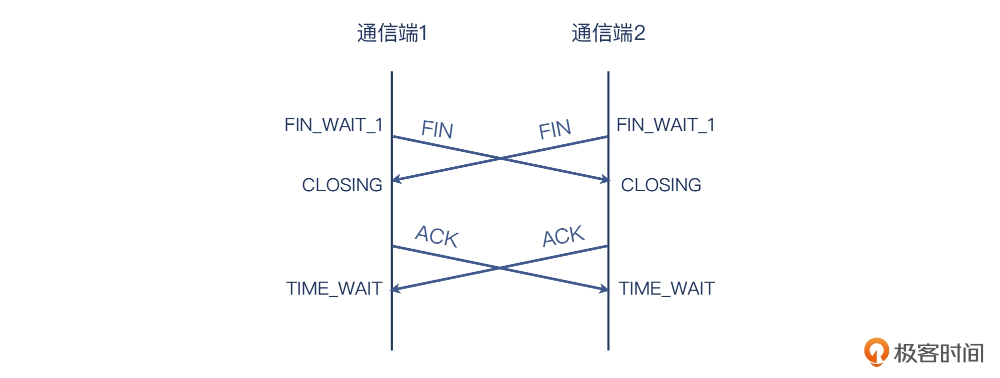

- 双方同时发起关闭后，也同时进入了 FIN_WAIT_1 状态；

- 然后也因为收到了对方的 FIN，也都进入了 CLOSING 状态；

- 当双方都收到对方的 ACK 后，最终都进入了 TIME_WAIT 状态。

这也意味着，两端都需要等待 2MSL 的时间，才能复用这个五元组 TCP 连接。这种情况是比较少见的，但是协议设计需要考虑各种边界条件下的实现，比普通的应用程序所要考虑的事情要多不少。所以也许有些 RFC 看似简单，但背后其实都十分不简单。

### TCP 挥手时双方同时停止发送数据？

一方发送 FIN，表示这个连接开始关闭了，双方就都不会发送新的数据了？这也是很常见的误区。

实际上，一方发送 FIN 只是表示这一方不再发送新的数据，但对方仍可以发送数据。

还是在 Richard Stevens 的《TCP/IP 详解（第一卷）》中，明确提到 TCP 可以有“半关闭”的做法，也就是：

- 一端（A）发送 FIN，表示“我要关闭，不再发送新的数据了，但我可以接收新的数据”。

- 另一端（B）可以回复 ACK，表示“我知道你那头不会再发送了，我这头未必哦”。

- B 可以继续发送新的数据给 A，A 也会回复 ACK 表示确认收到新数据。

- 在发送完这些新数据后，B 才启动了自己的关闭过程，也就是发送 FIN 给 A，表示“我的事情终于忙好了，我也要关闭，不会再发送新数据了”。

- 这时候才是真正的两端都关闭了连接。

还是搬运了 Stevens 的图过来供你参考，也再次致敬 Stevens 大师！

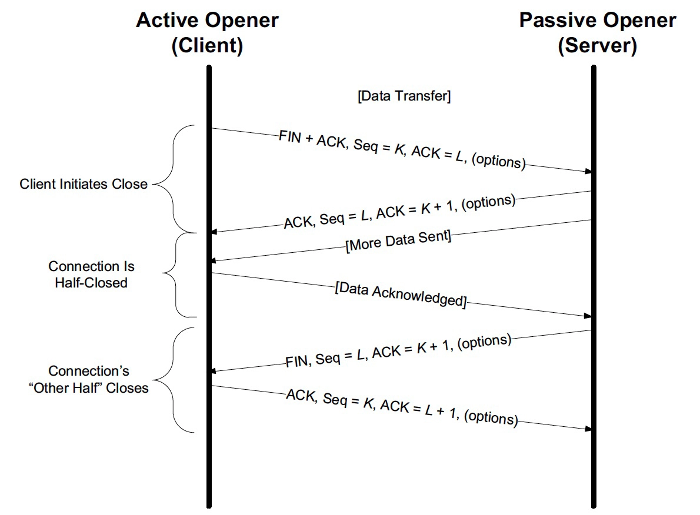
