# 06-定位防火墙（二）：网络层的精确打击

你好，我是胜辉。今天我们接着上节课的学习和思考，继续来探讨如何定位防火墙问题。

在上节课里，我们用两侧抓包并对比分析的方法，首先定位到了引发长耗时的数据包，然后对比两侧抓包文件，定位到了包乱序的现象及其原因。最后，我们综合这些有利证据，跟安全部门沟通后，拿到了真正的根因，并彻底解决了问题。


在那个案例中，大量的分析技术是位于传输层，而且要结合应用层（超时的问题）做综合分析。总的来说，难度还是不小的。而且还有一个不可回避的问题：包乱序难道只有防火墙才会


引发吗？

其实不是的。包乱序是一种相对来说比较普遍的现象，除了防火墙，还有网络设备、主机本身都可能引起乱序。所以，单纯根据包乱序就断定是防火墙在中间捣鬼，就有点以偏概全了。

那么有没有一种方法，不需要借助那么多的传输层的复杂知识，就可以让我们更加明确地判断出，问题是在防火墙呢？

这节课，我就给你介绍这种方法，即聚焦在网络层的精确打击。这是一种更加直接、更加高效的办法。

你可能又会疑惑了：难道说我们上节课学的东西，其实是多余的吗？那倒不是。这两节讲防火墙的课程，各自有不同的侧重点和不同的适用场景。这次我们介绍的方法，在上节课的案例里就不会起到作用；反过来也是如此。技术上没有“一招鲜”，只是这次课讲的内容相对上节课来说，确实更加直接，这也是它的一大特点。

好了，废话不多说，咱们来看案例吧。

## 案例 1：Web 站点访问被 reset

几年前我在公有云公司就职，当时公司乔迁入住了新的办公大楼，没过半天，不少同事陆续报告，他们无法访问某个内部 Web 工具。而且报告的人都有个共同点：他们使用的是二楼的有线网络。

我们这个内部工具是以 Web 网站形式运行的，报错页面就是类似下面这种（不同浏览器会有不同的错误页面）：

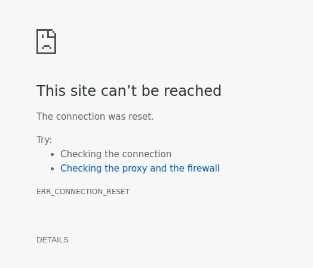

- 补充：不要误会，这可不是我们极客时间 App 的图片加载的报错，这本身就是当时的报错截图。

我们让二楼同事连接到有线网络并做了抓包，然后传给我们做分析。因为抓包的同事没有做过滤，所以抓上来的包比较大，包含了各种其他无关的数据包。不过没关系，我们可以按下面的顺序来。

- 第一步：过滤 IP

在这个案例里面，我们就可以把 Web 站点的 IP 作为过滤条件。Web 站点的 IP 是253.61.239.103，所以我们的过滤器就是：

```
ip.addr == 253.61.239.103
```

- 补充：因为信息安全的原因，这里的报文信息我做过脱敏了（也就是修改或者删除了敏感信息），所以 IP 和载荷等都已经不是原始信息了。

我们得到下面的过滤结果：

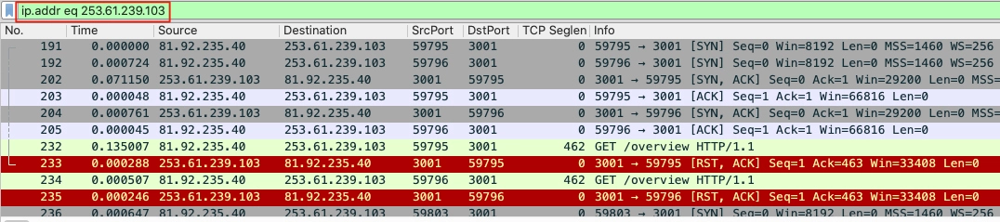

- 第二步：选中可能有问题的数据包，然后过滤出整个 TCP 流

从上图中已经能看到 RST 报文了。当然，在第 4 讲里，我们也学习了如何在 Wireshark 里面，用过滤器来找到 TCP RST 报文。那么这个案例里面，我们同样可以这么做。在过滤输入框里输入：

```
ip.addr eq 253.61.239.103 and tcp.flags.reset eq 1
```

我们觉得某个 RST 包比较可疑，那么还是用 Follow -> TCP Stream 的方法，找到对应的TCP 流：

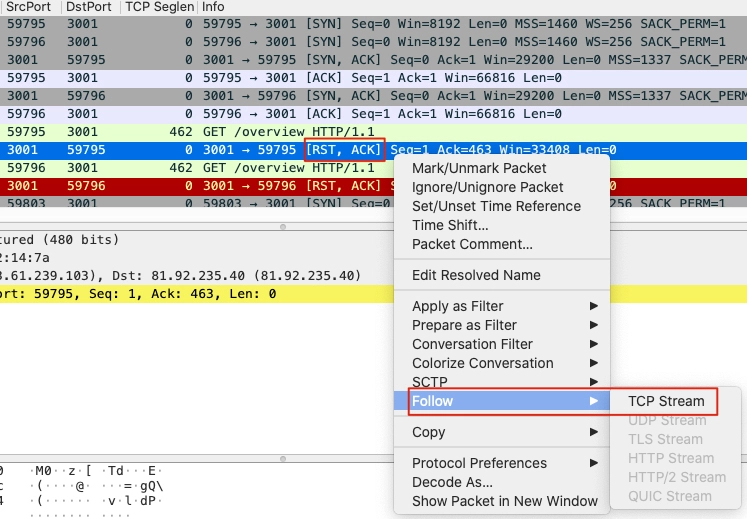

- 第三步：在过滤出来的 TCP 流中进一步分析

在我们点击 TCP Stream 的时候，Wireshark 会弹出一个窗口，显示解读好的应用层信息。如果是 HTTP 明文（非 HTTPS 加密），那就可以直接看到里面的内容了。

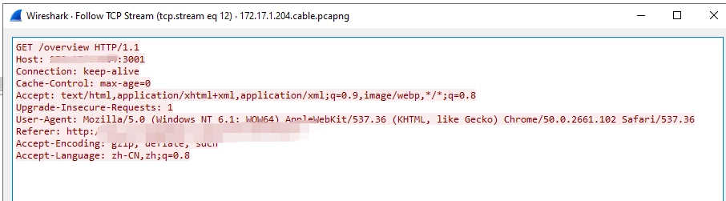

回到主窗口，此时过滤生效，所以只有属于这个 TCP 流的包才被显示，其他无关的数据包都已经被隐藏了。

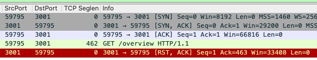

可见，TCP 三次握手后，客户端发起了一个 HTTP 请求，即 GET /overview HTTP/1.1，但服务端回复的是 TCP RST，怪不得访问失败了。我画了下面这张示意图供你参考：

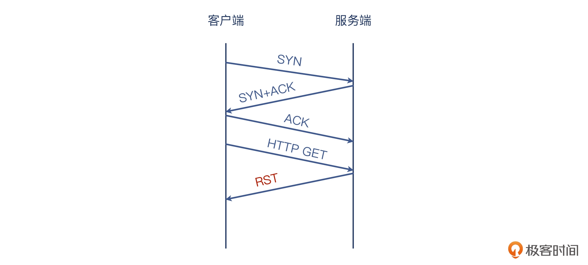

握手能成功，看起来网络连通性没有问题，然后发送 HTTP 请求后收到 RST，感觉服务端的嫌疑很大。

我们找到了负责服务端的同事，不过，他们说完全没有做 RST 这种设置，而且反问：“不是说Wi-Fi 就都正常吗？二楼以外的其他楼层也都可以，不是可以排除服务端原因了吗？”

客户端没问题，服务端也没问题，是不是就要怀疑是防火墙了？但还是那个困境：我们并没有

防护墙的权限，无法证实这件事。

那我们还是回到网络本身来查看，静下心来思考一下。

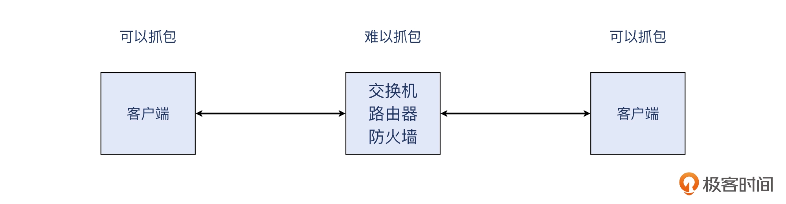

其实，虽然抓包分析是一个很好的排错方法，但是一般在中间设备（交换机、防火墙等）上不方便抓包，所以主要途径还是在客户端或者服务端的抓包文件里寻找端倪。当然，我们也可以争取条件到服务器上抓个包，然后再结合两侧抓包文件，进行对比分析，会更容易得出结论，这也是上节课我介绍过的方法。

不过，有没有办法只根据客户端的抓包，就能确定这次问题的根因呢？这个比较悬。但是，对于当前这种场景，如果能掌握到一个关键信息，我们就可以直接得出结论。

它就是 TTL（Time To Live）。你可能会觉得，这个知识点简直太简单了，真的能解决我们的问题吗？且听我慢慢说。

### TTL 详解

TTL 是 IP 包（网络层）的一个属性，字面上就差不多是生命长度的意思，每一个三层设备都会把路过的 IP 包的 TTL 值减去 1。而 IP 包的归宿，无非以下几种：

- 网络包最终达到目的地；

- 进入路由黑洞并被丢弃；

- 因为网络设备问题被中途丢弃；

- 持续被路由转发并 TTL 减 1，直到 TTL 为 0 而被丢弃。

在RFC791中规定了 TTL 值为 8 位，所以取值范围是 0~255。

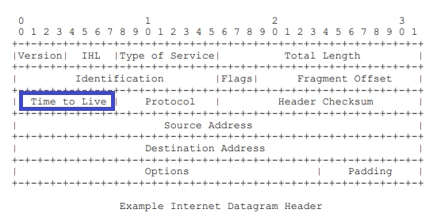

因为 TTL 是从出发后就开始递减的，那么必然，网络上我们能抓到的包，它的当前 TTL 一定比出发时的值要小。而且，我们可能也早就知道，TTL 从初始值到当前值的差值，就是经过的三层设备的数量。

不同的操作系统其初始 TTL 值不同，一般来说 Windows 是 128，Linux 是 64。由此，我们就可以做一些快速的判断了。比如我自己测试 ping www.baidu.com，收到的 TTL 是 52，如下图：

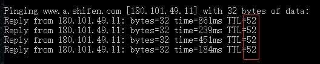

这个百度服务端大概率是 Linux 类系统，因为用 Linux 类系统的 TTL 64 减去 52，得到 12。这意味着这个回包在公网上经过了 12 跳的路由设备（三层设备），这个数量是符合常识的。

假如百度服务端是 Windows，而 Windows 类系统一般 TTL 为 128，那么 128 减去 52 就得到

76。那就意味着这个回包居然要途经 76 个三层设备，这显然就违背常识了，所以反证这个百度服务端不会是 Windows。这就是我想说的第一点：TTL 的值是反映了网络路径跳数的，也可以通过它间接推导出对端的 OS 类型。

- 补充：现今绝大部分网站的接入环节都是 *nix 类系统，所以这里只是单纯关于 TTL 这个知识点的技术讨论，不涉及“哪种 OS 是服务端主流”这种有争议的话题。

接下来第二点更加关键了。同样两个通信方之间的数据交互，其数据包在公网上容易出现路径不同的情况。就好比你每天开车上班，一般也有不止一条线路，无论走哪一条，只要能到公司就可以了。那么你和百度之间的路径，上午是 12 跳，下午变成 13 跳，或者 11 跳，也都属于正常。

但是内网不同，因为内网路径相对稳定，一般不会变化。如果出现 TTL 值的波动，特别是当这个波动值比较大（比如超过 2）的时候，那几乎就说明这些包的不同寻常了。这就是我想说的第二点：内网同一个连接中的报文，其 TTL 值一般不会变化。

回到我们这次的案例。我们就按这个思路，来排查下这仅有的 5 个数据包：

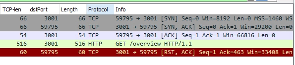

因为 TTL 并不是默认的展示列，所以我们需要选中报文，然后到 IP 详情部分去查看，像下面这样：

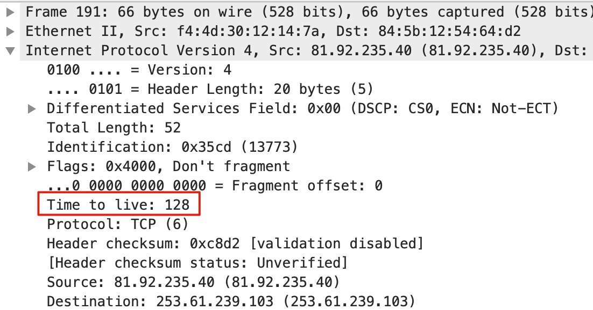

不过，这样看几个报文的 TTL 还行，再多点就十分困难了。怎么做才能更有效率呢？答案是借助 Wireshark 的自定义列。我们可以这样做：

- 选中任意一个报文，点开 IP 详情，找到 Time to live，然后右单击后选中 Apply ascolumn。

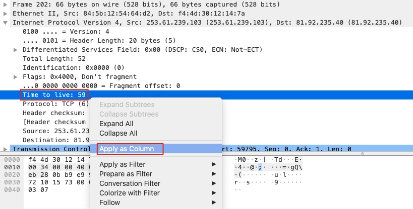

- 然后在主窗口中，就多出了一列 Time to live，对比起来非常方便。

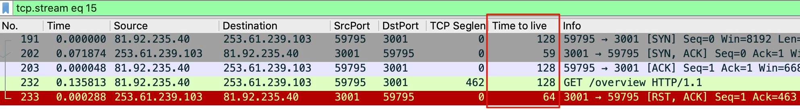

你也能很清楚地看到，同样的服务端，在三次握手中（SYN+ACK 报文）的 TTL 是 59，在导致连接中断的 RST 包里却变成了 64！显然，这个 RST 包并不是跟我们握手的那个服务端发

出的，否则 TTL 值就不会变化。

发出这个包的会是谁呢？其实，一般就是防火墙设备。由于防火墙也遵循 IP 协议，而这里的TTL 值是 64，这就说明这个防火墙跟客户端之间没有别的三层环节，或者说是三层直连的。

我们可以用一张简单的图来概括这个案子：

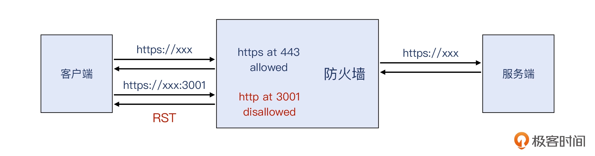

这样，我们底气大增！根据我们提供的信息，负责防火墙的同事就去复查了下，果然有发现：防火墙上对二楼有线网络有一条可疑的策略，跟其他线路不同。这条策略的出发点是：每个网络协议规定了协议数据格式以及标准端口号，所以协议数据跟端口号不匹配的话，就可以认为是“有害”流量。因为 HTTP 协议标准端口是 TCP 80，但是我们这个 Web 站点是 3001 端口的，被防火墙认为不一致，所以就拒掉了。

我们来看一下当时的防火墙的配置：

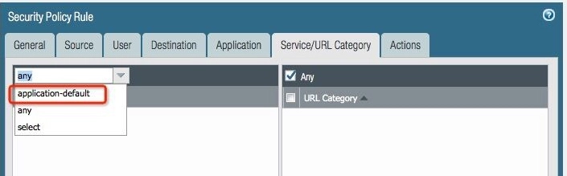

这里的 application-default 就是说，端口需要跟协议匹配。要不然就会被禁止，也就是回复

RST 给客户端，终止这条连接。这个防火墙策略被修正后，问题也立刻被解决了。

## 案例 2：访问 LDAPS 服务报 connection reset by peer

案例 1 中，我们在有权限的客户端抓了包。那么，如果两端都做了抓包，那么是否可以看到更多的风景呢？

这是我们最近遇到的一个例子。eBay 内部有一个用户报告，他的服务到 LDAPS 服务失败了（这个 LDAPS 在我们维护的 Windows AD 域控上），遇到了 connection reset by peer 的报错。LDAPS 就是 LDAP 的 TLS 版本，它监听的端口是 636。正好两端的操作权限我们都有，就可以做两侧抓包了。

我们先看一下客户端这边的抓包文件，确实有看到服务端返回了 TCP RST 包：

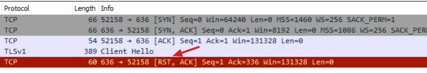

图中可见，TCP 三次握手正常完成了，随后的 TLS 握手 Client Hello 包也发送出来了，但是服务端回复的是 RST 包，这也就是引起客户端显示 connection reset by peer 报错的原因。

接着，我们再来看下服务端抓包文件的情况：

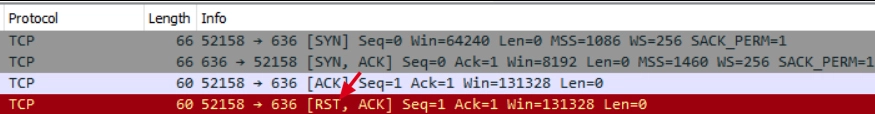

显然，这里也有一个从客户端回复的 TCP RST。

不过，再仔细对比服务端抓包和客户端抓包，是不是有些异样呢？为什么客户端抓包里有 TLSClient Hello 报文，但在服务端抓包里却没有呢？是因为 Client Hello 报文延迟了吗？

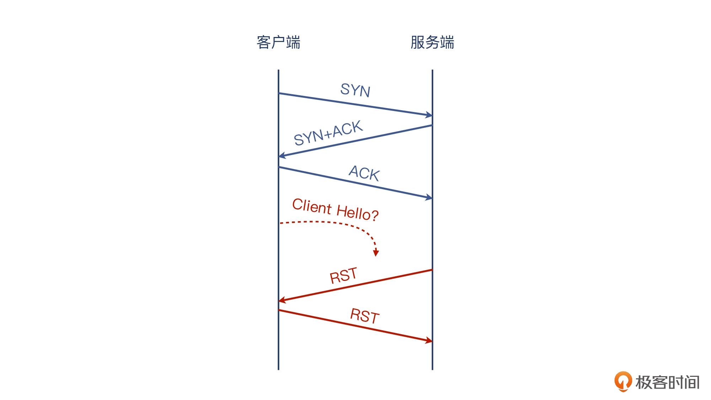

如果是延迟，那么这个 Hello 报文还是会出现在服务端抓包文件里，比如出现在 RST 报文的后面。但事实上，服务端抓包里并没有这个 Hello 报文的存在。所以这就反证了：这个 Hello不是延迟，而是确实就没到服务端。

那么问题来了：

- 客户端：发送了 TCP 握手 + 发送了 Client Hello。

- 服务端：收到了 TCP 握手 + 没有收到 Client Hello。

这个现象足以让我们怀疑：两者之间存在着一个“看不见的东西”，这个东西把 Client Hello 报文给“吃了”。

我们通过案例 1 的学习，已经了解到 TTL 是判断“是否有防火墙”的非常直接方便的方法。那么对于当前这个案例，我们也一样检查一下 TTL。

从服务端视角来看，它收到的报文只有三个：SYN 包、ACK 包、最后的 RST 包。我们选择SYN 和 RST，来对比看下它们的 TTL 是多少。下图是 SYN 包：

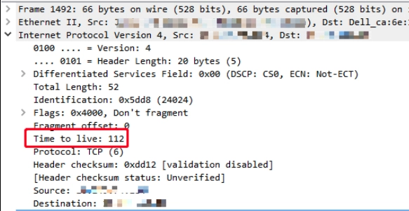

下图是 RST 包：

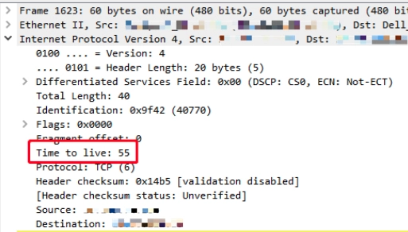

显然，跟之前的案例类似，这里的 TTL 也发生了明显的变化。你应该也明白了，这两个包并

不是同一个设备发出的。

因为这个案例里，客户端我们也抓包了，所以可以来看看客户端抓包里，是否也有 TTL 不同的现象呢？

客户端收到的 SYN+ACK 包的 TTL 是 110：

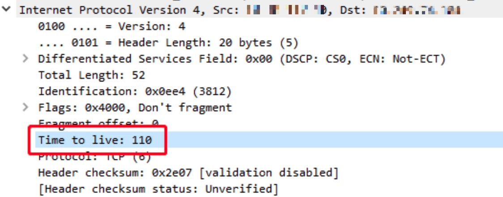

客户端收到的 RST 包的 TTL 是 54：

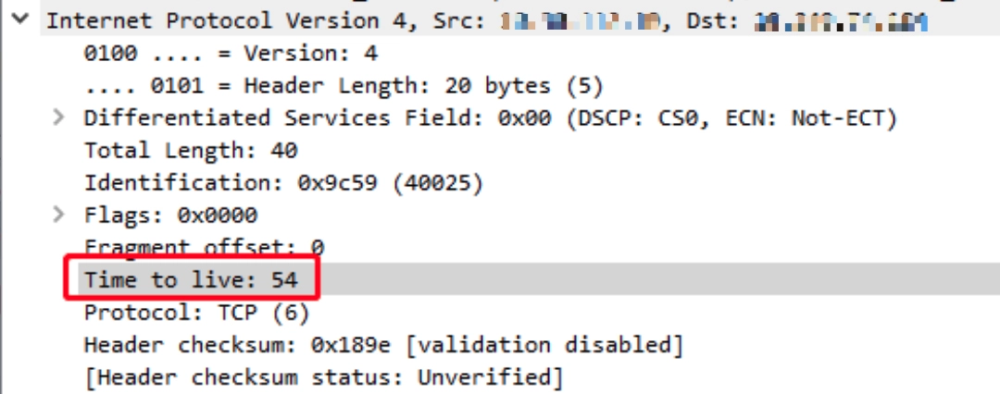

终于，结合两侧的抓包，我们就可以把这个拼图给拼完整了，而 Client Hello 报文丢失之谜，也将揭晓。更新一下前面的示意图，会变成下面这样。显然，Client Hello 报文就是被防火墙丢弃了。

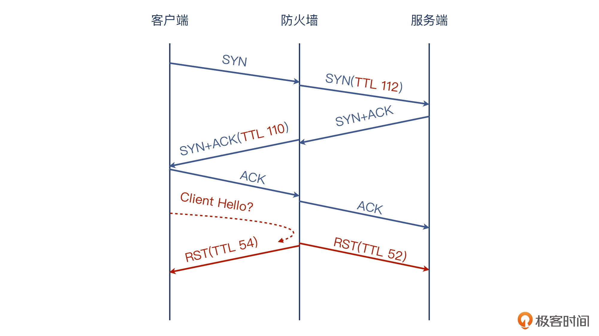

可见，防火墙的拦截行为可能出现在多个方向上（面对客户端时代表服务端，面对服务端时代表客户端），毕竟报文都要经过它，它如果想乱来，通信两端还真的无法控制它。从上图来看，防火墙两边“截胡”，两边拒绝，两边还都只好乖乖地听话，结束了连接。你都不能说它“没有武德”，因为整个过程都是完全遵照了 TCP 规范的，防火墙做得不可谓不周到。

不过百密一疏，它偏偏在 TTL 上露出了马脚，被我们抓了个现行。

你看，小小一个 TTL，在这里能起到如此关键的作用，真是不可小视。connection reset bypeer 的问题，我们在第 4 讲专门讲 TCP 挥手的时候就仔细分析过了。不过，你还记得为什么那次的情况跟这次不同吗？对，那次的场景里，RST 真的是对端发出来的，并不是防火墙从中作梗，所以 TTL 也都正常。

那么，今天的课程给你介绍的就是 connection reset by peer 的另外一种可能。你可以仿照我

这里介绍的排查过程，然后拿证据去跟网络安全团队沟通就行了。相信此时的你，说服力远远超过单纯抱怨而没有实质证据的你。

## 如何应对？

防火墙简单插入一个 RST，就可以终止连接，确实令人无奈。当然，这对网络安全来说，也许就是一种特性（Feature）了。正所谓“他人的美味，可能是你的毒药”。

我们通过上面介绍的排查过程，确认了防火墙的存在。那么，你可能会问了：接下来我们有什么办法可以规避这个问题呢？

这个问题的核心，就是既然我们可以准确地定义什么是防火墙插入的 RST 报文，那是否意味着我们就可以避开它了？比如你有没有想到：

干脆直接丢弃这个报文！

这个想法很大胆，好像也挺合理。但稍一细想觉得有几个现实问题得先解决：

- 我们用什么手段来达到“报文丢弃”这个目的呢？

- 我们做丢弃的时候，内核的 TCP 协议栈是否已经被“毒害”了呢？如果真是那样的话，即使我们丢弃了 RST 报文，实际上还是没有帮助的吧？

对于第一个问题，我想如果你熟悉 Linux 网络的话，可能第一时间就会想到 iptables 了。是的，我们就是可以利用它来达到“丢弃 RST 报文”的目的。当然，你做这个事情的时候必须十分小心，毕竟 RST 也是 TCP 协议里定义的标准，无论你是否喜欢它，RST 在很多场景里是必需的，一股脑地丢弃一定会引来难以预料的麻烦。

所以，我们可以对这条 iptables 规则设定精确的限定条件，使得它既能帮助我们丢弃“有害”的RST 报文，同时也不影响到其他正常连接的交互。

因为我们很难有条件拥有一台真实的防火墙设备来帮助我们做这个实验，所以只能找一个办法来模拟防火墙。怎么做呢？我们还是借助 iptables。

这里，真是要感谢创造了 iptables 的内核子模块——Netfilter 的内核开发团队了，有了Netfilter，基于它的 iptables 等工具在我们日常工作中起到了很大的作用。

对于第二个问题，其实不用担心，在报文进来的方向，报文会经过这样的处理流程：

```
PREROUTING -> INPUT -> 本地处理 -> OUTPUT -> POSTROUTING
```

所以，当我们在 INPUT 链上创建了丢弃 RST 报文的规则，那么当这个 RST 报文进入到机器时，会被这条规则丢弃，进不到本地处理，也就是不会有被内核协议栈处理的机会！那么，我们的 TCP 连接就不会被“毒害”了。还好，我们还有这张王牌可以打，只要对系统和网络足够熟悉，总还是有一线生机。

## 动手实践

现在“理都懂”了，让我们来动手实操一下。我们需要搭建这么一个测试环境：

- 虚拟机 1（下面简称为 1）：配置为客户端，实验时会在这台上执行 telnet，模拟访问行为。

- 虚拟机 2（下面简称为 2）：配置为客户端的网关，这样它就可以劫持流量，模拟防火墙行为。


### 实验 1：telnet 第三方站点

在 1 上，直接 telnet www.baidu.com 443，可以成功。

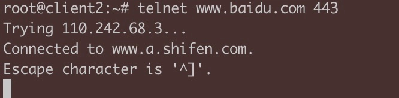

然后我们需要配置一下，让 1 访问www.baidu.com的流量强制经过 2，这样后续我们就可以让 2 来操控 1 和 baidu 之间的连接了。接下来步骤稍多，感谢你的耐心。

在虚拟机 1 上，我们需要完成这么几件事。

创建隧道，隧道另一头就是虚拟机 2，我们将在那里模拟一个“防火墙”。在上节课里，我们了解了 ipip 隧道，这里的 GRE 隧道也是类似的工作原理。

```
ip tun add tun0 mode gre remote 172.17.158.46 local 172.17.158.48 ttl 64
ip link set tun0 up
ip addr add 100.64.0.1 peer 100.64.0.2 dev tun0
```

添加路由项，使得本地去往第三方站点的流量，都走这条路由，也就是通过隧道到达虚拟机2，然后 2 来转发报文。

```
ip route add 110.242.68.0/24 via 100.64.0.2 dev tun0
```

当然了，虚拟机 2 上面也需要做对等的隧道配置：

```
ip tun add tun0 mode gre remote 172.17.158.48 local 172.17.158.46 ttl 64
ip link set tun0 up
ip addr add 100.64.0.2 peer 100.64.0.1 dev tun0
```

虚拟机 1 把报文发到虚拟机 2，但是如果后者不做配置，默认是会丢弃这些报文的，所以还需要在 2 上开启 ip_forward：

```
sysctl net.ipv4.ip_forward=1
```

我们在 2 上运行 tcpdump port 443，然后 1 上运行 telnet www.baidu.com 443。在 2 的tcpdump 窗口里，已经可以看到从 1 过来的流量了！

```
root@server$tcpdump port 443
tcpdump: verbose output suppressed, use -v or -vv for full protocol decode
listening on eth0, link-type EN10MB (Ethernet), capture size 262144 bytes
16:53:36.054124 IP 100.64.0.1.34396 > 110.242.68.3.https: Flags [S], seq 33644156
16:53:37.084514 IP 100.64.0.1.34396 > 110.242.68.3.https: Flags [S], seq 33644156
16:53:39.100482 IP 100.64.0.1.34396 > 110.242.68.3.https: Flags [S], seq 33644156
```

咦？抓包里只有 SYN 包而没有 SYN+ACK，1 这头的 telnet 也挂起，没响应了，这是怎么回事？


原来，我们还需要设置一下 NAT，要不然出去的报文源 IP 是 100.64.0.1，回包也会回这个地址，显然回不到 2 了。

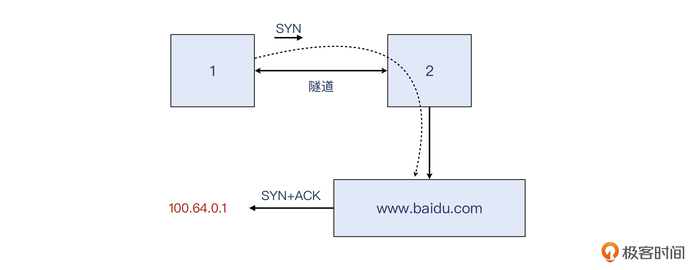

所以还需要在 2 上启用 SNAT：

```
iptables -t nat -A POSTROUTING -d 110.242.68.0/24 -j MASQUERADE
```

我们再试试在 1 上发起 telnet www.baidu.com 443，果然成功了。

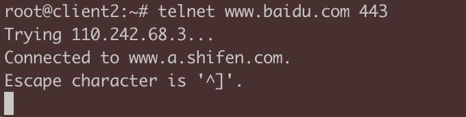

2 上的 tcpdump 也抓取到了正常连接的报文（这里就不贴了）。

### 实验 2：插入 RST 报文，连接失败

现在，我们需要在 2 上配置一个“插入 RST 报文”的动作，这样就可以模拟“防火墙阻隔 TCP连接”的效果了。

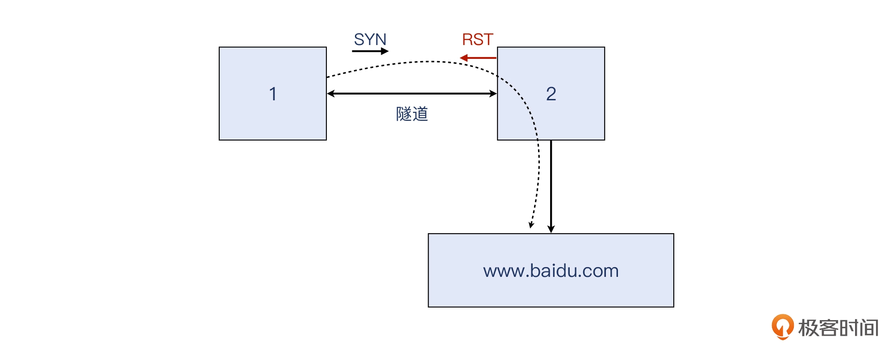

我们可以在 2 上运行这条 iptables 命令：

```
iptables -I FORWARD -p tcp -m tcp --tcp-flags SYN SYN -j REJECT --reject-with tcp
```

有了这条命令，2 就用 TCP RST 拒绝了转发链（也就是命令中的 FORWARD 链）上的 SYN报文。1 上的 telnet 立刻收到了拒绝：

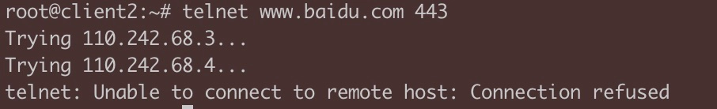

2 上的 tcpdump 抓包窗口里也看到了握手和拒绝的报文：

```
root@server$tcpdump -i any port 443
tcpdump: verbose output suppressed, use -v or -vv for full protocol decode
listening on any, link-type LINUX_SLL (Linux cooked v1), capture size 262144 byte
17:02:16.623480 IP 100.64.0.1.34428 > 110.242.68.3.https: Flags [S], seq 33145736
17:02:16.623518 IP 110.242.68.3.https > 100.64.0.1.34428: Flags [R.], seq 0, ack
```

可见，这个 RST 实实在在地起到了类似防火墙的作用，让你的连接无法建立。你看，其实防火墙也没那么神秘，我们也可以实现。可以小小地鼓励一下你自己！

### 实验 3：丢弃 RST 报文，连接成功

这套实验的核心目标是实现对 RST 干扰报文的规避，也就是丢弃这类报文。让我们继续实验，在 1 上添加这么一条 iptables 规则：

```
iptables -I INPUT -s 110.242.68.0/24 -p tcp --sport 443 -m tcp --tcp-flags RST RS
```

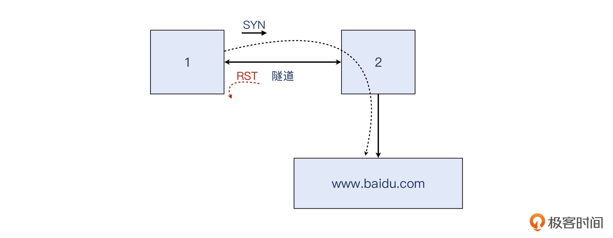

有了这条规则，我们就对符合条件的 TCP 报文进行了丢弃，这个条件就是“来自110.242.68.0/24 网段的 TCP 源端口为 443 的，带 RST 标志位的，TTL 等于 64 的报文”。

这里的 TTL 条件就是关键了。在实际场景下，你就可以根据防火墙插入的 RST 报文的 TTL 的

实际特征，写一条精确匹配的规则，把它跟正常报文区分开，进行精准的丢弃。

我们还是在 1 上 telnet，然后发现这次不再被 reset，而是挂起了。在 1 的 tcpdump 中，也看到 SYN 发出了，对方也回复了 RST，但是我们并没有被真的被 reset。这里，正是这条丢弃RST 报文的 iptables 规则起到了效果。

```
root@client2:~# tcpdump -i any host 110.242.68.4 and port 443
tcpdump: verbose output suppressed, use -v or -vv for full protocol decode
listening on any, link-type LINUX_SLL (Linux cooked v1), capture size 262144 byte
17:27:50.748194 IP client2.53438 > 110.242.68.4.https: Flags [S], seq 1164905016,
17:27:50.748433 IP 110.242.68.4.https > client2.53438: Flags [R.], seq 0, ack 116
```

你可能这里稍有疑惑：1 持续发 SYN，2 持续回复 RST，那我们这个连接不是依然没建立起来吗？

其实，一般防火墙工作模式跟实验里的稍有不同。这次两个案例中的防火墙都运行在应用层模式，也就是会先让 TCP 连接建立，然后检查后续的报文，发现不符合安全策略的时候，就插入一个 RST 报文，终止这条连接。这种动作一般是一次性的。

而在这个实验中，我们只要让 iptables 的 REJECT 只生效一两次（比如用下面的复合命令），TCP 连接就只是在最初几秒被短暂干扰，之后就依然能成功建立。

```
iptables -I FORWARD -p tcp -m tcp --tcp-flags SYN SYN -j REJECT --reject-with tcp
```

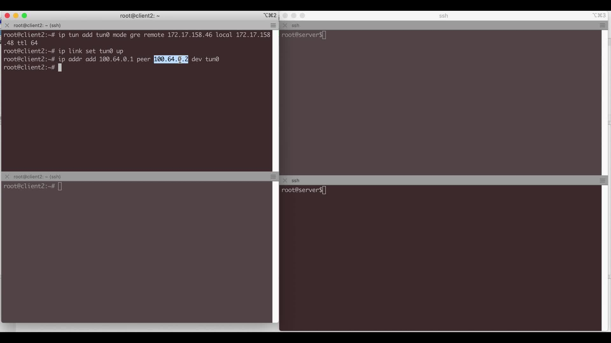

在实际场景中，只要设置前面提到的 iptables 丢弃特定 RST 报文的规则，就还有很大的几率能让这条连接继续保持下去，应用也运行下去。防火墙居然对你无效了，你除了长舒一口气，会不会心里也冒出“终于翻身当主人”的感觉？

### 拓展思考

那么，除了这种丢弃有害 RST 的办法，还有没有别的办法呢？

就上面探讨的丢弃 RST 的方法来说，这是一个“应对式”的策略，也就是有人要“害我”，那我把“毒药”给扔了。但仍然是“被动”的方法。如果思考得更进一步，我们有没有办法，使得别人都

没有机会来害我呢？就是你连“下毒”的机会也没有？这就是“主动”的策略了。

我个人看法是，可以到网络层（IP 层）去寻找机会。利用 IPSec（比如 IPv6 默认启用了IPsec），我们就获得了在第三层加密的能力。因为就连 IP 报文本身都是加密的，那么即使防火墙要插入报文，因为它不具备密钥，所以这个报文会被接收端认为非法而被丢弃。这样就有希望真正摆脱防火墙对传输层（TCP/UDP）的这种控制。

## 小结

上节课我们采用的方法，是通过两端抓包后进行网络包的对比分析，排查定位到防火墙的存在，这种方法对于丢包、乱序等场景特别有用。而这节课的方法呢，是通过分析 TTL 值的变化，快速定位到防火墙的存在。这种方法，对于连接被重置（RST）的场景，十分有效。

那么在学完这节课之后，你需要记住以下几个关键要点：

- 需要在受影响的客户端或者服务端进行抓包。这样你才能获取到你需要的关键信息，而这种信息，单纯通过应用层日志等途径，是很难获取的，这也是应用层排查的天然的不足。对此，你需要有清醒的认识，并深刻理解网络层排查技术的重要性和不可替代性。

- 分析抓包文件，识别 TTL 的变化。这里，你需要了解网络层和 IP 协议的相关知识点。同时也要明白，即使一个知识点看似简单，其背后的设计原理，都大有文章。对每个技术细节的推敲，能帮助我们打造出更为强大的技术底蕴。

- 灵活运用 Wireshark 自定义列。我们通过添加自定义列，让每个报文的 TTL 值都在主视图中展现，极大地方便了对这些 TTL 的比较。所以我们除了掌握协议知识以外，也要挖掘各类工具的使用技巧。所谓“工欲善其事，必先利其器”也。

另外，在这节课的最后，我们也通过一系列实验，再一次深入理解了 RST 报文的作用，以及可能的规避方法。在这个过程中，我们学习了：

- GRE 隧道的搭建和用途：你可以用 ip tunnel add 命令创建 GRE 隧道，并用 ip route add命令配置路由项，让某些网络的流量转而走这个隧道网关。注意，即使是一个二层不可达的IP，通过隧道也可以“包装成”二层可达，进而可以配置为网关。这一点，如果不借助隧道，是无法实现的。

- 用 iptables 实现对报文的操控：在你需要模拟一些问题场景的时候，不妨多发掘一下

- iptables 的“潜能”，比如可以丢弃符合某种条件的报文：

```
iptables -I INPUT -s 110.242.68.0/24 -p tcp --sport 443 -m tcp --tcp-flags RST RS
```

- 我们也学习了如何用 iptables 结合内核配置，实现一个简单的 NAT 网关：

```
iptables -t nat -A POSTROUTING -d 110.242.68.0/24 -j MASQUERADE
sysctl net.ipv4.ip_forward=1
```

## 思考题

这节课，我给你介绍了利用防火墙的 TTL 跟原先的正常报文的 TTL 不一致的特点，从而识别出防火墙的方法。

那么，假设有一天，防火墙公司把这个特性也完善了，我们再也不能仅仅凭 TTL 的突变而发现防火墙了，你觉得还有什么办法可以识别出防火墙吗？这是一个开放式的话题，欢迎你把答案写在留言区，与同学们一同分享。

## 附录

抓包文件：https://gitee.com/steelvictor/network-analysis/tree/master/06
