# 07-保活机制：心跳包异常导致应用重启？

你好，我是胜辉。这节课，咱们来聊聊 TCP 的保活机制。

以前的电视剧里经常会有这样的剧情：女主因为车祸失去了记忆，男主一边摇着女主的肩膀，一边痛苦地问道：“还记得我吗？我是欧巴啊！”可是女主已经对此毫无记忆，迷茫地反问道：“欧巴是谁？”

类似地，TCP 其实也需要一种机制，让双方能保持这种“记忆”。Keep-alive 这个词，你可能也听说过。特别是当遇到一些连接方面的报错的时候，可能有人会告诉你“嗯，你需要设置下Keep-alive”，然后问题确实解决了。

不过，你有没有深入思考过这样几个问题呢：

- Keep-alive 跟长连接是什么关系？

- 它是应用层代码独立实现，还是依赖操作系统的 TCP 协议栈去实现？

- 在 HTTP 层面也有一个 Keep-alive 的概念，它跟 TCP 的 Keep-alive，是同一个东西吗？

如果你对这几个问题的答案还不清楚，那么这节课，我就来帮助你厘清这些概念。以后你再遇到长连接失效、被重置、异常关闭等问题的时候，就知道如何通过抓包分析，解读出心跳包相关的信息，然后运用 Keep-alive 的相关知识点，去真正解决前面说的一系列问题。

好，按惯例，我们还是从案例说起。

## TCP 长连接为何总中断？

当时我在云计算公司就职，有个客户的应用基于 TCP 长连接，但长连接经常中断，引起了应用方面的大量报错。由于客户的业务是支付相关的，对实时性和安全性要求很高，这类报错就产生了较大的负面影响，所以急需解决。

### 应用概况

这个应用的架构比较简单：客户在云平台上部署了多台云主机，其中一台云主机专门做加解密，称之为加密服务器。另外几台云主机作为这台加密服务器的客户端，跟这台加密服务器保持 TCP 长连接。这些客户端会不时地跟加密服务器进行通信，完成加密操作。每 45 秒，客户端还会发送一次心跳包，这有两个作用：

- 维持这个长连接不被中断，即心跳保活，让长连接在两端保持下去；

- 探测加密服务器的可用性，即健康检查，一旦服务不可用，客户端就要去掉这个失效的连接。

就像下图这样：

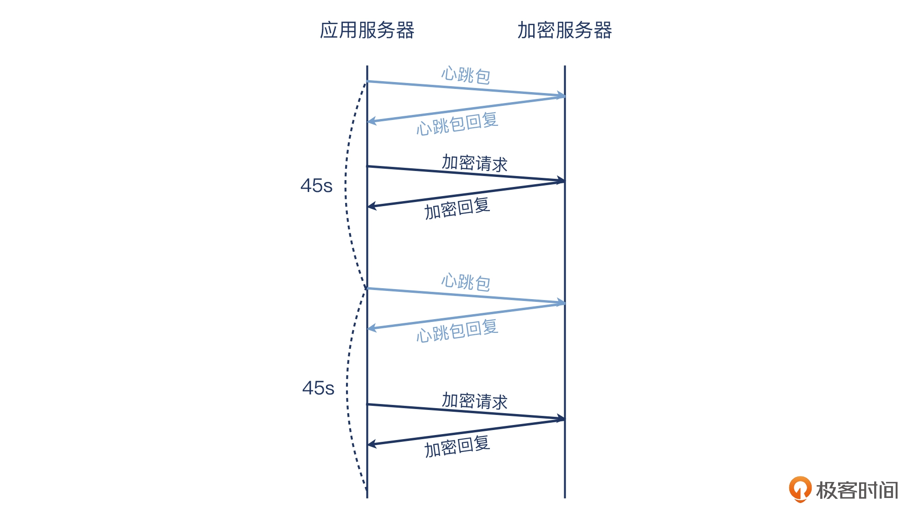

如果加密服务器能在 1 秒内对心跳包进行回复，那么客户端就认为服务端正常可用，后续的数据交互（即加密请求）将继续在这条长连接上进行。而如果服务端未能在 1 秒内回复，那么客户端会认为该长连接已经中断，于是重启应用，发起一条新的长连接，并在日志中记录一次报错。

用类 Python 语法来描述，大体是这样的：

```
while true:
   sleep(45)
   if Keep_alive_probe() is true:
       continue
   else:
       restart()
       log_error()
```

### 排查思路

整体的排查思路跟网络分层模型有点类似，逐层往下。我们需要先从应用层查找原因，然后是操作系统层面，最后是网络层分析。排查的顺序就是这样的：

- 应用层代码 -> 操作系统的时间配置 -> 网络的抓包分析

首先，客户自查了应用，没有发现可疑代码，并且尝试过重新部署代码、重装系统、更换 IP等，但都未奏效。

那么，会不会是时间服务（ntp）的问题呢？我们检查了两侧机器的 ntpd 服务的状态，都是正常的。对比了两端机器的实际时间，也没有发现明显的误差。于是这个可能性也被排除了。

然后就需要排查网络了。我们在一台客户端上启动了抓包程序 tcpdump，过滤条件是对端加密服务器的 IP 和端口。抓多久呢？因为问题大约十几分钟出现一次，那么按照这个频率，我们设定抓包时长为半个小时，得到了抓包文件。这样就能覆盖到一到两次的错误了。

- 补充：抓包示例文件已经上传至Gitee，建议用 Wireshark 打开文件，结合文稿学习。

因此，通过检查应用日志，我们发现在抓包时间段内，应用日志又记下了两次报错，比如下面这个：

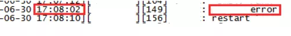

从日志上看，17:08:02 这个时间点发生了一次报错，17:08:10 发生了一次程序的重启。

有了应用层的信息，接下来，我们就需要在抓包文件中，找到传输层和网络层的信息来与应用层信息对应，这样排查工作才能继续推进。

但是日志记录的时间戳粒度太粗了，只精确到了秒级，而网络报文在 Wireshark 中都是微秒级的，一秒内可能会有成百上千个报文。所以，仅凭精确到秒的一个时间戳，还不足以让我们在几十个报文中，精确地找到对应的报文。这个时候，我们需要调整一下抓包文件分析工作的切入点。

一个常规的做法是，跳过案例本身的问题特殊性不谈，先从宏观上把握一下排查思路。也就是先不纠结于根据日志时间来寻找报文的难题，而是先看 Expert Information，找一找有没有比较可疑的报文。打开 Expert Information 窗口，如下：

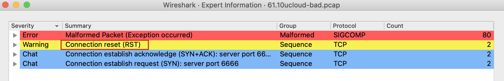

可见，有 80 个 Error 级别的 Malformed Packet（格式错误）报文和 2 个 RST 报文，都很可疑。

我们先看这 80 个 Malformed Packet 报文，这传递了什么信息呢？在 Protocol 栏显示SIGCOMP，说明 Wireshark 认为这 80 个报文是 SIGCOMP 协议的（SIP 的信令压缩协议）。不过，客户的应用不是 SIP 相关的，显然这些报文应该是被 Wiresharek 误会了。

- 在这里，我也给你一个小小的提醒：毕竟只有被公开广泛支持的数据格式和协议才能在Wireshark 中正确展示，所以如果你看到类似这种 Malformed Packet 的时候，还是要统筹考虑当前案例的实际情况，未必 Malformed 报文就真的是格式错误，也可能只是Wireshark 不了解某种“方言”而已。

让我们看看这些报文究竟是什么。点开 Error，选中一个报文。比如我这里选择 37 号报文：

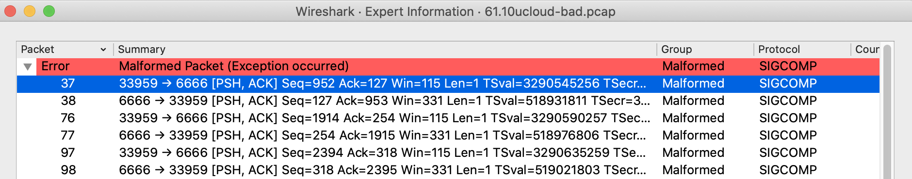

随后光标会自动定位到 37 号报文这里：

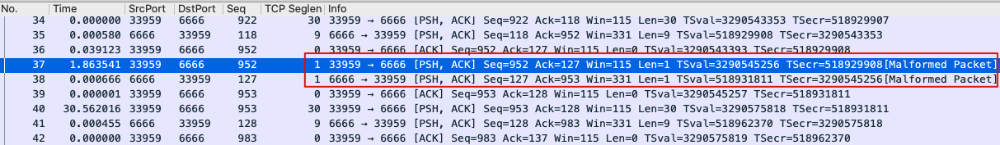

然后选了另外几个 Malformed Packet，发现它们都是成对出现的。它们还有一个特征是：

- 前一个报文的 TCP 载荷数据是 01（十六进制）；

- 后一个报文的 TCP 载荷数据是 41（十六进制）。

这就像是某种“联动”机制了，会不会就是心跳报文呢？你注意下 TCP Seglen 这一栏（这是我

```
添加的表示 TCP 载荷长度的列），有没有发现这类报文的长度都是 1 ？我们就以 tcp.len
eq 1 为过滤器，过滤出报文：
```

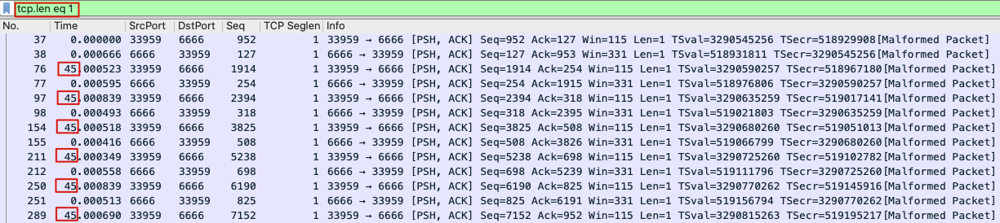

可见，37 和 38 是 0 秒发生的，76 和 77 是 45 秒后发生的，然后 97 和 98 以及后面每一对报文，也都符合 45 秒间隔的规律，正好跟客户程序的 45 秒心跳包机制对上了。我们可以确认这些报文就是心跳报文了！更确切地说，每次成对出现的两个报文中：

- 前一个是心跳探测包，它的 TCP 载荷数据为 01（十六进制）；

- 后一个是心跳回复包，它的 TCP 载荷数据为 41（十六进制）。

这是第一个比较明显的进展。也就是说，我们已经可以找到应用层的心跳包在网络层的展示形式了，这对于后续的排查非常有帮助。

不过，也不要忘了，我们是来排查“心跳包失败导致连接中断”的问题的，现在只是找到了心跳包的特征，还需要找到真正的跟日志报错相关的报文，而这个报文是跟“连接中断”现象有关的。

那么会是什么样的报文呢？其实，我们在第 4 讲就研究过TCP 挥手。你应该还记得，TCP的连接断开，无非跟两种报文有关：FIN 和 RST。

我们先尝试寻找 FIN 报文。输入过滤器：

```
tcp.flags.fin eq 1
```

结果发现什么报文都没有出来。可见，这次抓包里，连接的断开并不是用 FIN 完成的。

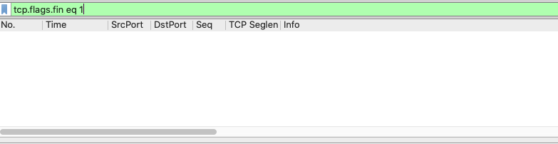

接着就是寻找 RST 报文。其实，在 Expert Information 里面，就有 2 个 RST 报文，我们可以直接从那里入手。当然，用过滤器也同样方便，输入：

```
tcp.flags.reset eq 1
```

我们能找到 2 个 RST 报文：

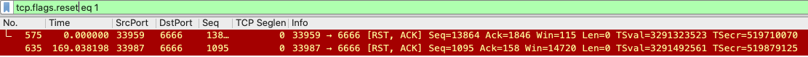

我们选中 575 号报文，然后 Follow -> TCP Stream，得到了这个 RST 所在的 TCP 流的全部报文：

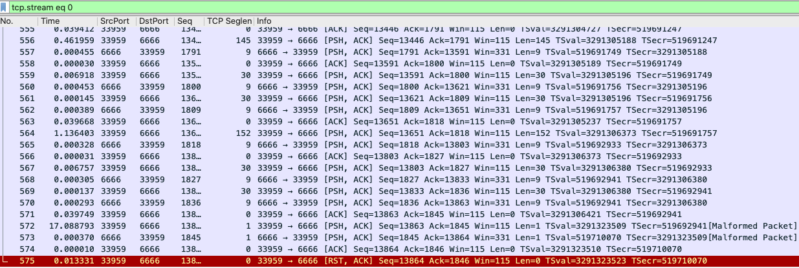

报文很多，上图显示的只是一部分报文。我往前翻阅了更前面的报文，也能看到很多相对长的时间间隔，有 17 秒、39 秒、11 秒的，但也没有什么规律。这时候，我们就需要结合前面刚分析到的一些信息，要不然就要在报文的海洋里迷失方向了。

我们通过前面的分析发现，心跳探测包的报文数据是 01，心跳回复包的报文数据是 41。所

```
以，让我们再次借助强大的过滤器。在 tcp.stream eq 0 后面添加 and tcp.payload
eq 01，即整体过滤器变为：
tcp.stream eq 0 and tcp.payload eq 01
```

这样就过滤出了这个 TCP 流里面，所有的心跳探测包：

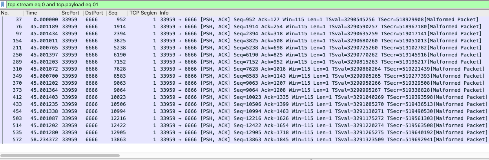

可见，这些心跳探测包也是很明显遵循了 45 秒间隔的规律。不过，等一下，为什么 572 号心跳探测包跟它的上一次心跳探测，间隔的时间是 58 秒，而不是 45 秒呢？

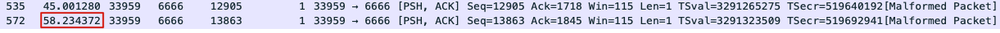

这很反常，也是第二个很重要的发现。要知道，这 45 秒的机制是在代码里实现的，照理说不

```
可能出现 13 秒这么大的误差。现在，我们把 tcp.payload eq 01 这个条件去掉，回到这
```

个 TCP 流的完整报文区域来综合分析：

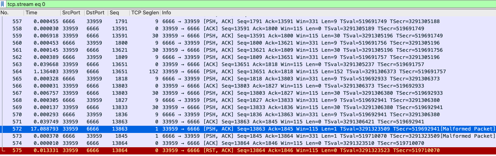

我来给你解读一下：

- 572 号报文（客户端发出）是心跳探测包；

- 573 号报文（服务端发出）是心跳回复包；

- 574 号报文（客户端发出）是客户端对 573 号报文的确认；

- 575 号报文（客户端发出）是一个 RST 报文，它跟客户端日志报错有直接的关系。

以上 4 个报文之间几乎没有时间上的停顿。这里，你可能会有个小疑问：为什么 572 号报文跟上一个报文的间隔是 17 秒而不是 45 秒呢？其实，这是 Time 列的类型导致的，我这里用的是 Delta time displayed 类型，是跟前一个被显示的报文的间隔时间。

之前我们看到很多个整齐的 45 秒，是因为那个窗口里显示的报文，都是过滤过的心跳报文，跟这里显示的报文不同，所以显示的间隔时间也不同。Wireshark 里的 Time 一列有多种配置可选，所以你一方面要理解这里面各种 Time 的区别，一方面自己做分析的时候，也可以根据实际需要，灵活选择 Time 类型。

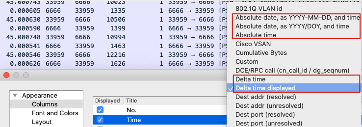

考虑到这里的问题就是跟心跳包和挥手包直接相关，排除掉无关报文，可以让我们的分析思路也变得更加清晰。所以，我们再一次调整过滤器，改为：

```
tcp.stream eq 0 and (tcp.len == 1 or tcp.flags.reset == 1)
```

就得到这个 TCP 流里面的心跳包和挥手包：

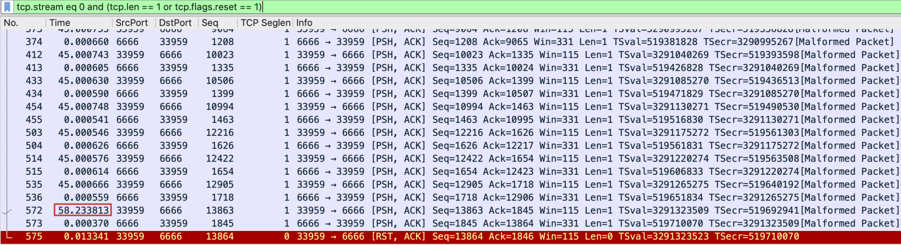

我们最后再确认一下时间戳。这个隔了 58 秒才发出的心跳包，发送的时间是在 17:08:10：

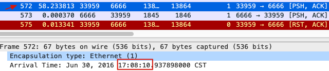

跟日志中 restart 时间一致：

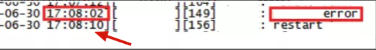

现在，事实已经很清楚了：客户端在连接被断开之前的心跳探测包，并没有遵循客户声称的“每隔 45 秒”，而是很意外地隔了 58 秒。我们结合程序逻辑，已经可以推断出真实的状况了。看示意图：

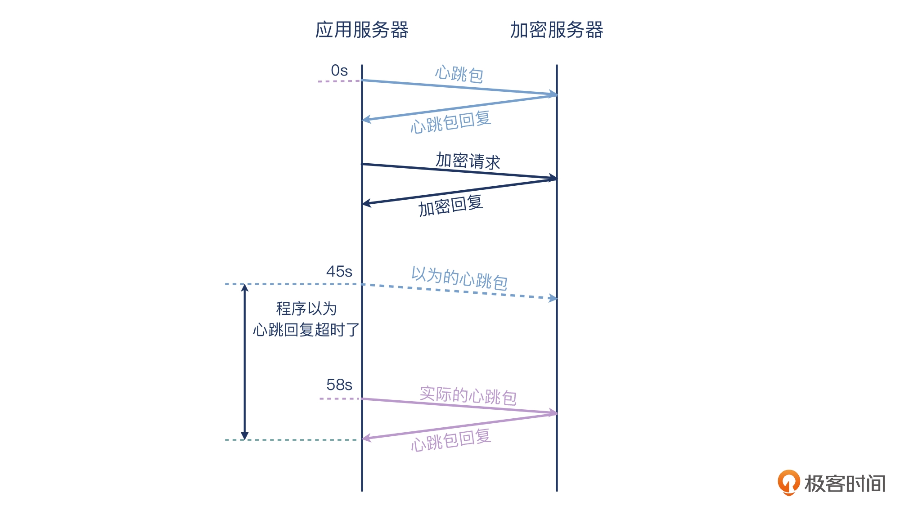

### 结论：排除网络，追查代码

现在，我们已经清楚了这个报错的原因：客户端程序出了一个 Bug，某一次心跳探测包发出的时候是在上一次心跳的 58 秒以后（也就是相对正常情况，迟了 13 秒）。那么，服务端虽然立即发送了心跳回复包，但也一样是在 58 秒以后了。程序的逻辑非常简单粗暴：一旦心跳回复包的到达时间超过了第 46 秒（也就是 45 秒 +1 秒超时），就认为是心跳探测失败。

为什么探测包本身会比预定的时间晚了 13 秒才发出呢？根据这个很明确的信息，客户再次检查了应用代码，终于定位到了出问题的代码段。修复代码后，问题随之解决。

补充一下，在这个案例中，异常时的心跳包探测和回复的耗时本身是正常的。我们可以看到包号 572 是客户端发出的心跳探测包，包号 573 是服务端发出的心跳回复包。两者之间，间隔只有 0.000370 秒，即 0.37 毫秒，完全是同机房内网时延的正常水平。

## 理解心跳机制的原理

显然，这个案例是关于应用层自己实现的心跳机制的，有一定的特殊性。但在机制上，也体现了心跳包的一些特点，比如：

- 定时发送心跳探测包；

- 对于心跳回复包有超时限制。

而从更普适的尺度上来看，其实 TCP 本身提供的 Keep-alive 机制更为安全易用。

一般来说，对于操作系统已经实现的特性，我们最好直接去利用，而不是自己创造一个类似的轮子。这好比你想基于 UDP，在应用层实现类似 TCP 的种种传输保障机制，也不是不可以，但实现起来会相当复杂（参考QUIC 协议）。TCP 心跳机制看似简单，但从上面这个案例来看，稍有不慎，还是很容易发生错误的。

### TCP Keep-alive

那么 TCP 自身的 Keep-alive，究竟是怎样的一个存在呢？

其实，如果不做显式的配置，默认创建出来的 TCP Socket 是不启用 Keep-alive 的，也就是都不会发送心跳包。不过，大部分应用程序已经在代码里启用了 Keep-alive，所以你平时不太会遇到连接失效的问题。比如我稍后要演示的一个含心跳包的抓包文件，抓取的就是 Chrome 浏览器的流量，里面就有很多心跳包，因为 Chrome 浏览器启用了 TCP 心跳保活机制。

要打开这个 TCP Keep-alive 特性，你需要使用 setsockopt() 系统调用，对已经创建的 Socket进行配置，启用 Keep-alive。具体的调用方法，你可以参考 man setsockopt。

在 Linux 操作系统层级，也有三个跟 Keep-alive 有关的全局配置项。

- 间隔时间：net.ipv4.tcp_keepalive_time，其值默认为 7200（秒），也就是 2 个小时。

- 最大探测次数：net.ipv4.tcp_keepalive_probes，在探测无响应的情况下，可以发送的最多连续探测次数，其默认值为 9（次）。

- 最长间隔：net.ipv4.tcp_keepalive_intvl，在探测无响应的情况下，连续探测之间的最长间隔，其值默认为 75（秒）。

- 补充：你可以在 Linux 系统里面，执行 man tcp，查看内核对 TCP 协议栈的详细文档。这里我摘录一下关于 Keep-alive 的部分：

- tcp_keepalive_intvl (integer; default: 75; since Linux 2.4)

- The number of seconds between TCP keep-alive probes.

- tcp_keepalive_probes (integer; default: 9; since Linux 2.2)

- The maximum number of TCP keep-alive probes to send before giving up and killingthe connection if no response is obtained from the other end.

- tcp_keepalive_time (integer; default: 7200; since Linux 2.2)

- The number of seconds a connection needs to be idle before TCP begins sendingout keep-alive probes. Keep-alives are sent only when the SO_KEEPALIVE socketoption is enabled. The default value is 7200 seconds (2 hours). An idle connection isterminated after approximately an additional 11 minutes (9 probes an interval of 75seconds apart) when keep-alive is enabled.

如果我们连接启用了 Keep-alive，但没有设定自定义的数值，那么就会使用上面这些默认值，即：当连接闲置（没有数据交互）达到 7200 秒（2 小时）时发送心跳包，每次心跳包超时时间为 75 秒，最多重试 9 次。

这样的话，对于一个已经失效的 TCP 连接，最大需要 7200+75*9=7875 秒（约等于 2 小时11 分钟）才能探测到。

毫无疑问，这个时间是相当长的。不过结合时代背景，这个其实也可以理解：TCP Keep-alive被设计的时候是八十年代，当时因特网还很初级，所以设计者们并不想让心跳包占据太多的网络资源。从而，就有了这么一个感知时间很长的心跳机制。关于 TCP Keep-alive 的一些更多信息在RFC1122里，你有兴趣的话可以去研究一下。

另外一个值得注意的地方，是 Keep-alive 报文本身的特点。在上面的案例中，这个特定的应用层代码设定的心跳包特征是这样的：

- 心跳探测包，载荷为 1 个字节，其值为 01。

- 心跳回复包，载荷也为 1 个字节，其值为 41。

但是 TCP 本身提供的 Keep-alive 报文特征就非常不同了。首先，它的序列号就很奇特，是上一个报文的序列号减 1，载荷为 0。回复的报文也同样特别，确认号为收到的序列号加 1。而且，无论是探测包还是回复包，其载荷长度都为 0。

文字描述不是很容易理解，我给你看一个实际的例子。这是某一次我用 Chrome 浏览器访问网站时做的抓包：

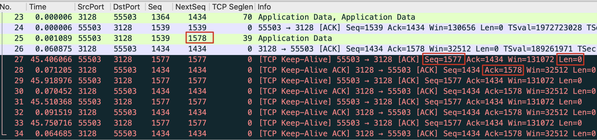

上图的红色底色的多个报文，就是 Wireshark 识别出来的 TCP 心跳包。我也把需要关注的信息用红色方框标注出来了。

25 号报文是离心跳包最近的一个常规报文，Wireshark 告诉我们：它的下一个序列号（图中的NextSeq）是 1578。也就是说，如果下一个是常规报文，那么这个常规报文的序列号就是1578。然后看同是这个客户端发出的报文 27，这就是一个心跳包，它的序列号却是 1577（也就是 1578-1），载荷为 0（Len=0）。对端对这个心跳包做了回应（包号 28），确认号为 1578（1577+1），载荷也为 0。

我们再来看一下示意图：

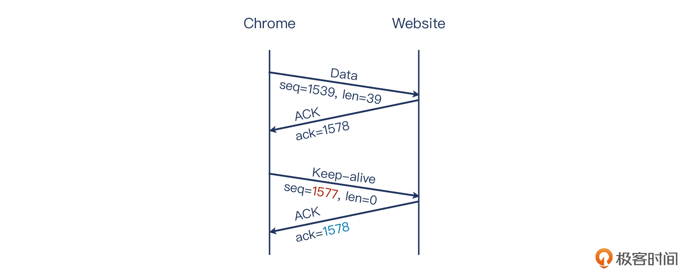

要是你了解 TCP 握手和挥手阶段的确认号的话，你对这个 +1 机制是不是感觉很熟悉？可见，TCP 认为心跳包也是十分重要的，它跟握手和挥手一样，都属于控制报文，它的确认号机制也体现了这一特点。

有趣的是，RFC1122 里并没有规定心跳探测包的载荷一定是 0，它也可以是 1。只是从我有限的抓包经验来看，心跳包都是载荷为 0 的，看来这是比较常见的实现方式。

### HTTP Keep-alive

那么我们也经常听到的 HTTP Keep-alive，又是一个什么东西呢？难道是应用层实现的心跳保活机制？意味着 HTTP 也有心跳包这种东西吗？

其实没有那么复杂。HTTP 的 Keep-alive，是用 Connection 这样一个 HTTP header 来实现的。你应该知道，HTTP 报文的 header 形式是 Key: value。比如常见的 header 有：

- User-Agent: curl/7.68.0 （客户端发出）

- Host: www.baidu.com （客户端发出）

- Content-Type: text/html （服务端发出）

- Server: bfe/1.0.8.18 （服务端发出）

而 Keep-alive 头部，就是这个形式：Connection: Keep-alive（注意这里有一个“-”符号）。

客户端和服务端都可以发送这个保活头部。表达的意思也跟外交人员的语言一样优雅专业：“我方真诚地希望，贵方能切实履行我们的协议，按照长连接待遇来处理本次连接，谢谢配合”。

你应该也知道，HTTP 的版本有 0.9、1.0、1.1、2.0。HTTP/0.9 现在基本不再使用了，而HTTP/1.0 占的流量比例也已经很低了（在公网上小于 1%）。目前占主流的是 HTTP/1.1 和HTTP/2，而这两者都默认使用长连接。

那既然 HTTP/1.1 默认是长连接了，为什么还要有这个 Connection 头部呢？在我看来，这有两个原因。

- 协议兼容性

在 HTTP/1.0 版本中，默认用的是短连接。这导致了一个明显的问题：每次 HTTP 请求都需要创建一个新的 TCP 连接。随着因特网带宽和各类资源迅速增长，每次建立 TCP 连接的开销变成了主要矛盾。

为了克服这个不足，Connection: Keep-alive 头部被扩充进了 HTTP/1.0，用来显式地声明这应该是一次长连接。当然，从 HTTP/1.1 开始，长连接已经是默认设置了，但为了兼容 1.0 版本的 HTTP 请求，Connection 这个头部在 HTTP/1.1 里得到了保留。

- 关闭连接的现实需求

即使在 HTTP/1.1 里，也并非所有的长连接都需要永久维持。有时候任意一方想要关闭这个连接，又想用一种“优雅”（graceful）的方式，那么就可以用 Connection: Close 这个头部来达到“通知对端关闭连接”的目的，体面而有效。另外，在 HTTP/2 里，连接关闭是通过另外的机制实现的，与 Connection 头部无关。

这个 Connection 头部看似简单，其实有时候也能起到很大的作用。在 eBay，我们每年有大量的流量迁移的工作。其中，这个 Connection 头部就在迁移的平滑度和收敛速度上，起到了很关键的作用。

具体来说，我们在新老两个 VIP 之间迁移流量，用的是名称解析（基于 DNS/GSLB）的返回值的比例，来控制真实的 HTTP 流量比例，这就可以逐步从新老比例为 1:99，到 50:50，最后到 100:0 也就是全部到新 VIP。

但是这样会有这么个问题：因为流量基本都是 HTTP/1.1（即默认是长连接），客户端依然坚持使用着老的 VIP，造成 DNS/GSLB 的比值调整没有起到应有的效果，真正观察到的流量经常跟 DNS/GSLB 的设置值相差甚远，或者说有很强的滞后性。


从上图中可以看到，客户端在查询 GSLB（相当于智能 DNS）的时候，拿到的新老 IP 的比例为 2:2，那么访问量应该也是符合这个比例。但是因为长连接的存在，这些拥有长连接的客户端连问都不会去问 GSLB，而是会继续往老的连接（也就是连着老 VIP 的连接）上发送流量，那么我们迁移流量的工作，就受到影响了。

为了解决这个问题，我们当然可以选择等待（比如几小时甚至几天）它自然收敛，但其实我们找到了更好的办法：在新老 VIP 上都添加了 rewrite policy，使得每一定比例的 HTTP 响应里面，都带上 Connection: Close 这个头部。

客户端收到这个头部后，按照协议规定，它必须关闭这条长连接。在下一次 HTTP 请求的时候，客户端就会遵循“DNS 解析 -> 发起新连接 -> 发送 HTTP 请求”这样的工作路径，于是新发起的连接数跟 DNS 解析数量基本对齐，也就达到了我们的目的。

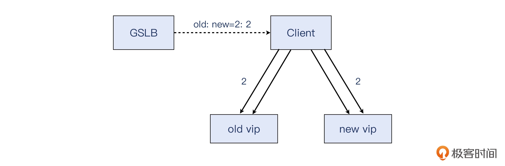

下图是在迁移尾声时候的流量趋势图。在这个阶段，老 VIP 已经从 DNS/GSLB 里禁用了。但原先不插入这种 Connection: Close 头部的话，总还是有很多请求在老的 VIP 上。在插入了Connection: Close 头部后，老 VIP 上的流量几乎立刻停止，可谓立竿见影。

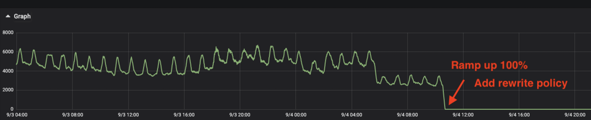

## 小结

这节课，我们通过一个奇特的案例，详细探究了一种应用层保活机制的 Bug 引发的报错。在这个排查过程中，Wireshark 过滤器的使用，很大程度上帮助了这次排查。所以，这里我推荐你要熟悉以下这些过滤器，在你以后的网络排查工作中，应该能给到不少的帮助：

```
tcp.len eq 长度
tcp.flags.fin eq 1
tcp.flags.reset eq 1
tcp.payload eq 数据
```

抓包分析中，面对 Wireshark 里千奇百怪的报文，有时候也会遇到不知道从何下手的窘况，那么你可以直接查看 Expert Information，从那里寻找线索也不失为一个有效的办法。

另外，在原理部分，我还给你介绍了 TCP 层面的 Keep-alive 和 HTTP 层面的 Keep-alive 的联系和区别。应该说，这确实是两个容易令人困惑的概念，不仅名称一样，作用也接近。通过这次讲解，希望能帮助你彻底理解这两个概念。

最后，我再给你梳理提炼一下这节课的关键知识点。

首先，对于 TCP Keep-alive，你需要掌握：

- 默认 TCP 连接并不启用 Keep-alive，若要打开的话要显式地调用 setsockopt()，来设置保活包的发送间隔、等待时间、重试个数等配置。在全局层面，Linux 还默认有 3 个跟 Keep-

- alive 相关的内核配置项可以调整：tcp_Keepalive_time，tcp_Keepalive_probes，还有tcp_Keepalive_intvl。

- TCP 心跳包的特点是，它的序列号是上一个包的下个序列号 -1，而心跳回复包的确认号是这个序列号 -1+1（即还是这个序列号）。

然后，对于 HTTP Keep-alive 的知识点，你需要理解：

- HTTP/1.0 默认是短连接，HTTP/1.1 和 2 默认是长连接。

- Connection: Keep-alive 在 HTTP/1.0 里，能起到维持长连接的作用，而在 HTTP/1.1 里面没有这个作用（因为默认就是长连接）。

- Connection: Close 在 HTTP/1.1 里，可以起到优雅关闭连接的作用。这个头部在流量调度场景下也很有用，能明显加快基于 DNS/GSLB 的流量调整的收敛速度。

## 思考题

最后再给你留两道思考题：

```
tcp.payload eq abc，这个过滤器可以搜索到精确匹配“abc”字符串的报文。那么，如
```

- 果是模糊匹配，比如只要包含“abc”的报文我都想搜到，这个过滤器又该如何写呢?

2. 在工作中，你遇到过跟 TCP Keep-alive 相关的问题吗？你是怎么解决的呢？

欢迎你把答案分享到留言区，我们一起进步成长。

## 附录

抓包示例文件：https://gitee.com/steelvictor/network-analysis/tree/master/07
