# 08-分段：MTU引发的血案

你好，我是胜辉。

在第 1 讲里，我给你介绍过 TCP segment（TCP 段）作为“部分”，是从“整体”里面切分出来的。这种切分机制在网络设计里面很常见，但同时也容易引起问题。更麻烦的是，这些概念因为看起来都很像，特别容易引起混淆。比如，你可能也听说过下面这些概念：

- TCP 分段（segmentation）

- IP 分片（fragmentation）

- MTU（最大传输单元）

- MSS（最大分段大小）

- TSO（TCP 分段卸载）

- ……

所以这节课，我就通过一个案例，来帮助你彻底搞清楚这些概念的联系和区别，这样你以后遇到跟 MTU、MSS、分片、分段等相关的问题的时候，就不会再茫然失措，也不会再张冠李戴了，而是能清晰地知道问题在哪里，并能针对性地搞定它。

## 案例：重传失败导致应用压测报错

我先来给你介绍下案例背景。

在公有云服务的时候，一个客户对我们公有云的软件负载均衡（LB）进行压力测试，结果遇到了大量报错。要知道，这是一个比较大的客户，这样的压测失败，意味着可能这个大客户要流失，所以我们打起十二分的精神，投入了排查工作。

首先，我们看一下这个客户的压测环境拓扑图：

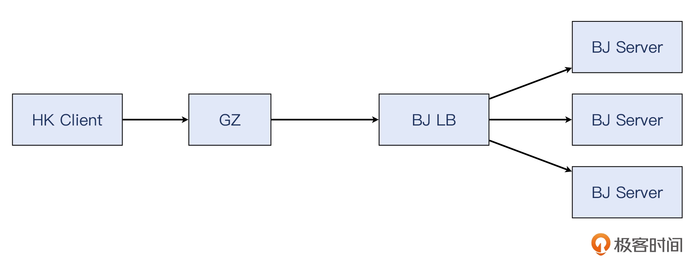

这里的香港和北京，都是指客户在我们平台上租赁的云计算资源。从香港的客户端机器，发起对北京 LB 上的 VIP 的压力测试，也就是短时间内有成千上万的请求会发送过来，北京 LB 就分发这些请求到后端的那些同时在北京的服务器上。照理说，我们的云 LB 的性能十分出色，承受数十万的连接没有问题。不夸张地说，就算客户端垮了，LB 都能正常工作。

但是在这次压测中，客户发现有大量的 HTTP 报错。我们看了具体情况，这个压测对每个请求的超时时间设置为 1 秒。也就是说，如果请求不能在 1 秒内得到返回，就会报错。而问题症状就是出现了大量这样的超时报错。

既然通过 LB 做压测有问题，客户就绕过 LB，从香港客户端直接对北京服务器进行测试，结果发现是正常的，压测可以顺利完成。当然，因为单台服务器的能力比不上 LB 加多台服务器的配置，所以压测数据不会太高，但至少没有报错了。

那这样的话，客户是用不了我们的 LB 了？

我们还是用抓包分析来查看这个问题。显然，我们知道了两种场景，一种是正常的，一种是异常的。那么我们就在两种场景下分别做了抓包。

### 绕过 LB 的压测

我们来看一下绕过 LB 的话，请求是如何到服务器的。香港机房的客户端发起 HTTP 请求，通过专线进入广州机房，然后经由广州 - 北京专线，直达北京机房的服务器。

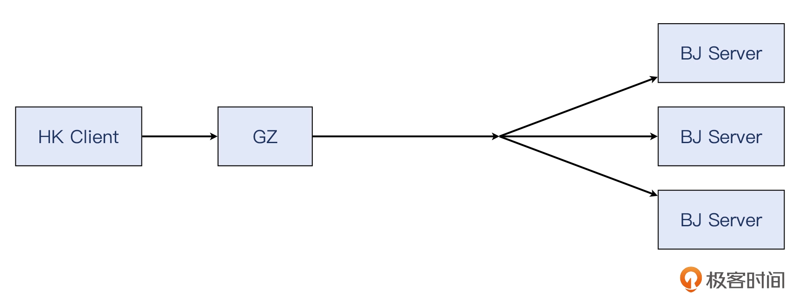

我们来看一下这种场景下的抓包文件：

- 抓包文件已经脱敏后上传至gitee。

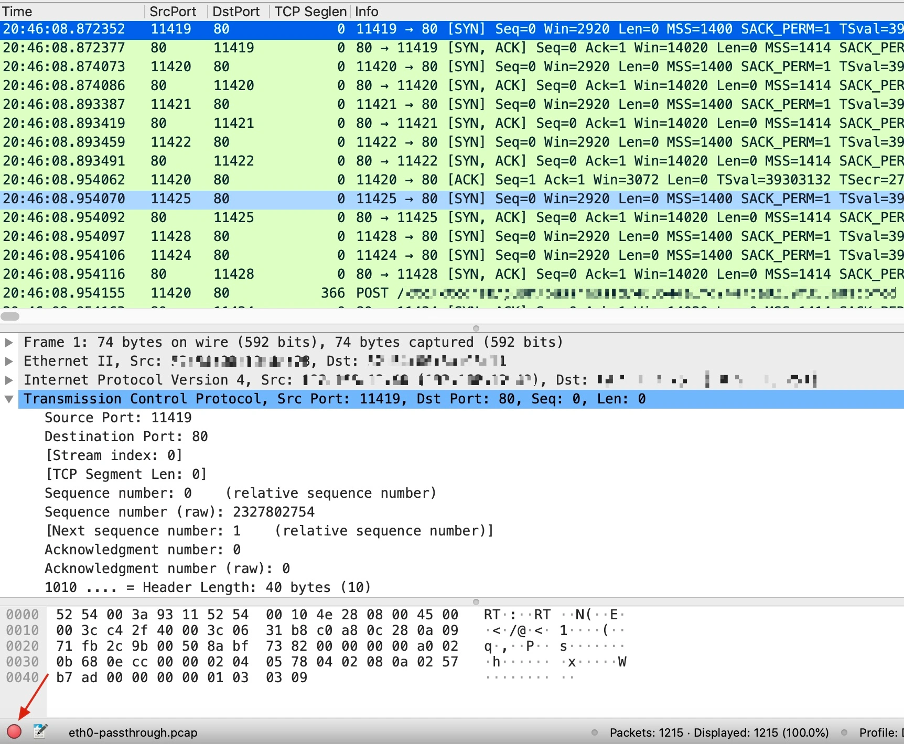

考虑到压测的问题是关于 HTTP 的，我们需要查看一下 HTTP 事务的报文。这里只需要输入过滤器 http 就可以了：

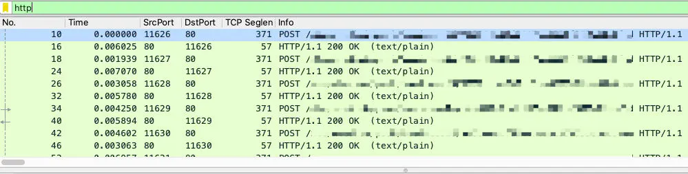

我们选中任意一个这样的报文，然后 Follow -> TCP Stream，来看看整个过程：

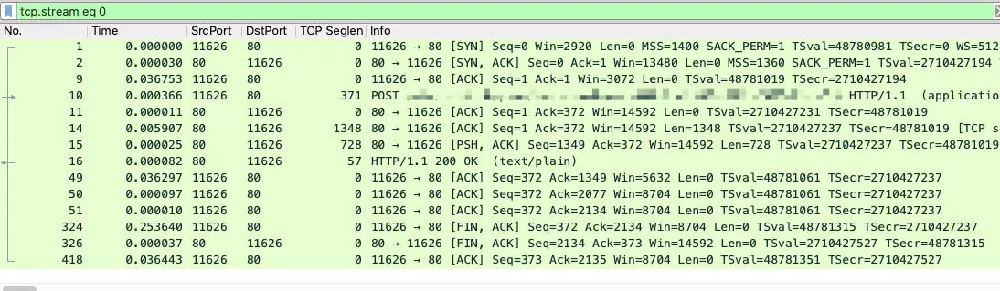

从这个正常的 TCP 流里，我们可以获取到以下信息：

- 时延（往返时间）在 36.8ms，因为 SYN+ACK（2 号报文）和 ACK（9 号报文）之间，就是隔了 0.036753 秒，即 36.8ms。

- HTTP 处理时间也很快，从服务端收到 HTTP 请求（在 10 号报文），到服务端回复 HTTP响应（14 到 16 号报文），一共只花费了大约 6ms。

- 在收到 HTTP 响应后，客户端在 250ms（324 号报文）后，发起了 TCP 挥手。

看起来，服务器确实没有问题，整个 TCP 交互的过程也十分正常。那么，我们再来看一下“经过 LB”的失败场景又是什么样的，然后在报文中“顺藤摸瓜”，进一步就能逼近根因了。

### 经过 LB 的压测

我们打开绕过 LB 的压测的抓包文件，在第 7 讲中，我提到过利用 Expert Information（专家信息）来展开排查的小技巧。那么这里也是如此。

- 抓包文件已经脱敏后上传至gitee。

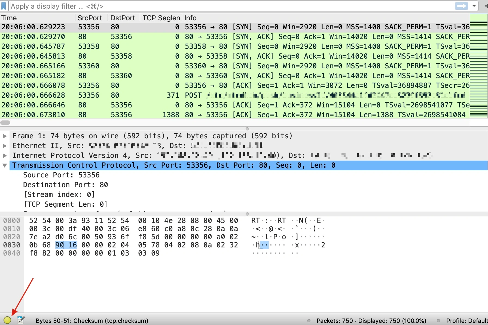

可以看到，里面有标黄色的 Warning 级别的信息，有 50 个需要我们注意的 RST 报文：

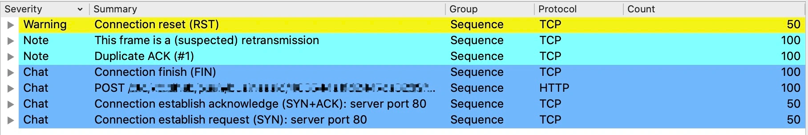

我们展开 Warning Connection reset (RST)，选一个报文然后找到它的 TCP 流来看一下：

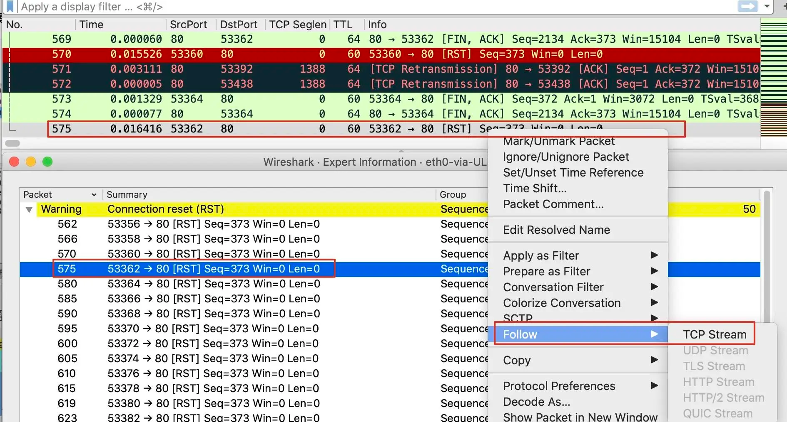

比如上图中，我们选中 575 号报文，然后 Follow -> TCP Stream，就来到了这条 TCP 流：

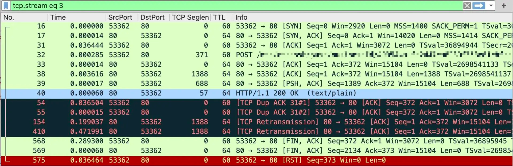

不过这里，我先考考你，目前这个抓包是在客户端还是服务端抓取的呢？

如果你对第 2 讲还有印象，应该已经知道如何根据 TTL 来做这个判断了。没错，因为SYN+ACK 报文的 TTL 是 64，所以这个抓包就是在发送 SYN+ACK 的一端，也就是服务端做的。

接下来就是重点了。显然，这个 TCP 流里面，有两个重复确认（54 和 55 号报文），还有两个重传（154 和 410 号报文），在它们之后，就是客户端（源端口 53362）发起了 TCP 挥手，最终以客户端发出的 RST 结束。

这里隐含着两个疑问，我们能回答这两个疑问了，那么问题的根因也就找到了。

### 第一个疑问：为什么有重复确认（DupAck）？

重复确认在 TCP 里面有很重要的价值，它的出现，一般意味着传输中出现了丢包、乱序等情况。我们来看看这两个重复确认报文的细节。

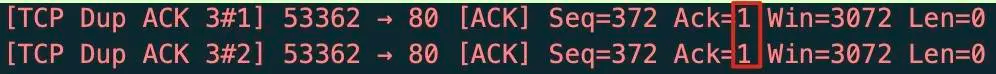

我们很容易发现，这两个 DupAck 报文的确认号是 1。这意味着什么呢？你现在对 TCP 握手已经挺熟悉了，显然应该能想到，这个 1 的确认号，其实就是握手阶段完成时候的确认号。也就是说，客户端其实并没有收到握手后服务端发送的第一个数据报文，所以确认号“停留”在1。

那么，为什么是两个重复确认报文呢？我们把视线从 2 个 DupAck 报文往上挪，关注到整个TCP 流的情况。

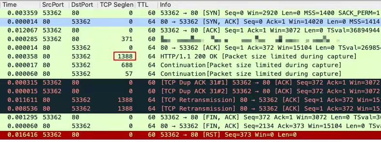

握手完成后，客户端就发送了 POST 请求，然后服务端先回复了一个 ACK，确认收到了这个请求。之后有连续 3 个报文作为 HTTP 响应，返回给客户端。

按照 TCP 的机制，它可以收一个报文，就发送一个确认报文；也可以收多个报文，发送一个确认报文。反过来说，一端发送几次确认报文，就意味着它收到了至少同样数量的数据报文。

在当前的例子里，因为有 2 个 DupAck 报文，那么客户端一定至少收到了 2 个数据报文。是哪两个呢？一定是连续 3 个报文的第二和第三个，也就是 1388 字节报文的后面两个。因为如果是收到了 1388 字节那个，那确认号就一定不是 1，而是 1389（1388+1）了。

我们再把视线从 2 个 DupAck 往下挪，这里有 2 个 TCP 重传。

我们关注一下 Time 列，第一个重传是隔了大约 200ms，第二次重传隔了大约 472 毫秒。这就是 TCP 的超时重传机制引发的行为。关于重传这个话题，后续课程里会有大量的展开，你可以期待一下。

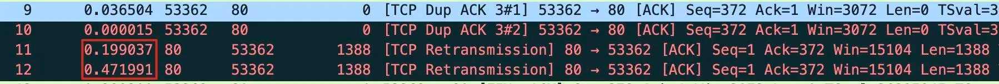

那么结合上面这些信息，我们也就理解了“通过 LB 压测失败”的整个过程，在 TCP 里面具体发生了什么。我还是用示意图来展示一下：

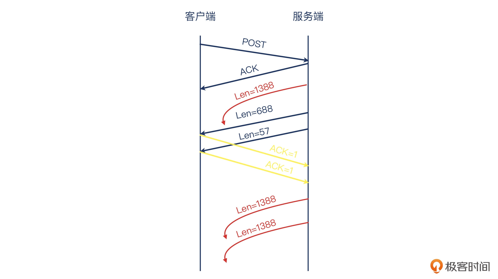

不过你也许会问：“每次这样画一个示意图，好像比较麻烦啊？难道 Wireshark 就不能提供类似的功能吗？”

Wireshark 主窗口里展示的报文，确实有点类似“一维”，也就是从上到下依次排列，在解读通信双方的具体行为时，如果能添加上另外一个“维度”，比如增加向左和向右的箭头，是不是可以让我们更容易理解呢？

其实，我们能想到的，Wireshark 的聪明的开发者也想到了，Wireshark 里确实有一个小工具可以起到这个作用，它就是 Flow Graph。

你可以这样找到它：点开 Statistics 菜单，在下拉菜单中找到 Flow Graph，点击它，就可以看到这个抓包文件的“二维图”了。不过，因为我们要查看的是过滤出来的 TCP 流，而 FlowGraph 只会展示抓包文件里所有的报文，所以，我们需要这么做：

- 先把过滤出来的报文，保存为一个新的抓包文件；

- 然后打开那个新文件，再查看 Flow Graph。

比如这次我就可以看到下面这个 Flow Graph：

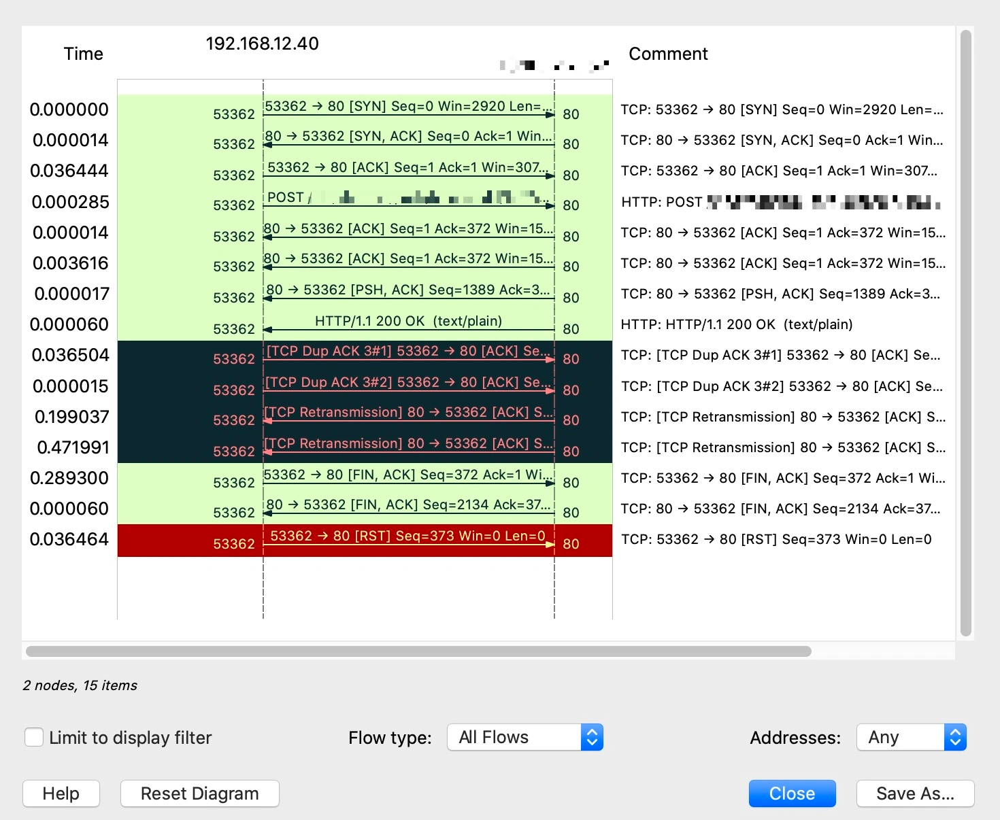

上图读起来，是不是感觉信息量要比主界面要多一些？特别是有了左右方向箭头，给我们大脑形成了“第二个维度”，报文的流向可以直接看出来，而不再去看端口或者 IP 去推导出流向了。

好了，“为什么会有重复确认”的问题，我们搞清楚了，它就是由于三个报文中，第一个报文没有到达客户端，而后两个到达的报文触发了客户端发送两次重复确认。我们接下来看更为关键的问题。

### 第二个疑问：为什么重传没有成功？

第一个报文就算暂时丢失，后续也有两次重传，为什么这些重传都没成功呢？既然我们同时有成功情况和不成功情况下的抓包文件，那我们直接比较，也许就能找到原因了。

让我们把两个文件中的类似的 TCP 流对比一下：

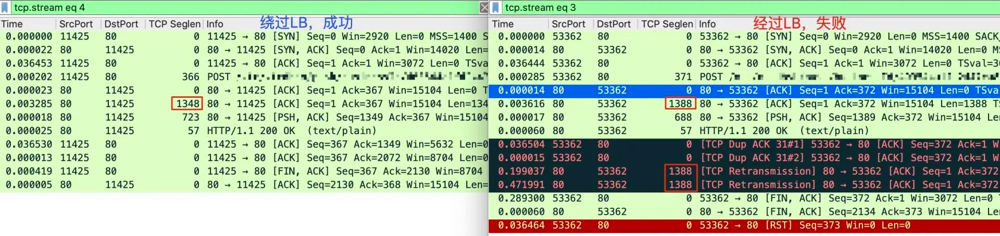

你能发现其中的不同吗？这应该还是比较容易发现的，它就是：HTTP 响应报文的大小。两次测试中，虽然 HTTP 响应报文都分成了 3 个 TCP 报文，但最大报文大小不同：左边是1348，右边是 1388，相差有 40 字节。既然已经提到了报文大小，那你应该会联想到我们这节课的主题，MTU 了吧？

MTU，中文叫最大传输单元，也就是第三层的报文大小的上限。我们知道，网络路径中，小的报文相对容易传输，而大的报文遇到路径中某个 MTU 限制的可能会更大。那么在这里，假如这个问题真的是 MTU 限制导致的，显然，1388 会比 1348 更容易遇到这个问题！

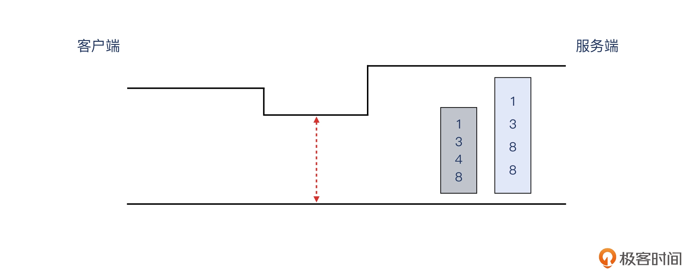

就像上面示意图展示的那样，如果路径中有一个偏小的 MTU 环节，那么完全有可能导致1388 字节的报文无法通过，而 1348 字节的报文就可以通过。

而且，因为 MTU 是一个静态设置，在同样的路径上，一旦某个尺寸的报文一次没通过，后续的这个尺寸的报文全都不能通过。这样的话，后续重传的两次 1388 字节的报文也都失败这个事实，也就可以解释了。

既然问题跟 MTU 有关，我们就检查了客户端到服务端之间的一整条链路，发现了一个之前没注意到的情况：除了广州到北京之间有一条隧道，在北京 LB 到服务端之间，还有一条额外的隧道。我们在第 5 讲里学习过，隧道会增加报文的大小。而正是这条额外隧道，造成了报文被封装后，超过了路径最小 MTU 的大小！从下面的示意图中，我们能看到两次路径上的区别所在：

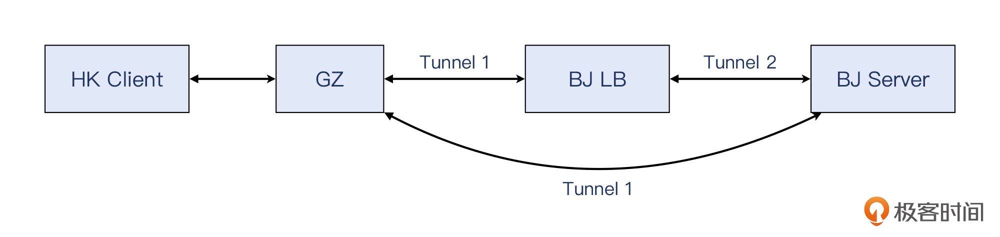

经过 LB 的时候，报文需要做 2 次封装（Tunnel 1 和 Tunnel 2），而绕过 LB 就只要做 1 次封装（只有 Tunnel 1）。跟生活中的例子一样，同样体型的两个人，穿两件衣服的那个看起来比穿单衣的那个要显胖一点，也是理所当然。要显瘦，穿薄点。或者实在要穿两件，那只好自己锻炼瘦身（改小自己的 MTU）了！

另外，由于 Tunnel 1 比 Tunnel 2 的封装更大一些，所以服务端选择了不同的传输尺寸，一个是 1388，一个是 1348。

### 第三个疑问：为什么重传只有两次？

一般我们印象里 TCP 重传会有很多次，为什么这个案例里只有两次呢？如果你能联想到第

```
3 讲里提到的多个内核 TCP 配置参数，那可能你会想到net.ipv4.tcp_retries2这个参
```

数。确实，通过这个参数的调整，是可以把重传次数改小，比如改为两次的。不过在这个案例里不太可能。一方面，除非有必要，没人会特地去改动这个值；另外一个原因，是因为我们找到了更合理的解释。

这个解释就是客户端超时，这一点其实我在前面介绍案例的时候就提到过。从 TCP 流来看，从发送 POST 请求开始到 FIN 结束，一共耗时正好在 1 秒左右。我们可以把 Time 列从显示时间差（delta time）改为显示绝对时间（absolute time），得到下图：

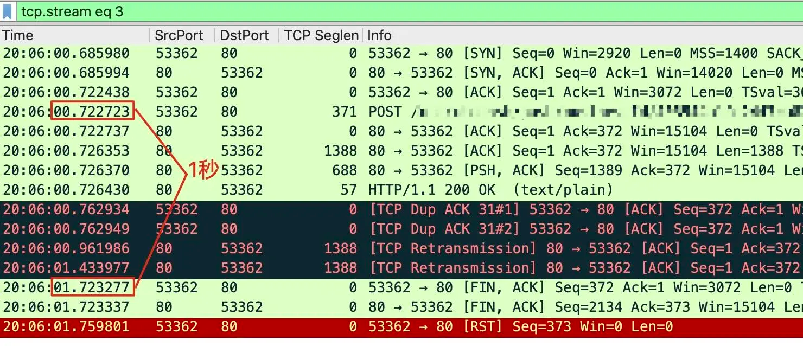

可见，客户端在 0.72 秒发出了 POST 请求，在 1.72 秒发出了 TCP 挥手（第一个 FIN），相差正好 1 秒，更多的重传还来不及发生，连接就结束了。

这种“整数值”，一般是跟某种特定的（有意的）配置有关，而不是偶然。那么显然，这个案例里，客户端压测程序配置了 1 秒超时，目的也容易理解：这样可以保证即使一些请求没有得到回复，客户端还是可以快速释放资源，开启下一个测试请求。

## 一般对策

其实，我估计你在日常工作中也可能遇到过这种 MTU 引发的问题。那一般来说，我们的对策是把两端的 MTU 往下调整，使得报文发出的时候的尺寸就小于路径最小 MTU，这样就可以规避掉这类问题了。

举个例子，在我的测试机上，执行 ip addr 命令，就可以查看到各个接口的 MTU，比如下面的输出里，enp0s3 口的当前 MTU 是 1500：

```
$ ip addr
1: enp0s3: <BROADCAST,MULTICAST,UP,LOWER_UP> mtu 1500 qdisc fq_codel state UP gro
   link/ether 08:00:27:09:92:f9 brd ff:ff:ff:ff:ff:ff
   inet 192.168.2.29/24 brd 192.168.2.255 scope global dynamic enp0s3
      valid_lft 82555sec preferred_lft 82555sec
   inet6 fe80::a00:27ff:fe09:92f9/64 scope link
      valid_lft forever preferred_lft forever
```

而假如，路径上有一个比 1500 更小的 MTU，那为了适配这个状况，我们就需要调小 MTU。这么做很简单，比如执行以下命令，就可以把 MTU 调整为 1400 字节：

```
$ sudo ip link set enp0s3 mtu 1400
```

## “暗箱操作”

那除了这个方法，是不是就没有别的方法了呢？其实，我喜欢网络的一个重要原因是，它有很强的“可玩性”。只要我们有可能拆解网络报文，然后遵照协议规范做事情，那还是有不少灵活的操作空间的。你可能会好奇：这听起来有点像“灰色地带”一样，难道网络还能玩“潜规则”吗？

比如这次的案例，网络环节都是软件路由和软件网关，所以“暗箱操作”也成了可能，我们不需要修改两端 MTU 就能解决这个问题。是不是有点神奇？不过，你理解了 TCP 和 MTU 的关系，就会明白这是如何做到的了。

MTU 本身是三层的概念，而在第四层的 TCP 层面，有个对应的概念叫 MSS，MaximumSegment Size（最大分段尺寸），也就是单纯的 TCP 载荷的最大尺寸。MTU 是三层报文的大小，在 MTU 的基础上刨去 IP 头部 20 字节和 TCP 头部 20 字节，就得到了最常见的 MSS1460 字节。如果你之前对 MTU 和 MSS 还分不清楚的话，现在应该能搞清楚了。


MSS 在 TCP 里是怎么体现的呢？其实我在 TCP 握手那一讲里提到过 Window Scale，你很容易能联想到，MSS 其实也是在握手阶段完成“通知”的。在 SYN 报文里，客户端向服务端通报了自己的 MSS。而在 SYN+ACK 里，服务端也做了类似的事情。这样，两端就知道了对端的 MSS，在这条连接里发送报文的时候，双方发送的 TCP 载荷都不会超过对方声明的MSS。

当然，如果发送端本地网口的 MTU 值，比对方的 MSS + IP header + TCP header 更低，那么会以本地 MTU 为准，这一点也不难理解。这里借用一下 RFC879 里的公式：

- SndMaxSegSiz = MIN((MTU - sizeof(TCPHDR) - sizeof(IPHDR)), MSS)

MTU 是两端的静态配置，除非我们登录机器，否则改不了它们的 MTU。但是，它们的 TCP报文却是在网络上传送的，而我们做“暗箱操作”的机会在于：TCP 本身不加密，这就使得它可以被改变！也就是我们可以在中间环节修改 TCP 报文，让其中的 MSS 变为我们想要的值，比如把它调小。

这里立功的又是一张熟悉的面孔：iptables。在中间环节（比如某个软件路由或者软件网关）上，在 iptabes 的 FORWARD 链这个位置，我们可以添加规则，修改报文的 MSS 值。比如在这个案例里，我们通过下面这条命令，把经过这个网络环节的 TCP 握手报文里的 MSS，改为1400 字节：

```
iptables -A FORWARD -p tcp --tcp-flags SYN SYN -j TCPMSS --set-mss 1400
```

它工作起来就是下图这样，是不是很巧妙？通过这种途中的修改，两端就以修改后的 MSS 来工作了，这样就避免了用原先过大的 MSS 引发的问题。我称之为“暗箱操作”，就是因为这是通信双方都不知道的一个操作，而正是这个操作不动声色地解决了问题。

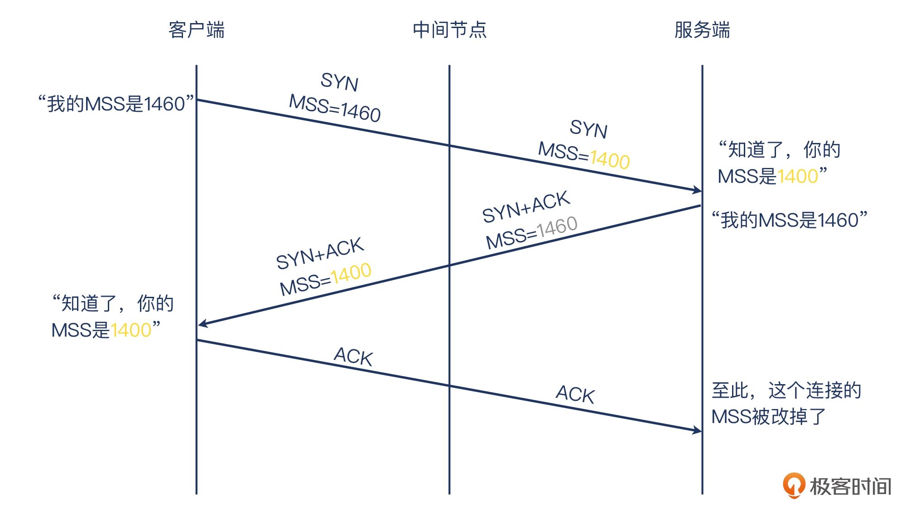

## 什么是 TSO？

前面说的都是操作系统会做 TCP 分段的情况。但是，这个工作其实还是有一些 CPU 的开销的，毕竟需要把应用层消息切分为多个分段，然后给它们组装 TCP 头部等。而为了提高性能，网卡厂商们提供了一个特性，就是让这个分段的工作从内核下沉到网卡上来完成，这个特性就是 TCP Segmentation Offload。

这里的 offload，如果仅仅翻译成“卸载”，可能还是有点晦涩。其实，它是 off + load，那什么是 load 呢？就是 CPU 的开销。如果网卡硬件芯片完成了这部分计算任务，那么 CPU 就减轻负担了，这就是 offload 一词的真正含义。

TSO 启用后，发送出去的报文可能会超过 MSS。同样的，在接收报文的方向，我们也可以启用 GRO（Generic Receive Offload）。比如下图中，TCP 载荷就有 2800 字节，这并不是说这些报文真的是以 2800 字节这个尺寸从网络上传输过来的，而是由于接收端启用了 GRO，由接收端的网卡负责把几个小报文“拼接”成了 2800 字节。

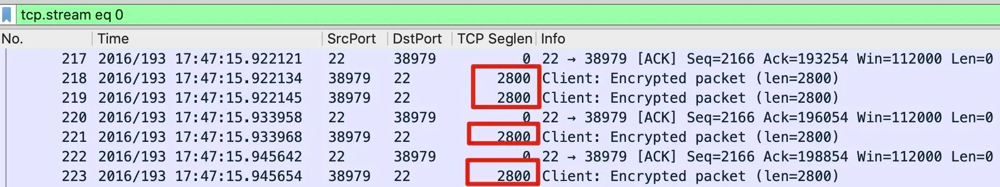

所以，如果以后你在 Wireshark 里看到这种超过 1460 字节的 TCP 段长度，不要觉得奇怪了，这只是因为你启用了 TSO（发送方向），或者是 GRO（接收方向），而不是 TCP 报文真的就有这么大！

想要确认你的网卡是否启用了这些特性，可以用 ethtool 命令，比如下面这样：

```
$ ethtool -k enp0s3 | grep offload
tcp-segmentation-offload: on
generic-segmentation-offload: on
generic-receive-offload: on
large-receive-offload: off [fixed]
rx-vlan-offload: on
tx-vlan-offload: on [fixed]
l2-fwd-offload: off [fixed]
hw-tc-offload: off [fixed]
esp-hw-offload: off [fixed]
esp-tx-csum-hw-offload: off [fixed]
rx-udp_tunnel-port-offload: off [fixed]
tls-hw-tx-offload: off [fixed]
tls-hw-rx-offload: off [fixed]
```

当然，在上面的输出中，你也能看到有好几种别的 offload。如果你感兴趣，可以自己搜索研究下，这里就不展开了。

对了，要想启用或者关闭 TSO/GRO，也是用 ethtool 命令，比如这样：

```
$ sudo ethtool -K enp0s3 tso off
$ sudo ethtool -k enp0s3 | grep offload
tcp-segmentation-offload: off
```

## IP 分片

IP 层也有跟 TCP 分段类似的机制，它就是 IP 分片。很多人搞不清 IP 分片和 TCP 分段的区别，甚至经常混为一谈。事实上，它们是两个在不同层面的分包机制，互不影响。

在 TCP 这一层，分段的对象是应用层发给 TCP 的消息体（message）。比如应用给 TCP 协议栈发送了 3000 字节的消息，那么 TCP 发现这个消息超过了 MSS（常见值为 1460），就必须要进行分段，比如可能分成 1460，1460，80 这三个 TCP 段。

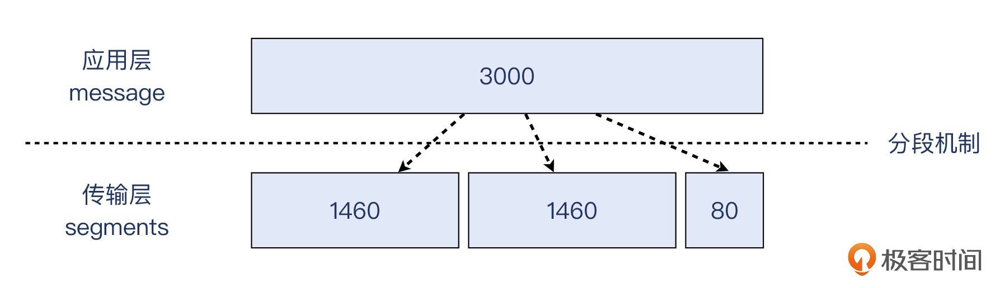

在 IP 这一层，分片的对象是 IP 包的载荷，它可以是 TCP 报文，也可以是 UDP 报文，还可以是 IP 层自己的报文比如 ICMP。

为了帮助你理解 segmentation 和 fragmentation 的区别，我现在假设一个“奇葩”的场景，也就是 MSS 为 1460 字节，而 MTU 却只有 1000 字节，那么 segmentation 和 fragmentation 将按照如下示意图来工作：

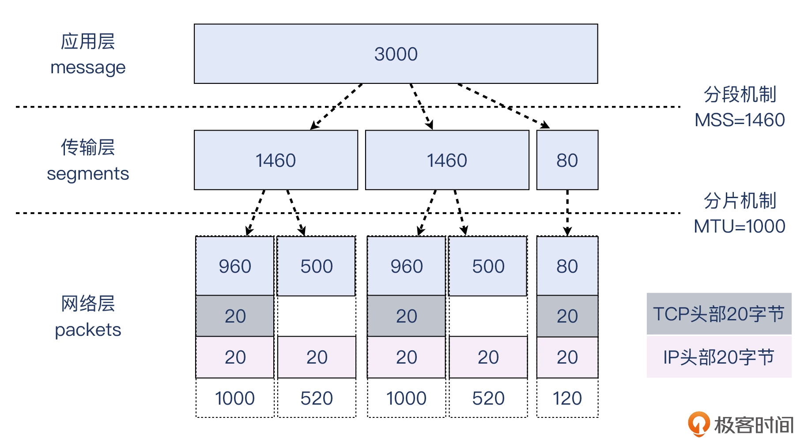

- 补充：为了方便讨论，我们假设 TCP 头部就是没有 Option 扩展的 20 字节。但实际场景里，很可能 MSS 小于 1460 字节，而 TCP 头部也超过 20 字节。

当然，实际的操作系统不太会做这种自我矛盾的傻事，这是因为它自身会解决好 MSS 跟 MTU的关系，比如一般来说，MSS 会自动调整为 MTU 减去 40 字节。但是我们如果把视野扩大到局域网，也就是主机再加上网络设备，那么就有可能发生这样的情况：1460 字节的 TCP 分段由这台主机完成，1000 字节的 IP 分片由路径中某台 MTU 为 1000 的网络设备完成。

这里其实也有个隐含的条件，就是主机发出的 1500 字节的报文，不能设置 DF（Don’tFragment）位，否则它既超过了 1000 这个路径最小 MTU，又不允许分片，那么网络设备只能把它丢弃。

在 Wireshark 里，我们可以清楚地看到 IP 报文的这几个标志位：

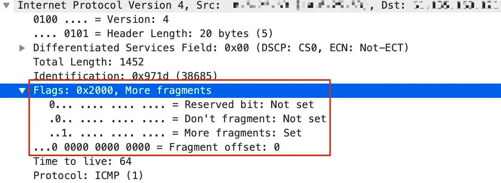

现在我们假设主机发出的报文是不带 DF 位的，那么在这种情况下，这台网络设备会把它切分为一个 1000（也就是 960+20+20）字节的报文和一个 520（也就是 500+20）字节的报文。1000 字节的 IP 报文的 MF 位（More Fragment）会设置为 1，表示后续还有更多分片，而520 字节的 IP 报文的 MF 字段为 0。

这样的话，接收端收到第一个 IP 报文时发现 MF 是 1，就会等第二个 IP 报文到达，又因为第二个报文的 MF 是 0，那么结合第二个报文的 fragment offset 信息（这个报文在分片流中的位置），就把这两个报文重组为一个新的完整的 IP 报文，然后进入正常处理流程，也就是上报给TCP。

不过在现实场景里，IP 分片是需要尽量避免的，原因有很多，主要是因为互联网是一个松散的架构，这就导致路径中的各个环节未必会完全遵照所有的约定。比如你发出了大于 PMTU的报文，寄希望于 MTU 较小的那个网络环节为你做分片，但事实上它可能不做分片，而是直接丢弃，比如下面两种情况：

- 它考虑到开销等问题，未必做分片，所以直接丢弃。

- 如果你的报文有 DF 标志位，那么也是直接丢弃。

即使它帮你做了分片，但因为开销比较大，增加的时延对性能也是一个不利因素。

另外一个原因是，分片后，TCP 报文头部只在第一个 IP 分片中，后续分片不带 TCP 头部，那么防火墙就不知道后面这几个报文用的传输层协议是什么，可能判断为有害报文而丢弃。

总之，为了避免这些麻烦，我们还是不要开启 IP 分片功能。事实上，Linux 默认的配置就是，发出的 IP 报文都设置了 DF 位，就是明确告诉每个三层设备：“不要对我的报文做分片，如果超出了你的 MTU，那就直接丢弃，好过你慢腾腾地做分片，反而降低了网络性能”。

## 小结

这节课，我们通过拆解一个典型的 MTU 引发的传输问题，学习了 MTU 和 MSS、分段和分片、各种卸载（offload）机制等概念。这里，我帮你再提炼几个要点：

- 在案例分析的过程中，我们解读了 Wireshark 里的信息，特别是两次 DupAck 和两次重传，推导出了问题的根因。这里，你需要了解 200ms 超时重传这个知识点，这在平时排查重传问题时也经常用到。

- 借助 Wireshark 的 Flow graph，我们可以更加清晰地看到两端报文的流动过程，这对我们推导问题提供了便利。

- 如果能稳定重现成功和失败这两种不同场景，那就对我们排查工作提供了极大的便利。我们通过对比成功和失败两种场景下的不同的抓包文件，能比较快地定位到问题根因。

- 如果排查中遇到有“整数值”出现，可以重点查一下，一般这跟人为的设置有关系，也有可能就是根因，或者与根因有关。

- 如果你对网络中间环节（包括 LB、网关、防火墙等）有权限，又不想改动两端机器的MTU，那么可以选择在中间环节实施“暗箱操作”，也就是用 iptables 规则改动双方的MSS，从而间接地达到“双方不发送超过 MTU 的报文”的目的。

- 我们也学习了如何用 ethtool 工具查看 offload 相关特性，包括 TSO、LRO、GRO 等等。同样通过 ethtool，我们还可以对这些特性进行启用或者禁用，这为我们的排查和调优工作提供了更大的余地。

## 思考题

最后再给你留两道思考题：

- 在 LB 或者网关上修改 MSS，虽然可以减小 MSS，从而达到让通信成功这个目的，但是这个方案有没有什么劣势或者不足，也同样需要我们认真考量呢？可以从运维和可用性的角度

- 来思考。

- 你有没有遇到过 MTU 引发的问题呢？欢迎你分享到留言区，一同交流。

## 附录

抓包示例文件：https://gitee.com/steelvictor/network-analysis/tree/master/08
