# 12-重传的认识：重传到底是怎么回事？

你好，我是胜辉。

在前面的第 8 讲和第 9 讲，我们先后介绍了两个 TCP 传输方面的案例。在刚过去的第11 讲，我们更是全面了解了 TCP 的拥塞控制机制。其中有一个词经常被提到，就是“重传”。

在我看来，TCP 最核心的价值，如果说只有一个的话，那就是对可靠传输的保证。而要实现可靠的传输，可能需要这样做：如果我的报文丢了，应该在一定次数内持续尝试，直到传输完成；而如果这些重传都失败了，那就及时放弃传输，避免陷入死循环。

所以，为了应对不同的情况，TCP 又发展出了两种不同的重传类型：超时重传和快速重传。它们在各自的场景下都有不可替代的作用。不过，它们本身也只是外在的表现，触发它们的条件又分别是什么呢？

另外，你可能在 Wireshark 里也见过 Spurious retransmission，这个又是什么意思，会对传输有什么影响吗？

这节课，我就通过对几个案例中的抓包文件的解读，带你学习这些重传家族的成员，了解它们的性格脾气，以后你在日常网络排查中看到重传，也就能顺利搞定了。

## 超时重传

我们先来学习下超时重传，Timeout Retransmission。在 TCP 传输中，以下两种情况，都可能会导致发送方收不到确认：

- 报文在发送途中丢失，没有到达接收方，那接收方也不会回复确认包。

- 报文到达接收方，接收方也回复了确认，但确认包在途中丢失。

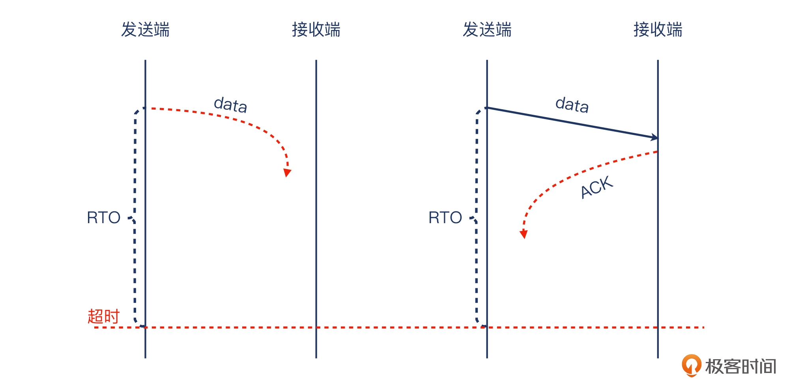

没有收到确认怎么办？发送方为了避免自己陷入“尬等”的境地，选择在等待某段时间后重新发送同样这份报文，这个等待的时间就是重传超时，Retransmission Timeout，简称 RTO。这个Timeout 其实是基于一个计时器，在报文发送出去后就开始计时，在时限内对方回复 ACK 的话，计时器就清零；而如果达到时限对方还没回复 ACK 的话，重传操作就被触发。

当然，超时重传也还是可能会丢包，此时发送方一般会以 RTO 为基数的 2 倍、4 倍、8 倍等时间倍数去尝试多次。

我们来看一个例子，熟悉一下这种重传。

### 超时重传案例

有一次，我们一个客户访问 HTTPS 站点的服务，时常报错失败，我们就做了抓包。这个问题的原因已经不重要了，但是这个抓包文件倒是很适合用来给我们学习 TCP 重传。

我们直接选一个典型的失败事务的 TCP 流来看一下：

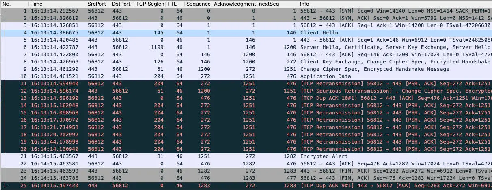

- 示例文件已经上传至Gitee，建议你结合示例文件和文稿来学习，效果更好。

显然，图中黑底红字的报文就是一系列的重传，而且都是超时重传。你如果仔细看了这个文件，可能会指出：“老师不对，这里的 12 号报文是 Spurious 重传，不是超时重传”。但是听完我后面的分析，你应该会同意我的观点：这个本质上也是超时重传。

好，我们开始分析。

- 第一阶段：1~3 号报文是 TCP 握手。

- 第二阶段：4~9 号报文是 TLS 握手。

- 第三阶段：11~20 号报文是连续重传，以及夹杂的 DupAck 和 Spurious 重传。

- 第四阶段：连接关闭。它的触发点是 21 号报文这个 TLS Alert 消息，它的类型是 21。要知道它的具体报错信息，需要解密才能知道（在第 20 讲我会介绍 TLS 解密的细节）。不过通常来说，在这种 TLS Alert 消息之后，就是 TCP 挥手了。

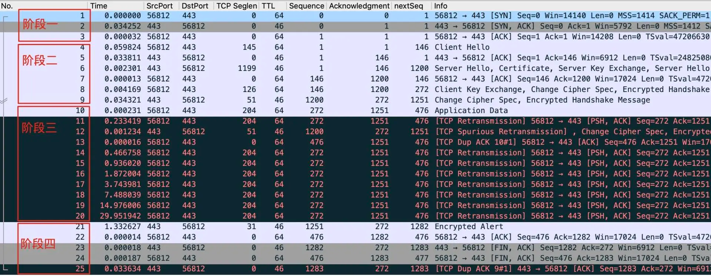

我们重点关注下第三阶段，也就是 11~20 号报文这些重传。那么问题来了：这些重传都是重传了谁呢？也就是如何找到原始报文呢？

方法就是：先找到重传报文的序列号，然后到前面找到同样这个序列号的报文。那个就是原始报文。

比如，11 号报文是 Wireshark 提示我们的第一个重传报文，我们看到它的序列号是 272。在11 号报文前面序列号同为 272 的，是 10 号报文。那么显然，11 就是 10 的重传，后面的 14到 20 号报文也是如此。

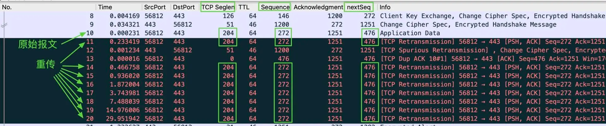

这里还有一个我们熟悉的现象。因为这一系列的重传是对同一个原始报文的重传，所以它们的发送时间也遵循了“指数退避”的原则，比如：

- #11 和 #10 隔了 233ms

- #14 和 #11 隔了 467ms

- #15 和 #14 隔了 936ms

- ……

到 20 号报文的时候，已经重传了第 8 次，也是最后一次。那么为什么没有第 9 次呢？有下面这两种可能：

- 客户端本来就最多只重传 8 次，所以后续也不再重传。

- 服务端的 TLS Alert 报文过来，并发起了挥手，这样后续也没机会重传了。

然后我们再来理解一下整个的传输过程。不过因为抓包文件是单侧的，所以你要注意，Wireshark 里的信息，是需要跟你“抓包发生在哪一侧”这个信息，结合起来解读的。

我画了下面这张图，供你参考这个过程。请注意，这是从抓包视角（也就是客户端）来解读的。如果服务端有抓包，很可能是不同的景象。比如，有可能服务端确实收到了这些重传报文，但确认报文一直没能成功传过来，这个可能性也是存在的。那样的话，这张图就会非常不同了。

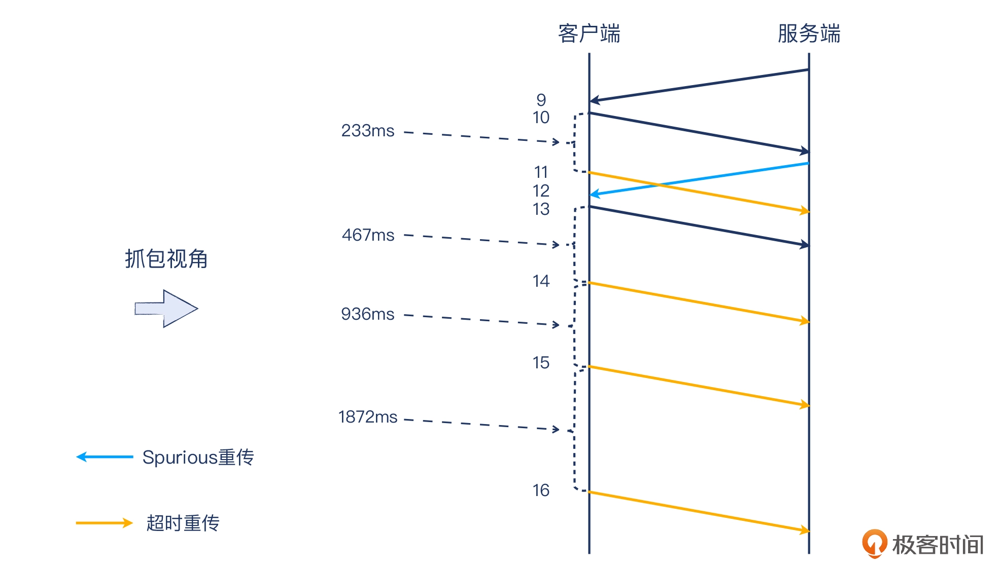

12 号报文的序列号是 1200，跟 9 号报文相同，而且由于客户端 9 号报文已经收到并且回复了确认，所以 Wireshark 认为它是 Spurious 重传。这又是什么重传呢？

### Spurious 重传

Wireshark 如果识别到某个报文已经被确认过，但又再次发送，那么这次就是 Spurious 重传。简单来说，就是已经成功了，不需要再传。

这可以发生在两个方向上。具体来说，假设两端分别是 A 和 B，我们在 A 端抓包，发现下面任何一种情况，Wireshark 就会标记 X 为 Spurious 重传：

- A 发送了报文 X，B 回复了确认，A 再次发送 X。

- A 收到了 B 发过来的报文 X，A 也回复了确认，但 B 再次发送 X。

那么我们在 Wireshark 里看到这种 Spurious 重传该怎么办呢？我觉得一般不用特别处理，集中关注超时重传和快速重传就好了。

- 补充：这个建议也是基于概率。Spurious 重传大部分时候不是问题，只有极少数情况下是问题，所以不去重点关注它是“划算的”。相关的案例，会在专栏的后半程里介绍。

不过我们仔细观察报文，还是发现了一些问题。10 号报文的确认号是 1251，也就是 9 号报文的下个序列号（1251= 序列号 1200+ 载荷长度 51），所以 10 号报文就是客户端对 9 号的确认报文。那么，9 号既然已经被确认了，为什么还要 12 号报文这个重传呢？

只有一种解释：这个抓包是在客户端做的，所以看不到服务端的情况。这个 10 号报文一定是没有到达服务端，所以后者认为 9 号未被客户端收到，于是在 234ms 后重传了 9 号的副本：12 号报文。这里的 234ms，就是 11 号报文的 233ms 加上 12 号报文的 1ms。

从发送端（客户端）的抓包来看，是收到了 Spurious 重传：

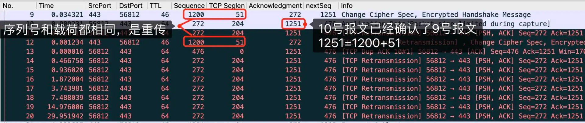

但从接收端（服务端）来看，我推测是认为 9 号丢失，所以 200 多 ms 后进行超时重传：

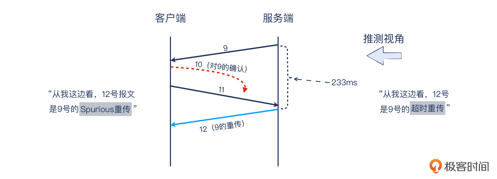

另外，你会发现 10 号报文本身也携带数据，它对 9 号报文的确认信息是跟着 10 号报文自己的数据一起过来的。反正确认信息只是一份元数据，不占用额外的空间，那么跟随数据报文一起发送是最高效的。

实际的重传的例子我们解读完了，接下来了解一下我们可能最关心的问题。

### 重传超时究竟是多长呢？

RFC6298规定：在一条 TCP 连接刚刚开始，还没有收到任何回复的时候，这时的超时RTO 为 1 秒。在更早以前的规范里，这个值是 3 秒。你可以参考 RFC6298 的这个部分，了解这个改变的来龙去脉。

在连接成功建立后，Linux 会根据 RTT 的实际情况，动态计算出 RTO。实际场景中，RTO 为200ms 出头最为常见。

而且，RTO 有上限值和下限值（仿佛有语音：“我们不是没有下限的~”）。一般情况下，Linux的这两个值分别是 120 秒和 200 毫秒。那么这个能否修改呢？

你可能想起了 sysctl 命令。但是很可惜，这两个值不能像 sysctl 那样调整，好像不太方便？其实，这也是一种“幸运”，操作系统把一些比较敏感、改错后影响比较大的参数，没有做成可以灵活调整的方式，也可以避免我们随便调整引发问题。

## 快速重传

上面的超时重传虽然避免了“干等”的尴尬局面，但不可避免地带来了另外的问题：“干等”的时间还是不短的，这段时间被白白浪费了。快速重传的出现就是为了解决这个问题。

它的思路是这样的：如果对端回复连续 3 个 DupAck 即重复确认，我就把序列号等于这个ACK 号的包重传。

### 快速重传案例

我在公有云工作的时候，有个客户对我们机房的网络可用性进行测试，结果发现测试情况不容乐观，很多 HTTP 请求没有得到及时回复。因为是相对简单的 HTTP 请求，本来期望在几个RTT 之内就得到 HTTP 响应的，但实际上很多次都是超过了 1 秒。

于是我们做了抓包，然后过滤出了有问题的 TCP 流。我们看一下这条流的专家信息（ExpertInformation）：

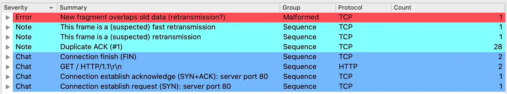

这里我选几个值得关注的信息，做一下解读。

Error 级别的一条信息，是 New fragment overlaps old data (retransmission?)。这是说，这个报文跟前面的报文有重合。这里的“重合”如何理解呢？比如，前面的报文是字节 100 到200，新的报文是字节 150 到 250，那么两者在 150 到 200 字节之间就是重合的。这也不是很大的问题。

Note 级别的 3 类信息，分别是：

- This frame is a (suspected) fast retransmission：这是快速重传报文，那为什么还要加个 suspected 字样呢？我的理解是，Wireshark 是根据一些条件来综合判断这个报文属于什么类型的，但这仅仅是一种参考的信息。由于 TCP 报文本身没有表示重传的字段，所以Wireshark 对它的解读只能作为参考，所以是 suspected。其实，这个信息一般都比较准确，很少有错的时候，用 suspected 这个词，更多地体现了 Wireshark 开发人员的谦虚和严谨。

- This frame is a (suspected) retransmission：这里就是超时重传了，Wireshark 发现抓包文件中没有相关的 DupAck，就推断出这个是超时重传。

- Duplicate ACK (#1)：这里有 28 个重复确认报文，而且，如果我们点开的话，会发现这28 个 DupAck 指向的都是同一个报文：56 号报文。

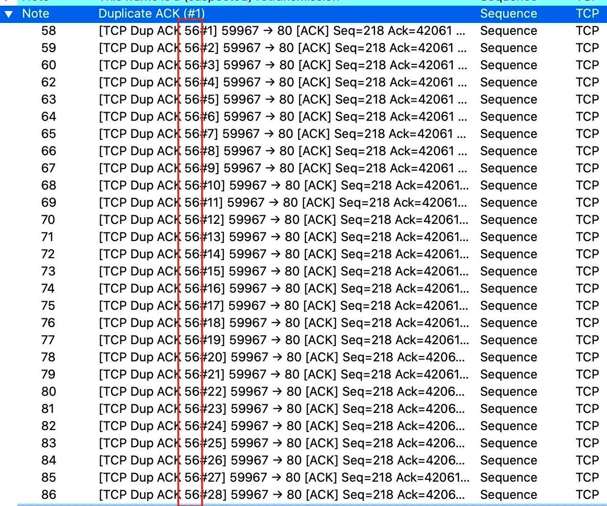

记住：DupAck 经常跟快速重传相关。因为有 3 个或以上数量的 DupAck，就可以触发快速重传。

那么问题来了：为什么这里会有 28 个 DupAck 呢，不是有 3 个就足够触发了吗？

我们回到主界面来分析，你可以参考下图：

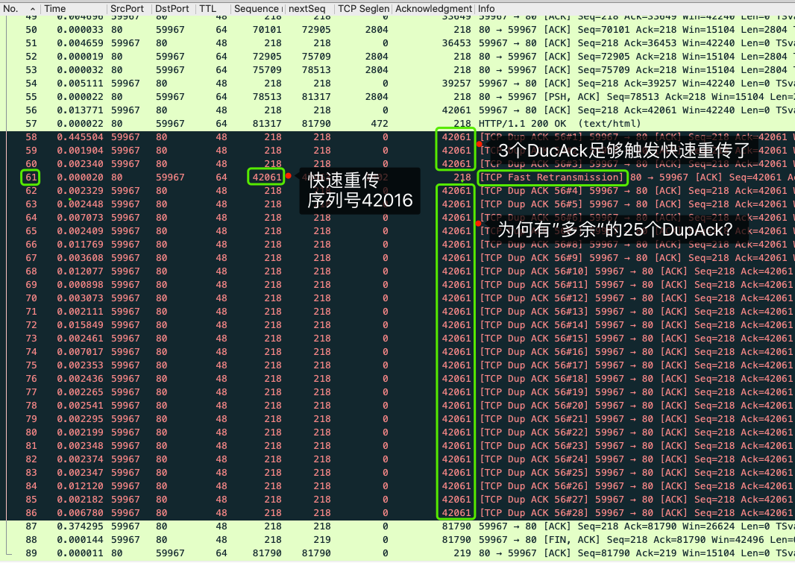

报文 58~60 是 3 个 DupAck，显然也直接触发了 61 号快速重传报文。这样不是已经重传了吗？为什么还会有后面连续 25 个之多的 DupAck 呢？

答案可能不在这片区域。我们把视线往上挪，看一下 57 号及之前的报文情况。

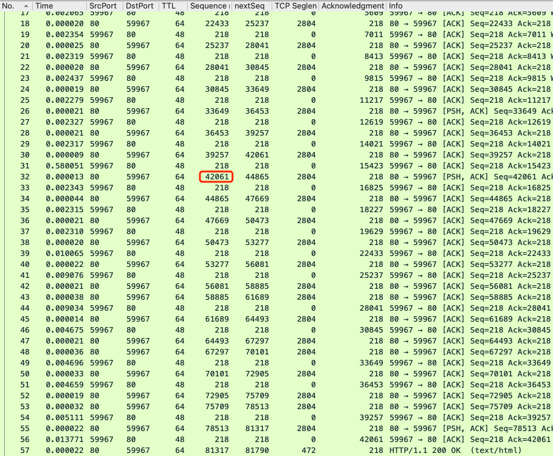

我们可以看到，57 号报文之前，整个传输就像一片宁静的草原。然而，在风平浪静的表面之下，能找到我们要的答案吗？

61 号快速重传报文的原始报文是哪个呢？不难找到，它就是 32 号报文，因为它的序列号就是42061，也就是连续 DupAck 的确认号。

正因为抓包在服务端抓取，所以一定能抓取到由这个服务端发出的报文，但是对端有没有收到，我们是看不到的。只有当 3 个的 DupAck 到达的时候，我们才知道这个报文一定是丢失了，然后会快速重传。

我直接给你揭晓答案：就是因为从 32 号报文之后，服务端还继续发送了 14 个数据报文，远不止 3 个，所以触发的 DupAck 也远不止是 3 个。你可以直接看下图来理解这里的逻辑：

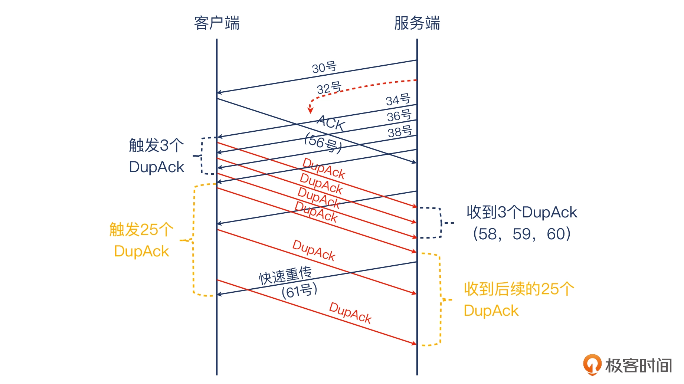

不过，你仔细看这个抓包文件的话，可能还是发现了一个漏洞：服务端从 32 号报文之后，发送的数据报文一共是 14 个，为啥客户端要回复的 DupAck 有 28 个呢？这数量对不上，老师你是不是搞错了？

我在解读这个抓包的时候，其实也在这里卡住过，确实是个有点烧脑的问题：逻辑都对，就是数量不对，到底哪里出了问题？

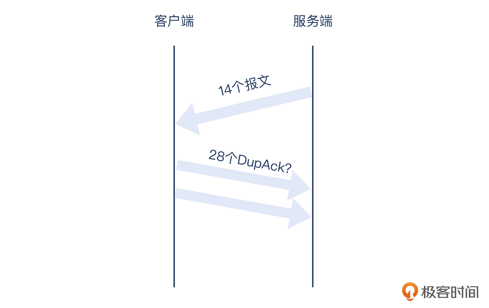

这种时候，你会怎么做呢？

- 宽慰自己：“应该有什么别的原因吧，就不追究了，这个小问题不影响大方向。”

- 鼓励自己：“真相只有一个！再查一下。”

其实，你如果是连续学习课程过来的，应该会对 TSO 有印象。这是我们在第 8 讲提到的概念。有了 TSO，操作系统就可以把大于 MSS 的 TCP 段，比如 2 个 MSS 或更大尺寸的段，交给网卡驱动来处理，后者会利用其硬件芯片做分段工作，重新组装成新的符合 MTU 的报文后发送出去。

那么，“为什么 14 个报文触发了 28 个 DupAck”的答案就在这里了：

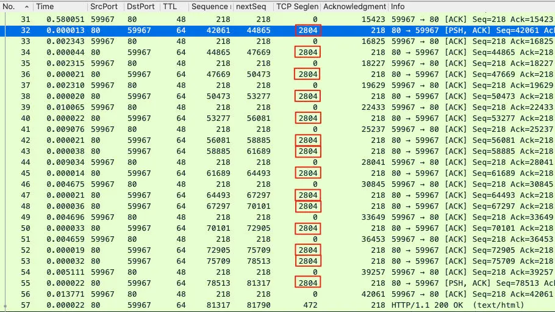

这 14 个报文，每个都是 2804 字节大小，这就显然是 TSO 在起作用了。服务端把 2804 字节发给网卡后，网卡拆分为 2 个报文后发出，所以 14 个数据报文，实际到达接收端的时候就是28 个报文！

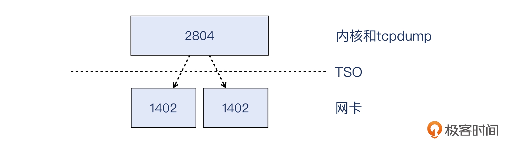

- 补充：实际 TSO 工作起来比这个图要复杂。为了突出重点，这个图里并没有展示 TCP 头部和 IP 头部的封装工作。

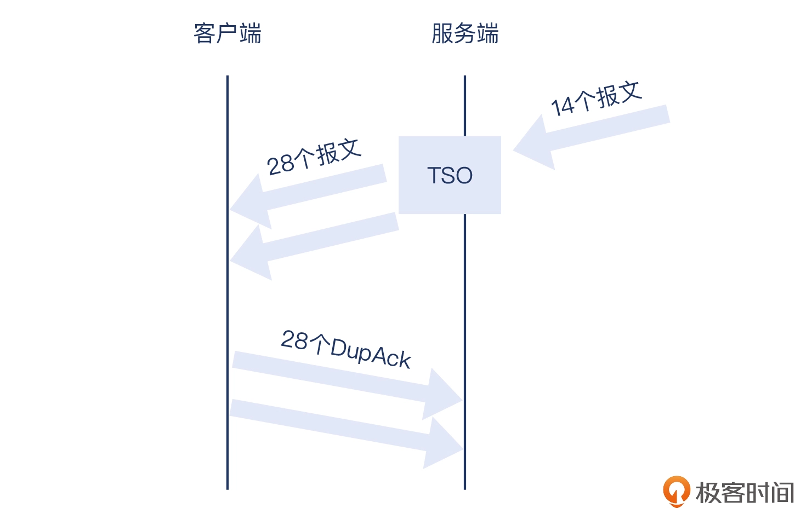

因为 tcpdump 在内核里靠近网卡这一侧，所以 tcpdump 抓取到的还是 TSO 处理之前的大报文，只有到达了网卡并且被 TSO 机制做了分段处理后，才变成小报文。我们抓包文件里看到14 个报文，实际发送出去的是 28 个报文，也就触发了 28 次 DupAck。

遇到难题，努力一下，往往就有新的发现。让我们每天进步一点点。

## SACK 跟重传的关系

其实在第 8 讲“MTU 引发的血案”里，我们就发现了 SACK 现象。这次我们研究重传，那就有必要回顾一下这个 SACK 部分，把它的含义和作用，都搞清楚。

在那次案例里，服务端向客户端发送了 3 个 HTTP 响应报文，但是因为 MTU 的问题，其中一个大的报文在路径上丢失了，只有后面 2 个报文到达了客户端，从而引发了客户端发送了两次DupAck。

- 示例文件已经上传至Gitee，建议结合示例文件和文稿来深入学习。

我们来看看这两个 DupAck 的详情，先看第一个：

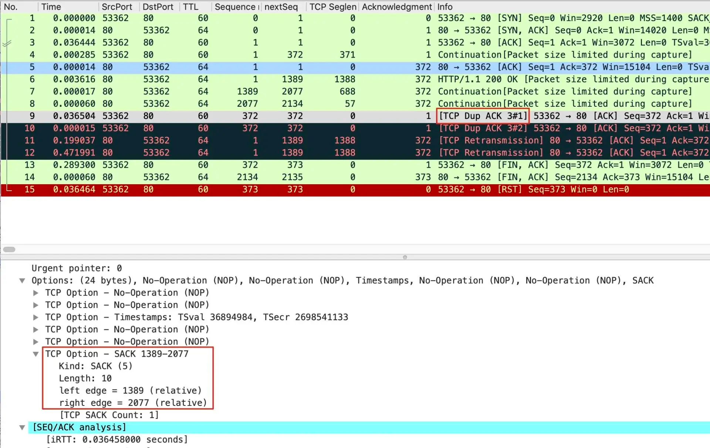

你可以直接进入关键部分，也就是这里框出来的 TCP Option SACK 1389-2077。SACK 全称是 Selective Acknowlegement，中文叫“选择性确认”。但是在中文里，貌似带“选择性”这个前缀的词都不是很正面，比如像“选择性忽视”“选择性失忆”什么的，我们好像都不想摊上这种事。

不过，在 TCP 的世界里，“选择性确认”这个概念就很不一样了，它还真的是我们实实在在需要的一个特性，能帮助 TCP 运作得更好。

我们先说说没有 SACK 会怎么样。在前面的五个报文的例子里，接收端在 TCP 里，我们只能对收到的连续报文进行确认。我们可以看个例子：

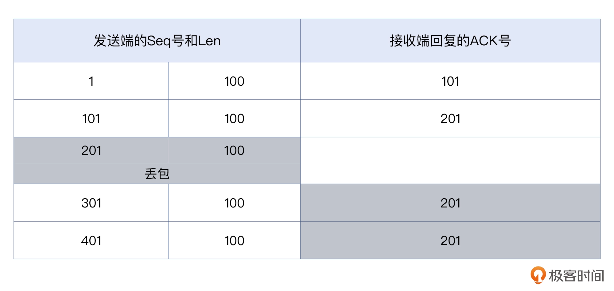

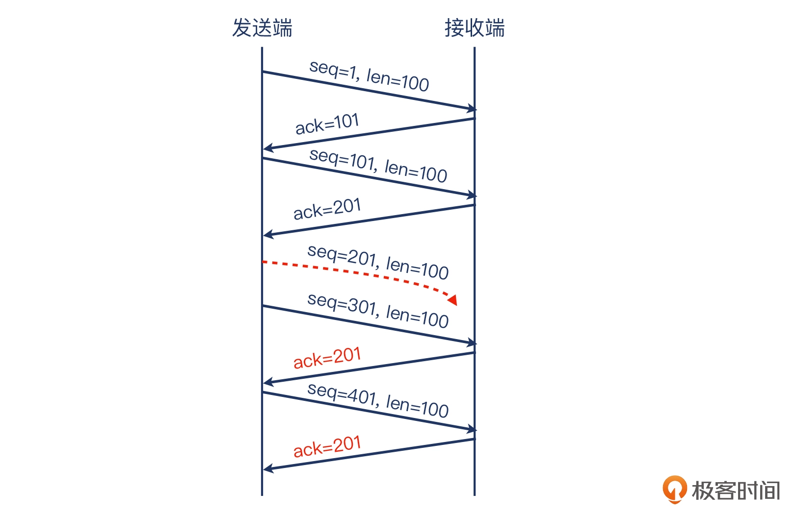

接收端回复的报文的确认号，只能是连续字节数的最后一个位置。因为发送端的序列号为201、长度为 100 的 TCP 报文丢失了，那么服务端收到的连续字节数的最后一个位置，就是第 201 字节。这还不是最糟糕的，后续发送过来的序列号为 301 和 401 这两个报文，服务端回复的确认报文的确认号也仍然只能是 201。

现在，有 3 个确认报文的确认号为 201。对于早期 TCP 实现来说，这个时候发送端只能把序列号从 201 开始的报文，也就是序列号分别为 201、301、401 的这 3 个报文全部重传。但是，301 和 401 报文实际已经到达接收端，却也要跟着 201 一起被重传，这未免太浪费了，301 和 401 号报文表示“201 真是我们的猪队友”。

那有没有办法，只重传序列号为 201 的报文，而避免重传 301 和 401 呢？

于是，TCP 增加了 SACK 这个特性。SACK 机制可以告诉发送端：“虽然我的确认号是 201，但是我的 TCP Option 里面还有更详细的信息，在那里我会告诉你，在断点后我又收到了哪些数据”。这段话比较晦涩，我们直接看这次的这个报文：

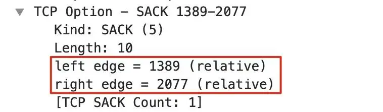

SACK 最关键的部分就是 left edge 和 right edge，也就是左右边界。上图告诉我们：我收到了从第 1389 字节开始直到 2076 字节（也就是不含 2077）的数据。这样，我们可以把 SACK和确认号结合起来，知道了通过这个报文，接收端（这里是客户端）明白了什么样的信息。我用示意图把这个信息表示了出来：

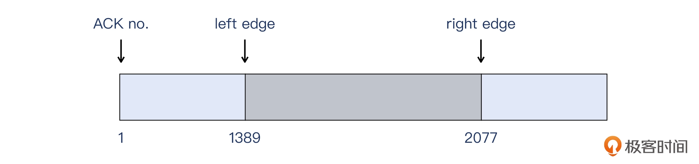

类似的，我们看一下第二个重复确认报文（示例文件的 10 号报文）的 SACK 详情：

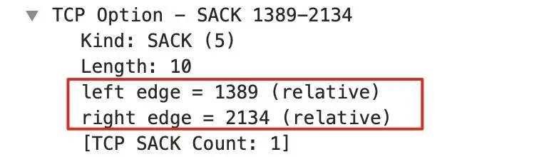

可见，第二个重复确认报文的 SACK，把实际收到的报文边界又往右“推”了一些，到了第 2134字节（之前是第 2077 字节）。这个差额是 2134-2077=57。

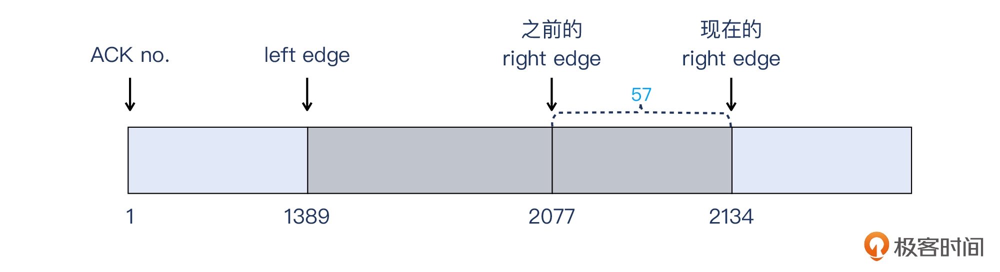

你有没有发现，这 57 个字节，其实正是前面抓包文件截图里的 8 号报文的大小，也就是说这57 字节的报文确实被服务端收到了，并在随后回复的 SACK 报文中得以体现。这里我们再看一眼这 57 字节的报文在抓包文件中的位置：

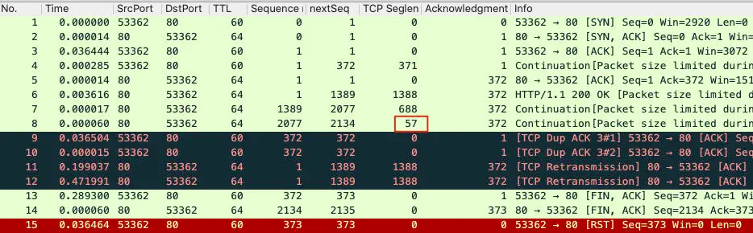

既然 SACK 这么好，是不是 TCP 传输都能用上它呢？其实，SACK 要能工作，还需要 SACKpermitted 这个 TCP 扩展属性的支持。这个字段只有在 TCP 握手的 SYN 和 SYN+ACK 报文中出现，表示自己是否支持 SACK 特性。比如下图：

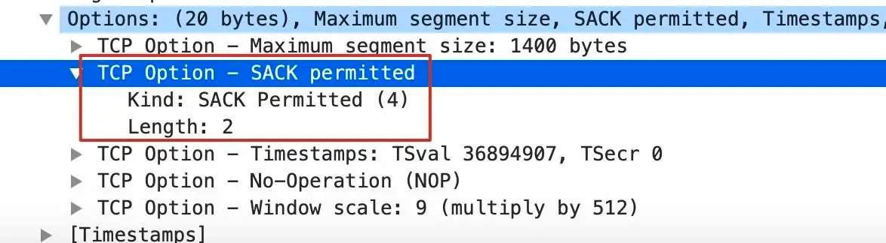

知道对方支持 SACK，那我们就可以在后续报文里带上 SACK，也就是上面的含有 left edge和 right edge，来告诉对方我实际收到的 TCP 段了，就可以避免这部分报文也被连带重传。201 报文表示：还好有了 SACK，队友们你们继续往前冲吧，我虽然这次掉队了，但我还会回来的。

那么有了 SACK，是不是所有的这种零星到达的报文，都不用重传了呢？答案是没有那么乐观。受限于 TCP Option 长度，SACK 部分最多只能容纳 4 个块。当然，这比没有 SACK 的情况还是好多了。

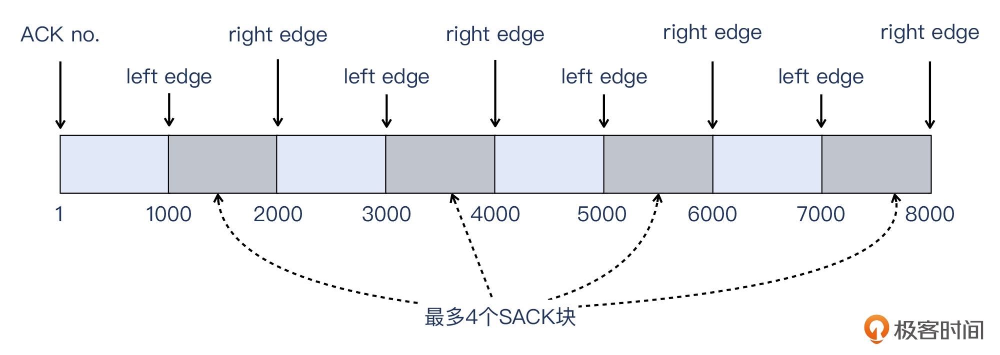

## 小结

这节课，我们学习了 TCP 重传的两种类型：超时重传和快速重传。然后也通过实际案例，看到了这两种重传在实际情况中的特点。这里我再给你小结一下这些知识点，你可要好好掌握。

对于超时重传：

- TCP 对于每条连接都维护了一个超时计时器，当数据发送出去后一定时限内还没有收到确认，就认为是发生了超时，然后重传这部分数据。

- RTO 的初始值是 1 秒（在发送 SYN 但未收到 SYN+ACK 阶段）。

- 在连接建立后，TCP 会动态计算出 RTO。

- RTO 有上限值和下限值，常见值分别为 2 分钟和 200ms。

- 实际场景中，RTO 为 200ms 出头最为常见。

对于快速重传：

- 快速重传的触发条件是：收到 3 个或者 3 个以上的重复确认报文（DupAck）。

- 在快速重传中，SACK（选择性确认）也起到了避免一部分已经到达的数据被重传。不过，也由于 TCP 头部长度的限制，SACK 只能放置 4 个块，再多也不行了。

- 快速重传只要 3 个 DupAck 就可以触发，实际上我们还可能观察到远多于 3 个 DupAck 的情况，这也是正常现象。

- Spurious 重传对 TCP 传输的影响比快速重传和超时重传小很多，总体来说是一种影响不大的重传。

另外，在案例拆解的过程中，我们也进一步学习了 Wireshark 的使用技巧，包括：

- Wireshark 里的信息，是需要跟你“抓包发生在哪一侧”这个信息，结合起来解读的。这对你的排查会起到很关键的作用。

- 如何定位到被重传的原始报文的方法：先找到重传报文的序列号，然后到前面找到同样这个序列号的报文。

- 如果在专家信息里看到 New fragment overlaps old data (retransmission?)，这意味着多个报文之间的数据有重叠，但一般不是严重的问题。

- Wireshark 提示的 (suspected) fast retransmission 就是快速重传报文。

- Wireshark 提示的 (suspected) retransmission 就是超时重传报文。

- 如果发现有数据报文和 DupAck 数量不对等的情况，可以看一下是否有 TSO 的存在。

## 思考题

最后再给你留两个思考题：

- TCP 的确认报文如果丢失了，发送端还会不会重传呢？为什么？

- 你有没有遇到过重传引发的问题，你是怎么处理的呢？

欢迎你把答案分享到留言区，我们一起进步、成长。
