# 18-偶发性问题如何排查？

- 登录

你好，我是胜辉。

在开始今天的课之前，我先问你一个问题：你在工作中没有遇到过那种“神出鬼没”的故障？就是说大部分时候情况都是正常的，但偶尔会来一下故障的那种。我猜有 99% 的可能你遇到过。

这种问题挺麻烦，经常是我们准备排查的时候，现场就没有了。那么，没有第一手的详细数据，我们还能查到问题的根因吗？

在我以往的实践当中，我发现不少人在对这个问题的认识上，会有两个常见的误区。

误区 1：没有现场，也没有抓包，但只要我们有历史记录，就能通过它查到根因。

这里说的历史记录，是指应用日志、性能指标等。的确，很多问题通过查看历史记录，就可以

- 登录

解决。但还有一些问题场景，单靠历史记录是无法查到根因的。

比如这样一个场景：用户访问页面时偶尔遇到 HTTP 503 错误。而 LB 日志里，记录的其实也是一次 HTTP 503，以及“后端服务不可用”这类信息。但是如果我们继续追问：为什么当时后端服务不可用呢？当时网络上有什么问题导致这种不可用呢？

日志并不能告诉我们这些问题的答案。这是它本身的局限性导致的，即它的视角是应用层，并不是网络层，所以天生就无法了解底层网络到底发生了什么。这种时候，你是不是有一种“隔靴搔痒”的感觉？

事实上，这类问题的排查，需要在重现（reproduce）问题时做全面的排查工作（比如抓包），拿到最真实全面的信息后，才能真正彻底完成。

误区 2：为了任何时候都能有现场数据，就一直抓包，一旦有问题就直接看抓包文件。

这样做，理论上确实保留了现场，但是现实中却并不可行。主要有两大原因：

- 第一，抓包数据量太大。以一个平均流量在 1Gbps 的服务为例，1 天就有 10TB 的网络报文数据。现在一个企业有几十个、上百个服务的情况也很常见，10TB 再乘以 10 或者 100这种系数，数据量就又上了几个数量级，这对存储、读取来说，都是极大的压力。

- 第二，常态的抓包对系统性能的影响不能低估。因为抓包本身也占用内存和 CPU 资源，这会对已经有问题的系统产生“叠加伤害”，有可能会出现“不抓包的时候只有老问题，而抓包之后，除了老问题，还出现了新问题”。所以，常态化的抓包工作，既不可行，也没必要。

因此，在这个大背景下，我们如何抓包、抓多久，就很有讲究了。

那么今天，我们就通过一个实际的案例，一起来探讨下在面临偶发性问题时，我们都可以采取哪些有效的排查手段，来解决这种“想查的时候问题不来，问题来的时候没在查”的困境。

在这个过程中，你可以观察下整个重现和排查的方法论，并重点关注我对大量报文进行某个指标分析的技巧。这样，当你在日后遇到偶发性问题时，就可以参考今天所讲的内容，把问题真正地解决。

- 登录

## 我们可以采用怎样的重现 + 排查策略？

我们先来了解下需要采用什么样的重现和排查策略。事实上，网络排查是一个更偏重实践的领域，所以只要能解决问题，我觉得都是合适的办法。针对偶发性问题的重现和排查，我个人会选择如下的策略。

### 1. 初步估计问题出现的时间跨度，对于问题何时重现有个预期

通过对用户反馈、应用日志，以及监控仪表盘（Dashboard）的异常事件做初步统计，了解到问题是多久出现一次，这样就决定了我们在观察和抓包上需要投入的时间成本是多少。

举个例子，一个偶发性问题是几分钟出现一次，另外一个偶发性问题是几天才出现一次。如果你对后者只观察几分钟，显然是无效的。反过来，对前一个问题用好几天的时间去观察和抓包，则远超实际需求，虽然有效，却很低效。

- 另外，在这里我还要做个提醒。针对频率一会儿密集一会儿稀疏的问题，最好选取稀疏频率，也就是做保守估计。比如，某个问题在第一个小时出现了 10 次（平均 6 分钟一次），第二个小时却一次也没有，到第三个小时才又出现一次，那么我们认为其时间跨度是 2 小时（即第二和第三小时），而不是 6 分钟。

### 2. 在问题机器上发起抓包，根据预估的时间跨度，指定抓包方式。

基于前一点的分析，我们知道了问题重现的大致时间跨度，由此也确定了做监控和抓包的时间跨度。无论是我们在监控上花的时间长短，还是抓包文件占用磁盘的大小，这些都是需要控制的成本。

这里面还有个矛盾：tcpdump 抓包抓久了文件太大，抓短了又可能错过问题现场。那么，如何做到既可以抓取到期待的报文，同时抓包文件也不至于特别大呢？给你分享两个技巧。

技巧一：利用 tcpdump 里跟循环抓包相关的几个参数。

- -W 个数：生成的循环文件数量，生成到最大数量后，新的报文数据会覆盖写入第一个文登录件，以此类推。

- -C 尺寸：每个文件的大小，单位是 MB。

- -G 间隔时间：每次新生成文件的间隔时间，单位是分钟。

下面这个例子，就是每 100MB 或者 60 分钟（满足任一条件即可）就生成一个文件，一共 10个文件：

```
tcpdump -i eth0 -w file.pcap -W 10 -C 100 -G 60
```

技巧二：在循环抓包的基础上，再利用 tcpdump 的 -s 参数可以大幅减小抓包文件的大小。

比如：

- tcpdump -s 54：抓取到从二层到四层的报文头部（不带 TCP Options）了。

- tcpdump -s 74：可以抓取到所有 TCP Options，对排查 TCP 行为足够用。

如果要对应用层的头部（比如 HTTP 头部）也进行抓取，那可以设置更大的 -s 参数值。整体来说，这样的抓包文件，要比抓满的情况（1514 字节）小很多。

- 补充：1514 字节是网络层 MTU 的 1500 字节，加上帧头的 14 字节。所以一般不指定 -s参数的抓包文件，其满载的帧大小是 1514 字节。

### 3. 定时观察，在问题重现时停止抓包。

这里又分成两种不同的做法：

- 直接人工观察应用日志或者仪表盘，比如每隔几分钟就刷新一次，直到问题重现。在问题出现频率相对高的场景下，这样做最为简单。这种做法类似软件设计里的轮询机制。

- 设定自动告警机制，当通过邮箱或者手机短信等途径收到相应告警时，就知道问题重现了。登录这样做的好处是，抓取的问题时间点更准确。现在有告警通知功能的监控系统很多，比如Prometheus + Grafana。这种做法类似软件设计里的事件通知机制。

### 4. 导出抓包文件，结合应用日志展开分析。

这就是我们前面提到的“问题现场”详情了，在抓包文件里，所有的网络行为都会被记录下来。我们把报文情况跟应用层的报错情况做对比，就能极大地推动根因排查工作。

我把这个方法论整理成了一个简单的流程图，供你参考：

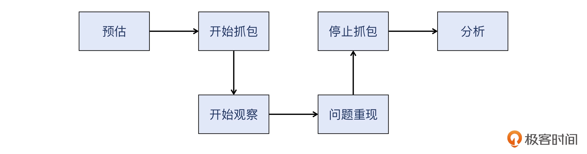

下面，我们就进入实际案例。

## 实战案例：网站偶尔会变慢？

曾经有个客户向我们报告了这样一个情况：他们的网站偶尔会变慢，比如正常 1 秒内就能完成的请求，可能会变成 5 秒钟或者更长。

但是这个情况不是每次必现，客户还做了功课，他们发现，问题出现的频率大约是几百次里面有一次。客户怀疑，是不是网络有丢包或者什么问题，导致了有时候 HTTP 请求或者响应没有被及时传输呢？所以就委托我们查清楚原因。

### 预估：如何预估问题的出现频率和周期？

按照前面的方法论，我们先做预估，也就是估计一下问题重现的时间跨度。

客户说“每几百次出现一次”，我们可以保守估计为 1000 次中出现一次问题。那么通过这个数

- 登录

据，能得出时间跨度吗？还不行，因为我们还不知道请求的频率是多少。

我们再次跟客户确认后，了解到他们业务还处在起步阶段，并不十分繁忙，访问频率大概在10 次 / 分钟。现在我们做个简单的算术题：1000/10=100 分钟，这就是预估的时间跨度。

### 抓包：抓多长时间合适？

有了预估的时间跨度，我们就可以做相应时长的抓包了。我们让客户在主机上用 tcpdump 抓取了 100 分钟左右的数据包，并发回给我们做分析。

### 监控：如何重现问题？

在这个时间段内，这个站点依然在对外服务。除此以外，客户那边的几个工程师也用浏览器不断刷新页面作为测试，发现也有遇到一次页面卡顿的情况。所以我们已经清楚，问题现场也就是跟问题相关的数据包，已经在抓包文件里了。

在这个案例里，因为客户那边的监控手段比较缺乏，没有全面的客户端日志，所以动用了“人肉”重现的方法。

其实，这个看起来很朴实的方法，在不少场景下也是挺有用的。我前面也提过，网络排查是一项偏向实践性的工作，只要有效的方法，我们都可以参考采用。当然如果你有 Grafana 等比较先进的监控系统，自然可以采用告警通知等更好的办法。

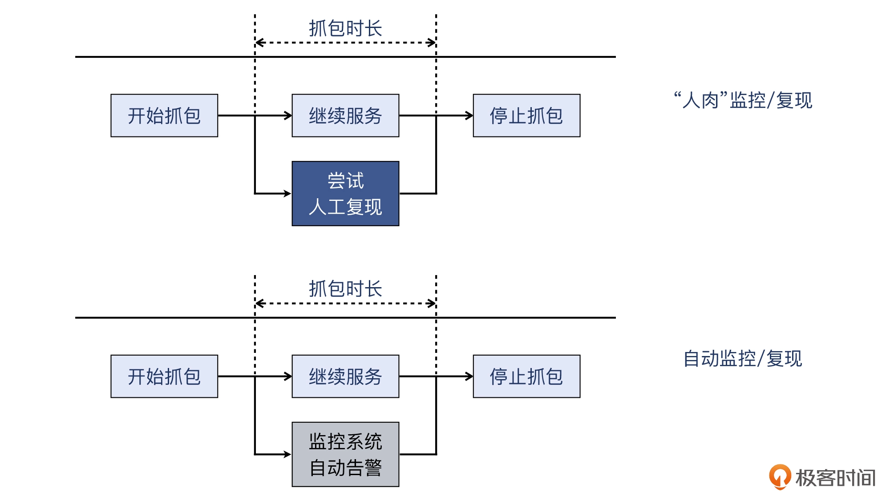

- 登录

## 抓包分析 1：如何在网络视角上精确定义问题？

接下来，就进入了分析阶段。不过在具体展开前，我们先思考两个简单的问题：

- 什么是慢 / 卡顿？

- 多慢才是慢？

客户的应用是 HTTP 协议的，业务是在线二手商品交易，他们的客户是通过浏览器和 App 进来交易的。所以，针对第一个问题，“慢”对于浏览器来说，就可能是页面一直显示转圈圈的图，要很久才能加载好页面。对于 App，就是界面里有很多内容空白，过一会儿才能正常使用。

第二个问题没有标准答案，但一般来说，一个页面响应超过 3~4 秒问题就很大了，1 秒以内完成是最好的。页面打开越快，客户体验越好，成交量就越高。有研究发现，电商网站页面的加载时间只要快 0.1 秒，成交量就有明显的提升。

所以，基于以上的分析，我们确定了查找条件，就是“响应时间超过 3 秒的 HTTP 事务”相关的报文。但是当我们打开抓包文件，随机选取一个 HTTP 事务的报文，我们就能很方便地找到“响应时间超过 3 秒的 HTTP 事务”吗？

- 登录

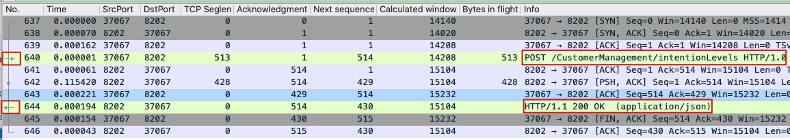

上图是某个随机选取的 HTTP 事务的 TCP 流。当然这里也是 Wireshark 的一个小的知识点：左侧的两个水平方向的箭头（一个向右，一个向左），分别表示这两个数据包是 HTTP 请求和HTTP 响应。然后我们可以根据第二列的时间差（Time），算出来 HTTP 耗时。

这次事务的耗时主要发生在 642 号和 641 号报文之间，大约是 115 毫秒，所以不符合 3 秒的条件。

## 抓包分析 2：如何用 Wireshark 实现对大量 HTTP 事务的性能分析？

前面的做法是，先找到 HTTP 事务的报文，然后用 Follow TCP Stream 的方式找到这个 TCP流，最后分析其 HTTP 请求和响应之间的耗时。如果抓包文件里只有几个这样的事务，这样做倒也无妨。但是，如果抓包文件里有几百几千个 HTTP 事务，难道也这么一个一个去对比分析？怕是几天都看不完。

事实上，我们还有更好的办法，也就是利用 Wireshark 的高级用法，来帮助我们实现对大量HTTP 事务的某个性能指标进行解析和统计，也就是可以借助它的两个特性：过滤器（filter）和自定义列。

### 过滤器

我们先来看看如何使用 Wireshark 的过滤器，来实现方便的数据分析。

在这个案例里，我们关注的是 HTTP 事务的耗时。其实在 Wireshark 窗口里，我们可以选中一个 HTTP 响应报文，然后找到它的耗时。比如前面提到的 115 毫秒的那个事务，它的HTTP 响应报文的详情是这样的：

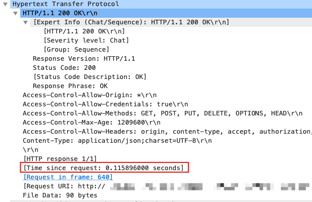

- 登录

```
可以看到，[Time since request: xxx seconds] 就表示了 HTTP 耗时。它本身不是
```

报文属性，而是 Wireshark 对报文的分析属性。所有 Wireshark 提供的分析属性，都会用方括号标识出来（这跟 ps 等命令里，把内核线程也用方括号标识出来的做法类似）。

```
这个 HTTP 耗时指标对应的 Wireshark 过滤器是 http.time。我们可以直接在 Wireshark 过
滤器输入框里输入 http.time，看看会出现什么：
```

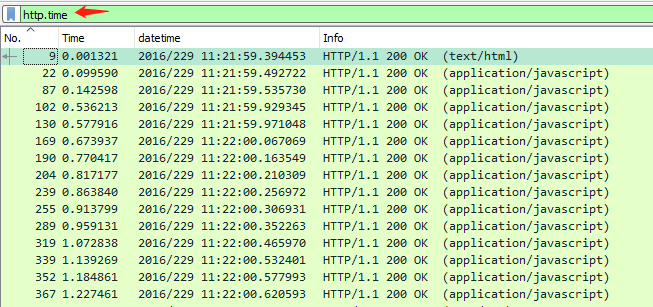

可见，所有的 HTTP 响应报文都被过滤显示出来了。这是因为 Wireshark 把 http.time 这个分

- 登录

析属性体现在 HTTP 响应报文上，所以这里搜出来的就都是响应报文了。而如果用过滤器http，就会同时显示 HTTP 请求和 HTTP 响应的报文。现在没有其他 TCP 包的干扰，看起来清爽多了。

不过等等，我们想要看的耗时信息在哪里呢？没有地方展示？

### 自定义列

到这里，就需要第二个特性上场了，也就是自定义列。跟之前课程里介绍的添加自定义列的方法一样，我们在 Wireshark 窗口下方的 http 详情部分，选中前面介绍过的 Time sincerequest，右单击，选择 Apply as column，然后 Wireshark 主窗口里就多了一列

```
http.time。
```

不过新增加的列默认出现在最右侧，你可以根据需要把它拖放到合适的位置，比如我把它拖到第三列，插入在 info 列之前，查看起来十分方便。

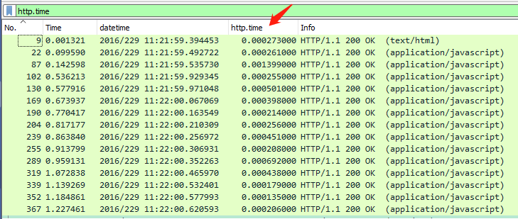

```
这样，我们结合 http.time 过滤器和 http.time 自定义列，就可以很直观地看清楚每个
```

HTTP 事务的耗时了。

```
好了，这时我们点击 http.time 列就可以排序了，一下子就可以找到耗时最高的几个事务，
```

如下：

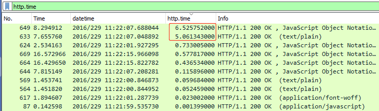

- 登录

我们可以很清楚地看到，有两个事务消耗了长达 5 到 6 秒的时间，其他事务就相对很低了，都在 1 秒以内。既然已经定位到问题事务了，接下来按照常规套路，右单击这个包，选择Follow -> TCP Stream，我们就可以跟踪到这个高耗时事务的前后 TCP 行为，进而可以定位是否是网络问题。

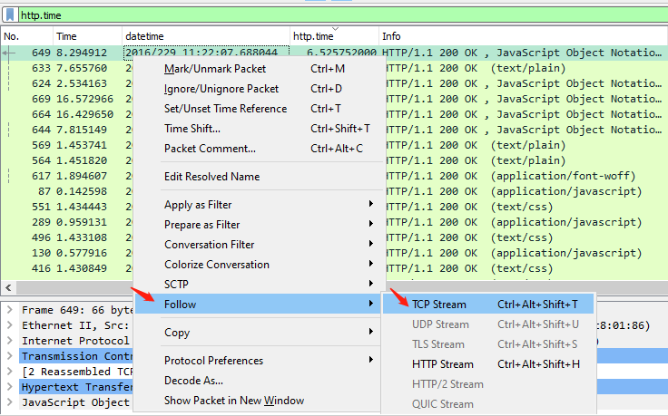

这个完整的 TCP 流是这样的：

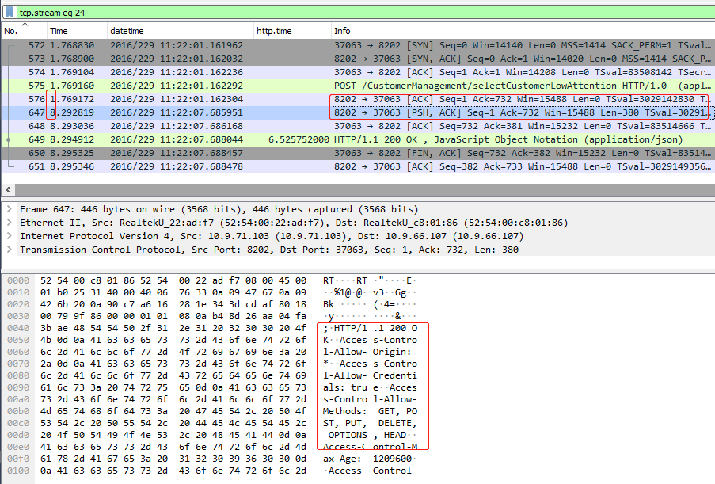

- 登录

显然，从第二列 Time 来看，6 秒多的时间耗费在 576 号报文和 647 号报文之间，具体来说：

- 576 号报文：服务端（监听在 8082 端口）回复了 TCP 确认，确认收到客户端发送过来的POST 请求。

- 中间停顿了 6.5 秒左右。

- 647 号报文：服务端回复的 HTTP 响应头部，可以在详情部分里看到 HTTP 返回码和多个header。

- 648 号报文：客户端确认收到 HTTP 响应头部。

- 649 号报文：服务端继续发送 HTTP 响应的 body 部分。在这里，因为 HTTP 响应报文已经

```
完整（648+649 号报文），Wireshark 可以在这 649 报文上显示 HTTP/1.1 200 OK 这样
```

- 的信息了。

- 650 号报文：客户端确认收到 HTTP 响应 body 部分，同时携带 FIN 标志位结束这个连接。

非常明显，问题是服务端收到 HTTP 请求后，花了大约 6.5 秒的时间才回复了 HTTP 响应。

- 登录

这充分说明两点：

- 网络上没有任何丢包、重传等问题；

- 服务端响应耗时高达 6 秒以上。

既然排查了网络的嫌疑，客户就转而去检查应用层面的问题了。

## 是否还有其他可能？

当然你可能会问，是否有可能服务端及时发送 HTTP 响应了，只是一直丢包，导致 6.5 秒后客户端才收到呢？就是下图这种情况：

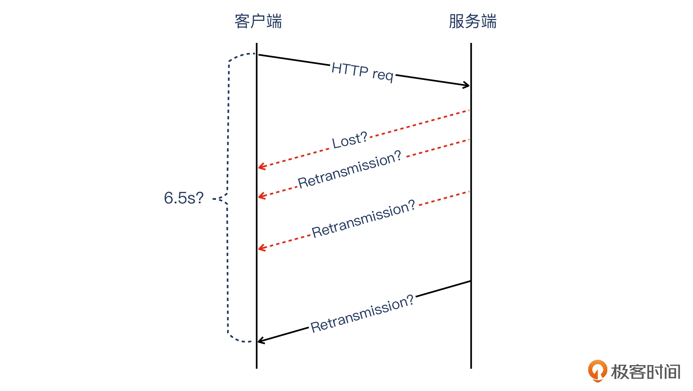

这个可能性当然是可能存在的，如果做得透彻一点，我们应该同时在客户端和服务端抓包，进行对比即可确认或排查这个可能性。具体的例子可以参考我们在第 5 讲介绍的防火墙的案例，里面就是用两侧抓包来查出问题的。

但是在当前的案例中，假设真有网络问题引起的重传，那么这个重传行为不会只集中在 HTTP

- 登录

响应上。

也就是说，一个有丢包表现的网络，不会“聪明”到只盯着 HTTP 响应去丢包，而是其他阶段也会有丢包。这里说的其他阶段，就是 TCP 握手、HTTP 请求、TCP 挥手，等等，丢包同样会引起这些阶段出现重传等现象。但是我们在这个抓包文件中并没有看到这类现象，因此反过来就说明，这个推测不太可能成立。

另外，细心的你可能已经注意到了，图中假想的丢包和重传，遵循了指数退避原则。这个知识点我们在第 3 讲有介绍过，你如果觉得生疏了，可以去复习一下。

## 如何用命令行工具做同样的分析？

前面我介绍了如何在 Wireshark 里结合过滤器和自定义列，来定位“高耗时 HTTP 事务”。不过因为图形界面的关系，这个过程有好几步操作，稍显麻烦，有没有更快一些的办法呢？

其实是有的，这次我们不用 Wireshark 图形界面程序，而是利用它自带的另外一个命令行工具tshark，我们在上节课里也介绍过这个工具。

就拿前面这个案例来说，我们可以直接用 tshark 在命令行中，实现对高耗时 HTTP 事务的获取。直接运行以下命令：

```
tshark -r 文件名 -T fields -e http.time | grep -v ^$
```

示例输出如下：

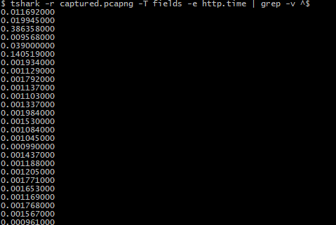

- 登录

注意，我们在命令的后面，必须加上管道符“ | ”和“grep -v ^$”，要不然就会看到下面这种，有大段空白的输出（因为凡是非 HTTP 的数据包都没有输出，会成为一个空行）：

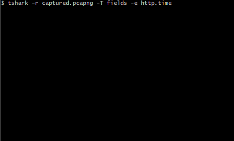

当然，如果要针对某个高耗时的事务进行数据面的分析，那光看 http.time 这一个指标是不够的，你需要知道这个事务对应的包号、TCP 流号等信息，并追踪这个流里面的数据包。比如，你可以运行以下命令，把 http.time 耗时最高的事务对应的 TCP 流数据包，都在命令行里展示出来：

- 登录

```
tshark -r 文件名 -T fields -e frame.number -e http.time -e tcp.stream | sort -k2 -
```

我来解释一下其中的几个参数：

```
-T fields -e frame.number -e http.time -e tcp.stream：表示要展示数据
```

- 包哪几个列的信息。frame.number 表示帧号（包号）、http.time 表示 HTTP 耗时、tcp.stream 表示 TCP 流号。

```
-Y "tcp.stream eq {}"：在管道符后面使用，指的是需要把这个 TCP 流号相关的数
据包都展示出来。因为结合了 xargs 命令，所以 eq 后面是一个{}符号，这个值就是 TCP
```

- 流的编号（由 awk 命令输出）。

下图是对这个案例应用此命令得到的输出，这一系列数据包跟我们前面在 Wireshark 图形界面里 Follow TCP Stream，而得到的那些数据包是一致的：

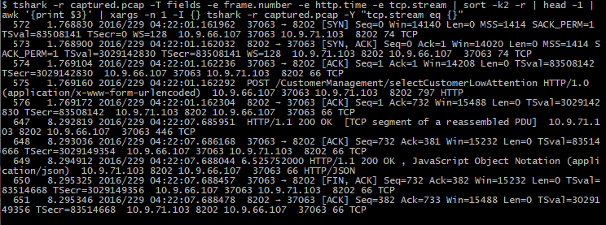

是不是有点神奇？我们在图形界面里能做的事情，在命令行里也一样能做到，只要借助tshark。而正因为它是命令行形式，所以具备下面这些优势：

- 图形界面里需要反复多次进行的操作，在命令行里利用管道特性，一条命令就可以完成。

- 图形程序集中在单个文件的处理，而命令行可以方便地对多个文件进行批量处理。

- 命令行的输入和输出都是文本，便于复制，在多人沟通协作场景下更显便利。

这样，通过利用 tshark 对大量 HTTP 事务的耗时进行统计，我们很容易就能得出整体的

- 登录

HTTP 事务性能状况了，比如平均耗时、各耗时区间的事务占全部事务的比例，等等。这不仅能在问题排查的时候提供帮助，而且在一些性能调优的场合，还可以给我们提供应用日志以外的另一种性能数据源。

## 小结

这节课，我给你介绍了一种排查偶发性问题，你可以重点关注和回顾以下这些知识点。

- 偶发性问题的排查思路

即先预估时间，然后一边抓包一边观察问题是否出现，在问题出现后停止抓包，最后进行抓包分析。也就是这样的流程：

- 排查技巧

首先是控制 tcpdump 抓包大小的方法。

为了控制抓包文件在合理的范围，我们可以用两种方法。

- 方法一：运行 tcpdump 时指定循环参数，比如每隔多少 MB 或者每隔多少分钟就生成一个文件，一共生成 n 个文件，循环使用。

- 方法二：tcpdump -s 参数，指定 -s 后面的数值为 54 到 74，就可以抓取到二层到四层的头部信息了。如果要抓取应用层头部，可以指定相应的更大的值。

第二是找到 HTTP 耗时最高事务的方法。

- 登录

```
为了找到 HTTP 耗时最高的事务，我们可以通过过滤器 http.time 或者 http，把 HTTP 事
```

务都过滤出来，然后增加一个自定义列来展示 HTTP 耗时。最后，我们点击这个列，就完成对HTTP 耗时这个自定义列的排序了。

而除了 Wireshark 这个工具以外，我们用 tshark 命令行工具，也同样可以实现“从大量报文中对某个指标进行解析和排序”的目的。

第三是找到 HTTP 事务的报文对的方法。

在 Wireshark 中，选中 HTTP 的请求或者响应报文时，这个报文以及与它对应的响应或者请求报文的左边，会出现两个水平方向的箭头（一个向右，一个向左），表示它们属于同一个HTTP 事务。

## 思考题

最后，给你留两道思考题：

- 前面我介绍了使用 tshark 来找到耗时最高的 HTTP 事务的方法。关于 tshark，你自己还有哪些使用经验呢？

- 在“是否还有其他可能？”这里，我提到了可能的重传。如果要验证是否真的存在这种重传，你觉得应该做什么呢？

欢迎在留言区分享你的答案，也欢迎你把今天的内容分享给更多的朋友，我们一起成长、进步。
