# 21-为什么用了负载均衡更加不均衡？

你好，我是胜辉。

咱们课程的第二个实战模块“应用层真实案例揭秘篇”已经进行到后半程了。前半程的四讲（15到 18）都是围绕应用层特别是 HTTP 的相关问题展开排查。而在刚过去的两讲（19 和 20）里，我们又把 TLS 的知识和排查技巧学习了一遍。

基本上，无论是网络还是应用引发的问题，也无论是不加密的 HTTP 还是加密的 HTTPS，你应该都已经掌握了一定的方法论和工具集，可以搞定不少问题了。

但是我们也要看到，现实世界里也有不少问题是混合型的，未必一定是跟网络有关。比如，你有没有遇到过类似下面这种问题：

- ping 正常，抓包看也没有丢包或者乱序现象，但是应用就是缓慢；

- Telnet 端口能通，但应用层还是报错。

其实这也说明了，掌握网络排查技能固然重要，但完全脱离操作系统和架构体系方面的知识，仅根据网络知识去做排查，也有可能会面临知识不够用的窘境。所以，作为一个技术人，我们任何时候都不要限制自己的学习和成长的可能，掌握得越多，相当于手里的牌越多，我们就越可能搞定别人搞不定的问题。

所以接下来的两节课，我会集中围绕系统方面的案例展开分析，希望可以帮助你构造这方面的能力。等以后你遇到网络和系统扯不清的问题时，也不会发怵，而是可以准确定位，高效推进了。

## 案例 1：高负载和不均衡

这也是我在公有云工作的时候处理的真实案例。当时一个客户是做垂直电商的，他们的体量还不大，所以并没有自建机房，而是放到公有云上运行。他们的架构大致是这样的：

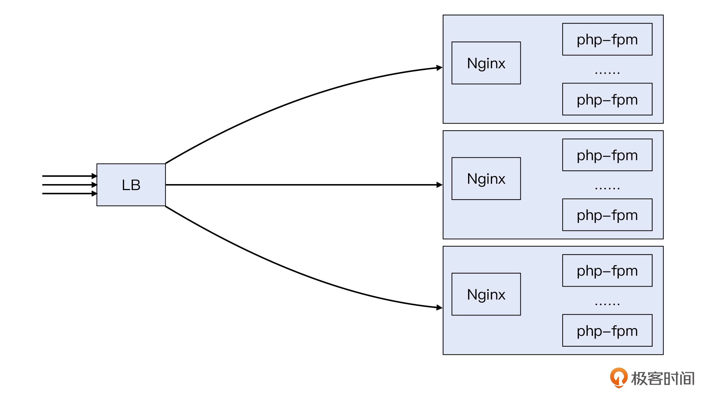

LB 运行在第四层，设置的负载均衡策略是 round robin（轮询），也就是新到达 LB 的请求，依次派发给后端 3 个 Nginx 服务器，使得每台机器获得的请求数相同。Nginx 运行在第七层，它作为 Web 服务器接收 HTTP 请求，然后通过FastCGI接口传递给本机的php-fpm进程，进行应用层面的处理。

应该说，这就是一个非常典型的负载均衡架构，平时运行也正常。不过有一天，客户忽然报告系统出问题了，网站访问越来越慢，甚至经常会抛出 HTTP 504 错误。如下图所示：

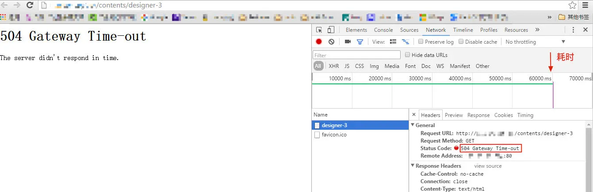

我们借助浏览器开发者工具可以看到，这个响应耗时长达 60 秒，然后抛出了 504 错误。事实上，一般人浏览一个网站的时候，等个十来秒肯定就没耐心了，所以这次的问题确实很严重。

### 初步检查

这三台 Nginx 服务器的配置都是 8 核 CPU。从服务端的监控来看，它们的系统负载，也就是CPU load 出现了严重的不均衡。其中一台的负载值在 7 左右，一台在 20 左右，最后一台居然高达 40 左右，远远超过它们的 CPU 核的数量。

我们知道，uptime 或者 top 命令输出里的 CPU load 值，表示的是待运行的任务队列的长度。比如 8 核的机器，load 到 8，那就是 8CPU 核处理 8 个任务，全部用满了。不过，能到用满的程度，实际已经对应用的性能产生明显的影响了，所以一般建议 load 值不超过核数*0.7。也就是 8 核的机器，建议在 load 达到 5.6 的时候，就需要重点关注了。

回到这三台 Nginx 机器，我们看看具体的 load。

Nginx 1 的 load 大致在 10 到 20 之间：

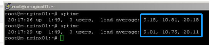

Nginx 2 的 load 在 7 左右：

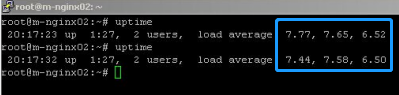

Nginx 3 就很高了，在 40 以上：

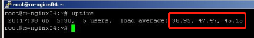

联系前面我们提到的负载均衡，你大概也明白为什么客户找过来了：因为 3 台机器的负载不均衡啊，难道不是你们的 LB 工作不正常导致的吗？

这确实是一个形式上讲得通的逻辑，我们开工吧。

### 排查 LB

首先需要检查网络状况。我们做了抓包分析，发现传输本身一切正常，没有丢包也没有特殊的延迟。

然后，我们需要确认 LB 工作是否正常。从直观上看，处于 LB 后端的 3 台机器的 load 不均，似乎也意味着 LB 分发请求时做得不均衡，要不然为啥后端这些机器的负载各不相同呢？

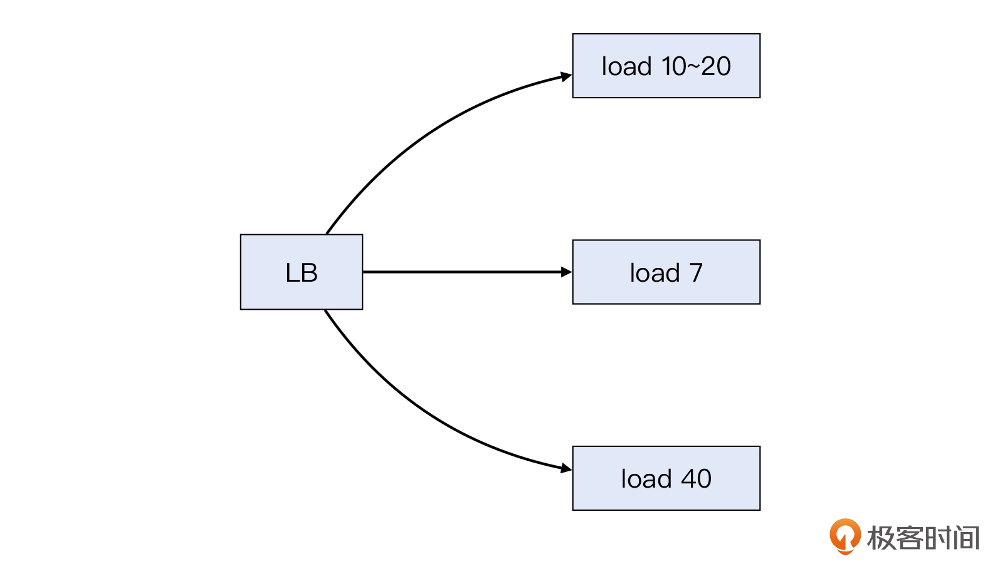

不过，这个 load 不均的问题，也可能只是表象，因为会影响到 load 的因素是比较多的。我们回到最初，既然要证明 LB 工作是否正常，最直接的方式，还是查证 LB 是否做到了 roundrobin，也就是分发的请求数量是否均等。于是我们去查 LB 上的日志，看看这三台后端机器分得的请求数量。

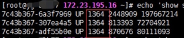

以上就是 LB 上的统计，红框圈出来的那一列是请求数，3 台 Nginx 对应这 3 行，可见请求数都是 1364，这就说明 LB 的 round robin 机制运行正常。

接着，跟之前课程里的很多案例类似，我们做了一个简单的排除性测试：我们绕过 LB，直接访问 Nginx 机器。结果发现：

- load 为 7 的那台机器，还勉强可以在 10 秒左右回复响应；

- 另外两台机器（也就是 load 为 20 和 40 的机器）的响应要慢很多，超过了 60 秒。

- 补充：如果只使用 load 为 7 的那台机器，而禁用另外两台，行不行呢？当然是不行的，一台肯定撑不住这个流量，必须要三台一起服务。所以还是要把根因给找到并解决。

我们再来对比一下“通过 LB”和“绕过 LB”这两种场景下的问题现象：

- 通过 LB，耗时 60 秒的时候收到 HTTP 504。

- 绕过 LB，虽然收到了 HTTP 200，但是耗时长达 70 多秒。

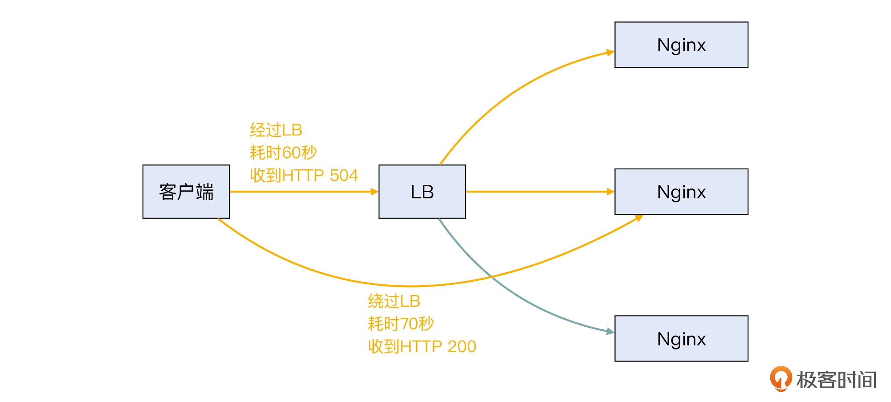

其实这两个场景的根本问题是一致的，都是后端服务器特别慢。这就再一次排除了 LB 本身的嫌疑。于是，问题就变成了“为什么机器的负载变高了？”

### 排查主机

那么，到了系统排查这一步，我们就没办法再用 tcpdump 结合 Wireshark 去排查了，因为问题跟网络报文没有关系。具体点说，我们要做下面这些事情：

- 分析所有进程，找到具体是哪个进程引起了 load 升高。

- 分析进程细节，找到是什么 Bug 导致该进程变成了问题进程。

针对第一个问题，最常用的工具就是 top 命令。通过 top，我们很快就找到了消耗 CPU 资源最多的进程，发现是 php-fpm 进程。客户的电商程序框架本身是基于 PHP 开发的，所以需要PHP 解释器来运行程序。又因为 Nginx 本身不能处理 PHP，所以需要结合 php-fpm 才能正常工作。也就是下图这样：

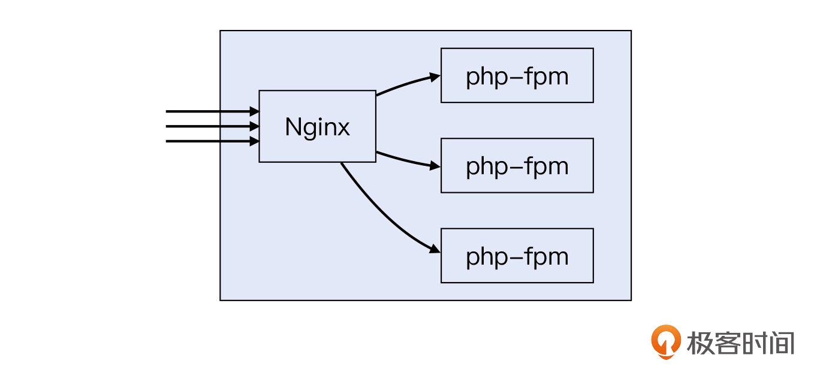

既然确定了问题进程，接下来就是要排查进程导致 load 高的原因。排查这个问题，大致也有两个思路。

- 白盒检查：检查代码本身，找到根因。

- 黑盒检查：不管代码怎么回事，我们从程序的外部表现来分析，寻求根因。

因为核心代码是客户的国外合作方维护的，客户自己并不十分清楚这里面所有的逻辑，所以白盒这条路，有点超出了他们的能力。那么自然的，我们要走第二条路。

### 排查操作系统

跟网络排查中有 tcpdump 这样强大的工具类似，进程的排查也有相关的强大工具，比如strace。通过 strace，我们可以把排查工作从进程级别，继续追查到更细的 syscall（系统调用）级别。无论是系统调用读写文件时的问题，还是系统调用本身的问题，都可以在 strace的帮助下现出原形。

不过，我这里需要先介绍一些系统调用相关的知识，方便你更好地理解 strace。

### 什么是系统调用？

系统调用，英文叫 system call，缩写是 syscall。如果我们把操作系统视作一个巨大的应用程序，那么系统调用相当于什么呢？其实，就相当于 API。利用各种系统调用，应用程序就可以做到各种跟操作系统有关的任务了。

如果没有系统调用，让应用程序直接去操作文件系统、内存等资源会怎么样呢？那一定是一场灾难。我们可以想象一个场景：程序 A 往地址为 100~300 的内存段里写入数据，然后程序 B往地址为 200~400 的内存段里写入数据，因为 200~300 这段内存被 A 和 B 所共用，就很容易产生错乱，这两个程序都可能因此而出错乃至崩溃。

所以，我们必须有一个“管理机构”来统筹安排，让所有的应用程序都向这个统一机构申请资源和办理业务。这个“管理机构”就是操作系统内核，而系统调用就是这个机构提供的“服务窗口”。

### 内核态和用户态

实际上，从更底层的视角来说，操作系统必须要提供系统调用的另一个原因，是计算机体系结构本身的设计。为了避免前面例子里那种不合理的操作，以及让不同安全等级的程序使用不同权限的指令集，大部分现代 CPU 架构都做了保护环（Protection Ring）的设计。

比如，x86 CPU 实现了 4 个级别的保护环，也就是 ring 0 到 ring 3，其中 ring 0 权限最大，ring 3 最小。就拿 Linux 来说，它的内核态就运行在 ring 0，只有内核态可以操作 CPU 的所有指令。Linux 的用户态运行在 ring 3，它就没办法操作很多核心指令。

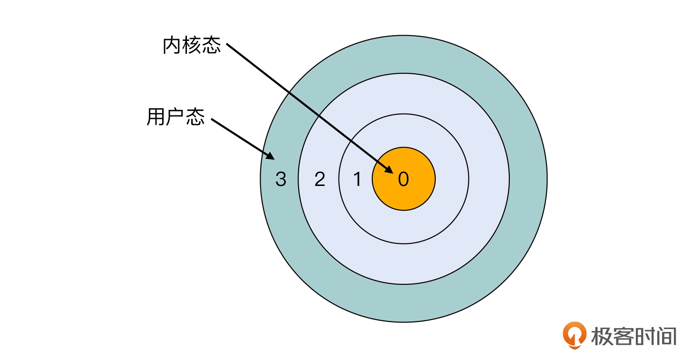

那么处于 ring 3 的应用程序也想要运行 ring 0 的指令的话，该怎么办到呢？就是让内核去间接地帮忙。而这个“忙”，其实就是通过系统调用来“帮”的。

这样的话，用户空间程序就可以借系统调用之手，完成它原本没有权限完成的指令（进入内核态）。下面这张示意图就展示了用户空间、系统调用、内核空间这三者之间的关系：

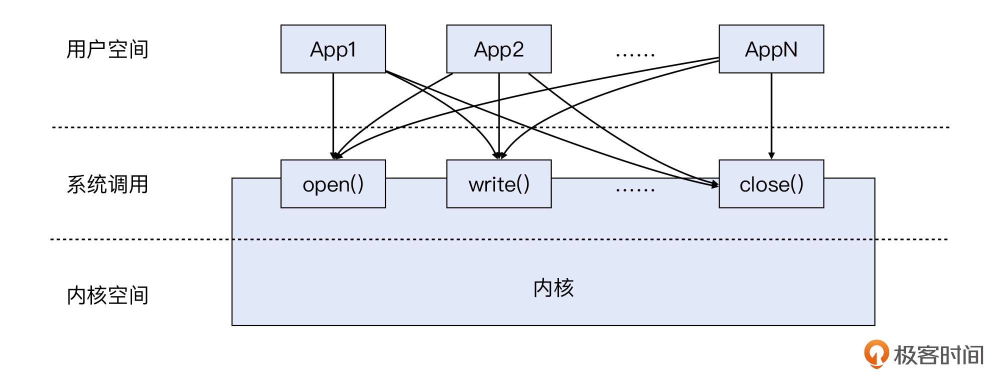

既然，系统调用要给用户空间的应用程序提供丰富而全面的接口，无论是文件和网络等 IO 操作，还是像申请内存等更加核心的操作，都需要通过系统调用来完成，那么系统调用的数量肯定是不少的。比如 Linux 的系统调用数量大约在 300 多个，有的操作系统则会达到 500 个以上。

### strace

了解了系统调用，我们再来认识下 strace。strace 这个工具的 s，指的就是 sycall，所以strace 就是对 syscall 的 trace。通过这个命令，我们可以观测到一个进程访问的所有系统调用、给这些系统调用传入的参数，以及系统调用的输出。可想而知，这样充足的信息就给系统排查工作提供了极大的帮助。

你可以想象一下，没有 strace 的时候，你只是看到了程序的表象，也就是程序想让你看到的，你才能看到（比如通过标准输出或者日志文件）。而有了 strace，程序的一举一动就全在你的视野里了，你就像有了火眼金睛，程序在明里暗里干的所有事情，都会被你知道。

夸奖了一番 strace，我们来了解一下它的具体用法。strace 的用法一般有两种。

直接在命令之前加上 strace。比如我们想知道 curl www.baidu.com 这个命令，在系统调用层面具体发生了什么，就可以执行 strace curl www.baidu.com，然后就能看到前后的几十个系统调用，包括打开文件的 openat()、关闭文件描述符的 close()、建立 TCP 连接的 connect() 等等。

执行 strace -p PID。这样的话，你需要先找到进程的 PID，然后执行这条指令来完成追踪。这比较适合对持续运行的服务（Daemon）进行追踪。比如，你可以先找到某个进程的进程号，然后执行 strace -p PID，找到这个进程在系统调用方面的细节。当然，你还可以加上各种其他参数，来达到不同的追踪效果。

### 使用 strace

好了，聊完了 strace 的强大功能，接下来看它的表现。我们用 strace 命令，对 php-fpm 的进程号进行追踪，也就是执行这个命令：

```
strace -p 进程号
```

果然发现一个非常奇怪的现象：整屏刷的都是 gettimeofday() 这个系统调用：

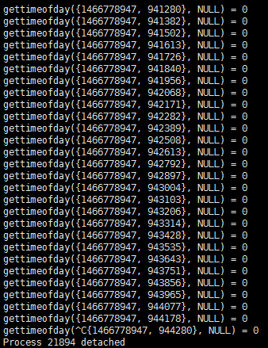

看起来好像只有这个调用了，那有没有别的调用呢？

我们可以对 strace 命令加上 -c 参数，这样可以统计每个系统调用消耗的时间和次数，看看这个奇怪的 gettimeofday() 系统调用，占用了多少比例。我们在 strace 前面加上 timeout 5，就可以收集 5 秒钟的数据了，命令如下：

```
timeout 5 strace -cp 进程号
```

命令输出如下：

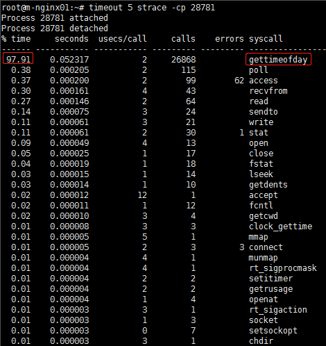

可见，gettimeofday() 占用了这个进程高达 97.91% 的运行时间。在短短的 5 秒之内，gettimeofday() 调用次数达到了 2 万多次，而其他正常的系统调用，比如 poll()、read() 等，

```
只有几十上百次。也就是说，非业务操作的耗时是业务操作耗时的 50 倍（98%:2%）。难怪进
```

程这么卡，原来全都花在执行 getimeofday()，也就是收集系统时间数据上了。

那么，为什么会有这么多 gettimeofday() 的调用呢？这里的 php-fpm 有什么特殊性吗？我们按这个方向去搜索，发现有不少人也遇到了同样的问题，比如 Stack Overflow 上这个人的“遭遇”。简而言之，原因多半是启用了某些性能监控软件。

我们把这个情况告诉了客户，对方忽然想起来，最近他们的国外团队确实有做一些性能监控的事情，用的软件好像叫 New Relic。果然，我们在客户服务器上找到了这个 New Relic。看下图：

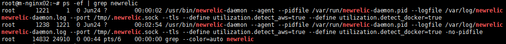

原来，问题的根因就是他们的国外团队部署了 New Relic，而这个软件发起了极为频繁的gettimeofday() 系统调用。这些调用抢走了大部分的 CPU 时间，这就导致业务代码基本没有机会被执行。因为 LB 有个 60 秒超时的机制，所以它眼看着收不到后端 Nginx 服务器的返回，就不得不返回 HTTP 504 了。也就是下面这样：

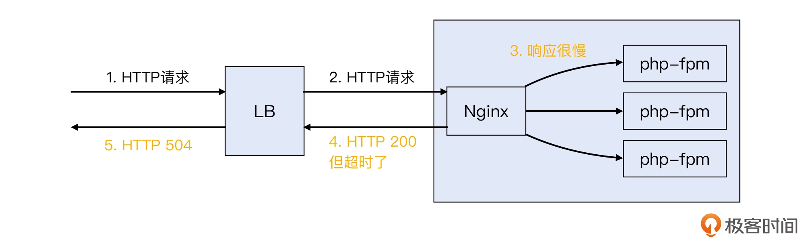

这个根因有点令人哭笑不得，不过对见怪不怪的技术支持团队来说，心里早已云淡风轻了。接下来就是客户卸载 New Relic，应用立刻恢复正常。用 strace 再次检查，显示系统调用也恢复正常：

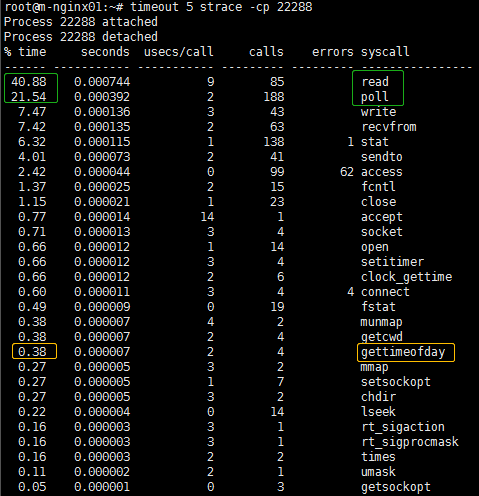

可以看到，read() 和 poll() 系统调用，上升到进程 CPU 时间的 60% 以上，而 gettimeofday()降低到不足 1%，所以已经彻底解决问题了。

## 案例 2：LB 特性和不均衡

我再给你讲一个案例。还有一个电商客户，也遇到了一次负载不均衡的问题。这是在双十一期间，客户发起了促销活动，随之而来的访问压力的上升也十分明显，而他们的后端服务器也出现了负载不均的现象，有时候访问十分卡顿，于是我们再次介入排查。

这次的架构是一台 LB 后面接了两台服务器，其中一台的 CPU load 高达 50 以上，也是远远超过了 8 个的 CPU 核数。另外一台情况要好一些，load 在 10 左右，当请求被分配到这台服务器上的时候，还算勉强可以访问。

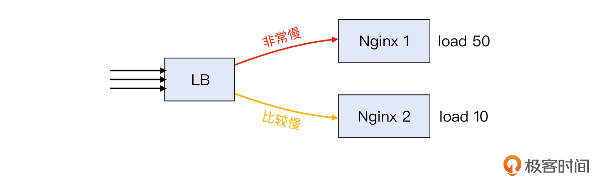

因为 CPU load 在两台机器上有比较大的差异，从访问速度来说，大约是一半请求会非常慢，一半请求略快一些，所以客户就怀疑：LB 的请求分配做得不均衡，导致其中一台处理不过来。

真的是这样吗？我们检查了 LB 的访问日志，发现一个有意思的现象：

- 大部分的访问请求是到了 /api.php 这个 URL 上。

- 按 HTTP 请求的源 IP 来分开统计，某些 IP 的访问量远远大于其他 IP。

我们来看一下根据源 IP 分开统计的访问次数：

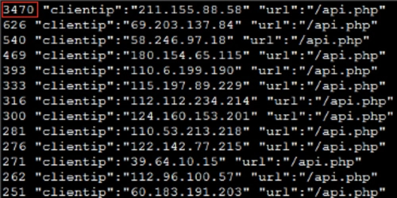

很明显，图中第一行的源 IP，对 /api.php 这个 URL 有 3470 次访问，而其他源 IP 的访问量比它低了一个数量级，只有小几百。那么，这跟问题有什么关系呢？

我们通过对 LB 日志做进一步的分析后发现，同样是源 IP 的请求，要么去了 Nginx 1，要么去了 Nginx 2。再次检查了这台 LB 的配置后，我们发现客户在 LB 上开启了“会话保持”（Session Persistence）。这就造成了下面这种分布不均的现象：

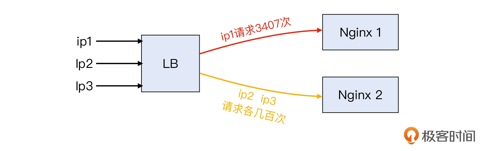

你可能也知道，会话保持是 LB 的常见功能，它主要是起到了维持会话状态的作用。在开启了会话保持功能后，LB 会维护一张映射表，供每次分发请求之前做匹配。如果 LB 查到某个请求属于之前的某个会话，就会把这个请求转发给上一次会话所选择的后端服务器；否则就按默认的负载均衡算法，来选择一个后端服务器。

那么，LB 怎么确定一个请求属于之前的会话呢？这就要说到会话保持的类型了。我们用的 LB是 HAProxy，它的会话保持有两种。

- 源 IP：凡是源 IP 相同的请求，都去同一个后端服务器。

- Cookie：凡是 HTTP Cookie 值相同的请求，都去同一个后端服务器。

而客户启用的是第一种：基于源 IP 的会话保持。不巧的是，这次访问量的源 IP 本身的分布就很不均匀。就像前面提到的，某个 IP 发起了 10 倍于其他 IP 的请求量，那么这个源 IP 所分配到的后端服务器，就不得不服务着 10 倍的请求了，然后就导致了负载不均的问题出现。

所以，我们让客户关闭了会话保持，两台后端服务器的负载很快就恢复平衡了。我们也给出了进一步的建议：最好把 /api.php 这个服务跟其他的服务隔离开，比如使用另外的域名，做另一套负载均衡。这是因为，/api.php 的访问量和作用，跟其他接口的区别很大，通过对它做独立的负载均衡，既可以隔离互相之间的干扰，也有利于提供更加稳定的访问质量。

而且，这次的问题也是无法用 tcpdump 来排查的，它需要我们对 LB 的特点很熟悉，以及对LB 和应用结合的场景，都有一个全面的认识。

## 实验

我们已经学习了 strace，现在做一个简单的小实验，来巩固一下学到的知识吧。我们可以这样做：

1. 到这里下载并执行一个 Nginx 服务的 Docker 镜像，也就是执行：

```bash
docker run --cap-add=SYS_PTRACE -p 80:80 -it docker.io/moonlightysh/v_nginx bash
注意，这里必须加上 --cap-add=SYS_PTRACE，否则容器内的 strace 将不能正确运行。
```

2. 进入容器后，启动里面的 Nginx 服务，执行：

```
systemctl start nginx
```

3. 还是在容器内，启动 strace：

```
strace -p $(pidof nginx | awk '{print $1}')
```

此时，strace 就开始监听 Nginx worker 进程了。

```
补充：这里用 awk '{print $1}' 是为了追踪 Nginx worker 进程，它出现在 pidof 命令
```

- 输出的左边，而最右边是 Nginx master 进程。跟踪 Nginx master 进程是看不到 HTTP 处理过程的。

```
从你的本机发起 HTTP 请求，也就是执行 curl localhost:80，此时在容器内 Nginx 在
```

- 处理这次请求时，就会发起很多系统调用，而 strace 就全面展示了这些调用涉及的文件和参数细节。比如下面这样的 strace 输出：

```javascript
root@48fc1221a03a:/# strace -p $(pidof nginx | awk '{print $1}')
strace: Process 14 attached
epoll_wait(9, [{EPOLLIN, {u32=4072472592, u64=140681431285776}}], 512, -1) = 1
accept4(6, {sa_family=AF_INET, sin_port=htons(60070), sin_addr=inet_addr("172.17.
epoll_ctl(9, EPOLL_CTL_ADD, 3, {EPOLLIN|EPOLLRDHUP|EPOLLET, {u32=4072473289, u64=
epoll_wait(9, [{EPOLLIN, {u32=4072473289, u64=140681431286473}}], 512, 60000) = 1
recvfrom(3, "GET / HTTP/1.1\r\nHost: localhost\r"..., 1024, 0, NULL, NULL) = 73
stat("/var/www/html/", {st_mode=S_IFDIR|0755, st_size=4096, ...}) = 0
stat("/var/www/html/", {st_mode=S_IFDIR|0755, st_size=4096, ...}) = 0
stat("/var/www/html/index.html", 0x7ffcb86eac80) = -1 ENOENT (No such file or dir
stat("/var/www/html", {st_mode=S_IFDIR|0755, st_size=4096, ...}) = 0
stat("/var/www/html/index.htm", 0x7ffcb86eac80) = -1 ENOENT (No such file or dire
stat("/var/www/html/index.nginx-debian.html", {st_mode=S_IFREG|0644, st_size=612,
stat("/var/www/html/index.nginx-debian.html", {st_mode=S_IFREG|0644, st_size=612,
openat(AT_FDCWD, "/var/www/html/index.nginx-debian.html", O_RDONLY|O_NONBLOCK) =
fstat(11, {st_mode=S_IFREG|0644, st_size=612, ...}) = 0
setsockopt(3, SOL_TCP, TCP_CORK, [1], 4) = 0
writev(3, [{iov_base="HTTP/1.1 200 OK\r\nServer: nginx/1"..., iov_len=247}], 1) =
sendfile(3, 11, [0] => [612], 612)      = 612
write(4, "172.17.0.1 - - [07/Mar/2022:14:2"..., 87) = 87
close(11)                               = 0
setsockopt(3, SOL_TCP, TCP_CORK, [0], 4) = 0
epoll_wait(9, [{EPOLLIN|EPOLLRDHUP, {u32=4072473289, u64=140681431286473}}], 512,
recvfrom(3, "", 1024, 0, NULL, NULL)    = 0
close(3)                                = 0
epoll_wait(9,
```

## 小结

我们的课程主旨是网络排查，但因为网络跟系统又是密不可分的关系，所以在掌握 Wireshark等技能以外，我们最好要熟悉操作系统排查的常规步骤。

在这节课里，我们通过一个典型的系统问题导致服务慢的案例，学习了内核空间（内核态）、用户空间（用户态）、系统调用这些操作系统的概念。另外我们还重点学习了 strace 这个工具，知道它有两种使用方式：直接在命令之前加上 strace；执行 strace -p PID。

那么在案例中，我们也用 strace-cp PID 中的 -c 参数，对进程发起的各种系统调用进行了执行次数和执行时间的统计，这对于分析进程耗时的去向会很有帮助。

在这里，我们也再一次温习下 HTTP 504 的概念。在后端服务不能在 LB 的时限内回复 HTTP响应的时候，LB 就会用 HTTP 504 来回复给客户端，告诉它是后端服务超时（潜台词：我 LB可没问题）。

而在第二个案例里，我们了解了会话保持在某些情况下会“放大”负载不均衡的问题。所以你要知道，在启用会话保持功能时，你需要根据实际情况，做通盘的考虑。

## 思考题

给你留两道思考题：

- 在案例 1 里面，LB 回复了 HTTP 504。那在什么情况下，这个 LB 会回复 HTTP 503 呢？

- 除了 strace，你还知道哪些 trace 类的工具可以帮助排查呢？

欢迎你在留言区分享自己的经验，我们一同成长。
