# 23-路径排查：没有网络设备权限要如何做排查？

你好，我是胜辉。

有一位同事问我：“大 V，你的课程会教我们排查家庭网络问题的技巧吗？”这是一个有意思的问题。我们课程里用到了大量的抓包分析，虽然这套方法功效甚大，但是在很多场景下，也有比它更加合适的方法。在网络路径的排查方面，这一点体现得尤为明显。比如一些小工具往往能起到意想不到的大作用。

不过，一个现实的问题是，我们一般不是专职的网络工程师，也没有相关的网络设备的查看权限，那要如何在这种条件下，尽可能做一些网络层排查的工作呢？这就需要我们对协议有深入的理解，对工具能做到灵活地运用。

在接下来的实战三模块“不用抓包就能做的网络排查篇”，我们就来学习一下网络层的案例和排查技巧。这样你以后遇到跟网络路径异常、丢包、时通时不通等问题的时候，不仅有抓包分析这样的“重型武器”，也有几把趁手的“瑞士军刀”，可以精确快速地搞定这些问题。

好，我们还是从案例开始。

## 为何 TCP 连接时常失败？

有一次，我们的一个内部客户团队报告了一个 TCP 连接失常的问题。这是一个 MySQL 的服务，它有两台服务器，都在同一个 LB VIP 的后面。这个团队发现，从他们的客户端到这个 LBVIP 的 TCP 连接，时常有失败的情况发生，于是我们介入排查。

这个服务的具体架构是这样的：客户团队从他们的客户端发起 TCP 连接到这台 LB 上的VIP，这个 VIP 后面是两台 MySQL 主机，LB 把请求转发给其中的一台。这里我们使用了 LB的一个特性，就是可以平时只启用一台后端主机，只有当这台主机离线时，LB 才会自动把流量切换到另外一台上。

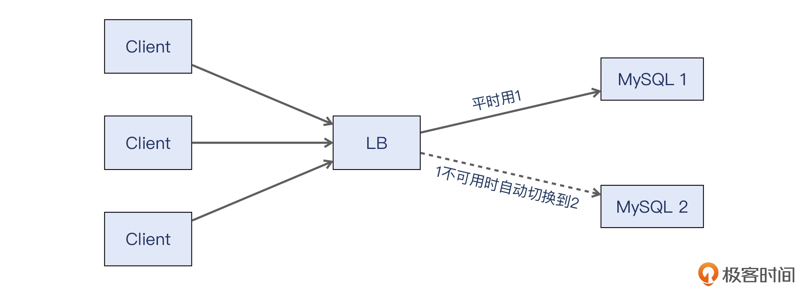

- 补充：那为什么不用 MySQL 双主 + Keep alive 的方案呢？其实，在当时我们的云网络设计里，漂移 IP 是不可以配置在主机上的，只有 LB 可以这么配置，所以就采用了这样的方案。

在前面很多次课里，我都提到过用“排除法”或者说是“逐段验证法”来开展排查。这次也不例外，我们就从客户端直接去连接 MySQL 主机，重试了很多次，TCP 连接都可以正常建立。于是，MySQL 主机的嫌疑基本可以排除，我们又集中到对 LB 的排查上来。


在客户端上测试 TCP 连接的工具有很多，其中 nc 是比较好用的一个。我们就选了一台客户端，用 nc 命令对 LB VIP 发起了多次 TCP 连接。我们看看当时的输出：

```
root@client:~# while true;do nc -zv 10.111.1.111 3306;sleep 1;done
Connection to 10.111.1.111 3306 port [tcp/mysql] succeeded!
Connection to 10.111.1.111 3306 port [tcp/mysql] succeeded!
nc: connect to 10.111.1.111 port 3306 (tcp) failed: Connection timed out
Connection to 10.111.1.111 3306 port [tcp/mysql] succeeded!
Connection to 10.111.1.111 3306 port [tcp/mysql] succeeded!
Connection to 10.111.1.111 3306 port [tcp/mysql] succeeded!
nc: connect to 10.111.1.111 port 3306 (tcp) failed: Connection timed out
Connection to 10.111.1.111 3306 port [tcp/mysql] succeeded!
Connection to 10.111.1.111 3306 port [tcp/mysql] succeeded!
Connection to 10.111.1.111 3306 port [tcp/mysql] succeeded!
nc: connect to 10.111.1.111 port 3306 (tcp) failed: Connection timed out
Connection to 10.111.1.111 3306 port [tcp/mysql] succeeded!
```

差不多每四次里就有一次的连接请求会超时失败，确实是有问题。而在 LB 那边发生了什么呢？

我们做了第二次 nc 测试。这次，我们还在客户端和 LB 上都分别做了 tcpdump 抓包，这样就可以观察到具体的握手阶段的情况了。客户端做 nc 的结果还是跟上面这个类似。我们再来看看客户端的抓包的情况，下面是 tcpdump 命令的输出：

```
23:32:37.084634 IP (tos 0x0, ttl 64, id 33781, offset 0, flags [DF], proto TCP (6
   10.222.22.22.47849 > 10.111.1.111.3306: Flags [S], cksum 0x2eed (incorrect ->
23:32:38.082468 IP (tos 0x0, ttl 64, id 33782, offset 0, flags [DF], proto TCP (6
   10.222.22.22.47849 > 10.111.1.111.3306: Flags [S], cksum 0x2eed (incorrect ->
23:32:40.086484 IP (tos 0x0, ttl 64, id 33783, offset 0, flags [DF], proto TCP (6
   10.222.22.22.47849 > 10.111.1.111.3306: Flags [S], cksum 0x6d56 (correct), se
23:32:44.098519 IP (tos 0x0, ttl 64, id 33784, offset 0, flags [DF], proto TCP (6
   10.222.22.22.47849 > 10.111.1.111.3306: Flags [S], cksum 0x696b (correct), se
```

这里的 Flags [S]表示，这个报文的 TCP 标志位为 SYN。显然，客户端连续发送了 4 个SYN，但都没有收到 SYN+ACK。

那么在 LB 这边的 tcpdump 情况又如何呢？我们来看一下：

```
23:31:30.210092 IP 10.222.22.22.47837 > 10.111.1.111.3306: Flags [S], seq 1376708
23:31:30.210099 IP 10.111.1.111.3306 > 10.222.22.22.47837: Flags [S.], seq 292081
23:31:32.214334 IP 10.222.22.22.47837 > 10.111.1.111.3306: Flags [S], seq 1376708
23:31:32.214339 IP 10.111.1.111.3306 > 10.222.22.22.47837: Flags [S.], seq 292081
23:31:36.611535 IP 10.222.22.22.47837 > 10.111.1.111.3306: Flags [S], seq 1376708
23:31:36.611542 IP 10.111.1.111.3306 > 10.222.22.22.47837: Flags [S.], seq 253260
23:31:44.112084 IP 10.222.22.22.47837 > 10.111.1.111.3306: Flags [S], seq 1376708
23:31:44.112091 IP 10.111.1.111.3306 > 10.222.22.22.47837: Flags [S.], seq 253260
```

这里的[S.]就是 SYN+ACK，点号[.]就是 ACK。显然，在 LB 这里既收到了客户端发来的全部4 个 SYN，自己也发出了 4 个 SYN+ACK，可是并没有收到任何一个[.]，也就是握手的第三个包。顺便提一下，[F.]是指 FIN+ACK，[P.]是指 PUSH+ACK，[R.]就是 RST+ACK 了。

到这里，我们能拼出问题的全貌了：客户端发出了 SYN，LB 回复了 SYN+ACK，但是却没到达客户端。显然，SYN+ACK 是在网络上丢失了。

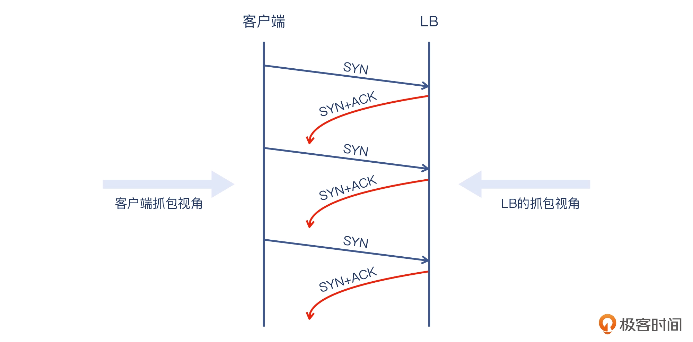

那会不会是这个链路的偶发性的丢包导致的呢？比如，是否这个链路存在一定比例的丢包，那么也可能在我们测试 TCP 握手的时候，正好赶上了丢包时段，所以就会观察到这样的现象。

于是我们就做了长 ping 测试。结果却发现，长 ping 是 100% 成功的，一点丢包都没有。这就奇怪了，难道丢包还专门盯着 SYN+ACK 丢，而 ICMP echo reply 报文就一点都不丢？这好像是“玄学”。

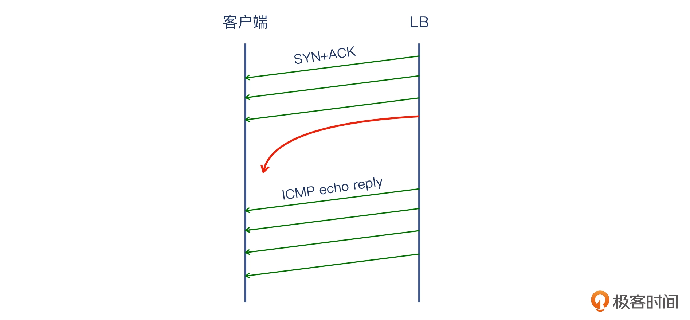

所以，为了搞清楚真相，我们需要回答下面两个问题：

- 为什么 ICMP 测试一直能通呢？

- 为什么 TCP 有时候连续丢包，有时候又可以呢？

我们需要到网络层寻找原因，这里要进入一个新的知识点：ECMP。

### 什么是 ECMP？

我们先复习一下三层网络的知识。现在随着网络上传输的数据量越来越大，网络基础架构要提供的传输带宽也迅速增大。这一方面需要提升“单兵作战能力”，就是增加网络接口和网线的带宽，另一方面也需要提升“多兵协同作战能力”，也就是把多个链路的带宽充分利用起来。

那么，假设有这样一个网络场景：一个起点连接到路由器 r1，它有两条 10Gbps 的线路连接到后面的两个节点，分别是 cost 为 10 的 r2 和 cost 为 20 的 r3，而 r2 和 r3 都连向终点10.10.10.0/24 这个网段。那么实际上从起点到终点的路径有 2 条，也就是下图中的路径 a 和路径 b。

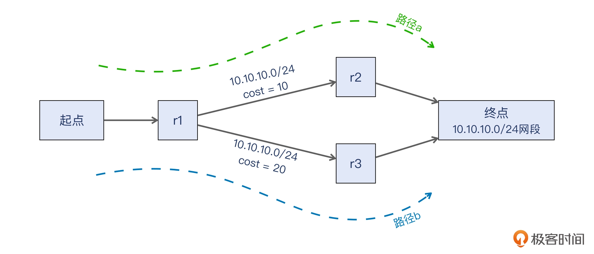

一般来说，因为 cost 不一样，路由器 r1 会选择 cost 更低的那条，也就是路径 a。当某些情况导致路径 b 的 cost 更低时，流量就切换到路径 b。这样的话，这两条路径平时只能用一条，带宽是 10Gbps。

而如果把两个 cost 设置为相同的值，并启用路由器的某个特性，这两条路径就可以被全部利用起来。这个时候，因为两条线路同时使用，所以带宽有 20Gbps。也就是下图这样：

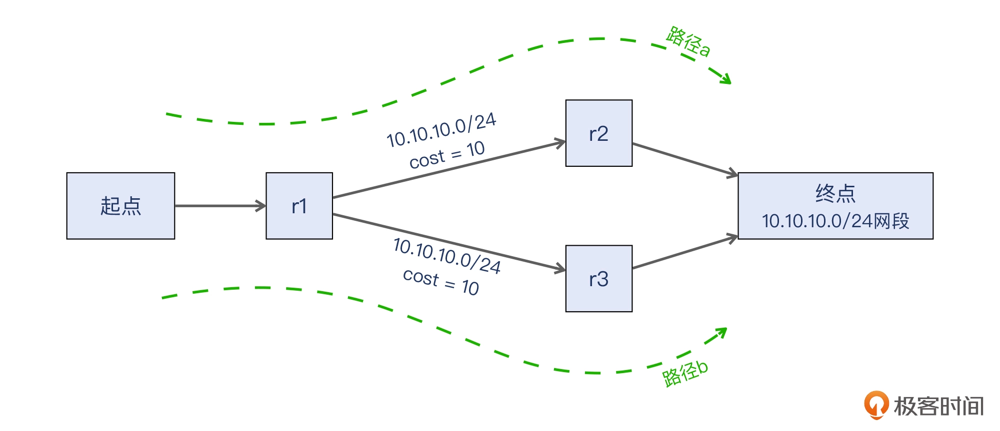

这个特性就是 ECMP，全称是 equal-cost multi-path，它可以让路由器同时使用多条链路，这样就使得通往同一个网段的带宽，变成了原先的好几倍。我们来看看下面的示意图：

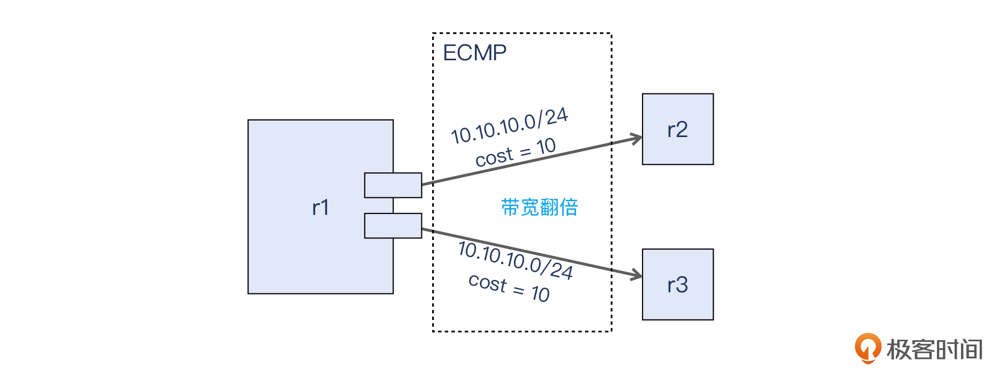

如果你在 Linux 上做过网卡 bonding，那你可能对这个“并行使用带宽”的做法并不陌生。在Linux 服务器上做多网卡的 bonding，也可以达到带宽合并使用的效果。

- 补充：bonding 有多种模式，其中的一部分模式需要交换机配合。

实际上，稍大一点的数据中心都已经使用了 ECMP。这样做，一方面极大地提升了网络带宽，而另一方面也带来了新的挑战，也就是网络路径的数量上升了一个数量级，排错的复杂度也明显上升。

比如，原先每一跳只有一个可用的 next-hop，从起点到终点的路径可能只有一条。而启用了ECMP 后，路径条数就是各跳的 next-hop 数量的乘积。以下图的拓扑为例，这里一共是 6

```
跳，从第 1 跳到第 4 跳都各有 4 个 next hop，那么就有 1*4*4*4*1*1=64 种可能的路径。
```

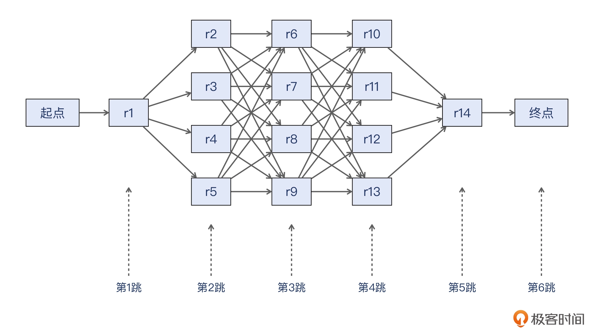

如果网络报文也有思想，面对 ECMP 这个场景可能会很兴奋了：“我终于不用每次都走一样的路径了，总算有多种选择了！”就像下图展示的这样，报文可能会走绿色的路线 a，也可能是走蓝色的路线 b，或者任何别的可行的路线。

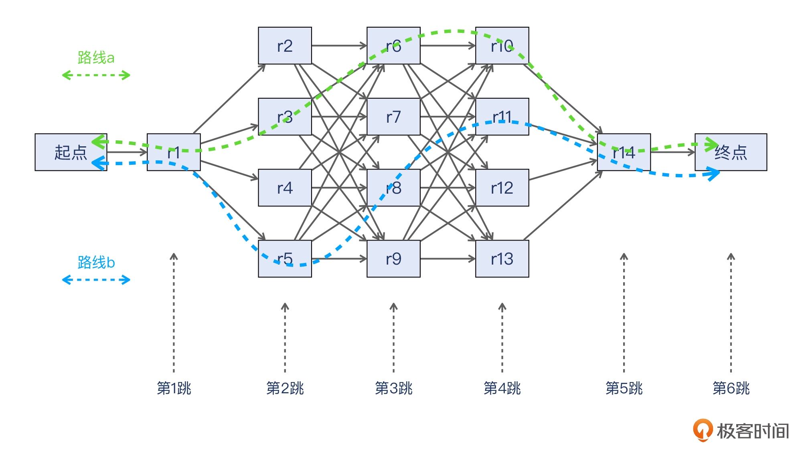

不过看到现在，这个 ECMP 跟我们的案例有什么关系呢？其实，了解了 ECMP 的核心特点，我们就能回答前面的两个问题：为什么 ping 可以成功；为什么 TCP 连接就时常不行。

这个核心特点就是 ECMP 的路径选择策略。

### ECMP 的路径选择策略

路由器面对多条等价的路径，是不是随便选一个转发策略就行了呢？比如用轮询策略，第一个报文转发给第一条路径，第二个报文给第二条路径，以此类推。

我们假设就用轮询策略。当 ECMP 场景下的某一个节点（比如 r8）出现故障的时候，经过这个节点的路径就都会受到影响。对于 TCP 来说，可能前一个报文经过的路径都是好的节点，就可以成功传送，而下一个报文因为轮询策略的关系，选择的路径里有 r8 这个故障节点，这个报文就会丢失了。

那么同样地，任何一个 TCP 流，都可能会被这个故障节点影响到。仅仅一个节点出现问题就可能影响到所有的流量，这是不合理的。

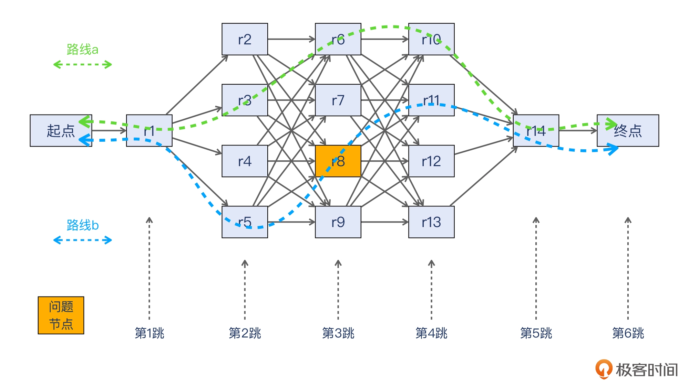

所以我们需要“立规矩”，让同一个流走固定的链路，这样可以限定影响的范围。比如，启用基于哈希的转发机制（也就是三层的负载均衡机制）就可以做到这一点。比较常见的哈希算法是基于报文的五元组，也就是源 IP、目的 IP、源端口、目的端口、协议，这样就可以确定 TCP流。

有了哈希转发机制，即使有一个节点出现问题，它所影响的就只是分配到这个节点上的 TCP流，而没有分配到这个节点的 TCP 流就不会被影响到，这就起到了风险“隔离”的效果。

- 这段特殊时期，我们对“隔离”的认识肯定更加深刻了。

到这里，我们就终于可以回答前面两个问题了。

### 根因推理

先看第一个问题：为什么 ICMP 测试一直能通呢？

ECMP 用的哈希算法多数是基于五元组的哈希，那么 ICMP 报文的五元组就会是下面这样：

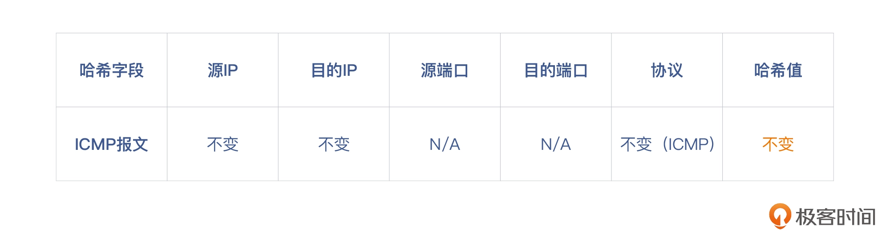

对于同一个客户端和服务端，因为源 IP、目的 IP 和协议都不会变，而源端口和目的端口是空缺的，那么哈希值就不会变。这意味着，每次选择的路径都是一样的。那么如果选到的路径是正常的，做多少次 ping 也都会是正常的！这就是第一个问题的答案。

其实，这时候你可能已经想到第二个问题的答案了：为什么 TCP 有时候连续丢包，有时候又可以呢？我们每次发起新的 TCP 连接的时候，用的源端口一般跟前一次连接是不同的，所以就会造成它跟 ICMP 的明显区别：

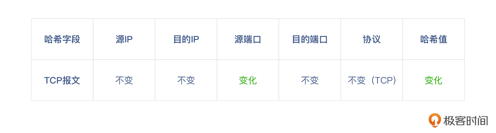

可见，不同的 TCP 连接，哈希值也不同，所以选择的路径也可能不同。如果某条路径有问题，某一次 TCP 连接选到这条路径的话就会发生故障！

我们可以用下面这张示意图来解释在测试中发现的现象。

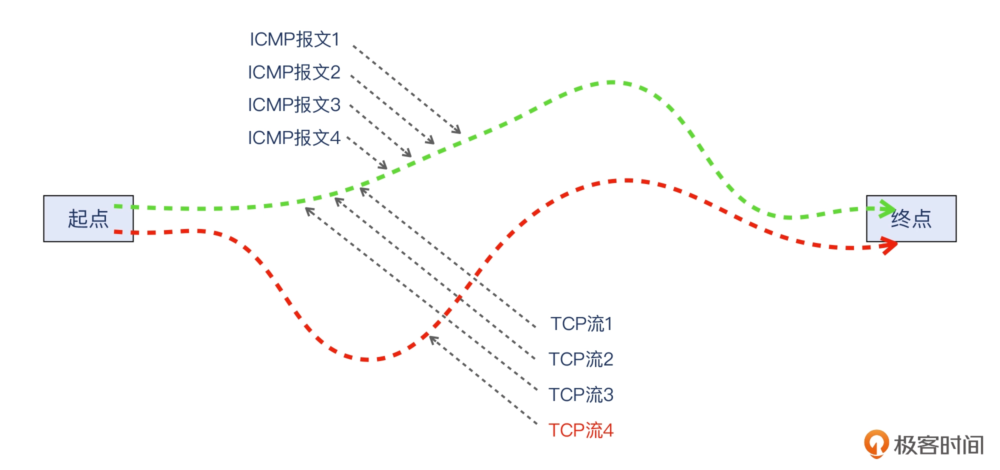

- 补充：图中我去掉了各个路由节点，只保留了一条正常路径和一条故障路径。

那还有一个问题：为什么客户端直接访问 MySQL 主机是正常的呢？其实也是因为 ECMP，直接访问 MySQL 主机时候的路径跟访问 LB 的路径不同，正好绕开了有问题的节点。

这就能完美解释我们遇到的所有现象了。玄学也不玄，只要你愿意深究，玄学就能变成科学。

不过，理论都解释通了，但没有证据还是不行的，让我们完成最后一击。

### 落实证据

既然源端口不同，ECMP 选择的路线就不同，那如果我们能模拟不同的源端口来测试，应该就能复现问题现象了。有什么工具可以指定源端口做测试呢？

我们前面用过的 nc 命令其实就可以，给它加上 -p 参数指定源端口就行。要知道，像其他工具，比如 telnet、curl 等，都无法指定源端口，也就没法在当前这个特定场景下帮上忙了。

所以，我们用下面这个命令，就可以指定用源端口 30000 来连接服务端了：

```
nc -p 30000 -w 5 -vz 10.111.1.111 3306
```

于是，我们用 nc 配合不同的源端口（比如从 30000 到 30010）做了多次测试，果然发现其中几个源端口可以稳定复现丢包现象。这其实就证实了我们的推测：路径中有一个节点出现了丢包，如果选择的路径中包含该节点，就一定会遇到问题。

```
nc -p 30000 -w 5 -vz 10.111.1.111 3306   #正常
nc -p 30001 -w 5 -vz 10.111.1.111 3306   #正常
nc -p 30002 -w 5 -vz 10.111.1.111 3306   #正常
nc -p 30003 -w 5 -vz 10.111.1.111 3306   #不正常，可以稳定重现
nc -p 30004 -w 5 -vz 10.111.1.111 3306   #正常
nc -p 30005 -w 5 -vz 10.111.1.111 3306   #正常
nc -p 30006 -w 5 -vz 10.111.1.111 3306   #正常
nc -p 30007 -w 5 -vz 10.111.1.111 3306   #不正常，可以稳定重现
nc -p 30008 -w 5 -vz 10.111.1.111 3306   #正常
nc -p 30009 -w 5 -vz 10.111.1.111 3306   #正常
nc -p 30010 -w 5 -vz 10.111.1.111 3306   #正常
```

根据这个信息，网络团队定位到了有问题的节点并做了修复，这个 TCP 连接时通时不通的问题终于被解决了。

有了对 ECMP 的充分理解和对 nc 这个工具的灵活运用，我们即使没有网络设备的权限，也依然发现了某些路径存在丢包的现象，从而推动相关团队更加高效地解决问题。可以说，这又是一次知识上的胜利。

## 拓展：ECMP 的其他使用场景

ECMP 大部分时候用来增加网络骨干环节的带宽，不过它还有一个重要的使用场景，就是实现多活的负载均衡（LB）。我们可以先看一个传统的一主一备的负载均衡架构：


而现在大型网站的负载均衡一般都选择做多活架构，也就是所有的 LB 节点都提供服务，这跟前面的一主一备就非常不同了。而要实现多活，就必须让同一个 VIP 能在多个 LB 节点上都提供服务。

我们知道，IP 一般是通过 ARP 广播，让广播域内的机器和交换机，都学习到这个 IP 和 MAC的对应关系，从而“占据”这个 IP。交换机学习到这条 ARP 记录后，就会把去往这个 IP 的报文都转发给这台机器了。

那多个 LB 配置同一个 IP，岂不是要“打架”了吗？如果大家都争先恐后地发起 ARP，那只有最后一个发 ARP 的节点可以真正的拿到这个 IP，其他节点是无法用这个 IP 来服务的。

所以 ARP 是肯定行不通的，而 ECMP 配合 BGP/OSPF 就可以发挥作用了。这些 LB 节点都会启用 BGP 或者 OSPF 这样的路由协议，而不是 ARP 协议，并跟上联网关进行 BGP 配对。这样的话，网关收到流量后，会认为这多个 LB 节点不再是终端设备，而是跟它一样的 next-hop 路由器，再加上 ECMP 的加持，流量就能相对均匀地分发到这些 LB 上。这就实现多活了。我们看一下示意图：

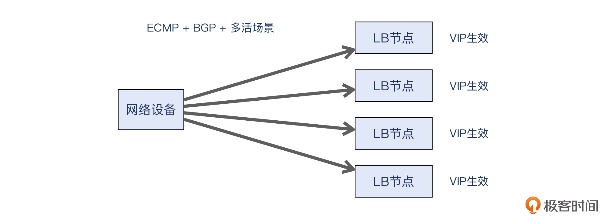

## 小结

这节课，我们通过案例，学习了网络层的一个重要概念 ECMP。ECMP 的最大作用是用多条链路实现更大的传输带宽。而为了提升可用性，ECMP 一般会启用基于哈希的转发策略，实现网络流量在多个链路间的有状态的转发。

因为 ECMP 多路径的存在，网络排查变得更加复杂。而了解它的哈希转发策略，对我们的排查工作很有帮助。特别是 ICMP 报文会走固定线路，而 TCP/UDP 的不同连接会因为五元组的变化而走不同的线路。

在排查技巧方面，我们学习了一个实用的小工具 nc。如果你怀疑 ECMP 的某个节点有问题，可以尝试用 nc 命令来发起不同哈希值的连接，也就是使用 -p 参数指定源端口做测试。如果发现某些源端口的表现跟其他端口不同，那么很可能就是 ECMP 的节点问题。

另外，我们也学习了一个 tcpdump 的小知识点。在 tcpdump 的命令行输出中：

- [S]代表 SYN；

- [.]代表 ACK；

- [F.]代表 FIN+ACK；

- [P.]代表 PUSH+ACK；

- [R.]代表 RST+ACK。

网络路径问题的排查是比较复杂的。当路径中某个节点的问题比较严重时，用 nc 工具相对容易复现出问题。当问题比较隐蔽，比如出错率比较低的时候，可能单纯用 nc 就不够方便了，我们需要另外一个工具 mtr。它是加强版的 traceroute，可以做持续的三层可达性的探测。关于 mtr 的更多细节，我们留到在下一讲里做详细的探讨。

## 思考题

最后再给你留两道思考题：

- ECMP 除了用五元组做哈希，还有哪些算法呢？

- 这个案例中的问题，用 traceroute 可以定位出来吗？为什么呢？

欢迎你在留言区分享你的答案，我们一同进步，成长。
